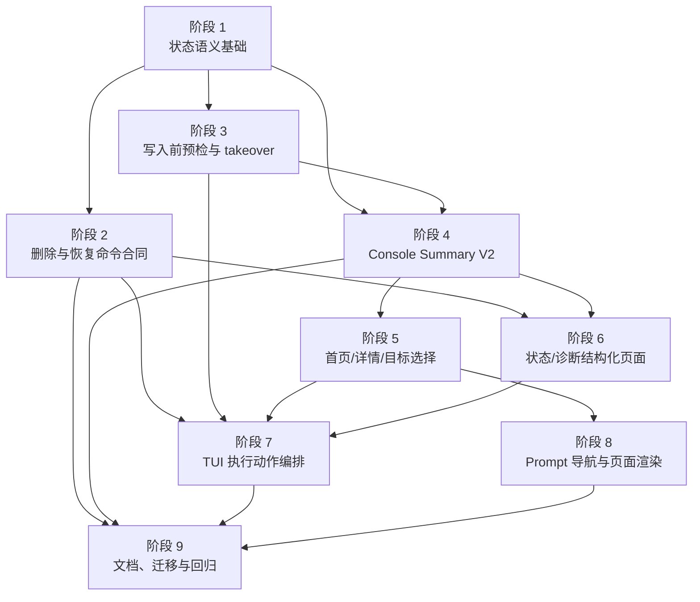

# `aw` TUI 使用体验优化执行计划

日期：2026-05-12
需求来源：`docs/dev/specs/aw-tui-ux-optimization.md`
状态：实施计划稿
文档规范：`docs/dev/spec-plan-writing-guide.md`

## 文档定位

这份计划只定义执行步骤、实现切分、涉及文件、测试范围和收口顺序。它回答“怎么做、先后依赖是什么、改哪些文件、用哪些测试证明完成”。

需求范围、现状探查结论、用户体验边界、公开合同边界和最终验收标准以 Spec 为准。本计划不重新推导需求，只把 Spec 中已经确认的现状事实和行为合同拆成可执行阶段、文件范围和测试范围。

## 实施约定

- 每个阶段都必须在自己的测试和验收项通过后再标记完成。
- 涉及公开合同、CLI help、命令行为、adapter 行为或插件作者理解的改动，必须同步更新公开文档和 `.agents/skills/create-agent-workflows-plugin/` 中受影响的模板、示例或夹具。
- 阶段里的文件清单是起始范围；实现时如发现同一职责在其它文件中，也要同步调整并在 PR/提交说明里补充。
- 新增模型、reason code 和 JSON schema 要优先集中在可复用模块中，避免 TUI、status 和 command 各自复制判断。
- TUI 页面层只能编排和展示，不应自行补命令层安全逻辑。

## 阶段依赖总览

| 阶段 | 主题 | 覆盖需求 | 依赖 | 可并行关系 |
| --- | --- | --- | --- | --- |
| 1 | 状态语义基础与 reason code | R8-R10 | 无 | 无 |
| 2 | 删除与恢复命令合同 | R14-R16 | 1 | 可与阶段 3 并行 |
| 3 | 写入前公共预检与 repair takeover 回归 | R13 | 1 | 可与阶段 2 并行 |
| 4 | Console Summary V2 与首页 loader | R1、R11、R12 | 1、3 | 阶段 2 完成前先做只读模型 |
| 5 | TUI 首页、详情和目标选择 | R1-R4 | 4 | 可与阶段 6 并行 |
| 6 | 状态/诊断结构化页面 | R5 | 2、4 | 可与阶段 5 并行 |
| 7 | TUI 执行动作编排 | R3、R4、R13-R16 | 2、3、5、6 | 集成阶段，不建议提前拆散 |
| 8 | Prompt 导航与页面式渲染 | R6、R7 | 5 | 可与阶段 7 并行，最后联调 |
| 9 | 文档、迁移说明与最终回归 | 全部 | 2、4、7、8 | 文档可随阶段增量更新 |

## 阶段依赖关系图

## 阶段 1：状态语义基础与 reason code

目标：先收稳 TUI、`status --json.consoleItems` 和命令预检会共用的状态语义。

主要文件：

- [x] `packages/cli/src/install-state/status-projection.ts`
- [x] `packages/cli/src/install-state/types.ts`
- [x] `packages/cli/src/install-state/shared-runtime-owner.ts`
- [x] `packages/cli/src/install-state/evidence.ts`
- [x] `packages/cli/src/commands/status.ts`
- [x] `packages/cli/src/commands/console-model.ts`
- [x] `packages/cli/src/utils/plugin-scripts.ts`
- [x] `packages/cli/src/commands/discovery.ts`

待办：

- [x] 定义或收敛 `PluginConsoleStatus` 四类状态：`notInstalled`、`installed`、`upgradeAvailable`、`abnormal`。
- [x] 定义 V2 稳定 reason code，并把 Spec 约定的最低公共合同钉成精确 code id：`duplicateInstall`、`missingRequiredConfig`、`artifactRefreshFailed`、`recordCorrupted`、`nativeIncomplete`、`adoptableInstall`、`foreignOwnershipConflict`、`residueDetected`、`dependencyBlocked`。
- [x] 收敛旧 `PluginConsoleReasonCode`，V2 `status --json.consoleItems` 不能继续输出 `missingRecord`、`adoptExisting`、`ownerConflict`、`dependencyProtected`、`requiredConfigMissing` 等旧 code id；如实现时确实需要保留最低集合之外的新 V2 code，必须先同步 Spec 和迁移说明。
- [x] 调整 optional capability 投影，未声明 lifecycle、config schema、artifact target、未安装候选 scope 和 catalog-only 插件不生成默认问题。
- [x] 修正 foreign shared runtime owner 投影，避免仅因 user owner 就把 project scope 判为残留。
- [x] 落地同平台 scope 唯一安装投影，user/project 同时健康时输出 `abnormal` + `duplicateInstall`。
- [x] 清理友好文案，避免首页出现 `needsAction`、`partial`、`repoManaged`、`external` 或“由其它来源管理”。

测试验收：

- [x] `packages/cli/tests/unit/install-state-status-projection.test.ts`
- [x] `packages/cli/tests/unit/install-state-shared-runtime-owner.test.ts`
- [x] `packages/cli/tests/unit/status-dependencies.test.ts`
- [x] `packages/cli/tests/unit/console-model.test.ts`
- [x] `packages/cli/tests/unit/plugin-scripts.test.ts`

阶段验收：

- [x] 普通 status/TUI 不再输出 `snapshot manifest does not declare install lifecycle script` 这类缺省能力警告。
- [x] 只有 `codex/user` 健康安装时，不把 `codex/project` 未安装投影为问题。
- [x] 同一插件同一平台 user/project 同时健康时稳定输出 `duplicateInstall`。
- [x] V2 reason code 至少稳定输出 Spec 约定的 9 个公共 code id，并且不会混入旧 reason code id。
- [x] 首页友好状态只使用 Spec 定义的四类状态。

## 阶段 2：删除与恢复命令合同

目标：固定 direct CLI 的删除和恢复边界，让 TUI 后续只编排稳定能力。

主要文件：

- [x] `packages/cli/src/index.ts`
- [x] `packages/cli/src/commands/options.ts`
- [x] `packages/cli/src/commands/uninstall.ts`
- [x] `packages/cli/src/commands/cleanup.ts`
- [x] `packages/cli/src/commands/install-state-removal.ts`
- [x] `packages/cli/src/commands/platform-resolution.ts`
- [x] `packages/cli/src/output/command-receipt.ts`
- [x] `packages/cli/src/utils/plugin-config.ts`
- [x] `packages/cli/src/utils/plugin-config-write.ts`

待办：

- [x] 从 CLI 入口、options normalize、help、receipt、测试和公开文档移除 `aw uninstall --force`。
- [x] 让 `uninstallCommand()` 只处理正常已安装或可升级且可安全标准卸载的目标。
- [x] 异常目标在删除前失败，错误中给出 reason code 和 `cleanup` 或重复安装处理入口。
- [x] 为 `aw uninstall` 增加 `--remove-config`，按 `(plugin, scope, projectKey?)` 分组删除配置。
- [x] 扩展 `cleanupCommand()` 为统一恢复评估入口，覆盖健康安装、可升级安装、残留、半完成、可认领、外部归属冲突和诊断问题。
- [x] 将 `marker-only` 目标和 `config-only` / `manifest-only` / `cache-only` 等受控 native residue 作为 `cleanup` 独立目标类型接入评估、计划和执行，不能只归入泛化残留。
- [x] 增加 `aw cleanup --plan`，保证只读；`--plan --json` 输出 `cleanupPlanSchemaVersion: 1`。
- [x] 固定 `aw cleanup --plan --json` 的首版公开字段，至少包含 `dryRun`、`force`、`removeConfig`、`plannedRemovals`、`wouldBackups`、`wouldRemoveConfig`、`skippedForeignItems`、`affectedDependents`、`blockingReasons` 和最终建议的执行命令。
- [x] 固定 `cleanup` 选项矩阵：`--plan --force` 合法且只读，普通插件 cleanup 不接受 `--yes`，dependency-index prune 不接受 `--plan`。
- [x] 让 `cleanup --plan` 与 `cleanup --force` 复用同一套目标解析、归属校验、依赖检查和删除计划生成逻辑。
- [x] 让 direct CLI 的 `aw cleanup --plan`、`aw cleanup --plan --force` 和 `aw cleanup --force` 普通文本输出都暴露同构计划信息；集合为空时也要展示空状态，避免用户无法判断风险是否已评估。
- [x] 实现外部归属冲突删除计划的安全边界，无法归类、枚举或证明归属时阻断。
- [x] 为 `aw cleanup` 增加 `--remove-config`，主体清理成功后才删除当前 target scope/store 的 AW 自管配置。

测试验收：

- [x] `packages/cli/tests/unit/uninstall-command.test.ts`
- [x] `packages/cli/tests/unit/cleanup-command.test.ts`
- [x] `packages/cli/tests/unit/install-state-removal.test.ts`
- [x] `packages/cli/tests/unit/removal-target-resolution.test.ts`
- [x] `packages/cli/tests/unit/command-receipt.test.ts`
- [x] `packages/cli/tests/unit/command-options.test.ts`
- [x] `packages/cli/tests/integration/cli-entry.test.ts`
- [x] `packages/cli/tests/integration/options-normalization.test.ts`

阶段验收：

- [x] `aw uninstall --force` 不再被接受，help 和文档也不出现该选项。
- [x] 异常目标调用 `aw uninstall` 会在删除前失败并指向 `cleanup`。
- [x] `marker-only` 目标和受控 native residue（至少覆盖 `config-only`、`manifest-only`、`cache-only`）都能通过 `aw cleanup --plan` 进入同构计划，并能在安全边界内由 `aw cleanup` / `aw cleanup --force` 清理。
- [x] `aw cleanup --plan --json` 不写状态、不删文件、不创建备份，并输出 `cleanupPlanSchemaVersion: 1` 和首版必填字段：`dryRun`、`force`、`removeConfig`、`plannedRemovals`、`wouldBackups`、`wouldRemoveConfig`、`skippedForeignItems`、`affectedDependents`、`blockingReasons`、最终建议的执行命令。
- [x] `aw cleanup --plan`、`aw cleanup --plan --force` 和 `aw cleanup --force` 的普通文本输出都展示 force reason、planned removals、备份项、skipped foreign items、affected dependents、blocking reasons；`--force` 还要区分实际已删除项、实际备份项、跳过项、未清项和阻断原因。
- [x] `aw cleanup --force` 不要求 `--yes` 或 plan token，receipt 包含实际计划、备份、跳过项、受影响依赖和未清项，并与 plan 输出使用同一个 `cleanupPlanSchemaVersion` 兼容边界。
- [x] `--remove-config` 只在主体删除或清理成功后执行。

## 阶段 3：写入前公共预检与 repair takeover 回归

目标：把会让目标变成健康安装的命令统一接入同平台 scope 互斥预检，并复核 takeover 端到端语义不回退。

主要文件：

- [x] `packages/cli/src/commands/install.ts`
- [x] `packages/cli/src/commands/upgrade.ts`
- [x] `packages/cli/src/commands/reinstall.ts`
- [x] `packages/cli/src/commands/repair.ts`
- [x] `packages/cli/src/commands/codex-project-installability.ts`
- [x] `packages/cli/src/commands/codex-project-safety.ts`
- [x] `packages/cli/src/commands/options.ts`
- [x] `packages/cli/src/commands/scope-exclusivity-preflight.ts`
- [x] `packages/cli/src/install-state/status-projection.ts`
- [x] `packages/cli/src/install-state/shared-runtime-owner.ts`
- [x] `packages/cli/src/utils/plugin-dependency-planner.ts`

待办：

- [x] 抽出公共只读 preflight，判断当前工作上下文中同一插件、同一平台另一侧 scope 是否已有健康安装。
- [x] 将 preflight 接入 `installCommand()`、`upgradeCommand()`、`reinstallCommand()`、普通 `repairCommand()` 和 `repair --adopt-existing`。
- [x] 对安装/升级复用 `plugin-dependency-planner` 的 graph-level preflight 输入，确保依赖图里每个写入节点都先完成只读预检。
- [x] 保证 preflight 在 required config 表单、config write 和任何状态写入之前执行。
- [x] 失败结果带 `duplicateInstall` 或等价稳定 reason code，并给出下一步。
- [x] 确认 `cleanup` 和重复安装处理动作不会被互斥 preflight 误拦截。
- [x] 复核现有 `repair --takeover-shared-runtime` raw options、normalized options、`RepairCommandOptions` 和 shared runtime owner repair pipeline，补齐 direct repair 回归测试，防止入口或 options 层支持但执行层忽略。

测试验收：

- [x] `packages/cli/tests/unit/install-command.test.ts`
- [x] `packages/cli/tests/unit/upgrade-command.test.ts`
- [x] `packages/cli/tests/unit/reinstall-command.test.ts`
- [x] `packages/cli/tests/unit/repair-command.test.ts`
- [x] `packages/cli/tests/unit/command-options.test.ts`
- [x] `packages/cli/tests/unit/plugin-dependency-planner.test.ts`
- [x] `packages/cli/tests/integration/upgrade-command.test.ts`
- [x] `packages/cli/tests/integration/cli-entry.test.ts`

阶段验收：

- [x] `aw install` / `aw upgrade` / `aw reinstall` / `aw repair` / `aw repair --adopt-existing` 在同平台另一侧 scope 已健康安装时，不写入任何状态并返回 `duplicateInstall`。
- [x] 安装/升级的 graph plan 会把所有写入节点纳入只读 preflight 输入，且早于 required config 表单和任何写入。
- [x] `aw cleanup` 和重复安装处理可以移除冲突，不被 preflight 阻断。
- [x] `aw repair --takeover-shared-runtime` 的现有 normalized options 和 shared runtime owner repair pipeline 有回归测试覆盖，并实际影响 repair pipeline。

## 阶段 4：Console Summary V2 与首页数据源

目标：拆出公开语义 summary、功能菜单 summary、执行层 action 和 TUI page model，并完成 `status --json.consoleItems` V2。

主要文件：

- [x] `packages/cli/src/commands/console-model.ts`
- [x] `packages/cli/src/commands/console.ts`
- [x] `packages/cli/src/commands/status.ts`
- [x] `packages/cli/src/commands/discovery.ts`
- [x] `packages/cli/src/types.ts`
- [x] `packages/cli/src/utils/plugin-catalog.ts`
- [x] `packages/cli/src/output/model.ts`
- [x] `docs/architecture.md`

待办：

- [x] 定义 `PluginConsoleSummary`、`PluginConsoleFeatureSummary`、`PluginConsoleLocationSummary`、`PluginConsoleExecutableAction` 和页面层模型。
- [x] 保证 `PluginConsoleSummary.features` 只表达可进入功能和目标选择策略，不携带最终 target、confirmText、命令字符串或页面展示字段。
- [x] 固定 `PluginConsoleExecutableAction` 合同：不携带 `command[]`，`command?: string[]` 只允许保留在诊断页补充信息；`force` 字段只能由 `runCleanup` 生成。
- [x] 增加 `consoleItemsSchemaVersion: 2`，让 `status --json.consoleItems` 输出 V2 summary shape。
- [x] 将 `status --json` V2 的变化限定在 `consoleItemsSchemaVersion` 与 `consoleItems` 合同切换；顶层 `ok`、`command` 和其它未声明语义变更的同级字段保持兼容。
- [x] 保持默认 `status --json.consoleItems` 结果集边界，不包含纯 catalog-only 插件。
- [x] 新增 console 专用加载路径，例如 `loadConsoleItems({ includeCatalogOnly: true })`，把 catalog-only 插件投影为 `notInstalled`。
- [x] `PluginConsoleSummary` 或页面模型输入中保留首页显示名与简短说明来源规则：显示名优先取 `manifest.interface.displayName`，简短说明优先取 `manifest.interface.shortDescription`，否则使用 `manifest.description`。
- [x] 首页页面模型从 summary 派生 `statusIcon`、`statusTone`、`platformBadges`、`primaryActionLabel`，这些字段不进入公开 JSON schema。

测试验收：

- [x] `packages/cli/tests/unit/console-model.test.ts`
- [x] `packages/cli/tests/unit/public-docs.test.ts`
- [x] `packages/cli/tests/integration/cli-entry-json-harness.test.ts`
- [x] `packages/cli/tests/integration/console-entry.test.ts`

阶段验收：

- [x] 裸 `aw` 的 console loader 能拿到未安装 catalog-only 插件。
- [x] 默认 `aw status --json.consoleItems` 仍不包含纯 catalog-only 插件。
- [x] JSON 中出现 `consoleItemsSchemaVersion: 2` 后，`consoleItems` 不含旧 action kind、旧友好状态、旧 reason code id 或 TUI 页面字段。
- [x] `status --json` 顶层 envelope 继续保留既有 `ok`、`command` 和状态矩阵、友好摘要等未声明变更字段；V2 不扩大到整个 payload envelope。
- [x] 首页标题和说明遵守 `manifest.interface.displayName` / `manifest.interface.shortDescription` 的优先级，缺失时按 Spec 约定回退。
- [x] 详情页第一层菜单可完全由 `summary.features` 派生。
- [x] `PluginConsoleExecutableAction` 不暴露 `command[]`，且除 `runCleanup` 外不会生成 `force: true`。

## 阶段 5：TUI 首页、详情和目标选择

目标：把 TUI 从“插件 -> 位置 -> 动作”改为“插件 -> 功能 -> 目标”。

主要文件：

- [x] `packages/cli/src/commands/console.ts`
- [x] `packages/cli/src/commands/console-model.ts`
- [x] `packages/cli/src/commands/console-wizard.ts`
- [x] `packages/cli/tests/helpers/fake-console.ts`

待办：

- [x] 首页改用 console 专用 loader，展示所有可管理插件。
- [x] 首页行使用状态图标、tone、平台 badge、短标签和主动作；先按异常、可升级、已安装、未安装排序，同一状态内再按首页显示名排序。
- [x] current catalog 不可用时仍展示已发现安装状态，顶部显示 `插件目录不可用，仅显示已发现安装；恢复后可安装或升级。`，不能把目录失败误导成“没有可管理插件”。
- [x] 插件详情页详情区只展示插件名、版本、简短说明、汇总状态和安装摘要；有问题时只展示一条主要原因和一条建议。
- [x] 插件详情页展示功能菜单，不在第一层列出所有位置；未安装插件的最小菜单包含 `安装`、可选 `配置`、`状态`、`诊断`、`返回`、`退出`。
- [x] 功能菜单按 `PluginConsoleSummary.features` 动态展示 Spec 中定义的功能。
- [x] 功能菜单中，如果目标仍被其它插件依赖，`卸载` 可显示但必须禁用，并展示简短原因；不能生成可执行卸载动作。
- [x] 进入具体功能后再生成目标选择页；只有一个可选目标时跳过选择页，但确认页仍展示最终 target。
- [x] 同平台重复安装展示“保留个人位置 / 保留当前项目位置”或等价动作。
- [x] 多平台普通动作在目标选择页提供 `所有平台`；takeover 标记为单目标流程。
- [x] 按动作收敛 `所有平台` 候选范围：安装只包含声明支持且当前上下文可安装的平台；升级、配置、卸载和重新安装只包含已有安装或可升级的平台；修复和重新应用配置只包含存在对应异常、残留或可刷新项目文件的平台；清理只包含健康安装、可升级安装、可认领状态、残留、半完成状态、外部归属冲突或诊断问题目标，未安装且无诊断问题的平台不得进入清理范围。
- [x] 选择 `所有平台` 后，如果各平台位置选项相同可只询问一次；如果位置选项不同，按平台列出目标并允许逐项确认或跳过。

测试验收：

- [x] `packages/cli/tests/unit/console.test.ts`
- [x] `packages/cli/tests/unit/console-wizard.test.ts`
- [x] `packages/cli/tests/unit/console-model.test.ts`
- [x] `packages/cli/tests/integration/console-entry.test.ts`

阶段验收：

- [x] 进入多平台插件详情后先看到功能菜单，而不是位置列表。
- [x] current catalog 不可用时，首页仍显示已发现安装，并在顶部显示 `插件目录不可用，仅显示已发现安装；恢复后可安装或升级。`。
- [x] 详情页摘要区包含插件名、版本、简短说明、汇总状态、安装摘要；有问题时只保留一条主要原因和一条建议。
- [x] 未安装插件详情页显示 `安装`、可选 `配置`、`状态`、`诊断`、`返回`、`退出`。
- [x] 选择 `卸载`、`配置`、`修复` 等功能后才进入平台和位置选择。
- [x] 仍被其它插件依赖的目标不会出现可点击的普通 `卸载` 动作；禁用项说明依赖阻断原因。
- [x] 跨平台可处理时出现 `所有平台`。
- [x] `所有平台` 的候选范围按动作收敛，不能把本轮动作不可处理的平台放入目标选择页后再依赖逐平台跳过兜底。
- [x] 同一状态内的插件按首页显示名稳定排序，不能退回按插件 id 或发现顺序排序。
- [x] `所有平台` 在位置选项不一致时不会套用一次全局位置选择，而是进入逐平台确认或跳过流程。
- [x] 重复安装不会显示成普通“多个位置”。

## 阶段 6：状态/诊断结构化页面

目标：让 TUI 的 `状态` 和 `诊断` 页面消费结构化模型，不解析人类输出文本。

主要文件：

- [x] `packages/cli/src/commands/status.ts`
- [x] `packages/cli/src/commands/diagnose.ts`
- [x] `packages/cli/src/commands/console.ts`
- [x] `packages/cli/src/commands/console-model.ts`
- [x] `packages/cli/src/output/model.ts`

待办：

- [x] 定义 `ConsoleIssueSummary`、`ConsoleLocationSummary`、`StatusPageModel`、`DiagnosePageModel` 或等价结构。
- [x] 状态页基于 summary、matrix、friendly summaries 等结构化数据展示每个位置的状态、原因摘要和下一步。
- [x] 诊断页基于 `diagnoseCommand()` payload 或等价结构生成结论、问题、建议功能、明确 target 的可执行动作和补充命令。
- [x] 诊断发现的恢复问题必须能映射到 `cleanup` 评估入口；需要高风险删除时先给 `cleanup --plan` 预览入口。
- [x] 无法安全自动恢复时，页面展示阻断原因、已知冲突面和人工处理建议。
- [x] 保留补充命令展示能力，但普通插件功能不能只给命令让用户复制执行。
- [x] `supplementalCommands` 只作为诊断页辅助信息展示；dependency index prune 这类全局维护动作不得提升为 `PluginConsoleSummary.features`、详情页普通功能菜单项或普通插件执行 action。

测试验收：

- [x] `packages/cli/tests/unit/diagnose-command.test.ts`
- [x] `packages/cli/tests/unit/console.test.ts`
- [x] `packages/cli/tests/unit/console-model.test.ts`
- [x] `packages/cli/tests/unit/status-dependencies.test.ts`

阶段验收：

- [x] TUI 状态/诊断页面不再把 `statusCommand().output.split('\n')` 或 `diagnoseCommand().output` 作为判断来源。
- [x] 未安装候选 scope 显示为中性事实。
- [x] 诊断问题都能产生更温和动作或最终 `cleanup` 评估路径。
- [x] 诊断页保留 `supplementalCommands`；全局维护动作只出现在诊断页补充命令区域，不进入普通插件功能菜单。
- [x] 测试中人类 output 含误导文本时，不影响页面状态和动作。

## 阶段 7：TUI 执行动作编排

目标：把功能菜单项接到真正的命令执行层，完成 `所有平台` 展开、config write group、确认页、风险处理和结果汇总。

主要文件：

- [x] `packages/cli/src/commands/console.ts`
- [x] `packages/cli/src/commands/console-wizard.ts`
- [x] `packages/cli/src/commands/console-model.ts`
- [x] `packages/cli/src/commands/install.ts`
- [x] `packages/cli/src/commands/upgrade.ts`
- [x] `packages/cli/src/commands/uninstall.ts`
- [x] `packages/cli/src/commands/cleanup.ts`
- [x] `packages/cli/src/commands/repair.ts`
- [x] `packages/cli/src/commands/reinstall.ts`
- [x] `packages/cli/src/utils/plugin-config-write.ts`
- [x] `packages/cli/src/utils/plugin-dependency-planner.ts`

待办：

- [x] 在目标选择完成后生成 `PluginConsoleExecutableAction`；所有写动作必须带完整 target。
- [x] `安装`、`升级` 在目标选择完成后、只读 preflight 前，仍按条件展示 skill trigger 选择；选项文案固定为 `默认`、`手动`、`自动`。
- [x] 用户选择的 skill trigger 必须传递到安装/升级执行层；单目标、`所有平台` 和多 target 流程都不能把选择静默重置为 `default`。
- [x] `安装`、`升级` 先执行整批只读 preflight；失败时不进入 required config 表单，不写 config store。
- [x] 安装、升级、配置复用 config write group 规则：同一 config store 且表单 identity 一致才合并填写，跨 store 必须拆组。
- [x] `配置` 覆盖已安装、可升级、配置缺失/无效，以及未安装但声明 config schema 的预配置入口；已安装或可升级插件默认写入当前安装位置，未安装插件默认写入 `个人`，并允许改选 `当前项目`。
- [x] `配置` 在 `所有平台` 下先展开为明确的平台、scope 和项目位置 target；默认或用户选择的位置必须落成具体 config store，不能用含糊的 `selectedScope` 贯穿跨 scope 目标。
- [x] `配置` 表单按字段类型选择控件：`string` / `file` / `directory` 使用输入框，`number` 校验范围，`boolean` 使用确认控件，`enum` 使用选择控件，`sensitive` 隐藏输入且已配置时只显示 `已配置`。
- [x] 配置保存成功但相关项目文件刷新失败时，结果页只展示 `配置已保存，但相关项目文件刷新失败。你可以重新应用配置，或进入诊断查看原因。`，并提供 `重新应用配置` 或 `诊断` 入口，不暴露 artifact refresh 内部细节。
- [x] `所有平台` 在 TUI 编排层展开成具体 targets，普通批量动作一次汇总确认、按平台执行、按平台展示结果。
- [x] `所有平台` 展开前先按当前动作过滤候选平台，分别覆盖安装、升级、配置、卸载、重新安装、修复、重新应用配置和清理的收敛规则；清理场景必须显式排除未安装且无诊断问题的平台。
- [x] `所有平台` 遇到各平台位置选项不同或某个平台只能跳过时，先进入逐平台确认/跳过流程，再汇总生成最终 target 列表。
- [x] 批量预检发现 takeover target 时，将该 target 从普通批量写入中跳过，并引导用户逐个进入单目标流程。
- [x] `认领现有安装` 调用 `repairCommand(..., { adoptExisting: true })`。
- [x] `接管共享触发策略` 只在单个明确 target 上调用 takeover 语义。
- [x] `卸载` 调用 `uninstallCommand()`，不生成或传递 `force`。
- [x] `清理` 调用 `cleanupCommand()`；需要 `force` 时先展示风险页，列出风险来源、删除计划、受影响 dependents、备份策略和不可删除项。
- [x] `清理` 功能入口和目标选择必须覆盖 `marker-only` 目标以及 `config-only` / `manifest-only` / `cache-only` 等受控 native residue；`所有平台` 展开、确认页和结果页都按具体 target 汇总，不能被泛化残留逻辑吞掉。
- [x] 除 `runCleanup` 外，执行层 action 都不能生成 `force: true`；破坏性动作只能用 `destructive`、确认页和目标合同表达风险。
- [x] `重新安装` 调用 `reinstallCommand()`；`重新应用配置` 调用 artifact refresh 能力，不修改 config store，并区分成功、skipped、失败三类结果。
- [x] `同时删除配置` 只出现在 `卸载` 和 `清理` 确认流程，并按 config store 去重和分组。
- [x] 统一写动作结果页合同：安装、升级、卸载、清理、修复、重新安装、认领、重复安装处理和重新应用配置完成后显示短摘要；任一失败目标都必须提供可直接进入 `诊断` 的入口，并保留足够 target 信息。
- [x] 写动作取消确认时不写状态；执行后刷新详情页或首页数据。

测试验收：

- [x] `packages/cli/tests/unit/console.test.ts`
- [x] `packages/cli/tests/unit/console-wizard.test.ts`
- [x] `packages/cli/tests/unit/console-model.test.ts`
- [x] `packages/cli/tests/unit/plugin-dependency-planner.test.ts`
- [x] `packages/cli/tests/integration/console-entry.test.ts`
- [x] 相关 command mock 或 integration 用例

阶段验收：

- [x] 修复、清理、重装、认领、重复安装处理都能在 TUI 内执行。
- [x] `所有平台` 不会进入命令层。
- [x] 安装、升级、配置、卸载、重新安装、修复、重新应用配置和清理的 `所有平台` 候选集都符合 Spec 的按动作收敛规则。
- [x] `所有平台` 的同构位置选项和异构位置选项两条分支都有测试覆盖。
- [x] `runTakeoverSharedRuntime` 永远是单目标确认和单目标调用。
- [x] 安装/升级的 skill trigger 选择在新详情页流转下仍按条件出现，并且用户选择会进入 install/upgrade command options。
- [x] `runUninstall` 不携带 `force`。
- [x] `runCleanup` 是唯一允许携带 `force: true` 的执行层 action；其它 action 即使是破坏性动作也不能复用该字段。
- [x] `marker-only`、`config-only`、`manifest-only`、`cache-only` 等清理目标会出现在详情页 `清理` 功能、`所有平台` 候选和结果页汇总中。
- [x] `配置` 和 `重新应用配置` 的入口、默认 target、分组写入、结果文案和失败诊断入口都符合 Spec。
- [x] `removeConfig` 的批量去重、主体成功后删除和失败保留语义能在结果页体现。
- [x] 普通写动作失败后都会在结果页提供 `诊断` 入口，不只限于配置刷新失败分支。

## 阶段 8：Prompt 导航与页面式渲染

目标：改善 TUI 外壳体验，让全局快捷键和页面刷新成为稳定基础能力。

主要文件：

- [x] `packages/cli/src/commands/runtime.ts`
- [x] `packages/cli/src/commands/interactive.ts`
- [x] `packages/cli/src/commands/console.ts`
- [x] `packages/cli/tests/helpers/fake-console.ts`

待办：

- [x] 将 prompt 层返回语义扩展为 `select` / `back` / `exit` / `cancel` 或等价结构。
- [x] 菜单页和选择页支持 `b`、`q`、`Esc`、`Ctrl+C`。
- [x] 输入框和密码框中，`b` / `q` 作为普通字符；`Esc` 取消当前输入。
- [x] controller 消费稳定导航结果，不再依赖 `__back` / `__exit` 这类特殊 value 作为唯一协议。
- [x] 替换或增强默认 console driver，从追加式输出改为清屏/重绘式页面渲染。
- [x] 操作结果作为短 banner 或结果页展示；长输出只在状态/诊断页出现。
- [x] 结果页渲染层支持按失败 target 展示 `诊断` 入口，并把入口选择交还 controller 执行对应诊断页面。

测试验收：

- [x] `packages/cli/tests/unit/runtime.test.ts`
- [x] `packages/cli/tests/unit/console.test.ts`
- [x] `packages/cli/tests/unit/cli-entry.test.ts`
- [x] `packages/cli/tests/integration/console-entry.test.ts`

阶段验收：

- [x] 菜单页按 `b`、`q`、`Esc` 的行为符合 Spec；首页按 `Esc` 退出。
- [x] 菜单页和选择页按 `Ctrl+C` 时稳定安全退出控制台。
- [x] 输入页中的普通 `b` / `q` 不触发导航；`Esc` 只取消当前输入。
- [x] 连续执行安装、返回、进入详情、查看状态时，旧页面不会持续堆叠。
- [x] 默认页面不展示长错误栈、JSON、debug log 路径或内部诊断矩阵。
- [x] 失败结果页能从短摘要直接进入对应 target 的诊断页面，且不需要用户复制命令。

## 阶段 9：公开文档、迁移说明与最终回归

目标：把公开合同变化、CLI 行为变化和 TUI 新体验同步到文档，并完成整轮回归。

主要文件：

- [x] `docs/architecture.md`
- [x] `docs/plugin-installation.md`
- [x] `docs/plugin-authoring.md`
- [x] `docs/testing.md`
- [x] `README.md`
- [x] `.agents/skills/create-agent-workflows-plugin/`
- [x] `packages/cli/src/index.ts`
- [x] CLI help 和 JSON contract 相关测试

待办：

- [x] 更新 `docs/architecture.md`，说明三层模型、`consoleItemsSchemaVersion: 2`、console 专用 loader 与公开 `status --json` 边界。
- [x] 更新 `docs/plugin-installation.md`，说明 `uninstall`、`cleanup`、`cleanup --plan`、`--force`、`--remove-config`、`config reset` 的职责边界。
- [x] 更新 `docs/plugin-authoring.md` 中会影响插件作者理解的 config、lifecycle、artifact 缺省能力语义。
- [x] 按 AGENTS.md 要求检查 `.agents/skills/create-agent-workflows-plugin/`，同步受影响模板、示例、测试夹具或作者说明。
- [x] 补充迁移说明：旧 console item 状态枚举、旧 action kind 到 V2 `features` / execution action 的替换关系。
- [x] 补充迁移说明：旧 reason code id 到 V2 reason code id 的替换关系，至少覆盖 `missingRecord`、`adoptExisting`、`ownerConflict`、`dependencyProtected`、`requiredConfigMissing`、`invalidConfig`、`unreadableConfig`、`nativeResidue`、`artifactDrift`、`externalOwnership`、`trackingIdentityBroken`、`roleOrMcpConflict`、`unmanagedArtifactConflict` 和 `catalogCapabilityChanged`；无法归入既有 V2 code 的语义必须先补 Spec，再进入实现。
- [x] 迁移说明明确 `status --json` V2 的变化边界：只切换 `consoleItemsSchemaVersion` 和 `consoleItems` 合同，顶层 envelope 中未声明变更的字段保持兼容。
- [x] 确认 README 和 CLI help 不再出现 `uninstall --force`，并包含新的 `cleanup --plan`、`cleanupPlanSchemaVersion: 1`、`--remove-config` 说明。
- [x] 运行相关测试并修复回归。

测试验收：

- [x] `packages/cli/tests/unit/public-docs.test.ts`
- [x] `packages/cli/tests/integration/cli-entry-json-harness.test.ts`
- [x] `pnpm test:unit`
- [x] `pnpm test:integration`
- [x] 如改动 build 产物或公开包布局，再运行 `pnpm test:smoke:build`

阶段验收：

- [x] 公开文档、CLI help、JSON 合同测试和命令行为一致。
- [x] `public-docs.test.ts` 覆盖移除 `uninstall --force`、新增 `cleanup --plan`、`--remove-config` 和 `consoleItemsSchemaVersion: 2`。
- [x] `status --json` V2 迁移说明和测试覆盖顶层 envelope 兼容边界。
- [x] V2 迁移说明和测试覆盖旧 reason code 到新 reason code 的替换关系，`consoleItemsSchemaVersion: 2` 下不会泄露旧 reason code id。
- [x] `pnpm test:unit` 和 `pnpm test:integration` 通过。
- [x] 最终手工或集成链路覆盖 catalog-only 首页可见、详情页先功能后目标、所有平台展开、重复安装处理、cleanup plan、remove-config、快捷键和页面重绘。

## 测试用例明细

本节把 Spec 中的行为合同落到具体测试用例。阶段详情里的“测试范围”说明该阶段主要改哪些测试文件，本节用于防止验收点被遗漏。

- [x] `packages/cli/tests/unit/console-model.test.ts`
  - [x] console 专用加载路径包含 catalog-only 插件，并投影为 `notInstalled`。
  - [x] current catalog 不可用时，console 专用加载路径仍返回已发现安装状态，并生成首页 banner 文案 `插件目录不可用，仅显示已发现安装；恢复后可安装或升级。`。
  - [x] 默认 `aw status --json.consoleItems` 不包含纯 catalog-only 插件；`consoleItemsSchemaVersion: 2` 只改变 summary shape，不扩大默认 status 结果集。
  - [x] `status --json` V2 只改变 `consoleItemsSchemaVersion` 和 `consoleItems` 合同；顶层 `ok`、`command` 以及状态矩阵、友好摘要等未声明变更字段保持兼容。
  - [x] `PluginConsoleSummary` 只包含语义字段和 `features`，不包含执行层写动作；`status --json.consoleItems` 不泄露 `statusIcon`、`statusTone`、`platformBadges`、`primaryActionLabel`、`targetOptions`、`availableTargets` 这类页面字段。
  - [x] `status --json` 输出 `consoleItemsSchemaVersion: 2` 后，`consoleItems` 使用 V2 summary shape，不再混入旧 action kind 或旧状态枚举。
  - [x] `status --json` 输出 `consoleItemsSchemaVersion: 2` 后，`consoleItems.reasonCodes` 和 location reason codes 使用 V2 reason code，不再混入 `missingRecord`、`adoptExisting`、`ownerConflict`、`dependencyProtected`、`requiredConfigMissing`、`invalidConfig`、`unreadableConfig`、`nativeResidue`、`artifactDrift` 等旧 id。
  - [x] V2 稳定 reason code 的最低集合完整覆盖 `duplicateInstall`、`missingRequiredConfig`、`artifactRefreshFailed`、`recordCorrupted`、`nativeIncomplete`、`adoptableInstall`、`foreignOwnershipConflict`、`residueDetected`、`dependencyBlocked`，并有 fixture 证明旧输入语义会投影为对应 V2 code。
  - [x] `ConsolePageModel` / `ConsolePageItem` 从 summary 派生 `statusIcon`、`statusTone`、`platformBadges` 和 `primaryActionLabel`；详情页页面模型在公开 summary 之外生成 `targetOptions`。
  - [x] 详情页页面模型生成详情区字段：插件名、版本、简短说明、汇总状态和安装摘要；多个问题只投影一条主要原因和一条建议。
  - [x] 未安装插件详情页功能菜单保留 `安装`、可选 `配置`、`状态`、`诊断`、`返回`、`退出`，不能因为快捷键支持而省略显式导航项。
  - [x] 首页标题优先使用 `manifest.interface.displayName`，简短说明优先使用 `manifest.interface.shortDescription`，缺失时才回退到 `manifest.description` 或既有插件名。
  - [x] 首页先按异常、可升级、已安装、未安装分组排序，同一状态内按最终首页显示名排序。
  - [x] 被其它插件依赖的健康目标在详情页功能菜单中保留禁用的 `卸载` 项，并给出短原因；页面模型不暴露可执行卸载 action。
  - [x] adopt、takeover、cleanup、reinstall 在目标选择后生成执行层直接动作，不再伪装成 `diagnoseCommand`。
  - [x] `PluginConsoleExecutableAction` 不包含 `command[]`；诊断页补充命令只能留在 diagnose payload / `supplementalCommands` 一侧。
  - [x] 执行层 action 中只有 `runCleanup` 可以生成 `force: true`，`runUninstall`、`runRepair`、`runReinstall`、`resolveDuplicateInstall` 等动作都不能复用该字段。
  - [x] takeover 执行动作标记为单目标，不能生成多 target action。
  - [x] 同平台 user/project 同时健康安装投影为 `abnormal` + `重复安装`。
  - [x] 一侧健康、一侧未安装不投影为 `多个位置`。
  - [x] 旧的 `needsAction`、`partial`、`repoManaged` 等内部状态不会变成首页友好状态，只会映射为 `异常`。
  - [x] optional lifecycle/config/artifact 缺省不会生成 `issueSummary` 或 `nextSteps`。

- [x] `packages/cli/tests/unit/console.test.ts`
  - [x] current catalog 读取失败时，首页仍显示已发现安装，并展示 `插件目录不可用，仅显示已发现安装；恢复后可安装或升级。`，不能渲染成空列表。
  - [x] 首页能选择未安装插件并执行安装。
  - [x] 多位置插件进入详情页时先显示详情摘要和功能菜单，摘要包含版本、安装摘要、单条主要原因和单条建议，不先显示位置列表。
  - [x] 未安装插件详情页显示 `安装`、可选 `配置`、`状态`、`诊断`、`返回`、`退出`。
  - [x] 选择功能后才选择平台和位置；跨平台可处理时出现 `所有平台`。
  - [x] 安装的 `所有平台` 只包含插件声明支持且当前上下文可安装的平台，不包含当前上下文不可安装的平台。
  - [x] 升级、配置、卸载和重新安装的 `所有平台` 只包含已有安装或可升级的平台，不包含纯未安装平台。
  - [x] 修复和重新应用配置的 `所有平台` 只包含存在对应异常、残留或可刷新项目文件的平台。
  - [x] 清理的 `所有平台` 只包含健康安装、可升级安装、可认领状态、残留、半完成状态、外部归属冲突或诊断问题目标；未安装且无诊断问题的平台不会进入候选集。
  - [x] 选择 `所有平台` 后会展开成具体平台和位置，确认后按平台调用对应 command。
  - [x] `所有平台` 在各平台位置选项相同时只询问一次位置；位置选项不同时按平台列出目标，并允许逐项确认或跳过。
  - [x] 安装/升级目标允许覆盖 skill trigger 时，TUI 在目标选择后展示 `默认`、`手动`、`自动`，并把用户选择传给 install/upgrade command。
  - [x] `所有平台` 或多 target 安装/升级不会把已选 skill trigger 静默重置成 `default`；不可覆盖时不展示该选择。
  - [x] `所有平台` 预检遇到 takeover target 时，普通批量写入跳过该 target，并引导用户进入单目标 `接管共享触发策略`。
  - [x] 修复、清理、重装动作调用对应 command。
  - [x] 选择 `卸载` 时不会出现或传递 `--force`；异常目标的卸载入口给出阻断原因并引导到 `清理`。
  - [x] 选择 `清理` 健康目标时确认页说明它会按正常卸载语义执行；选择异常目标时确认页说明它会做恢复清理。
  - [x] `marker-only` 目标能在详情页进入 `清理`，并在 `所有平台` 展开后保留为独立清理 target。
  - [x] `config-only`、`manifest-only`、`cache-only` 等受控 native residue 能在 TUI 中暴露 `清理`，确认页和结果页按具体 residue target 汇总。
  - [x] 需要 `cleanup --force` 的目标必须先展示依赖、外部归属或降级清理风险；用户取消确认时不写状态。
  - [x] `cleanup --force` 风险确认页会展示 `would-backup` / backup items，或明确说明当前计划没有可备份项或无法备份。
  - [x] `cleanup --force` 风险确认页会展示 skipped / blocked / 未清项，不能只用“有风险”概括。
  - [x] `同时删除配置` 只在 `卸载` 和 `清理` 的确认流程里出现，且传递 `removeConfig`。
  - [x] `所有平台` 搭配 `同时删除配置` 时，TUI 会先展开具体 target；多个 target 命中同一 config store 时只删除一次，跨 scope/store 时分组确认并分别汇总。
  - [x] 写动作取消确认时不写状态。
  - [x] 安装/升级只读预检失败时不调用 required config 表单，也不创建或改写 config store。
  - [x] 安装/升级选择 `所有平台` 且多个 target 缺 required config 时，TUI 会在整批预检完成后按 config store 和表单 identity 分组；同 store 同表单只填写一次，跨 `user` / `project` store 时拆组确认、拆组写入，并分别汇总结果。
  - [x] 已安装、可升级、配置缺失/无效，以及未安装但声明 config schema 的插件都能从详情页进入 `配置`；已安装或可升级插件默认写入当前安装位置，未安装插件默认写入 `个人`，用户可切到 `当前项目`。
  - [x] `配置` 选择 `所有平台` 时先展开具体 target；同 store 同表单只填写一次，跨 `user` / `project` store 必须拆组确认、拆组保存、拆组汇总。
  - [x] `配置` 表单按字段类型使用对应控件，`number` 校验范围，`sensitive` 已有值只显示 `已配置`。
  - [x] 配置保存成功但项目文件刷新失败时，只展示 `配置已保存，但相关项目文件刷新失败。你可以重新应用配置，或进入诊断查看原因。`，并提供 `重新应用配置` 和 `诊断` 入口。
  - [x] `重新应用配置` 调用 artifact refresh 能力但不写 config store；成功展示 `相关项目文件已更新。`，skipped 展示 `没有需要重新应用的项目文件。`，失败展示友好摘要并提供 `诊断` 入口。
  - [x] 安装、升级、卸载、清理、修复、重新安装、认领和重复安装处理失败时，结果页展示短摘要并提供进入对应 target `诊断` 的入口。
  - [x] 安装到 user 时，如果当前 project 已有同平台健康安装，TUI 阻断并提示先处理重复安装；反向同理。
  - [x] 重复安装处理动作二次确认后只删除用户选择删除的那一侧。

- [x] `packages/cli/tests/unit/console-wizard.test.ts`
  - [x] 新详情页流转下，`selectSkillTrigger` 步骤仍只在目标允许覆盖时出现，固定展示 `默认`、`手动`、`自动`。
  - [x] 安装和升级都会把用户选择的 skill trigger 写入执行决策，并传到最终 install/upgrade command options。
  - [x] 混合 target、`所有平台` 展开或 required config 分组不会重置已选 skill trigger。

- [x] `packages/cli/tests/integration/cli-entry-json-harness.test.ts`
  - [x] `aw status --json` stdout payload 保留既有顶层 envelope；新增 `consoleItemsSchemaVersion: 2` 后，`ok`、`command` 和其它未声明变更的同级字段仍保持兼容。
  - [x] `consoleItemsSchemaVersion: 2` 下 stdout payload 不包含旧 reason code id；迁移测试覆盖旧 reason code 到 V2 reason code 的替换关系。

- [x] `packages/cli/tests/unit/plugin-dependency-planner.test.ts`
  - [x] 安装/升级的 graph-level preflight 输入包含每个 write node，用于 required config、Codex project installability、external ownership、tracking identity、role namespace 和 project safety 等只读预检。
  - [x] 安装/升级选择 `所有平台` 时，TUI 使用 graph plan 的明确 target 列表先完成整批只读预检，再计算 config write group，不从页面层猜测依赖图节点。

- [x] direct command 互斥预检测试
  - [x] `aw install` / `aw upgrade` / `aw reinstall` / `aw repair` / `aw repair --adopt-existing` 在同平台另一侧 scope 已健康安装时，在任何写入前失败，返回 `duplicateInstall` 或等价稳定原因。
  - [x] `aw repair --takeover-shared-runtime` 的现有 CLI flag、normalized options 和 shared runtime owner preflight / repair pipeline 继续贯通；测试应防止入口接收 flag、命令层实际忽略的回归。
  - [x] `aw uninstall` 看到重复安装异常时失败并提示 `cleanup` 或重复安装处理动作；`aw cleanup` 和重复安装处理动作仍可移除冲突，不被互斥 preflight 误拦截。

- [x] `packages/cli/tests/unit/uninstall-command.test.ts` / `packages/cli/tests/unit/cleanup-command.test.ts`
  - [x] `aw uninstall --force` 不再被 CLI 接受；help、options normalize 和公开文档都不再出现该选项。
  - [x] `aw uninstall` 只处理正常状态。record 损坏、lifecycle/runtime 无法安全重放、native 状态不完整、artifact 漂移、可认领状态、残留、外部归属冲突或 dependency metadata 异常时，在删除前失败并提示 `cleanup`。
  - [x] `aw cleanup` 可以处理健康安装，并在正常路径可用时执行与 `uninstall` 等价的 lifecycle、native uninstall、artifact 删除和 state 清理。
  - [x] `aw cleanup` 可以处理 `marker-only` 目标；缺少 current catalog 或其它归属证明时，必须输出阻断原因和人工建议，不能让目标从 cleanup 评估范围里消失。
  - [x] `aw cleanup` 可以处理受控 native residue，至少覆盖 `config-only`、`manifest-only`、`cache-only`，并在 plan / receipt 中保留具体 residue 类型而不是只显示泛化残留。
  - [x] 健康目标的正常卸载路径失败时，普通 `cleanup` 失败；`cleanup --force` 可以降级为恢复清理。
  - [x] 目标仍有 verified dependents 时，普通 `cleanup` 失败；`cleanup --force` 可以移除目标，但不级联删除 dependents，并在 receipt 中列出受影响插件。
  - [x] direct CLI `aw cleanup --plan` 不写状态、不删除文件、不创建备份，但会输出与 `--force` 执行同构的 force reason、planned removals、would-backup items、skipped foreign items、affected dependents 和 blocking reasons；集合为空时也输出空状态。
  - [x] `aw cleanup --plan --json` 输出稳定 JSON schema，包含 `cleanupPlanSchemaVersion: 1`、`dryRun: true`、`force`、`removeConfig`、`plannedRemovals`、`wouldBackups`、`wouldRemoveConfig`、`skippedForeignItems`、`affectedDependents`、`blockingReasons` 和最终建议的执行命令。
  - [x] direct CLI `aw cleanup --force` 的普通文本输出基于执行时重新生成的计划，暴露实际计划信息，并区分实际已删除项、实际备份项、跳过项、未清项和阻断原因。
  - [x] `aw cleanup --plan` 与 `aw cleanup --force` 复用同一套目标解析、归属校验、依赖检查和删除计划生成逻辑；测试要覆盖预览与执行 receipt 的计划字段同构，并确认两者使用同一个 `cleanupPlanSchemaVersion`。
  - [x] `aw cleanup --plan --force` 合法且只读，会生成 force 语义下的高风险计划；不带 `--force` 的 plan 遇到高风险清理时只输出阻断原因和 `--plan --force` 预览建议。
  - [x] `aw cleanup --plan --remove-config` 合法且只读，JSON 中包含 `wouldRemoveConfig`；主体清理被阻断时，该字段标记为 skipped/blocked。
  - [x] `aw cleanup --dependency-index --prune-stale <token> --plan` 非法；普通插件 target cleanup 传入 `--yes` 也非法，错误需要说明 `--yes` 只用于 dependency-index prune。
  - [x] direct CLI `aw cleanup --force` 不额外要求 `--yes` 或 plan token；`--yes` 仍只用于 `cleanup --dependency-index --prune-stale` 这类已有确认路径。
  - [x] 外部归属或非 AW-owned 冲突默认阻断 `cleanup`；`cleanup --force` 可以删除可定位、可枚举、可证明属于当前目标冲突面的外部内容，并在确认信息和 receipt 中列出删除范围。
  - [x] 外部冲突删除计划包含未知 surface、无法枚举路径/native id/owner key/config block，或可能命中其它插件、其它 scope/project、dependency 插件、父目录、未知第三方文件时，`cleanup --force` 必须失败并列出人工处理建议。
  - [x] `cleanup --force` 遇到单项删除错误会继续尝试其它删除；如果最终仍有残留或诊断异常，命令返回失败并列出未清项。
  - [x] `aw uninstall --remove-config` 和 `aw cleanup --remove-config` 只在主体删除成功后删除当前目标 scope/store 的 AW 自管配置；主体失败时配置保留。
  - [x] direct `aw uninstall --remove-config` 展开出同一 `(plugin, scope, projectKey?)` config store 下多个 execution target 时，主体卸载全部成功后只删除一次配置；任一 target 失败时保留该 store 配置，并在 receipt 中标记跳过原因。
  - [x] direct `aw cleanup --remove-config` 仍要求单插件、单平台、单 scope；传入 `auto` / `both` / 多插件时仍按 cleanup 单 target 合同失败。

- [x] `packages/cli/tests/integration/console-entry.test.ts`
  - [x] 裸 `aw` 在 fake prompt 下能从 catalog-only 插件完成安装。
  - [x] fake prompt 可从普通写动作失败结果页直接进入对应 target 的诊断页面。
  - [x] 非 TTY / CI 行为保持不挂起。

- [x] `status` / `diagnose` 相关测试
  - [x] `aw status git-commit -p codex` 在只有 user 安装时不生成 project 残留。
  - [x] `aw status git-commit -p codex -s project` 在只有 user 安装时显示 project 未安装，并给出中性提示，不建议 cleanup project。
  - [x] install snapshot 没声明 install lifecycle 时，普通 status/TUI 不输出 warning；诊断页最多作为中性事实展示。
  - [x] foreign shared runtime owner 不单独把 project scope 判成 residual。
  - [x] `diagnose` 报出的插件异常都能映射到统一恢复评估入口。优先动作可以是 `repair`、`uninstall` 或其它更温和流程，但诊断模型必须能生成最终 `cleanup` 评估路径；需要高风险删除时先标记 `cleanup --plan` 预览入口，再给出 `cleanup --force` 执行入口；如果无法安全自动恢复，receipt 必须列出阻断原因、已知冲突面和人工处理建议。
  - [x] `DiagnosePageModel` / TUI 诊断页保留 diagnose payload 中的 `supplementalCommands`，并能展示 dependency index prune 这类补充命令和原因。
  - [x] dependency index prune 等全局维护命令不会被写入 `PluginConsoleSummary.features`，也不会出现在详情页普通功能菜单或普通插件执行 action 中。
  - [x] TUI `状态` / `诊断` 页面只消费结构化 `matrix`、`friendlySummaries`、console summary 或 diagnose `payload`；测试中让 `output` 包含误导性文本也不会影响页面状态和动作。

- [x] `packages/cli/tests/unit/console.test.ts` / `packages/cli/tests/integration/console-entry.test.ts`
  - [x] 使用 fake console 连续进入首页、详情、状态、结果页时，断言 render 走清屏/重绘路径，旧页面不会持续 append 到输出尾部。
  - [x] 普通页面在失败或诊断信息很多时仍只展示短摘要，不直接泄露长错误栈、JSON、debug log 路径或内部诊断矩阵。

- [x] `packages/cli/tests/unit/runtime.test.ts` 或 prompt adapter 测试
  - [x] `b`、`q`、`Esc` 映射为稳定导航结果。
  - [x] 菜单页和选择页收到 `Ctrl+C` 时映射为稳定 `exit` 结果，并完成安全退出。
  - [x] 输入框中的普通 `b`、`q` 不被当作快捷键。
  - [x] controller 根据稳定导航结果返回、退出或取消输入，不依赖 `__back`、`__exit` 这类菜单 value 作为唯一协议。

## 并行实施建议

- 阶段 1 是基础阶段，建议先独立完成并合入；后续阶段都依赖 reason code 和状态投影。
- 阶段 2 和阶段 3 可以分给两个执行者并行：一个负责删除/恢复合同，一个负责写入前 preflight 与 repair takeover。
- 阶段 4 可以在阶段 1 后先做只读 summary、loader 和 JSON V2；涉及 `cleanup`、`removeConfig`、`force` 的 execution action 细节等阶段 2 稳定后再接入。
- 阶段 5 和阶段 6 可以并行：一个改首页/详情/目标选择，另一个改状态/诊断结构化模型。
- 阶段 7 是集成阶段，最好由一个执行者统筹，避免 `所有平台` 展开、config write group、remove-config 去重和 takeover 单目标规则重复实现。
- 阶段 8 可以和阶段 7 并行，但合入前要做一次 TUI 联调。
- 阶段 9 不应等到最后才开始；每个改变公开合同的阶段都应顺手更新相关文档，最后只做一致性检查和迁移说明收口。
