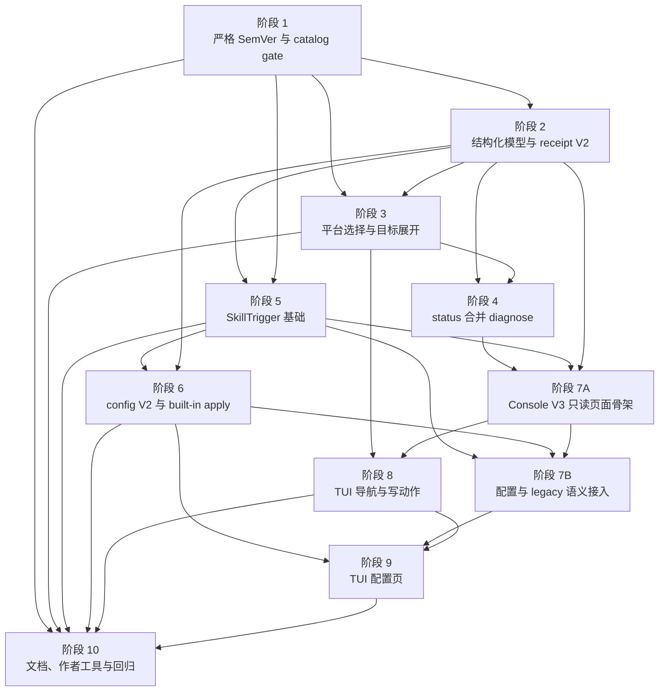

# `aw` TUI 体验返工后续执行计划

日期：2026-05-15
需求来源：`docs/dev/specs/aw-tui-ux-polish-followup.md`
状态：实施计划稿
文档规范：`docs/dev/spec-plan-writing-guide.md`

## 文档定位

这份计划只定义执行步骤、实现切分、涉及文件、测试范围和收口顺序。需求边界、用户体验合同、公开命令合同和验收标准以 Spec 为准，本计划不重新定义需求，也不把 Spec 中明确排除的能力重新纳入范围。

本轮不是单纯改 TUI 页面。它同时收口公开 CLI 命令、JSON schema、严格 SemVer、本地 catalog gate、平台目标解析、SkillTrigger 真值来源、配置管理、作者工具和文档。因此执行顺序按“底层合同先稳定，再接 TUI 和文档”的方式拆分。

## 实施约定

- 每个阶段都必须先补测试或调整现有测试，再实现行为，最后完成阶段验收。
- 涉及 manifest/schema、adapter 行为、scope 语义、插件作者使用方式、分发安装流程或作者工具的改动，必须同步检查 `.agents/skills/create-agent-workflows-plugin/`。
- 阶段里的文件清单是起始范围。实现时如果发现同一职责散落在其它文件中，要同步补到实现说明或后续计划修订里。
- 新的公开字段、schema version、reason code、next step 和 receipt 结构必须先落到结构化模型，再进入 JSON、人类输出和 TUI，不允许由 renderer 临时拼字段。
- TUI 页面层只负责页面状态、导航和动作编排，不重新实现命令层安全逻辑。
- TUI 所有页面都不能显示 `aw ...` 命令建议。CLI 可以展示命令，但必须配套说明作用和适用场景。
- 写操作、多目标结果、配置应用结果和最近操作结果必须复用同一组 target result 数据，避免 CLI、JSON 和 TUI 各自解释。
- 删除 `auto` 只针对平台选择；SkillTrigger 配置里的 `auto` 仍表示允许自动触发，不能在文案和类型中混用。
- SkillTrigger 运行时真值来自插件默认策略、AW 内建配置和 runtime target，不再来自 install record 历史偏好。
- 纯只读和纯 Codex project repo-managed 流程不能为了查询或项目级写入主动初始化、刷新或修复 `~/.aw`。
- 本轮不新增 `aw config apply`、`aw config refresh` 或 `aw config reapply` 公开 CLI 子命令；脚本化配置重放统一走 `aw repair <plugin> --platform <platform> --scope <scope>`。

## 阶段依赖总览

| 阶段 | 主题 | 覆盖需求 | 依赖 | 可并行关系 |
| --- | --- | --- | --- | --- |
| 1 | 严格 SemVer 与本地 catalog gate | R10、R11、版本判断 | 无 | 无 |
| 2 | 公开结构化模型、nextSteps 与 receipt V2 | R16、R7、多目标结果 | 1 | 可与阶段 3 前半并行 |
| 3 | 平台选择、`both` 展开与写命令显式目标 | R12、安装目标、作者测试入口基础 | 1、2 | 可与阶段 4 部分并行 |
| 4 | `status --verbose` 与移除 `diagnose` | R13、R14、R15 | 2、3 | 可与阶段 5 并行 |
| 5 | SkillTrigger 作者合同、resolver 与 built-in apply 基础 | R17、shared runtime owner | 1、2 | 可与阶段 4 并行 |
| 6 | `aw config` V2 与内建 SkillTrigger 配置 | R8、R17、配置管理 CLI | 2、5 | 阶段 7A 可并行做只读页面骨架 |
| 7A | Console item V3 只读页面骨架 | R1、R2、R3、R9 | 2、4、5 | 可与阶段 6 并行 |
| 7B | Console V3 配置与 legacy 语义接入 | R1、R2、R3、R8、R9、R17 | 5、6、7A | 阶段 5 resolver 和阶段 6 config V2 都稳定后开始 |
| 8 | TUI 导航、确认、目标选择和写动作结果 | R4、R5、R6、R7、R12 | 3、7A | 与阶段 9 分工但需联调 |
| 9 | TUI 配置管理页与应用/重新应用流程 | R8、R17 | 6、7B、8 的导航基础 | 可与阶段 8 分工 |
| 10 | 作者工具、公开文档与最终回归 | R18、作者测试入口、全部验收 | 1-9（含 7A/7B） | 文档可随阶段增量更新 |

## 阶段依赖关系图

## 阶段 1：严格 SemVer 与本地 catalog gate

目标：统一 CLI、插件、已安装版本和本地 catalog 的版本解析与比较规则，并把启动时本地 catalog 写入边界收稳。

主要文件：

- [x] `packages/cli/package.json`
- [x] `package.json`
- [x] `packages/cli/src/utils/manifest.ts`
- [x] `packages/cli/src/utils/plugin-catalog.ts`
- [x] `packages/cli/src/utils/bundle-layout.ts`
- [x] `packages/cli/src/commands/init.ts`
- [x] `packages/cli/src/commands/status.ts`
- [x] `packages/cli/src/commands/console.ts`
- [x] `packages/cli/src/install-state/status-projection.ts`
- [x] `packages/cli/src/commands/discovery.ts`
- [x] release、pack、build 相关脚本和测试夹具

待办：

- [x] 新增或收敛严格 SemVer 工具，只接受 SemVer 2.0.0，不清洗 `v1.2.3`、`1.2`、range 或 `latest`。
- [x] CLI package version、根 package version 和插件 `manifest.version` 统一使用同一套解析、规范化和比较函数。
- [x] build、pack、release、插件 bundle staging 在写出发布结果前校验 CLI 和所有插件版本；失败信息必须点名非法字段。
- [x] `upgradeAvailable` 只由 current catalog 版本高于已安装版本触发；source drift、fingerprint drift、project identity drift 和同版本内容变化不得显示 `可升级`。
- [x] current catalog 版本低于已安装版本、任一侧版本不可比较或不合规时，投影为 `异常`，原因使用版本不一致或版本号不符合规范。
- [x] 实现本地 catalog gate：只在需要 shared runtime、native marketplace、本地 marketplace 或其它 `~/.aw` 产物的入口执行。
- [x] 本地 catalog 不存在、当前 CLI 版本更高、同版本但 fingerprint/layout 异常时自动用 embedded bundle 刷新或初始化。
- [x] 当前 CLI 版本低于本地 `sourceVersion`，或本地 `sourceVersion` 缺失、非法、无法比较时，CLI 进入确认，TUI 进入选项确认页。
- [x] 非交互环境遇到需要确认是否覆盖本地 catalog 的场景时直接失败，不默认覆盖，也不继续使用不一致 catalog。
- [x] 带 `--json` 的命令在 gate 警告、确认、拒绝和失败时只写 stderr；失败时 stdout 为空、退出码非 0，不输出半份 JSON 或独立 `ok: false` envelope；确认覆盖并继续后，stdout 仍归原命令单一 JSON payload 独占。
- [x] 纯只读入口和纯 Codex project repo-managed 写入入口使用 embedded catalog 继续，不初始化、刷新或修复 `~/.aw`。
- [x] 将 project-only embedded catalog 例外落成入口判定：`aw config set/unset/reset --scope project`、`--scope project --local`、TUI 项目级配置保存 / 应用 / 重新应用、`aw repair <plugin> --platform codex --scope project` 在目标展开后只命中纯 Codex project repo-managed target，且不需要 native runtime、shared runtime 或本地 marketplace 时，不进入本地 catalog gate。
- [x] 将 `aw install <plugin> --platform codex --scope project` 纳入 project-only embedded catalog 例外：目标展开后只命中纯 Codex project repo-managed / no-runtime 写入时，不进入本地 catalog gate，也不要求本地 marketplace。
- [x] 为只读和 project-only embedded catalog 回退记录结构化原因：本地 catalog 存在但未使用时，默认简洁输出保持静默；`status --verbose`、`status --verbose --json` 和 TUI 状态详情能稳定说明本地插件列表未被使用。
- [x] TUI 本地插件列表校验页默认选中取消，用户取消后不继续本次写入。

测试验收：

- [x] `packages/cli/tests/unit/plugin-catalog.test.ts`
- [x] `packages/cli/tests/unit/plugin-catalog-resolvers.test.ts`
- [x] `packages/cli/tests/unit/manifest.test.ts`
- [x] `packages/cli/tests/unit/manifest-coverage.test.ts`
- [x] `packages/cli/tests/unit/install-state-status-projection.test.ts`
- [x] `packages/cli/tests/unit/codex-project-read-only-catalog.test.ts`
- [x] `packages/cli/tests/integration/cli-entry-json-harness.test.ts`
- [x] `packages/cli/tests/smoke/plugin-scripts-staging-smoke.test.ts`
- [x] `packages/cli/tests/smoke/pack-smoke.test.ts`
- [x] 如改动发布产物校验，运行 `pnpm test:smoke:build` 和 `pnpm test:smoke:pack`
- [x] 覆盖严格 SemVer 的接受和拒绝样例，并覆盖 CLI package version、插件 manifest version 非法时 build/pack/release 失败。
- [x] 覆盖升级判断只比较 SemVer 优先级：同版本 source drift 或 fingerprint drift 不显示 `可升级`，已安装版本更高或任一侧不可比较时显示 `异常`。
- [x] 覆盖本地 catalog gate：只读入口不写 `~/.aw`，写入口遇到本地版本领先或非法时确认，拒绝后不写入，非交互环境直接失败。
- [x] 覆盖 `--json` 命令经过 catalog gate 警告、确认、拒绝或失败时 stdout 纯度不被破坏；拒绝、取消或非交互失败时 stdout 为空、stderr 稳定、退出码非 0。
- [x] 覆盖 project-only embedded catalog 例外：项目级配置写入、项目级 repair 和 TUI 项目级配置动作在 repo-managed / no-runtime 分支不初始化、刷新或覆盖确认 `~/.aw`，TUI 不进入本地插件列表校验页。
- [x] 覆盖 `aw install <plugin> --platform codex --scope project` 在纯 repo-managed / no-runtime 分支的命令级 no-gate 行为，不初始化、刷新或覆盖确认 `~/.aw`。
- [x] 覆盖 embedded catalog 回退的公开提示合同：默认 `aw status` 人类输出不提示本地插件列表未被使用，`status --verbose` / `status --verbose --json` 暴露稳定诊断，TUI 状态详情可消费同一结构化字段。

阶段验收：

- [x] 非严格 SemVer 的 CLI version 或插件 version 会阻断 build/pack/release，且不会产出可发布结果。
- [x] `1.2.3+build.1` 与 `1.2.3+build.2` 不互相触发升级，`1.2.3-beta.1` 低于 `1.2.3`。
- [x] 同版本 fingerprint drift 不再显示 `可升级`。
- [x] 纯 `aw status --verbose --json` 不因为本地 catalog 版本领先而写 `~/.aw` 或输出 gate JSON envelope。
- [x] 需要本地 catalog 的写动作遇到本地 catalog 版本领先时，会要求确认；拒绝覆盖时不写入；非交互环境直接失败且 `--json` stdout 为空。
- [x] project-only 配置写入、项目级 install、项目级 repair 和 TUI 项目级配置动作在纯 Codex project repo-managed 分支不触发本地 catalog gate，也不写入 `~/.aw`。
- [x] 默认 `aw status` 人类输出不打扰用户；只有 `status --verbose`、`status --verbose --json` 和 TUI 状态详情说明本地插件列表未被使用。

## 阶段 2：公开结构化模型、nextSteps 与 receipt V2

目标：先落公开数据模型，让 CLI、人类输出、TUI 和 JSON 使用同一套结构化字段。

主要文件：

- [x] `packages/cli/src/types.ts`
- [x] `packages/cli/src/output/model.ts`
- [x] `packages/cli/src/output/command-receipt.ts`
- [x] `packages/cli/src/output/reporter.ts`
- [x] `packages/cli/src/commands/status.ts`
- [x] `packages/cli/src/commands/console-model.ts`
- [x] `packages/cli/src/commands/install.ts`
- [x] `packages/cli/src/commands/upgrade.ts`
- [x] `packages/cli/src/commands/uninstall.ts`
- [x] `packages/cli/src/commands/cleanup.ts`
- [x] `packages/cli/src/commands/repair.ts`
- [x] `packages/cli/src/commands/reinstall.ts`
- [x] `packages/cli/src/utils/plugin-config-write.ts`

待办：

- [x] 定义 `NextStepInstruction` 和 `nextStepsSchemaVersion: 1`，`nextSteps` 只承载结构化对象。
- [x] 保留旧消费者时只双写 `legacyNextSteps: string[]`，不能让新 `nextSteps` 继续输出字符串数组。
- [x] CLI 人类输出渲染结构化 next step 时，命令必须配套说明作用、适用场景和进入流程。
- [x] TUI 页面模型消费 next step 时忽略 `command` 字段，只保留可映射的 UI action 或状态说明。
- [x] 定义 `receiptSchemaVersion: 2` 的 target result：`completed`、`rolledBack`、`notRun`、`failed`。
- [x] 多目标写命令 receipt 输出展开后的真实 target，不输出 `both` 作为执行 target。
- [x] 卸载、清理和 `remove-config` receipt 增加按 config store 分组的 `configStoreRemovals`。
- [x] TUI 最近操作结果、CLI 人类输出和 JSON receipt 共用同一组 target result 和 config store removal 数据。
- [x] 所有公开 payload 的 schema version 边界清晰：`statusSchemaVersion` 不解释 console items，`receiptSchemaVersion` 不冒充 config read schema。

测试验收：

- [x] `packages/cli/tests/unit/command-receipt.test.ts`
- [x] `packages/cli/tests/unit/console-model.test.ts`
- [x] `packages/cli/tests/unit/install-command.test.ts`
- [x] `packages/cli/tests/unit/upgrade-command.test.ts`
- [x] `packages/cli/tests/unit/uninstall-command.test.ts`
- [x] `packages/cli/tests/unit/cleanup-command.test.ts`
- [x] `packages/cli/tests/unit/repair-command.test.ts`
- [x] `packages/cli/tests/unit/reinstall-command.test.ts`
- [x] `packages/cli/tests/integration/cli-entry-json-harness.test.ts`
- [x] 覆盖 `nextStepsSchemaVersion: 1`、结构化 `nextSteps`、`legacyNextSteps` 双写边界和旧字符串数组不再进入新合同。
- [x] 覆盖 CLI 人类输出中的命令建议必须带作用和适用场景说明，TUI 页面模型忽略 `command` 字段。
- [x] 覆盖 `receiptSchemaVersion: 2` 的 per-target `completed`、`rolledBack`、`notRun`、`failed` 状态，以及多目标 receipt 不输出 `both` 作为执行 target。
- [x] 覆盖 `remove-config` 结果按 config store 分组，主体失败时标记 skipped，且 schema version 边界不互相冒充。

阶段验收：

- [x] 公开 JSON 中暴露下一步的对象都带 `nextStepsSchemaVersion: 1`。
- [x] `nextSteps` 不再输出裸字符串数组。
- [x] CLI 输出不再出现只有 `下一步：aw ...` 的提示。
- [x] 多目标失败能区分已完成、已回滚、未执行和失败目标。
- [x] 配置删除结果不会被折叠进 execution target 的成功状态里。

## 阶段 3：平台选择、`both` 展开与写命令显式目标

目标：删除公开平台 `auto`，重新定义 `both`，并让所有绑定真实插件 target 的写命令在写入前拿到明确真实目标。

主要文件：

- [x] `packages/cli/src/commands/options.ts`
- [x] `packages/cli/src/commands/platform-resolution.ts`
- [x] `packages/cli/src/utils/platform-support.ts`
- [x] `packages/cli/src/utils/platform-entries.ts`
- [x] `packages/cli/src/commands/common.ts`
- [x] `packages/cli/src/commands/install.ts`
- [x] `packages/cli/src/commands/upgrade.ts`
- [x] `packages/cli/src/commands/uninstall.ts`
- [x] `packages/cli/src/commands/cleanup.ts`
- [x] `packages/cli/src/commands/repair.ts`
- [x] `packages/cli/src/commands/reinstall.ts`
- [x] `packages/cli/src/commands/interactive.ts`
- [x] `packages/cli/src/commands/console.ts`
- [x] `packages/cli/src/commands/runtime.ts`
- [x] `packages/cli/src/utils/plugin-dependency-planner.ts`
- [x] `packages/cli/src/commands/plugin-dependency-write-executor.ts`
- [x] `packages/cli/src/index.ts`

待办：

- [x] `PlatformSelection` 收敛为 `codex | claude | both`；公开 parse/help/error 不再接受或展示 `auto`。
- [x] `aw status` 未传 `--platform` 时按 `both` 查询；绑定真实插件 target 的写命令省略 `--platform` 时确定性失败。
- [x] `aw repair --dependency-index` 和 `aw cleanup --dependency-index --prune-stale <token> --yes` 保持全局维护例外，不接受也不要求 `--platform` 或 `--scope`。
- [x] dependency index 维护命令不执行普通插件 target 展开，不回落普通 `repair` / `cleanup` 分支，不触发本地 catalog gate，只读写 dependency index 和可验证的 install-state 文件。
- [x] 新写入分支的 `both` 按 current manifest 支持平台展开；单平台插件只生成唯一支持平台 target。
- [x] 恢复动作的 `both` 按所有可处理目标展开，可包含有现场证据的历史不支持平台。
- [x] `aw reinstall --platform both` 同时命中当前支持平台和历史不支持但有受管证据的平台时，整条命令在写入前失败；不能同一次清理旧平台又重建当前平台。
- [x] 显式单平台新写入要求整组选中插件都支持该平台；任一插件不支持时写入前失败。
- [x] 显式单平台恢复动作在 current manifest 已不支持但存在现场证据时，仍允许进入 cleanup、uninstall、repair 的恢复流程；没有现场证据时才失败。
- [x] `both` 展开后完整预检所有真实目标；任一目标不可执行、scope 不合法或预检失败时，整条写命令失败且不产生部分写入。
- [x] install record、tracking manifest、dependency index、diagnostic cache、receipt target 只保存真实平台。
- [x] TUI 安装目标选择拆成平台页和 scope 页；平台页不展示平台和 scope 笛卡尔积。
- [x] TUI 批量安装进入平台页前先确认整组插件有共同可用 scope；没有共同 scope 时 fail fast。
- [x] TUI 平台页候选按跨 scope 并集收敛：在存在共同可用 scope 的前提下，只要某个平台在任一共同可用 scope 下仍可能安装，就保留该平台；不要因为它只在 user 或 project 的某个 scope 可装就提前隐藏。
- [x] scope 选择后重新展开目标并完整预检；scope 让平台失效时返回平台页说明原因，而不是直接泛化失败。
- [x] 安装或升级会连带处理依赖时，在写入前进入依赖确认页；取消后不写入。

测试验收：

- [x] `packages/cli/tests/unit/command-options.test.ts`
- [x] `packages/cli/tests/unit/platform-support.test.ts`
- [x] `packages/cli/tests/unit/plugin-dependency-planner.test.ts`
- [x] `packages/cli/tests/unit/plugin-dependency-write-executor.test.ts`
- [x] `packages/cli/tests/unit/install-command.test.ts`
- [x] `packages/cli/tests/unit/upgrade-command.test.ts`
- [x] `packages/cli/tests/unit/uninstall-command.test.ts`
- [x] `packages/cli/tests/unit/cleanup-command.test.ts`
- [x] `packages/cli/tests/unit/repair-command.test.ts`
- [x] `packages/cli/tests/unit/reinstall-command.test.ts`
- [x] `packages/cli/tests/unit/console.test.ts`
- [x] `packages/cli/tests/unit/console-wizard.test.ts`
- [x] `packages/cli/tests/unit/runtime.test.ts`
- [x] `packages/cli/tests/unit/codex-project-platform-gates.test.ts`
- [x] `packages/cli/tests/unit/codex-project-installability.test.ts`
- [x] `packages/cli/tests/integration/cli-entry.test.ts`
- [x] `packages/cli/tests/integration/options-normalization.test.ts`
- [x] 覆盖 `--platform auto` 在公开入口失败，写命令省略 `--platform` 失败，`aw status` 省略 `--platform` 按 `both` 查询，dependency index 维护命令保持例外。
- [x] 覆盖新写入分支的 `both` 按 current manifest 展开，恢复动作的 `both` 能命中有现场证据的历史不支持平台。
- [x] 覆盖 dependency index 维护命令不触发本地 catalog gate，不执行普通插件 target 展开，也不落回普通 `repair` / `cleanup` 分支。
- [x] 覆盖 `reinstall --platform both` 混合当前支持平台和历史不支持证据时 fail fast，不写当前平台，也不清理历史平台。
- [x] 覆盖显式单平台不支持时写入前失败，`both` 展开后任一真实目标预检失败时整条命令不产生部分写入。
- [x] 覆盖显式单平台恢复动作在 current manifest 不支持但有现场证据时仍可进入 cleanup、uninstall、repair 流程；没有现场证据时失败。
- [x] 覆盖 install record、tracking manifest、dependency index、diagnostic cache 和 receipt target 只保存真实平台。
- [x] 覆盖 TUI 安装目标选择先平台后 scope、批量安装无共同 scope 时 fail fast、scope 让平台失效时返回平台页并说明原因。
- [x] 覆盖 TUI 平台页候选按跨 scope 并集生成：在存在共同可用 scope 的前提下，只要某个平台在任一共同可用 scope 下仍可能安装，就保留该平台。
- [x] 覆盖 TUI 混合平台插件候选收敛：只展示整组共同支持的单平台；没有共同单平台但 `both` 可展开时，只展示 `全部支持平台`。
- [x] 覆盖安装或升级的依赖确认页取消后不写入。

阶段验收：

- [x] `--platform auto` 在 CLI、TUI、help、错误提示和测试夹具中不再作为可用值。
- [x] `aw install <plugin>` 未传 `--platform` 时失败并提示显式选择。
- [x] `aw status` 未传 `--platform` 时仍可查询有证据的所有真实平台。
- [x] `both` 展开后的任一目标预检失败时，命令不写入任何目标。
- [x] `aw reinstall --platform both` 混合当前支持平台和历史不支持证据时 fail fast，并提示先清理历史平台再重装当前支持平台。
- [x] 显式单平台恢复动作在 current manifest 不支持但有现场证据时仍可进入 cleanup、uninstall、repair 流程。
- [x] TUI 安装目标页先选平台再选位置，且 `全部支持平台` 不被渲染成裸英文 `both`。
- [x] TUI 平台页候选按跨 scope 并集生成，不因某个平台只在 user 或 project 可装而提前隐藏。
- [x] TUI 批量安装混合平台插件时不会展示不满足整组兼容性的单平台候选；没有共同单平台时只保留 `全部支持平台`。

## 阶段 4：`status --verbose` 与移除 `diagnose`

目标：把公开排查入口统一到 `aw status`，先稳住 `statusSchemaVersion: 2` 和 `diagnose` 迁移；TUI 页面模型和 `consoleItems` / SkillTrigger 公共投影交给后续 7A / 7B。

主要文件：

- [x] `packages/cli/src/index.ts`
- [x] `packages/cli/src/commands/status.ts`
- [x] `packages/cli/src/commands/diagnose.ts`
- [x] `packages/cli/src/commands/console.ts`
- [x] `packages/cli/src/commands/console-model.ts`
- [x] `packages/cli/src/install-state/status-projection.ts`
- [x] `packages/cli/src/install-state/evidence.ts`
- [x] `packages/cli/src/output/model.ts`
- [x] dependency index 相关命令和工具文件

待办：

- [x] `aw status` 默认输出简洁状态，不列纯未安装 catalog 插件和位置。
- [x] `aw status --verbose` 迁移原 `diagnose` 和 `diagnose --deep` 的只读诊断能力，不写状态、诊断缓存、备份、插件配置或本地 catalog。
- [x] `aw status --json` 和 `aw status --verbose --json` 顶层输出 `statusSchemaVersion: 2`。
- [x] 本阶段不引入 `consoleItemsSchemaVersion: 3` 或 SkillTrigger 公共投影；它们由后续 7A / 7B 接续。
- [x] 默认状态输出和 TUI 状态页只展示有证据目标；显式查询未安装插件只返回简洁未安装结论。
- [x] `status --verbose`、`status --verbose --json` 和状态详情模型暴露 embedded catalog 回退诊断；默认 `aw status` 人类输出保持静默，不提示本地插件列表未被使用。
- [x] TUI 详情页只保留一个 `状态` 入口；状态详细信息消费结构化诊断数据，不解析人类 stdout。
- [x] CLI help 不再列出 `diagnose`。
- [x] 直接运行 `aw diagnose ...` 返回 exit code `1`，stdout 为空，stderr 提示改用 `aw status ... --verbose`；即使带 `--json` 也不输出 diagnose JSON。
- [x] 所有用户可见文案、receipt、warning、nextSteps 和文档引用从 `diagnose` 迁移到 `status --verbose`、`repair`、`cleanup` 或 dependency index 维护入口。
- [x] `aw repair --dependency-index` 和 `aw cleanup --dependency-index --prune-stale <token> --yes` 的参数矩阵按全局维护动作固定，传入插件 target 参数时失败。
- [x] `aw repair --dependency-index` 输出 coverage 信息；`--json` 成功时 stdout 是单一 repair payload，参数错误时 stdout 为空、错误写 stderr。
- [x] `aw cleanup --dependency-index --prune-stale <token> --yes` 成功时 stdout 是单一 cleanup payload；token 失效、参数错误或缺少确认时 stdout 为空、错误写 stderr。
- [x] `status --verbose`、receipt 和结构化 `nextSteps` 在 dependency index 不可信、coverage 不完整或 stale reference 时，指向对应 dependency index 维护入口。

测试验收：

- [x] `packages/cli/tests/unit/diagnose-command.test.ts`
- [x] `packages/cli/tests/unit/status-dependencies.test.ts`
- [x] `packages/cli/tests/unit/console-model.test.ts`
- [x] `packages/cli/tests/unit/console.test.ts`
- [x] `packages/cli/tests/integration/cli-entry.test.ts`
- [x] `packages/cli/tests/integration/cli-entry-json-harness.test.ts`
- [x] `packages/cli/tests/integration/console-entry.test.ts`
- [x] 覆盖 `aw status` 默认简洁输出，`aw status --verbose` 迁移诊断级只读信息且不写状态、缓存、备份、配置或本地 catalog。
- [x] 覆盖 `aw status --json` / `aw status --verbose --json` 顶层 `statusSchemaVersion: 2`。
- [x] 覆盖 embedded catalog 回退诊断只在 `status --verbose`、`status --verbose --json` 和 TUI 状态详情模型出现，默认 `aw status` 人类输出保持简洁。
- [x] 覆盖 `aw diagnose` 从 help 移除，直接调用返回迁移错误、stdout 为空，带 `--json` 时也不输出 diagnose JSON。
- [x] 覆盖 TUI 状态页和详细信息页只消费结构化诊断数据，不解析 human stdout，也不显示命令建议。
- [x] 覆盖 dependency index 维护命令的参数矩阵，不接受插件名、`--platform`、`--scope` 或目标型参数。
- [x] 覆盖 dependency index 维护命令不触发本地 catalog gate，不执行普通插件 target 展开，也不落回普通 `repair` / `cleanup` 分支。
- [x] 覆盖 `repair --dependency-index` 的 coverage 输出和 JSON 载荷，`cleanup --dependency-index --prune-stale` 的成功载荷，以及参数错误 / token 失效时 `--json` stdout 为空、stderr 报错。
- [x] 覆盖 `status --verbose`、receipt 和结构化 `nextSteps` 遇到 dependency index 不可信或 stale reference 时指向维护入口。

阶段验收：

- [x] `aw diagnose` 不出现在 help 中，直接调用只返回迁移错误。
- [x] `status --verbose` 覆盖原诊断级只读信息，但不会写入任何状态。
- [x] `status --json` / `status --verbose --json` 顶层先包含 `statusSchemaVersion: 2`，`consoleItemsSchemaVersion: 3` 由阶段 7A 接续接入。
- [x] 默认状态输出不列纯未安装位置。
- [x] 默认状态输出不提示 embedded catalog 回退；verbose、JSON 诊断和 TUI 状态详情可以说明本地插件列表未被使用。
- [x] TUI 状态页和详细信息页不显示命令建议，也不解析 human stdout。
- [x] dependency index 维护命令 no-gate、no-target-expansion，成功 JSON stdout 为单一 payload，参数错误或 token 失效时 stdout 为空。

## 阶段 5：SkillTrigger 作者合同、resolver 与 built-in apply 基础

目标：把 SkillTrigger 从安装偏好迁移为 AW 内建配置的底层真值，为 CLI config 和 TUI 配置页打基础。

主要文件：

- [x] `packages/cli/src/utils/manifest.ts`
- [x] `packages/cli/src/utils/skill-trigger-preferences.ts`
- [x] `packages/cli/src/utils/codex-skill-staging.ts`
- [x] `packages/cli/src/utils/slash-commands.ts`
- [x] `packages/cli/src/utils/plugin-scripts.ts`
- [x] `packages/cli/src/utils/artifact-refresh.ts`
- [x] `packages/cli/src/install-state/shared-runtime-owner.ts`
- [x] `packages/cli/src/install-state/schema.ts`
- [x] `packages/cli/src/install-state/status-projection.ts`
- [x] `packages/cli/src/commands/install.ts`
- [x] `packages/cli/src/commands/upgrade.ts`
- [x] `packages/cli/src/commands/repair.ts`
- [x] `packages/cli/src/commands/reinstall.ts`
- [x] `packages/cli/src/commands/options.ts`
- [x] `packages/cli/src/index.ts`

待办：

- [x] manifest `skillTriggers.<skill>` 合同升级为 `{ defaultTrigger, allowDynamicTrigger }`，拒绝旧 `allowInstallOverride` 作为新合同字段。
- [x] 静态 `skills/<skill>` 和动态 `codex.skill` 的 `skillKey` 必须有对应 `skillTriggers` entry；缺失、未知 key 或重复声明时 validate/build 失败。
- [x] 公共 `slashCommands` 生成的 Codex manual-only skill 注入隐式 fixed/manual 条目，不要求作者手写 entry。
- [x] 设计并实现统一 SkillTrigger resolver：输入 manifest 默认策略、AW 内建配置分层和 runtime target，输出 effective 值、公开投影和 apply 输入。
- [x] `allowDynamicTrigger: false` 的 skill 永远以默认策略为 effective；历史 `$aw` 覆盖标记为 ignored，不参与 runtime/status/drift。
- [x] orphaned SkillTrigger key 标记为 orphaned，只允许清理，不参与 effective、runtime、status 或 drift。
- [x] 移除安装、升级、修复、重装入口中的 `-t` / `--skill-trigger` help 和正向参数处理；用户传入时失败并引导配置管理。
- [x] TUI 安装、升级、修复、重装流程不再展示触发策略选择。
- [x] 已有 install record 的 `options.skillTriggerPreference` 只保留兼容读取，不再作为运行时真值或 drift 判断来源。
- [x] shared runtime owner 新逻辑只保存 owner 身份和完整性证据；replay、takeover、marketplace refresh 等从 owner location 当前 effective config 计算触发策略。
- [x] owner 证据失效或 owner effective config 不可解析时 fail closed，给出 `repair` 或单目标 takeover 恢复指引。
- [x] built-in apply pipeline 至少覆盖静态 Codex skill、Claude Code skill、动态 `codex.skill` 和公共 `slashCommands` fixed/manual skill。

测试验收：

- [x] `packages/cli/tests/unit/manifest.test.ts`
- [x] `packages/cli/tests/unit/manifest-coverage.test.ts`
- [x] `packages/cli/tests/unit/skill-trigger-preferences.test.ts`
- [x] `packages/cli/tests/unit/skill-trigger-install-options.test.ts`
- [x] `packages/cli/tests/unit/install-state-shared-runtime-owner.test.ts`
- [x] `packages/cli/tests/unit/install-state-schema.test.ts`
- [x] `packages/cli/tests/unit/codex-config.test.ts`
- [x] `packages/cli/tests/unit/codex-project-safety.test.ts`
- [x] `packages/cli/tests/unit/plugin-scripts.test.ts`
- [x] `packages/cli/tests/integration/skill-trigger-command.test.ts`
- [x] 覆盖 manifest 新 SkillTrigger 合同 `{ defaultTrigger, allowDynamicTrigger }`，旧 `allowInstallOverride` 被拒绝。
- [x] 覆盖静态 skill 和动态 `codex.skill` 缺少、未知或重复 `skillTriggers` entry 时校验失败，公共 `slashCommands` 注入 fixed/manual 隐式条目。
- [x] 覆盖统一 resolver 的 effective 值、公开投影和 apply 输入，包括 fixed、ignored、orphaned、invalid 等状态。
- [x] 覆盖安装、升级、修复、重装的 `-t` / `--skill-trigger` help 移除，用户传入时失败并指向配置管理，TUI 不再展示触发策略选择。
- [x] 覆盖 install record 旧偏好不再影响 status、refresh、repair、runtime patch 或 drift 判断。
- [x] 覆盖 shared runtime replay、takeover、marketplace refresh 从 owner location 当前 effective config 计算，owner 证据失效或配置不可解析时 fail closed。
- [x] 覆盖 built-in apply pipeline 至少处理静态 Codex skill、Claude Code skill、动态 `codex.skill` 和公共 `slashCommands` fixed/manual skill。

阶段验收：

- [x] 新 manifest 缺少必需 `skillTriggers` entry 时 build/validate 失败。
- [x] 旧 `allowInstallOverride` 不再被作者合同接受。
- [x] `aw install -t manual`、`aw upgrade --skill-trigger auto`、`aw repair -t default`、`aw reinstall --skill-trigger manual` 都失败并指向配置管理。
- [x] install record 里的旧偏好不再影响 status、refresh、repair 或 runtime patch。
- [x] shared runtime replay 不再从 owner 文件或 install record 恢复旧偏好。

## 阶段 6：`aw config` V2 与内建 SkillTrigger 配置

目标：让 `aw config` 能以统一字段模型管理普通配置和 AW 内建 SkillTrigger 配置，并为 TUI 配置页提供结构化输入。

主要文件：

- [x] `packages/cli/src/utils/plugin-config.ts`
- [x] `packages/cli/src/utils/plugin-config-write.ts`
- [x] `packages/cli/src/utils/artifact-refresh.ts`
- [x] `packages/cli/src/commands/repair.ts`
- [x] `packages/cli/src/commands/console-wizard.ts`
- [x] `packages/cli/src/output/command-receipt.ts`
- [x] `packages/cli/src/output/model.ts`
- [x] `packages/cli/src/index.ts`
- [x] `packages/cli/src/types.ts`

待办：

- [x] 定义 `ConfigFieldEntryV2`、`LegacyConfigStoreEntryV2`、`configSchemaVersion: 2` 和配置读命令主输出结构。
- [x] 普通 manifest 字段标记为 `kind: "manifest"`、`reserved: false`；AW 注入字段标记为 `kind: "builtIn"`、`reserved: true`。
- [x] SkillTrigger 用户可操作逻辑 key 固定为 `aw.skillTriggers.<skill>.trigger`，内部持久化使用 `$aw.skillTriggers` namespace。
- [x] `aw config list/get --json` 用 `fields` 作为主合同，不把旧 `summary.values` / `layers` 当作新语义唯一出口。
- [x] `aw config set/unset/reset --json` 输出 `receiptSchemaVersion: 2` 和 `affectedFields`，不输出 `configSchemaVersion: 2` 冒充读命令。
- [x] 普通旧配置无法被 current `config.schema` 解释时，通过 `legacyConfigStores` 暴露 store 级残留，不枚举普通 raw key 或 raw value。
- [x] `aw config get <plugin> <普通key> --json` 在 store-only 旧普通配置场景确定性失败，stdout 为空，stderr 说明只能整层清理。
- [x] SkillTrigger built-in 字段不依赖普通 `config.schema`；没有普通 schema 的插件也能 list/get/set/unset/reset 内建字段。
- [x] project scope 的 SkillTrigger effective 只由默认值和 project shared 配置决定；project local 存量值显示为 `invalid`，不能改变 runtime 真值。
- [x] `aw config get/set/unset <plugin> aw.skillTriggers.<skill>.trigger --scope project --local` 确定性失败，不写 store，不触发 apply。
- [x] fixed、ignored、orphaned、invalid 的 JSON、CLI 人类输出和 TUI 字段语义保持一致。
- [x] `aw config set/unset/reset --scope project` 与 `--scope project --local` 的普通字段写入在目标展开后只命中 project shared 或 project local config store，且保存后的自动应用只涉及 Codex project repo-managed target 或无可应用 runtime 时，复用 embedded catalog，不触发本地 catalog gate。
- [x] 配置写入后触发 built-in apply pipeline，并对同 store apply group 的 sibling target 输出 per-target 结果。
- [x] `aw repair` 处理配置驱动 runtime drift 时读取当前 effective config，重放 built-in apply 和 tracked dynamic artifact refresh，不修改 config store。
- [x] `aw repair <plugin> --platform codex --scope project` 处理配置驱动 runtime drift 时，如果只需要 repo-visible artifact refresh 或 SkillTrigger built-in apply pipeline，保持 embedded catalog 零写入；实际转入 native runtime、shared runtime 或本地 marketplace 分支前再运行 catalog gate。

测试验收：

- [x] `packages/cli/tests/unit/plugin-config.test.ts`
- [x] `packages/cli/tests/unit/config-write.test.ts`
- [x] `packages/cli/tests/unit/command-receipt.test.ts`
- [x] `packages/cli/tests/unit/repair-command.test.ts`
- [x] `packages/cli/tests/unit/console-wizard.test.ts`
- [x] `packages/cli/tests/integration/cli-entry-json-harness.test.ts`
- [x] `packages/cli/tests/integration/plugin-lifecycle-command.test.ts`
- [x] 覆盖 `aw config list/get --json` 顶层 `configSchemaVersion: 2` 和 `fields`，`set/unset/reset --json` 顶层 `receiptSchemaVersion: 2` 和 `affectedFields`。
- [x] 覆盖普通字段 `kind: "manifest"`、AW 内建字段 `kind: "builtIn"` / `reserved: true`，以及 `aw.skillTriggers.<skill>.trigger` 到 `$aw.skillTriggers` 的持久化边界。
- [x] 覆盖没有普通 `config.schema` 的插件仍能 list/get/set/unset/reset SkillTrigger 内建字段。
- [x] 覆盖 store-only 旧普通配置只通过 `legacyConfigStores` 暴露，不能按 raw key 读取、更新、清空或删除。
- [x] 覆盖 project scope 的 SkillTrigger effective 不受 project local 存量值影响，`--scope project --local` 命中 SkillTrigger key 时确定性失败且不写 store。
- [x] 覆盖 fixed、ignored、orphaned、invalid 的 JSON、CLI 人类输出和 TUI 字段语义一致。
- [x] 覆盖 `aw config set/unset/reset --scope project` 和 `--scope project --local` 在 repo-managed / no-runtime 分支不初始化、刷新或覆盖确认 `~/.aw`，保存后自动 apply 也不触发 gate。
- [x] 覆盖配置写入后触发 built-in apply pipeline，同 store apply group 的 sibling target 输出 per-target 结果。
- [x] 覆盖 `aw repair` 处理配置驱动 runtime drift 时读取当前 effective config，不修改 config store。
- [x] 覆盖 `aw repair <plugin> --platform codex --scope project` 在 repo-visible artifact refresh 或 built-in apply 分支不触发 catalog gate，转入 native / shared / marketplace 分支前才进入 gate。

阶段验收：

- [x] `aw config list/get --json` 顶层包含 `configSchemaVersion: 2` 和 `fields`。
- [x] `aw config set/unset/reset --json` 顶层包含 `receiptSchemaVersion: 2` 和 `affectedFields`。
- [x] fixed skill 展示为只读固定默认值，写入失败。
- [x] ignored 旧 `$aw` 覆盖不会影响 effective，也不会被读路径自动删除。
- [x] orphaned SkillTrigger 可以在 user 或 project shared 层按 key 清理，不能 set 新值。
- [x] project local 的 SkillTrigger 存量值只能作为 invalid 暴露，不能写入或参与 apply。
- [x] project-only 配置写入和项目级 repair 的 repo-managed / no-runtime 分支不触发本地 catalog gate，也不写入 `~/.aw`。

## 阶段 7A/7B：Console item V3 与 TUI 页面模型

目标：把首页、详情页、状态页和依赖页所需数据从命令输出中拆出来，固定 TUI 的页面模型和展示边界。

执行切分：

- [x] 阶段 7A 先做只读页面骨架：在阶段 4 的 `statusSchemaVersion: 2` 基础上补 `consoleItemsSchemaVersion: 3`、结构化 nextSteps、首页/详情/状态/依赖页面模型和展示边界，依赖阶段 2、4、5。
- [x] 阶段 7B 再接配置与 legacy 语义：在阶段 5 的 resolver 和阶段 6 的 `configSchemaVersion: 2` 都稳定后，接入 SkillTrigger 公共投影、当前用户/项目配置 store 残留、旧配置占位项和 config V2 驱动的入口状态，必须等 `LegacyConfigStoreEntryV2`、`ignored` / `orphaned` / `invalid` 语义稳定后开始。

主要文件：

- [x] `packages/cli/src/commands/console-model.ts`
- [x] `packages/cli/src/commands/console.ts`
- [x] `packages/cli/src/commands/discovery.ts`
- [x] `packages/cli/src/commands/status.ts`
- [x] `packages/cli/src/install-state/status-projection.ts`
- [x] `packages/cli/src/utils/plugin-catalog.ts`
- [x] `packages/cli/tests/helpers/fake-console.ts`

待办：

- [x] 7A：`consoleItemsSchemaVersion` 提升到 `3`，承载结构化 nextSteps，并移除旧 SkillTrigger 字段。
- [x] 7B：在阶段 6 稳定后接入 SkillTrigger 公共投影，字段语义与 config V2 的 built-in 字段、fixed、ignored、orphaned、invalid 保持一致。
- [x] 7A：首页 loader 合并 current catalog 未安装插件、已安装证据、状态证据和历史恢复目标。
- [x] 7B：首页 loader 合并当前用户/项目配置 store 残留，并基于 `LegacyConfigStoreEntryV2` 生成旧配置占位项。
- [x] 首页按异常、可升级、已安装、未安装分组，空分组不渲染。
- [x] 页面模型使用终端可见符号：`!`、`↑`、`✓`、`○`，不能输出 icon id。
- [x] 首页卡片展示显示名、简介、版本、平台摘要和主操作，不展示长摘要、命令建议、完整诊断或内部词。
- [x] 7B：首页旧配置占位项只进入异常分组，不参与安装、升级或 runtime apply 候选。
- [x] 详情页模型合并插件名、版本、简介、状态、异常原因、平台与安装、依赖摘要、最近操作结果和功能菜单。
- [x] 详情页主体使用固定位置、状态符号和颜色层级表达简介、平台、状态和版本，不为这些字段添加冗余行内标题。
- [x] 推荐动作只标在功能菜单上，不渲染 raw command。
- [x] 依赖详情页按真实平台和 scope 分组，只展示已安装目标下的依赖状态。
- [x] 依赖详情页模型为正常、异常和缺失依赖同时提供符号、颜色层级和文案：`✓ 正常`、`! <异常原因>`、`× 缺失`。
- [x] 没有依赖时，详情页不生成 `依赖` 功能入口。
- [x] 状态摘要页默认只展示有证据位置；状态详细信息页消费结构化诊断数据。
- [x] 状态详细信息页展示 embedded catalog 回退诊断；本地插件列表存在但未被使用时只在详情层说明，不影响默认状态摘要。
- [x] 历史不支持但有现场证据的平台必须在首页和详情页平台区域可见，不能只藏到状态页。
- [x] 同一平台同一插件同时拥有健康的 user 和 project 安装时，首页和详情页列出两个 scope，但不能仅因 dual-scope 归到异常。
- [x] 健康安装功能菜单只显示 `卸载`，不同时显示 `清理`。

测试验收：

- [x] `packages/cli/tests/unit/console-model.test.ts`
- [x] `packages/cli/tests/unit/console.test.ts`
- [x] `packages/cli/tests/unit/status-dependencies.test.ts`
- [x] `packages/cli/tests/unit/install-state-status-projection.test.ts`
- [x] `packages/cli/tests/integration/console-entry.test.ts`
- [x] 覆盖 7A 的 `consoleItemsSchemaVersion: 3` 基础 shape：结构化 nextSteps，以及旧 SkillTrigger 字段移除。
- [x] 覆盖 7B 的 SkillTrigger 公共投影，语义与 config V2 内建字段一致。
- [x] 覆盖 7A 首页 loader 合并 catalog-only 插件、已安装证据、状态证据和历史恢复目标。
- [x] 覆盖 7B 首页 loader 合并当前用户/项目配置 store 残留，旧配置占位项只进入异常分组。
- [x] 覆盖首页按异常、可升级、已安装、未安装分组，空分组不渲染。
- [x] 覆盖页面模型使用终端可见符号 `!`、`↑`、`✓`、`○` 或 ASCII 降级，不输出 icon id。
- [x] 覆盖首页和详情页展示边界：不显示 raw command、长摘要、完整诊断、内部词或命令建议。
- [x] 覆盖详情页主体不显示 `简介`、`状态`、`版本` 等冗余行内标题。
- [x] 覆盖依赖详情页按真实平台和 scope 分组，状态摘要页默认只展示有证据位置。
- [x] 覆盖 TUI 状态详情能显示本地插件列表未被使用的结构化诊断，状态摘要页不显示。
- [x] 覆盖依赖详情页正常、异常、缺失状态同时输出符号、颜色层级和文案；无依赖时不显示 `依赖` 入口。
- [x] 覆盖历史不支持但有现场证据的平台在首页和详情页可见，健康安装功能菜单只显示 `卸载`。
- [x] 覆盖同一平台双 scope 的健康安装列出两个 scope，但不会仅因 dual-scope 被归到异常。

阶段验收：

- [x] 7A 完成后，裸 `aw` 首页能看到 catalog-only 未安装插件。
- [x] 7B 完成后，裸 `aw` 首页能看到旧配置占位项，且该占位项只进入异常分组。
- [x] 首页不会输出 `arrow-up-circle`、`check-circle` 等 icon id。
- [x] 详情页不显示 `aw upgrade ...` 这类 raw command。
- [x] 详情页主体不显示 `简介`、`状态`、`版本` 等冗余行内标题。
- [x] 依赖页用符号、颜色和文案同时区分正常、异常和缺失状态；无依赖插件没有 `依赖` 入口。
- [x] 详情页只有一个 `状态` 入口，不再同时显示 `诊断`。
- [x] 状态页默认不列纯未安装平台/scope 矩阵。
- [x] TUI 状态详情能说明本地插件列表未被使用，默认状态页保持简洁。
- [x] 同一平台双 scope 的健康安装列出两个 scope，但不会仅因 dual-scope 被归到异常。
- [x] 健康安装不会同时出现 `卸载` 和 `清理`。

## 阶段 8：TUI 导航、确认、目标选择和写动作结果

目标：把 TUI 外壳和写操作体验收稳，覆盖退出、选项确认、平台/scope 目标选择、依赖确认、清理计划和最近结果。

主要文件：

- [x] `packages/cli/src/commands/runtime.ts`
- [x] `packages/cli/src/commands/interactive.ts`
- [x] `packages/cli/src/commands/console.ts`
- [x] `packages/cli/src/commands/console-wizard.ts`
- [x] `packages/cli/src/commands/console-model.ts`
- [x] `packages/cli/src/commands/install.ts`
- [x] `packages/cli/src/commands/upgrade.ts`
- [x] `packages/cli/src/commands/uninstall.ts`
- [x] `packages/cli/src/commands/cleanup.ts`
- [x] `packages/cli/src/commands/repair.ts`
- [x] `packages/cli/src/commands/reinstall.ts`
- [x] `packages/cli/tests/helpers/fake-console.ts`

待办：

- [x] 修复任意页面 `退出`、`q`、首页 `Esc`、子页面 `Esc` 返回和 `Ctrl+C` 安全退出。
- [x] 输入框和密码框内 `q`、`b` 作为普通字符，`Esc` 取消当前输入。
- [x] 写操作执行中页的 `q` 和 `Ctrl+C` 只记录延后退出意图，不中断已开始写入、回滚、receipt 写入或诊断状态写回。
- [x] 操作完成后默认刷新当前插件数据并返回插件详情页，不返回首页，不停留独立结果页。
- [x] 最近结果只保留最新一次操作，并按真实 target 展示完成、回滚、未执行和失败状态。
- [x] 危险动作统一使用选项确认页，默认选中取消，不使用文本式 `y/N`。
- [x] 卸载、重装、认领、接管、重复安装处理、删除配置、重置配置、清理都走确认页。
- [x] 多目标危险动作确认页列出展开后的真实目标和失败处理口径，不只展示 `both` 或“所有平台”。
- [x] 认领现有安装、接管共享运行时等高风险恢复动作保持单目标确认。
- [x] 清理先展示计划；需要 force 语义时进入高风险确认页，列出风险来源、备份、不可删除项和受影响依赖。
- [x] 卸载或清理附带删除配置时，确认页按 config store 分组展示删除范围和主体成功依赖。
- [x] 安装/升级平台页、scope 页、依赖确认页和写入前预检按阶段 3 的目标解析结果串起来。
- [x] 卸载失败后详情页最近结果提供 `状态` 和 `清理` UI 动作。
- [x] 升级成功后刷新状态，不能继续显示旧 `可升级`。

测试验收：

- [x] `packages/cli/tests/unit/runtime.test.ts`
- [x] `packages/cli/tests/unit/console.test.ts`
- [x] `packages/cli/tests/unit/console-wizard.test.ts`
- [x] `packages/cli/tests/unit/command-receipt.test.ts`
- [x] `packages/cli/tests/unit/uninstall-command.test.ts`
- [x] `packages/cli/tests/unit/cleanup-command.test.ts`
- [x] `packages/cli/tests/integration/console-entry.test.ts`
- [x] `packages/cli/tests/integration/console-duplicate-resolution.test.ts`
- [x] 覆盖任意页面 `退出`、`q`、首页 `Esc`、子页面 `Esc` 返回和 `Ctrl+C` 安全退出，输入框和密码框内 `q` / `b` 不触发导航。
- [x] 覆盖写操作执行中 `q` / `Ctrl+C` 只记录延后退出意图，不中断已开始写入、回滚、receipt 写入或诊断状态写回。
- [x] 覆盖操作完成后刷新当前插件数据并返回插件详情页，最近结果只保留最新一次并按真实 target 展示状态。
- [x] 覆盖危险动作统一使用默认选中取消的选项确认页，取消后不写状态、写配置或删除文件。
- [x] 覆盖多目标危险确认页列出展开后的真实目标，认领和接管等高风险恢复动作保持单目标确认。
- [x] 覆盖清理先展示计划，高风险确认页列出风险来源、备份、不可删除项和受影响依赖。
- [x] 覆盖卸载或清理附带删除配置时，确认页按 config store 分组展示删除范围和主体成功依赖。
- [x] 覆盖卸载失败后最近结果提供 `状态` 和 `清理` UI 动作，升级成功后刷新状态不再显示旧 `可升级`。

阶段验收：

- [x] 首页和任意子页面选择 `退出` 后进程 exit code 为 `0`，不刷新首页，不等待后续输入。
- [x] 写操作执行中请求退出后，操作收口结果完整，随后退出控制台。
- [x] 取消危险确认不会写状态、写配置或删除文件。
- [x] 清理页和高风险清理确认页不把多个平台压成一句总括文案。
- [x] 写操作完成后详情页展示刷新后的最新状态和最近结果。
- [x] TUI 全流程不显示 `aw ...` 命令建议。

## 阶段 9：TUI 配置管理页与应用/重新应用流程

目标：把配置从一次性向导扩展为插件配置管理页，覆盖 target 选择、作用层、字段编辑、旧配置清理和运行时重放。

主要文件：

- [x] `packages/cli/src/commands/console.ts`
- [x] `packages/cli/src/commands/console-model.ts`
- [x] `packages/cli/src/commands/console-wizard.ts`
- [x] `packages/cli/src/utils/plugin-config.ts`
- [x] `packages/cli/src/utils/plugin-config-write.ts`
- [x] `packages/cli/src/utils/artifact-refresh.ts`
- [x] `packages/cli/src/output/command-receipt.ts`

待办：

- [x] 详情页 `配置` 入口先解析明确可配置 target：location target、未安装预配置 target、config store target。
- [x] 单一可配置 target 直接进入配置页；多个平台、scope、project 或 config store target 时先进入配置目标选择页。
- [x] 未安装插件只在 current manifest 存在普通 schema 或 SkillTrigger 内建字段时提供预配置入口，默认写个人配置。
- [x] 未安装插件只有存在真实 project-installable target 时才展示当前项目预配置。
- [x] 插件退场、schema 撤掉或只有 orphaned SkillTrigger 时，配置页提供 store-only 查看和清理，不展示普通 raw key/raw value。
- [x] 配置页展示当前 target，作用层按 target 裁剪：`生效`、`个人`、`项目`、`本地`。
- [x] `生效` 只是只读合并视图，不生成或依赖 `valueState: "effective"`。
- [x] 普通字段和 SkillTrigger 内建字段合并展示，SkillTrigger 标题使用 `<skill> 触发方式` 这类用户文案。
- [x] 敏感字段只显示已配置或脱敏状态。
- [x] 更新、清空、重置和删除配置使用字段选择页、输入控件和选项确认页。
- [x] SkillTrigger 内建字段使用枚举选择，不允许动态变更的字段只读展示，不进入编辑。
- [x] project scope 的本地视图不提供 SkillTrigger 内建字段编辑、清空或字段级 reset。
- [x] 配置保存按最终 config store 去重；同 store、表单 identity 一致的 sibling location target 形成 apply group。
- [x] 跨 `user`、`project shared`、`project local` store，或同 store 但表单 identity 不一致时，拆成多个 config write group；每个 group 分别填写、分别确认、分别写入、分别展示结果，不能静默合并。
- [x] 保存成功后 built-in apply pipeline 和 dynamic artifact refresh fan-out 到 apply group 全部 target，并在最近结果和 JSON receipt 中按 target 展示。
- [x] `应用` / `重新应用配置` 不修改 config store，只按当前 effective config 重放可重放 runtime 写入。
- [x] TUI 项目级配置保存、保存后的自动应用、`应用` 和 `重新应用配置` 在最终目标仍是纯 Codex project repo-managed target，且不需要 native runtime、shared runtime 或本地 marketplace 时，跳过本地插件列表校验页并使用 embedded catalog 继续。
- [x] 没有普通 schema 或 tracked dynamic artifact、但存在 SkillTrigger 内建字段的插件，仍可运行 built-in apply pipeline。
- [x] 没有任何可重放 runtime 写入时展示 no-op 文案，不当作失败。

测试验收：

- [x] `packages/cli/tests/unit/console.test.ts`
- [x] `packages/cli/tests/unit/console-wizard.test.ts`
- [x] `packages/cli/tests/unit/console-model.test.ts`
- [x] `packages/cli/tests/unit/plugin-config.test.ts`
- [x] `packages/cli/tests/unit/config-write.test.ts`
- [x] `packages/cli/tests/unit/command-receipt.test.ts`
- [x] `packages/cli/tests/integration/console-entry.test.ts`
- [x] 覆盖配置入口解析明确可配置 target，多个平台、scope、project 或 config store target 时先进入配置目标选择页。
- [x] 覆盖未安装插件只在 current manifest 有普通 schema 或 SkillTrigger 内建字段时提供预配置入口，项目预配置只在真实 project-installable target 存在时出现。
- [x] 覆盖插件退场、schema 撤掉或只有 orphaned SkillTrigger 时提供 store-only 查看和整层清理，不展示 raw key/raw value。
- [x] 覆盖配置页的 target、作用层、只读 `生效` 视图、普通字段和 SkillTrigger 内建字段合并展示、敏感字段脱敏展示。
- [x] 覆盖更新、清空、重置和删除配置使用字段选择页、输入控件和选项确认页。
- [x] 覆盖 SkillTrigger 内建字段的只读、枚举编辑和 project local 禁止编辑语义。
- [x] 覆盖配置保存按 config store 去重，同 store 同表单 identity 的 sibling location target 形成 apply group。
- [x] 覆盖跨 `user` / `project shared` / `project local` store 时拆成多个 config write group，分别确认、分别保存、分别展示结果。
- [x] 覆盖同 store 但表单 identity 不一致时拆成多个 config write group，不能复用同一份表单输入或静默合并结果。
- [x] 覆盖 `应用` / `重新应用配置` 不修改 config store，只按当前 effective config 重放 runtime 写入；无可重放写入时展示 no-op。
- [x] 覆盖 TUI 项目级配置保存、保存后自动应用、`应用` 和 `重新应用配置` 在纯 repo-managed target 不进入本地插件列表校验页，也不触发 `~/.aw` 初始化、刷新或覆盖确认。

阶段验收：

- [x] 详情页有清晰 `配置` 入口，且不会静默挑选多个 target 中的一个。
- [x] 未安装但可配置的插件能预配置个人配置；项目预配置只在真实可消费时出现。
- [x] fixed、ignored、orphaned、invalid 字段在 TUI 配置页的含义与 CLI JSON 一致。
- [x] 本地层不能编辑 SkillTrigger 内建字段。
- [x] 配置保存、应用和重新应用的结果按 target 展示，而不是只显示整体成功或失败。
- [x] TUI 项目级配置保存、应用和重新应用在纯 Codex project repo-managed 分支不进入本地插件列表校验页。
- [x] 多 config write group 的保存流程会按 group 分别确认、写入和展示结果。
- [x] store-only 旧普通配置只提供整层清理，不展示 raw key/raw value。

## 阶段 10：作者工具、公开文档与最终回归

目标：同步所有公开文档、作者工具、脚手架、测试入口和最终回归，避免运行时能力与作者文档脱节。

主要文件：

- [x] `README.md`
- [x] `docs/architecture.md`
- [x] `docs/coding-conventions.md`
- [x] `docs/testing.md`
- [x] `docs/plugin-installation.md`
- [x] `docs/plugin-installation-technical-details.md`
- [x] `docs/plugin-authoring.md`
- [x] `.agents/skills/create-agent-workflows-plugin/SKILL.md`
- [x] `.agents/skills/create-agent-workflows-plugin/scripts/init_plugin.js`
- [x] `.agents/skills/create-agent-workflows-plugin/scripts/validate_plugin.js`
- [x] `.agents/skills/create-agent-workflows-plugin/references/`
- [x] `.agents/skills/create-agent-workflows-plugin/references/.examples/`
- [x] `packages/cli/scripts/test-plugin-scripts.js` 或等价 plugin test runner
- [x] `packages/cli/tests/integration/plugin-test-runner.test.ts`
- [x] `packages/cli/tests/smoke/build-smoke.test.ts`
- [x] `packages/cli/tests/smoke/pack-smoke.test.ts`
- [x] `packages/cli/tests/smoke/plugin-scripts-staging-smoke.test.ts`

待办：

- [x] 公开文档移除 `aw diagnose`、`aw diagnose --deep`、`--platform auto` 和安装期 `--skill-trigger` 使用方式。
- [x] 文档把排查入口改为 `aw status --verbose`，dependency index 恢复改为 `aw repair --dependency-index` / `aw cleanup --dependency-index --prune-stale <token> --yes`。
- [x] 文档把触发策略调整改为 `aw config` / TUI 配置页，配置驱动 runtime drift 的脚本化恢复改为 `aw repair`。
- [x] `docs/architecture.md` 移除 `diagnose` 公开命令、默认 `platform=auto`、install record 偏好真值、shared runtime owner preference 真值和 apply 阶段 preference patch。
- [x] `docs/coding-conventions.md` 的 SkillTrigger 检查清单更新为 manifest 默认策略、AW 内建配置、built-in apply pipeline、公开 JSON 投影和作者工具同步。
- [x] 插件作者文档、脚手架、校验脚本和参考夹具同步 `{ defaultTrigger, allowDynamicTrigger }` 合同。
- [x] 脚手架不再生成或推荐 `allowInstallOverride`。
- [x] 作者工具校验静态 skill 和动态 `codex.skill` 必须声明 `skillTriggers` entry；公共 `slashCommands` 隐式 fixed/manual 不要求作者补 entry。
- [x] `pnpm plugin:test` help、runner、错误提示、smoke test 和作者 skill 不再把 `auto` 当作 platform 值。
- [x] `pnpm plugin:test --platform auto` 失败并提示 `codex`、`claude`、`both`。
- [x] `pnpm plugin:test` 未传 `--platform` 时按 `both` 处理；`both` 按每个插件最终支持平台集合展开。
- [x] `pnpm plugin:test --platform codex|claude` 遇到任一选中插件不支持该平台时，在测试执行前失败。
- [x] 补充迁移说明：`consoleItemsSchemaVersion: 3`、`statusSchemaVersion: 2`、`configSchemaVersion: 2`、`receiptSchemaVersion: 2` 和 `nextStepsSchemaVersion: 1`。
- [x] 完整运行相关单元、集成和必要 smoke 测试，修复文档与 help 不一致问题。

测试验收：

- [x] `packages/cli/tests/unit/public-docs.test.ts`
- [x] `packages/cli/tests/unit/manifest.test.ts`
- [x] `packages/cli/tests/integration/plugin-test-runner.test.ts`
- [x] `packages/cli/tests/smoke/build-smoke.test.ts`
- [x] `packages/cli/tests/smoke/pack-smoke.test.ts`
- [x] `packages/cli/tests/smoke/plugin-scripts-staging-smoke.test.ts`
- [x] `packages/cli/tests/integration/cli-entry.test.ts`
- [x] `packages/cli/tests/integration/cli-entry-json-harness.test.ts`
- [x] `pnpm test:unit`
- [x] `pnpm test:integration`
- [x] `pnpm test:smoke:build`
- [x] `pnpm test:smoke:pack`
- [x] 覆盖 README、公开文档、CLI help 和作者工具不再引用 `aw diagnose`、`aw diagnose --deep`、`--platform auto` 或安装期 `--skill-trigger`。
- [x] 覆盖排查入口迁移到 `aw status --verbose`，dependency index 恢复入口迁移到 `aw repair --dependency-index` / `aw cleanup --dependency-index --prune-stale <token> --yes`。
- [x] 覆盖触发策略调整迁移到 `aw config` / TUI 配置页，配置驱动 runtime drift 的脚本化恢复迁移到 `aw repair`。
- [x] 覆盖作者文档、脚手架、校验脚本、参考夹具和示例同步 `{ defaultTrigger, allowDynamicTrigger }`，且不再生成或推荐 `allowInstallOverride`。
- [x] 覆盖 build smoke 的 bundle 产物断言同步新 SkillTrigger 合同，不再断言 `allowInstallOverride`。
- [x] 覆盖 `pnpm plugin:test` 平台语义：`auto` 失败，省略平台按 `both`，`both` 按最终支持平台展开，显式单平台不支持时执行前失败。
- [x] 覆盖迁移说明包含 `consoleItemsSchemaVersion: 3`、`statusSchemaVersion: 2`、`configSchemaVersion: 2`、`receiptSchemaVersion: 2` 和 `nextStepsSchemaVersion: 1`。

阶段验收：

- [x] README、公开 docs、CLI help、作者工具和测试夹具都不再推荐被移除入口。
- [x] 作者脚手架和校验脚本生成的新插件满足新 SkillTrigger 合同。
- [x] plugin:test 平台语义与 CLI 平台语义一致。
- [x] 公开 JSON schema、TUI 文案、CLI help 和 docs 对版本号、平台、status、config、nextSteps 和 receipt 的说法一致。
- [x] 全量单元和集成测试通过；如影响构建产物、pack 产物或发布门禁，smoke build 和 smoke pack 通过。

## 测试用例明细

本节是跨阶段测试索引和最终回归矩阵。阶段详情里的“测试验收”负责列出该阶段主责的关键行为用例；本节用于按主题聚合细项、标注主责阶段，并在最终收口时查漏。

### 版本与 catalog（阶段 1）

- [x] 严格 SemVer 接受 `1.2.3`、`1.2.3-beta.1`、`1.2.3+build.5`、`1.2.3-beta.1+build.5`。
- [x] 严格 SemVer 拒绝 `v1.2.3`、`1.2`、`1.2.3.4`、`latest`、`^1.2.3`。
- [x] CLI package version 非法时 build/pack/release 失败。
- [x] 任一插件 manifest version 非法时 build/pack/release 失败。
- [x] current catalog 版本高于已安装版本时显示 `可升级`。
- [x] 已安装版本高于 current catalog 或任一侧不可比较时显示 `异常`。
- [x] 同版本 source drift 或 fingerprint drift 不显示 `可升级`。
- [x] 只读入口不初始化、刷新或修复 `~/.aw`。
- [x] 只读和 project-only embedded catalog 回退使用稳定诊断：默认 `aw status` 人类输出静默，`status --verbose`、`status --verbose --json` 和 TUI 状态详情说明本地插件列表未被使用。
- [x] project-only 配置写入、项目级 install、项目级 repair 和 TUI 项目级配置动作在纯 Codex project repo-managed 分支不触发本地 catalog gate，也不写入 `~/.aw`。
- [x] 需要本地 catalog 的入口遇到本地版本领先或非法时进入确认；拒绝后不写入。
- [x] 非交互环境遇到本地 catalog 覆盖确认场景时直接失败，不默认覆盖或继续。
- [x] `--json` 命令经过 catalog gate 拒绝、取消或非交互失败时 stdout 为空、stderr 输出稳定错误、退出码非 0，且不输出半份 JSON 或 `ok: false` envelope。

### 平台与目标（阶段 3 / 阶段 8 / 阶段 10）

- [x] `--platform auto` 在所有公开 CLI 入口失败，错误提示可选值为 `codex`、`claude`、`both`。
- [x] 写命令省略 `--platform` 时失败，dependency index 维护命令除外。
- [x] `aw status` 省略 `--platform` 时按 `both` 查询。
- [x] 新写入分支的 `both` 按每个插件 current manifest 支持平台展开。
- [x] 恢复动作的 `both` 能命中有现场证据的历史不支持平台。
- [x] 显式单平台恢复动作在 current manifest 不支持但有现场证据时仍可进入 cleanup、uninstall、repair 流程；没有现场证据时失败。
- [x] `aw reinstall --platform both` 同时展开当前支持平台和历史不支持平台时写入前失败，不产生清理或重装副作用。
- [x] 显式单平台新写入遇到任一插件不支持该平台时写入前失败。
- [x] `both` 展开后任一目标预检失败时整条命令失败且无部分写入。
- [x] TUI 安装目标选择先平台后 scope，不展示笛卡尔积候选。
- [x] TUI 批量安装无共同 scope 时 fail fast。
- [x] TUI 平台页候选按跨 scope 并集生成，在存在共同可用 scope 的前提下，不因某个平台只在 user 或 project 可装就提前隐藏。
- [x] TUI 批量安装混合平台插件时，只展示整组共同支持的单平台；没有共同单平台但 `both` 可展开时，只展示 `全部支持平台`。
- [x] scope 让已选平台失效时，TUI 返回平台页并说明原因。
- [x] 依赖确认页取消后不写入。

### 状态与诊断（阶段 4 / 阶段 7A）

- [x] `aw status` 默认简洁输出，不列纯未安装位置。
- [x] `aw status --verbose` 输出诊断级只读信息，不写状态、缓存、备份、配置或本地 catalog。
- [x] `aw status --json` 顶层包含 `statusSchemaVersion: 2`。
- [x] `aw status --json` 顶层包含 `consoleItemsSchemaVersion: 3`。
- [x] `aw diagnose` 不出现在 help 中。
- [x] 直接运行 `aw diagnose ...` 返回 exit code `1`，stdout 为空，stderr 提示使用 `status --verbose`。
- [x] `aw diagnose --json` 不输出 diagnose JSON。
- [x] TUI 状态页和详细信息页只消费结构化数据。
- [x] dependency index 维护命令不接受插件名、`--platform`、`--scope` 或目标型参数。
- [x] dependency index 维护命令不触发本地 catalog gate，不执行普通插件 target 展开，不回落普通 `repair` / `cleanup` 分支。
- [x] `repair --dependency-index` 报告 coverage；dependency index 维护命令 `--json` 成功 stdout 是单一 payload，参数错误或 token 失效时 stdout 为空、stderr 报错。
- [x] `status --verbose`、receipt 和结构化 `nextSteps` 遇到 dependency index 不可信或 stale reference 时指向 `repair --dependency-index` 或 `cleanup --dependency-index --prune-stale`。

### nextSteps 与 receipt（阶段 2 / 阶段 8）

- [x] 公开 payload 的 `nextSteps` 是结构化对象数组。
- [x] 暴露 `nextSteps` 的对象同层包含 `nextStepsSchemaVersion: 1`。
- [x] 旧字符串数组只出现在 `legacyNextSteps`。
- [x] `kind: "cliCommand"` 同时包含 `label`、`description` 和 `command`。
- [x] CLI 人类输出中命令建议都有自然语言说明。
- [x] TUI 不渲染 `command` 字段。
- [x] 写命令 JSON receipt 顶层包含 `receiptSchemaVersion: 2`。
- [x] 多目标 receipt 包含 per-target `completed`、`rolledBack`、`notRun`、`failed`。
- [x] `remove-config` 结果按 config store 分组，主体失败时标记 skipped。

### SkillTrigger（阶段 5 / 阶段 6 / 阶段 7B）

- [x] manifest 使用 `{ defaultTrigger, allowDynamicTrigger }`，旧 `allowInstallOverride` 被拒绝。
- [x] 静态 skill 和动态 `codex.skill` 缺少 `skillTriggers` entry 时校验失败。
- [x] 公共 `slashCommands` 生成的 Codex manual-only skill 注入 fixed/manual。
- [x] 安装、升级、修复、重装 help 不展示 `-t` 或 `--skill-trigger`。
- [x] 用户传入 `--skill-trigger` 时命令失败并指向配置管理。
- [x] TUI 目标选择页不展示触发策略选择。
- [x] install record 旧 `skillTriggerPreference` 不影响 status、runtime、refresh、repair 或 drift。
- [x] fixed skill 历史覆盖显示为 ignored，effective 仍为默认策略。
- [x] orphaned SkillTrigger 显示为 orphaned，可清理但不可 set。
- [x] project local SkillTrigger 存量值显示为 invalid，不影响 project runtime 真值。
- [x] built-in apply 覆盖静态 Codex、Claude Code、动态 `codex.skill` 和 slashCommands fixed/manual。
- [x] shared runtime replay 从 owner location 当前 effective config 计算，不读 owner preference 真值。

### 配置管理（阶段 6 / 阶段 7B / 阶段 9）

- [x] `aw config list/get --json` 顶层包含 `configSchemaVersion: 2` 和 `fields`。
- [x] `aw config set/unset/reset --json` 顶层包含 `receiptSchemaVersion: 2` 和 `affectedFields`。
- [x] 普通字段为 `kind: "manifest"`，内建字段为 `kind: "builtIn"` 且 `reserved: true`。
- [x] 普通旧配置无法被 current schema 解释时只通过 `legacyConfigStores` 暴露 store 级残留。
- [x] store-only 普通旧字段不能按 raw key 读取、更新、清空或按 key 删除。
- [x] SkillTrigger 内建字段不依赖普通 `config.schema`。
- [x] `aw config get/set/unset ... --scope project --local` 命中 SkillTrigger key 时确定性失败。
- [x] `aw config set/unset/reset --scope project` 和 `--scope project --local` 普通字段写入在 repo-managed / no-runtime 分支不触发本地 catalog gate。
- [x] 配置保存按 config store 去重，同 store apply group fan-out 输出 per-target 结果。
- [x] 跨 user / project shared / project local store，或同 store 但表单 identity 不一致时，配置保存拆成多个 config write group 并分别确认、保存、展示结果。
- [x] `应用` / `重新应用配置` 不修改 config store，只重放 runtime 写入。
- [x] TUI 项目级配置保存、自动应用、`应用` 和 `重新应用配置` 在纯 repo-managed target 不进入本地插件列表校验页。

### TUI 页面和导航（阶段 7A / 阶段 7B / 阶段 8 / 阶段 9）

- [x] 首页按异常、可升级、已安装、未安装分组，空分组不显示。
- [x] 首页状态符号使用 `!`、`↑`、`✓`、`○` 或 ASCII 降级，不输出 icon id。
- [x] 首页展示旧配置占位项，但不提供安装、升级或 runtime apply。
- [x] 详情页显示最近一次操作结果，没有结果时不显示该区域。
- [x] 详情页推荐动作标在功能菜单，不显示 raw command。
- [x] 详情页主体不显示 `简介`、`状态`、`版本` 等冗余行内标题。
- [x] 详情页有依赖入口时，依赖页按真实平台和 scope 分组。
- [x] 依赖页用符号、颜色和文字同时标记正常、异常和缺失状态。
- [x] 没有依赖时不显示 `依赖` 入口。
- [x] 详情页只显示一个 `状态` 入口。
- [x] 同一平台双 scope 的健康安装列出两个 scope，但不会仅因 dual-scope 被归到异常。
- [x] 健康安装不同时显示 `卸载` 和 `清理`。
- [x] 卸载失败后最近结果提供 `状态` 和 `清理`。
- [x] 危险确认页默认选中取消，取消后无写入。
- [x] 多目标危险确认页列出每个真实目标。
- [x] 写操作完成后刷新并返回插件详情页。
- [x] 任意页面 `退出`、`q`、`Esc`、`Ctrl+C` 行为符合 Spec。
- [x] 写操作执行中请求退出不会中断写入，收口结果后退出。

### 作者工具和文档（阶段 10）

- [x] `pnpm plugin:test --platform auto` 失败。
- [x] `pnpm plugin:test` 未传平台时按 `both` 处理。
- [x] `pnpm plugin:test --platform both` 按每个插件最终支持平台集合展开。
- [x] `pnpm plugin:test --platform codex|claude` 遇到不支持平台的插件时执行前失败。
- [x] README 和公开文档不再引用 `aw diagnose`、`--platform auto` 或安装期 `--skill-trigger`。
- [x] 作者 skill、模板、示例、校验脚本和脚手架同步新 SkillTrigger 合同。

## 并行实施建议

- 阶段 1 是底座阶段，建议先独立完成。它影响版本比较、升级判断、本地 catalog gate 和后续构建门禁。
- 阶段 2 和阶段 3 可以部分并行，但阶段 3 的写命令目标结果需要阶段 2 的 receipt target result 模型。
- 阶段 4 和阶段 5 可以并行：一个收口 status/diagnose 的基础壳，一个收口 SkillTrigger 真值来源。两者先分别稳定，再在阶段 7B 的 SkillTrigger 公共投影处联调。
- 阶段 6 需要阶段 5 的 resolver 先稳定，否则 config JSON 和 built-in apply 会反复改字段语义。
- 阶段 7A 可以与阶段 6 并行做只读页面骨架；阶段 7B 必须等阶段 5 的 resolver 和阶段 6 的结构化 config 模型都稳定后，再接 SkillTrigger 字段、旧配置入口和当前用户/项目配置 store 残留。
- 阶段 8 和阶段 9 可以拆给两个执行者：一个负责导航、确认、写动作和最近结果，一个负责配置管理页。两者都不能改动对方的底层命令合同。
- 阶段 10 不应等最后才开始。每个阶段只要改动公开合同，就同步更新对应文档和作者工具，最后只做一致性回归。

## 最终回归

- [x] 运行 `pnpm test:unit`。
- [x] 运行 `pnpm test:integration`。
- [x] 如改动 build 产物、插件 bundle staging、作者 runner 或发布门禁，运行 `pnpm test:smoke:build`；如改动 pack 产物、tarball 内容或发布 pack 门禁，运行 `pnpm test:smoke:pack`。
- [x] 手工或 fake console 覆盖裸 `aw` 首页、详情、状态、配置、安装、升级、卸载、清理、退出和执行中延后退出。
- [x] 手工或集成覆盖 `--json` stdout 纯度：catalog gate、status、config、dependency index maintenance、diagnose migration error。
- [x] 检查 `README.md`、`docs/`、CLI help、作者 skill、脚手架和示例中不再出现被移除的公开用法。
- [x] 检查 TUI 页面不显示 `aw ...` 命令建议、内部词或 icon id。
- [x] 检查 `git diff`，确认改动范围只对应本轮需求和必要文档同步。
