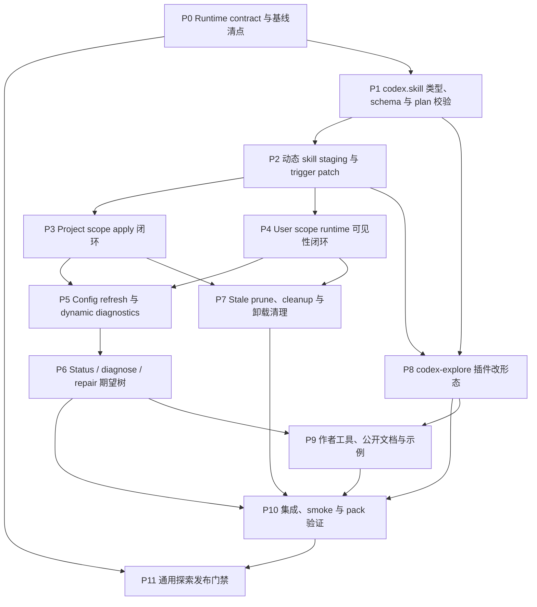

# Codex Explore Skill 重设计执行计划

日期：2026-05-09  
来源：[`../specs/codex-explore-skill-redesign.md`](../specs/codex-explore-skill-redesign.md)  
状态：已完成（P0-P11 已验收；通用只读探索按当前会话工具和权限发布）

## 需求来源

本计划落实 `docs/dev/specs/codex-explore-skill-redesign.md`。如果实现过程中发现 Codex runtime、AW 动态 artifact contract 或 skill 触发语义与 spec 不一致，先同步更新 spec 和本计划，再继续实现。

本轮目标是把 `codex-explore` 从“轻量 developer instruction + 专用 `codex-explorer` role + 手动代码库 skill”改成唯一入口 `$codex-explore` 的通用只读探索 workflow。通用探索能力来自 `spawn_agent` 子代理继承当前会话工具/权限，并由 `$codex-explore` prompt 明确资料来源、只读边界和输出要求；不是宣称内置 `explorer` role 自带不受限制的外部来源合同。仓库内交付重点是：

- 新增或等价实现受管动态 skill artifact target，建议命名为 `codex.skill`。
- 移除 `codex-explore` 的轻量 instruction 和专用 agent role 产品入口。
- 保留 `explorerModel` 和 `modelReasoningEffort`，并让已安装 skill 在配置变化后自动刷新。
- 让 project scope 和 user scope 都走动态 skill apply、status、diagnose、repair、cleanup、uninstall 和 config refresh 的统一闭环。
- 修复 renderer 模板 dedent，避免生成 Markdown/TOML 时泄漏 JS 模板缩进。
- 同步插件作者工具、公开文档和 smoke/pack 验证，避免继续把旧形态当成推荐示例。

基于本轮审查后的开发阶段约束，当前计划只是不承担“旧基线已安装 `codex-explore` 自动迁到新 `codex.skill` 基线”的兼容迁移合同。也就是说，旧 `kind = "skill"` static tracking、旧 `lightweight-instruction`、旧 `codex-explorer-role` 到新 dynamic skill identity 的一次性迁移不作为本轮交付项；如果实现或测试阶段发现必须兼容真实旧安装，需要先回到设计评审，在“原地升格旧 artifact identity”和“stale prune 遇到同路径同 `artifactKey` 时 preserve”之间做明确选择，不能临时加 path-only 特例。

这不影响新基线下的升级清理合同。`codex.skill` 基础设施落地后，后续版本如果移除、改名、替换或改变 dynamic skill artifact，upgrade stale prune、cleanup、uninstall、repair/status/diagnose 仍必须按新基线 identity 和 ownership 处理 AW-owned 残留，并保护非 AW-owned 同名 skill。

## 执行边界

本轮覆盖：

- `ArtifactTarget` / manifest schema / artifact plan schema / install record artifact identity / diagnostic cache 对 `codex.skill` 的识别。
- 动态 skill 的 renderer plan 校验、写盘、rollback、install record、project artifact identity、diagnostic cache、status、diagnose、repair、uninstall 和 config refresh。
- 新 `codex.skill` 基线建立后的插件升级清理合同：后续 manifest/renderer 变化导致 dynamic skill artifact 被移除、改名或替换时，upgrade stale prune 必须清理 AW-owned 旧 dynamic skill，并保留非 AW-owned 同名 skill。
- 静态 skill materialization 与动态 skill 的同名 `skillKey` 协调，避免同一路径被两套真值重复写入。
- 静态 skill materialization 的所有写盘入口，包括 install / upgrade / repair / config refresh 主链路、shared runtime owner claim / refresh / takeover / release、owner replay、本地 marketplace rebuild replay，以及 uninstall 后的 preference 重选。
- Codex project scope 写 `.agents/skills/<skillKey>`。
- Codex user scope 写 Codex runtime 实际可见的受管 skill 目录，并在提交后执行 native install 或刷新 native materialized cache。
- `skillTriggerPreference` 在 install / upgrade / repair / refresh 中的保留和 patch。
- 新 manifest、refresh、repair、cleanup 和 uninstall 不再创建或恢复 `codex-explore` 的旧 instruction block、`codex-explorer` registration 或 role file。
- `codex-explore` manifest、renderer、skill 模板、openai policy、测试、打包产物和文档。

本轮不覆盖：

- 修改 Codex 上游 `spawn_agent` 的全局授权规则。
- 新建自定义 explorer role 或覆盖 Codex 内置 `explorer` role。
- 把 `codex-explore` 变成搜索引擎、代码索引服务、MCP server、hook 或 permission mode。
- 让 explorer 执行写文件、安装依赖、登录、购买、发布、发消息或其它有副作用的动作。
- 旧 config store 里残留 `enableLightweightInstruction` 的兼容迁移或专项回归。当前处于开发阶段，按不存在旧版 `codex-explore` 已安装配置处理；新 schema 删除该 key，`config get/list` 只展示当前配置项。
- 旧基线到新基线的自动升级迁移，包括旧 static skill tracking artifact 升格为新的 dynamic skill identity，以及旧 `lightweight-instruction` / `codex-explorer-role` 到新 `codex.skill` 形态的一次性兼容清理。

## 总体方案

### 动态 Skill 真值

`codex.skill` 采用“静态模板真值 + 当前配置 + 当前 trigger preference patch”的模型：

- 静态模板来自 `plugins/codex-explore/skills/codex-explore/`，build 后对应 runtime bundle 的 `codex/skills/codex-explore/`。
- renderer 只能为 manifest 中声明的 `skillKey = "codex-explore"` 生成运行时 skill 内容，不能声明任意落盘路径。
- apply 路径负责把 renderer 输出落盘到 project / user scope 的真实 runtime 位置，并应用当前 `skillTriggerPreference`。
- status、diagnose 和 repair 的 expected tree 必须来自“renderer 输出 + 当前 render config + 当前 trigger preference patch”，不能再用 embedded pristine skill 作为动态 skill 期望内容。
- 同名静态 skill 不再独立 materialize 到同一路径；如果复用现有 skill trigger patch 逻辑，只能把它作为 dynamic skill staging 的一步。
- 所有会调用 `materializeSkillTriggerPreference()` 或其 stage/replay/rematerialize 包装的路径，都必须识别 manifest 中声明的 dynamic `skillKey`。这些路径要么跳过同名静态 skill，要么改走 `codex.skill` staging/apply，不能通过 owner replay、marketplace rebuild 或 uninstall 后重选把同名 skill 写回静态 runtime。

### User Scope 时序

Codex user scope 不能降级为静态 skill，也不能只写 AW 源目录。写入顺序必须收敛为：

1. 校验 shared runtime owner、同名 skill 冲突和现有 artifact ownership。
2. 捕获 runtime、native materialized cache、install record、diagnostic cache 和 tracking 的 rollback baseline。
3. 运行 renderer，生成 skill staging tree。
4. 应用当前 `skillTriggerPreference`。
5. 提交 AW-managed runtime skill，并写入 artifact identity、content digest 和 config digest。
6. 执行 Codex native install 或刷新 native materialized cache，确保新会话可见。
7. 失败时回滚本次写入，或留下能被 `status` / `diagnose` 解释的 refresh failure。

### Runtime Contract 门禁

通用只读探索依赖两层 contract：内置 `explorer` role 负责承接只读探索子任务，`spawn_agent` runtime 负责让子代理继承当前会话的工具、权限和资料上下文。Codex 源码里的内置 `explorer` role 文案仍偏 `codebase questions`，但 runtime 并没有给 explorer 配置一套仅限代码库的专用工具集；`$codex-explore` 的公开能力应描述为“按当前会话可用工具、权限和用户提供材料做通用只读探索”。

因此，公开文案可以覆盖代码库、文档、网页、日志和用户材料，但必须说明：能否访问具体来源取决于当前会话工具、联网策略、权限和用户提供的上下文；不能访问来源时要说明限制，不能凭记忆补事实。

## 阶段依赖关系图

### Mermaid

### 并行调度建议

- 波次 A：先做 P0 和 P1。P0 是发布门禁调查，P1 是所有实现的类型与校验基础。
- 波次 B：P1 稳定后做 P2。P2 定下动态 skill staging 和 trigger patch 语义，是 project/user 两条 apply 线的共同依赖。
- 波次 C：P3 和 P4 可由两个执行者并行，一个负责 project scope，一个负责 user scope。两边需要共享 P2 的 staging API 和 artifact identity 字段。
- 波次 D：P5 依赖 P3/P4 的写入闭环；P8 可在 P2 后并行推进插件 renderer、manifest 和 skill 文案。
- 波次 E：P6 和 P7 在 P5、P3/P4 稳定后分别推进；P9 可在 P8 与 P6 的诊断语义明确后写文档和作者工具。
- 波次 F：P10 汇总完整验证。P11 只做发布判断，不再大改基础设施。

## 阶段计划

### 阶段 P0：Runtime Contract 与基线清点

依赖：无  
建议并行：可由一个执行者调查 runtime contract，另一个执行者只读清点当前 AW 代码路径和 fixture。

任务：

- [x] 确认 Codex 内置 `explorer` role 的 contract 是否允许读取代码库之外的文档、网页、日志和用户材料。
- [x] 确认主 agent 是否允许把网络、官方文档、长日志、PR / issue 和用户材料作为 explorer prompt 的资料来源。
- [x] 记录 runtime contract 边界：通用探索依赖当前会话可用工具、权限、联网策略和用户提供材料，不能承诺访问当前会话不可达的来源。
- [x] 梳理现有动态 artifact 入口：`packages/cli/src/utils/artifact-plan.ts`、`generated-artifacts.ts`、`artifact-renderer.ts`、`artifact-refresh.ts`、`manifest.ts`、`rendered-contract.ts`。
- [x] 梳理现有 Codex project/user 写入入口：`packages/cli/src/adapters/codex.ts`、`utils/codex-config.ts`、`utils/codex-native-state.ts`、`utils/codex-roles.ts`、`commands/install.ts`、`commands/upgrade.ts`、`commands/repair.ts`、`commands/uninstall.ts`、`commands/cleanup.ts`、`commands/install-state-removal.ts`。
- [x] 梳理 skill trigger 入口：`utils/skill-trigger-preferences.ts`、`install-state/shared-runtime-owner.ts`、`commands/common.ts`、install-state record 中的 `options.skillTriggerPreference`。
- [x] 梳理所有静态 materialization 调用点：安装/升级/repair/config refresh 主链路、shared runtime owner upsert/removal/replay、本地 marketplace rebuild replay、uninstall 后重选。
- [x] 记录旧基线到新基线的自动迁移为本轮非目标；同时确认新 `codex.skill` 基线下的后续 upgrade stale prune / cleanup 合同仍属于本轮范围。
- [x] 建立 fixture 清单，覆盖 project scope、user scope、同名非 AW-owned skill、手动/自动/default trigger preference、config refresh failure、shared runtime owner takeover/replay、uninstall rematerialize、local marketplace rebuild replay、cleanup residual。

验收：

- [x] 有明确记录说明内置 `explorer` 与 `spawn_agent` runtime 如何共同支撑通用只读探索，以及公开验收需要保留哪些工具/权限边界。
- [x] 后续阶段需要改动的 CLI 文件、插件文件、测试 fixture 和文档入口已经列清。
- [x] 旧基线到新基线迁移的非目标边界已经写清，且新基线下后续插件升级清理合同没有被裁掉。
- [x] 每个后续阶段都能从 fixture 清单中找到对应测试输入。

P0 执行记录：

- `/Users/LeslieChan/Desktop/codex` 源码复核显示：内置 `explorer` role 定义在 `codex-rs/core/src/agent/role.rs:368-377`，role 描述文字偏 `specific codebase questions` / `well-scoped questions on the codebase`；`codex-rs/core/src/agent/builtins/explorer.toml` 当前为空，未额外声明模型、工具或外部来源扩展合同。
- 同时，`spawn_agent` runtime 在 `codex-rs/core/src/tools/handlers/multi_agents/spawn.rs:83-104` 克隆父 turn 配置后叠加 role，`multi_agents_common.rs:225-236` 会把父 turn 的模型、工具、developer instructions、sandbox/permission 等有效配置传给子代理；v2 工具说明也写明 spawned agent 拥有 same tools。因此本轮把 `$codex-explore` 定位为通用只读探索 workflow：它可以通过 prompt 要求 explorer 使用当前会话可用来源，但不能承诺任何当前工具/权限不可访问的来源。
- P11 发布口径据此调整：不把内置 `explorer` 说成“自带不受限制外部访问能力”的 role，而是把 `$codex-explore` 说成“按当前会话工具、权限和上层策略调度通用只读探索”的 workflow。公开文案可以覆盖网页、官方文档、长日志、PR / issue 和用户材料，但必须保留工具可用性、联网要求、官方文档优先和无法访问时说明限制的约束。
- 动态 artifact 基线入口集中在 `packages/cli/src/utils/manifest.ts`、`artifact-plan.ts`、`generated-artifacts.ts`、`artifact-renderer.ts`、`artifact-refresh.ts`、`rendered-contract.ts`。当前 schema / plan / refresh 只识别 `codex.developerInstructionsBlock` 和 `codex.agentRole`，其中 `artifact-plan.ts` 仍把 project scope 的 Codex dynamic target 统一视为 config-backed。
- Codex project / user 写入主链路集中在 `packages/cli/src/adapters/codex.ts`、`commands/install.ts`、`commands/repair.ts` 和 `utils/artifact-refresh.ts` 的 `installExtensions()` 调用；旧 instruction / role 路径依赖 `utils/codex-config.ts`、`utils/codex-roles.ts` 和命令层的 status / diagnose / uninstall / cleanup 逻辑。
- 静态 skill materialization 入口集中在 `utils/skill-trigger-preferences.ts` 的 `materializeSkillTriggerPreference()`、`replaySkillTriggerPreferencesFromLedger()`、`rematerializeSkillTriggerPreferenceAfterUninstall()`，以及 `install-state/shared-runtime-owner.ts`、`utils/local-marketplace.ts`、`commands/uninstall.ts`、`commands/install-state-removal.ts` 的 owner replay、marketplace replay 和 uninstall/cleanup rematerialize 路径。
- 后续测试入口已确认：`manifest.test.ts`、`artifact-plan.test.ts`、`generated-artifacts.test.ts`、`rendered-contract.test.ts`、`artifact-refresh.test.ts`、`skill-trigger-preferences.test.ts`、`codex-project-safety.test.ts`、`codex-project-installability.test.ts`、`install-state-shared-runtime-owner.test.ts`、`local-marketplace.test.ts`、`uninstall-command.test.ts`、`cleanup-command.test.ts`、`codex-explore-plugin.test.ts`，以及 `packages/cli/tests/fixtures/codex-project-repo-managed/`。

### 阶段 P1：`codex.skill` 类型、Schema 与 Plan 校验

依赖：P0 的代码路径清点  
建议并行：类型/schema、manifest normalizer、artifact plan validator、install-state identity 可拆分，但需要一个人统一字段名。

任务：

- [x] 扩展 `ArtifactTarget`、`DynamicArtifactKind`、`ArtifactPlanArtifact` 和 generated artifact schema，新增 `target = "codex.skill"` 或实现阶段确认的等价 target。
- [x] manifest schema 支持 `skillKey`、`projectManagedKind = "skill"`、`refreshKeys` 和 `states`，并要求 `skillKey` 静态声明。
- [x] artifact plan validator 接受声明过的 `codex.skill`，拒绝未声明 target、缺 `skillKey`、`skillKey` 不匹配、renderer 输出任意落盘路径、content 缺 `SKILL.md` 或 `agents/openai.yaml`。
- [x] 拆掉“project-scope Codex dynamic target 必须声明 `requiresCodexProjectConfig: true`”的旧通用假设，改成按 target 语义判断：`codex.developerInstructionsBlock` 和 `codex.agentRole` 仍是 config-backed target，`codex.skill` project scope 不要求 `.codex/config.toml` 访问。
- [x] install record artifact identity 支持 dynamic skill：记录 `id`、`target`、`artifactKey = skillKey`、`state` 和必要路径归属字段。
- [x] project artifact shared identity 支持 `kind = "skill"` / `projectManagedKind = "skill"`，并写入 repo-stable artifact identity。
- [x] dynamic diagnostic cache 支持 `codex.skill` 的 accepted state、`contentDigest`、`configDigest`、`lastRefresh`、`refreshReach` 和 failure 摘要。
- [x] discovery、installability、project write safety preflight 和 current catalog capability 判断读取 manifest target，不从 renderer 输出倒推能力。
- [x] 更新 `codex-project-surface` 和 historical tracking fallback：`codex.skill` 的 project installability、capability snapshot、status、diagnose 和 tracking-only historical path 都不能因为缺少 `requiresCodexProjectConfig` 而被当成 `.codex/config.toml` backed artifact。
- [x] 从新 manifest config schema 中移除 `enableLightweightInstruction`，并确认 schema、status、upgrade、refresh 和 config get/list 只依赖当前配置项。

验收：

- [x] 单元测试覆盖合法 `codex.skill` manifest target 和合法 renderer plan。
- [x] 单元测试覆盖缺 `skillKey`、`skillKey` 不匹配、未声明 target、任意 path、缺 skill 文件、缺 `openai.yaml` 都被拒绝。
- [x] 单元测试覆盖 `codex.skill` project scope 不需要 `requiresCodexProjectConfig: true`，同时旧 config-backed target 仍按原语义要求 `.codex/config.toml` 访问。
- [x] install record / project identity schema 能保存 dynamic skill artifact identity，且不要求保存完整 snapshot。
- [x] project installability / current catalog capability / historical tracking fallback 能把 `codex.skill` 识别为 project-managed skill，而不是 config-backed instruction 或 role。
- [x] `aw config get/list` 只展示 `explorerModel` 和 `modelReasoningEffort`；本轮不要求旧 `enableLightweightInstruction` 残留兼容回归。

P1 执行记录：

- 已接入 `codex.skill` 的类型、manifest schema、artifact plan 校验、generated artifact / install-state identity、Codex project capability 和 historical fallback。`codex.skill` 当前被识别为 project-managed `skill`，不再走 `.codex/config.toml` backed instruction / role 假设。
- P1 只完成 schema、identity、plan 和 capability 基础；staging、apply、refresh、repair、uninstall 和 status/diagnose expected tree 留到 P2 之后实现。
- 验证命令：`pnpm --filter @yiliang/aw exec vitest run tests/unit/manifest.test.ts tests/unit/artifact-plan.test.ts tests/unit/generated-artifacts.test.ts tests/unit/install-state-schema.test.ts tests/unit/codex-project-installability.test.ts tests/unit/codex-project-platform-gates.test.ts tests/unit/codex-project-read-only-catalog.test.ts tests/unit/codex-project-safety.test.ts`，结果为 8 个测试文件、120 个测试全部通过。

### 阶段 P2：动态 Skill Staging 与 Trigger Patch

依赖：P1  
建议并行：staging tree API、trigger patch 复用、静态 materialization 排除规则可以并行，但需要同一组 fixture 校验最终树。

任务：

- [x] 新增 dynamic skill staging 模型，表达至少两个文件：`SKILL.md` 和 `agents/openai.yaml`。
- [x] 复用或抽取现有 `materializeSkillTriggerPreference()` 中的 trigger patch 逻辑，让它能作用在 staging tree 上。
- [x] 实现 `default` / `auto` / `manual` 真值表：默认和 auto 生成 `allow_implicit_invocation: true`，manual 生成 `false`。
- [x] 安装、升级、repair 和 config refresh 计算静态 skill 写入集合时，排除 manifest 中声明为 dynamic skill 的同名 `skillKey`。
- [x] shared runtime owner claim / refresh / takeover / release、owner replay、本地 marketplace rebuild replay、uninstall 后 preference 重选也必须使用同一套 dynamic `skillKey` 排除规则。
- [x] 如果复用静态 skill materialization，只能作为 dynamic skill apply 内部的 patch 步骤，不能独立写同一路径，也不能通过 replay/rematerialize 旁路写回同一路径。
- [x] expected tree helper 统一返回“renderer 输出 + 当前 render config + 当前 trigger preference patch”。
- [x] content digest 基于最终 staging tree 计算，而不是基于 renderer 原始输出或 embedded pristine skill。

验收：

- [x] 单元测试覆盖 `default`、`auto`、`manual` 三种安装偏好在 staging `openai.yaml` 中的结果。
- [x] 安装同名 dynamic skill 时，静态 materialization 不会先写 `.agents/skills/<skillKey>`。
- [x] shared runtime owner takeover/replay、uninstall 后重选和 local marketplace rebuild replay 不会把 dynamic skill 回退成静态 materialization。
- [x] 修改 trigger preference 后，expected tree 和 content digest 随最终 runtime 内容变化。
- [x] 修改 embedded pristine skill 但 renderer 输出不变时，dynamic expected tree 不被静态模板比较链误判。

P2 执行记录：

- 已新增 `packages/cli/src/utils/codex-skill-staging.ts`，用 renderer plan 的 `content.skillFile` / `content.openaiYaml` 生成 dynamic staging / expected tree，并按当前 `skillTriggerPreference` patch `agents/openai.yaml`。
- 静态 skill trigger materialization 入口已统一排除 manifest 中声明为 `codex.skill` 的同名 `skillKey`；install / upgrade / repair / refresh 主链路、shared runtime owner replay、本地 marketplace rebuild replay 和 uninstall rematerialize 会继承这套排除规则，避免把 dynamic skill 写回静态 runtime。
- 验证命令：`pnpm --filter @yiliang/aw exec vitest run tests/unit/skill-trigger-preferences.test.ts tests/unit/artifact-plan.test.ts tests/unit/install-state-shared-runtime-owner.test.ts tests/unit/local-marketplace.test.ts tests/unit/uninstall-command.test.ts tests/unit/repair-command.test.ts`，结果为 6 个测试文件、85 个测试全部通过。

### 阶段 P3：Project Scope Apply 闭环

依赖：P2  
建议并行：project 写盘、project identity、冲突检查和 install/upgrade 接入可拆分。

任务：

- [x] 为 `codex.skill` 实现 project scope apply：把 staging tree 写入 `.agents/skills/<skillKey>`。
- [x] project scope preflight 和 apply 不要求读写 `.codex/config.toml`，只检查 `.agents/skills/<skillKey>`、repo artifact identity、managed marker 和同名 skill ownership。
- [x] 写入前复用 repo artifact / native runtime 冲突检查，拒绝覆盖同名但无 AW ownership 证明的 skill。
- [x] 写入 project artifact shared identity，`projectManagedKind` 映射为 `skill`，artifact identity 包含 `id`、`target`、`artifactKey`、`state`。
- [x] install / upgrade 成功后记录唯一 dynamic skill artifact，不再记录 instruction 或 agent role。
- [x] project scope uninstall 删除 AW-owned `.agents/skills/<skillKey>` 和 project artifact identity，不删除非 AW-owned 同名 skill。
- [x] project scope repair 从 renderer 重新生成 staging tree 并应用 trigger patch，不能从 bundle 直接复制同名静态 skill。
- [x] project scope adopt-existing 只在 shared identity、AW marker 或 stable artifact identity 能证明归属时认领。

验收：

- [x] Codex project scope 安装后只产生 `.agents/skills/codex-explore`，不写 `.codex/config.toml` 的 developer instruction，不写 `[agents.codex-explorer]`。
- [x] Codex project scope 安装、status 和 diagnose 在仓库没有 `.codex/config.toml` 写权限或该文件不存在时仍能围绕 `.agents/skills/codex-explore` 完成判断，不把 dynamic skill 当作缺失 config-backed artifact。
- [x] project install record 只记录一个 `target = "codex.skill"`、`artifactKey = "codex-explore"` 的 dynamic artifact。
- [x] manual trigger 安装后 project runtime `agents/openai.yaml` 关闭自动触发。
- [x] repair 修改过的 dynamic skill 时，回写内容来自 renderer + config + trigger patch，不来自 embedded pristine skill。
- [x] 非 AW-owned 同名 skill 存在时，install / repair / upgrade 在写入前拒绝并给出可诊断信息。

P3 执行记录：

- Project scope 已接入 `codex.skill` apply，按 renderer 输出和当前 trigger preference 写入 `.agents/skills/<skillKey>`，tracking / install-state / project artifact identity 记录 `target = "codex.skill"`、`artifactKey = skillKey`、`contentDigest` 和 `configDigest`。
- Project scope 的 install、status、diagnose、repair、uninstall 已按 repo-managed skill 语义处理，不再要求 `.codex/config.toml`；repair 重新走 renderer + staging，不从 embedded static skill 复制。
- 非 AW-owned 同名 skill、path-only adopt-existing、uninstall 后外部同名 skill 保护都已有测试覆盖。
- 验证命令包含 P3/P4 合并子集及补验收子集；最终补验收命令 `pnpm --filter @yiliang/aw exec vitest run tests/unit/codex-project-safety.test.ts tests/unit/repair-command.test.ts tests/unit/uninstall-command.test.ts tests/unit/cleanup-command.test.ts tests/integration/codex-explore-plugin.test.ts tests/unit/install-state-evidence.test.ts` 通过，6 个测试文件、99 个测试全部通过。

### 阶段 P4：User Scope Runtime 可见性闭环

依赖：P2  
建议并行：user runtime 写入、native install/cache refresh、rollback baseline 和 marker/diagnostic 可并行推进。

任务：

- [x] 确认 Codex user runtime 实际读取的受管 skill 位置，以及 AW runtime 与 native materialized cache 的同步方式。
- [x] user scope apply 写入 AW-managed runtime skill tree，并确保它是 native install/cache refresh 读取的来源。
- [x] user scope install / upgrade 顺序固定为：preflight、rollback baseline、render staging、trigger patch、commit runtime skill、native install 或 cache refresh、record/diagnostic 提交。
- [x] user scope 配置刷新只重跑 renderer 和 trigger patch，再更新 runtime skill 与 native materialized cache，不重放 lifecycle，不恢复旧 instruction / role。
- [x] 失败时回滚 runtime skill、native materialized cache 和相关 tracking；无法完全回滚时写入 dynamic diagnostic failure。
- [x] 写入前检查 shared runtime owner、同名 skill 外部 ownership 和现有 AW-owned artifact ownership。
- [x] shared runtime owner 的 upsert/removal/replay 阶段不能独立 materialize 同名 dynamic skill；需要改走 dynamic skill apply，或在 owner 流程中明确跳过该 `skillKey`。
- [x] user scope uninstall 删除 AW-owned runtime skill，并刷新 native materialized cache；不删除外部同名 skill。

验收：

- [x] Codex user scope 安装后，新会话可读到动态生成的 `$codex-explore` skill 内容。
- [x] 安装使用自定义 `explorerModel` / `modelReasoningEffort` 后，user runtime skill 包含对应配置值。
- [x] native install/cache refresh 不会读到旧静态 skill 或 stale staging。
- [x] user scope manual trigger 安装后，runtime `openai.yaml` 关闭自动触发，后续 refresh 仍保持 manual。
- [x] 任一写入步骤失败时，status / diagnose 能解释 rollback 后状态或 refresh failure，不报告假成功。

P4 执行记录：

- User scope `codex.skill` 的 AW-managed runtime 来源确定为 `~/.aw/plugins/<plugin>/codex/skills/<skillKey>`，native install / cache refresh 在 dynamic skill 写入后执行，确保新会话读取到 renderer + trigger patch 后的内容。
- User scope install / upgrade / refresh 已捕获 runtime skill 与 native materialized cache rollback baseline；refresh 失败会回滚 runtime/cache 并写入可诊断 failure，不恢复旧 instruction / role。
- User scope uninstall 已覆盖只清 AW-owned dynamic skill、刷新 native cache、保留外部同名 skill；manual trigger refresh 后 runtime/native cache 保持 `allow_implicit_invocation: false`。
- User dynamic skill repair 的完整 native cache 回写属于 P6 的 repair expected tree 闭环；cleanup residual 属于 P7 的 cleanup/stale prune 闭环，本阶段不提前扩张。

### 阶段 P5：Config Refresh 与 Dynamic Diagnostics

依赖：P3、P4  
建议并行：refresh planner、diagnostic cache、receipt/JSON 输出可并行。

任务：

- [x] `aw config set/unset/reset` 命中 `explorerModel` 或 `modelReasoningEffort` 时，把 `codex.skill` 纳入 dynamic artifact refresh。
- [x] “重新应用配置”/ `reapplyConfigRefresh()` 也必须覆盖 `codex.skill`，并沿用同一套 refresh unit 收集、`refreshKeys` 判定、trigger patch、rollback、native cache refresh 和失败诊断逻辑。
- [x] refresh 使用当前 location 的 `skillTriggerPreference`，保留 `manual` / `auto` / `default` 选择。
- [x] user config 写入刷新 user target，并在当前 repo 可定位 project target 时刷新当前 repo；project shared config 写入只刷新当前 repo project target。
- [x] refresh 成功后更新 dynamic diagnostic cache 的 accepted state、`contentDigest`、`configDigest`、`lastRefresh` 和 `refreshReach`。
- [x] refresh 成功后同步更新 install record 与 project artifact identity 中的 dynamic skill artifact identity、`contentDigest` 和 `configDigest`，避免 status、diagnose、cleanup 或 stale prune 继续读取旧 identity。
- [x] refresh 失败时写入 failure 摘要，保留上一份 accepted state，不重放 lifecycle，不恢复旧 instruction / role。
- [x] receipt / JSON 输出包含 attempted artifact、trigger keys、scope reach、success/failure 和下一步。

验收：

- [x] 修改 `explorerModel` 后，project scope 和 user scope 的已安装 skill 自动刷新到新模型值。
- [x] 修改 `modelReasoningEffort` 后，runtime skill 自动刷新到新 reasoning effort。
- [x] “重新应用配置”/ refresh-only 路径能命中 `codex.skill`，并刷新 runtime skill 与 native materialized cache。
- [x] config refresh 保留安装时的 `manual` / `auto` / `default` 触发偏好。
- [x] refresh 成功后，install record 和 project artifact identity 的 dynamic skill digest / identity 与最新 runtime 内容一致，后续 status / diagnose 不会继续按旧 identity 报 stale 或 drift。
- [x] refresh 失败后，默认 status / diagnose 能看到 recent refresh failed，且不丢上一份 accepted digest。
- [x] refresh 不会重新创建旧 `lightweight-instruction` 或 `codex-explorer-role`。

P5 执行记录：

- `aw config set/unset/reset` 与 `reapplyConfigRefresh()` 已覆盖 `codex.skill`。user config 写入会刷新 user target，并在当前 repo 可定位时刷新 current-project target；project shared config 只刷新当前 repo project target。
- Refresh 成功后会同步 install record、project artifact identity 和 dynamic diagnostic cache 的 `configDigest`、`contentDigest`、accepted state、`lastRefresh`、`refreshReach`；失败时保留上一份 accepted digest，只写 failure 摘要，不重放 lifecycle，不恢复旧 instruction / role。
- Receipt / JSON 输出补充 attempted artifact、trigger keys、scope reach、success/failure 和 next steps。
- 验证命令：`pnpm --filter @yiliang/aw exec vitest run tests/unit/artifact-refresh.test.ts tests/unit/config-write.test.ts tests/unit/command-receipt.test.ts tests/unit/diagnose-command.test.ts tests/unit/status-dependencies.test.ts tests/integration/codex-explore-plugin.test.ts`，结果为 6 个测试文件、74 个测试全部通过。

### 阶段 P6：Status / Diagnose / Repair 期望树

依赖：P5  
建议并行：status 默认只读、diagnose deep、repair dynamic skill 可拆分。

任务：

- [x] status / 默认 diagnose 在不执行 renderer 的前提下，使用 dynamic diagnostic cache 判断 content drift、config stale 和 recent refresh failed。
- [x] `diagnose --deep` 可以执行 renderer，计算当前配置和 trigger patch 下的 expected tree，但不写 diagnostic cache。
- [x] status / diagnose 输出能解释 `codex.skill` 的 missing、drift、disabled、config stale、refresh failed 和 diagnostic unavailable。
- [x] repair 对 `codex.skill` 重新运行 renderer、应用 trigger patch、写回 runtime skill，并更新 diagnostic cache。
- [x] repair 不从 runtime bundle 直接复制同名静态 skill，不把 dynamic skill 修回 embedded pristine 模板。
- [x] status / repair / diagnose 不把已经从当前 manifest 移除的 instruction / role 产品入口当成缺失能力；如果遇到旧 tracking，按本轮非目标边界给出明确提示，而不是隐式迁移。
- [x] JSON 字段稳定表达 `target = "codex.skill"`、`artifactKey = "codex-explore"`、content/config digest、trigger preference 和 refresh failure。

验收：

- [x] 默认 status 不执行 renderer；修改 dynamic skill 文件后能通过 cache 报 content drift。
- [x] 修改配置但未 refresh 时，默认 status / diagnose 报 config stale，不执行 renderer。
- [x] `diagnose --deep` 能渲染当前 expected tree，并显示 skill 文件差异来源。
- [x] repair 后 dynamic skill 内容与当前配置和 trigger preference 一致。
- [x] 修改 `explorerModel` 后，repair 不会把 skill 回写成 embedded 默认模型。

P6 执行记录：

- 默认 `status` / `diagnose` 保持只读，不执行 renderer；它们通过 dynamic diagnostic cache、tracking digest 和当前 config digest 判断 drift、config stale 与 recent refresh failed。
- `diagnose --deep` 会为 `codex.skill` 渲染当前 expected tree 并输出文件级差异来源；repair 会重新渲染、应用 trigger patch、写回 project/user runtime，user scope repair 会刷新 native cache。
- 已移除的旧 instruction / role tracking 不再被当作当前 manifest 的缺失能力隐式修复；旧基线迁移仍按非目标边界处理。
- P6/P7 合并验证命令：`pnpm --filter @yiliang/aw exec vitest run tests/unit/status-dependencies.test.ts tests/unit/diagnose-command.test.ts tests/unit/repair-command.test.ts tests/unit/adapter-status.test.ts tests/unit/upgrade-command.test.ts tests/unit/cleanup-command.test.ts tests/unit/uninstall-command.test.ts tests/unit/install-state-status-projection.test.ts tests/unit/local-marketplace.test.ts tests/integration/codex-explore-plugin.test.ts`，结果为 10 个测试文件、142 个测试全部通过。

### 阶段 P7：Stale Prune、Cleanup 与卸载清理

依赖：P3、P4  
建议并行：project stale prune、user stale prune、ownership safety、cleanup/uninstall 兼容可拆分。

任务：

- [x] stale prune 不只覆盖 `Codex + project scope`，也覆盖 `Codex + user scope` 的 dynamic skill artifact。
- [x] desired artifact diff 支持 dynamic skill artifact identity，使用 `id + target + artifactKey` 识别当前 dynamic skill，不能退化为 path-only 删除。
- [x] 新基线下后续插件升级必须能清理 stale dynamic skill：当新 manifest/renderer 不再声明某个 AW-owned `codex.skill` artifact，或用新的 `id + target + artifactKey` 替换它时，upgrade stale prune 按 ownership 删除旧 runtime skill 和对应 identity/cache。
- [x] 本轮不实现旧 static skill artifact 到新 dynamic identity 的自动迁移；如果未来要恢复旧基线升级兼容，先在设计里选择“原地升格旧 artifact identity”或“同路径同 `artifactKey` preserve”其中一种策略。
- [x] user scope stale prune 在改写用户级 Codex config、runtime skill 或 native materialized cache 前捕获 rollback baseline。
- [x] cleanup、repair、uninstall 和 status/diagnose 能解释当前 dynamic skill 的 tracking、diagnostic cache 与残留状态，不把同名 skill 修回或清回静态 materialization。
- [x] stale prune、cleanup 和 refresh 的 desired artifact 集合只来自当前 manifest / renderer，不再根据旧 `enableLightweightInstruction` 或旧 artifact target 恢复 instruction / role。

验收：

- [x] dynamic skill 的 current tracking 和 desired artifact diff 不会把刚写好的 `.agents/skills/<skillKey>` 或 user runtime skill 当作 stale 删除。
- [x] 新基线安装后升级到“移除或替换 dynamic skill artifact”的新 manifest 时，AW-owned 旧 dynamic skill 被清理，非 AW-owned 同名 skill 不被误删。
- [x] cleanup residual dynamic skill 时，不误报缺失、不恢复旧 instruction / role，也不把 dynamic skill 回退成 static materialization。
- [x] 同名非 AW-owned skill 不会被 uninstall、cleanup、repair 或 stale prune 覆盖/误删。
- [x] user scope stale prune 或 cleanup 失败会回滚本次 config/runtime/native cache 写入，或留下稳定可诊断状态。
- [x] status / diagnose 不把已移除的 instruction / role 产品入口误报为新版本仍缺失的能力。

P7 执行记录：

- Stale prune 已覆盖 Codex project 与 user scope 的 dynamic skill artifact，并使用 `id + target + artifactKey` 判断 desired/current identity；`codex.skill` 不再走 path-only 删除或旧基线静默迁移。
- 新基线后 manifest/renderer 移除或替换 dynamic skill artifact 时，AW-owned runtime skill、native cache、project identity、diagnostic cache 与 tracking 会按 ownership 清理，非 AW-owned 同名 skill 受保护。
- Cleanup residual dynamic skill 不恢复旧 instruction / role，也不回退为 static skill materialization；cleanup / uninstall / stale prune 与 status / diagnose 的残留解释已通过集成测试覆盖。

### 阶段 P8：`codex-explore` 插件改形态

依赖：P1、P2  
建议并行：manifest、renderer、skill 文案、测试可拆分，但 renderer plan 字段必须与 P1 保持一致。

任务：

- [x] 更新 `plugins/codex-explore/.agents-plugin/plugin.json`：移除 `enableLightweightInstruction`、`lightweight-instruction` target、`codex-explorer-role` target 和 `roleKey = "codex-explorer"`。
- [x] manifest 新增 dynamic skill target：`id = "codex-explore-skill"`、`target = "codex.skill"`、`skillKey = "codex-explore"`、`projectManagedKind = "skill"`、`refreshKeys = ["explorerModel", "modelReasoningEffort"]`。
- [x] 保留 `skills = "./skills"` 和 `skillTriggers.codex-explore.allowInstallOverride = true`。
- [x] 删除 `buildConfig.fileRules.codex` 中旧的 `instructions/**` 和 `roles/**` 额外复制规则；`skills = "./skills"` 仍由构建器自动复制到 runtime bundle 的 `codex/skills/**`，不能把 `codex/skills/**` 当成 `fileRules` 输入路径。
- [x] 如果后续确实需要额外文件，`fileRules.codex.include/exclude` 只能写相对插件根目录的 source glob，并且只用于 manifest 未声明的额外文件。
- [x] 删除或停止发布 `plugins/codex-explore/instructions/lightweight.md` 和 `plugins/codex-explore/roles/codex-explorer.md`。
- [x] 重写 `scripts/render-artifacts.mjs`，只生成 `codex-explore-skill` dynamic skill artifact。
- [x] renderer 从静态模板读取 `SKILL.md` / `agents/openai.yaml`，把 `explorerModel` 和 `modelReasoningEffort` 插入 skill 运行时内容。
- [x] 修复 `trimBlock()`：先 trim 首尾空白，再按非空行公共缩进 dedent，保留相对缩进和空行。
- [x] 更新 `skills/codex-explore/SKILL.md`，不再提 `codex-explorer`，明确使用内置 `explorer`，覆盖代码库、文档、网络、长日志和用户材料，写清只读边界、并发限制、等待和关闭要求。
- [x] `SKILL.md` 必须写明网络、文档和时间敏感事实探索要遵守当前会话工具可用性、联网要求、官方文档优先规则和上层安全策略；`explorer` 子代理继承当前会话可用工具和权限，无法访问来源时说明限制，不能凭记忆补事实。
- [x] `SKILL.md` 必须要求每个 explorer prompt 包含范围、资料来源、具体问题、探索深度、只读边界和期望输出；探索深度只允许 `quick`、`medium`、`very thorough`。
- [x] `SKILL.md` 必须写明 explorer 运行时主 agent 不重复调查同一个问题，`wait_agent` timeout 要按任务规模、资料量、探索深度和 explorer 数量设置，避免短 timeout 频繁空转；已经启动 explorer 后必须等待并读取结果，不能因暂时无结果就关闭并自行重复完成。
- [x] `SKILL.md` 必须写明结果整合只保留关键结论、证据路径或链接、必要行号、来源时间和不确定点；整合后立即 `close_agent`，并说明 `wait_agent` 不等于关闭 agent。
- [x] `SKILL.md` 必须写明如果配置的 `explorerModel` 不可用，主 agent 要先说明当前 workflow 默认模型不可用，再按用户最新指示处理，不能静默换模型。
- [x] 更新 `skills/codex-explore/agents/openai.yaml`，默认 `policy.allow_implicit_invocation = true`；`interface.short_description` 覆盖“代码库、文档、网络和大上下文的只读探索与多源证据总结”；`interface.default_prompt` 明确使用 `$codex-explore` 做只读探索，并允许代码库、文档、网络资料和用户提供数据作为来源。
- [x] 更新插件级 renderer 测试，覆盖默认配置、自定义模型、无旧 artifact、无缩进泄漏、skill 文案细项和 openai policy。

验收：

- [x] renderer 默认只生成一个 `id = "codex-explore-skill"`、`target = "codex.skill"` 的 artifact。
- [x] renderer 不再生成 `lightweight-instruction` 或 `codex-explorer-role`。
- [x] 生成的 `SKILL.md` 包含配置传入的 `model` 和 `reasoning_effort`，且不包含 `codex-explorer`。
- [x] 生成的 `SKILL.md` 锁住 spec 的行为 contract：网络/文档来源约束、prompt 必填字段、探索深度枚举、主 agent 不重复调查、`wait_agent` timeout 策略、结果整合字段、`close_agent` 要求和 `explorerModel` 不可用处理都存在。
- [x] 生成内容没有 JS 模板缩进泄漏；中文段落、列表、嵌套缩进和空行测试通过。
- [x] 源码 `openai.yaml` 默认允许自动触发。
- [x] 源码 `openai.yaml` 的 `interface.short_description` 明确覆盖代码库、文档、网络和大上下文的只读探索与多源证据总结；`interface.default_prompt` 明确使用 `$codex-explore`，并允许代码库、文档、网络资料和用户提供数据作为资料来源。
- [x] runtime bundle 里的 `codex/skills/codex-explore/**` 来自 `skills = "./skills"` 的自动产物，不依赖 `fileRules`。
- [x] runtime bundle 不包含旧 `codex/instructions/lightweight.md` 和旧 `codex/roles/codex-explorer.md`。

P8 执行记录：

- `codex-explore` 插件源码已改为唯一 dynamic skill 入口：manifest 只声明 `codex-explore-skill` / `codex.skill`，renderer 只输出 dynamic skill artifact，旧 lightweight instruction 与专用 role 源文件已删除。
- Skill 模板改为内置 `explorer` workflow，包含只读边界、网络/文档来源约束、prompt 必填字段、深度枚举、等待策略、结果整合、`close_agent` 和模型不可用处理；`agents/openai.yaml` 默认允许自动触发。
- 验证命令：`node plugins/codex-explore/scripts/render-artifacts.test.mjs`，结果通过。最终 runtime bundle / pack 产物验证留到 P10 smoke/pack。

### 阶段 P9：作者工具、公开文档与示例

依赖：P8、P6  
建议并行：公开文档和 `.agents/skills/create-agent-workflows-plugin/` 可分开做，最后统一术语。

任务：

- [x] 更新 `docs/plugin-authoring.md`，新增 `codex.skill` target、`skillKey`、content schema、refreshKeys、trigger patch、静态模板真值和 renderer 禁止直接写盘的说明。
- [x] 更新 `docs/plugin-installation.md`，说明 dynamic skill 的安装、trigger override、config refresh、status/diagnose/repair 和 user/project scope 可见性。
- [x] 更新 `docs/architecture.md`，纳入 `codex.skill` 在三层分发模型、dynamic artifact apply、diagnostic cache 和 stale prune 中的位置。
- [x] 更新 `docs/coding-conventions.md`，补充改动 dynamic skill、skill trigger 或 Codex artifact 时需要同时检查的模块。
- [x] 更新 `.agents/skills/create-agent-workflows-plugin/` 的 manifest 校验、模板、示例、references 和测试 fixture。
- [x] 移除或替换旧的 dynamic instruction + dynamic role 示例，避免作者继续把配置驱动 skill 写成 lifecycle 直接改文件。
- [x] 在文档中标注通用只读探索的 runtime contract：`explorer` 子代理按当前会话工具、权限、联网策略和用户材料执行，只读边界由 workflow prompt 约束。

验收：

- [x] 作者文档能让插件作者独立写出合法 `codex.skill` manifest 和 renderer plan。
- [x] 安装文档说明 `--skill-trigger manual|auto|default` 对 dynamic skill 的影响，以及 config refresh 不会重置用户选择。
- [x] 作者工具的示例不再包含 `codex.developerInstructionsBlock` + `codex.agentRole` 作为 `codex-explore` 当前形态。
- [x] 文档和作者工具测试通过，不再引用 `enableLightweightInstruction` 作为当前推荐配置。

P9 执行记录：

- 公开作者文档、安装文档、架构文档和编码约定已补齐 `codex.skill` 的 manifest 静态真值、`skillKey`、renderer content schema、refreshKeys、trigger patch、diagnostic cache、stale prune 和 user/project scope 语义。
- 作者工具 references 已把旧 dynamic instruction + dynamic role 推荐示例替换为 `codex.skill` 示例，并明确 renderer 不能直接写 `.agents/skills/**`、Codex user runtime、install record、project artifact identity 或 dynamic diagnostic cache。
- `validate_plugin.js` 已支持并校验 `codex.skill`，并拒绝 `codex.skill` 继续声明 `requiresCodexProjectConfig: true`。
- P0/P11 runtime contract 已写入公开文档和作者工具：`$codex-explore` 是通用只读探索 workflow，可以覆盖代码库、文档、网络、日志和用户材料；具体能访问哪些来源取决于当前会话工具、权限、联网策略和用户提供的上下文。
- 验证命令：`node .agents/skills/create-agent-workflows-plugin/scripts/validate_plugin.js plugins/codex-explore`、`node .agents/skills/create-agent-workflows-plugin/scripts/validate_plugin.js .agents/skills/create-agent-workflows-plugin/references/.examples/code-review`、`node --check .agents/skills/create-agent-workflows-plugin/scripts/validate_plugin.js`、`node --check .agents/skills/create-agent-workflows-plugin/scripts/init_plugin.js` 均通过；示例校验仅因目录不在 `<catalog>/plugins/<name>` 下给出预期 warning。

### 阶段 P10：集成、Smoke 与 Pack 验证

依赖：P6、P7、P8、P9  
建议并行：CLI 集成、plugin smoke、pack 内容检查可以分工，但最后要跑统一验证链。

任务：

- [x] 补齐 CLI 单元测试：manifest validator、artifact plan validator、static/dynamic skill materialization 协调、trigger preference、expected tree。
- [x] 补齐 CLI 集成测试：project install、user install、manual trigger、config refresh、status drift、diagnose deep、repair、cleanup、uninstall、dynamic stale prune、新基线后续 upgrade 清理。
- [x] 补齐 refresh-only / reapply 回归：`reapplyConfigRefresh()` 能识别 tracked `codex.skill`，按失败 refresh keys 或 tracked refresh keys 重新渲染，并在成功后更新 install record / project artifact identity。
- [x] 补齐 user scope 顺序回归：dynamic skill 进入 AW-managed runtime 后，native install/cache refresh 才执行。
- [x] 补齐 shared runtime owner 回归：`--takeover-shared-runtime`、owner replay、owner release 后不把 dynamic skill 回退成静态 materialization。
- [x] 补齐 replay/rematerialize 回归：uninstall 后 preference 重选、本地 marketplace rebuild replay 不会写回同名 static skill。
- [x] 补齐非 AW-owned 冲突测试：同名 skill 不能被覆盖或误删。
- [x] 补齐插件级 `SKILL.md` contract 回归：断言通用只读探索范围、当前会话工具/权限边界、prompt 范围/资料来源/具体问题/探索深度/只读边界/期望输出、`quick|medium|very thorough` 深度枚举、主 agent 不重复调查、按任务规模设置 `wait_agent` timeout、等待并读取结果、整合输出字段、`close_agent` 要求、`wait_agent` 不等于关闭 agent，以及 `explorerModel` 不可用时不能静默换模型。
- [x] 补齐插件级 `openai.yaml` contract 回归：断言 `interface.short_description` 定位代码库、文档、网络和大上下文的只读探索与多源证据总结；`interface.default_prompt` 明确使用 `$codex-explore` 做通用只读探索，并允许代码库、文档、网络资料和用户提供数据作为来源；默认 `policy.allow_implicit_invocation = true`。
- [x] 补齐 smoke build 测试：runtime bundle 包含由 manifest `skills` 声明自动复制的 `codex/skills/codex-explore/SKILL.md` 和 `agents/openai.yaml`，且不需要 `fileRules` 复制 skill 目录。
- [x] 补齐 pack/tarball 测试：tarball 不包含 `codex/instructions/lightweight.md` 和 `codex/roles/codex-explorer.md`。
- [x] 更新 marketplace/platform manifest 断言，不再把 `codex-explore` 报告为 instruction + agent 插件。
- [x] 运行必要验证命令：`pnpm test:unit`、`pnpm test:integration`、`pnpm test:smoke:build`、`pnpm test:smoke:pack`，必要时补跑 `pnpm build`。

验收：

- [x] 单元测试覆盖 spec 中列出的插件级、CLI 级、trigger 级和 dedent 回归。
- [x] 插件级测试逐条锁住 `SKILL.md` 行为 contract，不只检查“只读探索”这类概括性文案。
- [x] 插件级测试逐条锁住 `openai.yaml` 的 description、default prompt 和默认触发策略，不只检查“只读探索”这类概括性文案。
- [x] 集成测试证明 project scope 和 user scope 都能安装、刷新、诊断、修复、卸载 dynamic skill。
- [x] refresh-only / reapply 测试证明 `codex.skill` 会被刷新，且刷新后 status / diagnose 不会继续拿旧 install record 或 project artifact identity 报 stale。
- [x] cleanup 和 stale prune 测试证明 current dynamic skill 不会被 identity 切换或 path-only 逻辑误删；新基线后续 upgrade 能清理 AW-owned stale dynamic skill，且不会恢复旧 instruction / role。
- [x] smoke build 产物只保留 manifest `skills` 自动产出的新 skill runtime，不再依赖 `fileRules` 复制旧 instruction / role 或 skill 目录。
- [x] smoke pack / tarball 验证通过，tarball 不包含 `codex/instructions/lightweight.md` 或 `codex/roles/codex-explorer.md`。
- [x] `pnpm build`、`pnpm test:unit`、`pnpm test:integration`、`pnpm test:smoke:build`、`pnpm test:smoke:pack` 通过。

P10 执行记录：

- P10 测试侧已更新为 `codex.skill` 新形态：`codex-explore` synthetic embedded root 包含 `skills/codex-explore/SKILL.md` 与 `agents/openai.yaml`，集成测试围绕 dynamic skill 的 user/project install、refresh、status、diagnose、repair、cleanup、uninstall 和 stale prune 验收，不再期待旧 lightweight instruction 或 `codex-explorer` role。
- build/pack smoke 已锁定 runtime bundle 和 tarball：包含 `codex/skills/codex-explore/**`，不包含 `codex/instructions/lightweight.md` 或 `codex/roles/codex-explorer.md`。
- 为通过全量 build，补齐 install record dynamic artifact `state` 字段的类型、schema 和写入映射；修复 `codex.skill` 类型收窄、project root location 参数、config refresh `skipped` 状态窄化，以及显式 `allowInstallOverride: false` 不应向用户暴露“未声明 allowInstallOverride” warning 的行为。
- 验证命令：`pnpm build`、`pnpm test:unit`、`pnpm test:integration`、`pnpm test:smoke:build`、`pnpm test:smoke:pack` 均通过。

### 阶段 P11：通用探索发布门禁

依赖：P0、P10  
建议并行：无。此阶段是发布判断，不应和未完成验证并行。

任务：

- [x] 复核 P0 的 runtime contract 结论和 P10 的仓库内验证结果。
- [x] 复核 `/Users/LeslieChan/Desktop/codex` 源码结论：内置 `explorer` role 文案偏 `codebase questions`，但 `spawn_agent` runtime 会把父 turn 的有效工具、权限和上下文传给子代理。
- [x] 已更新 spec、计划、skill 文案和公开文档，把 `$codex-explore` 恢复为通用只读探索 workflow，同时说明访问来源受当前会话工具、权限、联网策略和用户材料约束。
- [x] 在开发记录中说明入口变化对已打开 Codex 会话的影响：如果旧会话已经带入轻量 instruction，本轮不会尝试修改当前会话上下文，新会话不会再注入。
- [x] 汇总最终测试结果、残余风险和后续跟进项。

验收：

- [x] 发布结论明确说明 `$codex-explore` 的通用只读探索能力已发布，并标注该能力依赖当前会话工具、权限和资料上下文。
- [x] 对外文档、skill 描述和验收结论没有承诺当前会话无法访问的来源。
- [x] 旧会话仍可能保留旧 instruction 的限制已记录，不试图修改当前会话上下文。
- [x] 最终验证记录包含测试命令、结果和未解决风险。

P11 执行记录：

- 发布判断：仓库内 `codex.skill` 基础设施、`codex-explore` 新入口、文档/作者工具和验证链已完成；`$codex-explore` 以通用只读探索 workflow 发布。
- 该发布判断已由 `/Users/LeslieChan/Desktop/codex` 源码复核支撑：role 文案偏 `codebase questions`，但 `spawn_agent` runtime 会继承父 turn 的有效工具、权限、developer instructions、sandbox/permission 等配置；因此 workflow 可以通过 prompt 要求 explorer 使用当前会话可用的代码库、文档、网络、日志和用户材料。
- 已将 `plugins/codex-explore/skills/codex-explore/SKILL.md` 和 `agents/openai.yaml` 的公开定位恢复为通用只读探索与多源证据总结；同时保留工具可用性、联网要求、官方文档优先和无法访问时说明限制的约束。
- 旧会话限制：如果某个已打开 Codex 会话已经带入旧 lightweight instruction，本轮不会修改当前会话上下文；新安装、新刷新和新会话不会再生成或注入旧 instruction / role。
- 用户复核后，已同步更新 spec、计划、公开文档和作者工具中的 P0/P11 contract 文案，删除旧的代码库专用发布判断。补充验收命令：`node plugins/codex-explore/scripts/render-artifacts.test.mjs`、`node .agents/skills/create-agent-workflows-plugin/scripts/validate_plugin.js plugins/codex-explore`、`pnpm --filter @yiliang/aw exec vitest run tests/integration/codex-explore-plugin.test.ts tests/smoke/build-smoke.test.ts tests/smoke/pack-smoke.test.ts`、`pnpm --filter @yiliang/aw test:smoke:build`、`pnpm --filter @yiliang/aw test:smoke:pack` 均通过；其中常规 Vitest 命令只命中 integration 文件，smoke 文件已按专用 smoke config 单独补跑。

## 测试重点

- `codex.skill` manifest / renderer plan 校验必须 fail closed，renderer 不能声明任意路径或任意 skillKey。
- 同名 static skill 和 dynamic skill 不能同时独立写入同一路径。
- static/dynamic skill 协调必须覆盖 shared runtime owner、owner replay、local marketplace rebuild replay 和 uninstall 后 rematerialize，不能只覆盖 install/repair/refresh 主链路。
- `skillTriggerPreference` 在 install、upgrade、repair、config refresh 中保持一致，manual 不会被源码默认 auto 覆盖。
- project scope 和 user scope 的 runtime 内容都必须来自 renderer、当前配置和 trigger patch。
- user scope native install/cache refresh 顺序必须保证 Codex runtime 读到新 dynamic skill。
- status 默认只读，不执行 renderer；diagnose deep 可以执行 renderer，但不写诊断缓存。
- repair 使用动态 expected tree，不回写 embedded pristine skill。
- cleanup、uninstall 和 stale prune 只处理 AW-owned dynamic skill，不误删非 AW-owned 同名 skill，也不恢复旧 instruction / role。
- 新 `codex.skill` 基线后的插件升级必须覆盖 dynamic skill 被移除、改名或替换时的 AW-owned stale cleanup。
- renderer dedent 不能破坏 Markdown 列表、嵌套代码块、中文段落和空行。
- `openai.yaml` 的 `short_description`、`default_prompt` 和默认触发策略要按具体语义断言，不能只检查“只读探索”这类概括性文案。
- smoke/pack 产物不包含旧 runtime 文件。

## 关键风险

- 通用只读探索依赖当前会话工具、权限、联网策略和用户提供材料；如果某个来源当前不可访问，结果必须说明限制，不能凭记忆补事实。
- 如果 user scope dynamic skill 只写 AW 源目录，没有刷新 Codex native/runtime 可见内容，新会话会继续读到旧内容或读不到 skill。
- 如果静态 skill materialization 没有排除 dynamic `skillKey`，安装、repair 或 refresh 可能出现双写和错误 drift。
- 如果 shared runtime owner、owner replay、marketplace rebuild replay 或 uninstall 后重选没有共用 dynamic `skillKey` 排除规则，dynamic skill 仍可能被旁路写回静态 runtime。
- 如果 config refresh 丢失 `skillTriggerPreference`，用户选择 `manual` 后会被下一次 refresh 重置成自动触发。
- 如果 stale prune 或 cleanup 退化成 path-only 删除，可能误删非 AW-owned 同名 skill，或删掉刚写好的 dynamic skill。
- 如果后续决定支持旧基线已安装 `codex-explore` 的自动迁移，需要单独补迁移合同和回归测试；这不同于本轮必须实现的新基线后续升级清理合同。
- 如果 status / repair 继续使用 embedded pristine skill，动态配置会被误判为 drift 或被修回默认值。

## 最终验收

- [x] 新安装 `codex-explore` 不再注入轻量 developer instruction。
- [x] 新安装 `codex-explore` 不再注册或安装专用 `codex-explorer` role。
- [x] `$codex-explore` skill 使用 Codex 内置 `explorer`，并按配置传入 `model` 和 `reasoning_effort`。
- [x] `codex.skill` runtime 内容来自静态模板、当前配置和当前 trigger preference patch。
- [x] project scope 和 user scope 安装后，Codex runtime 都能看到动态生成的 skill。
- [x] 修改 `explorerModel` 或 `modelReasoningEffort` 后，已安装 skill 自动刷新。
- [x] status、diagnose 和 repair 对 dynamic skill 使用动态 expected tree。
- [x] 新安装、refresh、repair、cleanup 和 uninstall 不会创建或恢复旧 instruction / role。
- [x] 新 `codex.skill` 基线下的后续插件升级能按 ownership 清理 stale dynamic skill。
- [x] renderer 输出没有模板缩进泄漏。
- [x] 文档、作者工具、测试和打包产物都不再把旧 instruction + 专用 role 形态当成当前方案。
- [x] 通用只读探索的公开验收不承诺当前会话无法访问的来源；本轮公开能力恢复为按当前会话工具、权限和材料执行的通用只读探索。
