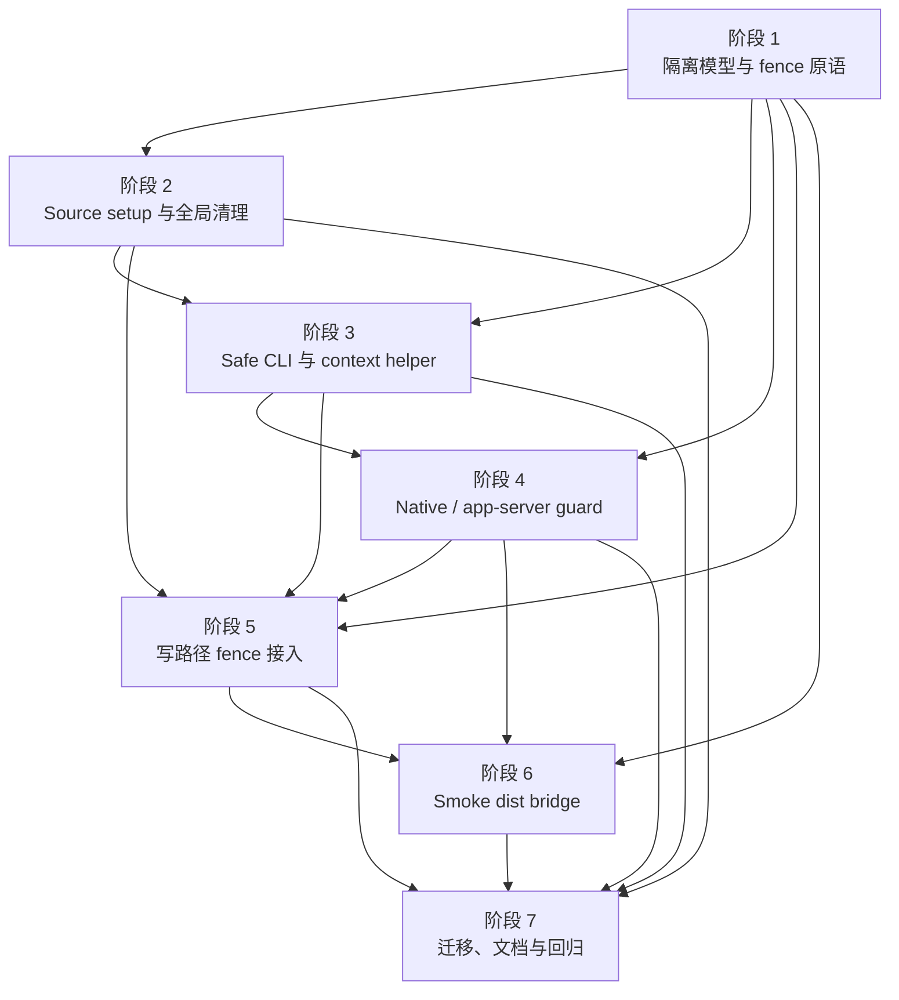

# 测试夹具环境隔离执行计划

日期：2026-05-20
需求来源：`docs/dev/specs/test-fixture-isolation.md`
状态：实施计划稿
文档规范：`docs/dev/spec-plan-writing-guide.md`

## 文档定位

这份计划只定义测试夹具环境隔离的执行步骤、实现切分、涉及文件、测试范围和收口顺序。它回答“怎么做、先后依赖是什么、改哪些文件、用哪些测试证明完成”。

需求范围、现状探查结论、测试作者体验、公开合同边界和最终验收标准以 Spec 为准。本计划不重新定义测试隔离合同；如果实施中发现需要改变需求边界，必须先回到 `docs/dev/specs/test-fixture-isolation.md` 调整需求，再更新本计划。

## 实施约定

- 生产 CLI 的默认路径解析、真实 native CLI 调用和真实 `codex app-server` 调用语义保持不变；测试层收紧默认值时，只能通过 test setup、测试 helper 或默认关闭的 test-only hook 生效。
- Unit、integration、smoke 必须共享同一套隔离语义；smoke 因为会 import `packages/cli/dist/**`，允许有独立 bridge，但合同不能弱于 source 模块图。
- 路径 fence 必须使用规范化后的绝对路径判断父子关系，并区分只读 fixture 根和可写状态根；不能用裸字符串前缀判断。
- 任何新增全局状态都必须有统一 reset 入口，并被 `beforeEach` / `afterEach` 覆盖；测试文件不应继续手写 env、cwd、catalog override 或 embedded root 的常规清理。
- Safe helper 的默认行为必须偏安全：漏传 env、cwd、native runner 或 app-server runner 时，最多写入测试安全根，或在写入/启动进程前给出可读错误。
- 现有 zero-write snapshot 继续保留，但只能作为事后检测；漏传 env、cwd、root 注册、native runner 或 app-server harness 的错误必须优先由 fence 或 guard 暴露。
- 文件清单是起始范围。实现时如果发现同一职责在其它文件中，也要同步纳入，并在提交说明里补充。
- 修改测试夹具、adapter 行为、scope 语义、插件安装流程或插件作者可见行为时，必须同步检查 `.agents/skills/create-agent-workflows-plugin/` 和公开文档是否受影响。

## 阶段依赖总览

| 阶段 | 主题 | 覆盖验收 | 依赖 | 可并行关系 |
| --- | --- | --- | --- | --- |
| 1 | 隔离模型、env/cwd fixture 与路径 fence 原语 | 2、4、6、7、14、15 | 无 | 无 |
| 2 | Source Vitest setup 与全局状态清理 | 1、2、3、12、13 | 1 | 阶段 3 可基于 helper 接口并行准备 |
| 3 | Safe CLI、command context 与测试作者入口 | 2、3、10、18 | 1、2 | 可与阶段 4 的 guard 细节并行 |
| 4 | Native runner guard 与 app-server guard | 5、8、9、10、11、12 | 1、3 | 可与阶段 5 的写路径 fence 并行 |
| 5 | 写路径 fence 接入与 temp 派生路径覆盖 | 4、5、6、7、14、15、16、17、19 | 1、2、3、4 | Smoke bridge 可先准备，不得先合并 |
| 6 | Smoke / dist 模块图隔离 bridge | 1、5、12、13、18、19 | 1、4、5 | 与阶段 7 文档可并行 |
| 7 | 测试迁移、公开文档和最终回归 | 18、20、全部 | 2-6 | 集成收口，不建议拆散 |

## 阶段依赖关系图

## 阶段 1：隔离模型、env/cwd fixture 与路径 fence 原语

目标：先建立测试安全根、env overlay、cwd 管理、只读/可写根注册和路径 fence 的共享原语，让后续阶段只消费同一套模型。

主要文件：

- [x] `packages/cli/tests/helpers/test-isolation.ts`
- [x] `packages/cli/tests/helpers/path-fence.ts`
- [x] `packages/cli/tests/unit/test-isolation.test.ts`
- [x] `packages/cli/tests/unit/path-fence.test.ts`
- [x] `packages/cli/src/utils/paths.ts`
- [x] `packages/cli/src/utils/marketplace.ts`
- [x] `packages/cli/src/commands/runtime.ts`

待办：

- [x] 定义测试安全根布局，至少包含 `home`、`aw-home`、`codex-home`、`claude-home`、`xdg-config`、`xdg-cache`、`xdg-state`、`npm`、`tmp`、`debug-logs` 和默认 `fixture-cwd`。
- [x] 提供 `createIsolatedTestEnv()` 或等价 helper，默认生成 `HOME`、`USERPROFILE`、`AW_HOME`、`AW_CODEX_HOME`、`AW_CLAUDE_HOME`、`XDG_CONFIG_HOME`、`XDG_CACHE_HOME`、`XDG_STATE_HOME`、npm userconfig、`TMPDIR`、`TEMP`、`TMP`。
- [x] 提供可写状态根和只读 fixture 根注册 API，并明确同一路径需要读写时必须分别注册。
- [x] 提供 `withSafeTestCwd()` / `runWithRepositoryCwdAsReadOnly()` 之类的 cwd helper，负责进入、恢复和 root 注册。
- [x] 实现路径 fence 原语，错误信息包含不安全路径、路径来源、当前已注册根和推荐修复入口。
- [x] 为真实 home、真实 `.aw`、真实 `.codex`、真实 `.claude`、真实 `.npmrc`、未登记 temp root、未登记 cwd 和只读根写入准备可复用断言 helper。

测试验收：

- [x] 默认隔离 env 的所有关键变量都位于测试安全根内。
- [x] 显式传入真实 home、真实平台 home、真实 npmrc、真实 temp root 或未登记 cwd 时，fence 在写入前失败。
- [x] 已注册可写状态根允许写入，未注册的同级临时目录不允许写入。
- [x] 已注册只读 fixture 根允许作为输入根声明，但写入该根会失败。
- [x] 相似前缀路径不会误判为父子关系，例如 `/tmp/root` 不放行 `/tmp/root-evil`。

阶段验收：

- [x] 后续阶段可以只通过共享 helper 创建安全 env、safe cwd、root registry 和 fence error，不再复制路径判断逻辑。
- [x] 测试隔离原语本身不依赖生产命令执行，也不改变非测试运行时行为。

## 阶段 2：Source Vitest setup 与全局状态清理

目标：让 unit 和 integration 默认进入安全 env/cwd，并把现有禁网络 catalog setup 扩展成统一测试全局状态清理入口。

主要文件：

- [x] `packages/cli/vitest.config.ts`
- [x] `packages/cli/tests/setup/no-network-catalog.ts`
- [x] `packages/cli/tests/setup/test-isolation.ts`
- [x] `packages/cli/tests/setup/reset-source-state.ts`
- [x] `packages/cli/src/utils/paths.ts`
- [x] `packages/cli/src/utils/marketplace.ts`
- [x] `packages/cli/src/utils/plugin-catalog.ts`
- [x] `packages/cli/tests/unit/test-isolation-setup.test.ts`

待办：

- [x] 将现有 `no-network-catalog.ts` 收敛进统一 setup，保留未显式 stub 的 `fetch` 必须失败的行为。
- [x] 在每个测试用例开始前创建或刷新测试安全根，覆盖 `process.env` 的隔离变量，并把 `process.cwd()` 切到安全 fixture cwd。
- [x] 在每个测试用例结束后恢复原始 cwd，清理 env overlay、fetch stub、catalog package source override、catalog resolution memo 和 embedded plugins root override。
- [x] 为 source 模块图提供统一 reset 入口，覆盖 `setEmbeddedPluginsRootOverrideForTests(null)`、`setCatalogPackageSourceForTests(null)`、`clearCurrentCatalogResolutionMemoForTests()` 等状态。
- [x] 让直接读取 `process.env`、`process.cwd()` 或 `os.tmpdir()` 的 source 测试默认看到隔离后的值。
- [x] 给需要读取真实仓库源码、fixtures 或 dist 输入的测试提供只读注册 helper，避免直接 `process.chdir()` 回真实仓库。

测试验收：

- [x] 任一 unit/integration 用例开始时，`process.cwd()` 是安全 fixture cwd，不是真实仓库 cwd。
- [x] 未显式传 env 的 source helper 读取到安全 HOME、AW home、XDG、npm userconfig 和 temp 变量。
- [x] 一条用例临时设置 embedded root、catalog source、fetch stub、env 或 cwd 后，下一条用例自动恢复默认隔离状态。
- [x] 未显式 stub 的 `fetch` 在 unit/integration 里继续失败。
- [x] 只读使用真实仓库 cwd 的测试必须通过共享 helper，helper 结束后 cwd 回到安全 fixture cwd。

阶段验收：

- [x] `packages/cli/vitest.config.ts` 的 setupFiles 指向统一隔离 setup。
- [x] 常规 source 测试不再需要为了默认隔离手写 env/cwd/catalog/fetch/embedded root 清理。

## 阶段 3：Safe CLI、command context 与测试作者入口

目标：把测试调用 CLI 的推荐入口改成默认安全入口，覆盖 `runCliEntry()`、`runCli()`、command context、CLI context 和常见 workspace fixture。

主要文件：

- [x] `packages/cli/tests/helpers/cli-entry.ts`
- [x] `packages/cli/tests/helpers/cli-runtime.ts`
- [x] `packages/cli/tests/helpers/workspace.ts`
- [x] `packages/cli/src/index.ts`
- [x] `packages/cli/src/commands/runtime.ts`
- [x] `packages/cli/tests/unit/cli-entry.test.ts`
- [x] `packages/cli/tests/integration/cli-entry.test.ts`
- [x] `packages/cli/tests/integration/runtime-env.test.ts`

待办：

- [x] 为 `runCliEntry()` 默认注入安全 env、安全 cwd、捕获 IO、默认 native guard 和默认 app-server guard；显式覆盖时仍通过 fence 校验。
- [x] 提供 `runSafeCli()` 或等价 helper，覆盖直接调用 `runCli()` 的测试。
- [x] 提供 safe command context / safe CLI context helper，避免测试直接调用 `createCommandExecutionContext()` 或 `createCliExecutionContext()` 时漏传 env/cwd/runner。
- [x] 为自建 temp root、fixture repo、embedded root、catalog source 和 dist 输入提供注册入口，分别声明可写状态根或只读 fixture 根。
- [x] 调整现有 CLI entry workspace builder，让默认 `cwd`、`AW_HOME`、`AW_CODEX_HOME`、`AW_CLAUDE_HOME` 和 embedded root 注册都来自共享隔离模型。
- [x] 保持生产 `runCli()`、`createCommandExecutionContext()` 和 `createCliExecutionContext()` 的公开默认语义不变。

测试验收：

- [x] 未传 env/cwd 调用 safe CLI/helper 时，所有关键路径都落在测试安全根。
- [x] 写入型 CLI 测试漏传 cwd 时，不会把真实仓库 cwd 当 project scope 写入目标。
- [x] 测试显式覆盖 env/cwd 到未登记路径时，safe helper 在命令写入前失败。
- [x] direct command 与 `runCli(..., { env })` 两条入口都能消费注入 env，不回落到真实 `process.env`。
- [x] 测试需要断言 native 参数时，可以显式注入 fake native runner 并读取 invocation。

阶段验收：

- [x] 新增或迁移后的 CLI 测试入口默认安全，测试作者少传参数不会触碰真实本机插件数据。
- [x] 直接命令层测试、CLI entry 测试和 runtime env 测试使用同一套隔离 fixture。

## 阶段 4：Native runner guard 与 app-server guard

目标：测试默认禁止真实 `codex`、`claude` native CLI 和真实 `codex app-server`，需要覆盖 native 行为时必须显式注入 fake runner 或 fake harness。

主要文件：

- [x] `packages/cli/tests/helpers/native-guard.ts`
- [x] `packages/cli/tests/helpers/fake-codex-app-server.ts`
- [x] `packages/cli/src/utils/native-cli.ts`
- [x] `packages/cli/src/utils/codex-app-server-client.ts`
- [x] `packages/cli/src/commands/runtime.ts`
- [x] `packages/cli/src/adapters/codex.ts`
- [x] `packages/cli/src/adapters/claude.ts`
- [x] `packages/cli/tests/unit/native-cli.test.ts`
- [x] `packages/cli/tests/unit/codex-app-server-client.test.ts`
- [x] `packages/cli/tests/unit/codex-adapter.test.ts`
- [x] `packages/cli/tests/integration/cli-entry.test.ts`

待办：

- [x] 实现测试默认 native runner guard，遇到 `codex`、`claude` 或其它已登记本机 agent CLI invocation 时直接失败。
- [x] guard 错误必须说明命令、args、cwd/env 来源，并提示注入 fake native runner。
- [x] 为 Codex app-server 实现测试默认 process runner guard，遇到真实 `codex app-server` 启动请求时直接失败，并提示使用 fake app-server harness。
- [x] 在 safe CLI/context helper 的默认 adapters factory 中传入 native guard 和 app-server guard。
- [x] 如需通过 runtime test-only hook 支持直接构造默认 context，hook 必须默认关闭，且 reset setup 必须每个用例恢复。
- [x] 扩展 fake Codex app-server harness 的 invocation 断言能力，确保测试能验证 command、args、cwd 和 env。

测试验收：

- [x] 默认 native runner 遇到 `codex plugin marketplace add` 或 `claude plugin ...` 时失败，不执行真实进程。
- [x] 默认 app-server runner 遇到 `codex app-server` 时失败，不启动真实进程。
- [x] 注入 fake native runner 后，可以断言 command、args、cwd 和 env，且不会触发 guard。
- [x] 注入 fake Codex app-server harness 后，可以完成 install/uninstall 协议断言，且下一条未注入 fake 的用例重新看到默认 guard。
- [x] Codex project repo-managed 不需要 native 的路径仍能走 `native:skipped`，不被 guard 误伤。

阶段验收：

- [x] unit、integration 的测试默认不依赖本机 `codex` / `claude` 是否安装。
- [x] app-server 与 native CLI 的 fake 行为都是显式 opt-in。

## 阶段 5：写路径 fence 接入与 temp 派生路径覆盖

目标：把路径 fence 接到测试中会代表用户环境写入的关键边界，覆盖 home、AW/Codex/Claude state、npmrc、XDG、debug log、catalog cache/staging、project cwd、cleanup backup、plugin lifecycle staging 和 `os.tmpdir()` 派生 staging/rollback。

主要文件：

- [x] `packages/cli/src/utils/paths.ts`
- [x] `packages/cli/src/commands/runtime.ts`
- [x] `packages/cli/src/utils/plugin-config.ts`
- [x] `packages/cli/src/utils/plugin-config-write.ts`
- [x] `packages/cli/src/commands/repair.ts`
- [x] `packages/cli/src/utils/marketplace.ts`
- [x] `packages/cli/src/utils/local-marketplace.ts`
- [x] `packages/cli/src/utils/plugin-catalog.ts`
- [x] `packages/cli/src/utils/codex-native-state.ts`
- [x] `packages/cli/src/install-state/paths.ts`
- [x] `packages/cli/src/install-state/shared-runtime-owner.ts`
- [x] `packages/cli/src/install-state/transactions.ts`
- [x] `packages/cli/src/adapters/codex.ts`
- [x] `packages/cli/src/adapters/claude.ts`
- [x] `packages/cli/src/utils/artifact-refresh.ts`
- [x] `packages/cli/src/utils/plugin-scripts.ts`
- [x] `packages/cli/src/generators/local-plugin.ts`
- [x] `packages/cli/src/commands/install.ts`
- [x] `packages/cli/src/commands/status.ts`
- [x] `packages/cli/src/commands/uninstall.ts`
- [x] `packages/cli/src/commands/cleanup.ts`
- [x] `packages/cli/src/commands/install-state-removal.ts`
- [x] `packages/cli/tests/unit/runtime.test.ts`
- [x] `packages/cli/tests/unit/paths.test.ts`
- [x] `packages/cli/tests/unit/marketplace.test.ts`
- [x] `packages/cli/tests/unit/local-marketplace.test.ts`
- [x] `packages/cli/tests/unit/plugin-catalog.test.ts`
- [x] `packages/cli/tests/unit/plugin-config.test.ts`
- [x] `packages/cli/tests/unit/config-write.test.ts`
- [x] `packages/cli/tests/unit/repair-command.test.ts`
- [x] `packages/cli/tests/unit/codex-native-state.test.ts`
- [x] `packages/cli/tests/unit/install-state-removal.test.ts`
- [x] `packages/cli/tests/unit/cleanup-command.test.ts`
- [x] `packages/cli/tests/unit/repo-managed-state.test.ts`
- [x] `packages/cli/tests/integration/plugin-lifecycle-command.test.ts`

待办：

- [x] 在测试模式下启用写路径 fence，并让 production 默认完全旁路。
- [x] 覆盖 `resolveAwHome()`、`getCodexHome()`、`getClaudeHome()`、catalog cache/staging、current catalog cache staging、platform config/cache、install-state、tracking dir 和 project scope 写路径。
- [x] 覆盖 `aw config set/unset/reset` 和 `repair` 的 project-scope 写路径：`resolvePluginConfigStorePath()` 的 `.agent-workflows/plugin-config*`、`applyPluginConfigWrite()` / `applyBuiltInConfigWrite()` 的配置回放、Codex project skill materialization 的 `.agents/skills`，以及 `repair` 会读取或重建的 project records / project artifacts 路径。
- [x] 覆盖 npm userconfig 解析，确保没有隔离 env 时不会读取或写入真实 `~/.npmrc`。
- [x] 覆盖 debug log 默认路径；`AW_DEBUG` 或 `--log-file` 的目标必须位于测试安全根或已注册可写状态根。
- [x] 覆盖 `os.tmpdir()` 派生写路径和 AW home 派生 staging，包括 status debug log、uninstall rollback staging、cleanup backup、artifact refresh staging、Codex native cache backup 和 plugin lifecycle staging。
- [x] 对 embedded plugins root、catalog source、repo fixtures、build/dist 输入默认按只读 fixture 根处理，只有同时注册为可写状态根才允许写入。
- [x] 保留 zero-write snapshot，并把它的职责调整为验证“命令不应写状态”的补充检测。

测试验收：

- [x] 真实 home、真实 AW/Codex/Claude home、真实 `.npmrc`、真实 temp root 和未登记 project cwd 都在写入前失败。
- [x] `aw config set/unset/reset` 和 `repair` 在未登记 cwd、真实 repo cwd 或越界 env 下，必须在真正写 `.agent-workflows` / `.agents` 前被 fence 阻断；显式注册的可写 project fixture root 下继续通过。
- [x] `os.tmpdir()`、status debug log、rollback staging、cleanup backup、artifact refresh staging、native cache backup 和 plugin lifecycle staging 都落在安全根或已注册可写状态根。
- [x] 只读 fixture 根可以读取 embedded root、catalog source、repo fixture 和 dist 输入，但不能承接用户状态写入。
- [x] Fence 错误包含路径、来源和推荐 helper；不能只输出泛化失败。
- [x] Fence 覆盖相似路径前缀误判风险。
- [x] zero-write snapshot 在 fence/guard 之外继续证明指定命令没有写入目标路径。

阶段验收：

- [x] 路径 fence 已覆盖 Spec 列出的写路径来源。
- [x] 生产 CLI 在非测试运行时下的默认路径解析和 native 行为保持不变。

## 阶段 6：Smoke / dist 模块图隔离 bridge

目标：让 smoke 测试加载与 unit/integration 等价的隔离 setup，并补齐 dist 模块图中的 catalog、embedded root、env/cwd、fetch、native guard 和 app-server guard 清理。

主要文件：

- [x] `packages/cli/vitest.smoke.config.ts`
- [x] `packages/cli/tests/setup/test-isolation-smoke.ts`
- [x] `packages/cli/tests/setup/reset-dist-state.ts`
- [x] `packages/cli/tests/smoke/build-smoke.test.ts`
- [x] `packages/cli/tests/smoke/pack-smoke.test.ts`
- [x] `packages/cli/tests/smoke/catalog-pack-smoke.test.ts`
- [x] `packages/cli/tests/smoke/catalog-fetch-smoke.test.ts`
- [x] `packages/cli/tests/smoke/plugin-scripts-staging-smoke.test.ts`
- [x] `packages/cli/tests/helpers/test-isolation.ts`

待办：

- [x] 为 smoke config 增加 setupFiles，加载统一隔离 setup 和 smoke bridge。
- [x] 为直接 import `packages/cli/dist/**` 的模块图提供动态 import reset bridge，清理 dist 侧 catalog source override、catalog memo、embedded root override 和 test-only guard。
- [x] 把 smoke 需要读取的真实 build/pack 产物注册为只读 fixture 根。
- [x] 把 smoke 显式创建的 temp root、临时 bundle 和 package staging 注册为可写状态根。
- [x] 保留 smoke 对真实 build/pack 产物的验证范围，不把构建输出误当成用户状态可写根。
- [x] 确认 smoke 里未显式 stub 的 `fetch` 继续失败。

测试验收：

- [x] smoke 用例开始时默认 cwd 是安全 fixture cwd，env/temp/home 变量位于测试安全根。
- [x] smoke import dist 后设置 catalog override、embedded root、fake native runner 或 fake app-server harness，下一条用例会恢复默认 guard 和默认清理状态。
- [x] build/dist/pack 输入可以作为只读 fixture 被读取，但写用户状态仍需安全根或可写状态根。
- [x] catalog fetch smoke 覆盖 dist 侧 catalog source override、catalog memo 和未显式 stub 的 `fetch` 恢复合同。
- [x] pack smoke 覆盖 CLI tarball 和 catalog tarball 的真实 smoke 模块图隔离。
- [x] smoke 中未显式 stub 的 `fetch` 继续失败。
- [x] smoke 不启动真实 `codex`、`claude` 或 `codex app-server`。

阶段验收：

- [x] Unit、integration 和 smoke 都加载基础隔离 setup。
- [x] Source 模块图和 dist 模块图满足同一恢复合同。

## 阶段 7：测试迁移、公开文档和最终回归

目标：迁移高风险测试和当前已知测试热点到 safe helper，更新 `docs/testing.md`，并用目标测试与全量分层回归证明需求收口。

主要文件：

- [x] `packages/cli/tests/unit/install-command.test.ts`
- [x] `packages/cli/tests/unit/uninstall-command.test.ts`
- [x] `packages/cli/tests/unit/status-command.test.ts`
- [x] `packages/cli/tests/unit/adapter-status.test.ts`
- [x] `packages/cli/tests/unit/codex-project-installability.test.ts`
- [x] `packages/cli/tests/unit/plugin-config.test.ts`
- [x] `packages/cli/tests/unit/config-write.test.ts`
- [x] `packages/cli/tests/unit/repair-command.test.ts`
- [x] `packages/cli/tests/unit/local-marketplace.test.ts`
- [x] `packages/cli/tests/unit/codex-native-state.test.ts`
- [x] `packages/cli/tests/unit/install-state-removal.test.ts`
- [x] `packages/cli/tests/unit/cleanup-command.test.ts`
- [x] `packages/cli/tests/integration/cli-entry.test.ts`
- [x] `packages/cli/tests/integration/cli.test.ts`
- [x] `packages/cli/tests/integration/skill-trigger-command.test.ts`
- [x] `packages/cli/tests/integration/console-duplicate-resolution.test.ts`
- [x] `packages/cli/tests/integration/upgrade-command.test.ts`
- [x] `packages/cli/tests/integration/codex-explore-plugin.test.ts`
- [x] `packages/cli/tests/integration/plugin-lifecycle-command.test.ts`
- [x] `packages/cli/tests/integration/runtime-env.test.ts`
- [x] `packages/cli/tests/smoke/build-smoke.test.ts`
- [x] `packages/cli/tests/smoke/pack-smoke.test.ts`
- [x] `packages/cli/tests/smoke/catalog-pack-smoke.test.ts`
- [x] `packages/cli/tests/smoke/catalog-fetch-smoke.test.ts`
- [x] `packages/cli/tests/smoke/plugin-scripts-staging-smoke.test.ts`
- [x] `docs/testing.md`
- [x] `.agents/skills/create-agent-workflows-plugin/`

待办：

- [x] 迁移直接修改 `process.env`、直接 `process.chdir()`、裸 `runCli()`、裸 `runCliEntry()`、裸 context 创建和手写 native runner 清理的测试。
- [x] 优先迁移已知热点：`local-marketplace.test.ts` 的 env/catalog/embedded root 清理、`cli.test.ts` 的 AW_* env 清理、`codex-native-state.test.ts` 的 native cache backup temp、`plugin-lifecycle-command.test.ts` 的 lifecycle temp/context、`skill-trigger-command.test.ts` 的 AW_* / force flags / embedded root 清理、`console-duplicate-resolution.test.ts` 的 AW_* / `PATH` 清理、`upgrade-command.test.ts` 的大量 `process.env` 写入和 embedded root reset。
- [x] 迁移 `config-write.test.ts`、`plugin-config.test.ts` 和 `repair-command.test.ts` 中直接构造 repo cwd、project config store、project artifact 或 watched path 的用例，确保 shared/local config 与 repair 的 project-scope 路径都通过可写状态根或只读 fixture 根表达意图。
- [x] 给仍需自建 temp root 的测试补充可写状态根注册；给 embedded root、catalog source、repo fixtures 和 dist 输入补充只读 fixture 根注册。
- [x] 清理或改写与统一 setup 冲突的 `afterEach` 手动 reset，保留测试自身业务状态清理。
- [x] 更新 `docs/testing.md`，面向测试作者说明默认隔离行为、safe helper、只读/可写根注册、全局 cwd 接管、fake native runner、fake app-server harness 和 zero-write snapshot 职责。
- [x] 检查插件作者工具和示例是否描述了旧测试写法；如没有受影响，记录无需修改的理由。
- [x] 跑完目标测试、unit、integration、smoke build、smoke fetch、smoke pack 和 plugin script smoke，修正因隔离收紧暴露的旧测试假设。

测试验收：

- [x] 现有高风险 CLI 写命令测试迁移后，不依赖真实 home、真实 repo cwd、真实 npmrc 或本机 native CLI。
- [x] `local-marketplace.test.ts`、`cli.test.ts`、`codex-native-state.test.ts`、`plugin-lifecycle-command.test.ts`、`skill-trigger-command.test.ts`、`console-duplicate-resolution.test.ts` 和 `upgrade-command.test.ts` 不再依赖手写全局 env/catalog/temp/embedded root 清理维持隔离。
- [x] 新增或迁移后的 CLI 测试少传参数时，只写测试临时目录或收到明确失败。
- [x] `config-write.test.ts`、`plugin-config.test.ts` 和 `repair-command.test.ts` 明确证明 project shared/local config、built-in config 回放和 repair 不会绕过 fence 写真实 `.agent-workflows` / `.agents`。
- [x] 只读测试临时使用真实仓库 cwd 时，通过共享 helper 表达只读意图，并证明不会触发 project scope 写入。
- [x] `docs/testing.md` 不再把手写 env/cwd 恢复、真实 `codex` / `claude` 依赖或用 zero-write 代替 fence 描述为常规推荐写法。
- [x] 生产 CLI 的默认路径解析和 native 行为没有被测试隔离改动。

阶段验收：

- [x] Spec 的 20 条验收标准都有对应测试或文档证明。
- [x] 最终回归通过，或未能运行的命令有明确原因和剩余风险说明。

## 测试用例明细

| 主责阶段 | 测试项 |
| --- | --- |
| 2、6 | - [x] Unit、integration 和 smoke 都加载统一隔离 setup。 |
| 1、3 | - [x] 未显式传 env 的 safe CLI/helper 生成安全 HOME、USERPROFILE、AW home、XDG、npm userconfig、temp 和 debug log 路径。 |
| 2、3 | - [x] 每个用例默认 cwd 是安全 fixture cwd，写入型测试不回退真实仓库 cwd。 |
| 1、5 | - [x] 真实家目录、真实 `.aw`、真实 `.codex`、真实 `.claude`、真实 `.npmrc`、真实 temp root 和未登记 cwd 被 fence 阻断。 |
| 5、7 | - [x] `aw config set/unset/reset` 的 project shared/local config 写入、built-in config 回放和 `.agents/skills` 刷新，在未登记 cwd、真实 repo cwd 或越界 env 下写前失败。 |
| 5、7 | - [x] `repair` 的 project records、project artifacts、dependency index 相关路径和 project config watched paths 位于安全根、可写状态根或只读 fixture 根；不能把真实 repo cwd 当成可写 project scope。 |
| 5 | - [x] `os.tmpdir()` 派生写路径、debug log、catalog cache/staging、rollback staging、cleanup backup、artifact refresh staging、native cache backup 和 plugin lifecycle staging 位于安全根或已注册可写根。 |
| 1、5 | - [x] 显式创建的 temp root 注册为可写状态根后可以承接用户状态写入，未注册时失败。 |
| 1、5、6 | - [x] 只读 fixture 根可用于 embedded root、catalog source、repo fixture 和 build/dist 输入，但不自动获得写权限。 |
| 4 | - [x] 默认 native runner 遇到 `codex` 或 `claude` 命令失败，并提示注入 fake runner。 |
| 4、6 | - [x] 默认 app-server runner 遇到真实 `codex app-server` 失败，并提示使用 fake app-server harness。 |
| 3、4 | - [x] fake native runner 可断言 command、args、cwd 和 env，不需要真实 CLI 安装。 |
| 4 | - [x] fake Codex app-server harness 可完成 install/uninstall 协议断言，不启动真实 app-server。 |
| 2、4、6 | - [x] embedded root override、catalog source override、catalog memo、fetch stub、env/cwd overlay、native guard 和 app-server guard 跨用例自动清理，source 与 dist 模块图都覆盖。 |
| 2、6 | - [x] Unit、integration 和 smoke 中未显式 stub 的 `fetch` 都继续失败。 |
| 6、7 | - [x] catalog fetch 和 pack smoke 进入最终回归，证明 dist 模块图 reset、fetch guard 和 tarball/catalog pack 路径同样隔离。 |
| 1、5 | - [x] Fence 错误包含路径、来源和推荐修复入口。 |
| 1、5 | - [x] Fence 使用规范化绝对路径判断父子关系，并覆盖相似前缀误判。 |
| 2、5、7 | - [x] 只读测试临时使用真实仓库 cwd 时，通过共享 helper 切换、恢复并验证不触发 project scope 写入。 |
| 5、7 | - [x] zero-write snapshot 继续作为补充检测；漏传 env/cwd/native runner 优先由 fence 或 guard 暴露。 |
| 3、7 | - [x] 新增或迁移后的 CLI 测试入口默认安全，少传参数不会触碰真实本机插件数据。 |
| 5、7 | - [x] 非测试运行时下的生产路径解析和 native 行为保持不变。 |
| 7 | - [x] `docs/testing.md` 已同步新隔离合同，并移除冲突的旧推荐写法。 |

## 并行实施建议

- 阶段 1 是所有后续工作的硬前置，不建议拆散。
- 阶段 2 和阶段 3 可以由同一执行者顺序推进；阶段 3 的 API 形状确定后，阶段 4 可以并行补 guard 和 fake harness 断言。
- 阶段 5 的写路径 fence 接入可以按路径域拆分：home/catalog/cache、project cwd/install-state、native/app-server/debug log/temp staging，但必须共用阶段 1 的 registry 和错误模型。
- 阶段 6 可以提前准备 smoke setup 文件和 dist dynamic import bridge，但合并前必须等阶段 4、5 的 guard/fence 合同稳定。
- 阶段 7 包含中等规模测试热点迁移，可以按文件分批推进；文档更新可以与阶段 6 并行起草，最终内容必须以实际落地的 helper 名称和行为为准。

## 最终回归

- [x] `pnpm --filter @yiliang/aw exec vitest run tests/unit/test-isolation.test.ts tests/unit/path-fence.test.ts tests/unit/test-isolation-setup.test.ts`
- [x] `pnpm --filter @yiliang/aw exec vitest run tests/unit/plugin-config.test.ts tests/unit/config-write.test.ts tests/unit/repair-command.test.ts`
- [x] `pnpm --filter @yiliang/aw exec vitest run tests/unit/runtime.test.ts tests/unit/paths.test.ts tests/unit/marketplace.test.ts tests/unit/plugin-catalog.test.ts tests/unit/native-cli.test.ts tests/unit/codex-app-server-client.test.ts`
- [x] `pnpm --filter @yiliang/aw exec vitest run tests/integration/runtime-env.test.ts tests/integration/cli-entry.test.ts`
- [x] `pnpm test:unit`
- [x] `pnpm test:integration`
- [x] `pnpm build`
- [x] `pnpm test:smoke:build`
- [x] `pnpm test:smoke:fetch`
- [x] `pnpm test:smoke:pack`
- [x] `pnpm test:smoke:plugin-scripts`
- [x] 检查 `docs/testing.md`、`docs/dev/specs/test-fixture-isolation.md` 和本计划没有互相冲突。
- [x] 检查 `.agents/skills/create-agent-workflows-plugin/` 是否需要同步测试写法；如无需修改，在提交说明中写明原因。
