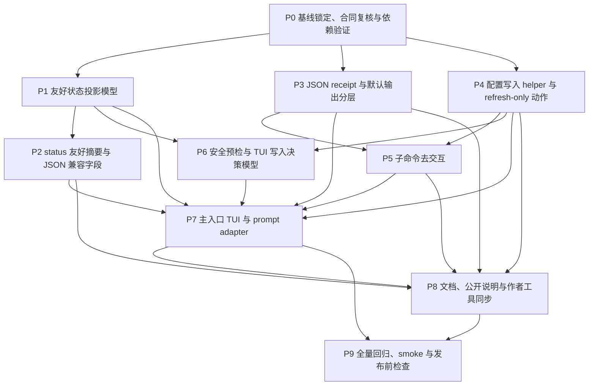

# `aw` 交互控制台与安装输出重设计 TODO

来源：[`../plans/aw-interactive-console-ux-plan.md`](../plans/aw-interactive-console-ux-plan.md)
日期：2026-05-05
状态：全部完成；P9 自动化回归、build、smoke、pack smoke、干净目录 tarball 安装、非 TTY 和真实 inquirer TTY 验收均已通过

## 目标

把 `aw` 主命令改成唯一交互入口，并让脚本化子命令、默认人类输出、JSON receipt、`status` 友好摘要、配置向导和 dynamic artifact refresh 共享稳定合同。

本文档按可单独执行的阶段拆分。每个阶段都有明确依赖、交付边界和测试验收，方便后续按阶段并行实施。

## 阶段总览

| 阶段 | 主题 | 前置依赖 | 可并行关系 |
| --- | --- | --- | --- |
| P0 | 基线锁定、合同复核与依赖验证 | 无 | 所有后续阶段的共同基础 |
| P1 | 友好状态投影模型 | P0 | 可与 P3、P4 并行 |
| P2 | `status` 友好摘要与 JSON 兼容字段 | P1 | 可与 P3、P4、P5 部分并行 |
| P3 | JSON receipt 与默认输出分层 | P0 | 可与 P1、P4 并行 |
| P4 | 配置写入 helper 与 refresh-only 动作 | P0 | 可与 P1、P2、P3 并行 |
| P5 | 子命令去交互 | P3、P4 | 可与 P6 的只读模型部分并行 |
| P6 | 安全预检与 TUI 写入决策模型 | P1、P4 | 可与 P5 并行，阻塞 P7 写入流程 |
| P7 | 主入口 TUI 与 prompt adapter | P1、P2、P3、P4、P5、P6 | 阻塞最终体验验收 |
| P8 | 文档、公开说明与作者工具同步 | P2、P3、P4、P5、P7 | 文档草稿可提前，最终校验依赖实现稳定 |
| P9 | 全量回归、smoke 与发布前检查 | P7、P8 | 收口阶段 |

## 阶段依赖关系图

## 并行实施建议

- 第一波只做 P0，先锁住旧行为、字段草案和 `@inquirer/prompts` 可用性。
- 第二波并行推进 P1、P3、P4。三者分别负责状态投影、输出合同、配置写入链路，文件边界相对清楚。
- 第三波在 P1 和 P4 可用后推进 P6，同时在 P3 和 P4 稳定后推进 P5。
- 第四波集中做 P7，把 TUI 绑定到已经稳定的投影、receipt、配置 helper 和安全预检模型。
- P8 可以先起草，但最终必须在 P7 行为确定后统一校准公开文档和插件作者技能。
- P9 只做验收和打包验证，不承载新能力。

## P0 基线锁定、合同复核与依赖验证

依赖：无。

目标：在大改前锁住当前行为和目标合同，避免后续阶段一边实现一边重新定义字段或测试边界。

主要改动面：

- `packages/cli/src/index.ts`
- `packages/cli/src/commands/runtime.ts`
- `packages/cli/src/commands/interactive.ts`
- `packages/cli/src/commands/install.ts`
- `packages/cli/src/commands/uninstall.ts`
- `packages/cli/src/commands/upgrade.ts`
- `packages/cli/src/commands/status.ts`
- `packages/cli/src/commands/discovery.ts`
- `packages/cli/src/commands/common.ts`
- `packages/cli/src/output/reporter.ts`
- `packages/cli/src/utils/plugin-config.ts`
- `packages/cli/src/utils/artifact-refresh.ts`

TODO：

- [x] 复核直接运行 `aw`、`aw status`、写命令默认输出、`--json` 输出和 `--verbose` 输出的当前行为。
- [x] 复核旧交互入口：`install/uninstall/upgrade` 的 `-i/--interactive`、`--no-interactive`、`config configure`、`config reset` 交互确认。
- [x] 新增或标记最小 regression tests，覆盖直接运行 `aw` 只显示 help、子命令缺参进入 prompt、默认输出泄露内部词、enabled-only 被误判、refresh failed 默认文案泄露内部字段。
- [x] Review 并冻结 JSON receipt 字段草案：`ok`、`command`、`plugins`、`targets`、`actions`、`skipped`、`artifacts`、`native`、`artifactRefresh`、`warnings`、`nextSteps`。
- [x] Review 并冻结 `status --json` 兼容追加字段：`ok`、`command`、`friendlySummaries`、`consoleItems`。
- [x] 验证 `@inquirer/prompts` 在项目实际 registry 下可安装，并记录可用版本。P0 记录：项目实际安装 registry 是 `https://registry.npmjs.org/`，当时工作机网络限制导致不能完成真实 install；公开包元数据可见，后续优先验证 `@inquirer/prompts` 7.x 线，若改用 8.x 必须重新确认 Node 下限。
- [x] 验证 `pnpm build` / runtime bundle / smoke tarball 对新增依赖的潜在影响。P0 记录：现有 build、build smoke、pack smoke 均通过；当前 pack smoke 会复用源码树 `node_modules`，P9 仍需补干净目录 tarball install 验证。

测试验收：

- [x] Baseline regression tests 能稳定复现需要修复的旧行为。
- [x] JSON 字段草案已经明确，后续阶段不需要边实现边改命名。
- [x] `@inquirer/prompts` 可安装性和打包风险已经明确记录。
- [x] P0 不要求全量测试通过，但不能引入与基线锁定无关的失败。

P0 验收记录：

- 当前 `aw` 直接运行仍打印 Commander help；`status --json` 当前顶层仍是 `StatusMatrixReport`，尚未包含 `ok`、`command`、`friendlySummaries`、`consoleItems`。
- 旧交互入口仍集中在 `packages/cli/src/index.ts` 与 `packages/cli/src/commands/interactive.ts`；`install/upgrade` 缺 required config 时还会经由 `preflightRequiredPluginConfigs()` 调用旧配置 prompt。
- 已新增 P0 baseline tests：`packages/cli/tests/unit/cli-entry.test.ts` 与 `packages/cli/tests/integration/cli-entry.test.ts`。本轮复跑 `pnpm --filter @lesliechan721/aw exec vitest run tests/unit/cli-entry.test.ts tests/integration/cli-entry.test.ts`，结果为 2 个 test files 通过，74 个 tests 通过，3 个 todo。
- 依赖验证结论：P0 时本机 registry 查询无法证明真实安装；P9 已完成 `pnpm install`，`pnpm-lock.yaml` 锁定 `@inquirer/prompts@7.10.1`，并补跑干净目录 tarball install 与真实 TTY 验收。

## P1 友好状态投影模型

依赖：P0。

目标：新增统一投影层，让 TUI、默认 `aw status` 和 `status --json.consoleItems` 复用同一套用户可理解的插件状态、位置、原因和动作合同。

主要改动面：

- 新增 `packages/cli/src/commands/console-model.ts` 或 `packages/cli/src/commands/friendly-status.ts`
- `packages/cli/src/commands/status.ts`
- `packages/cli/src/commands/discovery.ts`
- `packages/cli/src/types.ts`
- 对应 unit fixtures

TODO：

- [x] 新增 `PluginConsoleItem`、`PluginConsoleLocation`、`PluginConsoleAction`、`PluginConsoleReasonCode` 类型。
- [x] 实现从 `StatusMatrixReport`、discovery candidate、current catalog、native state、tracking 和 artifact diagnostics 到 `PluginConsoleItem[]` 的投影入口。
- [x] 固定首屏六类状态：`notInstalled`、`installed`、`upgradeAvailable`、`needsAction`、`partial`、`external`，默认文案分别显示为 `未安装`、`已安装`、`可升级`、`需要处理`、`部分可用`、`由其它来源管理`。
- [x] 实现位置标签：`Codex（个人）`、`Codex（当前项目）`、`Claude Code（个人）`、`Claude Code（当前项目）`、`多个位置`。
- [x] 集中实现状态优先级和跨位置汇总规则。
- [x] 实现保守升级判定：current catalog 不可读、版本或 bundle 证据不足、recovery、artifact drift、refresh failed、外部 ownership 冲突和 tracking identity 损坏都不能显示为 `可升级`。
- [x] 映射 Codex user native 状态：enabled config + active cache + AW record 健康才算已安装；enabled-only、cache-only、breadcrumb-only 不算已安装；recovery breadcrumb 映射 `nativeIncomplete`；无归属残留映射 `nativeResidue`。
- [x] 映射 dynamic artifact 状态：refresh failed 映射 `artifactRefreshFailed`；drift / missing 映射 `artifactDrift`；disabled by config 不算问题。
- [x] 映射 project trust 和 session visibility：`blockedByProjectTrust`、`projectTrustUnknown`、`shadowedByProjectDeveloperInstructions`、`unknownByExternalLayer` 都进入用户可理解的 `partial` 原因。
- [x] 映射外部 ownership、配置缺失/无效/不可读、tracking identity、role/MCP 冲突、unmanaged artifact、catalog capability changed 和 catalog unavailable。
- [x] 确保 `catalogUnavailable` 覆盖 current catalog 缺失、不可读/不可解析、插件已不在 current catalog 中三个场景。
- [x] 为每种原因码集中生成 `issueSummary`、`detailHints`、下一步说明和诊断命令 argv。
- [x] 默认人类 prose 不泄露 `ledger`、`healthSource`、`artifactRefresh`、`sessionVisibility`、`projectTrust`、`tracking` 等内部词；可复制命令、argv、flag、JSON 字段和类型名允许保留真实技术标识。
- [x] 固化 action 安全不变量：多位置汇总项不承载隐式批量写动作。
- [x] 所有写动作只能来自 `PluginConsoleLocation.actions`，并带明确 `target.platform`、`target.scope` 和必要的 `projectKey`。
- [x] 删除、覆盖、cleanup 动作都设置 `destructive: true` 和 `confirmText`。
- [x] disabled 动作必须提供 `disabledReason`，TUI 只能读取结构化字段，不能靠中文 `label` 推断行为。
- [x] 无归属 `nativeResidue` 不生成自动 cleanup 动作。

测试验收：

- [x] Unit 覆盖六类首屏状态、全部原因码、跨位置汇总、状态优先级和保守升级判定。
- [x] Unit 覆盖 Codex enabled-only、cache-only、breadcrumb-only、native recovery、无归属 native residue。
- [x] Unit 覆盖 dynamic artifact refresh failed、drift、missing、disabled by config。
- [x] Unit 覆盖 project trust 和 session visibility 到 `partial` 的映射。
- [x] Unit 覆盖 external ownership、required config、invalid config、unreadable config、tracking identity、role/MCP、unmanaged artifact、catalog capability changed、catalog unavailable。
- [x] Unit 覆盖 action contract：写动作只出现在 location actions；所有写动作带 target；破坏性动作带确认；disabled 动作带 `disabledReason`。
- [x] Unit 覆盖友好文案禁词合同，并保留命令、argv、flag、JSON 字段和代码类型里的技术标识例外。

P1 验收记录：

- 新增 `packages/cli/src/commands/console-model.ts` 和 `packages/cli/tests/unit/console-model.test.ts`。
- 已跑 `pnpm --filter @lesliechan721/aw exec vitest run tests/unit/console-model.test.ts`，11 个测试通过。

## P2 `status` 友好摘要与 JSON 兼容字段

依赖：P1。

目标：把 P1 的投影接入 `status`，让默认 `aw status` 变成友好摘要，同时保持 `status --json` 旧矩阵字段兼容。

主要改动面：

- `packages/cli/src/commands/status.ts`
- `packages/cli/src/index.ts`
- `packages/cli/src/output/reporter.ts`
- 对应 status unit / integration tests

TODO：

- [x] 调整 `statusCommand()`，在现有矩阵生成后调用友好投影层。
- [x] `status --json` 顶层追加 `ok`、`command`、`friendlySummaries`、`consoleItems`，不破坏既有 `detection`、`summaries`、`cells`、`reports`。
- [x] `status --json` 覆盖 native enabled/cache/recovery 原始机器字段。
- [x] `status --json` 覆盖 dynamic artifact health、last refresh、refresh metadata、project trust 和 session visibility。
- [x] `status --json` 失败路径守住 stdout 机器合同；discovery、current catalog、adapter 诊断或配置读取异常时，stdout 为空或仍是单一可解析 JSON，错误只写 stderr。
- [x] 默认 `aw status` 改为友好摘要，只展示插件名、状态、位置和下一步。
- [x] `status --verbose` 继续输出诊断矩阵，内部字段放入 `诊断信息` 小节。
- [x] 默认 status 文案过滤内部术语，保留可复制命令中的真实 flag。
- [x] 覆盖 current catalog 缺失、不可读/不可解析、插件已不在 current catalog 中、Codex native recovery、cache-only、enabled-only、dynamic artifact refresh failed、project trust、session visibility 等状态。

测试验收：

- [x] Integration 断言默认 `aw status` 不泄露内部禁词。
- [x] Integration 断言 `status --json` 旧字段可继续解析，新字段覆盖 TUI 所需数据。
- [x] Integration 断言 `status --json` 异常路径不污染 stdout。
- [x] Integration 断言 `status --verbose` 能看到诊断字段，默认输出看不到诊断字段。

P2 验收记录：

- `packages/cli/src/commands/status.ts` 已接入 `createPluginConsoleItems()`，并统一产出默认友好摘要、`--verbose` 诊断分层和 `status --json` 兼容扩展字段。
- 默认 `aw status` 现在只展示插件名、友好状态、友好位置和下一步；`aw status --verbose` 会在 `诊断信息` 小节继续输出内部诊断矩阵和命令级字段。
- `status --json` 顶层保留 `detection`、`summaries`、`cells`、`reports`，并追加 `ok`、`command`、`friendlySummaries`、`consoleItems`，供后续 P7 TUI 直接消费。
- 已复跑 `pnpm --filter @lesliechan721/aw exec vitest run tests/integration/cli-entry.test.ts -t "status"` 和 `pnpm --filter @lesliechan721/aw exec vitest run tests/integration/cli-entry.test.ts -t "status|friendly needs-action summaries"`，均通过。

## P3 JSON receipt 与默认输出分层

依赖：P0。

目标：把机器 receipt 和人类 renderer 分离，确保所有脚本化写命令的 `--json` stdout 都是单一可解析 JSON，默认输出只保留用户能理解、能行动的信息。

主要改动面：

- `packages/cli/src/index.ts`
- 新增或调整 `packages/cli/src/output/command-receipt.ts`
- `packages/cli/src/output/reporter.ts`
- `packages/cli/src/commands/init.ts`
- `packages/cli/src/commands/install.ts`
- `packages/cli/src/commands/uninstall.ts`
- `packages/cli/src/commands/upgrade.ts`
- `packages/cli/src/commands/config.ts`
- 对应 JSON/output tests

TODO：

- [x] 抽出或重写 `writeCommandReceipt()`，分离 receipt builder 和默认人类 renderer。
- [x] 所有写命令最小公共 receipt 包含 `{ ok, command, warnings, nextSteps }`。
- [x] `init --json` 输出 `{ ok, command, ... }`。
- [x] `install --json` 输出纯 JSON，包含 `plugins`、`targets`、`actions`、`artifacts`、`native`、`warnings`、`nextSteps`。
- [x] `uninstall --json` 输出纯 JSON，包含清理动作、native 结果、artifacts 和 warnings。
- [x] `upgrade --json` 输出纯 JSON，包含 `upgraded`、`skipped`、`targets`、`actions`、`native`、`artifacts`。
- [x] `config set/unset/reset --json` 输出纯 JSON，并稳定返回 `artifactRefresh`。
- [x] `config list/get --json` 保留稳定 `ok`、`command` 和既有数据结构，不被 receipt renderer 重构误伤。
- [x] 失败时 stdout 不输出半份 JSON；错误和人类 warning 走 stderr。
- [x] 警告模型分层，只让用户可行动 warning 进入默认输出。
- [x] 默认成功输出降噪，不展示 marketplace、app-server、RPC、cache、recovery breadcrumb、repo-managed、ledger、healthSource、config/script health 等内部词。
- [x] 默认人类输出避免 `user scope`、`project scope` 或裸 `scope` 这类 prose；可复制命令、argv、flag、JSON 字段和类型名保留真实技术标识。

测试验收：

- [x] `init/install/uninstall/upgrade/config` 的 `--json` stdout 都能直接 `JSON.parse`。
- [x] JSON 失败路径每类命令至少覆盖一个用例，stdout 为空或仍是单一可解析 JSON，错误只在 stderr。
- [x] `config list/get --json` 旧消费方结构不被破坏。
- [x] 默认写命令输出只包含友好完成句和必要下一步。
- [x] 默认输出和 warning renderer 不泄露内部禁词。

P3 验收记录：

- 新增 `packages/cli/src/output/command-receipt.ts`，`init/install/uninstall/upgrade` 已接入 `--json` receipt 和友好默认 renderer。
- 已跑 `pnpm --filter @lesliechan721/aw exec vitest run tests/unit/cli-entry.test.ts` 与 `tests/integration/cli-entry.test.ts`，均通过；`tsc --noEmit` 通过。

## P4 配置写入 helper 与 refresh-only 动作

依赖：P0。

目标：让脚本化 config 命令和 TUI 配置向导复用同一条 schema-aware 写入、store patch、effective config 重算和 artifact refresh 路径，并新增不改配置的重新应用 refresh 动作。

主要改动面：

- 新增 `packages/cli/src/commands/config-write.ts` 或 `packages/cli/src/utils/plugin-config-write.ts`
- `packages/cli/src/commands/config.ts`
- `packages/cli/src/utils/plugin-config.ts`
- `packages/cli/src/utils/artifact-refresh.ts`
- tracking / artifact diagnostics 相关 helper
- 对应 config / refresh tests

TODO：

- [x] 抽出共享 config 写入 helper，统一校验、store patch、effective config 重算和 artifact refresh。
- [x] 改造 `config set` 使用 helper。
- [x] 改造 `config unset` 使用 helper。
- [x] 改造 `config reset --yes` 使用 helper。
- [x] 保留 `config reset --yes` 在 current catalog 缺失时的 raw-store 删除分支。
- [x] raw-store 删除分支必须先调用 `assertSafePluginConfigSegment()` 或等价校验，拒绝空字符串、路径穿越、绝对路径和协议前缀。
- [x] 删除 `config configure` 前，先把可复用 schema 表单逻辑迁移成 TUI 可调用模型。
- [x] schema 表单逻辑保留 sensitive 字段 UX：已有值只显示 `已配置` 占位，不回显真实值，也不因为占位而要求用户重新输入。
- [x] 实现多字段一次提交 API，输入能表达 `updates` 和 `removeKeys`，receipt 返回 `updatedKeys` 和 `removedKeys`。
- [x] 可选字段已有值时，配置向导能显式清空；清空 key 进入 `removedKeys`，不进入 `updatedKeys`，也不写入空字符串。
- [x] `artifactRefresh.triggerKeys` 从本轮 `updatedKeys + removedKeys` 得出；只更新、只删除、更新删除混合提交都只 patch 一次、refresh 一次。
- [x] 保留 unknown keys，不复制另一层 effective config。
- [x] sensitive 值不在输出、debug log 或 receipt 明文出现。
- [x] 写入成功后调用 `refreshArtifactsAfterConfigWrite()`，并返回稳定 `artifactRefresh` receipt。
- [x] refresh 失败时保留 config store，不回滚，不执行第二条隐藏 refresh 路径。
- [x] 实现 `reapplyConfigRefresh`，不修改 config store。
- [x] `reapplyConfigRefresh` 优先使用 tracking 中失败 artifact 的 `refreshKeys`，没有失败记录时退回当前目标全部 tracked refresh keys。
- [x] 找不到可定位 tracked dynamic artifact 时返回 `skipped`。
- [x] refresh-only 必须复用 `refreshArtifactsAfterConfigWrite()` 或等价覆盖同一条 artifact apply / tracking 写回路径，不能只运行 renderer。
- [x] refresh-only 成功后更新对应 artifact 的 `lastRefresh` 和 tracking 诊断。
- [x] refresh-only 失败后保留配置，并把本次失败写入 receipt 的 `artifactRefresh.error` 和后续 status 可读取的 tracking 诊断。

测试验收：

- [x] Unit 覆盖多字段一次校验，任一字段非法时不写 store、不 refresh。
- [x] Unit 覆盖一次 patch、一次 refresh。
- [x] Unit 覆盖只删除、只更新、更新删除混合提交的 `updatedKeys`、`removedKeys` 和 `artifactRefresh.triggerKeys`。
- [x] Unit 覆盖不复制另一层 effective config。
- [x] Unit 覆盖 sensitive 值脱敏。
- [x] Unit 覆盖 current catalog 缺失时 raw-store 删除成功且 refresh skipped。
- [x] Unit 覆盖非法插件名不会删除任何文件。
- [x] Unit 覆盖 refresh-only 成功、失败和 skipped。
- [x] Integration 断言 `reapplyConfigRefresh` 不修改 config store，成功/失败结果能被后续 `aw status --json` / `aw status --verbose` 读到。

P4 验收记录：

- 新增 `packages/cli/src/utils/plugin-config-write.ts`、`packages/cli/tests/unit/config-write.test.ts`、`packages/cli/tests/unit/artifact-refresh.test.ts`，并扩展 config 表单模型。
- 已跑 config 相关 unit / integration、`tests/integration/codex-explore-plugin.test.ts -t "config"`，均通过；`tsc --noEmit` 通过。

## P5 子命令去交互

依赖：P3、P4。

目标：把 `install` / `uninstall` / `upgrade` / `config` 固定为脚本化命令，所有交互只从 `aw` 主入口进入。

主要改动面：

- `packages/cli/src/index.ts`
- `packages/cli/src/commands/options.ts`
- `packages/cli/src/commands/interactive.ts`
- `packages/cli/src/commands/install.ts`
- `packages/cli/src/commands/uninstall.ts`
- `packages/cli/src/commands/upgrade.ts`
- `packages/cli/src/commands/config.ts`
- 对应 CLI integration tests

TODO：

- [x] 从 `install` 删除 `-i/--interactive` 和 `--no-interactive`。
- [x] 从 `uninstall` 删除 `-i/--interactive` 和 `--no-interactive`。
- [x] 从 `upgrade` 删除 `-i/--interactive` 和 `--no-interactive`。
- [x] 删除 `config configure` 注册。
- [x] 从 `config reset` 删除 `-i/--interactive` 和 `--no-interactive`。
- [x] `install` 缺插件名时直接失败，提示运行 `aw` 或 `aw install <plugin>`。
- [x] `uninstall` 缺插件名时直接失败，提示运行 `aw` 或 `aw uninstall <plugin>`。
- [x] `upgrade` 缺插件名且没有 `--all` 时直接失败，提示运行 `aw` 或 `aw upgrade <plugin>` / `aw upgrade --all`。
- [x] install / upgrade 缺 required config 时失败，不 prompt，提示 `aw config set ...` 或 `aw` 主入口。
- [x] `config reset <plugin>` 目标 store 存在且未传 `--yes` 时失败，不 prompt。
- [x] 删除子命令对 `createInteractiveInstallPlan()`、`createInteractiveUninstallPlan()`、`createInteractiveUpgradePlan()` 的调用。
- [x] 评估 `commands/interactive.ts`：删除旧 prompt dispatch，或拆成只读候选 helper 给 TUI 复用。
- [x] 子命令不会使用 fake prompt，即使 runtime 注入了 prompt。

测试验收：

- [x] `aw install --interactive` / `--no-interactive` 返回 unknown option。
- [x] `aw uninstall --interactive` / `--no-interactive` 返回 unknown option。
- [x] `aw upgrade --interactive` / `--no-interactive` 返回 unknown option。
- [x] `aw config configure` 返回 unknown command。
- [x] `aw config reset <plugin> --interactive` / `--no-interactive` 返回 unknown option。
- [x] `aw install`、`aw uninstall`、`aw upgrade` 缺参时直接失败，不进入 prompt。
- [x] `aw config reset <plugin>` 需要确认时失败并提示 `--yes`。
- [x] 子命令注入 fake prompt 后仍不会 prompt。

P5 验收记录：

- `packages/cli/src/index.ts` 已移除 `install` / `uninstall` / `upgrade` / `config reset` 的交互 flags，删除 `config configure` 注册，并改为入口层直接校验缺参和 `config reset --yes`。
- `packages/cli/src/utils/plugin-config.ts` 的 required-config preflight 已改成纯失败路径，不再提示 `config configure`，统一引导到 `aw config set ...` 或 `aw` 主入口。
- `packages/cli/src/commands/interactive.ts` 本轮先保留，暂不再被子命令调用，留给后续 P7 复用只读候选能力。
- 已跑 `pnpm --filter @lesliechan721/aw exec vitest run tests/unit/cli-entry.test.ts tests/integration/cli-entry.test.ts`，结果为 2 个 test files 通过，85 个 tests 通过，2 个 todo。

## P6 安全预检与 TUI 写入决策模型

依赖：P1、P4。

目标：把安装、升级、修复和 cleanup 前的安全检查抽成 TUI 可调用的只读入口，确保失败路径不会写 config、native state、artifact、tracking 或 ledger。

主要改动面：

- `packages/cli/src/commands/install.ts`
- `packages/cli/src/commands/upgrade.ts`
- `packages/cli/src/commands/uninstall.ts`
- `packages/cli/src/commands/common.ts`
- 新增或调整 TUI wizard decision model
- Codex project safety / tracking / ownership / artifact conflict helpers
- 对应 unit / integration tests

TODO：

- [x] 把安装/升级前安全预检抽成可由 TUI 调用的只读入口。
- [x] 只读预检入口返回结构化失败原因和可行动下一步，供 TUI 展示友好说明。
- [x] 覆盖 Codex project write safety。
- [x] 覆盖用户级 Codex config 可读性。
- [x] 覆盖 project Codex config 可读性。
- [x] 覆盖 external ownership。
- [x] 覆盖 tracking identity。
- [x] 覆盖 role/MCP 冲突。
- [x] 覆盖 unmanaged artifact conflict。
- [x] 安全预检失败时，TUI 不调用 required config 表单，不创建 config store，不写 native state、artifact、tracking 或 ledger。
- [x] 安装/升级向导模型固定顺序：选择插件、平台、位置和必要触发方式；执行只读安全预检；预检通过后才展示 required config 表单；最后调用非交互 command API。
- [x] 插件确实需要且允许覆盖 skill trigger 时才展示触发方式，文案固定为 `默认`、`手动`、`自动`。
- [x] mixed target 安装/升级只提示一次 required config，后续 Codex / Claude 写入复用重新解析后的 effective config。
- [x] 不可安装组合或需要改选目标时，决策模型给出友好原因，不进入配置表单，也不写任何状态。
- [x] 覆盖插件能力不支持当前项目位置时，提示改为安装到个人位置。
- [x] 覆盖 Codex native 当前不可用但 Codex project 写入可行时，不隐藏当前项目候选，只说明会写入项目文件。
- [x] 覆盖外部来源或同名 ownership 冲突时，提示先处理冲突，不自动接管。
- [x] `repairInstall` 复用 install/upgrade 语义，不绕过 native post-check、tracking identity 或 external ownership。
- [x] `cleanupRecovery` 只处理证据匹配的受控 recovery breadcrumb，复用 uninstall recovery 语义。

测试验收：

- [x] Unit 覆盖安全预检各类失败原因和可行动下一步。
- [x] Unit 断言预检失败时不调用 required config 表单，不创建 config store，不写 native state、artifact、tracking 或 ledger。
- [x] Unit 覆盖安装向导触发方式展示条件和固定文案。
- [x] Unit 覆盖不可安装或需改选组合的友好原因。
- [x] Integration 覆盖 mixed target 安装/升级只提示一次 required config，并复用重新解析后的 effective config。

P6 验收记录：

- 新增 `packages/cli/src/commands/console-wizard.ts` 和 `packages/cli/tests/unit/console-wizard.test.ts`，提供 `resolveConsoleWriteActionPlan()`、`prepareConsoleWritePreflight()`、`createInstallWizardDecision()` 和 `executeInstallWizardDecision()`。
- 安全预检和向导模型已覆盖阻断原因、只读顺序、触发方式文案、mixed target 配置去重、repair / cleanup 语义。
- 已跑 `pnpm --filter @lesliechan721/aw exec vitest run tests/unit/console-wizard.test.ts`，13 个测试通过；`pnpm --filter @lesliechan721/aw exec vitest run tests/unit/codex-project-safety.test.ts`，28 个测试通过；`tsc --noEmit` 通过。

## P7 主入口 TUI 与 prompt adapter

依赖：P1、P2、P3、P4、P5、P6。

目标：实现 `aw` 主入口交互控制台。TTY 环境进入方向键驱动的插件控制台；非 TTY、CI 或交互不可用时确定性失败并提示脚本化命令和 `--json`。

主要改动面：

- 新增 `packages/cli/src/commands/console.ts`
- 扩展 `packages/cli/src/commands/runtime.ts`，或新增 `packages/cli/src/commands/prompt.ts`
- `packages/cli/src/index.ts`
- TUI wizard / prompt adapter tests
- `package.json` / workspace lockfile

TODO：

- [x] 引入 `@inquirer/prompts` 依赖。
- [x] 实现 prompt 抽象：`select`、`confirm`、`input`、`password`、可滚动列表、返回/取消结果。
- [x] 实现默认 inquirer prompt adapter。
- [x] 保留可注入 prompt/console driver，测试不依赖真实终端。
- [x] 扩展 runtime，让 `runCli([])` 在 TTY 环境进入主控制台。
- [x] 非 TTY、CI 或交互不可用时，主入口失败并输出清晰说明、可复制命令和 `--json` 机器可读输出提示。
- [x] 实现首屏列表，展示插件状态、描述和位置摘要，支持方向键滚动、回车、返回和取消。
- [x] 首屏候选来自 current catalog + AW 记录 + native evidence + tracking，同名插件多个位置只显示一个 item。
- [x] 实现详情页，展示位置详情、友好状态、原因说明和 location-level 动作。
- [x] 同一插件多个位置时，详情页必须先选明确位置，再执行写动作。
- [x] 未安装状态只显示安装；已安装显示升级、配置、卸载；需要处理显示问题说明和修复动作；部分可用显示配置、卸载、诊断和返回；由其它来源管理只显示说明和返回。
- [x] current catalog 缺失、不可读/不可解析，或插件已不在 current catalog 中时，详情页不展示升级或 schema 配置动作，只保留卸载、查看诊断命令和返回。
- [x] 实现安装向导：平台、位置、触发方式、只读安全预检和必填配置。
- [x] 安装/升级必须严格执行“先只读安全预检，再 required config 表单”的顺序。
- [x] 实现配置向导：按 schema 生成 string、file、directory、number、boolean、enum、sensitive 输入。
- [x] 配置向导 sensitive 字段已有值时只显示 `已配置` 占位，不回显真实值，保留现有值时不要求重新输入。
- [x] 配置向导支持显式清空已有可选字段，并把保存结果传给共享 helper，使 `updatedKeys`、`removedKeys` 和 `artifactRefresh.triggerKeys` 对齐。
- [x] 配置向导写入位置默认跟当前安装位置一致；插件尚未安装时默认 `个人`，但允许改选 `当前项目`。
- [x] 实现升级、卸载、修复安装、受控 cleanup、重新应用配置和诊断命令动作。
- [x] `artifactRefreshFailed` 触发 `重新应用配置` 时，如果 refresh-only helper 返回 `skipped` 且原因是没有可定位 tracked dynamic artifact，TUI 展示 `没有需要重新应用的项目文件`，receipt 保留 `artifactRefresh.status = skipped`。
- [x] 破坏性动作二次确认；取消后不写状态。
- [x] 控制器不能绕过 `installCommand` / `upgradeCommand` / `uninstallCommand` 的安全预检。
- [x] 控制器不能把 `多个位置` 摘要当成隐式批量写动作。
- [x] 控制器不给无归属 `nativeResidue` 生成自动 cleanup 动作。

测试验收：

- [x] Integration：`runCli([])` + fake prompt 进入控制台并完成安装、升级、配置、卸载、取消和诊断命令流程。
- [x] Integration：非 TTY / CI 下 `runCli([])` 不挂起，返回清晰错误、命令示例和 `--json` 提示。
- [x] Integration：多位置详情页要求选择明确位置，不触发隐式批量配置、卸载或升级。
- [x] Integration：安装/升级断言先只读安全预检，再 required config 表单。
- [x] Integration：配置向导覆盖各字段类型、sensitive 占位、显式清空和混合更新删除。
- [x] Integration：从 `Codex（当前项目）` 位置打开配置时默认写 project store，不误写 user store。
- [x] Integration：`artifactRefreshFailed` 重新应用配置成功、失败、skipped 都有正确反馈和 receipt。
- [x] Integration：卸载二次确认取消后不写状态。
- [x] 手工验收：真实 TTY 支持方向键、回车、返回和隐藏输入，直接运行 `aw` 不再退回 help。

P7 验收记录：

- 新增 `packages/cli/src/commands/console.ts`，把 `status --json.consoleItems` 投影接成主控制台循环，详情页按 location 选择写动作，不做隐式多位置批量写。
- `packages/cli/src/commands/runtime.ts` 已扩展统一 prompt 结果模型、默认 inquirer adapter、readline fallback 和可注入 console driver；`runCli([])` 现在在交互环境进入控制台，非 TTY / CI 失败并提示 `aw status`、`aw install <plugin> --platform codex --scope user`、`aw status --json`。
- 已新增 P7 测试：`packages/cli/tests/unit/console.test.ts`、`packages/cli/tests/integration/console-entry.test.ts`，并更新 `tests/unit/runtime.test.ts`、`tests/unit/cli-entry.test.ts`、`tests/integration/cli-entry.test.ts`。
- 已跑 `pnpm --filter @lesliechan721/aw exec tsc -p tsconfig.json --noEmit --pretty false`，以及 `pnpm --filter @lesliechan721/aw exec vitest run tests/unit/runtime.test.ts tests/unit/console.test.ts tests/unit/cli-entry.test.ts tests/integration/console-entry.test.ts tests/integration/cli-entry.test.ts`，均通过。
- 依赖落地说明：`packages/cli/package.json` 已声明 `@inquirer/prompts@^7.8.4`，P9 已完成 `pnpm install`，`pnpm-lock.yaml` 锁定 `@inquirer/prompts@7.10.1`；运行时仍保留动态 import + readline fallback，便于缺依赖或非交互环境给出确定性行为。
- 真实 TTY 验收：在 PTY 中运行编译后的 `aw`，首屏列表通过方向键移动，回车进入 `git-commit` 详情，位置页选择 `返回` 后回到首屏，再选择 `退出` 正常结束；通过 `createInquirerPrompt().password()` 验证隐藏输入只显示 `*`，不回显真实输入。

## P8 文档、公开说明与作者工具同步

依赖：P2、P3、P4、P5、P7。

目标：同步所有公开文档、开发文档和插件作者工具，避免运行时能力和作者说明脱节。

主要改动面：

- `README.md`
- `docs/plugin-installation.md`
- `docs/architecture.md`
- `docs/testing.md`
- `docs/dev/plans/codex-explorer-plugin.md`
- `.agents/skills/create-agent-workflows-plugin/SKILL.md`
- `.agents/skills/create-agent-workflows-plugin/references/`
- `.agents/skills/create-agent-workflows-plugin/templates/`
- `.agents/skills/create-agent-workflows-plugin/` 示例和测试夹具

TODO：

- [x] 更新 `README.md`，说明 `aw` 是唯一交互入口，子命令只服务脚本化调用。
- [x] 更新 `docs/plugin-installation.md`，说明安装、升级、卸载、配置和 status 的新入口与输出。
- [x] 更新 `docs/architecture.md`，补充友好状态投影、prompt adapter、JSON receipt 分层和 config write helper。
- [x] 更新 `docs/testing.md`，补充 fake prompt、非 TTY、JSON stdout、默认输出禁词、refresh-only 和安全预检测试规范。
- [x] 更新 `docs/dev/plans/codex-explorer-plugin.md` 中对 `aw config configure` 的旧描述。
- [x] 搜索并删除或改写 `--interactive`、`--no-interactive`、`config configure` 的公开说明。
- [x] 检查 `.agents/skills/create-agent-workflows-plugin/SKILL.md`、references、templates、example plugins 和 tests/fixtures。
- [x] 更新插件作者说明：配置向导只在 `aw` 主控制台，脚本化配置入口是 `config set/unset/reset`。
- [x] 更新 JSON receipt、默认输出、verbose/debug/json 分层说明。
- [x] 更新 Codex user native enabled/cache/recovery 语义说明。
- [x] 更新 dynamic artifact refresh、refresh-only 和友好状态投影说明。
- [x] 更新 action 安全不变量说明：写动作来自明确 location target，多位置汇总不做隐式批量写。

测试验收：

- [x] `rg --fixed-strings -- "--interactive"` 不再命中面向用户的旧入口说明。
- [x] `rg --fixed-strings -- "--no-interactive"` 不再命中面向用户的旧入口说明。
- [x] `rg --fixed-strings "config configure"` 不再命中面向用户的旧入口说明。
- [x] 插件作者技能、模板、示例和测试夹具与新 CLI 合同一致。
- [x] 公开文档说明默认输出、JSON、verbose/debug 的分层边界。

P8 验收记录：

- 已更新公开文档：`README.md`、`docs/plugin-installation.md`、`docs/architecture.md`、`docs/testing.md`、`docs/dev/plans/codex-explorer-plugin.md`。
- 已更新插件作者工具：`.agents/skills/create-agent-workflows-plugin/SKILL.md`、`references/aw-scripts-config-lifecycle.md`、`references/plugin-manifest-spec.md`、`references/comprehensive-example.md`；当前作者工具目录下没有 `templates/`、`tests/` 或 `fixtures/` 目录需要同步。
- 已在公开文档和作者工具路径复跑旧入口搜索：`--interactive`、`--no-interactive`、`config configure` 均无命中。历史 spec / plan / todo / review / backup 中保留的命中是开发记录或移除旧入口的验收说明，不属于面向用户的旧入口说明。
- 已跑 `git diff --check`，通过。

## P9 全量回归、smoke 与发布前检查

依赖：P7、P8。

目标：完成单测、集成、build、smoke、真实 TTY 和非 TTY 验收，确认新交互入口和脚本化合同可以发布。

主要改动面：

- 全仓测试
- `packages/cli/plugins-dist`
- release / smoke 相关脚本
- 手工 TTY 验收记录

TODO：

- [x] 跑 `pnpm test:unit`。
- [x] 跑 `pnpm test:integration`。
- [x] 跑 `pnpm build`。
- [x] 跑 `pnpm test:smoke:build`。
- [x] 如依赖打包或 tarball 内容有风险，补跑 `pnpm test:smoke:pack`。
- [x] 检查 `packages/cli/plugins-dist` runtime bundle，确认包含 TUI 所需依赖和 dist 文件。
- [x] 人工试跑真实 TTY：`aw`、`aw status`、`aw install <plugin> --json`、`aw config set/unset/reset --json`。真实 TTY 下 `aw` 进入 inquirer 控制台且不退回 help，方向键、回车、返回、退出和隐藏输入均已复验。
- [x] 人工试跑非 TTY：`aw < /dev/null`、`CI=true aw`，断言退出码非 0、不挂起，并包含 `--json` 提示。
- [x] 最终复核默认人类输出和 TUI prose，不出现内部实现词；`--verbose`、`--debug` 和 JSON 保留足够诊断信息。
- [x] 最终复核 `status` 保持只读，不创建、同步或修复 `~/.aw`，不执行 artifact renderer、lifecycle 或 app-server。

测试验收：

- [x] `pnpm test:unit` 通过。
- [x] `pnpm test:integration` 通过。
- [x] `pnpm build` 通过。
- [x] `pnpm test:smoke:build` 通过。
- [x] 如执行 pack smoke，`pnpm test:smoke:pack` 通过。
- [x] 真实 TTY 中 `aw` 进入控制台，支持方向键和返回；隐藏输入通过真实 inquirer password prompt 验证。
- [x] 非 TTY / CI 中 `aw` 确定性失败，不挂起，并提示机器可读输出使用 `--json`。
- [x] 所有最终验收项已回填到对应阶段或测试记录。

P9 验收记录：

- 第一轮 `pnpm test:unit` / `pnpm test:integration` 发现旧测试仍按子命令 prompt、`config configure` 和旧 status 默认文案断言。已按 P5/P7 新合同修正测试：子命令缺 required config 直接失败、不调用 fake prompt；`config configure` 用脚本化 `config set/unset/reset` 路径替代；默认 status 断言友好摘要，内部诊断改在 verbose / JSON / report 字段断言。
- 单独重跑并通过：`pnpm test:unit`（50 个 test files，511 个 tests 通过，2 个 todo）、`pnpm test:integration`（15 个 test files，223 个 tests 通过）、`pnpm build`、`pnpm test:smoke:build`、`pnpm test:smoke:pack`。
- `packages/cli/plugins-dist` 已生成 `.claude-plugin/marketplace.json`、`.agents/plugins/marketplace.json`、`plugins/git-commit` 和 `plugins/codex-explore` runtime bundle；pack smoke 能从 unpacked tarball 运行 init。
- 非 TTY 验收：`node packages/cli/dist/index.js < /dev/null` 和 `CI=true node packages/cli/dist/index.js` 均退出 1，不挂起，并提示 `aw status`、`aw install <plugin> --platform codex --scope user`、`aw status --json`。
- JSON receipt 手工验收：隔离 `/tmp` 环境中 `config set/unset/reset --json` 均输出单一 JSON；隔离 `/tmp` 项目中 `install git-commit --platform codex --scope project --json` 成功返回 install receipt。
- 依赖与打包验收：`packages/cli` 下可真实 `import('@inquirer/prompts')` 并解析 `confirm/input/password/select`；随后用 `/tmp/aw-clean-pack/lesliechan721-aw-1.0.0-beta.0.tgz` 在 `/tmp/aw-clean-install-pnpm` 做干净目录 `pnpm add`，安装后的 tarball 包可运行 `--version`，并能从安装目录解析同一组 inquirer prompt API。
- 真实 TTY 探测：PTY 下直接运行编译后的 `aw` 进入 inquirer 控制台，没有退回 Commander help；方向键可在首屏列表移动，回车可进入插件详情，位置页选择 `返回` 后回到首屏，选择 `退出` 后正常结束。隐藏输入验收使用真实 `createInquirerPrompt().password({ mask: true })`，终端只显示掩码 `*`，不回显输入内容。

## 最终验收清单

- [x] `aw` 是唯一交互入口，TTY 下进入控制台，非 TTY 下确定性失败并提示 `--json`。
- [x] 子命令没有任何 prompt 路径。
- [x] 旧交互 flag 和 `config configure` 已移除。
- [x] 默认人类输出不泄露内部实现词。
- [x] `aw status` 默认输出使用友好摘要。
- [x] `status --json` 兼容旧矩阵字段，并提供 `consoleItems`。
- [x] 写命令 `--json` 全部输出单一 JSON receipt。
- [x] TUI、默认 status 和 JSON 复用同一友好投影层。
- [x] Codex native enabled/cache/recovery 不会被误判为普通已安装。
- [x] dynamic artifact refresh failed、drift、session visibility、project trust 都能被用户理解并有下一步。
- [x] 配置向导和脚本化 config 命令复用同一写入/refresh helper，并能表达 `updatedKeys`、`removedKeys` 与 `artifactRefresh.triggerKeys` 的同轮提交语义。
- [x] 配置向导默认写入当前安装位置；未安装插件默认 `个人`，且可改选 `当前项目`。
- [x] `reapplyConfigRefresh` 不修改 config store，成功/失败结果都会写回 tracking 并能被后续 status 诊断读取。
- [x] action 安全不变量有测试覆盖：立即写状态的动作只来自 `PluginConsoleLocation.actions`，并带完整 target；`PluginConsoleItem.actions` 不存在隐式写动作或隐式批量写动作。
- [x] `config list/get --json` 和 JSON 失败通道都有回归测试。
- [x] 安全预检失败时 TUI 不写任何状态。
- [x] README、docs、开发计划和插件作者技能已同步。
- [x] `pnpm test:unit`、`pnpm test:integration`、`pnpm build`、`pnpm test:smoke:build`、`pnpm test:smoke:pack` 通过。
