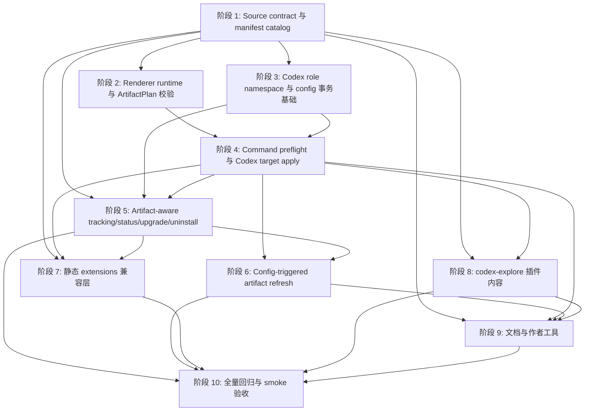

# Codex Explorer Plugin TODO

本文档从 `docs/dev/plans/codex-explorer-plugin.md` 拆出可独立推进的实施阶段。每个阶段都有明确前置条件、交付边界和测试验收，后续可以按依赖图安排并行开发。

## 阶段总览

| 阶段 | 主题 | 前置依赖 | 可并行关系 |
| --- | --- | --- | --- |
| 阶段 1 | Source contract 与 manifest catalog | 无 | 所有后续阶段的共同基础 |
| 阶段 2 | Renderer runtime 与 ArtifactPlan 校验 | 阶段 1 | 可与阶段 3 并行 |
| 阶段 3 | Codex role namespace 与 config 事务基础 | 阶段 1 | 可与阶段 2 并行 |
| 阶段 4 | Command preflight 与 Codex target apply | 阶段 2、阶段 3 | 阻塞阶段 5、阶段 6、阶段 8 的集成验收 |
| 阶段 5 | Artifact-aware tracking、status、upgrade、uninstall | 阶段 1、阶段 3、阶段 4 | 可与阶段 7、阶段 8、阶段 9 的部分工作并行 |
| 阶段 6 | Config-triggered artifact refresh | 阶段 2、阶段 4、阶段 5 | 可与阶段 7、阶段 8、阶段 9 并行 |
| 阶段 7 | 静态 extensions 兼容层 | 阶段 1、阶段 4、阶段 5 | 可与阶段 6、阶段 8、阶段 9 并行 |
| 阶段 8 | `codex-explore` 插件内容 | 阶段 1、阶段 2、阶段 4 | 内容编写可提前，安装验收依赖阶段 4 之后 |
| 阶段 9 | 文档与作者工具 | 阶段 1、阶段 2、阶段 4、阶段 6、阶段 8 | 文档草稿可提前，校验工具验收依赖相关能力落地 |
| 阶段 10 | 全量回归与 smoke 验收 | 阶段 5、阶段 6、阶段 7、阶段 8、阶段 9 | 收口阶段 |

## 阶段依赖关系图

并行建议：

- 第一波只做阶段 1，尽快稳定 manifest、catalog 和类型边界。
- 第二波并行推进阶段 2 和阶段 3。一个人负责 renderer 与 plan 校验，另一个人负责 Codex TOML、role namespace 和事务基础。
- 第三波在阶段 4 打通写路径后，阶段 5、阶段 7、阶段 8、阶段 9 可以分工推进。
- 第四波阶段 6 依赖 tracking 和 apply 语义稳定后再接入，避免 refresh 逻辑重复实现 install / upgrade 的写入链路。
- 阶段 10 只做收口，不承载新能力。

## 阶段 1：Source Contract 与 Manifest Catalog

前置依赖：无。

目标：先把动态 artifact 的静态真值和运行时 contract 固定下来，让 installability、discovery、status current catalog、project write safety preflight 和 ledger snapshot 都能在不执行 renderer 的情况下识别能力。

待办：

- [x] 扩展 `PluginScriptsConfig`，新增 `scripts.artifacts.render`。
- [x] 扩展 manifest schema，新增 `artifacts.targets`。
- [x] 定义 `ArtifactPlan`、`ManagedArtifactId`、`ArtifactState`、`ArtifactTarget` 等核心类型草案。
- [x] 首版支持 target：`codex.developerInstructionsBlock`、`codex.agentRole`。
- [x] 首版支持 artifact kind：`instruction`、`codexRole`，并保留 `permission`、`hook`、`agent` 的静态兼容语义。
- [x] `codex.developerInstructionsBlock` 的 `projectManagedKind` 映射到 `instruction`。
- [x] `codex.agentRole` 的 `projectManagedKind` 映射到 `agent`，不要把内部 `kind = "codexRole"` 写入 capability snapshot。
- [x] 校验 `scripts.artifacts.render.path` 是插件包内相对路径。
- [x] 校验 renderer runner，首版至少支持 `runner = "node"`，不支持时给出清晰错误。
- [x] 校验 `artifacts.targets` 中 `id + target` 唯一。
- [x] 校验 `refreshKeys` 必须存在于 `config.schema`。
- [x] 校验 `states` 只能使用首版支持状态。
- [x] 校验 `requiresCodexProjectConfig = true` 的 target 会进入 project write safety preflight 识别范围。
- [x] 校验 `codex.agentRole` target 必须声明静态 `roleKey`，且 roleKey 合法。
- [x] 确保 renderer 字段和动态 artifact metadata 保留在 `.agents-plugin/plugin.json` 与 AW runtime bundle 中。
- [x] 确保 renderer 字段和动态 artifact metadata 不泄漏到 Codex 原生插件 manifest。
- [x] 集中实现 Codex project managed kinds 合并入口，覆盖静态 manifest 能力和动态 `artifacts.targets`。
- [x] 让 project scope installability、discovery candidate、status current catalog view、ledger `capabilitySnapshot.projectManagedKinds` 共用同一套动态 metadata 合并逻辑。
- [x] 保证 `codex-explore` 首次 project install 前就被识别为 `skill + instruction + agent`。

#### 测试验收

- [x] Unit：合法 `scripts.artifacts.render` 能被 normalizer 接受。
- [x] Unit：合法 `artifacts.targets` 能进入 AW runtime catalog。
- [x] Unit：非法 runner、越界 path、未知 scripts 字段给出清晰错误。
- [x] Unit：未知 target、未知 state、未知 refresh key、非法 `projectManagedKind`、缺失 `codex.agentRole.roleKey` 都会失败。
- [x] Unit：renderer 字段和动态 artifact metadata 不进入 Codex 原生 manifest。
- [x] Unit：动态 artifact 被纳入 Codex project managed kinds。
- [x] Integration：首次 project install 前，current catalog 报告 managed kinds 为 `skill`、`instruction`、`agent`。
- [x] Integration：ledger capability snapshot 写入静态能力和动态 artifact metadata 的合并结果。

## 阶段 2：Renderer Runtime 与 ArtifactPlan 校验

前置依赖：阶段 1。

目标：让 install、upgrade、refresh 写路径可以安全执行 renderer，拿到结构化 ArtifactPlan，并在任何写盘前完成严格校验。

待办：

- [x] 新增 `packages/cli/src/utils/artifact-renderer.ts`。
- [x] 扩展 `packages/cli/src/utils/plugin-scripts.ts`，复用现有脚本 timeout、bundle、依赖闭包和跨平台 runner 约束。
- [x] 通过 `AW_PLUGIN_CONTEXT` 传入 renderer context JSON 路径，或实现等价上下文入口。
- [x] renderer context 至少包含 event、platform、scope、plugin name/version/rootDir、config schema/values/sources/issues、config mode、target scope、changedConfigKeys、previous tracked artifacts、AW/Codex/Claude home、manifestPath。
- [x] 新增 artifact render config helper，并和现有 effective config 明确区分。
- [x] user scope render config 只合并 `schema default + user config`。
- [x] project scope render config 合并 `schema default + user config + 当前 project config`。
- [x] install / upgrade 没有 changed keys 时仍按完整 artifact render config 输出 plan。
- [x] refresh event 必须带本次变更的 config keys。
- [x] renderer stdout 必须是 JSON，stderr 只作为诊断摘要。
- [x] 非 JSON、未知 version、超时、退出码非 0、未知 target、字段类型错误都视为 render 失败。
- [x] renderer 只允许在 install、upgrade、refresh 写路径执行，`aw status` 不执行 renderer 或 lifecycle。
- [x] 新增 `packages/cli/src/utils/artifact-plan.ts`。
- [x] 校验 plan 顶层 `version = 1`。
- [x] 校验 `artifacts` 是数组。
- [x] 校验 artifact id 非空且只使用安全字符。
- [x] 校验 `pluginName + id + target` 作为受管 artifact 逻辑身份。
- [x] 校验 platform、target、state、refreshKeys、scope 和 manifest 声明一致。
- [x] 当前 platform/scope 已声明的动态 artifact 必须返回 `present` 或 `disabled`，不能漏返回。
- [x] `disabled` artifact 允许无 content，但必须保留 refreshKeys，可带 `disabledReason = "config"`。
- [x] `present` artifact 按 target 校验 content。
- [x] `codex.agentRole` plan 的 `roleKey` 必须和 manifest 静态 metadata 完全一致。
- [x] 禁止 renderer 声明绝对路径或跳出插件/目标目录的路径。
- [x] 同一 plan 中同一个 `id + target` 不可重复。
- [x] 多个 instruction artifact 按稳定排序或合成规则处理，避免刷新 churn。
- [x] 计算 artifact `configDigest`，纳入 refreshKeys 对应 config 值、renderer 或 manifest digest、platform、target、id。

#### 测试验收

- [x] Unit：renderer context 包含 artifact render config、mode 和 target scope。
- [x] Unit：user scope context 不包含 project config 来源。
- [x] Unit：install / upgrade context 没有 changed keys，refresh context 带 changed keys。
- [x] Unit：stdout 非 JSON、renderer 超时、退出码非 0 都失败并脱敏诊断。
- [x] Unit：合法 instruction present、instruction disabled、`codex.agentRole` present 通过 plan 校验。
- [x] Unit：未知 target、未知 refresh key、未声明 artifact id/target/state/project config 写入面都会失败。
- [x] Unit：当前 platform/scope 已声明但 renderer 漏返回的动态 artifact 会失败。
- [x] Unit：disabled artifact 缺少 refreshKeys 会失败。
- [x] Unit：`roleFile.name !== roleKey` 会失败。
- [x] Unit：`content.registration.config_file` 会失败，该字段只能由 AW 生成。
- [x] Unit：renderer 声明任意路径或重复 `id + target` 会失败。
- [x] Unit：config digest 只随 refreshKeys 对应值、renderer/manifest digest、target/id 改变。
- [x] Unit：user artifact digest 不随当前 repo project config 改变。
- [x] Integration：install / upgrade 在写 artifact 之前拿到 plan。
- [x] Integration：非法 plan 不写文件、不写 tracking。
- [x] Integration：`aw status` 不执行 renderer 或 lifecycle。

## 阶段 3：Codex Role Namespace 与 Config 事务基础

前置依赖：阶段 1。

目标：先做 Codex 配置文件、developer instruction block、agent registration、role layer 和最终 role namespace 的读写基础，给阶段 4 的 apply 和 preflight 提供可靠原语。

待办：

- [x] 扩展 `packages/cli/src/utils/codex-config.ts`，支持 upsert/remove AW managed `developer_instructions` block。
- [x] 支持同一插件多个 present instruction artifact 的稳定合成。
- [x] 扩展 Codex config TOML helper，支持 upsert/remove `[agents.<roleKey>]` 并保留其它 TOML。
- [x] 新增或扩展 `packages/cli/src/utils/codex-roles.ts`。
- [x] 实现最终 role namespace 解析：读取当前 config layer 的 `[agents.*]`。
- [x] 解析带 `config_file` 的注册项，读取对应 role layer，文件有 `name` 时以文件内 name 作为最终 role 名。
- [x] 解析同层 `agents/**/*.toml` 中未被声明项引用的 role 文件。
- [x] 输出每个最终 role 的来源、table key、config path、role layer path 和是否 AW managed。
- [x] 识别高优先级 layer 中通过不同 table key、不同 role 文件名暴露同一最终 role name 的遮蔽或冲突。
- [x] 为同一 plugin + platform + scope 下落到同一 Codex config 的变更提供文档级事务 baseline。
- [x] 事务 baseline 覆盖 instruction block、role registration 和 role layer apply 的回滚需求。
- [x] 提供 status 诊断原语：注册项存在性、`config_file` 指向、role layer 存在性、`name`、description 一致性、外部同名最终 role、visibility drift。
- [x] TOML 损坏时，安装路径 fail fast，status 路径允许 degraded warning。

#### 测试验收

- [x] Unit：upsert/remove developer instructions block 保留其它 TOML。
- [x] Unit：多个 present instruction artifact 按稳定规则合成，renderer 返回顺序变化不改变最终 managed block。
- [x] Unit：upsert/remove `[agents.<roleKey>]` 保留其它 TOML。
- [x] Unit：删除时遇到 `config_file` drift 不误删用户文件。
- [x] Unit：`[agents.foo] config_file` 指向文件内 `name = "codex-explorer"` 能检测冲突。
- [x] Unit：未被声明引用的 `agents/*.toml` 同名 role 能检测冲突。
- [x] Unit：AW managed 同名 role 不算外部冲突。
- [x] Unit：注册项 description 与 role layer description 不一致可被诊断。
- [x] Unit：user scope status 按高优先级 layer 最终 role namespace 判断遮蔽，报告 `unknownByExternalLayer` 或等价稳定状态。
- [x] Unit：同一 Codex config 的 instruction 和 role registration 变更共享同一份 rollback baseline。

## 阶段 4：Command Preflight 与 Codex Target Apply

前置依赖：阶段 2、阶段 3。

目标：把 renderer 输出的合法 ArtifactPlan 应用到 Codex user/project scope，并把 role 冲突和 project write safety preflight 放到任何写入之前。

待办：

- [x] 扩展 `packages/cli/src/commands/codex-project-safety.ts` 或新增同级 preflight。
- [x] command-level role 冲突检查从 `artifacts.targets` 的静态 `roleKey` 读取目标 role 名，不依赖 renderer 输出。
- [x] install / upgrade 在 required-config preflight、config prompt、skill trigger materialization、Codex native marketplace/plugin enabled、renderer、artifact 写入、tracking、ledger、lifecycle 之前执行 role 冲突 preflight。
- [x] config-triggered refresh 在 config store 写入成功后、renderer 或任何 artifact 写入前复用同级 preflight。
- [x] preflight 失败时保持命令只读，不调用 fake prompt，不留下 native、artifact、tracking、ledger 半成品。
- [x] `codex.developerInstructionsBlock` present 时写入当前 scope 对应 Codex config 的 AW managed block。
- [x] `codex.developerInstructionsBlock` disabled 时移除或跳过该 artifact 对应的受管 instruction 内容，不保留禁用提示词。
- [x] `codex.agentRole` present 时写 role layer，再 upsert `[agents.<roleKey>]` 注册项。
- [x] role layer path 由 AW 根据 pluginName 和 roleKey 稳定生成，renderer 不能声明任意落盘路径。
- [x] registration 至少包含 description，不允许 renderer 提供 `config_file`。
- [x] role file 至少包含 name、description、developer_instructions，可包含 `model`、`model_reasoning_effort`。
- [x] role file 的 `name` 必须等于 `roleKey`。
- [x] registration 和 role layer 的 description 应保持一致。
- [x] refresh 前重新校验受管身份，registration drift 或 role layer content drift 不得被静默覆盖。
- [x] `codex.agentRole` disabled 首版预留：清理受管注册项和受管 role 文件，并更新 tracking state。
- [x] uninstall 同时清理 AW managed instruction block、role registration 和 role layer。
- [x] uninstall 遇到用户手写或外部接管 role 文件时不得删除用户文件。
- [x] apply 阶段复核 plan `roleKey` 与静态 metadata、tracking 受管身份一致。
- [x] 同一 scope 内 instruction、role registration 和 role layer apply 作为原子单元处理，失败时整体回滚。

#### 测试验收

- [x] Integration：instruction present 能正确写入 managed block。
- [x] Integration：instruction disabled 能正确移除 managed block，status 不把 disabled 报成 missing。
- [x] Integration：role present 生成 `[agents.codex-explorer]` 和 role layer。
- [x] Integration：同一 scope 内 instruction block 和 role registration 对同一 Codex config 的修改合并为一次文档级事务。
- [x] Integration：安装时存在非 AW 管理最终 role 名 `codex-explorer`，命令在 required-config preflight、config prompt、skill trigger materialization、renderer 和任何写入之前失败。
- [x] Integration：role 冲突失败不写 native plugin enabled、instruction、role layer、tracking、ledger。
- [x] Integration：upgrade 遇到非 AW 管理同名最终 role，也在 renderer 和任何写入前失败。
- [x] Integration：refresh 前 registration drift 或 role layer content drift 会记录失败，不接管用户文件，不写新的成功 digest。
- [x] Integration：uninstall 只清理 AW 管理内容，不删除用户手写 role 文件。
- [x] Unit：command-level preflight 能从 `artifacts.targets` 静态 `roleKey` 检查冲突。

## 阶段 5：Artifact-aware Tracking、Status、Upgrade、Uninstall

前置依赖：阶段 1、阶段 3、阶段 4。

目标：把 path-only tracking 扩展为 artifact-aware record，让 status、discovery、uninstall、upgrade 和 historical fallback 都能按 artifact id/target/roleKey 工作。

待办：

- [x] 扩展 tracking manifest，新增 artifact-aware record。
- [x] tracking 至少记录 id、kind、platform、target、state、disabledReason、refreshKeys、configDigest、contentDigest、paths、roleKey、lastRefresh、refreshReach。
- [x] `lastRefresh` 记录 status、updatedAt、triggerKeys、event、error 摘要。
- [x] `refreshReach` 记录 command scope、实际刷新到的 user/current project target、是否扫描历史 project、已知但未纳入范围的 project target 是否可能 stale。
- [x] status human 输出分别展示 instruction 和 role artifact，不用总健康状态掩盖问题。
- [x] status JSON 保持纯 JSON，人类可读 warning 不混入 stdout。
- [x] status 能诊断 present healthy、disabled by config、block missing、content drift、config digest stale、recent refresh failed。
- [x] project scope status 把 artifact health 和 session visibility 分成两个独立维度。
- [x] project scope session visibility 覆盖 repo trust `trusted`、`untrusted`、`unknown`。
- [x] session visibility 能表达 `visible`、`blockedByProjectTrust`、`projectTrustUnknown`、`unknownByExternalLayer`、`absent` 或等价稳定状态。
- [x] user scope role visibility 按高优先级 layer 最终 role namespace 解析，不只看 table key 或文件名。
- [x] discovery、status、交互式 uninstall/upgrade 候选、direct uninstall/direct upgrade 共用 historical fallback。
- [x] current catalog 缺失时，从 installed snapshot、tracking artifact kind 和 historical evidence 尽量恢复 artifact id、target、paths、roleKey 和 state。
- [x] 恢复不了的 manifest-derived 诊断标为 unavailable，不编造假 role 名或 `historical-agent`。
- [x] upgrade 普通路径和 capabilityChanged/重装路径都按 artifact id 和 target 处理旧产物。
- [x] upgrade capabilityChanged 比较使用 installed snapshot 与 current catalog 的动态 metadata 合并结果。
- [x] disabled artifact 参与 uninstall 收尾，避免旧 block 残留。
- [x] 保留静态 `extensions.*` 的源码/runtime contract 兼容，不要求迁移已经落盘的旧 path-only tracking。

#### 测试验收

- [x] Unit：tracking 可记录两个 artifact id、target、state、refreshKeys、paths、roleKey 和 digest。
- [x] Integration：status 分别报告 instruction 和 role artifact。
- [x] Integration：disabled by config 不被误报为 missing。
- [x] Integration：role layer 缺失、注册项 drift、config stale、refresh failed 都可诊断。
- [x] Integration：project scope status 在 repo trust 为 trusted 时报告 session visible。
- [x] Integration：project scope status 在 repo trust 为 untrusted 时，artifact health 仍健康，session visibility 为 blocked by project trust。
- [x] Integration：project scope status 在 repo trust 为 unknown 时，artifact health 仍健康，session visibility 为 project trust unknown。
- [x] Integration：`aw status -j`、`-j --verbose`、`-j --debug`、`-j --verbose --debug` stdout 都是纯 JSON。
- [x] Integration：JSON 同时包含 artifact health、projectTrust 和 session visibility 稳定字段。
- [x] Integration：human verbose 能说明 repo trust 或 session 加载状态导致的不可见原因。
- [x] Integration：current catalog 缺失但 tracking 仍有 artifact-aware record 时，discovery/status/交互式 uninstall/upgrade/direct uninstall/direct upgrade 能恢复真实 artifact identity 和 roleKey。
- [x] Integration：upgrade capabilityChanged 重装路径清理旧 instruction block、旧 role registration、旧 role layer 和旧 tracking 残留。

## 阶段 6：Config-triggered Artifact Refresh

前置依赖：阶段 2、阶段 4、阶段 5。

目标：在 `aw config set/configure/unset/reset` 写入配置后，根据已安装 artifact 的 refreshKeys 自动刷新当前可定位 target，同时保留失败诊断和 scope 级原子性。

待办：

- [x] 新增 `packages/cli/src/utils/artifact-refresh.ts`。
- [x] 在 `aw config set`、`aw config configure`、`aw config unset`、`aw config reset` 写入口接入 refresh 判断。
- [x] config store 写入成功后读取当前命令上下文能定位的已安装插件 tracking。
- [x] changed keys 命中 artifact refreshKeys，且写入层会进入该 artifact 所属 scope 的 artifact render config 时，触发 renderer `event = "refresh"`。
- [x] `reset` 按可能影响该插件所有 tracked refreshKeys 处理。
- [x] 未命中任何 refreshKeys 时保持现有行为，不刷新 artifact。
- [x] 未安装插件时只保存配置，后续 install/upgrade 按目标 scope 最新 artifact render config 渲染。
- [x] current manifest 或 renderer 不可用时，config store 写入仍保留，refresh 标记 skipped 或 failed，并在 JSON receipt 中输出稳定机器字段。
- [x] user scope config 写入刷新 user scope artifact；如果当前 repo 也安装了 project scope artifact，一并刷新当前 repo project artifact。
- [x] project scope config 写入只刷新当前 repo project artifact，不改写 user artifact。
- [x] project config store 存在不能被误判成 project scope 已安装。
- [x] project config 变化不能让 user scope artifact 进入 stale 或 refresh failed。
- [x] 命中 Codex project scope target 时，在 renderer 和 artifact 写入前执行 project write safety preflight。
- [x] project preflight 失败时保留 config store，不执行 renderer，不改写 repo artifact，不写新的成功 digest。
- [x] refresh 不执行 lifecycle 脚本。
- [x] refresh 不修改用户手写 role 文件。
- [x] refresh 不扫描所有历史 project。
- [x] refresh 最小原子单元是同一 plugin + platform + scope 下本次命中的 artifact 集合。
- [x] 同一 scope 中的 lightweight instruction 和 dedicated role 要么一起刷新成功，要么回滚到刷新前 artifact 状态。
- [x] user scope 和 project scope 分别作为独立原子单元处理，不跨 scope 回滚。
- [x] renderer 失败时不得写 artifact。
- [x] apply 阶段任一 artifact 失败时，回滚本原子单元已经写入的 Codex config、role 文件和 artifact 内容。
- [x] refresh 成功后更新 state、configDigest、contentDigest、lastRefresh。
- [x] refresh 失败后不回滚 config store，受影响 artifact 标记 refresh failed。
- [x] 每次 refresh 写入 refreshReach，user scope 写入只能把 user target 和当前 repo project target 记为已刷新。
- [x] 判断其它历史 project 可能 stale 时，只用 tracking/ledger 中已知 project scope 记录，不扫描文件系统。
- [x] config 命令 JSON receipt 输出 `artifactRefresh.attempted`、`status`、`triggerKeys`、`artifacts[]` 和稳定 error 摘要。

#### 测试验收

- [x] Integration：修改 `enableLightweightInstruction` 会切换 lightweight instruction present/disabled。
- [x] Integration：`enableLightweightInstruction=false` 移除轻量 instruction block，role artifact 不受影响，status 报告 disabled by config。
- [x] Integration：`enableLightweightInstruction` 从 false 改回 true 后 instruction 按当前 render config 重新写入。
- [x] Integration：修改 `explorerModel` 或 `modelReasoningEffort` 会刷新 instruction 和 role。
- [x] Integration：`aw config set/configure/unset/reset` 四个写入口都覆盖 refresh 触发、digest 更新和状态回写。
- [x] Integration：未命中 refreshKeys 的配置写入不刷新。
- [x] Integration：config-triggered refresh 不执行插件 lifecycle 脚本。
- [x] Integration：refresh 失败保留 config store，并让 status 报告 refresh failed。
- [x] Integration：config 命令 JSON receipt 稳定输出 attempted、status、triggerKeys、artifacts。
- [x] Integration：user scope 和 project scope 按各自 artifact render config 刷新，project config 不影响 user artifact。
- [x] Integration：同一 repo 同时安装 user/project scope artifact 后，user scope 写入可刷新 user target 和当前 repo project target。
- [x] Integration：project scope 原子单元失败不回滚已经成功提交的 user scope artifact。
- [x] Integration：project scope 写入只刷新当前 repo project artifact，不让 user artifact stale 或 refresh failed。
- [x] Integration：当前 repo 只有 project config store、没有 project scope tracking 时，不触发 project artifact refresh 或 preflight。
- [x] Integration：两个 repo 都安装 project artifact 后，在 repo A 写 user config，refreshReach 只记录 user target 和 repo A project target，status 提示其它已知历史 project 可能 stale。
- [x] Integration：project write safety preflight 失败时，不执行 renderer，不写 `.codex/config.toml`、repo-managed skill、instruction、role 文件或成功 digest。
- [x] Integration：renderer refresh 失败和 apply 部分写入失败都能保留 config store、记录 refresh failed，并保持 artifact 回滚后的健康状态可诊断。

## 阶段 7：静态 Extensions 兼容层

前置依赖：阶段 1、阶段 4、阶段 5。

目标：新 artifact renderer 主线落地后，旧插件的静态 `extensions.*` 行为不能被破坏。

待办：

- [x] 保留静态 `extensions.instructions`、`extensions.permissions`、`extensions.hooks`、`extensions.agents` 行为。
- [x] 可以把静态 extensions 包成内置 renderer，也可以在 adapter 中走等价兼容路径，但对外语义必须保持不变。
- [x] 旧式 Codex agent 单文件 artifact 不强制迁移到 `codex.agentRole`。
- [x] 静态 instruction 没有 dynamic refreshKeys 时，配置写入不触发 refresh。
- [x] status 对静态旧 artifact 不要求报告 config digest。
- [x] 不迁移已经落盘的旧 path-only tracking；兼容重点放在源码/runtime contract 和用户可见行为。

#### 测试验收

- [x] Integration：旧静态 `extensions.instructions` 插件 install/status/uninstall 仍按原行为工作。
- [x] Integration：旧静态 `extensions.permissions` 插件 install/status/uninstall 仍按原行为工作。
- [x] Integration：旧静态 `extensions.hooks` 插件 install/status/uninstall 仍按原行为工作。
- [x] Integration：旧静态 `extensions.agents` 插件 install/status/uninstall 仍按原行为工作。
- [x] Integration：静态 instruction 没有 dynamic refreshKeys 时，`aw config set/configure/unset/reset` 不触发 renderer refresh 或 artifact rewrite。
- [x] Integration：status 不对静态旧 artifact 额外报告 dynamic `configDigest` stale 或 refresh failed。

## 阶段 8：新增 `codex-explore` 插件

前置依赖：阶段 1、阶段 2、阶段 4。内容文件可以在阶段 1 后提前编写，安装链路验收必须等阶段 4 完成。

目标：交付 Codex-only `codex-explore` 插件，提供默认轻量 instruction、手动 `$codex-explore` skill 和专用 `codex-explorer` role。

待办：

- [x] 新增 `plugins/codex-explore/.agents-plugin/plugin.json`。
- [x] 新增 `plugins/codex-explore/instructions/lightweight.md`。
- [x] 新增 `plugins/codex-explore/roles/codex-explorer.md`。
- [x] 新增 `plugins/codex-explore/scripts/render-artifacts.mjs`。
- [x] 新增 `plugins/codex-explore/scripts/render-artifacts.test.mjs`。
- [x] 新增 `plugins/codex-explore/skills/codex-explore/SKILL.md`。
- [x] 新增 `plugins/codex-explore/skills/codex-explore/agents/openai.yaml`。
- [x] manifest 设置 `name = "codex-explore"`。
- [x] manifest 设置 `marketplace.policy.products = ["CODEX"]`。
- [x] manifest 设置 `skills = "./skills"`。
- [x] manifest 设置 `skillTriggers.codex-explore.allowInstallOverride = true`。
- [x] manifest 设置 `scripts.artifacts.render` 指向 `./scripts/render-artifacts.mjs`。
- [x] manifest 设置 `scripts.tests.node` 指向 `./scripts/render-artifacts.test.mjs`。
- [x] manifest 声明 `enableLightweightInstruction`、`explorerModel`、`modelReasoningEffort` config schema。
- [x] `lightweight-instruction` target 声明 `codex.developerInstructionsBlock`，scope 为 user/project，允许 present/disabled，refreshKeys 为 `enableLightweightInstruction`、`explorerModel`、`modelReasoningEffort`。
- [x] `codex-explorer-role` target 声明 `codex.agentRole`，静态 `roleKey = "codex-explorer"`，scope 为 user/project，允许 present，refreshKeys 为 `explorerModel`、`modelReasoningEffort`。
- [x] 两个 project scope target 都声明需要 Codex project config preflight。
- [x] renderer 读取 artifact render config。
- [x] `enableLightweightInstruction=true` 时返回 lightweight instruction present artifact。
- [x] `enableLightweightInstruction=false` 时返回 lightweight instruction disabled artifact，`disabledReason = "config"`。
- [x] renderer 始终返回 `codex-explorer-role` present artifact。
- [x] role layer 写入 `model`、`model_reasoning_effort` 和专用只读探索提示词。
- [x] `agents/openai.yaml` 默认 `policy.allow_implicit_invocation: false`。
- [x] `SKILL.md` 明确这是手动 `$codex-explore` workflow，主 agent 使用 `agent_type = "codex-explorer"`。
- [x] `SKILL.md` 明确小搜索优先本地完成，默认 1 个 explorer，复杂时 2 到 3 个，极复杂最多 4 个。
- [x] `SKILL.md` 规定委派 prompt 包含范围、具体问题、探索深度、输出格式和只读要求。
- [x] `SKILL.md` 只使用 `quick`、`medium`、`very thorough` 三档探索深度。
- [x] `SKILL.md` 要求主 agent 等待 explorer 最终结果，整合后关闭 explorer，并说明 `wait_agent` 不等于关闭 agent。
- [x] 轻量 instruction 使用 Codex 内置 `explorer` role，并传入配置中的 `model` 和 `reasoning_effort`。
- [x] 轻量 instruction 不复制完整 skill workflow，不使用 `agent_type = "codex-explorer"`。
- [x] 轻量 instruction 默认正文控制在 25 行以内，不讲插件机制、安装方式或配置命令。
- [x] 专用 role prompt 保留只读边界和固定输出结构：`结论`、`证据`、`不确定点`、`建议主 agent 下一步查看`。
- [x] build 后 runtime bundle 包含动态 artifact metadata、renderer、instruction template、role prompt、skill 文件。

#### 测试验收

- [x] Plugin script：`render-artifacts.test.mjs` 验证 instruction/role ArtifactPlan 输出。
- [x] Integration：`aw install codex-explore -p codex -s user` 成功写入 native plugin enabled、轻量 instruction、`[agents.codex-explorer]` 和 role layer。
- [x] Integration：`aw install codex-explore -p codex -s project` 成功写当前仓库 repo-managed skill、instruction 和 role artifact，不注册或启用 user native plugin。
- [x] Integration：`aw install codex-explore -p claude` 被 product policy 拦截。
- [x] Integration：未安装时先写配置，后续 install/upgrade 按目标 scope 最新 artifact render config 首次落盘。
- [x] Integration：user scope install/upgrade 只读取 `default+user`，project config 不进入 user artifact 内容、digest 或 stale 判断。
- [x] Integration：project scope install/upgrade 读取 `default+user+project`。
- [x] Integration：默认轻量 instruction 使用内置 `explorer`。
- [x] Integration：`$codex-explore` skill 默认手动触发，并使用 `codex-explorer` role。
- [x] Integration：`aw install --skill-trigger auto` 后才允许 skill 自动触发。
- [x] Content：轻量 instruction 包含渲染后的 `model = <explorerModel>` 和 `reasoning_effort = <modelReasoningEffort>`。
- [x] Content：轻量 instruction 不出现 `agent_type = "codex-explorer"`，不内嵌大段示例 prompt，不讲插件机制或配置命令。
- [x] Content：轻量 instruction 要求只读、范围清晰、输出简短，要求等待 explorer 结果并关闭 explorer。
- [x] Content：`SKILL.md` 包含 `agent_type = "codex-explorer"`、`close_agent` 要求、探索深度三档和等待 explorer 结果要求。
- [x] Content：`agents/openai.yaml` 默认 `allow_implicit_invocation: false`。
- [x] Content：专用 role prompt 保留只读边界和固定输出结构，不要求 explorer 写实现计划或修改文件。

## 阶段 9：文档与作者工具

前置依赖：阶段 1、阶段 2、阶段 4、阶段 6、阶段 8。公开文档草稿可以提前写，作者工具校验需要等 contract 和插件 fixture 稳定。

目标：更新用户文档、架构文档和插件作者技能，避免运行时能力和作者工具脱节。

待办：

- [x] 更新 `docs/plugin-authoring.md`，说明 `scripts.artifacts.render` 的用途、上下文、输出和限制。
- [x] 更新 `docs/plugin-authoring.md`，说明 `artifacts.targets` 是动态 artifact 的安装前能力真值。
- [x] 更新 `docs/plugin-authoring.md`，说明 renderer 只能返回 plan，不能直接写 AW 受管文件。
- [x] 更新 ArtifactPlan 文档，覆盖 `id`、`target`、`state`、`refreshKeys`、`disabledReason`。
- [x] 文档说明 `codex.developerInstructionsBlock` 和 `codex.agentRole`。
- [x] 文档说明 artifact render config 与 effective config 的区别。
- [x] 文档说明动态 artifact 的 config refresh 行为、refreshReach 和失败诊断。
- [x] 文档说明静态 `extensions.*` 仍适合简单静态产物。
- [x] 更新 `docs/plugin-installation.md`，说明动态 artifact 的安装、升级、状态检查和 refresh 排障。
- [x] 更新 `docs/architecture.md`，补充 renderer 阶段、plan apply、tracking/status/uninstall 边界。
- [x] 更新 `docs/coding-conventions.md`，补充 ArtifactPlan、target runtime 和 config transaction 的边界约定。
- [x] 更新 `.agents/skills/create-agent-workflows-plugin/SKILL.md`。
- [x] 更新 `.agents/skills/create-agent-workflows-plugin/references/*`，加入 renderer contract、ArtifactPlan、两个 Codex target、config refresh 和默认手动 skill 约定。
- [x] 更新作者工具校验脚本，检查 renderer path、runner、`artifacts.targets` 必要字段、scope、target、state、refreshKeys、project config 写入面。
- [x] 作者工具校验 `codex.agentRole` 静态 roleKey，以及 renderer fixture roleKey 与静态 metadata 一致。
- [x] 作者工具校验 Codex-only 插件声明产品范围。
- [x] 作者工具校验 `scripts.artifacts.render` 输出 fixture 符合 ArtifactPlan schema。
- [x] 作者工具校验 `agents/openai.yaml` 存在。
- [x] 作者工具校验 skill 默认触发策略符合插件意图。
- [x] 验收 `.claude/skills/create-agent-workflows-plugin` 符号链接能读到最新作者技能内容。

#### 测试验收

- [x] Unit/Integration：`tests/integration/authoring-tools.test.ts` 覆盖合法 renderer、dynamic target、roleKey metadata 和 renderer fixture。
- [x] Unit/Integration：作者工具拒绝非法 target、非法 state、未知 refresh key、缺失 `codex.agentRole.roleKey`。
- [x] Unit/Integration：作者工具拒绝 renderer fixture roleKey 不匹配。
- [x] Unit/Integration：作者工具拒绝缺失 skill 默认策略。
- [x] Docs：公开文档覆盖 renderer contract、ArtifactPlan、Codex targets、artifact render config、config refresh、静态 extensions 适用边界。
- [x] Docs：架构文档明确 renderer 只能产出 plan，动态写盘集中在 AW target apply，不散到 lifecycle。
- [x] Docs：作者工具 reference 和 `.claude` symlink 入口都能读到最新内容。

## 阶段 10：全量回归与 Smoke 验收

前置依赖：阶段 5、阶段 6、阶段 7、阶段 8、阶段 9。

目标：用完整测试矩阵和首版验收清单收口，确认 plan review 中的新关闭标准全部满足。

待办：

- [x] 核对首版验收清单，确认 manifest、renderer、ArtifactPlan、Codex targets、tracking/status/uninstall/upgrade/refresh、插件内容和文档作者工具都已覆盖。
- [x] 核对 review 问题关闭标准，确认不再实现 `codexRole` binding、`promptAppend`、`promptOverride`、`allowEmpty` 和 skill 默认隐式触发。
- [x] 确认 role 冲突检测以前置 command-level preflight 为准。
- [x] 确认 config-triggered refresh 单独覆盖 registration drift 和 role content drift。
- [x] 确认测试矩阵锁住多 instruction 稳定合成。
- [x] 确认测试矩阵锁住 role registration 与 role layer description 不一致的 status 诊断。
- [x] 确认测试矩阵锁住 user scope 和 project scope refresh 独立原子单元。
- [x] 确认测试矩阵锁住静态 `extensions.*` 兼容层。
- [x] 确认测试矩阵锁住未安装时先写配置再 install/upgrade 的渲染口径。
- [x] 确认测试矩阵锁住 upgrade 路径的 role 冲突 command-level preflight。
- [x] 确认 smoke 覆盖最终 bundle、plugin scripts、pack tarball。

#### 测试验收

- [x] 执行 `pnpm plugin:test codex-explore`。
- [x] 执行 `pnpm test:unit`。
- [x] 执行 `pnpm test:integration`。
- [x] 执行 `pnpm build`。
- [x] 执行 `pnpm test:smoke:build`。
- [x] 执行 `pnpm test:smoke:plugin-scripts`。
- [x] 执行 `pnpm test:smoke:pack`。
- [x] Smoke：`pnpm build` 生成 `packages/cli/plugins-dist/plugins/codex-explore` runtime bundle。
- [x] Smoke：runtime bundle 包含动态 artifact metadata、`scripts/render-artifacts.mjs`、instruction template、role prompt、skill 文件。
- [x] Smoke：`pnpm test:smoke:build` 覆盖 Codex-only marketplace entry、platform manifest、skill 文件和 renderer 脚本。
- [x] Smoke：`pnpm test:smoke:plugin-scripts` 覆盖插件脚本 staging、test-only helper 复制边界和最终 bundle 下的脚本运行形态。
- [x] Smoke：`pnpm test:smoke:pack` 验收 `pnpm pack:cli` tarball 包含新插件 runtime bundle。
- [x] Final：`aw install codex-explore -p codex -s user` 和 `aw install codex-explore -p codex -s project` 均通过关键路径验收。
- [x] Final：`aw install codex-explore -p claude` 被 product policy 拦截。
- [x] Final：`aw config set/configure/unset/reset` 命中 refreshKeys 后自动刷新当前可定位 artifact。
- [x] Final：`aw status -j` 系列输出纯 JSON，并包含 artifact health、projectTrust、session visibility 字段。
