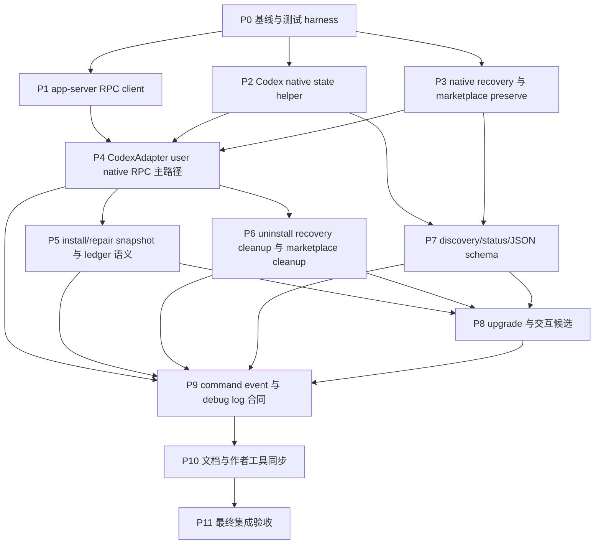

# Codex 原生插件安装/卸载 RPC 接入 TODO

来源：[`../plans/codex-native-plugin-install-rpc-plan.md`](../plans/codex-native-plugin-install-rpc-plan.md)  
日期：2026-05-04  
状态：已完成（P11 已验收）

## 目标

把 Codex user scope 的原生插件安装和卸载切到 Codex app-server `plugin/install` / `plugin/uninstall` RPC，让 `aw install <plugin> -p codex -s user` 同时得到 Codex enabled config 和 materialized cache，并补齐 native write 成功后 AW 后续步骤失败时的插件级恢复语义。

这个 TODO 按可单独执行的阶段拆分。每个阶段都给出依赖、主要改动面、交付物和测试验收，方便后续并行实施。

## 依赖关系图

## 并行实施建议

- `P1`、`P2`、`P3` 在 `P0` 完成后可并行执行，文件边界相对清楚。
- `P7` 只依赖本地 native state 和 recovery helper，可在 `P4` 主路径改造时并行推进。
- `P5` 和 `P6` 都依赖 `P4`，但写入面分别集中在 install / uninstall，可并行推进，注意共享的 recovery helper 和 ledger 类型不要互相覆盖。
- `P8` 需要 install、uninstall、status/discovery 语义稳定后再做。
- `P9` 适合最后统一收口 event payload 和 debug log 字段，避免前面阶段重复改测试断言。

## P0 基线与测试 harness

依赖：无

主要改动面：

- `packages/cli/src/adapters/codex.ts`
- `packages/cli/src/commands/install.ts`
- `packages/cli/src/commands/uninstall.ts`
- `packages/cli/src/commands/upgrade.ts`
- `packages/cli/src/commands/discovery.ts`
- `packages/cli/src/commands/status.ts`
- `packages/cli/src/types.ts`
- `packages/cli/src/utils/local-marketplace.ts`
- 测试夹具和 fake Codex app-server harness

TODO：

- [x] 梳理 Codex user/project scope 当前安装、升级、卸载、status、discovery 入口。
- [x] 锁定当前假成功问题的最小 regression tests：user native install 只写 enabled、status 把 enabled 当 installed、uninstall 只删 enabled。
- [x] 新增通用 fake Codex app-server 测试 harness，能模拟 stdio JSONL 响应、stderr、超时、提前退出和非 JSON 行。
- [x] 确认测试不依赖真实 `codex` 可执行文件，也不写真实 `~/.codex`。

测试验收：

- [x] 新增的 baseline regression tests 能稳定复现现有 config-only 假成功行为。
- [x] fake app-server harness 可被后续 client、adapter、integration tests 复用。
- [x] 可先跑相关 Vitest 文件；本阶段不要求全量 `pnpm test:unit` 通过，但不能引入非相关失败。

## P1 app-server RPC client

依赖：`P0`

主要改动面：

- 新增 `packages/cli/src/utils/codex-app-server-client.ts`
- 必要时新增小型 `CodexAppServerProcessRunner`
- 对应 unit tests

TODO：

- [x] 启动 `codex app-server`，使用默认 stdio JSONL transport。
- [x] 实现 `initialize -> initialized -> plugin/install|plugin/uninstall` 协议顺序。
- [x] 请求报文不带 `"jsonrpc": "2.0"`。
- [x] 按 `id` 匹配响应，并忽略无关 notification。
- [x] 捕获 stderr，处理 timeout、非 JSON 行、提前退出和子进程清理。
- [x] 暴露 `installCodexPluginViaAppServer()` 和 `uninstallCodexPluginViaAppServer()`。
- [x] 将 unknown method、invalid request、plugins disabled、install policy 拒绝、spawn failure 映射为 AW 可读错误。

测试验收：

- [x] unit tests 覆盖成功 install/uninstall、协议顺序、stderr capture、timeout、unknown method、invalid request、plugins disabled、install policy 拒绝、spawn failure、非 JSON 行和提前退出。
- [x] 测试只使用 fake runner，不调用真实 `codex app-server`。
- [x] 错误文案包含可行动建议，并保留足够 debug 上下文。

## P2 Codex native state helper

依赖：`P0`

主要改动面：

- 新增 `packages/cli/src/utils/codex-native-state.ts`
- 对应 unit tests

TODO：

- [x] 读取用户级 `~/.codex/config.toml [plugins."<plugin>@aw"]`。
- [x] 区分 `configEntryPresent` 与 `pluginEnabled`。
- [x] 扫描 `~/.codex/plugins/cache/aw/<plugin>/...` 的 active cache。
- [x] active cache 判定覆盖无效目录、多版本目录、非目录条目，规则贴近 Codex loader 语义。
- [x] 实现 install post-check：`pluginEnabled === true` 且 cache installed。
- [x] 实现 uninstall post-check：目标 config entry 不存在且 active cache 不存在。
- [x] 提供跨插件 native evidence 列表，供 discovery、status 和 marketplace cleanup 使用。
- [x] 判断 `[marketplaces.aw]` 是否允许清理。

测试验收：

- [x] unit tests 覆盖 enabled-only、disabled-only、cache-only、多版本 cache、无效 cache、非目录条目。
- [x] install post-check 缺 enabled 或缺 cache 都失败。
- [x] uninstall post-check 把 `enabled = false` 的目标 config entry 残留判为失败。
- [x] helper 全程只读本地文件，不启动 app-server。

## P3 native recovery 与 marketplace preserve

依赖：`P0`

主要改动面：

- 新增 `packages/cli/src/utils/codex-native-recovery.ts`
- 修改 `packages/cli/src/utils/local-marketplace.ts`
- 对应 unit tests

TODO：

- [x] 使用 `<AW_HOME>/native-recovery/codex/user/<plugin>@aw.json` 存储插件级 breadcrumb。
- [x] 实现 breadcrumb 原子读、写、更新、删除、按插件读取和全量扫描。
- [x] breadcrumb schema 包含 `state`、`reason`、`nativeWrittenAt`、`updatedAt`、`pluginId`、`marketplacePath`、`pluginVersion`、`bundleFingerprint`、`activeCachePath`、`lastError` 等诊断字段。
- [x] 只有 `plugin/install` 成功返回后才能创建 breadcrumb。
- [x] 初始状态为 `pending_after_native_write`，后续失败刷新为具体状态。
- [x] 全流程成功后删除 breadcrumb；删除失败时命令不能报告完全成功。
- [x] `initializeLocalMarketplace()` staging 时保留 `native-recovery/`。
- [x] `calculateBundleFingerprint()` 忽略 `native-recovery/`。
- [x] `validateLocalMarketplaceLayout()` 不把 `native-recovery/` 当成 bundle 源码或未知污染清理。
- [x] `replaceDirectoryAtomically()` 刷新 `~/.aw` 后仍保留未恢复 breadcrumb。

测试验收：

- [x] breadcrumb 在 `installed.json` 缺失或无效时仍可读取。
- [x] `ensureLocalMarketplace()` 和 `aw init --force` 不会删除 breadcrumb。
- [x] fingerprint 变化不会被 `native-recovery/` 影响。
- [x] breadcrumb 写入、更新、删除都具备原子性测试或等价失败保护测试。

## P4 CodexAdapter user native RPC 主路径

依赖：`P1`、`P2`、`P3`

主要改动面：

- `packages/cli/src/adapters/codex.ts`
- 可能涉及 marketplace registration helper
- 对应 unit / integration tests

TODO：

- [x] `CodexAdapter.installPlugin()` 保留 project scope 隔离和 native-only preflight。
- [x] user scope 且不需要 native runtime 时继续 no-op。
- [x] user scope 需要 native runtime 时按顺序执行：`ensureLocalMarketplace()`、解析 canonical `AW_HOME`、检查 external ownership、必要时注册 marketplace、验证 `[marketplaces.aw]`、计算 marketplace manifest path、调用 `plugin/install`、立即写入 `pending_after_native_write` breadcrumb、执行 enabled/cache post-check。
- [x] 从 install 主路径移除 `upsertCodexPluginEnabledFile()` config-only fallback，仅保留明确兼容或验证修复路径。
- [x] `CodexAdapter.uninstallPlugin()` 在最后一个 shared native ref 移除时调用 app-server `plugin/uninstall`。
- [x] 卸载成功后执行 config entry/cache post-check。
- [x] 从 user native uninstall 主路径移除 `removeCodexPluginEnabledFile()` fallback。
- [x] 为 breadcrumb-only 清理提供按 plugin id 卸载能力，避免强依赖成功 scope record 或完整 `PluginMeta`。
- [x] marketplace cleanup 改为检查 shared refs、breadcrumb、enabled config entry、active cache 四类 evidence。

测试验收：

- [x] user native install 调 app-server `plugin/install`，不再只写 enabled。
- [x] RPC 不可用、unknown method 或 install policy 拒绝时命令失败，不退回 config-only。
- [x] marketplace add 失败时不启动 install RPC。
- [x] 已注册 canonical marketplace 时仍调用 install RPC。
- [x] install post-check 缺 cache 时失败，并保留 recovery breadcrumb。
- [x] user native uninstall 调 app-server `plugin/uninstall`，不走 config-only fallback。
- [x] 仍有 shared native refs 时不调用 `plugin/uninstall`，不删除目标 native cache / enabled config，也不提前清理 `[marketplaces.aw]`。
- [x] Codex project scope 不调用 marketplace add、app-server 或用户级 config/cache。

## P5 install/repair snapshot 与 ledger 语义

依赖：`P4`

主要改动面：

- `packages/cli/src/commands/install.ts`
- lifecycle snapshot 相关 helper
- ledger / tracking 写入逻辑
- 对应 unit / integration tests

TODO：

- [x] 拆分 `createLifecycleConfigSnapshot()` 为只读 `prepareLifecycleConfigSnapshot()` 和写入型 `persistLifecycleConfigSnapshot(prepared)`。
- [x] native RPC 前只允许执行只读 prepare，不得提前创建 snapshot 目录或复制 bundle。
- [x] `pending_after_native_write` breadcrumb 成功持久化后，才能 persist lifecycle snapshot。
- [x] snapshot 持久化失败时刷新 breadcrumb 为 `snapshot_write_failed`，命令失败且不写成功 ledger。
- [x] lifecycle、tracking、ledger 只能使用已经落盘并通过基本校验的 snapshot metadata。
- [x] rollback 只删除已持久化 snapshot 或明确存在的 staging 目录，不能因只读 metadata 误报 snapshot cleanup 失败。
- [x] native write 成功且 breadcrumb 已持久化后，后续失败只刷新插件级 recovery state。
- [x] 收窄 `preserveLedgerState()` / rollback 中按 `nativeWritten` 写全局 degraded 的逻辑。
- [x] full install 或 repair install 全部成功后删除对应 breadcrumb。
- [x] breadcrumb 删除失败时命令失败但保留可诊断状态，不把成功安装 ledger 回滚成未知状态。
- [x] breadcrumb-only 显式 `install` 走 repair path，但必须先按 current catalog 解析目标插件。
- [x] current catalog 找不到 breadcrumb-only 插件时安装失败，并提示改用 `aw uninstall <plugin> -p codex -s user` 清理 native 残留。
- [x] repair install 不从 breadcrumb 继承 install options，也不把 breadcrumb 当成功账本。

测试验收：

- [x] native write 成功后先写 pending breadcrumb，再进入 post-check / lifecycle / tracking / ledger。
- [x] snapshot 真实持久化发生在 pending breadcrumb 成功之后。
- [x] snapshot 持久化失败会刷新 `snapshot_write_failed`，不写成功 ledger。
- [x] breadcrumb 写入失败时立即失败，不承诺自动 repair / uninstall 授权。
- [x] 只有 `pending_after_native_write` 的 breadcrumb 也能被 status、repair install、breadcrumb-only uninstall 当成恢复证据。
- [x] breadcrumb-only install 成功后写 ledger / tracking / snapshot，并删除 breadcrumb。
- [x] breadcrumb-only install 找不到 current catalog 插件时失败，stderr 给出 uninstall cleanup 建议。

## P6 uninstall recovery cleanup 与 marketplace cleanup

依赖：`P4`

主要改动面：

- `packages/cli/src/commands/uninstall.ts`
- marketplace cleanup 相关 helper
- lifecycle / tracking / ledger 清理路径
- 对应 unit / integration tests

TODO：

- [x] `commands/uninstall.ts` 把 native recovery breadcrumb 作为卸载授权证据。
- [x] breadcrumb-only uninstall 跳过插件自己的 uninstall lifecycle。
- [x] breadcrumb-only uninstall 不调用 `getScopeRecordForUninstall()`，也不通过 current catalog 间接执行 lifecycle。
- [x] breadcrumb-only uninstall 只执行 `plugin/uninstall`、post-check、breadcrumb 删除和 marketplace cleanup。
- [x] 已有成功 scope record 的正常卸载继续保持现有 lifecycle 语义。
- [x] `plugin/uninstall` 返回成功后必须同时确认目标 config entry 不存在且 active cache 不存在。
- [x] marketplace cleanup 必须等待 shared refs、breadcrumb、enabled config entry、active cache 全部消失。
- [x] breadcrumb 删除失败时保留 status 可见诊断，不报告完全成功。

测试验收：

- [x] breadcrumb-only uninstall 不运行 uninstall lifecycle。
- [x] breadcrumb-only uninstall 能清理 config/cache/breadcrumb，status 回到 `notInstalled`。
- [x] `plugin/uninstall` 成功但 cache 或 config entry 仍存在时命令失败，不写干净 ledger / tracking。
- [x] disabled config entry 残留会让目标 uninstall post-check 失败。
- [x] 多插件 breadcrumb 或无归属 enabled/cache 残留存在时，不提前删除 `[marketplaces.aw]`。
- [x] 命令开始前已有无关全局 degraded 时，breadcrumb-only uninstall 不顺手清掉它。

## P7 discovery/status/JSON schema

依赖：`P2`、`P3`

主要改动面：

- `packages/cli/src/commands/discovery.ts`
- `packages/cli/src/commands/status.ts`
- `packages/cli/src/commands/common.ts`
- `packages/cli/src/types.ts`
- status JSON schema / fixtures
- 对应 unit / integration tests

TODO：

- [x] `DiscoveryEvidenceSource` 增加 `codexNativeCache` 和 `codexNativeRecovery`。
- [x] Codex user discovery 合并 enabled config entry、active cache、AW ledger / tracking / native recovery breadcrumb 三类证据。
- [x] disabled-only config entry 不进入候选。
- [x] cache-only 或 breadcrumb-only 插件进入 status 和交互式 uninstall 候选。
- [x] 无 managed evidence / breadcrumb 的 cache-only 残留只能展示诊断，执行型命令不能静默删除。
- [x] 更新 `NativePluginStatus`：`native.pluginInstalled` 表示 cache installed，新增 `native.pluginEnabled`、config entry、active cache path 等诊断字段。
- [x] 新增稳定的 `native.recovery` JSON 对象：`present`、`state`、`reason`、`evidenceMatches`、`suggestion`。
- [x] `native.recovery` 只表示恢复状态，不能被 health resolver、upgrade target 选择或 install options 继承逻辑当成成功 installed。
- [x] 按 spec 状态表重算 ready / needsAttention / notInstalled。
- [x] `ready` 必须同时满足 cache installed、config enabled、成功 scope record、无 breadcrumb、无全局 degraded、无其它 drift。
- [x] `--verbose` 和 `--json` 输出 enabled、installed、cache path、config path、marketplace health、breadcrumb 和 ledger degraded reason。
- [x] status 文本输出不再把 `pluginInstalled` 展示成旧 enabled 语义。
- [x] status 默认输出遇到 native recovery breadcrumb 时说明 Codex native 已写入、AW 未完成，并区分 pending、具体失败状态和 breadcrumb 删除失败。

测试验收：

- [x] `aw status --json` 锁住 `native.recovery.present/state/reason/evidenceMatches/suggestion` 字段；不存在 breadcrumb 时返回 `false` / `null`。
- [x] status 默认路径不启动 app-server。
- [x] enabled-only、cache-only、shared-ref-only、breadcrumb-only 的 health 判定符合预期。
- [x] cache/config 都存在但只有 shared native ref、没有成功 scope record 时判为 `needsAttention`，不能进入 `upgrade --all` ready target，也不能作为 install options / lifecycle snapshot 继承来源。
- [x] installed/enabled 都为 false，但仍有 managed evidence、shared native ref 或 native recovery breadcrumb 时判为 `needsAttention`。
- [x] disabled-only config entry 且没有 cache / breadcrumb / managed evidence 时，不进入 discovery/status 候选，也不阻塞 marketplace cleanup。
- [x] cache-only 状态能被 status 发现，交互式 uninstall 只展示诊断，不静默清理。

## P8 upgrade 与交互候选

依赖：`P5`、`P6`、`P7`

主要改动面：

- `packages/cli/src/commands/upgrade.ts`
- `packages/cli/src/commands/discovery.ts`
- 交互式 uninstall 候选逻辑
- 对应 unit / integration tests

TODO：

- [x] breadcrumb-only 显式 `upgrade` 在 lifecycle、安装选项继承和 app-server install 前失败。
- [x] `upgrade --all` 排除 breadcrumb-only 目标，记录 skipped，并提示先 install 修复或 uninstall 清理。
- [x] 防止 shared-ref-only、cache-only、breadcrumb-only 借 fallback evidence 混入 ready upgrade target。
- [x] 交互式 uninstall 候选能展示 cache-only / breadcrumb-only 诊断。
- [x] cache-only 且缺少 AW 归属证明时，执行型命令不能静默删除。
- [x] upgrade 不从 breadcrumb 继承 install options，也不把 breadcrumb 当成功 scope record。

测试验收：

- [x] breadcrumb-only explicit upgrade 失败，且失败发生在 lifecycle 和 app-server install 之前。
- [x] `upgrade --all` 对 breadcrumb-only 目标给出 skipped。
- [x] shared-ref-only、cache-only、breadcrumb-only 都不会被选为 ready upgrade target。
- [x] 交互式 uninstall 候选包含必要诊断，但不会自动清理缺少归属证明的 cache-only 残留。

## P9 command event 与 debug log 合同

依赖：`P4`、`P5`、`P6`、`P7`、`P8`

主要改动面：

- command reporter / debug log 事件类型
- install / uninstall / status / discovery / upgrade 中事件写入点
- 对应 unit / integration tests

TODO：

- [x] 新增或扩展 `native:marketplace` event，覆盖 marketplace add / verify。
- [x] 新增或扩展 `native:rpc` event，覆盖 app-server `plugin/install` / `plugin/uninstall`。
- [x] 新增或扩展 `native:recovery` event，覆盖 breadcrumb 写入、刷新和删除。
- [x] 新增或扩展 `native:post-check` event，覆盖 install / uninstall 后 config/cache 校验。
- [x] 扩展 `native:skipped`，Codex project repo-managed 路径使用稳定 reason：`project_repo_managed_skipped_native`。
- [x] 默认成功输出能区分 user native RPC 与 project repo-managed skipped native，但不打印冗长 JSONL 协议细节。
- [x] breadcrumb 写入失败时，stderr 明确说明 native side effect 已发生但 AW 没有持久化恢复证据。
- [x] breadcrumb 已落盘但后续失败时，stderr 明确说明 native 已写入、AW 安装未完成，并提示用 `aw status --verbose` 诊断。
- [x] `--verbose` 和 debug log 持久化同一组 event payload。

测试验收：

- [x] 测试锁住 event type 和关键 payload，而不是只断言 stderr。
- [x] debug log / `--verbose` 能区分 marketplace registration、install RPC、uninstall RPC、cache/materialization verification、project repo-managed skipped native。
- [x] native side effect 已发生但 recovery breadcrumb 缺失时，stderr 与 debug event 都说清风险。
- [x] project scope 在 PATH 缺少 `codex` 时仍能完成 repo-managed 写入，并输出 skipped native 事件。

## P10 文档与作者工具同步

依赖：`P9`

主要改动面：

- `docs/architecture.md`
- `docs/plugin-installation.md`
- `docs/plugin-authoring.md`
- `docs/testing.md`
- `.agents/skills/create-agent-workflows-plugin/`

TODO：

- [x] 更新架构文档：Codex user native install/uninstall 改为 app-server RPC。
- [x] 更新安装文档：说明 `--scope user`、故障排查、`aw status --json` breaking change。
- [x] 更新作者文档：说明 Codex user/project scope 对插件作者的影响。
- [x] 更新测试文档：补 Codex native marketplace / app-server RPC 测试约定。
- [x] 检查并同步插件作者技能：`SKILL.md`、`references/plugin-manifest-spec.md`、`references/extensions-spec.md`、`references/comprehensive-example.md`、`scripts/validate_plugin.js`、相关示例和夹具。
- [x] 移除或改写仍暗示 Codex user native 只写 config 的旧说法。

测试验收：

- [x] 公开文档、作者技能和运行时行为没有互相冲突的描述。
- [x] 文档中的命令、scope 语义、status JSON 字段与测试锁定行为一致。
- [x] 如文档生成或 lint 有对应命令，跑对应文档检查；否则人工检查新增链接和相对路径。

## P11 最终集成验收

依赖：`P10`

主要改动面：

- 全仓测试与 smoke 验证
- 真实 build/pack 产物相关路径

TODO：

- [x] 跑完整 unit tests。
- [x] 跑完整 integration tests。
- [x] 跑 smoke build，确认 runtime bundle 正常生成。
- [x] 检查 install 后 uninstall 的端到端状态闭环。
- [x] 检查 app-server 不可用、方法不可用、policy 拒绝、native write 后 AW 失败、breadcrumb 删除失败等失败路径。
- [x] 检查 Codex project scope 仍保持 repo-managed 隔离，不产生用户级 native 副作用。

测试验收：

- [x] `pnpm test:unit`
- [x] `pnpm test:integration`
- [x] `pnpm test:smoke:build`
- [x] `aw install <plugin> -p codex -s user` 后 Codex 同时看到 enabled config 和 installed cache。
- [x] `aw uninstall <plugin> -p codex -s user` 后 config entry、cache、breadcrumb 清理干净，status 回到 `notInstalled`。
- [x] app-server 不可用或方法不可用时命令失败，且没有 config-only fallback。
- [x] native write 成功后 AW 后续失败时，breadcrumb 被 status 识别为 `needsAttention`，不会把全局 ledger 错标成 degraded。
- [x] breadcrumb 独立于 `installed.json`，也不会被 marketplace refresh 删除。
- [x] breadcrumb-only install 可以修复；breadcrumb-only uninstall 可以清理；breadcrumb-only upgrade 会拒绝或 skipped。
- [x] `[marketplaces.aw]` 只在所有 `@aw` native evidence 都消失后才删除。
- [x] `aw status --json` 中 `native.pluginInstalled` 表示 cache installed，`native.pluginEnabled` 表示 config enabled。
- [x] 默认输出、`--verbose` 和 debug log 都能区分 marketplace registration、install RPC、uninstall RPC、cache/materialization verification、project repo-managed skipped native。
