# Codex Project Scope Repo-Managed 隔离 TODO 拆解

## 文档说明

- 来源计划：`docs/dev/plans/codex-project-scope-repo-managed-isolation.md`
- 目标：把 Codex `project` scope 从用户级 native plugin / marketplace 状态中彻底隔离出来，改为只写当前 repo 内的可追踪产物。
- 使用方式：每个阶段都可以单独派给 agent 执行；开发项和测试项全部完成后，必须通过该阶段的“阶段验收”才能进入依赖它的后续阶段。
- 默认执行目录：repo root。
- 默认语言：代码、命令、路径、API 名称保持原文；说明、验收和 review 结论使用简体中文。

## 统一约束

- Codex `project` scope 不再调用 `codex plugin marketplace add`，不写用户级 `~/.codex/config.toml [marketplaces]` 或 `[plugins]`。
- Codex `user` scope 不改语义，仍使用 Codex native plugin / marketplace 平面。
- Codex `project` scope 的 repo-managed 产物只落在当前仓库：
  - `.agents/skills/<skill>`
  - `.codex/config.toml [mcp_servers.*]`
  - `.codex/hooks.json`
  - `.codex/rules/*.rules`
  - `.codex/agents/*.toml`
  - `.codex/.agent-workflows-manifest.json`
- `apps` 在 Codex `project` scope 首版全部拒绝安装；即使插件同时有其它可 project-managed 能力，也不做部分安装。
- 写命令必须先做安全预检，再进入 required AW config preflight / prompt。安全预检失败时，不能写 repo artifact、tracking、ledger、AW config store、install snapshot 或共享 marketplace/runtime。
- Codex project-only install / explicit upgrade / `upgrade --all` 使用只读 catalog；不能因为 catalog 准备去初始化、修复、替换或 replay 共享 `~/.aw/plugins` runtime。
- 成功安装后仍可按通用 AW bookkeeping 写 `installed.json`、install snapshot；这些写入必须晚于安全预检。
- Codex project repo-managed install / uninstall / explicit upgrade / `upgrade --all` 不要求本机 PATH 里存在 `codex` executable；真正需要 native runner 的 Codex user scope 仍要求平台可用。
- `.codex/config.toml` 只有在命令实际需要读取或改写 config-backed artifact 时才作为阻塞项。skills-only 路径不因无关 project TOML 损坏失败。
- user `~/.codex/config.toml` 无法可靠读取时，Codex project install / explicit upgrade 早失败，因为无法排除 user-native 同名插件冲突；status 和已有 project evidence 的 uninstall 可继续，并把 external ownership / project trust 暴露为 `unknown`。
- tracking manifest 中 `GeneratedArtifact.path` 继续写绝对路径；`.agents/skills/<skill>`、`.codex/config.toml` 只作为人类展示写法。
- `kind: "skill"` 和 `kind: "mcpServer"` 必须带 `artifactKey`；缺失时属于 tracking integrity error，执行型清理不能退回 path-only 删除。
- MCP server key 使用 rendered `.mcp.json` 的原始属性名，支持 TOML quoted key，例如 `[mcp_servers."acme.tools v1"]`，不能把点号拆成路径。
- 公共 `slashCommands` 是唯一的跨平台手动命令作者入口。Claude 生成原生 slash command；Codex 生成 manual-only skill，`policy.allow_implicit_invocation` 固定为 `false`。
- 公共 `slashCommands` 的 Codex 图标资源源码只能写 `./assets/...`，只复制被 command frontmatter 引用的资源到对应 generated skill。
- `skillTriggerApplicability` 是稳定合同：`none` 不伪造 default 偏好，`fixed` 不要求 ledger 偏好，只有 `overridable` 需要可恢复的 install options。
- Codex project scope 不参与共享 skill trigger winner 选举、`aw init` replay、local marketplace rebuild replay 或卸载后的共享 runtime 重选。

## 阶段总览

| 阶段 | 目标 | 可并行边界 | 阶段门禁 |
|------|------|------|------|
| 阶段 0 | 固定合同、夹具和多 agent 分工边界 | 可立即启动 | 新旧行为差异、fixture 矩阵和零写入断言方式清楚 |
| 阶段 1 | Scope-aware capability 与 project installability | 依赖阶段 0 | skills-only / mcp-only / slashCommands-only 可作为 Codex project 候选，apps 早失败 |
| 阶段 2 | 只读 catalog、写入型 runtime 准备和 Codex executable gate 拆分 | 依赖阶段 1，可与阶段 3 初版并行 | project-only 路径不触碰共享 runtime，不被缺少 `codex` executable 挡住 |
| 阶段 3 | 写入前安全预检和 required AW config 顺序 | 依赖阶段 1/2 | external ownership、project TOML、tracking identity 和 config prompt 顺序稳定 |
| 阶段 4 | Tracking / ledger 身份模型和 historical evidence 基础 | 依赖阶段 1 | `artifactKey`、绝对 path、`scopeInitialized` 与 historical placeholder 稳定 |
| 阶段 5 | Skill trigger applicability 与共享 runtime 边界 | 依赖阶段 4 | `none` / `fixed` / `overridable` 行为分开，Codex project 不污染 `~/.aw` |
| 阶段 6 | 公共 `slashCommands` schema、build 和作者工具 | 依赖阶段 1，可与阶段 5 部分并行 | Claude 生成 commands，Codex 生成 manual-only skills，旧 commands 入口拒绝 |
| 阶段 7 | Repo skill materializer、冲突检查和 skill drift | 依赖阶段 4/5/6 | `.agents/skills` 可安装、刷新、卸载、回滚和 status |
| 阶段 8 | MCP writer / remover 与 `.codex/config.toml` 文档级事务 | 依赖阶段 4 | 结构化 MCP、quoted key、managed instructions 共用一次事务 |
| 阶段 9 | Install / uninstall 主链路和失败回滚 | 依赖阶段 3/4/7/8 | repo artifacts、lifecycle、tracking、ledger 的提交和回滚顺序稳定 |
| 阶段 10 | Explicit upgrade、`capabilityChanged` 恢复和 stale prune | 依赖阶段 3/4/7/8/9 | upgrade 预检先于卸载，晚失败能恢复旧安装 |
| 阶段 11 | Discovery / status / historical fallback 和 health 语义 | 依赖阶段 4/5/7/8/9 | status 只看 repo evidence，逐 item 状态和 JSON 合同稳定 |
| 阶段 12 | `upgrade --all` skipped 合同和 evidence-first auto 推断 | 依赖阶段 2/3/4/10/11 | 10 个 skipped code、receipt、退出码和 auto 推断稳定 |
| 阶段 13 | 交互式 install / uninstall / upgrade UX | 依赖阶段 2/11/12 | Codex project 候选不被 native availability 隐藏，旧兼容规则不退化 |
| 阶段 14 | 输出文案、公开文档、作者文档和示例收口 | 依赖阶段 6/11/12/13 | 文档不再描述 project native fallback，示例使用新合同 |
| 阶段 15 | 最终联调、CLI entry 和 smoke 验收 | 依赖所有阶段 | unit、integration、smoke 和关键人工验收全通过 |

## 总体依赖关系图

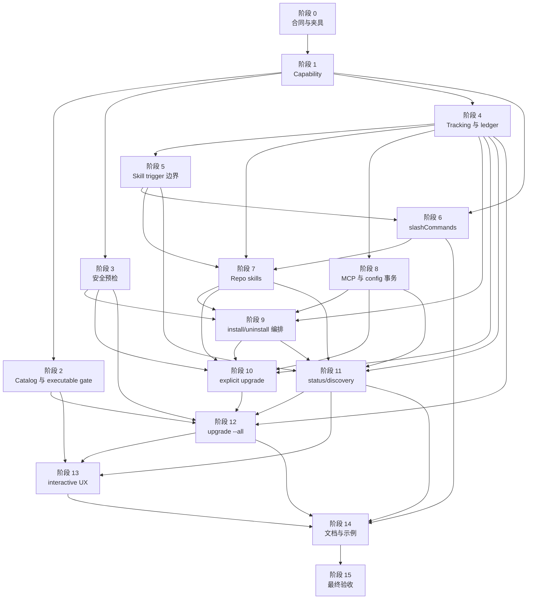

## 并行执行建议

- 阶段 1 和阶段 4 可以由不同 agent 并行推进，但阶段 4 写入 tracking / ledger 类型时要及时同步阶段 1 的 managed kind 命名。
- 阶段 3 与阶段 6 可以并行：前者改命令安全预检，后者改插件源码协议和 build。
- 阶段 7 和阶段 8 是最适合并行的两条产物线：一个 agent 负责 repo skill，另一个 agent 负责 MCP / `.codex/config.toml`。
- 阶段 11 可以先搭 schema 和 formatter 骨架，但 visible / drift 的最终断言要等阶段 7 和阶段 8 的产物 helper 稳定。
- 阶段 12 和阶段 13 都依赖 discovery/evidence 结果，建议先让阶段 11 输出最小可用 evidence API，再分别接 `upgrade --all` 与 interactive。
- 多 agent 并行写代码时，尽量按阶段写入范围拆分，避免两个 agent 同时重写同一个命令编排函数。

## 阶段 0：合同冻结、夹具矩阵与分工边界

### 阶段依赖关系图

### 目标

先把新语义的可测试边界写清楚，准备贯穿后续阶段的 fixture。这个阶段尽量不改主逻辑，只补测试基础和文档内的执行约束，避免后面 agent 各自发明同名 fixture 或错误断言。

### 可并行边界

- Agent A：梳理 fixture 名称、manifest 组合和目录布局。
- Agent B：梳理零写入断言 helper，例如 `.agents/`、`.codex/`、tracking、ledger、AW config store、共享 runtime 的快照比较。
- Agent C：梳理 CLI stdout / stderr / JSON / exit code harness 的复用入口。

### 开发 TODO

- [x] 建立 Codex project repo-managed fixture 矩阵：skills-only、mcp-only、slashCommands-only、extensions-only、skills+MCP、instructions+MCP、multi-MCP、apps-only、apps-mixed、native-only。
- [x] 给 MCP fixture 加至少一个 quoted key server，例如 `acme.tools v1`，并加入 sibling server 用例。
- [x] 给公共 `slashCommands` fixture 加 `claude` / `codex` 分平台 frontmatter、模板渲染、`./assets/...` 图标和负向非法资源路径。
- [x] 增加能构造损坏 user `~/.codex/config.toml`、损坏 project `.codex/config.toml`、损坏 tracking manifest、ledger degraded / missing scope record 的测试 helper。
- [x] 增加“命令前后状态不变”的快照 helper，覆盖 repo artifact、tracking、ledger、AW config store、install snapshot、native config、共享 marketplace/runtime。
- [x] 明确每个后续阶段的文件写入范围，记录在对应测试或 TODO 注释中，便于多 agent 分工。

### 自动化测试

- [x] Fixture 可以被 unit / integration / CLI entry harness 复用，不依赖真实 `codex` 或 `claude` executable。
- [x] 零写入快照 helper 能断言目录不存在、目录内容不变、文件内容不变和 JSON ledger 等价。
- [x] JSON stdout harness 能在 `--json`、`--verbose`、`--debug` 组合下稳定 `JSON.parse`。

### 阶段验收

- [x] 后续阶段所需的主要正向和负向 fixture 都已命名并可复用。
- [x] 任何“早失败不写状态”的测试都能用统一 helper 断言。
- [x] 多 agent 可以按阶段说明拆分工作，不需要先猜 fixture 或 harness 设计。

## 阶段 1：Scope-Aware Capability 与 Project Installability

### 阶段依赖关系图

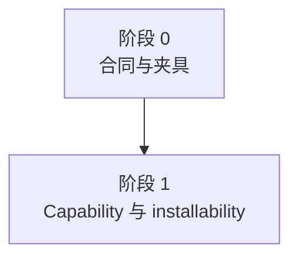

### 目标

把 Codex capability 从平台级判断改成 scope-aware 判断。Codex project scope 不再把 skills / MCP / slashCommands 视为 native-only，同时明确 apps 的 fail fast 规则。

### 可并行边界

- Agent A：改类型、helper 和 capability snapshot。
- Agent B：改 install / interactive candidate 过滤。
- Agent C：补 unit 测试和 manifest capability fixture。

### 开发 TODO

- [x] 新增或替换为 `requiresCodexNativePlugin(plugin, scope)`。
- [x] 新增 `hasCodexProjectManagedArtifacts(plugin)`，覆盖 `skills`、`slashCommands`、`mcpServers`、instructions、permissions、hooks、agents。
- [x] 新增 `getCodexProjectManagedKinds(plugin)`，返回 `skill`、`mcpServer`、`instruction`、`permission`、`hook`、`agent`。
- [x] 调整 `CodexCapabilitySnapshot`：新写入使用 scope-aware `requiresNativePlugin` 和 `projectManagedKinds` / `managedKinds`。
- [x] Codex user scope 的 slashCommands-only 插件仍记录 native capability，并能写 `sharedNativeRefs.user`。
- [x] install / upgrade 入口不再因为 Codex project scope 插件有 skills / MCP 而判定必须 native plugin。
- [x] Codex project scope 且 `manifest.apps` 存在时统一 fail fast，不做部分安装。
- [x] Codex project scope 且没有任何 project managed kind 时 fail fast。
- [x] interactive install 候选包含 skills-only、mcp-only、slashCommands-only 插件。
- [x] apps-only 插件在无插件名交互安装里不进入候选；apps-mixed 插件显示为 disabled，原因指向 user scope 或拆分插件。

### 自动化测试

- [x] `hasCodexProjectManagedArtifacts()` 覆盖 skills-only、slashCommands-only、mcp-only、extensions-only、apps-only、apps-mixed。
- [x] `requiresCodexNativePlugin()` 覆盖 Codex user / project scope 的差异。
- [x] Codex project install validation 对 apps-only / apps-mixed 早失败，且零写入。
- [x] skills-only、mcp-only、slashCommands-only 可以通过 project installability 预检。
- [x] interactive candidate 过滤覆盖 apps-only 缺席、apps-mixed disabled、skills-only 可选。
- [x] 运行 `pnpm test:unit`。

### 阶段验收

- [x] Codex project scope 的可安装性由 repo-managed kind 决定，不再由 native capability 粗粒度判断决定。
- [x] apps 拒绝语义独立清晰，mixed apps 不会被部分安装。
- [x] slashCommands-only 在 Codex user scope 仍是 native runtime 能力，在 Codex project scope 是 repo skill 能力。

## 阶段 2：只读 Catalog、写入型 Runtime 准备与 Executable Gate 拆分

### 阶段依赖关系图

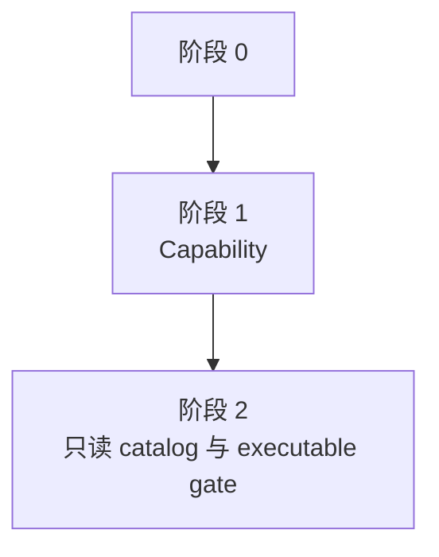

### 目标

把 catalog 读取和共享 local marketplace/runtime 初始化拆开。Codex project-only 路径只能用只读 catalog，缺少本机 `codex` executable 时仍可执行。

### 可并行边界

- Agent A：改 `preparePluginTargetsForCommand()` / marketplace state。
- Agent B：改 platform availability / executable gate。
- Agent C：补 install / upgrade / uninstall 的入口回归。

### 开发 TODO

- [x] 为 `preparePluginTargetsForCommand()` 增加 `catalogMode: 'readOnly' | 'runtimeWritable'` 或等价模型。
- [x] read-only catalog 优先读现有 local catalog；不可用、stale、布局损坏或 ledger degraded 时回退 embedded bundle catalog。
- [x] read-only catalog 不创建或修复 `~/.aw/config.json`、`~/.aw/plugins`、embedded bundle 副本，也不 replay skill trigger preference。
- [x] `PreparedMarketplaceState` 表达 `source: 'embedded' | 'local'` 和 `changed: false`。
- [x] install / explicit upgrade / `upgrade --all` 在解析出真实 target 前不无条件 `ensureLocalMarketplace()`。
- [x] `platform=auto|both` 先解析真实 platform/scope 组合，再决定哪些 target 需要 runtimeWritable 准备。
- [x] 拆分 Codex native executable availability 和 Codex project repo-managed executability。
- [x] 显式 `-p codex -s project`、最终只落到 Codex project target 的 `auto|both`、`upgrade --all -p codex -s project` 不因 `detectEnvironment().codex.available === false` 提前失败。
- [x] Codex user scope、native-only target 或其它实际需要 native runner 的路径继续要求本机 Codex 可用。
- [x] explicit install / upgrade 的 `--platform auto --scope project` 使用整组插件共同候选平台和当前 scope evidence 消除歧义；无 evidence 且 Claude / Codex project 都可执行时拒绝 auto。
- [x] uninstall `--platform auto --scope project` 先做只读 managed evidence 统计；唯一 Codex project evidence 可落到 Codex，Claude 与 Codex 同时存在或 evidence unknown 时拒绝 auto。

### 自动化测试

- [x] `~/.aw` 缺失 / stale / 布局损坏 / ledger degraded 时，Codex project-only install / explicit upgrade / `upgrade --all` 的 read-only 阶段不创建或修复共享 runtime。
- [x] PATH 缺少 `codex` 且未设置 `AW_FORCE_CODEX_AVAILABLE` 时，Codex project repo-managed install / uninstall / explicit upgrade / `upgrade --all` 可继续。
- [x] 同一环境下 Codex user scope 或 native-only target 仍按平台不可用失败。
- [x] `--platform auto --scope project` 在 Claude 可用、Codex native 不可用、Codex project 可写但无 managed evidence 时拒绝自动推断并零写入。
- [x] 当前 scope 只有完整 Codex project tracking / ledger evidence 时，`auto` 稳定落到 Codex project。
- [x] evidence unknown 时，`auto` 拒绝并说明 evidence unknown / 需要显式平台。
- [x] `--platform both --scope project` 的 Codex project 分支预检失败时，整条命令不执行 Claude 分支。
- [x] 对照测试确认 Claude project 或 Codex user 需要 runtime 时仍会按现有规则初始化 / 修复 `~/.aw`。
- [x] 运行 `pnpm test:unit` 和 `pnpm test:integration`。

### 阶段验收

- [x] Codex project-only 路径不再因为 catalog 准备产生共享 runtime 副作用。
- [x] Codex project repo-managed 可执行性与 Codex native executable availability 已拆开。
- [x] `auto` 推断不会静默偏向 Claude 或 Codex project，歧义和 unknown 都在写入前拒绝。

## 阶段 3：写入前安全预检与 Required AW Config 顺序

### 阶段依赖关系图

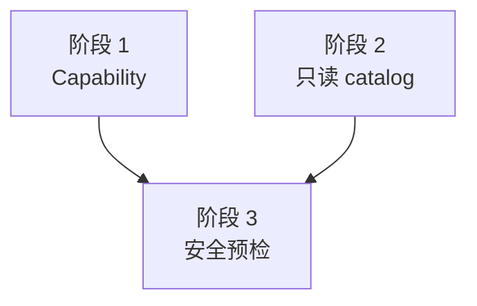

### 目标

建立 Codex project 写命令专用安全预检，避免复用 status 结果当守门。所有 user config、project config、tracking identity 和 unmanaged conflict 问题都必须在 repo artifact 或 AW config prompt 之前发现。

### 可并行边界

- Agent A：实现 preflight helper 和错误类型。
- Agent B：拆 required config preflight 的调用顺序。
- Agent C：补 status fatal error 边界和 mixed refusal 测试。

### 开发 TODO

- [x] 新增 `preflightCodexProjectWriteSafety()` 或等价 helper。
- [x] install / explicit upgrade 在 repo artifact、tracking、ledger、AW config、install snapshot、runtime 写入前完成 user config external ownership 预检。
- [x] user `~/.codex/config.toml` 语法损坏时，install / explicit upgrade 整条命令早失败；mixed explicit 命令不部分继续。
- [x] user-native 同名外部 plugin 存在时，install / explicit upgrade 早失败，避免运行时歧义。
- [x] project `.codex/config.toml` 只在 target 包含 MCP / managed `developer_instructions`，或历史 tracking 证明管理了 config-backed artifact 时预检。
- [x] project TOML 损坏时，config-backed install / explicit upgrade 早失败；skills-only 路径不触达该文件。
- [x] tracking identity 损坏、同名 unmanaged repo artifact、其它插件管理同名 artifact 都在写入前拒绝。
- [x] required AW config preflight / prompt 排在 Codex project 安全预检之后。
- [x] 同一条 install / explicit upgrade 命令里，同一插件同一 schema source 只 prompt 一次、只写一次。
- [x] prompt 返回的 `selectedScope` 是唯一写入层；mixed target 复用写入后的 effective config。
- [x] uninstall 不把 external ownership present 当硬阻塞；已有 project evidence 时允许清理，并输出 warning / next step。
- [x] status 定义 fatal status error：project TOML 损坏且 status 需要读取 config-backed artifact 时整命令失败；user config 不可读则输出 unknown 诊断。

### 自动化测试

- [x] user config 损坏时，project install / explicit upgrade 早失败，且 fake config prompt 不被调用。
- [x] user-native 外部同名插件冲突时，project install / explicit upgrade 早失败，零写入。
- [x] project TOML 损坏时，MCP / instructions target 早失败；skills-only install / status 不失败。
- [x] required config 缺失但安全预检失败时，不写 `<AW_HOME>/plugin-config` 或 project config store。
- [x] 安全预检通过后，同插件 mixed target 只 prompt 一次，并复用 effective config。
- [x] 已有 repo-managed evidence 的 uninstall 在 user config 损坏或外部同名冲突下继续清理，并输出 unknown / warning 诊断。
- [x] status JSON 模式遇到 fatal project config error 时不输出半截 JSON。
- [x] 运行 `pnpm test:unit` 和 `pnpm test:integration`。

### 阶段验收

- [x] Codex project 写命令的所有安全阻塞都发生在任何状态写入之前。
- [x] required AW config prompt 不再早于 Codex project 安全预检。
- [x] status / uninstall / install / explicit upgrade 对 user config 和 project config 损坏的分流符合计划。

## 阶段 4：Tracking / Ledger 身份模型与 Historical Evidence 基础

### 阶段依赖关系图

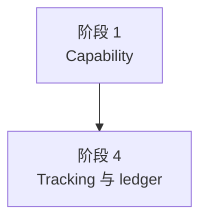

### 目标

让 tracking manifest 和 installed ledger 能表达 repo skill、MCP server、绝对路径、子项身份和 Codex project 非 native 语义，为 install、status、uninstall、upgrade 和 historical fallback 打基础。

### 可并行边界

- Agent A：改类型、validator、merge/filter identity。
- Agent B：改 ledger capability snapshot 和 `sharedNativeRefs` 写入。
- Agent C：改 historical evidence / placeholder。

### 开发 TODO

- [x] 扩展 `GeneratedArtifact.kind`：`instruction | permission | hook | agent | skill | mcpServer`。
- [x] 增加 `GeneratedArtifact.artifactKey?: string`，并把 identity key 改为 `platform + kind + path + artifactKey + hookGroups`。
- [x] 新写入的 `GeneratedArtifact.path` 必须是绝对路径。
- [x] `kind: "skill"` 的 `artifactKey` 使用 skill / command 目录名。
- [x] `kind: "mcpServer"` 的 `artifactKey` 使用 rendered `.mcp.json` 原始 server key。
- [x] `mergeGeneratedArtifacts()` 不折叠同 path / kind 但不同 `artifactKey` 的 MCP server。
- [x] `GeneratedArtifactStatus` 原样输出 `artifactKey`，`path` 保持 tracking 中的绝对路径。
- [x] `kind: "skill"` / `"mcpServer"` 缺少 `artifactKey` 时标记 tracking integrity error。
- [x] Codex project scope 新写入不再写 `sharedNativeRefs.projects`。
- [x] Codex user scope 继续写 `sharedNativeRefs.user`；slashCommands-only Codex user 插件也必须能作为 native evidence 恢复。
- [x] ledger project scope record 记录 managed kinds、install options、project key、lifecycle/config snapshot metadata，但不记录 native ref。
- [x] 实现 Codex project `scopeInitialized` 派生：完整 ledger managed 或完整 tracking managed evidence 为 `yes`；只有 orphan / unmanaged / external-only 为 `no`；归属不可判定为 `unknown`。
- [x] `DiscoveryEvidenceSummary.trackingKinds`、historical kind 集合和 placeholder 支持 skill / MCP evidence。
- [x] current catalog missing 时，historical target 能表达 repo skill / MCP server，供 status 和 uninstall 使用。

### 自动化测试

- [x] tracking 新写入 skill / MCP artifact 时断言 `path.isAbsolute()`。
- [x] 多 MCP server 同 path / kind / platform 但不同 `artifactKey` 不被 merge。
- [x] status 从 tracking 生成 `generatedArtifacts[]` 时保留绝对 path 和 `artifactKey`。
- [x] `skill` / `mcpServer` 缺少 `artifactKey` 时，status 报 unknown，uninstall / explicit upgrade / cleanup 拒绝 path-only 删除。
- [x] Codex project install ledger 不写 `sharedNativeRefs.projects`。
- [x] Codex user slashCommands-only 插件在 current catalog missing 时仍可通过 native evidence 被 status / uninstall / upgrade 识别。
- [x] `scopeInitialized` 覆盖 ledger managed、tracking-only、orphan-only、external-only、ledger degraded、tracking identity 损坏。
- [x] current catalog missing + tracking repo skill / MCP 时，historical placeholder 不退化成 `Unknown plugin`。
- [x] 运行 `pnpm test:unit`。

### 阶段验收

- [x] tracking 和 status JSON 对同一 artifact 使用同一份绝对 path 与 `artifactKey` 合同。
- [x] Codex project ledger 不再伪装 native project ref。
- [x] historical fallback 可以安全发现并清理 tracking 证明归属的 repo skill / MCP。

## 阶段 5：Skill Trigger Applicability 与共享 Runtime 边界

### 阶段依赖关系图

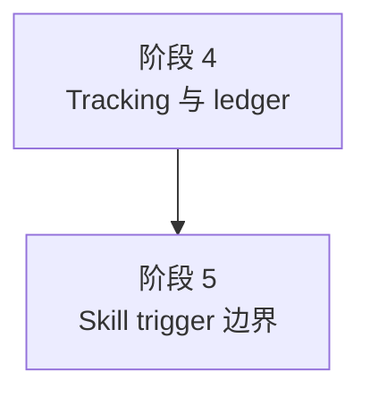

### 目标

把 skill trigger 从“所有 target 都有可恢复 preference”改成 `none | fixed | overridable` 三态，并把 Codex project scope 的物化目标从共享 `~/.aw` runtime 改到 repo `.agents/skills`。

### 可并行边界

- Agent A：改类型、resolver 和 install options 恢复逻辑。
- Agent B：改 materialization target 和 shared runtime selector。
- Agent C：补 status 聚合所需的 signature helper。

### 开发 TODO

- [x] 引入 `SkillTriggerApplicability = 'none' | 'fixed' | 'overridable'`。
- [x] 调整 `ResolvedInstallOptions` 为 discriminated union；`none` / `fixed` 不携带伪造的 `skillTriggerPreference`。
- [x] 新增 `SkillTriggerMaterializationTarget`，支持 Codex project `kind: 'repoSkill'`。
- [x] Codex project scope 解析偏好时，只有 `overridable` 读取 CLI 或 ledger scope record。
- [x] tracking 只证明 artifact 归属，不作为 skill trigger preference 来源。
- [x] `overridable` tracking-only 且 ledger 缺失 / degraded / 无法恢复 install options 时，install / explicit upgrade 未传 `--skill-trigger` 必须拒绝。
- [x] `none` / `fixed` target 不因 ledger install options 缺失而拒绝或 skipped。
- [x] 公共 `slashCommands` 生成 skill 固定归为 `fixed`，不接受 install override。
- [x] `resolveSkillTriggerPolicies()` 或等价 helper 接受目标 platform，只枚举该平台真实存在的 `skills/` artifact。
- [x] Claude 不读取公共 slashCommands 生成的 Codex skill；Codex 不读取 Claude-only skill。
- [x] shared runtime winner 选举排除 `platform=codex && scope=project` 的 scope record。
- [x] `aw init` / local marketplace rebuild / stale refresh 只 replay Codex user scope 和 Claude 共享 runtime 记录。
- [x] Codex project uninstall 不调用共享 runtime rematerialize，不修改 `~/.aw/plugins/<plugin>/codex/skills`。

### 自动化测试

- [x] `mcp-only` / extensions-only 输出 `skillTriggerApplicability = "none"`，不输出 default 偏好。
- [x] slashCommands-only 和所有 skill 都不允许 override 的 target 输出 `fixed`。
- [x] 至少一个有效 skill `allowInstallOverride = true` 的 target 输出 `overridable`。
- [x] tracking-only `overridable` 缺 ledger 时，重复 install / explicit upgrade 未传 `--skill-trigger` 拒绝；显式传入后可继续。
- [x] tracking-only `none` / `fixed` 缺 ledger 时不拒绝，不被 `upgrade --all` 记为 `installOptionsUnavailable`。
- [x] platform-scoped inventory 不对 Codex / Claude 做 skill 名并集。
- [x] `initializeLocalMarketplace()` 面对 Codex project ledger record 不 replay 到 `~/.aw`。
- [x] Codex user 卸载后的共享 runtime 重选不会选择剩余 Codex project record。
- [x] 运行 `pnpm test:unit`。

### 阶段验收

- [x] `none`、`fixed`、`overridable` 的 install options、status 和 upgrade 行为已经分开。
- [x] Codex project skill trigger 只影响当前 repo，不会污染共享 marketplace runtime。
- [x] 公共 `slashCommands` 生成 skill 永远保持 manual-only 固定 runtime。

## 阶段 6：公共 `slashCommands` Schema、Build 和作者工具

### 阶段依赖关系图

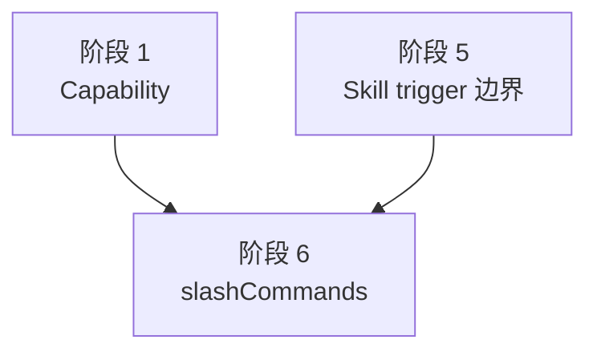

### 目标

新增公共 `slashCommands` 源码协议，替代旧 Claude-only command 作者入口。构建时 Claude 生成原生 commands，Codex 生成 manual-only skills。

### 可并行边界

- Agent A：改 manifest schema、source validation 和旧 commands 拒绝。
- Agent B：改 build 生成 Claude / Codex 平台产物。
- Agent C：改 authoring tool、示例和负向 fixture。

### 开发 TODO

- [x] `PluginManifestSource` 新增 `slashCommands?: string`。
- [x] `validatePluginManifest()` 允许 `slashCommands` 顶层字段，并按 `./` 相对路径规则规范化。
- [x] 默认 `slash-commands/` 存在但未声明 `slashCommands` 时 fail fast。
- [x] `slashCommands` 只能指向目录；目录不存在、越界、不是目录或无可生成 Markdown 命令时失败。
- [x] 首版只接受根目录直属 `*.md` 命令文件和保留 `assets/` 资源目录；其它子目录失败。
- [x] `assets/` 内的 Markdown 不生成命令。
- [x] 命令名来自 basename，沿用 skill 目录名 / `artifactKey` 校验；非法命名、归一化重复、与显式 skill 同名时失败。
- [x] 每个命令文件必须有 frontmatter，顶层必填 `description`。
- [x] 顶层只允许公共字段和 `claude` / `codex` 分平台块；Claude-only 字段必须在 `claude` 块。
- [x] `claude` 块支持 `description`、`allowed-tools`、`model`、`argument-hint`、`shell`；生成时固定 `disable-model-invocation: true`。
- [x] `codex` 块支持 `description` 和 `interface`；禁止配置 `policy`。
- [x] `codex.interface.icon_small` / `icon_large` 必须是 `./assets/...`，拒绝绝对路径、`../`、反斜杠、目录目标、缺文件和非 `assets/` 前缀。
- [x] build 只复制被 icon 字段引用的资源到对应 Codex generated skill 的 `assets/`。
- [x] `agents/openai.yaml` 保持合法 `./assets/...` 路径，并固定 `policy.allow_implicit_invocation: false`。
- [x] `slashCommands` 支持 `buildConfig.templates`；先按目标平台渲染 Markdown，再生成平台产物。
- [x] Claude 渲染结果可包含 `$ARGUMENTS` / `$1` / 命令结果填充；Codex 渲染结果残留这些 Claude-only 语法时 fail fast。
- [x] platform bundle 不包含原始 `slash-commands/` 源目录。
- [x] 源码 manifest 出现 `manifestOverrides.claude.commands`、旧式 `commands` 或旧 `commands/**` fileRules 时直接失败并提示改用 `slashCommands`。
- [x] 更新 `validate_plugin.js`、隐藏示例、参考文档和 authoring-tool 集成测试。

### 自动化测试

- [x] 合法 `slashCommands` schema 通过，缺 frontmatter / 缺 description / 未知字段 / 字段放错平台块都失败。
- [x] 嵌套命令目录、`assets/` 下 Markdown、非 Markdown-only 目录、重名 basename 都按合同处理。
- [x] Claude generated command frontmatter 字段映射正确，并固定 `disable-model-invocation: true`。
- [x] Codex generated `SKILL.md`、`agents/openai.yaml`、interface fallback 和 manual-only policy 正确。
- [x] icon 正向用例复制到 generated skill `assets/`；负向路径全部在写 bundle 前失败，且错误点名 command、字段和资源路径。
- [x] 模板渲染后 Claude 可保留 `$ARGUMENTS`，Codex 残留 `$ARGUMENTS` / `$1` / 命令结果填充时失败。
- [x] platform bundle 不包含原始 `slash-commands/`。
- [x] 旧 `manifestOverrides.claude.commands`、旧 `commands` 字段和旧 fileRules 被拒绝。
- [x] slashCommands-only Codex user install 可生成 native runtime skill，并被 status / upgrade 识别为 user native managed evidence。
- [x] 运行 `pnpm test:unit` 和 authoring-tool 集成测试。

### 阶段验收

- [x] 插件作者只需要维护一份公共 `slashCommands` 源码。
- [x] Claude 与 Codex 生成物符合各自 runtime 语义，Codex 侧始终 manual-only。
- [x] 旧 command 作者入口已经从 schema、build 和作者工具中移除或变成明确错误。

## 阶段 7：Repo Skill Materializer、冲突检查与 Skill Drift

### 阶段依赖关系图

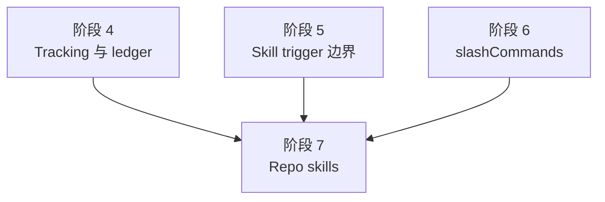

### 目标

实现 Codex project scope 的 `.agents/skills` 安装、刷新、卸载、回滚和 drift 计算。显式 skills 和公共 slashCommands generated skills 共用同一条 materializer。

### 可并行边界

- Agent A：实现 repo skill collect / install / uninstall helper。
- Agent B：实现冲突检查和 tracking 写入。
- Agent C：实现 skill drift / runtime signature 对比。

### 开发 TODO

- [x] 新增 `collectCodexProjectManagedArtifacts()` 的 skill 产物收集分支。
- [x] 新增或扩展 `installCodexProjectManagedArtifacts()`，复制 pristine bundle `codex/skills/<skill>` 到 repo `.agents/skills/<skill>`。
- [x] 新增或扩展 `uninstallCodexProjectManagedArtifacts()`，只删除 tracking 证明当前插件拥有的 repo skill。
- [x] 目标目录不存在时完整复制；当前插件 tracking 管理时允许替换。
- [x] 目标目录由其它 AW 插件 tracking 管理时 fail fast。
- [x] 目标目录存在但没有 AW tracking 时 fail fast，作为 unmanaged repo artifact conflict。
- [x] 显式 `--skill-trigger manual|auto|default` 在复制后的 repo skill 上物化。
- [x] 未指定 preference 时，对 `overridable` target 只从当前 project ledger scope record 恢复；不能从 tracking 推导。
- [x] 公共 slashCommands generated skill 复用同一复制、tracking、status、uninstall、upgrade prune 和 rollback 逻辑。
- [x] slashCommands generated skill 固定 manual-only，`--skill-trigger auto` 不能改写它。
- [x] 每个 repo skill tracking artifact 写 `kind: "skill"`、绝对 `path`、`artifactKey`。
- [x] skill status drift 使用 repo `.agents/skills/<skill>` 与 pristine bundle 的 trigger runtime signature 比较。
- [x] orphan repo skill 只作为 unmanaged evidence 展示，不计入 installed evidence，不被 uninstall 清理。
- [x] skill materializer 提供 rollback handle，支持安装失败、tracking 失败、ledger 失败后恢复目录。

### 自动化测试

- [x] `aw install git-commit -p codex -s project` 生成 `.agents/skills/git-commit/...`，不写 user native config。
- [x] tracking skill artifact 使用绝对 path 和 `artifactKey`。
- [x] 当前插件管理的 skill 可刷新；其它插件管理或 unmanaged 同名 skill fail fast。
- [x] `--skill-trigger manual|auto|default` 只 patch repo skill，不修改 `~/.aw/plugins/<plugin>/codex/skills`。
- [x] slashCommands project install 生成 `.agents/skills/<command>/SKILL.md`、`agents/openai.yaml`、`assets/...`，并保持 manual-only。
- [x] slashCommands 传 `--skill-trigger auto` 后仍是 `allow_implicit_invocation: false`。
- [x] tracking-only slashCommands / fixed target 缺 ledger scope record 时，重复 install / upgrade 不因偏好缺失拒绝。
- [x] repo skill 被手删时报 `missing`；内容或 trigger runtime 被手改时报 `drifted`；unmanaged 同名目录时报 `orphan`。
- [x] 安装写 skill 后模拟 tracking / ledger 失败，skill 目录恢复到命令前状态。
- [x] 运行 `pnpm test:unit` 和 `pnpm test:integration`。

### 阶段验收

- [x] Codex project skills-only 插件可完整安装、刷新、卸载和 status。
- [x] repo skill 的冲突、tracking identity、drift 和 rollback 都有测试覆盖。
- [x] 公共 slashCommands generated skill 没有引入第二套清理或 status 逻辑。

## 阶段 8：MCP Writer / Remover 与 `.codex/config.toml` 文档级事务

### 阶段依赖关系图

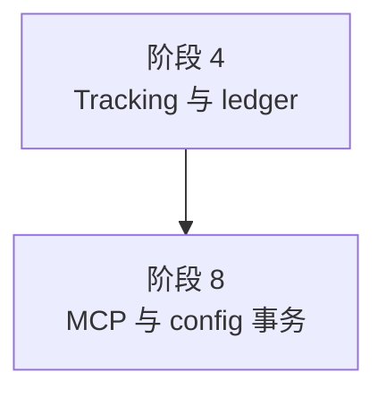

### 目标

把 plugin `.mcp.json` / `manifest.mcpServers` 转写到 repo `.codex/config.toml [mcp_servers.*]`，并让 MCP servers 与 managed `developer_instructions` 共用同一个文档级事务。

### 可并行边界

- Agent A：实现 JSON 到 TOML 等价结构转换和 quoted key 读写。
- Agent B：实现 subtree replace / delete 与 conflict 检查。
- Agent C：接入 managed instructions 同文件事务和 rollback。

### 开发 TODO

- [x] 扩展 `packages/cli/src/utils/codex-config.ts`，保持 TOML round-trip，尽量不重排无关配置。
- [x] rendered `.mcp.json` 的 `mcpServers` 必须是 object；每个 server config 必须是 object。
- [x] 完整转写 string、boolean、number、array、object；遇到 `null` 或无法稳定表达的值时写入前 fail fast。
- [x] server key 使用原始 JSON 属性名；读写和比较都按 TOML quoted key 语义定位单个 server。
- [x] 结构化 TOML writer 支持 `[mcp_servers."acme.tools v1"]`，不能拆成 `[mcp_servers.acme.tools]`。
- [x] 刷新同名 server 时整体替换 `[mcp_servers.<server>]` 及所有后代子表。
- [x] 删除 server 时删除当前 server 整棵子树，保留 sibling server、外部配置和其它插件 server。
- [x] 写入前扫描 tracking：当前插件管理可替换，其它插件管理 fail fast，unmanaged 同名 server fail fast。
- [x] 每个 MCP server tracking artifact 写 `kind: "mcpServer"`、绝对 `.codex/config.toml` path、原始 `artifactKey`。
- [x] 同一插件多个 MCP servers 写入多条 tracking artifact。
- [x] MCP drift comparator 把当前 TOML 子树规范化为 JSON 等价值，再与 rendered `.mcp.json` 子树深比较。
- [x] MCP orphan status 发现 `.codex/config.toml` 中同名 server 但无当前插件 tracking 时，输出 `tracked: false`、`state: "orphan"`。
- [x] MCP servers 与 managed `developer_instructions` 共用一次 `.codex/config.toml` baseline、validation、内存合并和写回。
- [x] 写 tracking 或 ledger 失败时，恢复整份 `.codex/config.toml` baseline，而不是反向 patch 单个 server。

### 自动化测试

- [x] 写入 `.codex/config.toml [mcp_servers.*]`，并保留无关用户配置、注释和 sibling server。
- [x] 结构化 server 覆盖 `args`、`env`、`http_headers`、timeout、`tools.<tool>.approval_mode`、array、boolean、number。
- [x] quoted key fixture 安装后写 `[mcp_servers."acme.tools v1"]`，tracking / status `artifactKey` 原样保留。
- [x] quoted key 的 status、upgrade replace、`upgrade --all` refresh、uninstall 都只命中同一 key，不误伤 sibling。
- [x] refresh 删除旧版独有 nested table；uninstall 删除整棵后代子表。
- [x] rendered `.mcp.json` 含 `null` 或 server 非 object 时 fail fast，且 `.codex/config.toml`、tracking、ledger 保持 baseline。
- [x] 多 MCP server tracking 不被 merge，status 可分别报告 `foo missing`、`bar visible`。
- [x] 同名 unmanaged server 和其它插件管理 server 都 fail fast。
- [x] 同一插件同时声明 managed instructions 和 MCP 时只写一次 `.codex/config.toml`；模拟任一失败可完整恢复 baseline。
- [x] project TOML 损坏时，需要读取 / 改写 config-backed artifact 的 writer / remover / status reader 都 fail fast。
- [x] 运行 `pnpm test:unit` 和 `pnpm test:integration`。

### 阶段验收

- [x] Codex project MCP 能完整表达 rendered `.mcp.json` 的 TOML 可表达 JSON 子树。
- [x] MCP quoted key 身份在 install / status / upgrade / uninstall / drift 中保持一致。
- [x] `.codex/config.toml` 同文件多产物事务没有半写入、半删除或半回滚状态。

## 阶段 9：Install / Uninstall 主链路与失败回滚

### 阶段依赖关系图

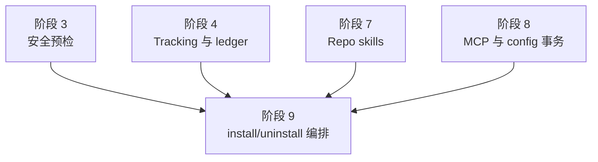

### 目标

把 repo skills、MCP、managed instructions、hooks、rules、agents 接入 install / uninstall 主链路，固定 lifecycle、tracking、ledger 和 rollback 顺序。

### 可并行边界

- Agent A：接 install 提交流程。
- Agent B：接 uninstall 清理流程。
- Agent C：接 snapshot / rollback / degraded ledger 失败诊断。

### 开发 TODO

- [x] install 成功路径固定为：写 repo-managed artifacts，执行 install / upgrade lifecycle，写 tracking manifest，写 `installed.json` 和 lifecycle/config snapshot metadata。
- [x] install / upgrade 开始写 repo artifact 前准备 scope-owned lifecycle/config 安装快照；失败且未写 ledger 时删除未引用 snapshot。
- [x] lifecycle 失败视同 artifact 提交前失败，要回滚 repo artifacts 并删除未引用 snapshot。
- [x] tracking 写入失败、ledger 写入失败或 ledger 后错误，都先恢复 repo artifacts，再恢复 tracking baseline，再处理 snapshot，最后按 ledger baseline 写 degraded。
- [x] Codex project scope 没有 native write，degraded reason 不应写成 native plugin 已写入。
- [x] uninstall lifecycle 在 repo artifact remover 前执行，并优先使用 ledger scope record 的 install snapshot 解析旧版本脚本 / config。
- [x] uninstall remover 只删除 tracking 证明当前插件拥有的 repo skill、MCP server、managed instructions、hooks、rules、agents。
- [x] uninstall 任一步失败时，恢复 repo artifacts、tracking baseline，并按现有策略恢复或标记 ledger degraded。
- [x] rollback 失败时错误点名 repo artifacts、`.codex/config.toml`、tracking manifest、`installed.json` 中可能需要人工检查的 surface。
- [x] install / uninstall 的 `nativePlugins.codex` 在 pure project repo-managed 路径为空。
- [x] install / uninstall receipt 不输出 native marketplace add 或 plugin enabled 成功信息。

### 自动化测试

- [x] install skill + MCP + managed instructions 混合插件时，repo artifacts、tracking、ledger、snapshot 都写入正确。
- [x] install lifecycle 失败时，repo skill、`.codex/config.toml`、tracking、ledger 和 snapshot 恢复或清理正确。
- [x] tracking 写入失败、ledger 写入失败分别触发正确回滚和 degraded 诊断。
- [x] uninstall 先执行 lifecycle，再删除 repo artifacts；lifecycle 失败时不删除。
- [x] uninstall 删除 skill / MCP / instructions / hooks / rules / agents 任一步失败都能恢复已删内容和 tracking baseline。
- [x] Codex project uninstall 不修改 user native config 或共享 `~/.aw` skill runtime。
- [x] PATH 缺少 `codex` 时显式 Codex project uninstall 仍可清理 repo-managed evidence。
- [x] receipt / result 中 pure project repo-managed `nativePlugins.codex` 为空。
- [x] 运行 `pnpm test:unit` 和 `pnpm test:integration`。

### 阶段验收

- [x] install / uninstall 对所有 Codex project repo-managed artifact 使用统一事务和回滚模型。
- [x] lifecycle / config snapshot 已按现有基线接入，且失败不会留下半安装或半卸载。
- [x] pure project repo-managed 路径不再输出或记录 native plugin 成功状态。

## 阶段 10：Explicit Upgrade、`capabilityChanged` 恢复和 Stale Prune

### 阶段依赖关系图

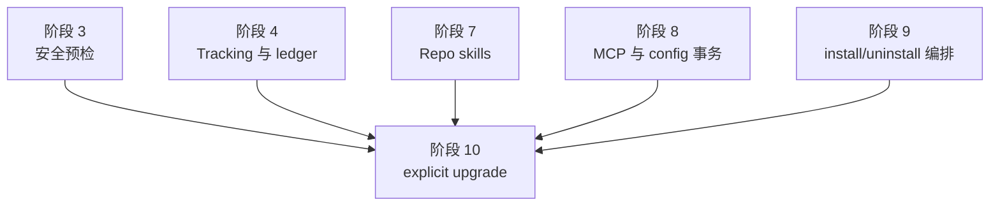

### 目标

让显式 upgrade 先验证新版 project installability，再卸载旧版。`capabilityChanged` 的内部 uninstall 和新版 install 必须被同一个旧安装恢复快照包住。

### 可并行边界

- Agent A：改 explicit upgrade 预检顺序。
- Agent B：实现 artifact inventory 和 stale prune。
- Agent C：实现 `capabilityChanged` 旧安装恢复快照。

### 开发 TODO

- [x] explicit upgrade 在任何 uninstall、artifact 清理、stale prune、tracking、ledger、AW config、snapshot 或 runtime 写入前完成 Codex project validation。
- [x] 新版 current catalog 含 `apps` 或没有 project managed kind 时早失败，旧安装保持不变。
- [x] external ownership、user config、project config、tracking identity、skill trigger 偏好预检都先于 uninstall。
- [x] required AW config preflight 排在 Codex project 安全预检之后，且先于破坏性写入。
- [x] `capabilityChanged` 内部 uninstall 不触发插件 `uninstall` lifecycle。
- [x] 进入内部 uninstall 前捕获旧安装 baseline：repo artifacts、`.codex/config.toml`、tracking、ledger scope record、skill trigger preference、snapshot metadata。
- [x] 新版 install 任一点失败时，先恢复旧安装 baseline，再返回失败。
- [x] 旧安装恢复失败时，同时暴露原始 upgrade 失败和恢复失败，并点名需要人工检查的 surface。
- [x] `catalogCompatibility === 'current'` 也计算 artifact inventory，不仅比较 capability。
- [x] `previousArtifacts` 来自升级前 tracking；`desiredArtifacts` 来自新版成功生成的 artifact 集合。
- [x] identity 使用 `platform + kind + path + artifactKey + hookGroups`；skill / MCP 缺 `artifactKey` 时拒绝 upgrade。
- [x] 新版 artifact 写入和冲突校验成功后再 prune `previousArtifacts - desiredArtifacts`。
- [x] stale skill 只删 tracking 证明属于当前插件的 `.agents/skills/<skill>`；stale MCP 只删对应 `[mcp_servers.<server>]` 整棵子树。
- [x] prune 纳入 rollback baseline；tracking 只能在新版写入和 prune 都成功后覆盖当前插件记录。

### 自动化测试

- [x] explicit upgrade 新版含 apps / 无 project managed kind 时早失败，旧文件、tracking、ledger 不变。
- [x] user config 损坏、external ownership 冲突、project config 损坏、tracking identity 损坏都在卸载前拒绝。
- [x] `overridable` tracking-only 缺 ledger 偏好且未传 `--skill-trigger` 时 explicit upgrade 拒绝；传入显式偏好且 identity 完整时可刷新并重建 ledger。
- [x] `none` / `fixed` tracking-only 不因偏好缺失拒绝。
- [x] `capabilityChanged` 内部 uninstall 不触发 uninstall lifecycle，新版 install 触发 upgrade lifecycle。
- [x] 内部 uninstall 成功后，新版 repo artifact 写入、config transaction、upgrade lifecycle、tracking、ledger 任一点失败，都恢复旧 repo artifacts、tracking、ledger 和旧 snapshot metadata。
- [x] upgrade 删除或改名 skill / MCP 时，stale prune 删除旧受管内容，保留外部内容。
- [x] prune 后 tracking / ledger 失败能恢复被删除的旧 skill / MCP 和旧 tracking。
- [x] 运行 `pnpm test:unit` 和 `pnpm test:integration`。

### 阶段验收

- [x] explicit upgrade 不会先删旧版再发现新版不可 project 安装。
- [x] `capabilityChanged` 晚失败后，旧安装能恢复到命令开始前状态。
- [x] stale prune 精确处理 skill / MCP 删除或改名，不误删外部内容。

## 阶段 11：Discovery / Status / Historical Fallback 与 Health 语义

### 阶段依赖关系图

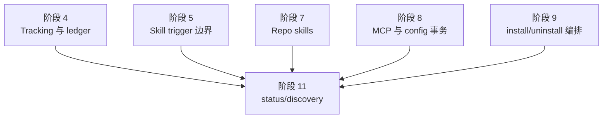

### 目标

把 Codex project installed evidence 改为 repo-managed evidence。status 输出逐 item 状态、per-kind summary、external ownership、project trust、skill trigger applicability 和 health。

### 可并行边界

- Agent A：实现 discovery evidence 和 historical fallback。
- Agent B：实现 `repoManagedSessionState` schema 与 item 状态。
- Agent C：实现 human / JSON formatter、health 和 next steps。

### 开发 TODO

- [x] Codex project scope installed evidence 来自 ledger managed scope record 或 repo tracking managed artifact，不来自 user native `[plugins]`。
- [x] user native 同名 plugin 只作为 `externalOwnership` 诊断和写命令拒绝依据。
- [x] user config 不可读时，status 继续报告 repo item 真值，`externalOwnership.checkState = "unknown"`，project trust 相关诊断为 unknown。
- [x] project TOML 损坏且 status 目标需要读取 config-backed artifact 时整命令失败；skills-only status 不失败。
- [x] `ExternalOwnershipStatus` 增加 `checkState: 'known' | 'unknown'`，保留 `present` 兼容字段。
- [x] `PluginStatusReport.projectManagedKinds` 表达当前 project scope 已知 repo-managed kind。
- [x] 新增 `repoManagedSessionState.skills` / `mcpServers` summary 和 `items[]`。
- [x] `RepoManagedProjectItemState` 覆盖 `visible`、`missing`、`drifted`、`orphan`、`blockedByProjectTrust`、`projectTrustUnknown`、`absent`、`unknown`。
- [x] 未声明且无 tracking / orphan evidence 的 kind summary 使用 `not_applicable`，不和 `absent` 混用。
- [x] skill drift 来自 repo `.agents/skills` 与 pristine bundle trigger runtime signature。
- [x] MCP drift 来自 `.codex/config.toml [mcp_servers.<artifactKey>]` 子树与 rendered `.mcp.json` 规范值深比较。
- [x] instructions drift 来自 managed `developer_instructions` block；rules / agents 字节级比较；hooks 用现有 parser 规范化 group 后比较。
- [x] trust gating 只影响 MCP、instructions、hooks、rules、agents；skills-only 不因 project trust 降级。
- [x] health 映射：missing / drifted / orphan / blockedByProjectTrust 为 `needsAttention`；unknown 来源为 `unknown`；纯 visible 且诊断可判定为 `ready`。
- [x] plugin 级 skill trigger 字段先输出 `skillTriggerApplicability`，只有 `overridable` 输出可切换偏好相关字段。
- [x] 多 skill runtime 聚合支持 `matched`、`mixed`、`unknown`，并按 `default` / `manual` / `auto` 顺序输出 matches。
- [x] orphan skill / MCP 只作为 unmanaged evidence，不计入 installed evidence、projectManagedKinds 或 discovery managed target。
- [x] current catalog missing + tracking repo skill / MCP 时，status 和 uninstall 能从 historical placeholder 工作。

### 自动化测试

- [x] user native plugin enabled 不让 project scope 显示 installed。
- [x] 已有 repo-managed evidence 且存在 user-native 外部同名插件时，status 仍展示 repo item，health 为 `needsAttention`，next steps 提示解除冲突。
- [x] user config 损坏时，skills-only status 报 tracked skill visible / drift=no，同时 external ownership unknown，health unknown。
- [x] project TOML 损坏且含 MCP / managed instructions evidence 时 status 失败；JSON 模式无半截 JSON。
- [x] `repoManagedSessionState.items[]` 同时表达 `skill commit visible`、`mcp foo missing`、`mcp bar visible`。
- [x] skills-only 的 `mcpServers.state = "not_applicable"`，mcp-only 的 `skills.state = "not_applicable"`，计数全为 0。
- [x] MCP quoted key 的 visible、missing、drifted、orphan 都原样展示 `artifactKey`。
- [x] hooks JSON 不可解析时对应 item `state = "unknown"`、`drift = "unknown"`，summary unknown 计数和 next steps 正确。
- [x] tracking 中 skill / MCP 缺 `artifactKey` 时 status 报 unknown，执行型命令拒绝 cleanup。
- [x] project trust untrusted 时，skill visible，MCP / instructions / hooks / rules / agents 为 `blockedByProjectTrust`。
- [x] skills-only project 在 embedded fallback、repo trust unknown / untrusted 下，只要 external ownership 可判定，health 仍 ready。
- [x] current catalog missing + tracking repo skill / MCP 时，status 不退化成 `Unknown plugin`，uninstall 只清 tracking 证明拥有的内容。
- [x] default / verbose / JSON / debug 输出都能断言新增字段，`status -j` stdout 始终可解析。
- [x] 运行 `pnpm test:unit` 和 `pnpm test:integration`。

### 阶段验收

- [x] Codex project status 以 repo-managed artifact 为主，不再把 user native marketplace 状态作为主诊断。
- [x] 每个 repo-managed item 的归属、存在性、drift、trust gating 和 unknown 来源都能机读。
- [x] historical fallback 可以支持 current catalog 缺失下的 status 和受控 uninstall。

## 阶段 12：`upgrade --all` Skipped 合同与 Evidence-First Auto 推断

### 阶段依赖关系图

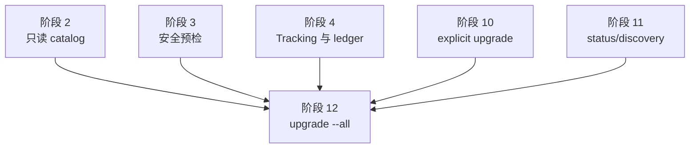

### 目标

让 `upgrade --all` 能表达 target-level safe skip，而不是遇到第一个 Codex project target 问题就整命令失败；同时让 `--platform auto` 先基于 evidence 唯一推断平台。

### 可并行边界

- Agent A：实现 `SkippedUpgradeTarget` 类型、direct result 和 receipt。
- Agent B：实现 target-level preflight 与 10 个 stable code。
- Agent C：实现 `upgrade --all --platform auto` evidence-first 推断和退出码。

### 开发 TODO

- [x] `UpgradeCommandResult` 增加稳定 `skipped: SkippedUpgradeTarget[]`。
- [x] `SkippedUpgradeTarget.code` 固定为 10 个值：`scopeNotInitialized`、`codexProjectUserConfigUnreadable`、`externalOwnershipUnknown`、`externalOwnershipPresent`、`trackingIntegrityError`、`installOptionsUnavailable`、`catalogNotCurrent`、`catalogNotProjectInstallable`、`projectConfigUnreadable`、`unmanagedRepoArtifactConflict`。
- [x] 为多个 blocking reason 固定优先级，target 外 fatal error 仍先于 skipped 中止整命令。
- [x] `plugins[]` 只列实际升级成功的插件；skipped target 只出现在 `skipped[]`。
- [x] CLI `mergeCommandResults()` 和 `writeCommandReceipt()` 透传并渲染 skipped 摘要。
- [x] mixed succeeded + skipped 退出码为 0；全部 skipped 且无成功升级退出码为 1。
- [x] `upgrade --all -p codex -s project` user config 损坏时，所有 Codex project targets 逐项 skipped，code=`codexProjectUserConfigUnreadable`。
- [x] project config 损坏只让 config-backed target skipped，code=`projectConfigUnreadable`；skills-only target 继续。
- [x] `overridable` tracking-only 且 ledger install options 不可恢复时 skipped，code=`installOptionsUnavailable`；`none` / `fixed` 不 skipped。
- [x] current catalog 缺插件时 code=`catalogNotCurrent`；current catalog 有插件但已不 project-installable 时 code=`catalogNotProjectInstallable`。
- [x] 同名 unmanaged repo artifact conflict 时 code=`unmanagedRepoArtifactConflict`。
- [x] `upgrade --all --platform auto` 先统计当前 scope 的 ledger managed record 和 repo tracking managed evidence。
- [x] Codex project tracking-only evidence 计入 Codex 平台推断；orphan / unmanaged evidence 不计入；identity 损坏导致对应平台 unknown。
- [x] auto 只有 evidence 唯一收敛到一个平台时继续；多个平台都有 evidence 或任一候选 unknown 且无法排除时整命令拒绝，不产生 target-level skipped。
- [x] auto 推断只决定平台，不恢复 install options；后续 target 仍可因 `installOptionsUnavailable` skipped。

### 自动化测试

- [x] 10 个 skipped code 都有 direct command 返回值、human receipt 和退出码断言。
- [x] skipped reason 文案可读，但机读断言以 `code` 为准。
- [x] mixed succeeded + skipped 退出 0；全部 skipped 退出 1；target 外 fatal error 非零且无 `skipped[]`。
- [x] user config 损坏下，纯 Codex project `upgrade --all` 所有 target skipped；`--platform both` 下 Claude target 继续。
- [x] `--platform auto` 同样 evidence 场景先拒绝平台推断，不执行 Claude target，不产生 Codex skipped。
- [x] project config 损坏时，config-backed target skipped，skills-only target 继续。
- [x] `overridable` tracking-only 缺 ledger skipped；`none` / `fixed` tracking-only 不 skipped。
- [x] current catalog missing 和 catalog not project-installable 分别落到正确 code。
- [x] unmanaged skill / MCP orphan conflict 落到 `unmanagedRepoArtifactConflict`。
- [x] catalog 整体不可加载仍是 fatal error，不产生 `skipped[]`。
- [x] 运行 `pnpm test:unit`、`pnpm test:integration` 和 CLI entry 测试。

### 阶段验收

- [x] `upgrade --all` 可以稳定同时表达成功 target 和安全跳过 target。
- [x] 10 个 skipped code 的触发条件、优先级、receipt 和退出码都被测试锁住。
- [x] `--platform auto` 使用 evidence-first 推断，不会在 target discovery 前漏掉 Codex project tracking-only target。

## 阶段 13：交互式 Install / Uninstall / Upgrade UX

### 阶段依赖关系图

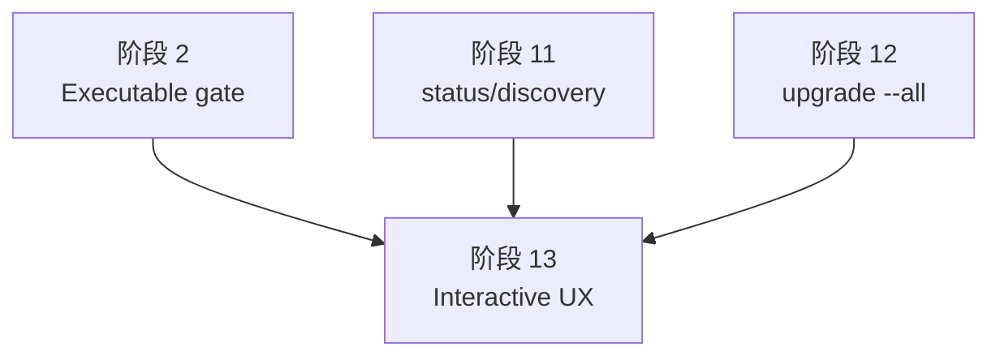

### 目标

让交互式入口复用同一套 Codex project repo-managed 可执行性和 evidence-first 解析，不再把 native executable availability 当成 Codex 是否可选的唯一条件。

### 可并行边界

- Agent A：改 interactive install platform / plugin candidate。
- Agent B：改 interactive uninstall / upgrade evidence-first platform prompt。
- Agent C：补旧共享兼容性回归，防止 Codex project 特例覆盖旧规则。

### 开发 TODO

- [x] `resolveInstallPlatforms()` 不在 detected platforms 为空时直接拒绝 Codex project repo-managed 安装。
- [x] scope 为 project 且候选插件包含 Codex project managed artifacts 时，Codex 作为可选平台参与 prompt / selection。
- [x] 保留 `marketplace.policy.products` 过滤、`both` 下单平台插件禁用 / 默认选择、多插件共同兼容平台交集、无共同兼容平台早失败。
- [x] fake prompt 返回不兼容平台或候选外插件时，runtime validation 仍拒绝。
- [x] 缺少 `codex` executable 时，`-p codex -s project -i` 展示并可安装 repo-managed 候选；Codex user scope 仍按平台不可用失败。
- [x] PATH 同时缺少 Codex 和 Claude 时，默认 `--scope project --platform auto -i` 仍可展示 Codex project repo-managed 候选。
- [x] Claude executable 可用、Codex executable 不可用时，platform prompt 仍暴露 Codex project repo-managed 选项。
- [x] apps-only 不进入无插件名候选；apps-mixed 进入候选但 disabled，fake prompt 旁路仍被 runtime validation 拒绝。
- [x] `resolveInteractiveScopeAndPlatform()` 在 uninstall / upgrade 中结合 current scope managed evidence。
- [x] project scope 有 Codex repo-managed tracking / ledger evidence 时，uninstall / upgrade platform prompt 包含 Codex，即使缺少 Codex executable。
- [x] 当前 scope 同时有 Claude 和 Codex project evidence，或任一候选 evidence unknown 时，interactive auto 拒绝并要求显式平台。
- [x] 真实需要 native runner 的 Codex user scope、native-only target 继续走 availability gate。

### 自动化测试

- [x] interactive install 候选包含 `git-commit` skills-only 插件和 slashCommands-only 插件。
- [x] 缺少 `codex` executable 时，Codex project interactive install 可完成；Codex user scope 失败。
- [x] 同时缺少 Codex / Claude executable 时，project auto interactive 仍可展示 Codex project 候选；user scope / native-only 候选失败。
- [x] Claude 可用、Codex native 不可用时，platform prompt 不隐藏 Codex project。
- [x] apps-only 缺席，apps-mixed disabled，fake prompt 旁路仍拒绝且零写入。
- [x] interactive uninstall / upgrade 在已有 Codex repo-managed evidence 时展示 Codex 并可继续。
- [x] Claude 与 Codex project evidence 同时存在或 evidence unknown 时，auto 拒绝并零写入。
- [x] 共享兼容性旧合同全部有回归：products 过滤、both 规则、多插件交集、无共同平台失败、fake prompt 不兼容拒绝。
- [x] 运行 `pnpm test:integration` 和 CLI entry 测试。

### 阶段验收

- [x] 交互式 Codex project 候选不再被本机缺少 Codex executable 误伤。
- [x] install / uninstall / upgrade 的交互式平台解析与非交互命令使用同一套 evidence 和可执行性语义。
- [x] 旧的 interactive 兼容性判断没有因 Codex project 特例退化。

## 阶段 14：输出文案、公开文档、作者文档和示例收口

### 阶段依赖关系图

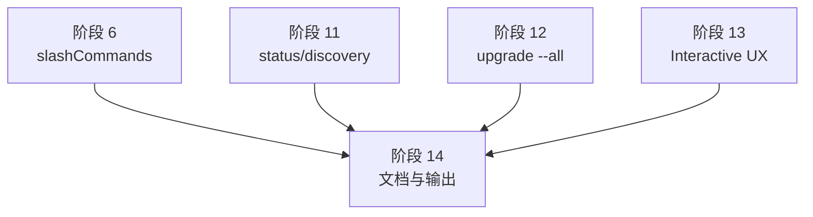

### 目标

把用户看到的输出和公开文档同步到新语义：Codex project scope 是 repo-managed，不再描述成 native marketplace fallback。

### 可并行边界

- Agent A：改 command receipt / warnings / default status 文案。
- Agent B：改公开 docs。
- Agent C：改作者工具参考文档、示例和 fixture。

### 开发 TODO

- [x] Codex project install / uninstall / upgrade / status 默认输出不再把 user native marketplace 注册/缺失作为主诊断。
- [x] project scope 成功 receipt 点名 repo-managed artifacts，例如 `.agents/skills`、`.codex/config.toml`。
- [x] pure project repo-managed 成功路径不输出 native marketplace add 或 plugin enabled 成功信息。
- [x] 项目未 trusted 时，输出只提示 trust-gated artifact 可能不会加载；skills-only 不输出 project trust warning。
- [x] external ownership 冲突只作为附加诊断和 next step，不替换 repo-managed installed signal。
- [x] `upgrade --all` receipt 同时展示 succeeded / skipped；全部 skipped 时不输出“已升级 无”。
- [x] 更新 `README.md`、`docs/plugin-installation.md`、`docs/architecture.md`、`docs/plugin-authoring.md`、`docs/testing.md`、`docs/coding-conventions.md`。
- [x] 更新作者工具参考文档和隐藏示例，把旧 commands 示例改成公共 `slashCommands`。
- [x] 文档明确 `slashCommands` frontmatter schema、`./assets/...` 图标资源合同、manual-only Codex skill 语义和旧 commands 拒绝。
- [x] 文档明确 tracking `artifactKey`、绝对 path、MCP quoted key、`skillTriggerApplicability`、`upgrade --all` skipped code。
- [x] 文档明确 required AW config 顺序：Codex project 安全预检先于 prompt。

### 自动化测试

- [x] CLI output 测试确认 pure Codex project install / uninstall / upgrade 不含 native marketplace / plugin enabled receipt。
- [x] status default 输出在纯 repo-managed 正常场景不把 user marketplace 状态当主诊断。
- [x] `upgrade --all` succeeded + skipped、全部 skipped 的 receipt 和退出码都符合文档。
- [x] authoring-tool 示例通过 validate；旧 commands 示例失败并提示改用 `slashCommands`。
- [x] 运行 `pnpm test:unit` 和相关 authoring-tool 集成测试。

### 阶段验收

- [x] 用户文档、作者文档和 CLI 输出都使用同一套 repo-managed 语义。
- [x] 文档不再暗示 Codex project scope 会启用 user native plugin。
- [x] 公共 `slashCommands`、MCP、tracking identity、skill trigger applicability 和 skipped code 都有可执行说明。

## 阶段 15：最终联调、CLI Entry 和 Smoke 验收

### 阶段依赖关系图

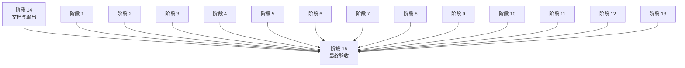

### 目标

用真实 CLI entry、集成测试、smoke build / pack 和关键人工验收把整条新语义收口。

### 可并行边界

- Agent A：跑 unit / integration 并修回归。
- Agent B：跑 CLI entry / smoke build / pack。
- Agent C：做人工验收脚本和最终文档核对。

### 开发 TODO

- [x] 收敛所有阶段遗留 TODO 和临时 helper。
- [x] 删除或更新旧 Codex project native fallback 测试。
- [x] 确认所有新 fixture 都纳入合适的 unit / integration / smoke 层，不把重型 package manager 操作放进普通 unit。
- [x] 确认 status JSON schema 新字段保持旧字段兼容读取。
- [x] 确认 `nativePlugins.codex` 在 pure project repo-managed 路径为空。
- [x] 确认从 repo 子目录执行 install / status / uninstall / upgrade 仍锚定 repo root realpath。
- [x] 确认真实 dist / pack 产物包含 slashCommands generated skill assets，不包含原始 `slash-commands/` 源目录。

### 自动化测试

- [x] 运行 `pnpm test:unit`。
- [x] 运行 `pnpm test:integration`。
- [x] 运行 `pnpm test:smoke:build`。
- [x] 运行 `pnpm test:smoke:pack`。
- [x] 若仓库已有脚本，运行 `pnpm test:smoke:plugin-scripts`。
- [x] CLI entry 覆盖 PATH 缺少 `codex` 时 Codex project install / explicit upgrade / `upgrade --all` 的 stdout、stderr 和退出码。
- [x] CLI entry 覆盖 status `-j`、`-j --verbose`、`-j --debug`、`-j --verbose --debug` 的 stdout 纯 JSON。

### 阶段验收

- [x] `aw install git-commit -p codex -s project` 成功写入 repo `.agents/skills/git-commit`。
- [x] 上述命令不调用 `codex plugin marketplace add`，不写用户级 `~/.codex/config.toml [marketplaces]` 或 `[plugins]`。
- [x] `~/.aw` 缺失、stale、布局损坏或 ledger degraded 时，Codex project-only 命令不创建、不修复、不替换共享 marketplace/runtime；成功后只出现允许的 AW bookkeeping。
- [x] 新 Codex 会话在该 repo 中能发现 repo skill；离开该 repo 后看不到该 project 安装带来的 skill / MCP / extensions。
- [x] 公共 `slashCommands` 插件在 Claude 得到原生 `/command`，在 Codex project 得到 repo manual-only skill，在 Codex user 得到 native runtime manual-only skill。
- [x] Codex project MCP 插件能写入、刷新、prune、uninstall `.codex/config.toml [mcp_servers.*]`，支持结构化 JSON 子树和 quoted key。
- [x] `.codex/config.toml` 同时管理 instructions 和 MCP 时使用同一个文档级事务，失败能恢复 baseline。
- [x] `repoManagedSessionState` 能稳定表达 skill / MCP / instructions / hooks / rules / agents 的 visible、missing、drifted、orphan、blocked、unknown 状态。
- [x] `skillTriggerApplicability` 的 `none` / `fixed` / `overridable` 行为在 install、status、upgrade、`upgrade --all` 中一致。
- [x] `upgrade --all` 的 10 个 skipped code、receipt 和退出码全部通过回归。
- [x] 缺少本机 `codex` executable 时，Codex project repo-managed install / uninstall / explicit upgrade / `upgrade --all` 可执行；Codex user scope 仍按平台不可用失败。
- [x] interactive install / uninstall / upgrade 会暴露 Codex project repo-managed 候选，并保留旧兼容性规则。
- [x] status / discovery 不把 user native plugin evidence 当成 project installed evidence。
- [x] user config 损坏、project config 损坏、external ownership 冲突、tracking identity 损坏、unmanaged repo artifact conflict 都按对应命令语义早失败、unknown 诊断或 skipped。
- [x] 文档和示例已同步；没有残留“Codex project scope 会回退写 user native config”的正常路径说明。
