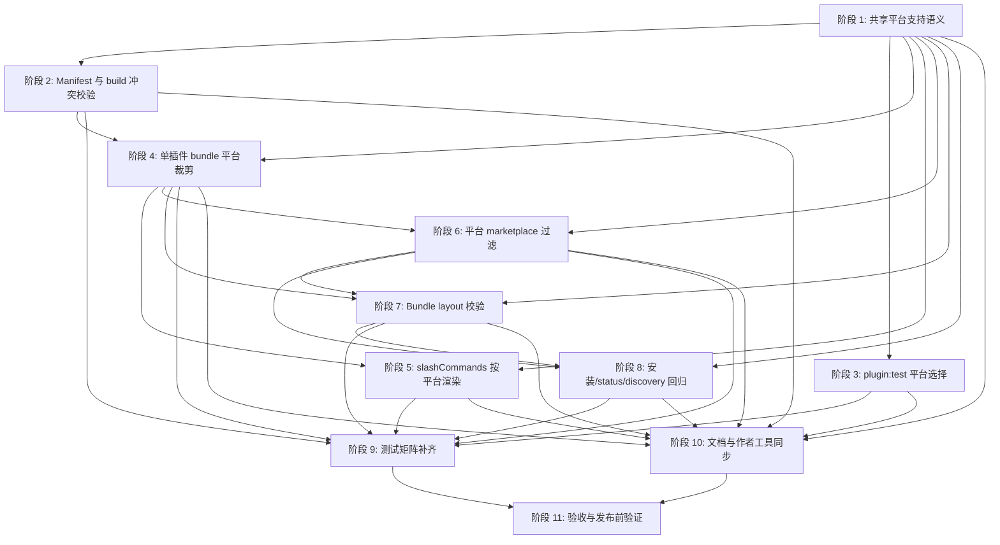

# 平台专属插件构建物 TODO

本文档从 `docs/dev/plans/platform-specific-plugin-bundles.md` 拆出可独立推进的实施阶段。每个阶段都有明确前置依赖、交付边界和测试验收，后续可以按依赖图安排并行开发。

## 阶段总览

| 阶段 | 主题 | 前置依赖 | 可并行关系 |
| --- | --- | --- | --- |
| 阶段 1 | 共享平台支持语义 | 无 | 所有后续阶段的共同基础 |
| 阶段 2 | Manifest 与 build 冲突校验 | 阶段 1 | 可与阶段 3 并行 |
| 阶段 3 | `pnpm plugin:test` 平台选择 | 阶段 1 | 可与阶段 2 并行 |
| 阶段 4 | 单插件 bundle 平台裁剪 | 阶段 1、阶段 2 | 阻塞阶段 5、阶段 6、阶段 7 的产物集成 |
| 阶段 5 | slashCommands 按平台渲染 | 阶段 1、阶段 4 | 可与阶段 6 并行 |
| 阶段 6 | 平台 marketplace 过滤 | 阶段 1、阶段 4 | 可与阶段 5 并行，阻塞阶段 7、阶段 8 |
| 阶段 7 | Bundle layout 校验 | 阶段 1、阶段 4、阶段 6 | 阻塞阶段 8 和最终 smoke |
| 阶段 8 | 安装、status 与 discovery 回归 | 阶段 1、阶段 6、阶段 7 | 可与阶段 10 的文档草稿并行 |
| 阶段 9 | 测试矩阵补齐 | 阶段 2 到阶段 8 | 可随各阶段逐步补齐，最终收口依赖阶段 8 |
| 阶段 10 | 文档与作者工具同步 | 阶段 1 到阶段 8 | 文档草稿可提前，作者工具验收依赖对应能力落地 |
| 阶段 11 | 验收与发布前验证 | 阶段 9、阶段 10 | 收口阶段 |

## 阶段依赖关系图

并行建议：

- 第一波只做阶段 1，先稳定平台支持集合的单一真值。
- 第二波并行推进阶段 2 和阶段 3。一个人收口 manifest/build 冲突校验，另一个人改 `plugin:test` 的 staging manifest 判定链路。
- 第三波先做阶段 4，让 `bundleLocalPlugin()` 的返回合同和产物裁剪稳定下来。
- 第四波并行推进阶段 5 和阶段 6，分别处理 slash command 渲染和根级 marketplace 过滤。
- 第五波做阶段 7 和阶段 8，收紧 layout 校验并确认安装、status、discovery 不依赖平台 marketplace 的完整镜像假设。
- 阶段 9 和阶段 10 可以随实现滚动补齐，但最终验收必须等阶段 8 完成后统一收口。
- 阶段 11 只做发布前验证，不承载新能力。

## 阶段 1：共享平台支持语义

前置依赖：无。

目标：新增一套 CLI、build、layout、测试 runner 和作者工具都能复用的平台支持集合解析逻辑，让 `marketplace.policy.products` 成为平台范围的单一语义来源。

交付边界：

- 只抽取共享语义和替换现有重复判断，不改变安装命令已有的平台门禁结果。
- `products` 仍只接受 `CODEX` 和 `CLAUDE`。
- `products` 缺失或为空数组时继续表示 Claude + Codex 双平台。

待办：

- [x] 新增或扩展 `packages/cli/src/utils/platform-support.ts`。
- [x] 定义 `SupportedPlatformSet = ReadonlySet<PlatformName>`。
- [x] 实现 `resolveSupportedPlatforms(manifest)`。
- [x] 实现 `supportsPlatform(manifest, platform)`。
- [x] 实现 `formatSupportedPlatforms(platforms)`。
- [x] 实现 `formatMarketplaceProductsForError(manifest)`。
- [x] 平台 token 归一化沿用 `trim().toUpperCase().replace(/[\s-]+/g, "_")`。
- [x] `products` 省略或空数组时解析为 `claude + codex`。
- [x] `products=["CODEX"]` 解析为 Codex-only。
- [x] `products=["CLAUDE"]` 解析为 Claude-only。
- [x] `products=["CODEX", "CLAUDE"]` 解析为双平台。
- [x] 将 `pluginSupportsPlatform()` 改成共享 helper 的 thin wrapper。
- [x] 确认 `resolvePlatformTargets()`、interactive、upgrade、discovery 继续通过 `pluginSupportsPlatform()` 复用现有行为。
- [x] 删除 `packages/cli/scripts/test-plugin-scripts.ts` 中本地 `inferPlatforms()` 的独立 products 解析逻辑。
- [x] 将 `test-plugin-scripts.ts` 改为复用共享 helper。
- [x] 统一错误信息，包含插件名、`marketplace.policy.products` 和实际支持平台集合。

#### 测试验收

- [x] Unit：`products` 省略时解析为双平台。
- [x] Unit：`products` 空数组时解析为双平台。
- [x] Unit：`products=["CODEX"]` 解析为 Codex-only。
- [x] Unit：`products=["CLAUDE"]` 解析为 Claude-only。
- [x] Unit：双平台声明解析为 Claude + Codex。
- [x] Unit：大小写、空格、短横线 token 归一化行为不变。
- [x] Unit：`pluginSupportsPlatform()` 和共享 helper 结果一致。
- [x] Unit：错误格式能稳定展示 `marketplace.policy.products=[CODEX]` 等文本。
- [x] 运行相关 unit tests，例如 `pnpm --filter @yiliang/aw exec vitest run tests/unit/manifest.test.ts`。

## 阶段 2：Manifest 与 Build 冲突校验

前置依赖：阶段 1。

目标：所有会向某个平台增加、覆盖或声明 runtime 能力的字段，都必须受插件支持平台集合约束；排除平台上出现实际产物配置时 fail fast。

交付边界：

- 不把 `products` 写入 `.claude-plugin/plugin.json` 或 `.codex-plugin/plugin.json`。
- 不新增顶层 `claude` / `codex` manifest block。
- 不做 skill 级平台拆分。
- 不新增 Claude 动态 artifact target。
- 放宽旧的 Codex 动态 artifact 限制，允许双平台插件声明 Codex target。

待办：

- [x] 在 `packages/cli/src/utils/manifest.ts` 或 build validation 阶段加入统一平台冲突检查。
- [x] 视需要实现 `assertPlatformFieldSupported({ pluginName, manifest, fieldPath, requiredPlatform })`。
- [x] 校验 `buildConfig.fileRules.claude` 要求支持 Claude。
- [x] 校验 `buildConfig.fileRules.codex` 要求支持 Codex。
- [x] 校验 `buildConfig.manifestOverrides.claude` 要求支持 Claude。
- [x] 校验 `buildConfig.manifestOverrides.codex` 要求支持 Codex，即使当前只允许空对象。
- [x] 校验顶层 `apps` 要求支持 Codex。
- [x] 校验 `extensions.nativeHooks.claude` 要求支持 Claude。
- [x] 校验 `extensions.nativeHooks.codex` 要求支持 Codex。
- [x] 校验 `extensions.*[].agentOverrides.<platform>` 中非空 override 要求支持对应平台。
- [x] 保持 `agentOverrides.<unsupportedPlatform> = null` 合法。
- [x] 校验 `artifacts.targets[].platform` 必须属于插件支持平台集合。
- [x] 调整 `packages/cli/src/generators/local-plugin.ts` 的 build 校验接入点。
- [x] 调整 `packages/cli/src/utils/codex-project-surface.ts`，避免 unsupported platform 的动态 artifact 进入 Codex project surface。
- [x] 调整 `packages/cli/src/utils/artifact-plan.ts`，允许双平台插件声明 Codex dynamic artifact。
- [x] 保证 Claude-only 插件声明任意 Codex artifact target 都失败。
- [x] 保证当前没有 Claude target 时，Claude-only 插件声明任何 `artifacts.targets` 都失败。
- [x] 错误文案包含插件名、冲突字段路径、当前 `marketplace.policy.products` 和字段要求的平台。
- [x] 同步 `.agents/skills/create-agent-workflows-plugin/scripts/validate_plugin.js` 的基础校验。
- [x] 检查作者工具对应测试夹具，本阶段无需额外调整。

#### 测试验收

- [x] Unit：Codex-only 插件声明 `buildConfig.fileRules.claude` 失败。
- [x] Unit：Codex-only 插件声明 `buildConfig.manifestOverrides.claude` 失败。
- [x] Unit：Claude-only 插件声明 `apps` 失败。
- [x] Unit：Claude-only 插件声明 Codex `artifacts.targets` 失败。
- [x] Unit：双平台插件声明 Codex `artifacts.targets` 通过。
- [x] Unit：unsupported platform 的 `nativeHooks` 失败。
- [x] Unit：unsupported platform 的非空 `agentOverrides` 失败。
- [x] Unit：`agentOverrides.<unsupportedPlatform> = null` 通过。
- [x] Unit：`artifact-plan.test.ts` 覆盖双平台插件的 Codex dynamic artifact 仍能建立 Codex renderer plan，且不会被 Claude 分支消费。
- [x] Unit：`adapter-status.test.ts` 覆盖双平台插件的 Codex dynamic artifact 只进入 Codex capability/status surface。
- [x] Unit：`codex-project-platform-gates.test.ts` 覆盖双平台插件携带 Codex dynamic artifact 时，project preflight 只在 Codex project 分支生效。
- [x] Unit：`codex-project-installability.test.ts` 覆盖双平台插件携带 Codex dynamic artifact 时，repo-managed kinds 和 installability 只在 Codex project 分支生效。
- [x] 运行相关 unit tests，例如 `pnpm --filter @yiliang/aw exec vitest run tests/unit/manifest.test.ts tests/unit/artifact-plan.test.ts tests/unit/adapter-status.test.ts tests/unit/codex-project-platform-gates.test.ts tests/unit/codex-project-installability.test.ts`。

## 阶段 3：`pnpm plugin:test` 平台选择

前置依赖：阶段 1。

目标：`pnpm plugin:test` 以 build 后 staging manifest 为准解析支持平台。显式 `--platform` 只允许在支持集合内缩小测试目标，不允许强制测试未支持平台。

交付边界：

- `--platform claude|codex|both` 不是 override。
- 校验失败必须在 runtime bundle 生成前发生。
- source manifest 与 staging manifest 的 `products` 不一致时，以 staging manifest 为准。

待办：

- [x] 调整 `packages/cli/scripts/test-plugin-scripts.ts` 的 runner 时序。
- [x] 先读取 source manifest，只用于定位插件和测试配置。
- [x] 调用 `prepareLocalPluginBundleSource(..., { buildMode: "staging" })` 生成 staging source。
- [x] 从 staging manifest 解析最终支持平台集合。
- [x] 实现 `--platform auto`：使用完整支持平台集合。
- [x] 实现 `--platform codex`：仅当插件支持 Codex 时合法。
- [x] 实现 `--platform claude`：仅当插件支持 Claude 时合法。
- [x] 实现 `--platform both`：仅当插件同时支持 Claude 和 Codex 时合法。
- [x] 校验失败时清理 staging 目录。
- [x] 校验失败时不要进入 `bundleLocalPlugin()`。
- [x] 校验通过后调用 `bundleLocalPlugin(..., { buildMode: "prepared" })` 生成测试 runtime bundle。
- [x] 错误信息包含插件名、用户显式选择的平台、staging manifest 中的 `marketplace.policy.products` 和实际支持平台集合。
- [x] 视需要调整 `packages/cli/scripts/plugin-staging.ts`，暴露读取 staging manifest 所需路径或返回值。
- [x] 更新 `packages/cli/tests/integration/plugin-test-runner.test.ts` fixture。

#### 测试验收

- [x] Integration：Codex-only 插件 `--platform auto` 只跑 Codex。
- [x] Integration：Claude-only 插件 `--platform auto` 只跑 Claude。
- [x] Integration：双平台插件 `--platform auto` 跑两轮。
- [x] Integration：双平台插件显式 `--platform both` 继续跑 Codex / Claude 两轮。
- [x] Integration：双平台 `--platform both` 两轮使用独立可写 bundle、home 和 tmp。
- [x] Integration：Codex-only 插件 `--platform claude` fail fast。
- [x] Integration：Codex-only 插件 `--platform both` fail fast。
- [x] Integration：Claude-only 插件 `--platform codex` fail fast。
- [x] Integration：Claude-only 插件 `--platform both` fail fast。
- [x] Integration：source manifest 与 staging manifest 的 `products` 不一致时，以 staging manifest 为准。
- [x] Integration：校验失败不进入 `bundleLocalPlugin()`，也不会因为缺 runtime 文件才失败。
- [x] 运行 `pnpm --filter @yiliang/aw exec vitest run tests/integration/plugin-test-runner.test.ts`。

## 阶段 4：单插件 Bundle 平台裁剪

前置依赖：阶段 1、阶段 2。

目标：`bundleLocalPlugin()` 按 build 后最终 manifest 的支持平台集合生成产物。被排除平台不创建 platform manifest，不复制 runtime 目录，也不渲染平台专属产物。

交付边界：

- `.agents-plugin/plugin.json` 仍是 AW current catalog 真值，所有插件都必须保留。
- `platformManifests` 只能包含插件最终支持的平台。
- 不支持的平台不能保留空 manifest 或占位字段。
- `platformManifests` key 集合必须等于 build 后最终 manifest 解析出的支持平台集合。
- 调用方不能继续依赖 `result.claudeManifest` 或 `result.codexManifest`。

待办：

- [x] 修改 `packages/cli/src/generators/local-plugin.ts`。
- [x] 将 `LocalPluginBundleResult` 改为包含 `outputRoot`、`plugin` 和 `platformManifests: Partial<Record<PlatformName, PlatformPluginManifest>>`。
- [x] 迁移所有 `result.claudeManifest` 调用点。
- [x] 迁移所有 `result.codexManifest` 调用点。
- [x] `bundleLocalPlugin()` 开始时继续清空 `outputRoot`，避免旧平台残留被保留。
- [x] 支持 Claude 时生成 `.claude-plugin/plugin.json`。
- [x] 支持 Codex 时生成 `.codex-plugin/plugin.json`。
- [x] 支持平台复制对应 runtime 目录和平台专属产物。
- [x] 不支持 Claude 时不创建 `.claude-plugin/` 和 `claude/`。
- [x] 不支持 Codex 时不创建 `.codex-plugin/` 和 `codex/`。
- [x] 不支持平台时不执行该平台 slash command 生成。
- [x] 不支持平台时不渲染 native hooks、agents、instructions、permissions 或 manifest overrides。
- [x] 支持平台 manifest 内路径继续使用 `./claude/...` 或 `./codex/...`。
- [x] `skills` 复制到所有支持的平台。
- [x] `mcpServers` 复制到所有支持的平台。
- [x] `apps` 只复制到 Codex；Claude-only + apps 已在阶段 2 fail fast。
- [x] `scripts`、`config`、`artifacts.targets` 只保留在 `.agents-plugin/plugin.json`。
- [x] 检查 `packages/cli/src/generators/hooks.ts`，本阶段无需调整。
- [x] 检查 `packages/cli/src/generators/instructions.ts`，本阶段无需调整。
- [x] 检查 `packages/cli/src/generators/permissions.ts`，本阶段无需调整。
- [x] 检查 `packages/cli/src/generators/agents.ts`，本阶段无需调整。
- [x] 检查 `packages/cli/src/generators/shared.ts`，本阶段无需调整。

#### 测试验收

- [x] Unit：Codex-only 插件只生成 `.codex-plugin/plugin.json` 和 `codex/**`。
- [x] Unit：Codex-only 插件不生成 `.claude-plugin/plugin.json` 和 `claude/**`。
- [x] Unit：Claude-only 插件只生成 `.claude-plugin/plugin.json` 和 `claude/**`。
- [x] Unit：Claude-only 插件不生成 `.codex-plugin/plugin.json` 和 `codex/**`。
- [x] Unit：双平台插件保持双 manifest 与双 runtime 行为。
- [x] Unit：`platformManifests` key 集合与支持平台一致。
- [x] Unit：旧的 `result.claudeManifest` / `result.codexManifest` 调用全部迁移。
- [x] 运行 `pnpm --filter @yiliang/aw exec vitest run tests/unit/generators.test.ts`。

## 阶段 5：SlashCommands 按平台渲染

前置依赖：阶段 1、阶段 4。

目标：`slashCommands` 仍是跨平台源码入口，但生成和校验只发生在插件支持的平台上。

交付边界：

- 双平台插件同时生成 Claude `commands/*.md` 和 Codex manual-only skills。
- Codex-only 插件只生成 Codex manual-only skills。
- Claude-only 插件只生成 Claude commands。
- Codex forbidden syntax 校验只在生成 Codex 产物时执行。
- Claude-only 插件不应被 Codex-only 语法限制阻断。

待办：

- [x] 调整 `packages/cli/src/utils/slash-commands.ts`。
- [x] 将 `resolveSlashCommands()` 改为显式接收目标平台集合，例如 `targetPlatforms: SupportedPlatformSet`。
- [x] 在 `packages/cli/src/generators/local-plugin.ts` 中传入最终支持平台集合。
- [x] Codex-only 插件只返回 Codex 结果。
- [x] Claude-only 插件只返回 Claude 结果。
- [x] 双平台插件同时返回 Claude 和 Codex 结果。
- [x] Codex forbidden syntax 校验只在 `targetPlatforms` 包含 Codex 时执行。
- [x] 被排除平台的 command 输出不进入 platform manifest。
- [x] 被排除平台的 assets 引用不进入 platform manifest。
- [x] 被排除平台的 platform frontmatter 不进入 platform manifest。
- [x] 更新 `packages/cli/src/utils/manifest.ts` 中与 slash command 校验相关的调用。
- [x] 同步 `.agents/skills/create-agent-workflows-plugin/scripts/validate_plugin.js` 的 slash command 平台化校验。

#### 测试验收

- [x] Unit：`slash-commands.test.ts` 覆盖 Codex-only 只返回 Codex 结果。
- [x] Unit：`slash-commands.test.ts` 覆盖 Claude-only 只返回 Claude 结果。
- [x] Unit：`slash-commands.test.ts` 覆盖双平台同时返回两边结果。
- [x] Unit：Claude-only 命令即使命中 Codex forbidden syntax，也不会因 Codex 校验失败。
- [x] Unit：Codex-only 命令仍执行 Codex render/frontmatter/forbidden syntax 校验。
- [x] Unit：`generators.test.ts` 覆盖 bundle 侧平台化 slash command 输出。
- [x] 运行 `pnpm --filter @yiliang/aw exec vitest run tests/unit/slash-commands.test.ts tests/unit/generators.test.ts`。

## 阶段 6：平台 Marketplace 过滤

前置依赖：阶段 1、阶段 4。

目标：根级 `.claude-plugin/marketplace.json` 和 `.agents/plugins/marketplace.json` 不再要求插件列表完全一致。两者共享根级元数据，但 entries 按平台支持集合过滤。

交付边界：

- 平台 marketplace 过滤必须基于每个插件完成 staging/bundle 后的最终 manifest。
- 不得用 `discoverPlugins()` 读到的 source metadata 直接过滤 marketplace。
- AW current catalog 仍扫描 `plugins/<name>/.agents-plugin/plugin.json` 看到全部插件。

待办：

- [x] 调整 `packages/cli/scripts/bundle-plugins.ts`。
- [x] 支持 Claude 的插件进入 `.claude-plugin/marketplace.json`。
- [x] 支持 Codex 的插件进入 `.agents/plugins/marketplace.json`。
- [x] marketplace entry 的 `source` 继续写 `./plugins/<pluginName>`。
- [x] build script 改写 `products` 时，平台 marketplace 以后续 staging/final manifest 为准。
- [x] 调整 `packages/cli/src/utils/marketplace.ts`。
- [x] `readMarketplaceManifest()` 不再比较两份 marketplace 完全一致。
- [x] `readMarketplaceManifest()` 只读取目标平台 marketplace。
- [x] 单独校验 marketplace 基本结构。
- [x] 保持 owner、interface 等根级元数据基础校验。
- [x] 删除或替换旧的“两份 marketplace 完全相等”断言。

#### 测试验收

- [x] Unit：Claude marketplace 不包含 Codex-only 插件。
- [x] Unit：Codex marketplace 不包含 Claude-only 插件。
- [x] Unit：双平台插件同时出现在两份 marketplace。
- [x] Unit：两份 marketplace 的 owner/interface 等根级元数据一致。
- [x] Unit：build script 改写 staging manifest 后，平台 marketplace 按 staging manifest 过滤。
- [x] Smoke：`build-smoke.test.ts` 覆盖平台 marketplace 过滤。
- [x] Smoke：`pack-smoke.test.ts` 覆盖 tarball 内平台 marketplace 过滤。
- [x] 运行 `pnpm --filter @yiliang/aw exec vitest run tests/unit/marketplace.test.ts tests/smoke/build-smoke.test.ts tests/smoke/pack-smoke.test.ts`。

## 阶段 7：Bundle Layout 校验

前置依赖：阶段 1、阶段 4、阶段 6。

目标：layout 校验以 `plugins/<name>/.agents-plugin/plugin.json` 扫描全部插件，再按支持平台集合校验应该存在和不应该存在的文件。

交付边界：

- 不能再从 marketplace entries 推导全部插件集合。
- 单平台过滤后的 marketplace 必须能通过校验。
- 手工残留的不支持平台 manifest/runtime 目录必须被抓出。

待办：

- [x] 调整 `packages/cli/src/utils/bundle-layout.ts`。
- [x] 扫描 `plugins/*/.agents-plugin/plugin.json` 作为全插件集合。
- [x] 校验所有插件都有 `.agents-plugin/plugin.json`。
- [x] 支持 Claude 的插件必须有 `.claude-plugin/plugin.json`。
- [x] 不支持 Claude 的插件不得有 `.claude-plugin/plugin.json`。
- [x] 不支持 Claude 的插件不得有 `claude/` runtime 目录。
- [x] 支持 Codex 的插件必须有 `.codex-plugin/plugin.json`。
- [x] 不支持 Codex 的插件不得有 `.codex-plugin/plugin.json`。
- [x] 不支持 Codex 的插件不得有 `codex/` runtime 目录。
- [x] Claude manifest 中的路径必须存在，且以 `./claude/` 开头。
- [x] Codex manifest 中的路径必须存在，且以 `./codex/` 开头。
- [x] Claude marketplace entries 必须等于支持 Claude 的插件集合。
- [x] Codex marketplace entries 必须等于支持 Codex 的插件集合。
- [x] 每个 marketplace entry 的 `source` 必须是 `./plugins/<pluginName>`。
- [x] 错误分类覆盖 `missing supported Claude manifest`。
- [x] 错误分类覆盖 `missing supported Codex manifest`。
- [x] 错误分类覆盖 `unexpected Claude bundle files for unsupported platform`。
- [x] 错误分类覆盖 `unexpected Codex bundle files for unsupported platform`。
- [x] 确认 `ensureLocalMarketplace()` / `copyBundleToStaging()` 刷新后的 `~/.aw` 能通过新 layout 校验。
- [x] 视需要调整 `packages/cli/src/utils/local-marketplace.ts`。
- [x] 检查 `packages/cli/src/utils/paths.ts`，本阶段无需调整。

#### 测试验收

- [x] Unit：平台过滤后的 marketplace 能通过。
- [x] Unit：Codex-only 插件残留 `.claude-plugin/plugin.json` 失败。
- [x] Unit：Codex-only 插件残留 `claude/` 目录失败。
- [x] Unit：Claude-only 插件残留 `.codex-plugin/plugin.json` 失败。
- [x] Unit：Claude-only 插件残留 `codex/` 目录失败。
- [x] Unit：支持平台缺少 manifest 失败。
- [x] Unit：marketplace entries 与支持平台集合不一致失败。
- [x] Unit：`local-marketplace.test.ts` 覆盖刷新后 layout 校验。
- [x] 运行 `pnpm --filter @yiliang/aw exec vitest run tests/unit/bundle-layout.test.ts tests/unit/local-marketplace.test.ts`。

## 阶段 8：安装、Status 与 Discovery 回归

前置依赖：阶段 1、阶段 6、阶段 7。

目标：平台 marketplace 过滤后，AW current catalog 仍能看到全部插件。错误平台安装应返回“不支持目标平台”，而不是 unknown plugin 或 manifest 缺失。

交付边界：

- 不改变安装命令已有的平台门禁语义。
- 平台 marketplace 不是 AW current catalog 的唯一来源。
- 历史卸载 fallback 不依赖平台 marketplace 是否列出当前插件。

待办：

- [x] 确认 `resolveCatalogPlugins()` 仍扫描 `plugins/<name>/.agents-plugin/plugin.json`。
- [x] 调整 `packages/cli/src/commands/discovery.ts` 的 current catalog 读取或测试假设。
- [x] 检查 `packages/cli/src/commands/common.ts` 中平台支持错误路径，本阶段无需额外调整。
- [x] 检查 `packages/cli/src/commands/install.ts` 中错误平台安装的诊断，本阶段无需额外调整。
- [x] 调整 `packages/cli/src/commands/upgrade.ts` 依赖的 discovery current catalog 和 historical fallback 诊断路径。
- [x] 检查 `packages/cli/src/commands/status.ts` 中 current catalog 展示，本阶段通过回归测试覆盖。
- [x] 确认 `aw install <codex-only> -p claude` 能找到插件，并返回平台不支持错误。
- [x] 确认 `--platform both` 遇到单平台插件时继续在写入前失败。
- [x] 确认 `--platform auto` 仍先按 `products` 过滤候选平台，再推断目标平台。
- [x] 确认 `aw status` current catalog 能看到单平台插件。
- [x] 确认 discovery current catalog 能看到单平台插件。
- [x] 确认历史卸载 fallback 不依赖目标平台 marketplace entry。

#### 测试验收

- [x] Integration：单平台插件不在目标平台 marketplace 中时，显式安装到错误平台仍不是 `Unknown plugin`。
- [x] Integration：`aw status` current catalog 包含单平台插件。
- [x] Integration：`aw init --force` 后本地 marketplace layout 通过校验。
- [x] Integration：upgrade 的历史诊断不因 platform marketplace 过滤而丢插件名。
- [x] Integration：uninstall 的历史诊断不因 platform marketplace 过滤而丢插件名。
- [x] Integration：`--platform both` 对单平台插件在写入前失败。
- [x] 运行相关 integration tests，例如 `pnpm test:integration` 或聚焦安装、status、discovery 测试文件。

## 阶段 9：测试矩阵补齐

前置依赖：阶段 2 到阶段 8。

目标：把单平台 bundle、平台冲突、平台化 runner、marketplace/layout 和 Codex dynamic artifact 的跨模块行为全部锁进测试矩阵。

交付边界：

- 本阶段不引入新的产品能力，只补齐覆盖和替换旧假设。
- 可随阶段 2 到阶段 8 分批落地，但最终收口时必须能独立跑完整矩阵。

待办：

- [x] 调整 `packages/cli/tests/unit/generators.test.ts`。
- [x] 调整 `packages/cli/tests/unit/slash-commands.test.ts`。
- [x] 调整 `packages/cli/tests/unit/bundle-layout.test.ts`。
- [x] 调整 `packages/cli/tests/unit/marketplace.test.ts`。
- [x] 调整 `packages/cli/tests/unit/manifest.test.ts`。
- [x] 调整 `packages/cli/tests/unit/manifest-coverage.test.ts`。
- [x] 调整 `packages/cli/tests/unit/artifact-plan.test.ts`。
- [x] 调整 `packages/cli/tests/unit/adapter-status.test.ts`。
- [x] 调整 `packages/cli/tests/unit/codex-project-platform-gates.test.ts`。
- [x] 调整 `packages/cli/tests/unit/codex-project-installability.test.ts`。
- [x] Unit 覆盖单平台 bundle 裁剪。
- [x] Unit 覆盖 `platformManifests` 返回合同。
- [x] Unit 覆盖平台冲突 fail fast。
- [x] Unit 覆盖 slash command 单平台渲染。
- [x] Unit 覆盖平台 marketplace 过滤。
- [x] Unit 覆盖 layout 对缺失和残留文件的区分。
- [x] Unit 覆盖双平台 Codex dynamic artifact 允许。
- [x] Unit 覆盖 renderer plan、status/capability snapshot、project preflight、repo-managed kinds 和 installability 都只把双平台 Codex dynamic artifact 作为 Codex 能力处理。
- [x] 调整 `packages/cli/tests/integration/plugin-test-runner.test.ts`。
- [x] 调整 `packages/cli/tests/integration/authoring-tools.test.ts`。
- [x] 调整安装、status、discovery 相关集成测试。
- [x] Integration 覆盖 `pnpm plugin:test --platform auto|claude|codex|both` 的新约束。
- [x] Integration 覆盖双平台插件显式 `--platform both` 继续成功。
- [x] Integration 覆盖 Codex / Claude 两轮隔离 bundle、home 和 tmp。
- [x] Integration 覆盖 staging manifest 改写 `products` 后，runner 与 marketplace 都跟随最终 manifest。
- [x] Integration 覆盖作者文档断言不再包含恒定双平台 bundle 的旧叙述。
- [x] Integration 覆盖 `validate_plugin.js` 的平台冲突、slash command 单平台校验和 artifact target 校验。
- [x] 调整 `packages/cli/tests/smoke/build-smoke.test.ts`。
- [x] 调整 `packages/cli/tests/smoke/pack-smoke.test.ts`。
- [x] 调整 `packages/cli/tests/smoke/plugin-scripts-staging-smoke.test.ts`。
- [x] Smoke 覆盖 `pnpm build` 后 `codex-explore` 有 `.codex-plugin/plugin.json`、`codex/skills`、`codex/instructions`、`codex/roles` 和 renderer runtime。
- [x] Smoke 覆盖 `codex-explore` 没有 `.claude-plugin/plugin.json` 和 `claude/`。
- [x] Smoke 覆盖 Claude marketplace 不包含 `codex-explore`。
- [x] Smoke 覆盖 Codex marketplace 包含 `codex-explore`。
- [x] Smoke 覆盖 npm tarball 不包含 `codex-explore` 的 Claude bundle 文件。
- [x] Smoke 覆盖 build script 改写 staging manifest 后，runner、bundle 和平台选择都跟随最终 manifest。
- [x] Smoke 覆盖单平台插件显式选择错误平台时，`pnpm plugin:test` 在 runtime bundle 生成前 fail fast。

#### 测试验收

- [x] 执行 `pnpm test:unit`。
- [x] 执行 `pnpm test:integration`。
- [x] 执行 `pnpm test:smoke:build`。
- [x] 执行 `pnpm test:smoke:plugin-scripts`。
- [x] 执行 `pnpm test:smoke:pack`。
- [x] 确认所有旧的恒定双平台 bundle/marketplace 镜像断言已删除或替换。

## 阶段 10：文档与作者工具同步

前置依赖：阶段 1 到阶段 8。文档草稿可以提前写，作者工具校验需要等对应 contract 稳定。

目标：更新所有会指导插件作者、维护者和测试编写者的文档，避免新 contract 只存在于实现里。

交付边界：

- 改动插件基础架构、manifest/schema、adapter 行为、scope 语义、分发/安装流程时，必须同步检查 `.agents/skills/create-agent-workflows-plugin/`。
- `validate_plugin.js` 必须与 CLI 的平台范围语义保持一致。

待办：

- [x] 更新 `docs/plugin-authoring.md`，说明 `products` 参与 build 裁剪，不只是安装门禁。
- [x] 更新 `docs/plugin-authoring.md` 的 Bundle Contract，不再说每个插件固定生成两份 platform manifest。
- [x] 更新 `docs/plugin-authoring.md` 的 Public Slash Commands，说明只为支持平台生成 Claude commands / Codex manual-only skills。
- [x] 更新 `docs/plugin-authoring.md` 的 apps 说明：`products=["CLAUDE"] + apps` 是矛盾配置。
- [x] 更新 `docs/plugin-authoring.md` 的 extensions 说明：unsupported platform 的 `nativeHooks` 和非空 `agentOverrides` fail fast，`agentOverrides.<unsupportedPlatform> = null` 合法。
- [x] 更新 `docs/plugin-authoring.md` 的 `pnpm plugin:test` 示例，避免把 `--platform both` 写成单平台插件通用命令。
- [x] 更新 `docs/architecture.md` 的 Three-Layer Distribution Model。
- [x] 在 `docs/architecture.md` 明确所有插件都有 `.agents-plugin/plugin.json`。
- [x] 在 `docs/architecture.md` 明确 platform manifest/runtime 目录只在支持平台存在。
- [x] 删除 `docs/architecture.md` 中 `plugins/<name>/` 恒定包含双 platform manifest 的暗示。
- [x] 更新 `docs/testing.md` 的 `pnpm plugin:test` 平台选择语义。
- [x] 在 `docs/testing.md` 明确 `auto` 使用 build 后 staging manifest 的支持平台集合。
- [x] 在 `docs/testing.md` 明确显式 `claude|codex|both` 不允许越过最终 `products`。
- [x] 更新 `.agents/skills/create-agent-workflows-plugin/SKILL.md`。
- [x] 更新 `.agents/skills/create-agent-workflows-plugin/references/plugin-manifest-spec.md` 的 runtime marketplace 和三层分发模型。
- [x] 更新 `.agents/skills/create-agent-workflows-plugin/references/build-config-spec.md`，说明 `fileRules` / `manifestOverrides` 只能用于支持平台。
- [x] 更新 `.agents/skills/create-agent-workflows-plugin/references/slash-commands.md`，说明单平台生成和 Codex forbidden syntax 校验时机。
- [x] 更新 `.agents/skills/create-agent-workflows-plugin/references/mcp-and-apps.md`，写明 Claude-only 插件声明 `apps` 必须失败。
- [x] 更新 `.agents/skills/create-agent-workflows-plugin/references/extensions-spec.md`，写明 unsupported platform 的冲突和 `null` 排除语义。
- [x] 更新 `.agents/skills/create-agent-workflows-plugin/references/skills-and-triggers.md`，说明 Claude-only skill 与 Codex bundle 裁剪。
- [x] 更新 `.agents/skills/create-agent-workflows-plugin/references/aw-scripts-config-lifecycle.md`，说明 `plugin:test --platform both` 只适用于双平台插件。
- [x] 更新 `.agents/skills/create-agent-workflows-plugin/scripts/validate_plugin.js`，使用同一套平台范围解析规则。
- [x] `validate_plugin.js` 校验 unsupported platform 的 `fileRules`。
- [x] `validate_plugin.js` 校验 unsupported platform 的 `manifestOverrides`。
- [x] `validate_plugin.js` 校验 Claude-only 插件不允许声明 `apps`。
- [x] `validate_plugin.js` 校验 unsupported platform 的 `nativeHooks`。
- [x] `validate_plugin.js` 校验 unsupported platform 的非空 `agentOverrides`。
- [x] `validate_plugin.js` 校验 `artifacts.targets` 的 target 平台必须属于插件支持平台集合。
- [x] `validate_plugin.js` 的 `slashCommands` 只按支持平台渲染和校验。
- [x] `validate_plugin.js` 的 Codex forbidden syntax 只在插件支持 Codex 时执行。

#### 测试验收

- [x] Integration：`authoring-tools.test.ts` 覆盖平台冲突校验。
- [x] Integration：`authoring-tools.test.ts` 覆盖 slash command 单平台校验。
- [x] Integration：`authoring-tools.test.ts` 覆盖 artifact target 平台校验。
- [x] Docs：公开文档不再描述恒定双平台 platform manifest。
- [x] Docs：作者技能参考与 CLI 的 `products` / bundle 裁剪 / `plugin:test` 语义一致。
- [x] 运行 `pnpm --filter @yiliang/aw exec vitest run tests/integration/authoring-tools.test.ts`。

## 阶段 11：验收与发布前验证

前置依赖：阶段 9、阶段 10。

目标：用完整本地验证命令和人工产物检查收口，确认平台专属插件构建物新 contract 可以发布。

交付边界：

- 本阶段只做验证和必要的修正，不新增新能力。
- 所有验收标准都必须基于 build 后最终产物。

待办：

- [x] 按风险从小到大执行本地验证命令。
- [x] 检查 `packages/cli/plugins-dist/plugins/codex-explore/.codex-plugin/plugin.json` 存在。
- [x] 检查 `packages/cli/plugins-dist/plugins/codex-explore/codex/skills` 存在。
- [x] 检查 `packages/cli/plugins-dist/plugins/codex-explore/codex/instructions` 存在。
- [x] 检查 `packages/cli/plugins-dist/plugins/codex-explore/codex/roles` 存在。
- [x] 检查 `packages/cli/plugins-dist/.agents/plugins/marketplace.json` 存在且包含 `codex-explore`。
- [x] 确认 `packages/cli/plugins-dist/plugins/codex-explore/.claude-plugin/plugin.json` 不存在。
- [x] 确认 `packages/cli/plugins-dist/plugins/codex-explore/claude/` 不存在。
- [x] 确认 `validateBundleLayout(packages/cli/plugins-dist)` 通过。
- [x] 确认 Claude marketplace 不包含 `codex-explore`。
- [x] 确认 Codex marketplace 包含 `codex-explore`。
- [x] 确认 `aw install codex-explore -p claude` 返回平台不支持错误，不是 unknown plugin。
- [x] 确认 Codex-only 插件声明 `buildConfig.fileRules.claude` 时 build fail fast。
- [x] 确认双平台插件声明 Codex `artifacts.targets` 校验通过。
- [x] 确认 Claude-only 插件声明 Codex `artifacts.targets` 校验失败。
- [x] 确认 `pnpm plugin:test <codex-only> --platform auto` 只跑 Codex。
- [x] 确认 `pnpm plugin:test <codex-only> --platform claude|both` 在 runtime bundle 生成前 fail fast。
- [x] 确认公开文档、作者技能参考和 `validate_plugin.js` 与新 contract 一致。

#### 测试验收

- [x] 执行 `pnpm test:unit`。
- [x] 执行 `pnpm test:integration`。
- [x] 执行 `pnpm build`。
- [x] 执行 `pnpm test:smoke:build`。
- [x] 执行 `pnpm test:smoke:plugin-scripts`。
- [x] 执行 `pnpm test:smoke:pack`。
- [x] 如果实现范围触及作者工具校验，执行 `pnpm --filter @yiliang/aw exec vitest run tests/integration/authoring-tools.test.ts`。

## 建议拆分

- PR 1：共享平台支持 helper、安装侧 wrapper、基础 unit tests。
- PR 2：manifest/build 冲突校验和作者工具基础校验。
- PR 3：`plugin:test` staging manifest 平台选择。
- PR 4：`bundleLocalPlugin()` 返回合同和单插件 bundle 裁剪。
- PR 5：`slashCommands` 平台化渲染。
- PR 6：platform marketplace 和 bundle layout 校验。
- PR 7：安装、status、discovery 回归和测试矩阵补齐。
- PR 8：文档和作者技能参考同步。
- PR 9：完整 build、integration、smoke 和 pack 验证。

## 关键风险

- build script 可以改写 staging manifest，因此 marketplace、bundle、`plugin:test` 都必须以 staging manifest 为准，不能在不同入口混用 source manifest。
- `bundleLocalPlugin()` 返回合同变化会影响大量测试和调用点，迁移时要一次性删除旧的 `claudeManifest` / `codexManifest` 依赖。
- slash command 目前可能假设双平台同时渲染，改接口时要直接覆盖工具函数测试，否则容易留下隐性双平台校验。
- layout 校验不能再从 marketplace entries 推导全部插件集合，否则单平台过滤后会漏掉被过滤平台的插件。
- 作者工具如果继续保留旧的 Codex-only artifact 规则，会和 CLI build 分叉，必须和实现同轮更新。
- 文档测试会锁住措辞方向，更新公开文档和作者参考时要同步改断言，避免测试只验证旧 contract 消失却没有验证新 contract 出现。
