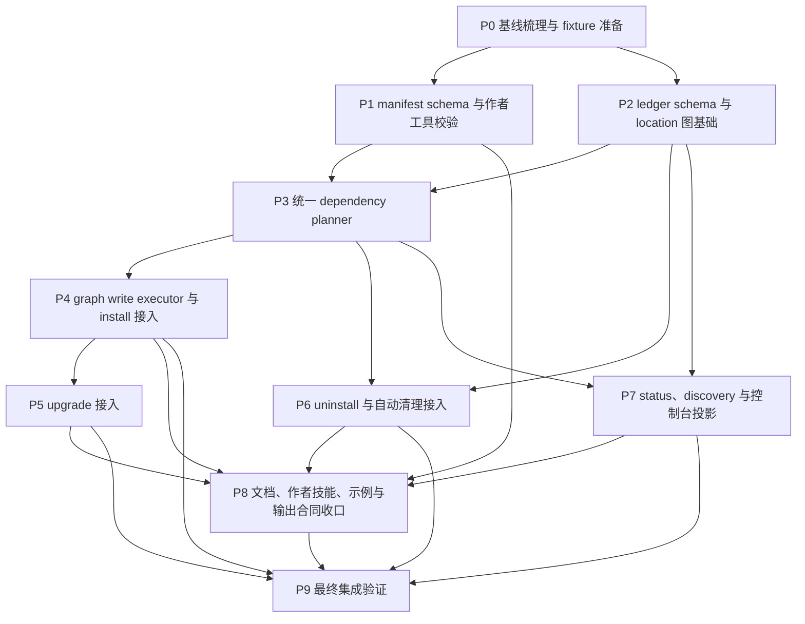

# 插件依赖与自动安装 TODO

来源：[`../plans/plugin-dependencies-plan.md`](../plans/plugin-dependencies-plan.md)  
日期：2026-05-06  
状态：P0/P1/P2/P3/P4/P5/P6/P7/P8/P9 已完成

## 目标

交付 AW 插件依赖的首版能力：插件可以在 `.agents-plugin/plugin.json` 顶层声明 `dependencies.plugins`，`install`、`upgrade`、`upgrade --all`、`uninstall`、`status` 和主控制台都基于同一套 location-aware 依赖图工作，并同步更新 ledger、receipt、作者工具、公开文档和测试夹具。

本文档按可单独执行的阶段拆分。每个阶段都包含依赖、主要改动面、待办清单和测试验收，方便后续按阶段并行实施。

## 阶段总览

| 阶段 | 主题 | 前置依赖 | 并行关系 |
| --- | --- | --- | --- |
| P0 | 基线梳理与 fixture 准备 | 无 | 所有后续阶段的共同基础 |
| P1 | manifest schema 与作者工具校验 | P0 | 可与 P2 并行，注意 `types.ts` 共享改动 |
| P2 | ledger schema 与 location 图基础 | P0 | 可与 P1 并行，注意 `types.ts` 共享改动 |
| P3 | 统一 dependency planner | P1、P2 | 阻塞写命令和只读投影接入 |
| P4 | graph write executor 与 install 接入 | P3 | P6、P7 可并行推进 |
| P5 | upgrade 接入 | P4 | 可与 P6、P7 后半段并行 |
| P6 | uninstall 与自动清理接入 | P2、P3 | 可与 P4、P5、P7 并行 |
| P7 | status、discovery 与控制台投影 | P2、P3 | 可与 P4、P5、P6 并行 |
| P8 | 文档、作者技能、示例与输出合同收口 | P1、P4、P5、P6、P7 | 文档草稿可提前，最终校准依赖实现 |
| P9 | 最终集成验证 | P4、P5、P6、P7、P8 | 收口阶段，不承载新能力 |

## 阶段依赖关系图



## 并行实施建议

- 第一波只做 P0，先锁住行为对照、fixture builder 和最小回归测试。
- 第二波并行推进 P1 和 P2。两者都会碰 `packages/cli/src/types.ts`，需要提前约定类型命名，避免互相覆盖。
- P3 是核心阻塞阶段，建议先集中完成 planner 的纯函数模型和测试，再让写命令接入。
- P3 完成后，P4、P6、P7 可以并行：P4 负责 install 写入事务，P6 负责 uninstall 保护和自动清理，P7 负责只读投影。
- P5 依赖 P4 的 graph write executor，不能再走旧的逐批 upgrade 事务边界。
- P8 可以在 P1/P3 稳定后先写草稿，但最终必须等 P4 到 P7 的用户可见行为落定后统一校准。
- P9 只做完整验证和 smoke，不新增合同或行为。

## P0 基线梳理与 fixture 准备

依赖：无。

目标：在改造前锁住现有命令入口、测试夹具和行为对照，让后续阶段可以专注实现依赖语义。

主要改动面：

- `packages/cli/src/commands/install.ts`
- `packages/cli/src/commands/upgrade.ts`
- `packages/cli/src/commands/uninstall.ts`
- `packages/cli/src/commands/status.ts`
- `packages/cli/src/commands/console-model.ts`
- `packages/cli/src/utils/local-marketplace.ts`
- 测试 fixture、catalog builder、ledger builder、health builder

TODO：

- [x] 锁定 `install`、`upgrade`、`uninstall`、`status`、`console-model` 和 `local-marketplace` 的关键测试入口。
- [x] 新增无依赖父插件 fixture。
- [x] 新增同 scope 依赖父插件 fixture。
- [x] 新增 Codex-only 依赖和 Claude-only 依赖 fixture。
- [x] 新增 project 父插件依赖 user scope 插件 fixture。
- [x] 新增 project 父插件显式依赖 project scope 插件 fixture。
- [x] 新增循环依赖 fixture。
- [x] 新增同名平台条件重叠 fixture。
- [x] 为 planner 准备轻量 catalog / ledger / health fixture builder。
- [x] fixture builder 支持 installed snapshot manifest。
- [x] fixture builder 能表达 snapshot 与 current catalog dependency drift。
- [x] 补当前行为回归测试，证明父插件现在不会自动安装依赖，作为后续行为变更对照。

测试验收：

- [x] fixture 可以独立表达 spec 中的核心依赖组合。
- [x] 当前行为回归测试能稳定证明父插件不会自动补齐依赖。
- [x] 相关 fixture / baseline 测试可单独运行，并且不依赖真实 adapter 写入。

验收记录：

- 2026-05-06：已运行 `pnpm --filter @yiliang/aw exec vitest run tests/unit/plugin-dependency-fixtures.test.ts tests/unit/install-command.test.ts`，2 个 test files、9 个 tests 通过。

## P1 manifest schema 与作者工具校验

依赖：P0。

目标：让 CLI、build staging 校验和插件作者工具共享同一套 `dependencies.plugins` 合同。

主要改动面：

- `packages/cli/src/types.ts`
- `packages/cli/src/utils/manifest.ts`
- `packages/cli/src/utils/bundle-layout.ts`
- `packages/cli/src/generators/local-plugin.ts`
- `packages/cli/tests/unit/manifest.test.ts`
- `packages/cli/tests/unit/manifest-coverage.test.ts`
- `packages/cli/tests/smoke/build-smoke.test.ts`
- `.agents/skills/create-agent-workflows-plugin/scripts/validate_plugin.js`
- `.agents/skills/create-agent-workflows-plugin/references/plugin-manifest-spec.md`

TODO：

- [x] 新增 `PluginDependenciesConfig`、`PluginDependencyEntry`、`PluginDependencyTarget`、`PluginDependencyWhen` 等类型。
- [x] 在 manifest normalizer 中校验 `dependencies` 顶层白名单，只允许 `plugins` 字段。
- [x] 校验 `dependencies.plugins` 数组形状，空数组允许，但 build 和作者工具给 warning。
- [x] 校验 dependency entry 字段白名单，只允许 `name`、`target`、`inheritInstallOptions`、`when`。
- [x] 拒绝 `version`、`range`、`platform`、`target.platform`、`marketplace`、`source`、`optional`、`dev`、`peer` 等字段。
- [x] 校验 dependency `name` 使用和 manifest `name` 相同的安全命名规则。
- [x] 校验 dependency `name` 不能等于当前插件自身。
- [x] 校验 `target.scope` 只允许 `user` 或 `project`。
- [x] 校验 `when.platforms` 只允许 `codex` 和 `claude`，必须非空且不能重复。
- [x] 校验 `inheritInstallOptions` 类型。
- [x] 校验同一 manifest 内同名依赖的平台条件不能重叠；省略 `when` 视为覆盖 `codex` 和 `claude`。
- [x] 把 catalog-level 依赖存在性校验放到 current catalog 解析后执行。
- [x] build 流程在 `scripts.node.build` 改写 staging manifest 后，重新校验 staging `.agents-plugin/plugin.json`。
- [x] 平台 manifest 生成时明确过滤 `dependencies`，避免 `.claude-plugin/plugin.json`、`.codex-plugin/plugin.json` 和平台 marketplace manifest 收到 AW 自管字段。
- [x] 更新作者工具 validator，与 CLI 校验保持字段白名单、自依赖、catalog 可解析、平台条件和同名重叠语义一致。
- [x] 建立 CLI validator 与作者工具 validator 的 parity fixture，同一组非法 manifest 必须同时被拒绝。

测试验收：

- [x] 合法 `dependencies.plugins` 能通过 CLI normalizer 和作者工具 validator。
- [x] 未知字段、非法平台条件、自依赖、同名平台条件重叠都会失败。
- [x] `pnpm build` 会拒绝 build script 生成的非法 staging 依赖声明。
- [x] 平台原生 manifest 和平台 marketplace manifest 不包含 `dependencies`。
- [x] manifest / authoring-tools 单测覆盖 CLI 与作者工具校验 parity。

验收记录：

- 2026-05-06：已运行 `pnpm --filter @yiliang/aw exec vitest run tests/unit/plugin-dependency-fixtures.test.ts tests/unit/install-command.test.ts tests/unit/manifest.test.ts tests/unit/manifest-coverage.test.ts tests/unit/generators.test.ts tests/unit/bundle-layout.test.ts tests/integration/authoring-tools.test.ts tests/unit/installed-ledger.test.ts tests/unit/local-marketplace.test.ts tests/unit/plugin-dependency-graph.test.ts`，10 个 test files、130 个 tests 通过。
- 2026-05-06：已运行 `pnpm build`，通过。
- 2026-05-06：已运行 `pnpm test:smoke:build`，`tests/smoke/build-smoke.test.ts` 5 个 tests 通过。

## P2 ledger schema 与 location 图基础

依赖：P0。

目标：扩展 installed ledger，让依赖引用只持久化 canonical outgoing edges，所有 dependents、ref-count 和 `autoRemovable` 都从图上现算。

主要改动面：

- `packages/cli/src/types.ts`
- `packages/cli/src/utils/local-marketplace.ts`
- 新增 `packages/cli/src/utils/plugin-dependency-location.ts`
- 新增 ledger graph helper
- `packages/cli/tests/unit/installed-ledger.test.ts`
- `packages/cli/tests/unit/local-marketplace.test.ts`

TODO：

- [x] 扩展 `InstalledScopeRecord`，新增安装来源字段，能表达 explicit 保留、auto-installed 来源和“引用归零时允许自动清理”的策略语义。
- [x] 策略字段命名避开只读投影 `autoRemovable`。
- [x] 扩展 `InstalledScopeRecord`，新增 `dependencyEdges` 或等价字段，只存 canonical outgoing edges。
- [x] 定义 `PluginLocation`，端点包含 `plugin`、`platform`、`scope`、`projectKey`。
- [x] user scope 的 `projectKey` 规范化为 `null` 或等价稳定表示。
- [x] 建立稳定 location identity serializer，用于排序、去重、ledger edge 比较、receipt 和测试断言。
- [x] edge 记录 dependency entry 的声明摘要，包括 `name`、`target.scope`、`inheritInstallOptions` 和 `when.platforms`。
- [x] `validateInstalledLedger()` 严格校验新字段。
- [x] 缺少依赖 metadata 的开发期 ledger 在依赖相关动作中 fail closed。
- [x] 新增 graph helper，从 ledger outgoing edges 构建 incoming dependents index。
- [x] 禁止持久化 `dependents`、`ref-count` 和派生的 `autoRemovable` 真值。
- [x] 用户显式安装一个已自动安装的依赖时，把 explicit 保留标记置为 true。
- [x] 同一 dependent 重复 install 或 upgrade 时覆盖同一 edge，不增加重复 ref。
- [x] 父插件卸载时先移除 outgoing refs，再从 incoming index 计算自动清理候选。
- [x] ledger degraded、edge 不完整或 tracking identity 损坏时，不执行自动依赖清理。

测试验收：

- [x] ledger schema 能表达同一插件在 `codex/user`、`codex/project:<key>`、`claude/user` 等不同位置的依赖引用。
- [x] incoming dependents 完全从 canonical outgoing edges 推导。
- [x] 重复 install、重复 upgrade、install 后 upgrade 不会产生重复 edge。
- [x] explicit 保留过的 auto dependency 不会被后续父插件卸载自动清理。
- [x] ledger / local-marketplace 单测覆盖新 schema、validator、incoming index 和 fail-closed 场景。

验收记录：

- 2026-05-06：已运行 `pnpm --filter @yiliang/aw exec vitest run tests/unit/plugin-dependency-fixtures.test.ts tests/unit/install-command.test.ts tests/unit/manifest.test.ts tests/unit/manifest-coverage.test.ts tests/unit/generators.test.ts tests/unit/bundle-layout.test.ts tests/integration/authoring-tools.test.ts tests/unit/installed-ledger.test.ts tests/unit/local-marketplace.test.ts tests/unit/plugin-dependency-graph.test.ts`，10 个 test files、130 个 tests 通过。

## P3 统一 dependency planner

依赖：P1、P2。

目标：新增统一 planner，集中处理依赖展开、location 选址、已有 edge 保留、拓扑排序、跳过传播、只读投影和图级 preflight 输入。

主要改动面：

- 新增 `packages/cli/src/utils/plugin-dependency-graph.ts`
- 新增 `packages/cli/src/utils/plugin-dependency-planner.ts`
- `packages/cli/src/commands/codex-project-installability.ts`
- `packages/cli/src/adapters/codex.ts`
- `packages/cli/src/adapters/claude.ts`
- planner unit fixtures

TODO：

- [x] planner 节点身份使用 `(plugin, platform, scope, projectKey)`。
- [x] 当前命令不在项目内且目标 scope 为 `project` 时，在 planner 阶段 fail fast。
- [x] `--platform auto` 继续在依赖展开前完成，planner 只消费已确定 platform 集合。
- [x] 每个平台独立展开生效依赖图，过滤当前 platform 不生效的 dependency entry。
- [x] 当前 platform 不生效的 entry 不参与 platform products 校验、scope installability、循环检测、满足检查、自动安装或 edge 写入。
- [x] 所有 entry 的结构校验不受当前安装 platform 影响。
- [x] 直接依赖顺序保留 manifest 数组顺序，用户显式目标保留命令行顺序，独立子图按首次出现顺序稳定排序。
- [x] 循环依赖错误输出完整链路，例如 `a -> b -> c -> a`。
- [x] 多路径指向同一 location 时只规划一次写入，但为每个 dependent 提交独立 outgoing edge。
- [x] planner 输入区分 current catalog manifest 和 installed snapshot manifest。
- [x] install / upgrade 使用 current catalog 展开目标图。
- [x] status 使用 snapshot-first 的只读健康层，snapshot 不可用时才 fallback。
- [x] 定义依赖满足健康条件：必须有完整 AW-managed 安装证据。
- [x] external-only、breadcrumb-only、enabled-only、cache-only、tracking 损坏或需要 repair 的状态都不算满足。
- [x] user 父插件只能由同 platform 的 user scope 健康依赖满足。
- [x] user 父插件遇到当前 platform 生效且 `target.scope: "project"` 的依赖时，在写状态前失败。
- [x] project 父插件省略 `target.scope` 时，先选当前 project scope；当前 project 缺失或不健康时，允许 fallback 到 user scope 健康依赖。
- [x] 显式 `target.scope: "user"` 只检查 user scope，缺失时安装到 user scope。
- [x] 显式 `target.scope: "project"` 只检查当前 project scope，缺失时安装到当前 project scope，不允许 user fallback。
- [x] 如果 dependent 旧 outgoing edge 指向仍健康、可见且满足 manifest target 约束的位置，继续保留该 edge。
- [x] 只有旧 edge 不健康、不可见或不再满足 target 约束时，才按确定性规则重新选址。
- [x] Codex project scope 缺失依赖安装前复用现有 project installability。
- [x] required config、external ownership、tracking identity、role namespace、project safety 等 preflight 输入覆盖所有待写依赖节点。
- [x] 实现 install options 继承和冲突检测。
- [x] 实现 upgrade-all root 选择、目标图展开和 skipped 传播模型。
- [x] 实现 uninstall 保护和自动清理 planning。
- [x] 实现 status 只读投影模型。

测试验收：

- [x] planner 单测只用 catalog manifest、installed snapshot manifest、ledger fixture 和 health fixture 就能验证图展开。
- [x] 循环、自依赖、缺失 catalog 依赖、同名重叠平台条件都在写状态前失败。
- [x] 单测覆盖 user 父插件不能依赖 project、project 父插件省略 scope fallback user、显式 project 不 fallback、显式 user 不被 project 满足。
- [x] 单测覆盖平台条件过滤、`--platform both` 分平台展开、稳定排序和循环错误链路。
- [x] 单测覆盖保留已有 healthy edge、多父共享依赖只规划一次、安装选项继承冲突。
- [x] status planner 单测覆盖 installed snapshot manifest、snapshot fallback 和 current catalog drift。

验收记录：

- 2026-05-06：已运行 `pnpm --filter @yiliang/aw exec vitest run tests/unit/plugin-dependency-fixtures.test.ts tests/unit/install-command.test.ts tests/unit/manifest.test.ts tests/unit/manifest-coverage.test.ts tests/unit/generators.test.ts tests/unit/bundle-layout.test.ts tests/integration/authoring-tools.test.ts tests/unit/installed-ledger.test.ts tests/unit/local-marketplace.test.ts tests/unit/plugin-dependency-graph.test.ts tests/unit/plugin-dependency-planner.test.ts`，11 个 test files、141 个 tests 通过。
- 2026-05-06：已运行 `pnpm build`，通过。

## P4 graph write executor 与 install 接入

依赖：P3。

目标：把 `install` 切到 location-level graph write executor，确保所有依赖和父插件在第一笔写状态前完成图级 preflight，并按拓扑顺序事务化写入。

主要改动面：

- `packages/cli/src/commands/install.ts`
- `packages/cli/src/commands/platform-resolution.ts`
- `packages/cli/src/commands/common.ts`
- `packages/cli/src/output/command-receipt.ts`
- `packages/cli/tests/unit/install-command.test.ts`
- `packages/cli/tests/integration/cli.test.ts`

TODO：

- [x] 保持现有显式目标解析和 platform auto 解析顺序，依赖不参与 platform 自动选择。
- [x] 在准备写状态前调用 planner，得到完整 location-level install graph。
- [x] 对所有待写 node 统一执行 preflight，包括 platform products、scope installability、required config、external ownership、tracking identity、Codex project safety、role/MCP namespace 和 install options。
- [x] 依赖安装选项默认不继承父插件；只有 `inheritInstallOptions: true` 时继承插件级安装选项。
- [x] 多个父插件在同一命令中对同一缺失依赖产生冲突安装选项时，在写状态前失败。
- [x] 从 `installTargetsOnPlatforms()` 拆出“单个 location node 原子安装器”，只负责一个 node 的 native / artifact / tracking / ledger / snapshot 写入和该 node 的回滚。
- [x] 新增通用 graph write executor，按拓扑顺序调用单节点安装器。
- [x] graph write executor 统一管理 graph-level preflight、已成功 dependent edge 集、dependent edge 延迟提交、共享 auto dependency 回滚归属和 fail-closed 写回。
- [x] graph write executor 先接入 `installDependency` / `install`，接口预留 `upgradeDependency` / `upgrade`。
- [x] 旧的 `platform -> target` 双层循环不能继续作为依赖事务边界，只能作为单节点执行细节逐步迁移。
- [x] 缺失依赖自动安装；已满足依赖不重复安装，但要写入父插件 edge。
- [x] 按拓扑顺序安装依赖和父插件，依赖先写，父插件后写。
- [x] 新装 auto dependency 标记为自动依赖，显式目标标记为 explicit。
- [x] 父插件成功安装后再提交自己的 outgoing dependency edges。
- [x] 父插件失败前不能提前写入该父插件的 edge。
- [x] 后续父插件失败时，新装 auto dependency 如果尚未被任何成功 dependent edge 引用，优先回滚卸载。
- [x] 新装 auto dependency 已经被其它成功 dependent 引用时，不因后续另一个父插件失败而卸载。
- [x] 无法完整回滚时 fail closed，不留下失败父插件的成功 edge，并把新建自动依赖标记成 degraded 或 cleanup-blocked。
- [x] 默认输出说明自动安装了哪些依赖。
- [x] JSON receipt target 带 `requested`；自动依赖 target 带 `dependencyOf`。
- [x] receipt actions 区分 `installDependency` 和用户显式 `install`。

测试验收：

- [x] `aw install workflow-pack -p codex -s project` 能自动补齐生效依赖，再安装父插件。
- [x] 任一图级 preflight 失败时，不写 native、artifact、tracking、ledger 或 snapshot。
- [x] 单测覆盖 `--platform auto` 不受依赖影响。
- [x] 单测覆盖父插件失败后的 rollback / degraded / cleanup-blocked。
- [x] 单测覆盖父插件成功后才提交 edge，失败父插件不留下 planned edge。
- [x] JSON receipt 能区分用户显式目标和自动依赖目标。
- [x] install 单元和集成测试覆盖自动安装、已满足依赖不重复安装、依赖 required config 缺失错误指向依赖插件。

验收记录：

- 2026-05-06：已运行 `pnpm --filter @yiliang/aw exec vitest run tests/unit/install-command.test.ts tests/unit/uninstall-command.test.ts tests/unit/status-dependencies.test.ts tests/unit/adapter-status.test.ts tests/unit/console-model.test.ts tests/unit/plugin-dependency-planner.test.ts tests/unit/plugin-dependency-graph.test.ts tests/unit/plugin-dependency-fixtures.test.ts tests/unit/local-marketplace.test.ts tests/integration/cli.test.ts tests/integration/discovery.test.ts`，11 个 test files、153 个 tests 通过。
- 2026-05-06：已运行 `pnpm build`，通过。

## P5 upgrade 接入

依赖：P4。

目标：让显式 `upgrade` 和 `upgrade --all` 复用同一个 graph write executor，依赖失败后不继续升级父插件，并正确刷新 dependency refs。

主要改动面：

- `packages/cli/src/commands/upgrade.ts`
- `packages/cli/src/output/command-receipt.ts`
- `packages/cli/tests/unit/upgrade-command.test.ts`
- `packages/cli/tests/integration/upgrade-command.test.ts`

TODO：

- [x] 显式 `aw upgrade <plugin...>` 复用 planner 展开 current catalog 依赖图。
- [x] 缺失依赖先安装，已安装依赖先升级，父插件最后升级。
- [x] `upgrade` 复用 P4 的 graph write executor，不新增一套平行事务执行器。
- [x] graph write executor 支持同一图内混合节点动作：`installDependency`、`upgradeDependency` 和用户显式 `upgrade`。
- [x] `upgrade.ts` 不能在 planner 之后回退到逐批调用 `installTargetsOnPlatforms(..., operation: 'upgrade')` 作为事务边界。
- [x] upgrade-specific preflight 覆盖 catalog 缺失、capabilityChanged、tracking 损坏、required config 缺失、external ownership 和 Codex project safety。
- [x] breadcrumb-only 或其它非完整受管状态不能作为依赖满足或 upgrade source。
- [x] `upgrade` 失败收口和 install 共用 edge 延迟提交、共享 auto dependency 回滚归属和 fail-closed 写回逻辑。
- [x] 升级成功后刷新当前 platform 生效的 dependency refs：新增写入、删除移除、平台条件不再生效的 edge 移除。
- [x] 删除的依赖 ref 只在父插件升级成功后从 ledger 移除。
- [x] `upgrade --all` 根集合只包含 explicit 保留安装。
- [x] auto-installed location 只有从 explicit root 的 current catalog 目标依赖图可达时，才参与 upgrade-all 前置图。
- [x] current catalog 目标图内依赖 skipped 时，依赖它的父插件也 skipped，原因指向依赖未满足或依赖升级失败。
- [x] 旧 edge 指向但 current catalog 不再需要的 auto dependency 不阻塞父插件升级。
- [x] 父插件升级成功刷新 refs 后，把不再需要的旧 auto dependency 放入自动清理候选。
- [x] upgrade receipt actions 区分 `upgradeDependency` 和用户显式 `upgrade`。

测试验收：

- [x] 显式 upgrade 和 upgrade-all 都不会在依赖失败后继续升级父插件。
- [x] 缺失依赖安装、既有依赖升级和父插件升级在同一张 location-level 图里完成事务管理。
- [x] 单测覆盖依赖升级失败后父插件不继续、edge 不提前提交、旧 ref 只在父插件成功后移除。
- [x] 单测覆盖无法完整回滚时进入 degraded / cleanup-blocked。
- [x] 集成测试覆盖 `aw upgrade workflow-pack` 补齐新增依赖并刷新 refs。
- [x] 集成测试覆盖 `aw upgrade --all` 不把孤立 auto dependency 当根。
- [x] upgrade receipt 覆盖 `upgradeDependency`、skipped 传播和自动依赖 target。

验收记录：

- 2026-05-06：已运行 `pnpm --filter @yiliang/aw exec vitest run tests/unit/upgrade-command.test.ts tests/integration/upgrade-command.test.ts`，2 个 test files、21 个 tests 通过。
- 2026-05-06：已运行 `pnpm build`，通过。

## P6 uninstall 与自动清理接入

依赖：P2、P3。

目标：让卸载命令基于 incoming dependents index 做保护，并在父插件卸载后安全清理引用归零的自动依赖。

主要改动面：

- `packages/cli/src/commands/uninstall.ts`
- `packages/cli/src/commands/discovery.ts`
- `packages/cli/src/commands/interactive.ts`
- `packages/cli/src/commands/console-model.ts`
- `packages/cli/src/output/command-receipt.ts`
- `packages/cli/tests/unit/uninstall-command.test.ts`
- `packages/cli/tests/integration/cli.test.ts`

TODO：

- [x] uninstall planner 先从 ledger outgoing edges 构建 incoming dependents index。
- [x] 用户显式卸载目标仍被其它 installed dependent 引用时失败，并列出 dependent location。
- [x] 如果用户同一命令内卸载所有 dependents，允许继续。
- [x] 父插件先卸载，再按反向拓扑卸载不再需要的自动依赖。
- [x] 自动清理候选必须来自 canonical incoming edge。
- [x] 自动清理候选只允许位于当前命令可操作的同 platform user scope 或当前 project scope。
- [x] 其它历史 project scope 的自动依赖不能被当前 cwd 的卸载命令跨项目删除。
- [x] 自动依赖只有未被 explicit 保留、没有其它 installed dependent、状态不是 external-only 且 identity 完整时才可清理。
- [x] ledger degraded、dependency refs 不完整或 tracking identity 损坏时，不执行高风险自动清理。
- [x] Codex user breadcrumb-only cleanup 继续按现有 native recovery 语义处理，但不能被当作完整依赖满足。
- [x] receipt actions 区分用户显式 `uninstall` 和 `uninstallAutoDependency`。
- [x] 默认输出说明随父插件自动清理的依赖。

测试验收：

- [x] 卸载父插件会自动移除引用归零的自动依赖。
- [x] 显式安装保留过的依赖不会被父插件卸载连带删除。
- [x] 仍有 dependents 的插件不能被单独卸载。
- [x] 同一条 `aw uninstall ...` 同时包含完整 dependent 集合时允许继续，并验证最终 ledger / native 状态不留下断裂依赖引用。
- [x] degraded、edge 不完整、tracking identity 损坏时跳过自动清理并给出可行动错误。
- [x] uninstall receipt 覆盖 `uninstallAutoDependency` 和默认输出摘要。

验收记录：

- 2026-05-06：已运行 `pnpm --filter @yiliang/aw exec vitest run tests/unit/install-command.test.ts tests/unit/uninstall-command.test.ts tests/unit/status-dependencies.test.ts tests/unit/adapter-status.test.ts tests/unit/console-model.test.ts tests/unit/plugin-dependency-planner.test.ts tests/unit/plugin-dependency-graph.test.ts tests/unit/plugin-dependency-fixtures.test.ts tests/unit/local-marketplace.test.ts tests/integration/cli.test.ts tests/integration/discovery.test.ts`，11 个 test files、153 个 tests 通过。
- 2026-05-06：已运行 `pnpm build`，通过。

## P7 status、discovery 与控制台投影

依赖：P2、P3。

目标：把依赖只读投影接入 `status`、主控制台和 discovery，让用户能看到依赖声明、满足位置、缺失依赖、被依赖关系、自动安装和可清理状态。

主要改动面：

- `packages/cli/src/commands/status.ts`
- `packages/cli/src/commands/console-model.ts`
- `packages/cli/src/commands/discovery.ts`
- `packages/cli/src/types.ts`
- `packages/cli/src/output/model.ts`
- `packages/cli/tests/unit/adapter-status.test.ts`
- `packages/cli/tests/unit/console-model.test.ts`
- `packages/cli/tests/unit/status-dependencies.test.ts`
- `packages/cli/tests/integration/discovery.test.ts`

TODO：

- [x] `status` 使用 planner 只读投影依赖关系，不迁移 edge、不安装依赖、不触发自动清理。
- [x] 在 `types.ts` 增加 status dependencies payload 类型。
- [x] 把 `PluginStatusReport.dependencies` 作为稳定 JSON schema 字段。
- [x] 当前安装健康优先依据 installed snapshot manifest 中的 `dependencies` 和 ledger outgoing edges。
- [x] installed snapshot 缺失或损坏时，按既有 `healthSource` 降级到 current catalog、historical 或 none，并在 verbose/json 中标出来源。
- [x] current catalog drift 单独展示，不直接写入 `dependencies.missing`。
- [x] 输出 `dependencies.declared`，展示 current catalog 直接依赖和 `when.platforms`。
- [x] 输出 `dependencies.resolved`，展示当前安装健康层解析后的生效依赖目标和来源。
- [x] 输出 `dependencies.satisfied`，展示依赖满足位置。
- [x] 输出 `dependencies.missing`，只展示当前安装健康层缺失、损坏或不可用的依赖。
- [x] 输出 `dependencies.dependents`，由 ledger outgoing edges 反向推导。
- [x] 输出 `dependencies.autoInstalled` 和 `dependencies.autoRemovable`。
- [x] 输出 `dependencies.catalogDrift`，展示新增、删除、平台条件变化和 target scope 变化。
- [x] 父插件自身健康但当前安装健康层依赖缺失时，友好状态进入需要处理。
- [x] 当前 platform 不生效的 entry 只出现在 declared 诊断，不影响 ready。
- [x] 主控制台复用 status 的只读依赖投影，不触发安装、修复或自动清理。
- [x] `console-model` 新增依赖缺失、可清理自动依赖等友好原因。
- [x] 自动依赖没有 dependents 且未 explicit 保留时，控制台可展示清理动作；真正清理必须走 destructive 确认。
- [x] discovery / 交互候选识别 auto-installed 和被依赖保护状态。

测试验收：

- [x] `aw status --json` 能稳定表达 declared、resolved、satisfied、missing、dependents、autoInstalled、autoRemovable 和 catalogDrift。
- [x] status 单测覆盖 snapshot-first、fallback source 和 current catalog drift。
- [x] status 覆盖当前 platform 不生效的 dependency entry 只进入 `declared`，不影响 ready / needsAttention。
- [x] status 覆盖 snapshot 自洽但 current catalog 新增依赖时，只展示 catalog drift 或 upgrade 建议。
- [x] `console-model` 覆盖缺失依赖进入 needsAttention、纯 catalog drift 不打坏 ready、可清理 auto dependency 展示清理动作。
- [x] 主控制台不需要重新实现依赖判定。

验收记录：

- 2026-05-06：已运行 `pnpm --filter @yiliang/aw exec vitest run tests/unit/install-command.test.ts tests/unit/uninstall-command.test.ts tests/unit/status-dependencies.test.ts tests/unit/adapter-status.test.ts tests/unit/console-model.test.ts tests/unit/plugin-dependency-planner.test.ts tests/unit/plugin-dependency-graph.test.ts tests/unit/plugin-dependency-fixtures.test.ts tests/unit/local-marketplace.test.ts tests/integration/cli.test.ts tests/integration/discovery.test.ts`，11 个 test files、153 个 tests 通过。
- 2026-05-06：已运行 `pnpm build`，通过。

## P8 文档、作者技能、示例与输出合同收口

依赖：P1、P4、P5、P6、P7。

目标：同步公开文档、作者技能、示例和输出合同，确保插件作者、用户文档和 CLI 行为没有互相冲突的说法。

主要改动面：

- `docs/architecture.md`
- `docs/plugin-authoring.md`
- `docs/plugin-installation.md`
- `docs/testing.md`
- `.agents/skills/create-agent-workflows-plugin/SKILL.md`
- `.agents/skills/create-agent-workflows-plugin/references/*`
- comprehensive example / 测试夹具
- `packages/cli/src/output/command-receipt.ts`
- `packages/cli/src/output/model.ts`
- `packages/cli/src/output/reporter.ts`
- `packages/cli/src/output/debug-log.ts`
- `packages/cli/tests/unit/command-receipt.test.ts`
- `packages/cli/tests/integration/cli-entry-json-harness.test.ts`

TODO：

- [x] 更新 `docs/architecture.md`，补 dependency planner、ledger edge、incoming index 和写命令拓扑顺序。
- [x] 更新 `docs/plugin-authoring.md`，说明 `dependencies.plugins` 字段、平台条件、scope target 和限制。
- [x] 更新 `docs/plugin-installation.md`，说明自动安装、升级顺序、卸载自动清理和错误排查。
- [x] 更新 `docs/testing.md`，补依赖 planner、ledger edge、跨 scope 和平台条件测试约定。
- [x] 更新 `.agents/skills/create-agent-workflows-plugin/SKILL.md` 和 references。
- [x] 更新 comprehensive example，加入带平台条件和 scope target 的依赖示例。
- [x] 复核作者工具相关测试，确保运行时合同和作者工具不脱节。
- [x] 扩展 receipt target：`requested: boolean`、`dependencyOf?: PluginLocation[]`。
- [x] 扩展 action type：`installDependency`、`upgradeDependency`、`uninstallAutoDependency`，并保留用户显式动作。
- [x] 确保 `plugins` 包含本次所有受影响插件，包括自动依赖。
- [x] `warnings[]` 中依赖 warning 必须包含插件名、platform、scope 和可复制命令。
- [x] 默认输出使用短句说明自动依赖行为，不暴露 ledger edge、ref-count 或 ledger 字段名。
- [x] 依赖缺少 required config 的失败输出指向依赖插件和配置 key。
- [x] 依赖相关 debug event 使用 location identity，避免只按插件名造成跨 scope 混淆。
- [x] 检查 JSON receipt stdout 不混入 warning、verbose 或 debug 文案。

测试验收：

- [x] 公开文档覆盖依赖声明、平台条件、scope target、自动安装、升级顺序、卸载自动清理和排障。
- [x] 作者工具 reference、示例和 validator 与 CLI 行为一致。
- [x] command-receipt 单测覆盖 JSON target/action schema、`requested` / `dependencyOf` 去重、依赖 action type、warning 字段和默认输出摘要。
- [x] `--json` stdout 仍是单一可解析 JSON。
- [x] build 后 runtime `.agents-plugin/plugin.json` 保留 `dependencies`，平台 manifest 不包含 `dependencies`。

验收记录：

- 2026-05-06：已运行 `pnpm --filter @yiliang/aw exec vitest run tests/unit/command-receipt.test.ts tests/integration/cli-entry-json-harness.test.ts tests/unit/cli-entry.test.ts`，3 个 test files、55 个 tests 通过。
- 2026-05-06：已运行 `pnpm --filter @yiliang/aw exec vitest run tests/unit/install-command.test.ts tests/unit/upgrade-command.test.ts tests/unit/uninstall-command.test.ts`，3 个 test files、31 个 tests 通过。
- 2026-05-06：已运行 `pnpm build`，通过。

## P9 最终集成验证

依赖：P4、P5、P6、P7、P8。

目标：用完整测试矩阵和 smoke 收口，确认核心命令、只读投影、作者工具和 build 产物都满足依赖合同。

主要改动面：

- 测试命令、smoke、最终验收记录

TODO：

- [x] 跑依赖相关 Vitest 文件。
- [x] 跑完整单元测试。
- [x] 跑完整集成测试。
- [x] 跑 build smoke。
- [x] 检查 JSON receipt stdout 没有混入 warning、verbose 或 debug 文案。
- [x] 检查 `pnpm build` 产物中 runtime `.agents-plugin/plugin.json` 保留 `dependencies`。
- [x] 检查 `.claude-plugin/plugin.json`、`.codex-plugin/plugin.json` 和平台 marketplace manifest 不包含 `dependencies`。
- [x] 核对首版验收清单：manifest 合同、planner、ledger、install、upgrade、uninstall、status、receipt、作者工具和文档全部覆盖。

必跑命令：

```bash
pnpm test:unit
pnpm test:integration
pnpm test:smoke:build
```

测试验收：

- [x] `pnpm test:unit` 通过。
- [x] `pnpm test:integration` 通过。
- [x] `pnpm test:smoke:build` 通过。
- [x] 插件作者可以在 `.agents-plugin/plugin.json` 顶层声明 `dependencies.plugins`。
- [x] `aw install <plugin>` 会按当前 platform 生效依赖图自动补齐缺失依赖。
- [x] 自依赖、循环依赖、缺失依赖、平台不兼容、scope 不可安装和安装选项冲突都会在写状态前失败。
- [x] project 父插件省略 `target.scope` 时可复用健康 user 依赖；显式 `target.scope` 始终是硬约束。
- [x] ledger 能记录 explicit / auto-installed 来源和 canonical outgoing dependency edges。
- [x] 卸载父插件会自动清理引用归零、未显式保留且状态可信的自动依赖。
- [x] `upgrade <plugin>` 和 `upgrade --all` 都复用 graph write executor 按依赖拓扑执行，并正确刷新 refs。
- [x] `aw status` 和主控制台能显示依赖健康、被依赖关系、自动安装来源和可清理状态。
- [x] JSON receipt 能区分用户显式目标和自动依赖目标。
- [x] 作者工具、公开文档和 build smoke 与 CLI 依赖合同保持一致。

验收记录：

- 2026-05-06：已运行依赖相关最小验收：`pnpm --filter @yiliang/aw exec vitest run tests/unit/upgrade-command.test.ts tests/integration/upgrade-command.test.ts`、`pnpm --filter @yiliang/aw exec vitest run tests/unit/command-receipt.test.ts tests/integration/cli-entry-json-harness.test.ts tests/unit/cli-entry.test.ts`、`pnpm --filter @yiliang/aw exec vitest run tests/unit/install-command.test.ts tests/unit/upgrade-command.test.ts tests/unit/uninstall-command.test.ts`，均通过。
- 2026-05-06：已运行 `pnpm test:unit`，56 个 test files、565 个 tests 通过。
- 2026-05-06：已运行 `pnpm test:integration`，15 个 test files、231 个 tests 通过。
- 2026-05-06：已运行 `pnpm test:smoke:build`，`tests/smoke/build-smoke.test.ts` 5 个 tests 通过。
- 2026-05-06：已运行 `pnpm build`，通过。
- 2026-05-06：已检查 `packages/cli/plugins-dist`，平台 manifest 和 marketplace manifest 未包含 `dependencies`；当前实际发布插件源码没有依赖声明，runtime 保留语义由 manifest / bundle / generator / smoke fixture 测试覆盖。
