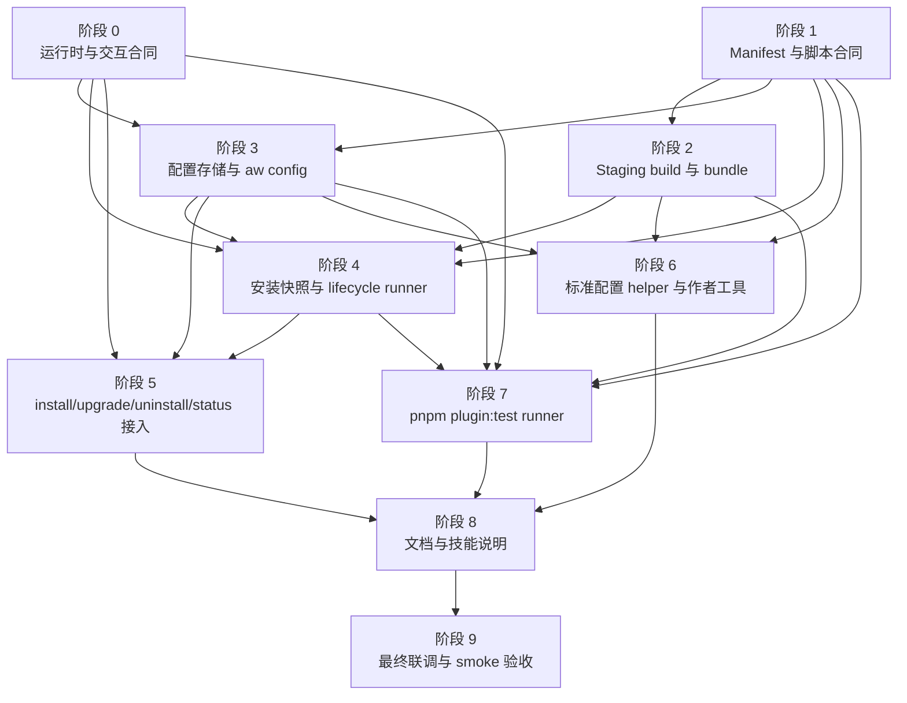

# 插件脚本、生命周期回调与自定义配置 TODO 拆解

## 文档说明

- 来源计划：`docs/dev/plans/plugin-scripts-lifecycle-config.md`
- 目标：把插件 `scripts`、lifecycle runner、AW 自管配置、安装快照、状态健康检查和插件脚本测试拆成可独立执行、可单独验收的阶段。
- 使用方式：每个阶段先完成开发项，再补自动化测试，最后通过阶段验收；阶段验收不过，不进入依赖它的后续阶段。
- 默认约定：
  - 新增能力属于 AW 插件运行时，不是 Claude / Codex 原生 agent hook。
  - lifecycle 脚本默认自动执行，失败阻断命令；首版不提供 `--no-scripts`。
  - `aw config` 读写 AW 自管配置，默认写 `user`，默认读 effective config。
  - `status` 只读，不执行脚本、不刷新 marketplace、不创建配置目录。
  - 插件脚本测试是包脚本能力：`pnpm plugin:test`，不新增 `aw plugin test` 客户端命令。
  - 所有路径、catalog、prompt、reporter、debug logger、env 都必须通过现有 `CommandExecutionContext` 传递。

## 阶段依赖关系图

## 并行实现建议

- 阶段 0 和阶段 1 可以并行启动：一个人改 runtime/prompt 合同，另一个人改 manifest 类型、校验和 import scanner。
- 阶段 2 依赖阶段 1，但可以和阶段 3 并行：阶段 2 聚焦打包与 bundle layout，阶段 3 聚焦 config store 和 CLI。
- 阶段 4 需要阶段 0/1/2/3 的基础，但其中 runner argv/env 纯函数可以提前用 fixture 开发。
- 阶段 5 是命令编排收口，必须等阶段 3 和阶段 4 的 API 稳定后再接入。
- 阶段 6 作者工具和阶段 7 `plugin:test` 可以在阶段 2/3/4 API 稳定后并行推进。
- 阶段 8 文档可提前起草，但最终验收应等阶段 5/6/7 行为定稿后再落版。

## 阶段总览

| 阶段 | 目标 | 可并行边界 | 阶段门禁 |
|------|------|------|------|
| 阶段 0 | 补齐 runtime、prompt、JSON 输出和公共 option 合同 | 可与阶段 1 并行 | `CommandExecutionContext` 是唯一走线，prompt 可注入 output sink |
| 阶段 1 | 建立 `scripts` / `config` manifest 合同和 import contract | 可与阶段 0 并行 | source/bundle manifest 校验覆盖脚本、配置和 Node 依赖边界 |
| 阶段 2 | 落地 staging build、runtime 文件收集和 bundle layout | 依赖阶段 1 | build 后 manifest 是发布真值，bundle 包含 runtime 闭包和 production 依赖 |
| 阶段 3 | 实现配置存储、`aw config` 命令和 required config preflight | 依赖阶段 0/1 | project/user store、effective config、脱敏和 raw reset 行为稳定 |
| 阶段 4 | 实现安装快照、lifecycle target resolver 和脚本 runner | 依赖阶段 0/1/2/3 | context、env、timeout、快照真值和失败清理稳定 |
| 阶段 5 | 接入 install/upgrade/uninstall/status | 依赖阶段 3/4 | 命令时机、回滚、status health 和 `healthSource` 符合计划 |
| 阶段 6 | 标准配置 helper、脚手架和 validate 工具 | 依赖阶段 1/2/3 | helper 显式声明、fail closed、作者工具可生成和校验 |
| 阶段 7 | 实现 `pnpm plugin:test` runner | 依赖阶段 1/2/3/4 | 单插件隔离、临时 bundle、Node test、平台双跑和 no-op 语义稳定 |
| 阶段 8 | 更新公开文档、开发文档和技能说明 | 依赖阶段 5/6/7 | 用户文档、测试分层和作者文档与实际行为一致 |
| 阶段 9 | 完整回归、smoke 和发布验收 | 依赖所有阶段 | unit/integration/smoke 覆盖全部关键合同 |

## 阶段 0：运行时与交互合同

### 目标

在现有 `CommandExecutionContext`、`CliPrompt`、diagnostics、discovery 和 status 矩阵上补齐本计划需要的公共能力，避免 `config`、lifecycle 和 `plugin:test` 各自发明 runtime。

### 开发 TODO

- [ ] 复用并扩展 `packages/cli/src/commands/runtime.ts`，确保 config、install、upgrade、uninstall、status、lifecycle runner 和插件脚本测试都消费同一份 `env`。
- [ ] 改造 `createReadlinePrompt()`，支持注入 prompt output sink；`--json` 上下文中 prompt 文案、确认问题和候选列表必须写入 stderr。
- [ ] 调整交互可用性判断：按 `stdin` TTY 加 prompt output sink TTY 判断，不再绑定 `stdout.isTTY`。
- [ ] 扩展 `CliPrompt`，新增 schema 驱动配置向导接口，返回 `selectedScope`、`updates`、`updatedKeys` 和 `cancelled`。
- [ ] 为默认 prompt 增加敏感输入隐藏能力，`sensitive: true` 的值不能回显到 stdout、stderr、debug log 或 log file。
- [ ] 固定 config 写命令默认 scope 为 `user`，config 读命令默认 resolution 为 effective。
- [ ] 将 `--json`、`--value-json`、`-y/--yes`、`--script-timeout`、diagnostics、reporter、debug logger 的边界说清并接入 option normalization。
- [ ] `config reset` 复用 `CliPrompt.confirm`；只有确认通过或传入 `--yes` 时才删除 raw store。
- [ ] `aw config` CLI action 通过和其它命令一致的 action context 创建路径进入 command 层。

### 自动化测试

- [ ] 默认 prompt 支持 output sink 注入，`--json` 时 prompt 进入 stderr，stdout 仍是单一 JSON。
- [ ] stdout 非 TTY、stderr TTY 时，真实 prompt harness 仍可用于 `--json` 交互合同回归。
- [ ] 敏感输入不会出现在 stdout、stderr、debug log、log file 或 JSON receipt 的明文里。
- [ ] fake prompt 注入后，config command、install/upgrade preflight 不访问真实 stdin。
- [ ] direct command 和 `runCli(..., { env })` 都不回落到 `process.env`。
- [ ] `config configure --scope user|project` 时，fake prompt 返回候选外的 `selectedScope` 会被拒绝且不写 store。
- [ ] `config configure` 取消时返回业务错误，不创建或修改任何 store。

### 阶段验收

- [ ] 新增交互能力只通过现有 runtime 入口透传。
- [ ] `--json` 的 stdout 边界被测试锁住，不会被 prompt、verbose、warning 或 debug 污染。
- [ ] 配置向导的 scope 选择、dirty key patch 和取消语义稳定可测。
- [ ] 所有新增命令入口都能注入 fake env、fake prompt、fake reporter 和 fake debug logger。

## 阶段 1：Manifest 与脚本合同

### 目标

给 `.agents-plugin/plugin.json` 增加 `scripts` 和 `config` 首版合同，并建立脚本路径、OS selector、runner、Node 依赖和配置 schema 的统一校验。

### 开发 TODO

- [ ] 修改 `packages/cli/src/types.ts`，新增 `PluginScriptsConfig`、`PluginLifecycleScripts`、`PluginLifecycleScriptEntry`、`PluginLifecycleOsSelector`、`PluginScriptHelpersConfig`、`PluginConfigSchema` 等类型。
- [ ] `PluginManifestSource` 增加 `scripts?: ...` 和 `config?: ...`；`PlatformPluginManifest` 不增加这些 AW 字段。
- [ ] 修改 `packages/cli/src/utils/manifest.ts`，顶层 allowlist 接受 `scripts` 和 `config`。
- [ ] 校验 lifecycle 事件、OS selector 优先级、runner、路径必须在插件根内、禁止绝对路径和逃逸路径。
- [ ] 支持字符串简写和结构化脚本条目；拒绝内联命令字符串和未知 runner。
- [ ] 校验每个 lifecycle 事件能在 `linux`、`darwin`、`win32` 至少解析到一个条目。
- [ ] 校验顶层 `scripts.timeoutMs` 为 `1000..300000` 的整数；拒绝 event/selector 下的 timeout 覆盖。
- [ ] 校验 `scripts.helpers.config` 显式声明的 Node helper，禁止固定文件名隐式扫描。
- [ ] 校验 `scripts.node.packageRoot`、`package.json`、`pnpm-lock.yaml`、manifest 显式 `scripts.node.build` 和只支持 pnpm lockfile。
- [ ] 在真实 staging install 前拒绝非 registry dependency specifier，包括 `workspace:`、`file:`、`link:`、`portal:`、本地路径、git/shortcut、HTTP(S) URL 和 tarball URL。
- [ ] 拒绝 `optionalDependencies` / `bundledDependencies` 作为 runtime 依赖入口。
- [ ] 校验 config schema key、类型、字段 allowlist、default、required、sensitive、enum values、`number.min/max` 闭区间。
- [ ] 增加 Node import contract 扫描器，支持 ESM import/export、CJS `require()` 和 literal dynamic `import()` 的相对依赖闭包。
- [ ] 未声明 `scripts.node.packageRoot` 时，只允许 `node:` 内置模块和插件内相对 import。
- [ ] 声明 `scripts.node.packageRoot` 时，只允许 packageRoot 内文件引用已声明 dependencies/devDependencies，并阻止相对 import 逃逸。
- [ ] `createBundleSourceManifest()` 保留 runtime 需要的 `scripts.lifecycle`、`scripts.helpers`、`scripts.node.packageRoot`、`scripts.timeoutMs` 和 `config`，剥离 `scripts.tests` 与 `scripts.node.build`。

### 自动化测试

- [ ] `manifest.test.ts` 接受合法 `scripts` / `config`。
- [ ] OS selector 覆盖 `linux -> unix -> default`、`darwin -> unix -> default`、`win32 -> windows -> default`。
- [ ] helper 路径逃逸、绝对路径、非 Node 扩展名会失败。
- [ ] 非法 runner、内联命令字符串、缺 Windows 可解析 entry 会失败。
- [ ] packageRoot 缺 `package.json`、缺 `pnpm-lock.yaml`、非 pnpm lockfile、build 入口逃逸会失败。
- [ ] 非 registry 依赖来源和 `optionalDependencies` / `bundledDependencies` 会在 staging install 前失败。
- [ ] `scripts.timeoutMs` 合法值通过，越界、非整数、非数字、per-event timeout 失败。
- [ ] config schema 未知字段、非法 default、非法 enum、`min > max`、非 number 类型使用 `min/max` 都失败。
- [ ] import contract 能递归返回 runtime 相对依赖闭包，并拒绝第三方 bare import、未声明包、dev-only 包和路径逃逸。

### 阶段验收

- [ ] Manifest source mode 和 bundle mode 对 `scripts` / `config` 有清晰、不同的校验边界。
- [ ] AW 脚本合同不会写入 Claude/Codex platform manifest。
- [ ] Node 运行时文件闭包、第三方依赖声明和配置 schema 校验可以被打包、layout、runner 和 authoring 工具复用。

## 阶段 2：Staging Build 与 Bundle Layout

### 目标

让 build 阶段能安全执行显式 manifest build，重新读取最终 manifest，并把 runtime 需要的脚本、helper、相对依赖闭包和 production 依赖放进 bundle。

### 开发 TODO

- [ ] 修改 `packages/cli/src/generators/local-plugin.ts`，增加隔离 staging 流程：复制 source 到临时目录，源码树不被修改。
- [ ] 声明 `scripts.node.build` 时，先做 source package metadata / dependency specifier 预检，再执行 `pnpm install --frozen-lockfile --ignore-scripts` 和 manifest build 入口。
- [ ] build 完成后重新读取 staging `.agents-plugin/plugin.json`，以最终 manifest 作为发布真值。
- [ ] 最终 manifest 仍声明 `scripts.node.packageRoot` 时，重新校验 package metadata / dependency specifier，重新 `pnpm install --frozen-lockfile --ignore-scripts`，重新扫描 production dependency closure。
- [ ] 拒绝最终 runtime dependency closure 中存在 `preinstall`、`install`、`postinstall` 或 `prepare` 的包。
- [ ] build 后 `name` 改变时打包失败；其它 catalog、platform manifest base 和测试入口字段以最终 staging manifest 为准。
- [ ] 给 `bundleLocalPlugin()` / `bundlePlugins()` 增加显式脚本 build mode，例如 `build-free | staging`。
- [ ] 普通 unit/integration 的 synthetic embedded root 继续使用 build-free 模式，不调用 package manager 或 manifest build。
- [ ] 真实 `pnpm build`、smoke 和 `plugin:test` 使用 staging 模式。
- [ ] 收集所有 OS selector 声明的 lifecycle 文件，不只复制当前 OS 的文件。
- [ ] 收集 `scripts.helpers.config` 和 Node runtime 入口的可静态识别相对依赖闭包。
- [ ] 复制 `scripts.node.packageRoot` 中的 `package.json`、`pnpm-lock.yaml` 和 production `node_modules` 到 bundle 相同相对路径。
- [ ] 不复制 devDependencies、测试文件、test-only helper 和构建缓存进发布 runtime bundle。
- [ ] 修改 `packages/cli/src/utils/bundle-layout.ts`，校验 lifecycle/helper 文件存在、runtime 相对依赖存在、packageRoot metadata 和 production `node_modules` 存在。
- [ ] bundle layout 校验第三方 bare import 能从 bundle packageRoot 解析，且不会解析回 source tree。

### 自动化测试

- [ ] build-free 模式遇到需要 staging 的 `scripts.node` fixture 时返回确定性 mode 错误。
- [ ] staging fake helper 覆盖最终 manifest 消费，`bundlePlugins()` marketplace manifest 不使用 build 前 metadata。
- [ ] build 后改 `name` 失败。
- [ ] 多文件 runtime fixture 的入口和 sibling 模块都进入 bundle。
- [ ] 声明 packageRoot 的 runtime sibling 模块进入 bundle，dev-only 文件不进入发布 bundle。
- [ ] bundle root 缺 lifecycle、helper 或 runtime sibling 模块时，layout 校验失败。
- [ ] OS selector 下多个脚本文件都会进入 bundle。
- [ ] 声明 packageRoot 时，bundle 内缺 metadata、production `node_modules` 或 runtime bare import 无法解析都会失败。

### 阶段验收

- [ ] build 后 staging manifest 是 marketplace entry、bundle source manifest、platform manifest base 和 `plugin:test` 发现的唯一真值。
- [ ] 发布 bundle 只包含运行时需要的文件和 production 依赖。
- [ ] 常规 unit/integration 不会因为 `scripts.node` 引入 package manager、manifest build 或 dependency closure 扫描。

## 阶段 3：配置存储与 `aw config`

### 目标

实现 AW 自管配置的 user/project 分层存储、effective config 解析、schema-aware CLI、raw-store reset，以及 install/upgrade 的 required config preflight。

### 开发 TODO

- [ ] 新增 `packages/cli/src/utils/plugin-config.ts`。
- [ ] 实现 user store：`<AW_HOME>/plugin-config/<plugin>/config.json`。
- [ ] 实现 project store：`<repoRoot>/.agent-workflows/plugin-config/<plugin>/config.json`。
- [ ] 提供单一 AW project root resolver：repo/workspace 内返回 repo root，否则退回 normalized command `cwd`。
- [ ] 实现 `assertSafePluginConfigSegment()`，拒绝路径分隔符、`.`、`..`、绝对路径、URL-like 值和跨平台分隔符。
- [ ] 实现 read/write/reset store，POSIX 下权限 `0600` best effort。
- [ ] 实现 default < user < project 的 effective config 聚合和每个 key 的 source 跟踪。
- [ ] 过滤当前 schema source 未声明的旧 key，只返回脱敏诊断 `ignoredUnknownKeys`，不暴露旧值。
- [ ] 实现 schema validate/coerce、enum、number 边界、boolean、file/directory 和 sensitive redaction。
- [ ] `file` / `directory` 写入时按 AW project root 解析相对路径，`realpath` 后以 canonical absolute realpath 落盘。
- [ ] 每次读取 effective config 都重新校验 `file` / `directory` 存在性和类型。
- [ ] 提供 patch 写入 helper，只把 prompt 返回的 `updates` 写入 `selectedScope` 原始 store，保留同层未修改 key 和 unknown keys。
- [ ] `resolveEffectivePluginConfig()` 返回 typed issues，区分 `missing-required` 与 `invalid-config`。
- [ ] 修改 `packages/cli/src/index.ts`，新增 `aw config list/get/set/configure/unset/reset`。
- [ ] `set` 实现 `--value-json` 输入解析；`--json` 只影响输出 receipt。
- [ ] `configure` 使用阶段 0 prompt 合同，支持 scope 选择、dirty key patch、取消和敏感输入。
- [ ] `reset` 支持 current catalog 缺失时 raw-store 删除；存在 store 时要求 `--yes` 或交互确认。
- [ ] 六个 config 子命令的 `--json` stdout 都保持单一可解析 JSON。
- [ ] 修改 `packages/cli/src/utils/local-marketplace.ts`，重建 `~/.aw` 时保留 `plugin-config/`。
- [ ] 给 install/upgrade 增加 required config preflight API，按 `pluginName + schema source manifest identity` 去重并缓存 prompt 结果。
- [ ] preflight 必须在任何 native state、repo-managed artifact、tracking 或 ledger 写入前完成。

### 自动化测试

- [ ] `plugin-config.test.ts` 覆盖 set/get/list/unset/reset。
- [ ] 写命令默认 user，读命令默认 effective。
- [ ] project 覆盖 user，删除 project 后回落 user。
- [ ] 未安装插件但 current catalog 有 schema 时允许写配置。
- [ ] current catalog 缺失时，`reset` 能清理既有 store；`get/list/set/configure/unset` 确定性失败且不 raw 打印旧值。
- [ ] 无 schema 插件不能走 schema-aware 命令，也不能创建或读取无 schema store。
- [ ] 所有 config 命令都拒绝非法插件名，且不会越界访问路径。
- [ ] unknown keys 被保留但不进入 effective config、helper、status 或 lifecycle context。
- [ ] `set --value-json` 和 `set --json` 语义互不抢占。
- [ ] `unset --json`、`reset --json` 输出稳定 receipt。
- [ ] file/directory 在 repo root 和子目录写同一相对路径时落盘为同一个 absolute realpath。
- [ ] 非 repo/workspace cwd 下 project store 回退到 normalized command `cwd`。
- [ ] 路径写入后失效时返回 `invalid-config`，`unset/reset` 仍可清理。
- [ ] local marketplace force/stale/damaged rebuild 保留 `plugin-config/`。
- [ ] install/upgrade preflight 在多平台/重复 target 下只 prompt 和写入一次。

### 阶段验收

- [ ] `aw config` 六个子命令支持 project/user 分层、effective 读取、schema 校验、脱敏和 JSON 输出。
- [ ] raw-store `reset` 是唯一 schema-less 清理入口，并有路径安全和确认保护。
- [ ] 配置存在不会被 discovery/status 当作安装证据。
- [ ] required config preflight 能在 install/upgrade 写入前 fail-fast 或交互补齐。

## 阶段 4：安装快照与 Lifecycle Runner

### 目标

实现 scope-owned 安装快照、historical lifecycle 真值选择、脚本 context 文件、OS-aware spawn env、timeout、脱敏输出和快照 GC。

### 开发 TODO

- [ ] 修改 installed ledger 类型，给 `InstalledScopeRecord` 增加 `lifecycleConfigSnapshot` 或等价字段。
- [ ] 快照 metadata 至少包含 snapshot bundle root、manifest path、plugin name/version、source manifest digest、bundle fingerprint、创建时间和生成来源。
- [ ] 快照目录采用 scope-owned 独立副本，不按 digest 做跨 scope/platform 共享。
- [ ] `initializeLocalMarketplace()` 重建时保留安装快照目录。
- [ ] 新增 `packages/cli/src/utils/plugin-scripts.ts`。
- [ ] 实现 `createLifecycleConfigSnapshot()`，从 current catalog bundle 固化本轮 install/upgrade 快照。
- [ ] 实现 snapshot GC helper，只删除当前 ledger 中没有任何 scope record 精确引用的 snapshot root。
- [ ] 实现 `resolveLifecycleScriptTarget()`，按安装快照 -> current catalog -> warning fallback 选择 lifecycle 真值。
- [ ] 校验安装快照 metadata、manifest digest、manifest path 和脚本 realpath 都在 snapshot bundle root 内。
- [ ] lifecycle target 返回脚本 entry、bundle root、source manifest、manifest path、manifest digest 和来源类型。
- [ ] context config 只用 lifecycle target 返回的 source manifest 解析 schema/default/value。
- [ ] `file` / `directory` invalid 时，在写 context 前失败，不把失效路径交给脚本。
- [ ] 写入 `AW_PLUGIN_CONTEXT` 临时文件，POSIX 下 `0600` best effort，并在失败和超时路径清理。
- [ ] context 包含 event、plugin、platform、scope、cwd、paths、config、script 和 artifacts。
- [ ] runner argv builder 支持 Node、`sh`、`bash`、`pwsh`、`powershell`、`cmd`，且不使用 `shell: true`。
- [ ] Windows `cmd` 脚本路径和参数使用专门 quoting helper。
- [ ] 实现 timeout 优先级：CLI `--script-timeout` > manifest `scripts.timeoutMs` > runtime 默认 `30000`。
- [ ] spawn env 从 `CommandExecutionContext.env` 生成 OS-aware 白名单，隔离 POSIX `HOME/TMPDIR` 和 Windows `USERPROFILE/TEMP/TMP`。
- [ ] 通过 reporter/debug logger 记录脚本事件、stdout/stderr 摘要和失败原因，并复用 config schema 做敏感值脱敏。
- [ ] 禁止执行内联 shell 字符串和路径逃逸脚本。

### 自动化测试

- [ ] `plugin-scripts.test.ts` 覆盖 context 写入、权限、清理、exit code、timeout 和 stderr 摘要。
- [ ] timeout 优先级和非法 timeout 值全部覆盖。
- [ ] runner argv builder 覆盖 Node、POSIX shell、PowerShell、cmd，以及 Windows 路径空格和引号。
- [ ] 当前 OS 无法解析 lifecycle entry 时，执行前返回业务错误。
- [ ] spawn env 不会读取真实 home/temp。
- [ ] lifecycle stdout/stderr 原样输出敏感值时，所有输出通道都脱敏。
- [ ] 安装快照优先于 current catalog；current catalog 与快照 schema 漂移时 context 使用快照 manifest。
- [ ] 本地 marketplace refresh 到新版 bundle 后，uninstall lifecycle 仍使用旧安装快照。
- [ ] 快照 digest 不匹配、脚本逃逸或快照目录缺失时降级并记录诊断，不执行损坏快照。
- [ ] snapshot GC 只删除没有精确引用的 snapshot root。
- [ ] install/upgrade 失败回收未写入 ledger 的新快照。
- [ ] uninstall lifecycle 或平台卸载失败时不删除 ledger 指向的快照。

### 阶段验收

- [ ] lifecycle runner 不依赖当前 marketplace root，安装快照是 historical uninstall 和 status health 的首选真值。
- [ ] `AW_PLUGIN_ROOT`、context `plugin.rootDir`、resolver `bundleRoot` 始终一致。
- [ ] 脚本执行安全边界清晰：无内联命令、无 `shell: true`、超时有效、env 隔离、敏感输出脱敏。
- [ ] 快照创建、引用、回收和失败清理有统一入口。

## 阶段 5：命令接入与 Status 健康

### 目标

把配置 preflight、快照、lifecycle runner 和 config/script health 接入现有 install、upgrade、uninstall 和 status 矩阵。

### 开发 TODO

- [ ] `CommandOptions` / `RawCommandOptions` 增加公共 `scriptTimeoutMs?: number`。
- [ ] CLI 为 install/upgrade/uninstall 增加 `--script-timeout <ms>`，不增加跳过脚本选项。
- [ ] `normalizeCommandOptions()`、`normalizeInstallCommandOptions()`、`normalizeUpgradeCommandOptions()`、`normalizeUninstallCommandOptions()` 共享 timeout parser。
- [ ] `installTargetsOnPlatforms()` 增加 operation 参数，默认 `"install"`，upgrade 调用时传 `"upgrade"`。
- [ ] install/upgrade 在目标矩阵写入前整体执行 required config preflight。
- [ ] install/upgrade 在 native state 和 repo-managed artifacts 写完后、tracking/ledger 前执行 install/upgrade lifecycle。
- [ ] install/upgrade lifecycle 使用本轮创建、准备写入 ledger 的安装快照。
- [ ] 失败路径复用现有回滚和 degraded ledger 语义，并清理未进入 ledger 的新快照。
- [ ] upgrade `--all` 和显式 upgrade 都透传 `operation: "upgrade"` 与 `scriptTimeoutMs`。
- [ ] capabilityChanged 内部清理标记为 upgrade internal cleanup，不触发用户可见 uninstall lifecycle。
- [ ] upgrade 成功后 ledger 指向新快照，并按精确引用 GC 旧快照。
- [ ] uninstall 在 `adapter.uninstallPlugin()` 前执行 uninstall lifecycle。
- [ ] uninstall historical fallback 先用当前 `platform + scope` ledger 快照，快照不可用再回退 current catalog，两边都没有脚本时 warning 后继续旧清理路径。
- [ ] uninstall 成功删除 ledger 记录并持久化后，再 GC 原快照。
- [ ] status formatter 增加 config/script 健康摘要。
- [ ] 实现 status health resolver，按 `installSnapshot -> currentCatalog -> historical/none` 为每个矩阵 cell 选择健康真值。
- [ ] status config health 支持 `configured | missing-required | invalid-config | no-schema`。
- [ ] status script health 支持 `declared | not_declared | missing-from-bundle | unsupported-on-current-os`。
- [ ] `status --json` 暴露稳定 `healthSource` 字段：`installSnapshot | currentCatalog | historical | none`。
- [ ] Codex `activeLocalBundle` 只作为 runtime evidence / drift 诊断，不能作为 healthSource 或 manifest 真值。
- [ ] status 不能调用 `ensureLocalMarketplace()`，不能创建 config store，不能修复 bundle。

### 自动化测试

- [ ] install CLI timeout 覆盖、manifest timeout、runtime 默认三种路径可区分。
- [ ] upgrade 重新进入 install 编排时不丢失 `scriptTimeoutMs`。
- [ ] uninstall 平台卸载前执行 lifecycle；失败时不删除平台状态、artifacts、tracking、ledger 或快照。
- [ ] install/upgrade 缺 required config 时，交互可用则补问，非交互则写入前失败。
- [ ] 双平台、重复 target、upgrade --all 下同一插件只 prompt、写入和 receipt 一次。
- [ ] lifecycle 失败时命令失败，并保留可重试状态。
- [ ] current catalog、activeLocalBundle 与安装快照不同时，status 使用安装快照并输出 `healthSource: "installSnapshot"`。
- [ ] 安装快照不可读但 current catalog 可用时，status 回退 current catalog 并保留诊断。
- [ ] 只有 historical 证据且无可信 manifest 时，status 输出 `healthSource: "historical"`、`config: "no-schema"`、`scripts: "not_declared"`。
- [ ] 只有 config store 存在时，status 不把插件判断为已安装。
- [ ] `missing-from-bundle`、`unsupported-on-current-os`、`missing-required`、`invalid-config` 都有覆盖。
- [ ] `status --json --debug --log-file` 不污染 stdout，日志和 JSON 不泄漏敏感值。

### 阶段验收

- [ ] install、upgrade、uninstall 的 lifecycle 执行时机、失败策略和快照真值符合计划。
- [ ] upgrade 内部清理不会误触发 uninstall lifecycle。
- [ ] status 是纯只读健康展示，并按每个 `platform + scope + plugin` cell 计算 config/script health。
- [ ] `activeLocalBundle` 不再被用作配置或脚本真值来源。

## 阶段 6：标准配置 Helper 与作者工具

### 目标

提供插件作者可复用的 AW config helper、脚手架和 validate 能力，让 Claude 命令结果填充、lifecycle 和测试能用同一套配置读取规则。

### 开发 TODO

- [ ] 在 `.agents/skills/create-agent-workflows-plugin/` 增加标准 helper 模板，例如 `assets/aw-config.mjs`。
- [ ] helper 存在 `AW_PLUGIN_CONTEXT` 时优先读取 context 中的 config values、sources、schema 和 configStores。
- [ ] helper 没有 `AW_PLUGIN_CONTEXT` 时，通过 `import.meta.url` 定位当前 bundle root，并读取邻近 `.agents-plugin/plugin.json` 作为 schema/default/redaction 真值。
- [ ] helper fallback 通过 `process.cwd()` 解析 AW project root，通过 `AW_HOME` / home 解析 user store。
- [ ] helper 支持 `get <key> [--scope effective|user|project]` 和 `json [--scope effective|user|project]`。
- [ ] helper 找不到或无法校验 bundle manifest 时 fail closed，不回退 current catalog 或 schema-less raw store。
- [ ] helper 只暴露当前 schema source 声明的 key，unknown keys 只进入脱敏诊断。
- [ ] 更新 `init_plugin.js`，增加可选 `--with-config-api` / `--with-lifecycle`，生成 lifecycle、config schema、Node test 和 config helper 样板。
- [ ] 启用 config helper 时，在 manifest 写入 `scripts.helpers.config`。
- [ ] 更新 `validate_plugin.js`，校验 scripts/config、helper 文件存在性、runner、OS selector、Windows entry 和 Node import contract。
- [ ] validate 不承诺静态证明任意 helper 读取了哪些配置 key。
- [ ] 更新 `.agents/skills/create-agent-workflows-plugin/SKILL.md`，说明插件脚本测试通过 `pnpm plugin:test`，不通过 `aw` 客户端。

### 自动化测试

- [ ] 标准 helper 有 context 时直接使用 context，不重新猜测 home、project root 或 schema。
- [ ] 标准 helper 无 context 时使用当前 bundle邻近 manifest，和 `aw config` current catalog 视图可短暂漂移。
- [ ] helper 缺 manifest、manifest 损坏或 schema 校验失败时返回确定性错误，不泄漏 store 明文。
- [ ] helper fallback 的 project store 和 CLI 在 repo/非 repo cwd 下解析一致。
- [ ] helper 只输出 schema allowlist 内的 key，unknown key 旧值不出现在 stdout、stderr、debug log 或 log file。
- [ ] 脚手架可选生成 lifecycle/config/test/helper，并写入 `scripts.helpers.config`。
- [ ] validate 在 build-free fixture 下拒绝坏脚本路径、坏 helper、坏 config schema、坏 packageRoot、缺锁文件和非 registry 依赖来源。

### 阶段验收

- [ ] Claude 命令结果填充可以通过显式声明的 Node helper 读取 AW config。
- [ ] helper 的 context 路径和 fallback 路径都使用同一套 config path、schema、redaction 和 fail-closed 规则。
- [ ] 作者工具能生成首版推荐样板，并能在不跑真实 package manager 的场景下校验常见错误。

## 阶段 7：`pnpm plugin:test` Runner

### 目标

提供插件作者开发期 Node 脚本测试入口，在 build 后临时 bundle、隔离 AW_HOME 和受管临时 project root 中执行测试，不污染真实用户状态。

### 开发 TODO

- [ ] 根 `package.json` 新增 `plugin:test`，委托到 `pnpm --filter @lesliechan721/aw plugin:test --`。
- [ ] 根 `package.json` 新增 opt-in `test:smoke:plugin-scripts`。
- [ ] `packages/cli/package.json` 新增 `plugin:test`：先 `tsc -p tsconfig.json`，再运行 `node dist/scripts/test-plugin-scripts.js`。
- [ ] `packages/cli/package.json` 新增 `test:smoke:plugin-scripts`，运行 `tests/smoke/plugin-scripts-staging-smoke.test.ts`。
- [ ] 新增 `packages/cli/scripts/test-plugin-scripts.ts` 作为唯一 runner 源码入口。
- [ ] 新增 `packages/cli/scripts/plugin-staging.ts` 或等价显式 staging helper；runner 只加载编译后的 `dist/scripts/**`。
- [ ] runner 不 import `packages/cli/src/**/*.ts`，不 import `tests/helpers/**`，不要求用户预先跑 `pnpm build`。
- [ ] 不修改 `packages/cli/src/index.ts`，不增加 `aw plugin test`。
- [ ] 参数校验要求 `<plugin>` 和 `--all` 二选一；两者同时出现时报错。
- [ ] 单插件模式只处理指定插件，不被其它插件 manifest、staging build 或测试失败阻断。
- [ ] `--all` 才走批量路径和完整临时 embedded root。
- [ ] 实现 `--scope user|project`，默认 `user`，只影响测试 context 和临时 config store 视图。
- [ ] 实现 `--platform codex|claude|both|auto`；`both` 拆成两轮独立可写 bundle，`auto` 按 build 后 staging manifest 的 product policy 推断。
- [ ] 实现 `--test-name <pattern>`，原样传给 Node `--test-name-pattern`。
- [ ] 单插件和 `--all` 都复用 staging bundle 流程；声明 `scripts.node` 时运行和 `pnpm build` 相同的 staging install/build/最终校验流程。
- [ ] 按最终测试基准 manifest 的 `scripts.tests.node` glob 发现 Node 测试入口。
- [ ] 零匹配时输出 skipped/no tests matched 摘要，退出码 0，不退化成 Node 默认测试发现。
- [ ] 测试入口复制到临时 bundle 相同相对路径；递归复制 test-only 相对依赖，遇到已存在 runtime 文件时不覆盖。
- [ ] 入口文件自身与 runtime 文件路径冲突时报错。
- [ ] 注入 `AW_PLUGIN_CONTEXT`，`event: "test"`，`cwd` 和 Node 进程 cwd 都指向受管临时 project root。
- [ ] context 同时提供 `plugin.rootDir` 和 `sourceRoot`；sourceRoot 只用于 fixture/golden data。
- [ ] 创建隔离 `AW_HOME`、`AW_CODEX_HOME`、`AW_CLAUDE_HOME`、user/project config store 和 temp 目录。
- [ ] 复用 import contract 扫描测试文件、test-only helper、runtime lifecycle/helper。
- [ ] 未声明 `scripts.node` 时拒绝第三方 bare package import；声明后只允许已声明 dependencies/devDependencies，并清空 `NODE_PATH`。
- [ ] 复用 lifecycle env builder，按 POSIX/Windows 分支隔离 home/temp。
- [ ] 测试失败摘要和 stderr 转发复用敏感值脱敏规则。

### 自动化测试

- [ ] `plugin:test` 没有测试入口时退出码 0，输出 skipped/no tests matched，且不调用裸 `node --test`。
- [ ] `plugin:test <plugin>` 不处理其它坏插件。
- [ ] `plugin:test --all` 会被其它插件失败阻断。
- [ ] runner 使用 `dist/scripts/test-plugin-scripts.js` 和 `dist/scripts/**` staging helper，不依赖 test helper。
- [ ] 单插件模式启动前不执行全量 `bundlePlugins()`。
- [ ] `--platform codex|claude|both|auto` 行为稳定；`both` 两轮 bundle 互不污染。
- [ ] `--scope` 写入 context 并影响临时 config store 视图。
- [ ] `--test-name` 原样传给 Node。
- [ ] Node 进程 cwd、context cwd 和 project config store root 一致，且不等于 source root、staging root、bundle root 或真实仓库。
- [ ] helper fallback 在测试中命中临时 project root 和临时 AW_HOME。
- [ ] 测试相对 import 命中 bundle runtime 文件，不回落 source 文件。
- [ ] 未声明 `scripts.node` 时拒绝 `import "yaml"` 和 `require("yaml")`。
- [ ] POSIX 与 Windows home/temp env 纯函数覆盖，不读真实目录。
- [ ] 复制测试文件不会覆盖 runtime 文件；冲突时报错。

### 阶段验收

- [ ] `pnpm plugin:test` 是开发期包脚本，不暴露给 `aw` 客户端。
- [ ] 单插件测试隔离、可快速运行，不被其它插件影响。
- [ ] 测试运行的是 build 后临时 bundle，并能发现 runtime 文件漏打包问题。
- [ ] 临时 AW_HOME、平台 home、project root、config store、cwd 和 env 都与真实用户状态隔离。

## 阶段 8：文档与技能说明

### 目标

把 manifest 合同、配置命令、lifecycle 行为、脚本测试和测试分层写入公开文档与作者技能，避免实现完成后使用者仍按旧模型理解。

### 开发 TODO

- [ ] 更新 `.agents/skills/create-agent-workflows-plugin/references/plugin-manifest-spec.md`，新增 `scripts` / `config` 字段规范。
- [ ] 新增或更新 `plugin-scripts.md`、`plugin-config.md` 和 Claude 命令结果填充调用 AW config helper 的说明。
- [ ] 更新 `docs/plugin-authoring.md`。
- [ ] 更新 `docs/architecture.md`，说明三层分发模型中的 AW-managed scripts/config/snapshot。
- [ ] 更新 `docs/testing.md`，写清 prompt harness 的窄例外和 fake prompt 默认策略。
- [ ] 更新 `docs/testing.md`，写清 `scripts.node` staging 分层：unit/integration 不跑 package manager、manifest build 或真实 dependency closure。
- [ ] 更新 `docs/plugin-installation.md`，说明 install/upgrade 缺 required config 时的交互补问和非交互失败。
- [ ] 文档说明 AW config 是 project/user 分层，effective 优先级为 default < user < project。
- [ ] 文档说明配置可先于安装写入，也可写在未安装插件的另一层 scope；uninstall 默认保留配置。
- [ ] 文档说明 project config root 在非仓库目录下退回 normalized command `cwd`。
- [ ] 文档说明 `file` / `directory` 相对路径锚点、absolute realpath 落盘和每次读取重校验。
- [ ] 文档说明 `aw config reset` 可清理 current catalog 缺失后的残留配置，并要求确认或 `--yes`。
- [ ] 文档说明 config store 插件名路径安全规则。
- [ ] 文档说明 helper 无 context 时使用 bundle 邻近 manifest，可能和 `aw config` current catalog 视图短暂不同。
- [ ] 文档说明 lifecycle 支持 Node 和受控 shell 脚本文件，不支持内联 shell 命令。
- [ ] 文档说明 Windows lifecycle 需要 `.ps1` / `.cmd` 或 Node 脚本入口。
- [ ] 文档说明 Node lifecycle/helper/test 的依赖边界、registry-only 依赖和 runtime 离线执行。
- [ ] 文档说明 manifest build 只能通过 `scripts.node.build` 显式触发，源码树不被修改。
- [ ] 文档说明 `pnpm plugin:test` 的临时 bundle、no-op、受管 project root、双平台隔离和 sourceRoot 用途。
- [ ] 更新 `.agents/skills/create-agent-workflows-plugin/SKILL.md`，说明测试入口和适用场景。

### 自动化测试

- [ ] 文档中的 CLI 示例能与实现后的 help/option 保持一致。
- [ ] `dist/index.js --help` 不暴露 `plugin test` 或 `--no-scripts`。
- [ ] docs/testing 中列出的常规测试和 smoke 测试入口在 package scripts 中存在。

### 阶段验收

- [ ] 用户能从文档理解 `aw config configure`、`aw config set`、install/upgrade preflight 和 `aw config reset` 的使用边界。
- [ ] 插件作者能从文档理解 `scripts`、`config`、Node packageRoot、manifest build、helper 和 `pnpm plugin:test`。
- [ ] 测试分层写清楚，重路径只进入 smoke/opt-in。

## 阶段 9：最终联调与 Smoke 验收

### 目标

把所有阶段串起来做完整回归，确认常规测试不变慢，真实 staging/build/pack 路径能覆盖重行为。

### 开发 TODO

- [ ] 补齐 unit、integration、smoke 测试矩阵中的遗漏项。
- [ ] 整理 smoke fixture，覆盖 manifest build 改写 manifest、packageRoot、test glob 和 product policy。
- [ ] 整理 fixture，覆盖 runtime dependency install script、非 registry dependency、未声明 bare import 和 build 后新增 runtime dependency。
- [ ] 确认 `tests/helpers/embedded-root.ts` 仍保持 build-free。
- [ ] 确认 `pnpm test` 不执行 package manager、不跑真实 manifest build、不扫真实 dependency closure。
- [ ] 确认 `pnpm test:smoke:plugin-scripts` 是唯一真实执行 plugin scripts staging 回归的入口。
- [ ] 确认 `pnpm test:smoke:build` 覆盖发布 bundle 中 runtime 文件、production dependencies 和 layout。
- [ ] 确认 `pnpm test:smoke:pack` 覆盖 npm tarball 内容和 CLI help。

### 自动化测试

- [ ] `pnpm test:unit`
- [ ] `pnpm test:integration`
- [ ] `pnpm test:smoke:plugin-scripts`
- [ ] `pnpm test:smoke:build`
- [ ] `pnpm test:smoke:pack`
- [ ] 必要时运行 `pnpm build`
- [ ] 必要时运行目标插件的 `pnpm plugin:test <plugin>`

### 阶段验收

- [ ] 常规测试保持 build-free，不被 `scripts.node` 重路径拖慢或阻断。
- [ ] 真实 build 后，runtime lifecycle、helper、相对依赖闭包、package metadata 和 production `node_modules` 进入 bundle。
- [ ] tarball 包含 AW 脚本、helper、runtime 闭包和 production 依赖，不包含测试文件、test-only helper、devDependencies 或 build 入口。
- [ ] `aw config`、lifecycle、status health、helper fallback 和 `pnpm plugin:test` 在脱敏、路径、env 和 JSON 输出边界上行为一致。
- [ ] 整个功能达到来源计划的最终验收标准。
