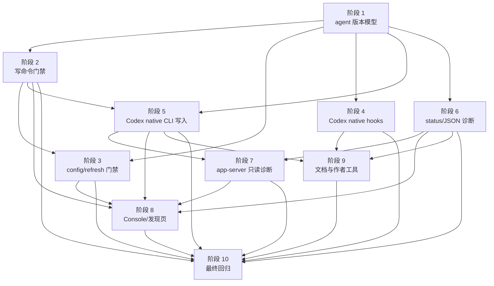

# Agent 版本门禁与 Codex 0.131 原生能力对齐执行计划

日期：2026-05-21
需求来源：`docs/dev/specs/agent-version-gate-and-codex-0131.md`
状态：已完成
文档规范：`docs/dev/spec-plan-writing-guide.md`

## 文档定位

这份计划只定义执行步骤、实现切分、涉及文件、测试范围和收口顺序。它回答“怎么做、先后依赖是什么、改哪些文件、用哪些测试证明完成”。

需求范围、状态模型、命令边界、用户体验和最终验收标准以 Spec 为准。本计划不重新定义宿主 agent 版本合同，也不扩大 Codex 0.131 对齐范围；如果实施中发现需要改变行为边界，必须先回到 `docs/dev/specs/agent-version-gate-and-codex-0131.md` 调整需求，再更新本计划。

## 实施约定

- 宿主 agent 版本门禁必须是命令层 preflight。只要后续动作会写平台 native/runtime 状态、repo-visible artifacts、install record、recovery marker、project artifact identity 或受保护的 config store，就必须在第一笔写入前完成门禁。
- Codex `>= 0.131.0`、Claude Code `>= 2.1.88` 是 AW CLI 内置全局门槛。本期不在插件 manifest、catalog manifest 或依赖字段里新增 per-plugin agent 版本声明。
- 版本检测、错误 reason code、JSON payload、默认输出、`status --verbose` 和主控制台诊断必须复用同一套结构化模型，不能在各命令里各自解析 `--version`。
- `AW_FORCE_CODEX_AVAILABLE` / `AW_FORCE_CLAUDE_AVAILABLE` 只能影响“可用性检测”测试入口，不能绕过版本门禁。需要伪造版本时通过可注入 runner 或测试 helper 显式提供 fake output。
- `--platform both` 按整体事务处理。任一目标平台版本不达标时，本次命令不能写入另一平台，也不能创建 active view、native cache、install record、recovery marker 或 repo-visible artifacts。
- Codex project scope 不再保留“缺少 `codex` 也可写 repo-managed artifacts”的写命令例外；只读状态和发现仍可以展示可认领或已存在的 project artifacts。
- Codex user scope 写入主链路改为 Codex native CLI：`codex plugin add/remove` 与 `codex plugin marketplace add/list/remove`。`codex plugin add/remove` 成功后还必须通过本地证据证明 native 状态已经落地；AW 不能手写或手删 Codex config/cache 来伪装 native 成功。
- Codex app-server RPC 在本期只作为 verbose native view 只读诊断。`plugin/list`、`plugin/installed`、`plugin/read` 不参与写命令 hard gate，也不能授权 cleanup、takeover 或 marketplace removal。
- Codex user-scope hooks 进入 `.codex-plugin/plugin.json` 的 native `hooks` 字段；Codex project scope 继续写 repo-managed `.codex/hooks.json`。本期不迁移旧 user-scope AW-managed `.codex/hooks.json` hook groups。
- 修改插件基础架构、manifest/schema、adapter 行为、scope 语义、分发/安装流程或插件作者可见能力时，必须同步检查 `.agents/skills/create-agent-workflows-plugin/`、公开文档和相关 fixtures。
- 每个阶段必须补齐对应行为测试。阶段内的待办、测试验收和阶段验收都完成后，才能把该阶段标记为已完成。
- 文件清单是起始范围；实现时如果发现同一职责在其它文件中，也要同步纳入计划或提交说明。

## 阶段依赖总览

本表是阶段硬依赖的权威来源；下方 Mermaid 图必须与本表一致。可并行关系只表示能提前准备或用接口桩推进，不新增硬依赖；凡涉及下方“并行写入边界”列出的共享文件，必须先声明单一 owner 或改为串行交接。

| 阶段 | 主题 | 覆盖验收 | 依赖 | 可并行关系 |
| --- | --- | --- | --- | --- |
| 1 | 宿主 agent 版本模型与探测 API | 1-6、8、9 | 无 | 无 |
| 2 | 写命令统一门禁与平台事务边界 | 1-8、13、17 | 1 | 阶段 4、5 仅限接口桩或非共享文件并行准备 |
| 3 | Config 写入、refresh 与重新应用配置门禁 | 10、11 | 1、2 | 可与阶段 6 按并行写入边界推进 |
| 4 | Codex native hooks manifest 与 project/user 分流 | 12-14、18 | 1 | 可与阶段 5 按并行写入边界推进，最终在 install/upgrade 联调 |
| 5 | Codex native CLI 写入与 marketplace 生命周期 | 13、16、17 | 1、2 | 可与阶段 4 按并行写入边界推进，阶段 7 依赖其状态模型 |
| 6 | Status、JSON 与 agent version 诊断投影 | 9、11、15、16 | 1 | 可与阶段 3、7 按并行写入边界推进，最终统一 JSON schema |
| 7 | Codex app-server 只读 native view 诊断 | 11、15、16 | 5、6 | 可先扩展 client 单测，状态投影等阶段 6 接口稳定后联调 |
| 8 | 主控制台、发现页与交互写动作复用 | 7、10、11、15、17 | 2、3、5、6、7 | 文案和页面模型可提前准备 |
| 9 | Claude 2.1.88 兼容回归、文档和作者工具同步 | 18、19 | 4、5、6 | 可随前序阶段增量更新，最终统一收口 |
| 10 | 最终回归、迁移说明和发布前检查 | 全部 | 2-9 | 集成阶段，不建议拆散 |

## 并行写入边界

- 并行任务必须在开工前声明文件 ownership；同一文件同一时间只允许一个阶段写入。共享文件需要通过接口桩、类型契约或后续集成提交交接，不能让多个阶段分别修改同一文件后再靠最终合并消冲突。
- 阶段 2 / 5 共享 `packages/cli/src/commands/cleanup.ts` 和 `packages/cli/tests/unit/cleanup-command.test.ts`。阶段 2 负责通用写命令门禁、目标解析和整体事务失败语义；阶段 5 负责 Codex user-scope CLI / marketplace removal helper。共享 cleanup 命令接入必须在阶段 2 preflight helper 稳定后由单一 owner 串行完成。
- 阶段 3 / 6 共享 `packages/cli/src/commands/console-model.ts`。阶段 3 只负责配置保存、重新应用配置和 refresh/apply 影响分析结果；阶段 6 负责只读 status/consoleItems 投影。若两边都需要改同一模型字段，先由阶段 3 输出稳定结果结构，再由阶段 6 串行接入展示层。
- 阶段 4 / 5 共享 `packages/cli/src/adapters/codex.ts` 和 `packages/cli/tests/unit/codex-adapter.test.ts`。阶段 4 负责 hooks manifest 与 project/user hooks 分流；阶段 5 负责 Codex CLI、marketplace 生命周期和 native 写入。共享 adapter 与测试文件必须由单一集成 owner 在两边 helper 稳定后统一改。
- 阶段 6 / 7 共享 `packages/cli/src/commands/status.ts`、`packages/cli/src/commands/discovery.ts`、`packages/cli/src/commands/console-model.ts` 和 `packages/cli/tests/unit/status-command.test.ts`。阶段 7 可先限制在 app-server client、native state/evidence 和 fake server 单测；命令输出、JSON schema 和 consoleItems 接入由阶段 6 或后续集成 owner 串行完成。

## 阶段依赖关系图

## 阶段 1：宿主 agent 版本模型与探测 API

目标：建立统一的 agent version 模型、严格 SemVer token 提取、版本比较、错误 reason code 和 runner 注入入口，让写命令、status、JSON 和主控制台共用同一套结果。

主要文件：

- [x] `packages/cli/src/types.ts`
- [x] `packages/cli/src/constants.ts`
- [x] `packages/cli/src/utils/manifest.ts`
- [x] `packages/cli/src/utils/native-cli.ts`
- [x] `packages/cli/src/utils/detect.ts`
- [x] `packages/cli/src/utils/agent-version.ts`
- [x] `packages/cli/src/commands/runtime.ts`
- [x] `packages/cli/tests/unit/agent-version.test.ts`
- [x] `packages/cli/tests/unit/detect.test.ts`
- [x] `packages/cli/tests/unit/native-cli.test.ts`

待办：

- [x] 定义 `AgentVersionStatus`、`AgentVersionProbeResult`、`AgentVersionRequirement` 和稳定 reason code：`agentVersionMissing`、`agentVersionProbeFailed`、`agentVersionUnparseable`、`agentVersionTooLow`。
- [x] 内置 Codex `0.131.0`、Claude Code `2.1.88` 的最低要求，并提供按平台读取最低版本的单一入口。
- [x] 实现 `codex --version`、`claude --version` 探测，复用 `NativeCliRunner`，并允许测试注入 fake runner。
- [x] 实现严格 SemVer token 提取：只接受边界或空白包围的合法 SemVer，不从 `v1.2.3`、`agent-1.2.3`、`1.2.3beta` 或 `1.2.3.4` 中截取。
- [x] 复用既有严格 SemVer 比较工具；如果现有工具只做 manifest 校验，抽取共享 helper，避免新增第二套优先级逻辑。
- [x] 让 `AW_FORCE_CODEX_AVAILABLE` / `AW_FORCE_CLAUDE_AVAILABLE` 保持 detect 可用性覆盖，但版本门禁仍必须执行 runner 探测。
- [x] 为 probe timeout、spawn ENOENT、非零退出、stderr/stdout 混合输出和不可解析输出生成稳定结构化结果。
- [x] 将 `EnvironmentDetection` 扩展为可携带 agent version 摘要，同时保持旧调用方可以只消费 available/scopes。

测试验收：

- [x] 接受 `codex-cli 0.131.0`、`2.1.119 (Claude Code)`，并正确比较为满足最低要求。
- [x] 拒绝 `latest`、`v0.131.0`、`agent-0.131.0`、`0.131`、`0.131.0beta`、`0.131.0.1`。
- [x] 按 SemVer precedence 比较 prerelease：`0.131.0-beta.1` 低于 `0.131.0`，`0.131.1-alpha.1` 高于 `0.131.0`，`2.1.88-alpha.1` 低于 `2.1.88`。
- [x] executable 缺失、runner 失败、timeout、不可解析、版本过低分别返回正确 reason code 和平台名。
- [x] 设置 `AW_FORCE_CODEX_AVAILABLE=1` 或 `AW_FORCE_CLAUDE_AVAILABLE=1` 时，版本过低、不可解析和 probe 失败不会被绕过。

阶段验收：

- [x] 仓库内不再出现面向写命令的 ad hoc `codex --version` / `claude --version` 解析。
- [x] agent version 结果能直接服务默认错误、JSON payload、`status --verbose` 和 console model。
- [x] 旧的 detect 可用性调用方没有被迫理解写命令门禁细节。

## 阶段 2：写命令统一门禁与平台事务边界

目标：在所有直接写命令进入平台写入前统一执行 agent version preflight，移除 Codex project scope 无 native 可执行文件的写入例外，并保证 `--platform both` 失败时没有部分写入。

主要文件：

- [x] `packages/cli/src/commands/platform-resolution.ts`
- [x] `packages/cli/src/commands/common.ts`
- [x] `packages/cli/src/commands/install.ts`
- [x] `packages/cli/src/commands/upgrade.ts`
- [x] `packages/cli/src/commands/reinstall.ts`
- [x] `packages/cli/src/commands/repair.ts`
- [x] `packages/cli/src/commands/uninstall.ts`
- [x] `packages/cli/src/commands/cleanup.ts`
- [x] `packages/cli/src/commands/plugin-dependency-write-executor.ts`
- [x] `packages/cli/src/index.ts`
- [x] `packages/cli/tests/unit/install-command.test.ts`
- [x] `packages/cli/tests/unit/upgrade-command.test.ts`
- [x] `packages/cli/tests/unit/uninstall-command.test.ts`
- [x] `packages/cli/tests/unit/cleanup-command.test.ts`
- [x] `packages/cli/tests/unit/repair-command.test.ts`
- [x] `packages/cli/tests/unit/reinstall-command.test.ts`
- [x] `packages/cli/tests/unit/codex-project-platform-gates.test.ts`
- [x] `packages/cli/tests/integration/plugin-lifecycle-command.test.ts`
- [x] `packages/cli/tests/integration/upgrade-command.test.ts`

待办：

- [x] 新增命令层 `assertAgentVersionsForWriteTargets()` 或等价 helper，在解析目标平台、scope、插件和写动作后执行。
- [x] 扩展 `CommandAction` 或新增 write action 枚举，覆盖 `install`、`upgrade`、`upgradeAll`、`reinstall`、`repair`、`uninstall`、执行删除计划的 `cleanup` 和后续 config apply。
- [x] 移除 `canExecuteCodexProjectWithoutNative()` 对写命令的放行语义；Codex project scope 写入前也必须确认 `codex` 存在且版本达标。
- [x] `cleanup --plan`、只读安全预检、`status` 和发现类命令保持只读，不因版本不达标而写状态或失败清理。
- [x] 在 `--platform both` 下先收集两个平台的 agent version 结果，再决定是否进入任一平台写入；失败 payload 必须包含所有阻断平台。
- [x] 确保依赖安装/升级图在执行任一节点写入前完成相关平台门禁，不能出现父插件未写、依赖插件已写的局部状态。
- [x] 错误文案包含平台名、检测到的版本或失败原因、最低要求和升级建议；JSON 字段包含 `platform`、`command`、`detectedVersion`、`requiredMinVersion`、`suggestedAction`。
- [x] 对 probeFailed 的普通 CLI 写命令错误保持可见；普通 `status` 的展示差异留到阶段 6。

测试验收：

- [x] `codex-cli 0.130.0` 时，Codex user/project 的 install、upgrade、`upgrade --all`、uninstall、执行删除计划 cleanup、repair/reinstall 写路径都在写入前失败。
- [x] `codex-cli 0.131.0` 时，Codex 版本门禁通过，后续失败只能来自其它 preflight 或写入逻辑。
- [x] `2.1.87 (Claude Code)` 时，Claude install、upgrade、`upgrade --all`、uninstall、执行删除计划 cleanup、repair/reinstall 写路径在写入前失败；`2.1.88 (Claude Code)` 或更高版本通过。
- [x] `--platform both` 任一平台 missing、probeFailed、unparseable 或 tooOld 时，不写另一平台、不创建 native cache、active view、install record、recovery marker 或 repo-visible artifacts。
- [x] `cleanup --plan` 在 agent 版本不达标时仍只输出计划，不执行删除、不创建备份、不写诊断缓存。
- [x] Codex project scope 的旧 no-native 通过用例改为版本门禁失败，并确认仓库文件没有变化。

阶段验收：

- [x] 所有直接写命令都通过同一 preflight helper 执行 agent version gate。
- [x] `aw upgrade --all` 作为独立写路径有版本门禁和 `--platform both` 整体失败回归，不能只用单插件 `upgrade` 验收代替。
- [x] 写命令失败路径可稳定落到结构化 reason code，且没有平台级部分成功。
- [x] 只读命令和写命令的版本不达标语义已经分清。

## 阶段 3：Config 写入、refresh 与重新应用配置门禁

目标：让 `aw config set/unset/reset` 和主控制台配置保存、重新应用配置在命中已安装 target 的 artifact refresh 或 SkillTrigger apply 时，先完成受影响平台的 agent version 门禁，再写 config store 或 runtime artifact；fresh clone 可认领但尚未认领的 project artifacts 命中 refresh 时，先提示 `aw repair --adopt-existing`，不得进入 agent version 门禁。

主要文件：

- [x] `packages/cli/src/utils/plugin-config-write.ts`
- [x] `packages/cli/src/utils/artifact-refresh.ts`
- [x] `packages/cli/src/utils/skill-trigger-preferences.ts`
- [x] `packages/cli/src/commands/console.ts`
- [x] `packages/cli/src/commands/console-model.ts`
- [x] `packages/cli/src/output/command-receipt.ts`
- [x] `packages/cli/tests/unit/config-write.test.ts`
- [x] `packages/cli/tests/unit/plugin-config.test.ts`
- [x] `packages/cli/tests/unit/console.test.ts`
- [x] `packages/cli/tests/integration/skill-trigger-command.test.ts`
- [x] `packages/cli/tests/integration/codex-explore-plugin.test.ts`

待办：

- [x] 在 config 写入前新增 refresh/apply 影响分析，基于 install record、historical runtime、dynamic diagnostic cache、project artifact identity、本次 key 变更和 SkillTrigger 内建字段，先区分已安装可刷新 target、可认领但尚未认领的 project artifacts 和没有可刷新 target 的配置写入，再推导真正需要门禁的受影响平台集合。
- [x] 对命中 `refreshKeys`、dynamic artifact refresh 或 built-in SkillTrigger apply 的已安装 target，在写 config store 前调用阶段 2 的门禁 helper。
- [x] 未安装插件预配置、orphan store raw reset、未命中 refresh/apply 的纯 config store 更新不触发宿主 agent 版本门禁。
- [x] user 配置写入按 user target 和当前仓库 project target 推导影响；project 配置只影响当前仓库 project target。
- [x] fresh clone 可认领但本机未认领的 project artifacts：未触发 repo-visible refresh 时允许 config-only 预写入，并在 receipt 的 `configRefreshSkippedReason` 字段中返回 `adoptExistingRequired` 或 `noRefreshTarget`；触发 refresh 时必须在 agent version 门禁和 config store 写入前短路失败，保留 `configRefreshSkippedReason: "adoptExistingRequired"` 语义并提示先 `aw repair --adopt-existing`。
- [x] 主控制台配置保存和“重新应用配置”复用同一影响分析和门禁，不复制平台推导逻辑。
- [x] 门禁失败时不写 config store、不更新 runtime artifact、不写 dynamic diagnostic cache，也不执行部分平台刷新。

测试验收：

- [x] 已安装 Codex/Claude target 的 config set/unset/reset 命中 refresh/apply 时，版本不达标会在 config store 写入前失败。
- [x] user 配置同时影响 user 和当前 project target 时，任一平台不达标会让整次配置命令失败，且没有部分刷新。
- [x] 未安装插件预配置、orphan store raw reset、未命中 refreshKeys 且不触发 SkillTrigger apply 的更新不做版本门禁。
- [x] 可认领 project target 的 config-only 预写入在 `configRefreshSkippedReason` 字段中返回 `adoptExistingRequired` 或 `noRefreshTarget`；触发 refresh 时即使 fake agent version 不达标，也先提示 adopt-existing，且不进入 agent version 门禁或平台写入。
- [x] 主控制台配置保存和重新应用配置展示与 direct CLI 同样的 reason code、阻断原因和下一步建议。

阶段验收：

- [x] config 写入的事务顺序满足“版本门禁失败前没有任何持久化写入”。
- [x] 可认领 project artifact 的 refresh 分支在 agent version helper 之前短路，有单测证明 agent version 错误不会覆盖 adopt-existing 提示。
- [x] refresh/apply 目标推导有单测覆盖，不依赖主控制台页面状态。
- [x] direct CLI 与 console 配置路径共享同一结果模型。

## 阶段 4：Codex native hooks manifest 与 project/user 分流

目标：补齐 Codex 0.131 原生 `hooks` manifest 生成和校验，让 user-scope native bundle 通过 `.codex-plugin/plugin.json` 暴露 hooks，同时保留 project scope 的 repo-managed `.codex/hooks.json` 路径。

主要文件：

- [x] `packages/cli/src/types.ts`
- [x] `packages/cli/src/generators/local-plugin.ts`
- [x] `packages/cli/src/generators/hooks.ts`
- [x] `packages/cli/src/utils/hooks-contract.ts`
- [x] `packages/cli/src/utils/rendered-contract.ts`
- [x] `packages/cli/src/utils/bundle-layout.ts`
- [x] `packages/cli/src/adapters/codex.ts`
- [x] `packages/cli/tests/unit/generators.test.ts`
- [x] `packages/cli/tests/unit/bundle-layout.test.ts`
- [x] `packages/cli/tests/unit/rendered-contract.test.ts`
- [x] `packages/cli/tests/unit/codex-adapter.test.ts`
- [x] `packages/cli/tests/integration/codex-static-extensions.test.ts`

待办：

- [x] 扩展 Codex platform manifest 类型，允许 `.codex-plugin/plugin.json` 包含 Codex 0.131 原生 `hooks` 字段。
- [x] 复用 `resolvePlatformHookDefinitions()` 和现有 hook renderer，为 Codex user-scope native bundle 生成 Codex 0.131 可识别的 hooks artifact 或内联 manifest 结构。
- [x] 在 bundle layout 校验中接受并校验 Codex `hooks`，但继续拒绝 Codex 0.131 不支持或 AW 非目标字段。
- [x] 修改 Codex adapter user-scope 安装/升级路径，避免为 user scope 新写会重复触发的 `.codex/hooks.json` hook groups。
- [x] 保持 Codex project scope 通过 `syncCodexHooks()` 写 repo `.codex/hooks.json`，并继续使用 tracking/project artifact identity 保护 ownership。
- [x] 明确旧版 user-scope AW-managed `.codex/hooks.json` hook groups 本期不迁移、不接管、无 ownership evidence 时不删除。
- [x] 回归 Claude hooks 生成和 Claude manifest 校验，避免 Codex hooks 改动破坏 Claude Code 2.1.88 能力。

测试验收：

- [x] 声明 `extensions.hooks` 或 `extensions.nativeHooks.codex` 的插件，在 Codex user-scope bundle 中生成 `.codex-plugin/plugin.json` 的 `hooks` 字段。
- [x] bundle layout 校验接受合法 Codex hooks，并拒绝非法事件、matcher 或 handler schema。
- [x] 同一插件安装到 Codex project scope 时仍写 `.codex/hooks.json`，不会创建 project native install state。
- [x] Codex user scope 不再新写 `.codex/hooks.json` hook groups；现场无 ownership evidence 的 hook groups 保留。
- [x] Claude native hooks、commands、agents、MCP、LSP、user config 校验不因本阶段改动回退。

阶段验收：

- [x] Codex user/project hooks 路径在代码和测试中有明确分流。
- [x] Hook 生成、bundle 校验和 adapter 写入使用同一公共 hook 合同。
- [x] 本期不迁移旧 user hooks 的边界已在测试和文档任务中标出。

## 阶段 5：Codex native CLI 写入与 marketplace 生命周期

目标：把 Codex user-scope native 写入从 app-server `plugin/install` / `plugin/uninstall` 主链路切换到 Codex CLI，并用 marketplace CLI 管理本地 path source 的注册、校验、重新指向和安全移除。

主要文件：

- [x] `packages/cli/src/adapters/codex.ts`
- [x] `packages/cli/src/utils/native-cli.ts`
- [x] `packages/cli/src/utils/codex-native-state.ts`
- [x] `packages/cli/src/utils/codex-native-recovery.ts`
- [x] `packages/cli/src/utils/codex-config.ts`
- [x] `packages/cli/src/utils/local-marketplace.ts`
- [x] `packages/cli/src/install-state/evidence.ts`
- [x] `packages/cli/src/commands/cleanup.ts`
- [x] `packages/cli/src/commands/upgrade.ts`
- [x] `packages/cli/src/commands/init.ts`
- [x] `packages/cli/src/commands/install-state-removal.ts`
- [x] `packages/cli/tests/unit/codex-adapter.test.ts`
- [x] `packages/cli/tests/unit/codex-native-state.test.ts`
- [x] `packages/cli/tests/unit/cleanup-command.test.ts`
- [x] `packages/cli/tests/unit/install-state-evidence.test.ts`
- [x] `packages/cli/tests/integration/cli.test.ts`
- [x] `packages/cli/tests/integration/upgrade-command.test.ts`
- [x] `packages/cli/tests/integration/codex-explore-plugin.test.ts`

待办：

- [x] 新增 Codex CLI wrapper，覆盖 `codex plugin add <plugin>@aw`、`codex plugin list`、`codex plugin remove <plugin>@aw`、`codex plugin marketplace add <canonical AW_HOME>`、`list`、`remove`。
- [x] 保留 active local marketplace/runtime view 的物化和校验，再执行 Codex CLI 注册与 plugin add/remove；本地 path source 不使用 `codex plugin marketplace upgrade` 刷新。
- [x] 首次注册、缺失修复和 source 重新指向必须走 `codex plugin marketplace add/list`，并通过 CLI 输出、Codex 静态 config 读证据或等价证据确认 `aw` 指向当前 canonical `AW_HOME`。
- [x] 对 `codex plugin add/remove` 执行写后本地证据校验：用 `codex plugin list`、Codex 静态 config/cache 读证据或等价本地证据确认目标 `plugin@aw` 已安装或已移除；无法证明时 fail closed。
- [x] 将 `codexNativeCliUnavailable`、`codexNativeMarketplaceMissing`、`codexNativeMarketplaceDrift` 纳入结构化错误和 debug/native event。
- [x] Codex CLI 失败、超时或输出无法证明写入完成时 fail closed；不手写 Codex config/cache 伪装成功。
- [x] Codex CLI 写入和写后本地证据校验成功后，再更新 AW install record、recovery marker、active runtime view 或诊断缓存，保持 recovery breadcrumb 能解释 native side effect 后的 AW 失败。
- [x] 卸载和 cleanup 通过 `codex plugin remove` 删除目标 plugin；只有能证明 user-scope 下没有任何受管 `@aw` 使用者或恢复证据时，才调用 `codex plugin marketplace remove`。
- [x] 无 AW ownership、install record、recovery marker 或受管 cache/config evidence 时，不使用 RPC 或单纯 config/cache 残留授权 cleanup、takeover 或 marketplace removal。
- [x] Codex project scope 的 install/upgrade/`upgrade --all`/uninstall/repair/cleanup 不调用 `codex plugin` 或 `codex plugin marketplace`。

测试验收：

- [x] Codex user-scope install/upgrade/`upgrade --all`/reinstall/native repair 调用 marketplace add/list 校验本地 path source，再调用 `codex plugin add`，并在写后证明目标 `plugin@aw` 已进入本地 native state。
- [x] Codex user-scope uninstall/cleanup 调用 `codex plugin remove`，写后证明目标已从本地 native state 移除，并只在最后一个受管 native 使用者移除后调用 marketplace remove。
- [x] 本地 path source refresh 不调用 `codex plugin marketplace upgrade`。
- [x] marketplace 缺失、指向旧 `AW_HOME`、source_type 不对、CLI 失败、输出无法证明成功或 plugin add/remove 写后本地证据缺失时，命令 fail closed 并带稳定 reason code。
- [x] Codex CLI 写入失败时 AW 不手改 Codex config/cache；后续 AW 状态文件没有被伪造成成功。
- [x] `aw init`、普通 `status`、`cleanup --plan`、主控制台只读首页和 Codex project scope 路径不调用 Codex native 写入 CLI。

阶段验收：

- [x] Codex user-scope native 写入主链路已经从 app-server RPC 切到 Codex CLI，并以写后本地证据作为 `codex plugin add/remove` 的成功条件。
- [x] marketplace 生命周期的增删改查都有可测试的命令调用和证据校验。
- [x] cleanup / uninstall 的 marketplace removal 授权只依赖 AW 本地 ownership 证据和 Codex CLI/static evidence，不依赖 app-server RPC。

## 阶段 6：Status、JSON 与 agent version 诊断投影

目标：让 `status`、`status --json`、`status --verbose`、console model 和诊断输出展示 agent version 结果，普通视图只提示明确可行动的阻断问题，verbose/JSON 保留完整结构化诊断。

主要文件：

- [x] `packages/cli/src/commands/status.ts`
- [x] `packages/cli/src/commands/common.ts`
- [x] `packages/cli/src/commands/console-model.ts`
- [x] `packages/cli/src/commands/discovery.ts`
- [x] `packages/cli/src/commands/diagnose.ts`
- [x] `packages/cli/src/output/model.ts`
- [x] `packages/cli/src/output/reporter.ts`
- [x] `packages/cli/tests/unit/status-command.test.ts`
- [x] `packages/cli/tests/unit/console-model.test.ts`
- [x] `packages/cli/tests/unit/diagnose-command.test.ts`
- [x] `packages/cli/tests/integration/discovery.test.ts`
- [x] `packages/cli/tests/integration/console-entry.test.ts`

待办：

- [x] 将阶段 1 的 agent version result 接入 status 数据模型，输出每个平台的状态、检测版本、最低要求、阻断 reason code 和 suggestedAction。
- [x] 普通 `status` 只在 `missing`、`unparseable` 或 `tooOld` 可能阻断下一次写命令时显示简短提示；`probeFailed` 只出现在 verbose、JSON、主控制台诊断详情或具体写命令错误。
- [x] `status --verbose --json` 输出稳定结构，包含 `platform`、`command`、`detectedVersion`、`requiredMinVersion`、`suggestedAction`；`rawVersionOutput` 只在 debug/verbose 层级出现。
- [x] 不带 verbose 的 `status --json` 仍输出必要的 agent version 诊断，至少包含每个平台的状态、检测版本、最低要求、阻断 reason code 和 suggestedAction；但不包含 `rawVersionOutput` 或 Codex native view RPC 详情。
- [x] 普通 `status` 和不带 verbose 的 `status --json` 不启动 `codex app-server`，不刷新 marketplace，不运行 renderer，不写诊断缓存。
- [x] consoleItems summary 带可追踪 agent version/native 摘要，但不把只读页面变成 repair/install/upgrade 入口。
- [x] 将 `nativeViewUnknown` 与 agent version 状态拆开展示，避免把 RPC 失败误判为版本门禁失败或 healthy。

测试验收：

- [x] `status --verbose --json` 稳定输出 Codex/Claude agent version 状态、检测版本、最低版本和 reason code。
- [x] 不带 verbose 的 `status --json` 仍保留 Codex/Claude agent version 状态、检测版本、最低版本、reason code 和 suggestedAction。
- [x] 普通 `status` 对 missing、unparseable、tooOld 给简短提示，不展示 probeFailed。
- [x] 普通 `status`、不带 verbose 的 `status --json` 和 `cleanup --plan` 不启动 `codex app-server`，也不写任何状态。
- [x] consoleItems 能表达 agent version 阻断摘要，但不输出执行动作命令数组或隐式修复结果。
- [x] JSON stdout 仍可直接 `JSON.parse`，debug/raw output 不污染普通 JSON。

阶段验收：

- [x] 读侧 agent version 诊断与写侧门禁共用同一模型。
- [x] 默认视图和 verbose 视图的信息层级符合 Spec。
- [x] status/discovery/console 首页保持只读，不产生任何 native 或 AW 状态写入。

## 阶段 7：Codex app-server 只读 native view 诊断

目标：扩展 Codex app-server client 的只读 RPC 能力，用 `plugin/list`、`plugin/installed`、`plugin/read` 补充 Codex user-scope native view 诊断，并在 RPC 不可用时降级为 `nativeViewUnknown`。

主要文件：

- [x] `packages/cli/src/utils/codex-app-server-client.ts`
- [x] `packages/cli/src/utils/codex-native-state.ts`
- [x] `packages/cli/src/install-state/evidence.ts`
- [x] `packages/cli/src/commands/status.ts`
- [x] `packages/cli/src/commands/discovery.ts`
- [x] `packages/cli/src/commands/console-model.ts`
- [x] `packages/cli/tests/helpers/fake-codex-app-server.ts`
- [x] `packages/cli/tests/unit/codex-app-server-client.test.ts`
- [x] `packages/cli/tests/unit/fake-codex-app-server.test.ts`
- [x] `packages/cli/tests/unit/status-command.test.ts`
- [x] `packages/cli/tests/unit/install-state-evidence.test.ts`

待办：

- [x] 在 client 中新增只读 RPC API：`listCodexPluginsViaAppServer()`、`listInstalledCodexPluginsViaAppServer()`、`readCodexPluginViaAppServer()` 或等价命名。
- [x] 将 app-server 错误分类映射为 `codexNativeDiagnosticUnavailable`，并保留 method unavailable、timeout、protocol error、spawn failure 等 debug context。
- [x] 定义 Codex Native View 诊断结果：`nativeViewAvailable`、`nativeViewUnknown`，并记录 reason、method、pluginId、marketplace/source 摘要。
- [x] `status --verbose`、`status --verbose --json`、主控制台诊断详情和发现页在需要解释 Codex user-scope native view 时才启动 app-server。
- [x] RPC 证据只用于解释 Codex 当前是否认为插件已安装、启用、可注入、可被 mention 或来自外部 marketplace/source。
- [x] 写命令、ownership 判断、cleanup 授权、takeover 和 marketplace removal 不启动也不依赖 app-server RPC。
- [x] RPC 不可用、超时、method unavailable 或返回值无法解释时显示 `nativeViewUnknown`，不覆盖 AW 本地 ownership 证据，也不阻断 Codex CLI 写入主链路。

测试验收：

- [x] client 单测覆盖 `plugin/list`、`plugin/installed`、`plugin/read` 成功、timeout、unknown method、protocol error、提前退出。
- [x] `status --verbose --json` 能展示 native view available 证据；RPC 不可用时展示 `nativeViewUnknown`。
- [x] 普通 `status`、不带 verbose 的 `status --json`、`cleanup --plan` 不启动 app-server。
- [x] RPC 结果不能授权没有 AW ownership 证据的 cleanup、takeover 或 marketplace removal。
- [x] RPC 不可用不影响 Codex CLI 写入路径的 hard gate 结论。

阶段验收：

- [x] app-server RPC 已从写入主链路降级为明确的只读诊断能力。
- [x] Native view 诊断状态不会和 agent version 状态混淆。
- [x] 诊断结果对 user-scope 生效，不改变 Codex project scope repo-managed 判断。

## 阶段 8：主控制台、发现页与交互写动作复用

目标：让主控制台首屏、发现页、诊断详情和控制台触发的写动作复用 direct CLI 的版本门禁、Codex CLI hard gate、native view 诊断和配置写入事务语义。

主要文件：

- [x] `packages/cli/src/commands/console.ts`
- [x] `packages/cli/src/commands/console-model.ts`
- [x] `packages/cli/src/commands/console-wizard.ts`
- [x] `packages/cli/src/commands/discovery.ts`
- [x] `packages/cli/src/commands/interactive.ts`
- [x] `packages/cli/src/commands/runtime.ts`
- [x] `packages/cli/tests/unit/console.test.ts`
- [x] `packages/cli/tests/unit/console-model.test.ts`
- [x] `packages/cli/tests/unit/console-wizard.test.ts`
- [x] `packages/cli/tests/integration/console-entry.test.ts`
- [x] `packages/cli/tests/integration/discovery.test.ts`

待办：

- [x] 主控制台首页和发现页列表复用 `status --json.consoleItems`、current catalog discovery 和阶段 6 的 agent version/native 摘要。
- [x] 主控制台诊断详情在需要 Codex user-scope native view 时走阶段 7 的 verbose 读路径；首页只读，不启动 app-server。
- [x] 主控制台触发 install、upgrade、reinstall、repair、uninstall、执行 cleanup 删除计划时，复用阶段 2 的门禁 helper 和阶段 5 的 Codex CLI hard gate。
- [x] 主控制台配置保存和“重新应用配置”复用阶段 3 的 config 门禁和事务顺序。
- [x] 控制台中的 all-platform / both 写动作保持整体失败语义，任一平台版本不达标时不写其它平台。
- [x] UI 文案展示同样的阻断 reason、最低版本、检测版本和下一步建议，不暴露冗余协议细节。

测试验收：

- [x] 主控制台首屏在 agent 版本缺失、不可解析或过低时展示可行动摘要，但不写状态。
- [x] 诊断详情可显示 `nativeViewAvailable` 或 `nativeViewUnknown`；RPC 失败不影响 direct CLI 写命令门禁。
- [x] 控制台触发 both 写动作时，任一平台版本不达标会整体失败，并保持文件系统无部分写入。
- [x] 控制台配置保存命中 refresh/apply 时，版本门禁失败发生在 config store 写入前。
- [x] 发现页只读列表不会刷新 marketplace、启动写入命令或移除任何 native 状态。

阶段验收：

- [x] 控制台和 direct CLI 的门禁、错误模型和事务边界一致。
- [x] 只读页面与写动作入口有清晰分层。
- [x] 用户看到的下一步建议与 Spec 文案语义一致。

## 阶段 9：Claude 2.1.88 兼容回归、文档和作者工具同步

目标：确认 Claude Code 2.1.88 能力没有被本轮改动破坏，并同步公开文档、插件作者技能、示例和 fixtures，避免作者继续按旧合同理解 Codex hooks 或 agent 可用性。

主要文件：

- [x] `docs/plugin-authoring.md`
- [x] `docs/plugin-installation.md`
- [x] `docs/plugin-installation-technical-details.md`
- [x] `docs/architecture.md`
- [x] `docs/testing.md`
- [x] `.agents/skills/create-agent-workflows-plugin/SKILL.md`
- [x] `.agents/skills/create-agent-workflows-plugin/references/plugin-manifest-spec.md`
- [x] `.agents/skills/create-agent-workflows-plugin/references/extensions-spec.md`
- [x] `.agents/skills/create-agent-workflows-plugin/references/skills-and-triggers.md`
- [x] `.agents/skills/create-agent-workflows-plugin/references/comprehensive-example.md`
- [x] `.agents/skills/create-agent-workflows-plugin/scripts/validate_plugin.js`
- [x] `packages/cli/tests/integration/authoring-tools.test.ts`
- [x] `packages/cli/tests/unit/public-docs.test.ts`
- [x] `packages/cli/tests/smoke/build-smoke.test.ts`
- [x] `packages/cli/tests/smoke/plugin-scripts-staging-smoke.test.ts`

待办：

- [x] 更新安装文档：写命令要求 Codex `>= 0.131.0`、Claude Code `>= 2.1.88`，Codex project scope 也需要版本达标。
- [x] 更新 Codex user scope 说明：安装/卸载走 `codex plugin add/remove` 并做写后本地证据校验，marketplace 生命周期走 `codex plugin marketplace add/list/remove`，app-server RPC 只用于 verbose 诊断。
- [x] 更新 Codex hooks 文档：user-scope native bundle 进入 `.codex-plugin/plugin.json`，project-scope 仍写 `.codex/hooks.json`，旧 user hooks 不迁移。
- [x] 更新插件作者技能和 references，说明作者无需在 manifest 中声明最低 Codex/Claude Code 版本。
- [x] 更新 validate/build fixture，让 Codex hooks manifest、Claude 2.1.88 支持字段和最低版本假设都被覆盖。
- [x] 回归 Claude bundle/layout 校验，确认 skills、hooks、commands、agents、MCP、LSP、user config 和 marketplace install/uninstall 不被本轮改动破坏。
- [x] 如 Codex native hooks 物化改变官方插件 artifact identity，按版本管理规则递增受影响 plugin version，并同步 catalog/build fixture。

测试验收：

- [x] `public-docs.test` 或等价测试能捕捉旧文档中“只需要 executable 存在”“Codex user hooks 只写 .codex/hooks.json”“Codex user 写入依赖 app-server RPC 主链路”等过期表述。
- [x] 作者工具测试覆盖 Codex native hooks manifest、project hooks 分流和无需 per-plugin agent version 字段。
- [x] smoke build 产物包含合法 Codex hooks manifest，并仍包含 Claude 2.1.88 支持的字段。
- [x] 官方插件 fixture 的版本、artifact digest 和 manifest digest 与本轮物化变化一致。

阶段验收：

- [x] 公开文档、作者技能和测试夹具对新合同的描述一致。
- [x] Claude 2.1.88 支持边界有回归覆盖。
- [x] 插件作者不会从模板或示例中学到旧 Codex user-scope 写入/ hooks 模型。

## 阶段 10：最终回归、迁移说明和发布前检查

目标：用单元、集成、smoke、文档和手工链路把 Spec 的 19 条验收标准逐项收口，确认没有旧路径绕过版本门禁或 native CLI hard gate。

主要文件：

- [x] `docs/dev/specs/agent-version-gate-and-codex-0131.md`
- [x] `docs/dev/plans/agent-version-gate-and-codex-0131-plan.md`
- [x] `docs/dev/reviews/agent-version-gate-and-codex-0131-review.md`
- [x] `packages/cli/tests/unit/*`
- [x] `packages/cli/tests/integration/*`
- [x] `packages/cli/tests/smoke/*`

待办：

- [x] 按本计划“测试用例明细”逐项核对是否已有自动化覆盖；缺口必须补测试或记录明确的手工验证步骤。
- [x] 运行 `pnpm test:unit`，确认 agent version、Codex native CLI、hooks manifest、status 诊断、config 门禁和 console 模型单测通过。
- [x] 运行 `pnpm test:integration`，确认 direct CLI、console、discovery、Codex project/user、config refresh 和 lifecycle 链路通过。
- [x] 运行 `pnpm test:smoke:build` 和 `pnpm test:smoke:plugin-scripts`，确认真实 build/staging/bundle 布局通过。
- [x] 手工或脚本化核对 `codex --version` 为 `codex-cli 0.131.0`、`claude --version` 为 `2.1.88 (Claude Code)` 及更高版本时的通过链路。
- [x] 手工或脚本化核对低版本、缺失 executable、不可解析版本、probeFailed 和 both 平台部分失败不会写状态。
- [x] 最终检查公开文档、作者工具和 fixtures 是否和实现同步。

测试验收：

- [x] Spec 19 条验收标准都有自动化测试或明确手工验证记录。
- [x] 单元、集成和 smoke 测试通过。
- [x] 写命令失败路径没有新增未清理的 native cache、active view、install record、recovery marker、diagnostic cache 或 repo-visible artifacts。
- [x] 只读路径没有启动写命令、没有刷新 marketplace、没有修改本地状态。

阶段验收：

- [x] 本计划所有阶段待办和测试验收完成后，状态从“实施计划稿”更新为“已完成”或另写实施复盘。
- [x] 最终变更说明能清楚列出行为变化、兼容边界、测试命令和任何残余风险。

## 测试用例明细

本节是跨阶段测试索引和最终回归矩阵。它不能替代阶段详情里的测试验收；实现时每项都要能追溯到主责阶段。

### Agent Version Core

- [x] 阶段 1：Codex `codex-cli 0.131.0` 解析为 supported。
- [x] 阶段 1：Claude `2.1.88 (Claude Code)` 解析为 supported。
- [x] 阶段 1：Codex `codex-cli 0.130.0` 返回 `agentVersionTooLow`。
- [x] 阶段 1：Claude `2.1.87 (Claude Code)` 返回 `agentVersionTooLow`。
- [x] 阶段 1：缺少 executable 返回 `agentVersionMissing`。
- [x] 阶段 1：版本命令失败或 timeout 返回 `agentVersionProbeFailed`。
- [x] 阶段 1：不可解析输出返回 `agentVersionUnparseable`。
- [x] 阶段 1：`AW_FORCE_*_AVAILABLE=1` 不绕过版本过低、不可解析或 probeFailed。

### Direct Write Gate

- [x] 阶段 2：Codex user install/upgrade/`upgrade --all`/uninstall/cleanup/repair/reinstall 在低版本时写入前失败。
- [x] 阶段 2：Codex project install/upgrade/`upgrade --all`/uninstall/cleanup/repair 在低版本或缺 executable 时写入前失败。
- [x] 阶段 2：Claude install/upgrade/`upgrade --all`/uninstall/cleanup/repair/reinstall 在低版本时写入前失败。
- [x] 阶段 2：`--platform both` 任一平台不达标时无任何平台写入。
- [x] 阶段 2：`cleanup --plan` 在版本不达标时仍只读。
- [x] 阶段 2：错误 JSON 包含平台、命令、检测版本或失败原因、最低版本、suggestedAction。

### Config And Console Write Gate

- [x] 阶段 3：config set 命中 dynamic artifact refresh 时，版本门禁失败发生在 config store 写入前。
- [x] 阶段 3：config unset/reset 命中 SkillTrigger apply 时，版本门禁失败不写 runtime artifact 或 diagnostic cache。
- [x] 阶段 3：未安装预配置和不触发 refresh/apply 的纯 store 更新不做版本门禁。
- [x] 阶段 3：adoptable project artifact 未触发 refresh 时在 `configRefreshSkippedReason` 字段中返回 `adoptExistingRequired` 或 `noRefreshTarget`。
- [x] 阶段 3：adoptable project artifact 触发 refresh 时提示 `aw repair --adopt-existing`，不进入 agent version 门禁或平台写入。
- [x] 阶段 8：主控制台配置保存和重新应用配置与 direct CLI 语义一致。

### Codex Hooks And Native CLI

- [x] 阶段 4：Codex user-scope bundle 的 `.codex-plugin/plugin.json` 包含合法 `hooks` 字段。
- [x] 阶段 4：Codex project-scope hooks 仍写 `.codex/hooks.json`。
- [x] 阶段 4：Codex user scope 不再新写 `.codex/hooks.json` hook groups。
- [x] 阶段 5：Codex user install/upgrade/`upgrade --all` 先校验 active local marketplace/runtime view，再用 marketplace add/list 和 plugin add，并做 plugin add 写后本地证据校验。
- [x] 阶段 5：Codex user uninstall/cleanup 用 plugin remove，做 plugin remove 写后本地证据校验，并只在最后一个受管 native 使用者移除后 marketplace remove。
- [x] 阶段 5：本地 path source 不调用 `codex plugin marketplace upgrade`。
- [x] 阶段 5：Codex CLI 失败或 plugin add/remove 写后本地证据缺失时不手改 config/cache 伪装成功。
- [x] 阶段 5：Codex project scope install/upgrade/`upgrade --all`/uninstall/repair/cleanup 不调用 `codex plugin` 或 `codex plugin marketplace`。

### Status And Native View Diagnostics

- [x] 阶段 6：普通 `status` 只提示 missing、unparseable、tooOld，不展示 probeFailed。
- [x] 阶段 6：`status --verbose --json` 输出每个平台 agent version 详情。
- [x] 阶段 6：不带 verbose 的 `status --json` 仍输出必要的 agent version 诊断，但不包含 raw/debug 或 Codex native view RPC 详情。
- [x] 阶段 6：普通 `status --json` 不启动 app-server，stdout 仍是纯 JSON。
- [x] 阶段 7：`status --verbose` 可以用 `plugin/list`、`plugin/installed`、`plugin/read` 展示 native view 证据。
- [x] 阶段 7：RPC 不可用时显示 `nativeViewUnknown`，不覆盖本地 ownership 证据。
- [x] 阶段 7：RPC 结果不能授权 cleanup、takeover 或 marketplace removal。
- [x] 阶段 8：发现页和主控制台只读首页不写状态、不刷新 marketplace。

### Docs, Authoring And Regression

- [x] 阶段 9：公开文档说明 agent 最低版本、Codex native CLI 写入、RPC 只读诊断和 Codex hooks 分流。
- [x] 阶段 9：作者工具说明无需 per-plugin Codex/Claude version 字段。
- [x] 阶段 9：Claude 2.1.88 支持字段通过 bundle/layout 和 smoke 回归。
- [x] 阶段 10：`pnpm test:unit` 通过。
- [x] 阶段 10：`pnpm test:integration` 通过。
- [x] 阶段 10：`pnpm test:smoke:build` 通过。
- [x] 阶段 10：`pnpm test:smoke:plugin-scripts` 通过。

## 并行实施建议

- 阶段 1 是硬前置，建议单独完成并合并后再大规模接入写命令。
- 阶段 2 和阶段 3 都依赖版本模型，但阶段 3 的 refresh 目标推导可以先用阶段 2 helper 的接口桩开发，最后再联调事务顺序；涉及配置保存展示的共享模型按“并行写入边界”交接。
- 阶段 4 的 hooks manifest 生成与阶段 5 的 Codex CLI 写入可以并行；两者先分别收敛 helper，`codex.ts` 和 adapter 单测由单一集成 owner 最后合流。
- 阶段 6 的 agent version 状态投影可以与阶段 7 的 app-server 只读 client 扩展并行；阶段 7 先限制在 client/native-state/evidence 层，命令输出和 JSON schema 由阶段 6 或后续集成 owner 接入。
- 阶段 8 适合在阶段 2、3、5、6 的公共 helper 稳定后推进，避免控制台复制 direct CLI 的业务判断。
- 阶段 9 可随每个行为阶段增量更新文档和作者工具，但最终必须在阶段 10 前统一扫一遍旧表述。

## 最终回归

- [x] 运行 `pnpm test:unit`。
- [x] 运行 `pnpm test:integration`。
- [x] 运行 `pnpm test:smoke:build`。
- [x] 运行 `pnpm test:smoke:plugin-scripts`。
- [x] 核对 `docs/plugin-authoring.md`、`docs/plugin-installation.md`、`docs/architecture.md`、`.agents/skills/create-agent-workflows-plugin/` 与实现一致。
- [x] 用 fake runner 覆盖 Codex/Claude supported、missing、probeFailed、unparseable、tooOld 五类状态。
- [x] 用 isolated env 验证 `upgrade --all`、`--platform both`、Codex project scope、config refresh、主控制台写动作和 verbose native view 诊断的端到端行为。
- [x] 检查 `git diff`，确认只修改本需求相关代码、测试、文档和 fixture，没有顺手重构或无关格式化。
