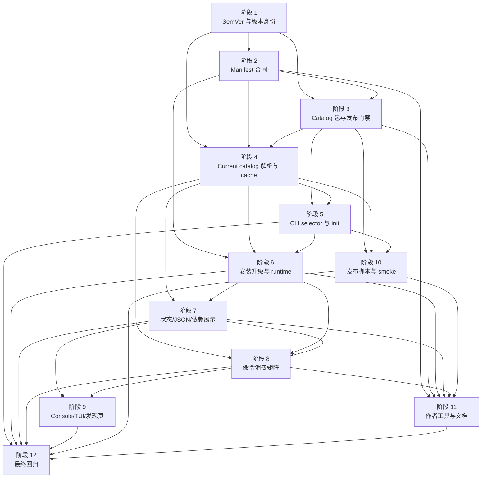

# `aw` 版本管理执行计划

日期：2026-05-15
需求来源：`docs/dev/specs/aw-version-management.md`
状态：实施计划稿
文档规范：`docs/dev/spec-plan-writing-guide.md`

## 文档定位

这份计划只定义执行步骤、实现切分、涉及文件、测试范围和收口顺序。它回答“怎么做、先后依赖是什么、改哪些文件、用哪些测试证明完成”。

需求范围、现状探查结论、用户体验边界、公开合同边界和最终验收标准以 Spec 为准。本计划不重新定义版本合同；如果实施中发现需要改变 Spec 的行为边界，必须先回到 `docs/dev/specs/aw-version-management.md` 调整需求，再更新本计划。

## 实施约定

- 版本比较、catalog 选择、依赖最低版本、cache fallback 和 JSON/TUI 状态都必须复用同一套结构化模型，不能在命令层、TUI 或测试夹具里各自补一份判断。
- 每个阶段都必须补齐对应行为测试，并在阶段测试和阶段验收都通过后再标记完成。
- 文件清单是起始范围；实现时如果发现同一职责在其它文件中，也要同步调整，并在 PR/提交说明里补充。
- 本期删除 CLI embedded catalog 的正式分发语义。为了过渡可以保留构建 staging 产物，但不能把它作为 `@yiliang/aw` tarball 的插件兜底。
- Catalog 历史记录、artifact digest、manifest digest 和 sidecar/full manifest 一致性是发布与运行时的版本真值；npm metadata 只能用于 dist-tag、tarball URL、npm integrity 等分发信息。
- 修改插件基础架构、manifest/schema、adapter 行为、scope 语义、分发/安装流程或插件作者使用方式时，必须同步检查 `.agents/skills/create-agent-workflows-plugin/`、公开文档和测试夹具。
- Legacy 数据只能通过明确的兼容解释进入运行时，不能退回字符串比较、embedded fallback 或“猜测最新版本”。

## 阶段依赖总览

| 阶段 | 主题 | 覆盖验收 | 依赖 | 可并行关系 |
| --- | --- | --- | --- | --- |
| 1 | SemVer 基础与版本身份模型 | 1、2、11、24、31 | 无 | 无 |
| 2 | Plugin manifest、catalog manifest 与依赖最低版本合同 | 3、4、16、17、35、39 | 1 | 可与阶段 3 的发布包骨架并行推进 |
| 3 | Catalog artifact、sidecar/full 包和发布门禁 | 3、6、7、11、33-35 | 1、2 | 阶段 4 可先基于接口桩开发 |
| 4 | Current catalog 解析、远程获取和多 entry cache | 5、7-10、13、26-29、40、41 | 1、2 | 可与阶段 3 并行，最终联调 |
| 5 | CLI selector、`aw init` 和 embedded catalog 移除 | 12、26-29、37、41 | 3、4 | 阶段 6 可基于 resolver 接口先接入 |
| 6 | 安装/升级依赖图、active view 与 historical runtime | 18-20、42、43 | 2、4、5 | 可与阶段 7 读侧模型并行 |
| 7 | 状态投影、JSON receipt 和依赖版本展示 | 14、15、21-25、28、31、37、38 | 1、4、6 | 可与阶段 8 命令矩阵并行 |
| 8 | Config、diagnose、cleanup、uninstall、repair、reinstall 消费矩阵 | 30、31、38、43 | 4、6、7 | 可与阶段 9 TUI 展示并行 |
| 9 | Console/TUI/发现页版本体验 | 14、15、21、25、30、38 | 7、8 | 文案与页面模型可提前准备 |
| 10 | CLI/catalog 发布脚本拆分与本地 smoke | 12、32-35 | 3、4、5 | 文档可与阶段 11 并行 |
| 11 | 插件作者工具、公开文档和夹具迁移 | 20、36、39 | 2、3、5、6、7、8、10 | 随前序阶段增量更新 |
| 12 | 最终回归、迁移说明和发布前收口 | 全部 | 5-11 | 集成阶段，不建议拆散 |

## 阶段依赖关系图

## 阶段 1：SemVer 基础与版本身份模型

目标：先建立全仓库唯一的严格 SemVer 解析、比较和错误表达，明确 CLI version、catalog version、插件 version、依赖 minVersion 和 installed version 的身份边界。

主要文件：

- [ ] `packages/cli/src/types.ts`
- [ ] `packages/cli/src/utils/manifest.ts`
- [ ] `packages/cli/src/utils/plugin-catalog.ts`
- [ ] `packages/cli/src/utils/local-marketplace.ts`
- [ ] `packages/cli/src/install-state/types.ts`
- [ ] `packages/cli/src/install-state/schema.ts`
- [ ] `packages/cli/src/commands/status.ts`
- [ ] `packages/cli/src/commands/console-model.ts`
- [ ] `packages/cli/tests/unit/manifest.test.ts`
- [ ] `packages/cli/tests/unit/plugin-catalog.test.ts`
- [ ] `packages/cli/tests/unit/install-state-schema.test.ts`

待办：

- [ ] 新增统一版本工具，严格接受 SemVer 2.0.0，拒绝 `v1.2.3`、`1.2`、`latest`、`^1.2.3` 等非法值。
- [ ] 为版本解析错误定义稳定 code 和字段路径输出，运行时、构建和发布门禁都能复用。
- [ ] 实现 SemVer 优先级比较，保证 prerelease 低于 stable，build metadata 不影响可升级判断。
- [ ] 定义 CLI、catalog、plugin、dependency 和 installed record 的版本身份类型，避免继续用 `sourceVersion` 表达多种含义。
- [ ] 清理字符串不等触发 `upgradeAvailable` 的路径，先改成复用统一比较结果。
- [ ] 为 legacy 非法 installed version 定义结构化状态，不能把非法版本当作低版本自动升级。

测试验收：

- [ ] 合法 SemVer 示例都能解析并保留原始字符串。
- [ ] 非法版本示例在 manifest 校验、install record 读取和状态比较前被阻断，并带字段路径和值。
- [ ] `1.2.3+build.1` 与 `1.2.3+build.2` 不显示为可升级。
- [ ] 已安装版本高于 current catalog 版本时输出异常，而不是降级成已安装或可升级。
- [ ] legacy 非 SemVer `resolvedVersion` 不参与字符串比较，`upgrade --all` 不会自动替换它。

阶段验收：

- [ ] 仓库内用户可见版本比较都能追踪到统一版本工具。
- [ ] `status`、console model 和 install-state projection 不再通过原始字符串不等判断可升级。
- [ ] 版本错误能同时服务默认输出、JSON 和 TUI 数据模型。

## 阶段 2：Plugin manifest、catalog manifest 与依赖最低版本合同

目标：把插件最低 CLI 版本、catalog 最低 CLI 版本、catalog 历史记录和依赖最低版本固化为 schema 与校验合同。

主要文件：

- [ ] `packages/cli/src/types.ts`
- [ ] `packages/cli/src/utils/manifest.ts`
- [ ] `packages/cli/src/utils/plugin-dependency-graph.ts`
- [ ] `packages/cli/src/utils/plugin-dependency-planner.ts`
- [ ] `packages/cli/src/utils/plugin-dependency-location.ts`
- [ ] `packages/cli/scripts/plugin-staging.ts`
- [ ] `packages/cli/scripts/bundle-plugins.ts`
- [ ] `packages/cli/tests/unit/manifest.test.ts`
- [ ] `packages/cli/tests/unit/manifest-coverage.test.ts`
- [ ] `packages/cli/tests/unit/plugin-dependency-graph.test.ts`
- [ ] `packages/cli/tests/unit/plugin-dependency-planner.test.ts`
- [ ] `packages/cli/tests/support/plugin-dependency-validator-parity.ts`

待办：

- [ ] 在插件 manifest 类型和校验中新增 `compatibility.aw.minVersion`，远程发布路径必须要求存在且合法。
- [ ] 为源码插件过渡定义一次性默认或迁移策略，但发布到远程 catalog 的 artifact 不能缺失该字段。
- [ ] 允许 `dependencies.plugins[].minVersion`，继续拒绝 `version`、`range`、optional、peer、dev、跨 marketplace 等非目标字段。
- [ ] 定义 catalog manifest 类型，覆盖 schema version、catalog version、channel、`compatibility.aw.minVersion`、history、sidecar package identity、full package identity 和当前快照 entries。
- [ ] 定义 catalog history release 类型，保留 catalog version、catalog minAwVersion、插件 version、插件 minAwVersion、artifactDigest 和 manifestDigest。
- [ ] 校验插件最低 CLI 版本不能高于 catalog 级最低 CLI 版本。
- [ ] 校验同一 catalog 快照内插件名唯一，依赖目标存在且快照内候选版本满足 `minVersion`。
- [ ] 为 digest 字段定义格式校验和规范化 manifest digest 输入。

测试验收：

- [ ] 插件缺失 `compatibility.aw.minVersion`、值非法或高于 catalog 门槛时校验失败。
- [ ] `dependencies.plugins[].minVersion` 合法时进入依赖图，非法或旧式 `version` / `range` 字段被拒绝。
- [ ] Catalog manifest 缺失 history、history schemaVersion、channel、digest 或 package identity 时校验失败。
- [ ] `latest` catalog 拒绝 prerelease catalog version 和 prerelease 插件 version；`beta` catalog 接受 prerelease catalog version。
- [ ] 同一 catalog 内同一插件名出现多个版本时按 catalog 不一致处理。

阶段验收：

- [ ] 插件 manifest、catalog manifest、history 和依赖最低版本都有类型、解析和错误 code。
- [ ] 依赖解析仍保留既有 `target`、`inheritInstallOptions` 和 `when` 语义。
- [ ] 发布侧和运行时能共享 manifest 合同，避免作者工具、CLI 和发布脚本校验漂移。

## 阶段 3：Catalog artifact、sidecar/full 包和发布门禁

目标：生成独立的 `@yiliang/aw-plugins-manifest` 和 `@yiliang/aw-plugins` 产物，并在本地发布门禁中阻断不合法 catalog。

主要文件：

- [ ] `packages/cli/scripts/plugin-staging.ts`
- [ ] `packages/cli/scripts/bundle-plugins.ts`
- [ ] `packages/cli/src/utils/bundle-layout.ts`
- [ ] `packages/cli/src/utils/marketplace.ts`
- [ ] `packages/cli/src/utils/plugin-catalog.ts`
- [ ] `scripts/release/common.mjs`
- [ ] `scripts/release/pack-cli.mjs`
- [ ] `scripts/release/publish-cli.mjs`
- [ ] `scripts/release/sync-version.mjs`
- [ ] `package.json`
- [ ] `packages/cli/package.json`
- [ ] `pnpm-workspace.yaml`
- [ ] `Makefile`
- [ ] `packages/cli/tests/smoke/build-smoke.test.ts`
- [ ] `packages/cli/tests/smoke/pack-smoke.test.ts`
- [ ] `packages/cli/tests/smoke/plugin-scripts-staging-smoke.test.ts`

待办：

- [ ] 设计 catalog staging 输出目录，生成一份 canonical `catalog-manifest.json`，并同时写入 sidecar 包和 full catalog 包。
- [ ] 为 sidecar 包生成只含 `catalog-manifest.json` 和必要 package metadata 的 tarball 内容。
- [ ] 为 full catalog 包生成同一份 manifest、全部构建后插件 artifact 和 digest 元数据。
- [ ] 计算 artifactDigest 和 manifestDigest，覆盖 manifest、runtime、脚本、静态资源和会随包发布的能力声明。
- [ ] 发布前读取目标轨道最新 sidecar history，追加本次 release；非首次发布读取失败或无法校验时失败。
- [ ] 发布前读取官方 `latest` 与 `beta` 两条可用 history 并集，校验 `plugin@version` 摘要不可变和同优先级 build metadata 替代版本。
- [ ] 校验 catalog version 在目标轨道严格递增，且 `latest` / `beta` 的 version 类型和插件 prerelease 约束正确。
- [ ] 校验 sidecar/full package identity、channel、catalog version、catalog minAwVersion 和 manifest byte-for-byte 一致。
- [ ] 实现 two-phase 发布流程：full package 先发布或确认已存在并通过校验，sidecar package 或正式 dist-tag 最后切换。
- [ ] 支持同一 catalog version 恢复重跑：已存在 package 只能作为待校验事实，内容不一致时失败。

测试验收：

- [ ] Sidecar tarball smoke 证明不含插件 artifact、runtime 快照或 npm tarball integrity 字段。
- [ ] Full catalog tarball smoke 证明包含与 sidecar byte-for-byte 一致的 manifest 和全部 artifact。
- [ ] 发布门禁阻断 catalog version 未递增、latest 含 prerelease 插件、同一 `plugin@version` digest 改变、只改 build metadata 和依赖最低版本无法满足。
- [ ] Full package 成功但 sidecar 失败时，入口不报告成功；重跑同版本会校验已存在 full package 后补齐 sidecar。
- [ ] 已存在 package 与本次 staging manifest、metadata、history 或 digest 不一致时恢复重跑失败。

阶段验收：

- [ ] Catalog-only 发布产物可以独立于 CLI package 生成。
- [ ] Catalog manifest 是 sidecar 和 full 包的共享真值，package metadata 不替代 history。
- [ ] 发布门禁覆盖 Spec 中所有会破坏版本身份的场景。

## 阶段 4：Current catalog 解析、远程获取和多 entry cache

目标：实现统一 current catalog resolver，从 sidecar manifest 开始选择远程 catalog、历史兼容 catalog 或合法 cache fallback。

主要文件：

- [ ] `packages/cli/src/utils/plugin-catalog.ts`
- [ ] `packages/cli/src/utils/local-marketplace.ts`
- [ ] `packages/cli/src/utils/marketplace.ts`
- [ ] `packages/cli/src/utils/paths.ts`
- [ ] `packages/cli/src/constants.ts`
- [ ] `packages/cli/src/output/debug-log.ts`
- [ ] `packages/cli/src/output/model.ts`
- [ ] `packages/cli/tests/unit/plugin-catalog.test.ts`
- [ ] `packages/cli/tests/unit/plugin-catalog-resolvers.test.ts`
- [ ] `packages/cli/tests/unit/local-marketplace.test.ts`
- [ ] `packages/cli/tests/integration/discovery.test.ts`

待办：

- [ ] 定义 catalog selector：默认 channel、显式 dist-tag、显式 exact catalog version，且 dist-tag 与 exact version 互斥。
- [ ] 根据 CLI version 类型选择默认 channel：stable CLI 默认 `latest`，prerelease / beta CLI 默认 `beta`。
- [ ] 先下载并校验 `@yiliang/aw-plugins-manifest` tarball integrity，再读取固定路径 `catalog-manifest.json`。
- [ ] 只有 sidecar manifest 表明目标 catalog 兼容当前 CLI 时，才下载或使用同版本 `@yiliang/aw-plugins`。
- [ ] latest / beta 目标 catalog 不兼容时，通过同一 sidecar history 查询同轨道最新兼容 catalog package。
- [ ] 历史记录缺失、schema 不支持、非法或不可获取时返回 `catalogHistoryUnavailable`，不能使用 npm metadata 或本地 cache 绕过。
- [ ] 历史记录确认没有兼容 catalog 时返回 `awVersionTooLow`，不能被 cache fallback 推翻。
- [ ] exact catalog version 只校验该版本，不做历史回退；不兼容时返回 `explicitCatalogIncompatible`。
- [ ] 实现多 entry catalog cache，按 selector、channel、catalog version、schema、integrity 和 minAwVersion 隔离。
- [ ] Cache fallback 只在已经解析出允许使用的 catalog identity 后生效，并且必须与本次 selector 匹配。
- [ ] 旧 `sourceVersion + bundleFingerprint` 单槽 metadata 不解释为有效远程 catalog cache。
- [ ] Resolver 输出结构化证据：source、selector、channel、catalog version、minAwVersion、latest blocked、history schema、cache fallback、remote failure 和阻断 code。

测试验收：

- [ ] stable CLI 离线时不能使用 beta cache，beta CLI 离线时不能使用 latest cache。
- [ ] 显式 dist-tag 只命中同一 dist-tag cache，显式 exact version 只命中同一 catalog version cache。
- [ ] latest 不兼容且 history 可用时，resolver 使用最新兼容历史 catalog，并保留 `latestCatalogBlocked` 证据。
- [ ] history 不可用、history 确认无兼容版本、远程校验失败且无匹配 cache 分别映射为 `catalogHistoryUnavailable`、`awVersionTooLow`、`catalogUnavailable`。
- [ ] Sidecar/full manifest 不一致或 artifact digest 失败时，不写入失败远程 catalog；有匹配 cache 时只作为 cache fallback，并暴露原始校验错误。

阶段验收：

- [ ] 所有需要 current catalog 的入口都能消费同一个 resolver 结果。
- [ ] 本地 cache 不再依赖 CLI package version 判断新鲜度。
- [ ] 远程不可用、历史记录不可用、CLI 版本过低和 cache fallback 在机器状态上可区分。

## 阶段 5：CLI selector、`aw init` 和 embedded catalog 移除

目标：把统一 selector 接入命令入口，重写 `aw init` 为远程 catalog/cache 预热，并移除 CLI tarball 的 embedded catalog 正式分发。

主要文件：

- [ ] `packages/cli/src/index.ts`
- [ ] `packages/cli/src/commands/options.ts`
- [ ] `packages/cli/src/commands/init.ts`
- [ ] `packages/cli/src/commands/install.ts`
- [ ] `packages/cli/src/commands/upgrade.ts`
- [ ] `packages/cli/src/commands/reinstall.ts`
- [ ] `packages/cli/src/commands/status.ts`
- [ ] `packages/cli/src/commands/discovery.ts`
- [ ] `packages/cli/src/commands/console.ts`
- [ ] `packages/cli/package.json`
- [ ] `packages/cli/scripts/bundle-plugins.ts`
- [ ] `scripts/release/pack-cli.mjs`
- [ ] `packages/cli/tests/unit/command-options.test.ts`
- [ ] `packages/cli/tests/integration/options-normalization.test.ts`
- [ ] `packages/cli/tests/integration/cli-entry.test.ts`
- [ ] `packages/cli/tests/smoke/pack-smoke.test.ts`

待办：

- [ ] 为脚本化入口统一暴露 `--catalog-channel <dist-tag>` 和 `--catalog-version <semver>`，两者互斥。
- [ ] 保留 `aw init --channel <dist-tag>` 作为 `--catalog-channel` 兼容别名，内部落到同一 selector。
- [ ] 让 selector 只影响当前命令或本次 `aw init` 预热，不修改持久默认 channel。
- [ ] 重写 `aw init`：只拉取、校验并预热 current catalog/cache，不安装、不升级、不写 install record、不 materialize active view。
- [ ] `aw init --force` 强制重建 cache，但不能删除仍被安装位置或恢复证据引用的 historical runtime。
- [ ] 需要 current catalog 的安装、升级、重装、状态、发现和未安装 config schema 入口都传入同一 selector。
- [ ] CLI npm package `files` 移除 `plugins-dist/` 或等价完整插件快照。
- [ ] 调整 `build`、`prepack`、pack 和 smoke，允许生成 staging 产物但不带入 CLI tarball。
- [ ] 删除运行时读取 CLI package embedded catalog 作为 fallback 的路径。

测试验收：

- [ ] `--catalog-channel` 与 `--catalog-version` 同时传入时报错，错误中说明互斥关系。
- [ ] `aw init --json` 输出 schema version、请求 selector（含 catalog channel / 显式 catalog version 和显式覆盖来源）、实际 sidecar manifest package source/version/channel/npm integrity/manifest digest、实际 full catalog source/version/channel/minAwVersion/revision/freshness、latest catalog version/minAwVersion/blocked、history schema、历史兼容 catalog 或 cache fallback 来源、cache fallback 命中的 selector / catalog identity 和阻断 code。
- [ ] `aw init` 远程不可用且无匹配 cache 时返回 `catalogUnavailable`，不回退 embedded catalog。
- [ ] `aw init --channel beta` 预热不会污染默认 latest 的离线 fallback。
- [ ] CLI pack smoke 证明 tarball 不含 `plugins-dist/` 或完整插件 artifact。

阶段验收：

- [ ] `aw init` 的用户可见语义从“同步 embedded 快照”切换为“预热远程 catalog/cache”。
- [ ] 需要 current catalog 的入口都能看到请求 selector 和实际命中的 catalog identity。
- [ ] CLI package 与官方插件 catalog package 的发布边界已经拆开。

## 阶段 6：安装/升级依赖图、active view 与 historical runtime

目标：让写命令基于 current catalog 选择插件版本，自动安装或升级依赖最低版本，并在成功 record 前持久化 historical runtime。

主要文件：

- [ ] `packages/cli/src/commands/install.ts`
- [ ] `packages/cli/src/commands/upgrade.ts`
- [ ] `packages/cli/src/commands/reinstall.ts`
- [ ] `packages/cli/src/commands/repair.ts`
- [ ] `packages/cli/src/commands/plugin-dependency-write-executor.ts`
- [ ] `packages/cli/src/utils/plugin-dependency-planner.ts`
- [ ] `packages/cli/src/utils/plugin-dependency-graph.ts`
- [ ] `packages/cli/src/utils/plugin-scripts.ts`
- [ ] `packages/cli/src/utils/codex-skill-staging.ts`
- [ ] `packages/cli/src/utils/codex-native-recovery.ts`
- [ ] `packages/cli/src/utils/generated-artifacts.ts`
- [ ] `packages/cli/src/install-state/transactions.ts`
- [ ] `packages/cli/src/install-state/evidence.ts`
- [ ] `packages/cli/src/install-state/runtime-state.ts`
- [ ] `packages/cli/tests/unit/install-command.test.ts`
- [ ] `packages/cli/tests/unit/upgrade-command.test.ts`
- [ ] `packages/cli/tests/unit/reinstall-command.test.ts`
- [ ] `packages/cli/tests/unit/repair-command.test.ts`
- [ ] `packages/cli/tests/unit/plugin-dependency-planner.test.ts`
- [ ] `packages/cli/tests/unit/plugin-dependency-write-executor.test.ts`
- [ ] `packages/cli/tests/integration/upgrade-command.test.ts`

待办：

- [ ] 安装和升级始终使用 current catalog 快照中的唯一插件版本，不能使用被阻止 latest catalog 或 history 中的旧插件条目直接安装。
- [ ] 父插件安装或升级前解析完整依赖图，缺失依赖自动安装，版本过低依赖自动升级。
- [ ] 自动依赖升级和父插件写入进入同一预检、同一执行计划和同一事务；任一目标失败时整体失败。
- [ ] `upgrade --all` 只把用户显式保留的安装作为根，自动依赖只在根插件需要时升级。
- [ ] current catalog 中依赖候选缺失或版本低于 `minVersion` 时，在写入前失败。
- [ ] 写命令遇到 legacy invalid installed version 时，只有用户显式针对该插件执行 upgrade/reinstall 且 current catalog 可用，才允许替换并在输出中说明。
- [ ] 需要 user-scope native runtime 的安装、升级、重装和 native repair，在原生平台调用前 materialize active local marketplace/runtime view。
- [ ] Active view 元数据记录 selector、channel、catalog version、minAwVersion、sidecar identity、digest、写入 CLI version 和 materializedAt。
- [ ] Native adapter 调用前校验 active view 与本次 current catalog 一致；不一致时重建或失败。
- [ ] 成功 install、upgrade，以及通过 current catalog 成功重建 artifact 的 repair，在提交成功 record 前持久化 historical runtime / snapshot。
- [ ] Historical runtime 绑定 plugin version、artifact digest、manifest digest、bundle fingerprint、manifest path 和 lifecycle/renderer 入口。
- [ ] Cache cleanup、channel 切换和 `aw init --force` 不能删除仍被 install record、project artifact identity、dynamic diagnostic cache 或 native recovery marker 引用的 historical runtime。

测试验收：

- [ ] 已安装依赖低于 `minVersion` 且 current catalog 候选满足时，父插件安装/升级自动升级依赖。
- [ ] 自动依赖升级中任一目标预检失败时，父插件和依赖都不写入。
- [ ] `upgrade --all` 不升级孤立自动依赖。
- [ ] user-scope native 写命令切换 selector 后不会消费另一个 channel 或 exact version 的旧 active view。
- [ ] Historical runtime 持久化失败时不提交成功 install record；native 写入已发生时留下可恢复 marker。
- [ ] 被 install record 引用的 historical runtime 不会被 cache cleanup 或 `aw init --force` 删除。

阶段验收：

- [ ] 安装、升级、重装和依赖写入都以 current catalog resolver 输出为唯一版本来源。
- [ ] 依赖最低版本进入写命令事务边界，而不是只出现在状态文案里。
- [ ] 移除 embedded catalog 后，卸载、repair 和 config refresh 有可校验的 installed historical runtime 可用。

## 阶段 7：状态投影、JSON receipt 和依赖版本展示

目标：让状态、JSON 和写命令 receipt 稳定表达 catalog 决策、插件版本比较、依赖版本比较、historical runtime 和 legacy metadata。

主要文件：

- [ ] `packages/cli/src/install-state/status-projection.ts`
- [ ] `packages/cli/src/install-state/types.ts`
- [ ] `packages/cli/src/install-state/evidence.ts`
- [ ] `packages/cli/src/commands/status.ts`
- [ ] `packages/cli/src/commands/console-model.ts`
- [ ] `packages/cli/src/output/model.ts`
- [ ] `packages/cli/src/output/command-receipt.ts`
- [ ] `packages/cli/src/output/reporter.ts`
- [ ] `packages/cli/tests/unit/status-dependencies.test.ts`
- [ ] `packages/cli/tests/unit/install-state-status-projection.test.ts`
- [ ] `packages/cli/tests/unit/console-model.test.ts`
- [ ] `packages/cli/tests/unit/command-receipt.test.ts`
- [ ] `packages/cli/tests/integration/cli-entry-json-harness.test.ts`

待办：

- [ ] `可升级` 只由 current catalog 插件版本语义上高于 installed version 触发。
- [ ] latest catalog 被当前 CLI 阻止时，不显示插件可升级，改为 catalog 更新受 CLI 版本限制。
- [ ] Bundle fingerprint、source drift、project identity drift 或同版本内容变化不能触发可升级。
- [ ] 依赖状态输出 declared minVersion、installed version、candidate version、比较结果和可自动升级状态。
- [ ] 已安装父插件健康判断优先使用 install record 写入的 dependency edge declaration；current catalog 父插件新依赖只用于升级规划和 drift 提示。
- [ ] 状态 JSON 增加 schema version 或兼容边界，覆盖 sidecar manifest package source/version/channel/npm integrity/manifest digest、selector、catalog source/version/revision/freshness、catalog minAwVersion、latest blocked、cache fallback、history schema、依赖版本、artifact integrity、historical runtime、legacy metadata 和 config schema source。
- [ ] 写命令 JSON receipt 增加 schema version，覆盖本次 sidecar manifest package source/version/channel/npm integrity/manifest digest、full catalog source/version/channel/minAwVersion/revision/freshness、selector、cache fallback、选择的插件版本、自动依赖升级、historical runtime 持久化和阻断原因。
- [ ] `aw init --json` receipt 使用稳定 schema，覆盖 Spec 要求的 catalog/cache 预热字段，包含请求 selector、显式覆盖来源、sidecar manifest package source/version/channel/npm integrity/manifest digest、catalog source/version/channel/minAwVersion/revision/freshness、latest catalog version/minAwVersion/blocked、history schema、历史兼容 catalog/cache fallback 来源和阻断 code。
- [ ] 默认文本输出涉及版本时说明版本来源，不能把 CLI、catalog 和插件版本混成一个概念。

测试验收：

- [ ] current catalog 插件版本高于 installed version 时显示 `可升级`。
- [ ] installed version 与 catalog version 只差 build metadata 时不显示 `可升级`。
- [ ] latest catalog blocked 且使用历史兼容 catalog 时，状态详情说明 CLI 版本限制，不建议重复执行插件 upgrade。
- [ ] 依赖版本过低、缺失、可自动升级、catalog unavailable 和 catalog blocked 都有稳定 JSON 枚举。
- [ ] 写命令失败时 receipt 区分 `catalogUnavailable`、`awVersionTooLow`、`catalogHistoryUnavailable`、`explicitCatalogIncompatible`、`legacyInvalidVersion`、`historicalRuntimeUnavailable` 和 integrity failure。

阶段验收：

- [ ] TUI 和外部脚本不需要解析人类文案就能判断版本状态。
- [ ] `status --json`、写命令 receipt 和 `aw init --json` 都有可机器判断的 schema 边界。
- [ ] 旧漂移信号不再把同版本内容变化显示成可升级。

## 阶段 8：Config、diagnose、cleanup、uninstall、repair、reinstall 消费矩阵

目标：把 Spec 的 current catalog 消费矩阵落到命令层，明确无 current catalog 时哪些入口可以继续、哪些必须失败。

主要文件：

- [ ] `packages/cli/src/index.ts` 中的 `aw config` 命令段
- [ ] `packages/cli/src/commands/diagnose.ts`
- [ ] `packages/cli/src/commands/cleanup.ts`
- [ ] `packages/cli/src/commands/uninstall.ts`
- [ ] `packages/cli/src/commands/repair.ts`
- [ ] `packages/cli/src/commands/reinstall.ts`
- [ ] `packages/cli/src/commands/install-state-removal.ts`
- [ ] `packages/cli/src/utils/plugin-config.ts`
- [ ] `packages/cli/src/utils/plugin-config-write.ts`
- [ ] `packages/cli/src/utils/artifact-refresh.ts`
- [ ] `packages/cli/src/install-state/shared-runtime-owner.ts`
- [ ] `packages/cli/tests/unit/plugin-config.test.ts`
- [ ] `packages/cli/tests/unit/config-write.test.ts`
- [ ] `packages/cli/tests/unit/diagnose-command.test.ts`
- [ ] `packages/cli/tests/unit/cleanup-command.test.ts`
- [ ] `packages/cli/tests/unit/uninstall-command.test.ts`
- [ ] `packages/cli/tests/unit/repair-command.test.ts`
- [ ] `packages/cli/tests/unit/reinstall-command.test.ts`

待办：

- [ ] `uninstall` 不依赖 current catalog，只使用 install record、dependency index、平台现场、ownership 证据和可校验 historical runtime。
- [ ] `uninstall` 需要 historical runtime 但缺失、不可信或 legacy 证据不足时 fail closed，返回 `historicalRuntimeUnavailable` 或 `uninstallBlocked`。
- [ ] `repair` 只重放已安装版本且 historical runtime 健康时可以不依赖 current catalog；需要远程 artifact、依赖解析或替换版本时必须拿到 current catalog。
- [ ] `reinstall` 始终按 current catalog 重新安装；旧状态撤销阶段继承 `uninstall` fail-closed 边界。
- [ ] `diagnose` 和 `cleanup` 可以在已有本地证据足够时继续，current catalog 只作为可选诊断证据。
- [ ] 已安装位置的 config schema 来源优先为 installed historical manifest，而不是 current catalog。
- [ ] 未安装插件配置预置或未消费 store 的 current catalog schema 路径，拿不到 catalog 时失败为 `catalogUnavailable` 或 `configSchemaUnavailable`。
- [ ] 同一 config store 多个 installed consumer schema identity 不一致时，`list/get/set/unset` 失败为 `configSchemaConflict`。
- [ ] `config reset` 区分 installed consumer 和 orphan store；已消费 store 走 installed-aware write 并触发 dynamic artifact refresh，孤立残留 store 才允许确认后 raw 删除。
- [ ] 命令层稳定映射 sidecar manifest unavailable、manifest mismatch、integrity failure、latest blocked、history unavailable、remote unavailable、cache fallback、config schema unavailable/conflict 等状态。

测试验收：

- [ ] Current catalog unavailable 时，`uninstall` 可基于 healthy historical runtime 正常卸载。
- [ ] Historical runtime 不可信时，`uninstall` 和 `reinstall` 在写入前 fail closed。
- [ ] 已安装位置 config read/write 在 current catalog unavailable 但 historical schema 健康时继续。
- [ ] Schema conflict 时 `set/unset` 阻断，`config reset` 可以作为整 store 清理动作继续但不能任选一个 schema 解释输入。
- [ ] `repair` 只重放已安装版本不拉 current catalog；需要替换版本时拿不到 current catalog 会失败。

阶段验收：

- [ ] Spec 的 current catalog 消费矩阵在 direct CLI 层有稳定测试覆盖。
- [ ] 无 current catalog 时，命令不会发明 embedded fallback，也不会从 history 直接拼可安装列表。
- [ ] Config schema source、reset 分支和 artifact refresh 行为都能在 JSON/TUI 中审计。

## 阶段 9：Console/TUI/发现页版本体验

目标：让首页、详情页、状态页、发现页和配置向导消费阶段 7/8 的结构化模型，展示正确版本状态和可用操作。

主要文件：

- [ ] `packages/cli/src/commands/console.ts`
- [ ] `packages/cli/src/commands/console-model.ts`
- [ ] `packages/cli/src/commands/console-wizard.ts`
- [ ] `packages/cli/src/commands/discovery.ts`
- [ ] `packages/cli/src/commands/interactive.ts`
- [ ] `packages/cli/tests/unit/console-model.test.ts`
- [ ] `packages/cli/tests/unit/console.test.ts`
- [ ] `packages/cli/tests/unit/console-wizard.test.ts`
- [ ] `packages/cli/tests/integration/console-entry.test.ts`
- [ ] `packages/cli/tests/integration/discovery.test.ts`

待办：

- [ ] 首页 `可升级` 只显示当前 CLI 可安装的插件升级。
- [ ] latest catalog 被 CLI 版本阻止时，详情页展示 CLI 版本限制提示，不把主操作标成升级。
- [ ] Current catalog unavailable 时，首页和详情页可以展示已安装状态，但安装、升级、发现和选择最新版本动作禁用或隐藏。
- [ ] 发现页、可安装列表和详情页必须拿到 current catalog；拿不到时按统一状态映射失败或禁用。
- [ ] 详情页展示 installed version、current catalog version、catalog source、catalog channel 和 catalog minAwVersion。
- [ ] 依赖版本过低时，详情页或状态页说明会自动升级哪些依赖；无法满足时展示阻断原因。
- [ ] Catalog refresh 结果只作为 catalog 状态反馈，不显示成插件已经升级。
- [ ] 配置向导展示 schema source；schema conflict 时阻断写入并展示冲突位置和修复动作。
- [ ] Legacy metadata 影响判断时，详情页展示具体影响，例如 dependency minVersion unknown、installed version invalid、legacy catalog cache unavailable。

测试验收：

- [ ] TUI 在 latest blocked 且使用历史兼容 catalog 时不显示升级主按钮。
- [ ] Current catalog unavailable 时，发现页不可用，状态页仍能展示本地安装。
- [ ] 依赖自动升级计划在确认页展示依赖插件、installed version、minVersion 和 candidate version。
- [ ] Config schema source 为 `installedHistorical` 时，current catalog unavailable 不阻断配置读写。
- [ ] 页面模型只消费结构化状态，不从文本输出中解析版本或错误。

阶段验收：

- [ ] Console/TUI 的版本体验与 direct CLI 状态一致。
- [ ] 发现类页面不从 history、install record 或 embedded bundle 拼出可安装列表。
- [ ] 用户能区分“插件可升级”、“catalog 被 CLI 阻止”、“catalog unavailable”和“cache fallback”。

## 阶段 10：CLI/catalog 发布脚本拆分与本地 smoke

目标：把发布流程拆成 CLI-only、catalog-only 和组合发布，确保本地 smoke 覆盖新包边界。

主要文件：

- [ ] `package.json`
- [ ] `packages/cli/package.json`
- [ ] `Makefile`
- [ ] `scripts/release/common.mjs`
- [ ] `scripts/release/sync-version.mjs`
- [ ] `scripts/release/pack-cli.mjs`
- [ ] `scripts/release/publish-cli.mjs`
- [ ] 新增 `scripts/release/pack-catalog.mjs`
- [ ] 新增 `scripts/release/publish-catalog.mjs`
- [ ] `packages/cli/tests/smoke/build-smoke.test.ts`
- [ ] `packages/cli/tests/smoke/pack-smoke.test.ts`
- [ ] 新增 sidecar/catalog smoke 测试文件

待办：

- [ ] CLI version 仍由 `packages/cli/package.json` 表达，根目录 version 如继续镜像则只同步 CLI version。
- [ ] Catalog version 独立于 CLI version，由 sidecar/full catalog package 的相同 package version 表达。
- [ ] 拆分 `release:pack`、`release:publish:*`、Makefile 文案和入口，避免一个版本号隐式代表 CLI 与 catalog。
- [ ] CLI-only 发布只验证 `@yiliang/aw` 运行时代码、命令合同和 catalog fetch/cache 能力。
- [ ] Catalog-only 发布构建源码插件、生成 manifest、追加 history、打包 sidecar/full、执行发布门禁和 two-phase 发布。
- [ ] 组合发布入口分别接收或确定 CLI version 与 catalog version，默认先发布 CLI，再发布 catalog。
- [ ] CLI 发布成功但 catalog 发布失败时，组合入口不能报告整体成功，输出可重跑的 catalog 发布入口和两侧状态。
- [ ] 本地 smoke 拆分 CLI tarball、sidecar tarball、full catalog tarball 和 fetch resolver 行为。

测试验收：

- [ ] `pnpm test:smoke:pack` 证明 CLI tarball 不含 embedded catalog 或完整插件 artifact。
- [ ] Sidecar smoke 证明 manifest 带 history、package identity、minAwVersion、artifactDigest/manifestDigest，且没有 npm tarball integrity 字段。
- [ ] Catalog smoke 证明 full tarball 包含全部 artifact、digest 元数据和 byte-for-byte 相同 manifest。
- [ ] Fetch smoke 覆盖先 sidecar、后 full；latest 不兼容时按 history 查历史兼容 catalog。
- [ ] 版本同步脚本区分 CLI version 和 catalog version。

阶段验收：

- [ ] 维护者可以只发布 CLI、只发布 catalog 或显式组合发布。
- [ ] CLI tarball 与 catalog tarball 的文件边界有 smoke 证明。
- [ ] 发布失败输出能定位 sidecar、full package 或一致性校验中的具体阶段。

## 阶段 11：插件作者工具、公开文档和夹具迁移

目标：让插件作者技能、公开文档、示例和测试夹具同步新版本合同，避免运行时能力和作者文档脱节。

主要文件：

- [ ] `.agents/skills/create-agent-workflows-plugin/SKILL.md`
- [ ] `.agents/skills/create-agent-workflows-plugin/scripts/init_plugin.js`
- [ ] `.agents/skills/create-agent-workflows-plugin/scripts/validate_plugin.js`
- [ ] `.agents/skills/create-agent-workflows-plugin/references/plugin-manifest-spec.md`
- [ ] `.agents/skills/create-agent-workflows-plugin/references/comprehensive-example.md`
- [ ] `.agents/skills/create-agent-workflows-plugin/references/build-config-spec.md`
- [ ] `docs/plugin-authoring.md`
- [ ] `docs/plugin-installation.md`
- [ ] `docs/plugin-installation-technical-details.md`
- [ ] `docs/testing.md`
- [ ] `docs/architecture.md`
- [ ] `packages/cli/tests/integration/authoring-tools.test.ts`
- [ ] `packages/cli/tests/unit/public-docs.test.ts`
- [ ] 插件 fixture manifest

待办：

- [ ] 脚手架新增或要求填写 `compatibility.aw.minVersion`。
- [ ] `validate_plugin` 拒绝非法插件 version、缺失或非法插件最低 CLI 版本、非法依赖 `minVersion`、旧式依赖 `version` / `range` 字段。
- [ ] 作者文档说明插件 version、CLI version 和 catalog version 是三套身份，插件升级不要求 CLI 发版。
- [ ] 文档说明 latest / beta 对 catalog version 和插件 prerelease version 的约束。
- [ ] 文档说明修改 runtime、依赖最低版本、最低 CLI 版本或平台能力时必须发布新插件 version。
- [ ] 文档说明 sidecar manifest 包、full catalog 包、catalog 单版本快照和 history 的职责。
- [ ] 安装文档更新 `aw init` 预热语义、selector、cache fallback、latest blocked 和无 embedded fallback 行为。
- [ ] 技术细节文档更新 active local marketplace/runtime view、historical runtime、config schema source 和 `config reset` 分支。
- [ ] 测试指南更新新增 unit/integration/smoke 回归矩阵。
- [ ] 更新所有内置插件与 fixture manifest，保证版本和 minAwVersion 合法。

测试验收：

- [ ] 作者工具创建的新插件 manifest 默认包含合法 `compatibility.aw.minVersion`。
- [ ] 作者工具校验非法版本、非法 minVersion 和旧式依赖字段时给出字段路径和值。
- [ ] `public-docs` 测试覆盖文档中不再把 CLI package version 作为 catalog 新鲜度真值。
- [ ] Fixture 中没有缺失插件最低 CLI 版本的远程发布候选。

阶段验收：

- [ ] 插件作者从脚手架、校验器和文档都能提前理解新版本合同。
- [ ] 公开文档不再描述 embedded catalog 作为正式分发真值。
- [ ] `.agents/skills/create-agent-workflows-plugin/` 与运行时 manifest/schema 行为一致。

## 阶段 12：最终回归、迁移说明和发布前收口

目标：用一轮完整回归确认各入口、文档和发布产物都符合 Spec，并记录 legacy 行为和迁移边界。

主要文件：

- [ ] `docs/dev/specs/aw-version-management.md`
- [ ] `docs/dev/plans/aw-version-management-plan.md`
- [ ] `docs/architecture.md`
- [ ] `docs/testing.md`
- [ ] `docs/plugin-installation.md`
- [ ] `packages/cli/tests/integration/cli-entry.test.ts`
- [ ] `packages/cli/tests/integration/cli-entry-json-harness.test.ts`
- [ ] `packages/cli/tests/integration/console-entry.test.ts`
- [ ] `packages/cli/tests/smoke/build-smoke.test.ts`
- [ ] `packages/cli/tests/smoke/pack-smoke.test.ts`

待办：

- [ ] 核对 Spec 43 条验收标准，每条都有阶段、测试或手工回归覆盖。
- [ ] 整理 legacy install record、旧 local marketplace config、旧 cache 和旧 artifact snapshot 的运行时解释说明。
- [ ] 确认所有新增 JSON schema version 或兼容边界已经写入文档。
- [ ] 确认 CLI help、Makefile、package scripts 和发布文档对 CLI/catalog 版本拆分描述一致。
- [ ] 跑完整 unit、integration、smoke build、smoke pack 和插件作者工具测试。
- [ ] 手工或集成验证 latest blocked、history unavailable、cache fallback、active view materialize、historical runtime replay 和 config schema conflict 的端到端链路。
- [ ] 更新计划中的阶段 TODO 状态，未完成项必须转为明确后续计划或阻断说明。

测试验收：

- [ ] `pnpm test:unit`
- [ ] `pnpm test:integration`
- [ ] `pnpm test:smoke:build`
- [ ] `pnpm test:smoke:pack`
- [ ] `pnpm test:smoke:plugin-scripts`
- [ ] Catalog pack / fetch smoke 新入口

阶段验收：

- [ ] Spec 中所有验收标准都有自动测试或明确手工验证记录。
- [ ] 无 current catalog、latest blocked、catalog history unavailable、aw version too low、cache fallback 和 legacy metadata 的用户可见状态稳定一致。
- [ ] 发布产物、文档、插件作者工具和运行时行为没有互相矛盾的旧 embedded catalog 叙述。

## 测试用例明细

以下用例是跨阶段回归索引。阶段详情里的测试验收仍是每阶段主责，不能被本节替代。

### 版本与 manifest

- [ ] 严格 SemVer：合法、非法、prerelease、build metadata、字段路径和值。
- [ ] 插件 `compatibility.aw.minVersion`：缺失、非法、高于 catalog 门槛、合法通过。
- [ ] Catalog `compatibility.aw.minVersion`：metadata、sidecar manifest、full manifest 三处一致性。
- [ ] Catalog history：schemaVersion、channel、release 排序、最后一条对应当前 version、digest 必填。
- [ ] 依赖 `dependencies.plugins[].minVersion`：合法、省略、非法 range、旧式字段、候选无法满足。
- [ ] `latest` / `beta` 轨道：catalog version 类型、插件 prerelease 限制、同 version 不跨轨道复用。
- [ ] `plugin@version` 不可变：manifestDigest、artifactDigest、同优先级 build metadata 替代版本。

### Catalog 解析与缓存

- [ ] 默认 selector：stable CLI 走 `latest`，prerelease / beta CLI 走 `beta`。
- [ ] 显式 selector：`--catalog-channel`、`--catalog-version`、互斥错误、只影响本次命令。
- [ ] Sidecar-first：不能为了读取 manifest 或 history 先下载 full catalog。
- [ ] Full catalog：npm integrity、sidecar/full manifest byte-for-byte 一致、artifact digest 校验。
- [ ] latest blocked：history 可用时查同轨道最新兼容 catalog，并暴露 `latestCatalogBlocked`。
- [ ] history unavailable：缺失、非法、schema 不支持、不可获取都返回 `catalogHistoryUnavailable`。
- [ ] aw too low：history 有效且确认无兼容 catalog 时返回 `awVersionTooLow`，cache 不可覆盖。
- [ ] cache fallback：只在已解析出允许使用的 catalog identity 后命中，且 selector、channel、version、schema、integrity、minAwVersion 都匹配。
- [ ] 旧 `sourceVersion + bundleFingerprint` metadata 不被当作有效远程 catalog cache。

### 安装、升级与 runtime

- [ ] 安装使用 current catalog 快照中的唯一插件版本。
- [ ] 父插件依赖缺失时自动安装依赖。
- [ ] 父插件依赖版本过低时自动升级依赖。
- [ ] 自动依赖升级和父插件写入同一事务，任一目标失败整体失败。
- [ ] `upgrade --all` 不升级孤立自动依赖。
- [ ] Legacy invalid installed version 只允许用户显式替换，不被自动升级吞掉。
- [ ] user-scope native 写命令先 materialize active view，且 active view 与本次 selector/catalog identity 一致。
- [ ] 成功 install/upgrade/repair 在成功 record 前持久化 historical runtime。
- [ ] Historical runtime 被引用时不会被 init、cleanup 或 catalog 轮转删除。

### 状态、JSON 与 TUI

- [ ] `可升级` 只由 current catalog version 大于 installed version 触发。
- [ ] 同版本不同 build metadata 不显示可升级。
- [ ] latest blocked 不显示为插件可升级，提示升级 `aw`。
- [ ] 依赖状态 JSON 表达 minVersion、installed version、candidate version 和比较结果。
- [ ] `status --json`、写命令 receipt、`aw init --json` 都带 schema version 或兼容边界，并稳定表达 sidecar manifest package source/version/channel/npm integrity/manifest digest、catalog source/version/channel/minAwVersion/revision/freshness、selector、cache fallback 和阻断 code；`aw init --json` 还要表达显式覆盖来源。
- [ ] TUI 不解析文本输出判断状态，只消费结构化模型。
- [ ] Current catalog unavailable 时，状态页展示本地安装，发现和安装升级动作禁用。
- [ ] Cache fallback、catalogUnavailable、catalogHistoryUnavailable、awVersionTooLow 在 CLI/JSON/TUI 中可区分。

### 命令消费矩阵

- [ ] `aw init` 只预热 catalog/cache，不安装、不升级、不写 active view 或 install record。
- [ ] `install`、`upgrade`、`upgrade --all`、`reinstall` 需要 current catalog，拿不到时写入前失败。
- [ ] `uninstall` 不依赖 current catalog，但 historical runtime 不可信时 fail closed。
- [ ] `repair` 区分已安装版本重放和需要 current catalog 的替换/重建。
- [ ] `diagnose`、`cleanup` 在本地证据足够时可继续，不能使用 embedded fallback。
- [ ] 已安装位置 config 使用 historical schema；未安装预置配置才使用 current catalog schema。
- [ ] `config reset` 区分 installed consumer 和 orphan store，installed 分支触发 dynamic artifact refresh。
- [ ] Schema conflict、schema unavailable、historicalRuntimeUnavailable、uninstallBlocked 都有稳定机器状态。

### 发布与文档

- [ ] CLI tarball 不含 embedded catalog、`plugins-dist/` 或完整插件 artifact。
- [ ] Sidecar tarball 只含 manifest 和必要 metadata。
- [ ] Full catalog tarball 含同一 manifest 和全部构建后 artifact。
- [ ] Catalog 发布 full package 先就绪，sidecar 最后切换。
- [ ] 同 catalog version 恢复重跑只能校验并补齐缺失侧，不能覆盖已发布 package。
- [ ] CLI-only、catalog-only、组合发布入口都能独立运行或明确失败。
- [ ] 插件作者工具、manifest 参考、安装文档、技术细节、测试指南和架构文档全部更新。

## 并行实施建议

- 阶段 1 是基础阶段，建议先独立完成；后续阶段都依赖统一 SemVer 和版本错误模型。
- 阶段 2 和阶段 3 可以拆给两个执行者并行：一个负责 manifest/schema 合同，一个负责 catalog 包产物骨架和 digest 生成。两边需要提前约定 catalog manifest 类型。
- 阶段 4 可以在阶段 3 完整发布脚本落地前基于本地 fixture 或 fake registry 开发 resolver；最终必须和真实 sidecar/full tarball 联调。
- 阶段 6 和阶段 7 可以并行：一个接写命令事务和 runtime，另一个接状态投影与 JSON；共享依赖比较模型必须由双方复用。
- 阶段 8 和阶段 9 可以并行：direct CLI 先稳定消费矩阵，TUI 只消费阶段 7/8 暴露的结构化模型。
- 阶段 11 不应等到最后才做。任何阶段改了 manifest、命令选项、发布包或用户可见状态，都应同步更新作者工具和公开文档的对应部分。
- 阶段 12 是集成收口，建议由一个执行者统筹，避免多个分支同时改 release 脚本、smoke 和文档导致验收遗漏。

## 最终回归

- [ ] 运行 `pnpm test:unit`。
- [ ] 运行 `pnpm test:integration`。
- [ ] 运行 `pnpm test:smoke:build`。
- [ ] 运行 `pnpm test:smoke:pack`。
- [ ] 运行 `pnpm test:smoke:plugin-scripts`。
- [ ] 运行新增 catalog sidecar/full pack smoke 和 fetch smoke。
- [ ] 手工验证 stable CLI 默认 latest、prerelease CLI 默认 beta、显式 dist-tag、显式 exact version 和离线 cache fallback。
- [ ] 手工验证 latest blocked 后 history fallback、history unavailable、awVersionTooLow、explicitCatalogIncompatible 和 catalogUnavailable。
- [ ] 手工验证 install/upgrade 依赖自动升级、active view materialize、historical runtime replay、uninstall fail-closed、config schema conflict 和 `config reset` artifact refresh。
- [ ] 检查 CLI help、JSON receipt、TUI 文案和公开文档中的版本概念是否一致区分 CLI version、catalog version、plugin version 和 dependency minVersion。
