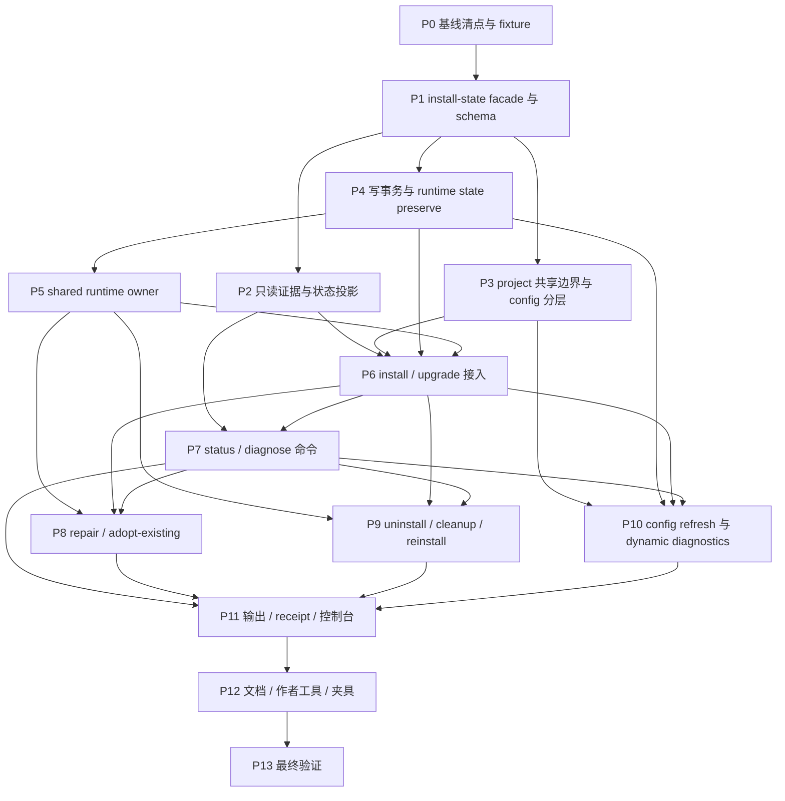

# 插件安装状态最小化执行计划

日期：2026-05-07  
来源：[`../specs/minimal-plugin-install-state.md`](../specs/minimal-plugin-install-state.md)  
状态：待执行

## 需求来源

本计划落实 `docs/dev/specs/minimal-plugin-install-state.md`。如果实现过程中发现需求需要调整，先同步更新 spec 和计划；不要让实现按过期计划继续推进。

命令面以当前 CLI 和 spec 为准：`aw config configure` 已移除，本轮不恢复交互式 configure 入口。配置写入只覆盖现有 `config set/unset/reset`，并保留拒绝 `config configure` 的回归测试。

本轮改造的主线是：

- 不兼容旧 `installed.json`、旧 tracking manifest 或旧 Codex recovery breadcrumb，不做自动迁移。
- scope 本地 per-plugin install record 成为唯一安装真值；单条 record 损坏只影响对应插件和 location。
- AW 只持久化安全卸载、修复、重装、依赖保护和 shared runtime replay 所必需的最小归属信息。
- `status`、`diagnose`、主控制台和 JSON 输出都从当前文件、平台原生状态、current catalog、project shared identity、dynamic diagnostic cache 和全局依赖索引推导健康状态。
- project scope 的 AW private state 默认不提交；repo-visible artifacts 通过独立 project artifact shared identity metadata 支持 fresh clone 后显式认领。
- dynamic artifact refresh 的 accepted state / digest 进入独立 diagnostic cache，不进入 install record；install record 只在必要时更新 artifact identity。
- historical lifecycle runtime 只服务安全卸载和必要 repair / reinstall，不再作为完整 install snapshot。
- 全局依赖索引只辅助跨 scope incoming edge 保护；索引缺失、不可信或 stale 未退休时，删除类命令必须 fail closed。
- shared skill trigger runtime 改成单 owner 合同；冲突时必须显式 `--takeover-shared-runtime`。
- 用户默认输出只展示可理解、可行动的状态，不暴露 `ledger`、`tracking`、`breadcrumb`、`snapshot`、`degraded` 等内部术语。

## 首版交付目标

首版要交付八层能力。

第一层是新的 install-state facade：

- 统一读写 per-plugin install record、dynamic diagnostic cache、project artifact shared identity、global dependency index、historical lifecycle runtime、native transaction marker 和 shared runtime owner。
- 提供稳定 `recordId`、`sharedIdentityId`、location serializer、digest 校验、schema validator 和安全路径边界。
- 明确拒绝旧状态格式，不做 silent migration 或 best-effort backfill。

第二层是只读证据与状态投影：

- `status` 默认不写文件、不执行 renderer、不执行 lifecycle、不修复 native state。
- 只展示 `已安装`、`需要修复`、`可认领`、`有残留`、`由其它来源管理`、`未安装` 等用户可理解状态。
- 依赖、dynamic artifact、project shared identity、historical lifecycle、shared runtime owner 和 dependency index 只作为诊断证据参与投影。
- dynamic diagnostic cache 中最近一次 refresh 失败摘要必须参与默认投影；`status` / 默认 `diagnose` 不执行 renderer，也要能把 refresh failed 显示为需要修复或需要用户行动的状态。

第三层是 project scope 共享边界：

- `.claude/.agent-workflows/`、`.codex/.agent-workflows/` 和 `.agent-workflows/plugin-config.local/` 是 AW 本地私有状态，默认写入 ignore。
- `.agent-workflows/plugin-config/` 和 `.agent-workflows/project-artifacts/` 是可提交共享输入，不能被默认忽略。
- project artifact render config 只能来自 manifest default 和 project shared config store 中可共享键；user / project local / 路径型配置不能影响 repo-visible artifacts。

第四层是写命令事务：

- `install`、`upgrade`、`repair`、`uninstall`、`cleanup`、`reinstall` 和 config refresh 通过同一 facade 提交 ownership、identity、diagnostic、lifecycle 和 dependency 信息。
- record 成功提交前的 native marker、project identity、diagnostic cache、historical runtime、shared owner staging 都要可回滚或可诊断。
- 任意局部失败不写全局 degraded 状态，只留下局部可诊断证据。

第五层是 repair / cleanup / reinstall 命令面：

- `repair` 只在 current catalog 与 record source 能证明同一 bundle 时重新应用 artifacts；source 漂移时不能隐式升级。
- `repair --adopt-existing` 是 project fresh clone 认领共享 artifacts 的唯一脚本化入口。
- `cleanup` 只清理 AW 可确认拥有的残留、marker-only 或损坏状态，不替代正常 `uninstall`。
- `reinstall` 等价于 diagnose 后安全移除，再重新安装；遇到可认领状态默认停止。

第六层是依赖与索引：

- install record 保存 `installSource` 和 canonical outgoing `dependencyEdges`。
- `dependents`、`ref-count`、未使用依赖提醒和依赖健康结果全部现算，不持久化。
- 全局 dependency index 只用于跨 scope 删除保护、未使用依赖提示和汇总视图；不可信时删除 fail closed，并在 status / diagnose 的 verbose、JSON 和可行动诊断里解释覆盖范围不足的原因与恢复路径。

第七层是 shared skill trigger owner：

- 同一 plugin/platform 的 shared runtime 只有一个 owner location。
- 非 owner 写命令不能改变 shared runtime 语义，除非单目标命令显式传 `--takeover-shared-runtime`。
- owner 删除后恢复 embedded 默认，不从其它 record 自动重选。

第八层是输出、文档和作者工具：

- 默认人类输出不暴露内部状态术语。
- JSON 字段围绕新模型命名，例如 `installRecordPresent`、`dynamicDiagnosticUnavailable`、`projectArtifactIdentityHealthy`、`dependencyIndexTrusted`。
- 公开文档、测试 fixture 和 `.agents/skills/create-agent-workflows-plugin/` 必须同步。

## 执行边界

本轮覆盖：

- per-plugin install record v2。
- dynamic artifact diagnostic cache v1。
- global dependency index v1。
- project artifact shared identity metadata v1。
- historical lifecycle runtime ref 与 runtime directory。
- Codex user native transaction marker v1。
- shared skill trigger runtime owner v1。
- project shared / local config store 边界和 ignore preflight。
- `install`、`status`、`diagnose`、`repair`、`uninstall`、`cleanup`、`reinstall`、`upgrade`、`config get/list/set/unset/reset`；不重新引入已移除的 `config configure`。
- 主控制台和默认输出的新友好状态投影。
- `aw init`、marketplace refresh、layout repair、`~/.aw` 原子替换对 runtime state 的 preserve / fingerprint ignore 合同。
- 文档、作者工具、测试夹具和 smoke 验证。

本轮不覆盖：

- 旧 `installed.json`、旧 tracking manifest 或旧 recovery breadcrumb 自动迁移。
- 旧版 artifact snapshot 或完整 install snapshot 的兼容读取。
- 自动卸载引用归零的依赖；只给手动清理建议。
- 旧版跨 scope skill trigger drift 诊断。
- 用 historical lifecycle runtime 解释 current artifacts、config schema 或 dependency manifest。
- 在 current catalog 已漂移且没有旧 artifact truth 的情况下，可靠判断旧版静态 artifact 是否被手工改坏。
- project shared config 中本机路径型 `file` / `directory` 的可提交语义。
- 恢复或重新设计 `aw config configure` 交互式配置命令。

## 总体方案

### Install-State Facade

建议新增一组集中模块，避免 command、adapter、status 和 console 各自读写不同状态：

- `packages/cli/src/install-state/types.ts`
- `packages/cli/src/install-state/locations.ts`
- `packages/cli/src/install-state/records.ts`
- `packages/cli/src/install-state/dynamic-diagnostics.ts`
- `packages/cli/src/install-state/project-artifact-identity.ts`
- `packages/cli/src/install-state/dependency-index.ts`
- `packages/cli/src/install-state/lifecycle-runtime.ts`
- `packages/cli/src/install-state/native-transaction.ts`
- `packages/cli/src/install-state/shared-runtime-owner.ts`
- `packages/cli/src/install-state/evidence.ts`
- `packages/cli/src/install-state/status-projection.ts`
- `packages/cli/src/install-state/transactions.ts`

facade 对外提供稳定 API：

- `readInstallRecord(location)`
- `writeInstallRecord(record, options)`
- `deleteInstallRecord(location)`
- `readDynamicDiagnosticCache(location)`
- `writeDynamicDiagnosticCache(cache)`
- `readProjectArtifactIdentity(locator)`
- `writeProjectArtifactIdentity(identity)`
- `readDependencyIndex()`
- `refreshDependencyIndexFromRecords(records)`
- `writeNativeTransactionMarker(marker)`
- `deleteNativeTransactionMarker(target)`
- `stageHistoricalLifecycleRuntime(bundle, location)`
- `commitHistoricalLifecycleRuntime(staging)`
- `readSharedRuntimeOwner(plugin, platform)`
- `stageSharedRuntimeOwnerTakeover(...)`
- `collectInstallEvidence(target)`
- `projectInstallState(evidence)`

完成后，旧 `InstalledLedger` 和 tracking manifest 的 install truth 语义应逐步从写路径退出。保留旧类型时，也只能作为过渡内部实现，不能继续作为新状态真值。

### 证据分层

状态读取按九层证据组合：

1. Current catalog。
2. 平台现场。
3. Project artifact shared identity。
4. Scope 本地 per-plugin install record。
5. Dynamic artifact diagnostic cache。
6. Historical lifecycle runtime。
7. Global dependency index。
8. Shared skill trigger runtime owner。
9. Native transaction marker。

每一层都要返回结构化 evidence，不直接输出用户文案。用户文案由 status projection、diagnose renderer 和 receipt reporter 统一生成。

### 写入顺序

写命令必须遵守统一顺序：

1. 解析 current catalog、目标 location、依赖图和 project config 输入。
2. 做整张图的只读 preflight。
3. staging native marker、project identity backup、dynamic cache backup、historical runtime staging、shared owner backup。
4. 写 native 和 artifacts。
5. 写 project artifact shared identity。
6. 写 dynamic diagnostic cache。
7. 写 historical lifecycle runtime。
8. 运行 lifecycle。
9. 原子提交 install record。
10. 删除 marker 或提交 owner takeover。
11. 刷新 global dependency index。
12. 回收当前命令 staging；无法回收的内容只进入诊断 warning。

## 阶段依赖关系图

### Mermaid



### 并行调度建议

- 波次 A：先做 P0。
- 波次 B：P1 完成后，P2、P3、P4 可以并行；P2 只读，P3 project/config，P4 写事务。
- 波次 C：P4 完成后做 P5；同时可以继续补 P2/P3 的边界测试。
- 波次 D：P2/P3/P4/P5 都可用后做 P6；P6 是后续写命令的主阻塞点。
- 波次 E：P7、P8、P9、P10 可以在 P6 稳定后分工并行，但 P8/P9/P10 都应复用 P7 的诊断模型和 P4 的事务 API。
- 波次 F：P11 汇总输出和控制台，P12 同步文档和作者工具，P13 做完整验证。

## 阶段计划

### 阶段 P0：基线清点与 Fixture 准备

依赖：无  
建议并行：无，先由一个执行者锁定测试入口和旧状态边界。

任务：

- [ ] 梳理当前状态写入入口：`install`、`upgrade`、`uninstall`、`status`、discovery、console、config refresh、adapter tracking、local marketplace refresh。
- [ ] 确认 config 写命令测试入口只覆盖 `config set/unset/reset`，并保留拒绝 `config configure` 的现有测试。
- [ ] 标记所有旧 `InstalledLedger`、tracking manifest、install snapshot、capability snapshot、Codex breadcrumb 的读取和写入路径。
- [ ] 建立新旧状态对照表：哪些字段删除、哪些字段进入 install record、哪些字段进入 diagnostic cache、哪些字段改为现算。
- [ ] 新增 fixture builder，能表达 per-plugin record、dynamic diagnostic cache、project shared identity、dependency index、historical lifecycle runtime、native marker 和 shared owner。
- [ ] 新增 project scope fixture，覆盖 repo-visible artifacts 已存在但本机 record 缺失的 fresh clone 场景。
- [ ] 新增损坏 fixture：单条 record 损坏、diagnostic cache 损坏、identity metadata 损坏、dependency index stale / unreadable、historical lifecycle 缺失、native marker-only、record+install marker 残留。
- [ ] 新增输出词汇守卫 fixture，后续用于确保默认 stdout 不出现禁用内部术语。
- [ ] 给当前旧行为补最小 regression tests，作为后续替换的对照。

测试验收：

- [ ] fixture builder 可以独立构造 spec 中六类默认状态：已安装、需要修复、可认领、有残留、由其它来源管理、未安装。
- [ ] 单个 record 损坏 fixture 不会影响同 scope 其它 record fixture 的读取。
- [ ] 当前旧 `installed.json` 写入路径在测试中被明确标注，后续阶段能逐步替换。
- [ ] 运行相关 fixture / helper 单测，确认新增 fixture 不依赖真实 Codex、Claude 或用户目录。

### 阶段 P1：Install-State Facade 与 Schema

依赖：P0  
建议并行：P1 内部可以按 record、diagnostic、identity、index、lifecycle、marker、owner 分文件并行，但需要一个人统一类型和命名。

任务：

- [ ] 新增 `PluginLocation`、`InstallRecordFile`、`InstallRecord`、`InstallRecordInstallSource`、`InstallRecordDependencyEdge`、`InstallRecordArtifact` 类型。
- [ ] `InstallRecordArtifact` 必须覆盖 repair / cleanup 所需的最小 artifact identity：完整 `path` / `paths`、shared file block 的 `ownershipMarker`、skill / MCP `artifactKey`、hook `hookGroups`、dynamic artifact `id` + `target`、role registration `roleKey`；这些字段只表达定位和归属，不保存 digest、refresh 或健康结论。
- [ ] `InstallRecord` schema 明确包含 `options.skillTriggerPreference?: "default" | "manual" | "auto"`；该字段只保存当前 location 自己的偏好，不能恢复旧的跨 scope 写入顺序、胜者列表或 sibling drift 状态。
- [ ] 实现稳定 `recordId` 生成：可读 `pluginSlug` 加 `sha256(location).slice(0, 12)`，文件内容自带完整 location。
- [ ] 实现 per-plugin record 路径：
  - Claude user：`~/.claude/.agent-workflows/records/<recordId>.json`
  - Claude project：`<project>/.claude/.agent-workflows/records/<recordId>.json`
  - Codex user：`~/.codex/.agent-workflows/records/<recordId>.json`
  - Codex project：`<repo>/.codex/.agent-workflows/records/<recordId>.json`
- [ ] 实现 install record schema validator，强制 `version: 2`、`installSource`、`dependencyEdges: []` 和 `source` digest / fingerprint。
- [ ] validator 明确拒绝旧读模型和派生健康字段：`ledgerState`、`degradedAt`、`degradedReason`、`scopeInitialized`、`capabilitySnapshot`、`lastRequestedScope`、`lastRequestedAt`、`sharedNativeRefs`、`skillTriggerWriteOrder`、`dependents`、`refCount`、`autoRemovable`、`unusedDependencyHint`、`dependencies.satisfied`、`dependencies.missing`、`dependencies.catalogDrift`。
- [ ] validator 明确拒绝 dynamic diagnostic / snapshot 派生字段：`lastRefresh`、`refreshReach`、`configDigest`、`contentDigest`、完整 install snapshot、capability snapshot、config snapshot 或 artifact health snapshot metadata；record 只能保存 historical lifecycle 引用，不能保存完整 snapshot 内容。
- [ ] 新增 dynamic diagnostic cache v1 类型、路径、读写和 validator；读取时必须能把 cache `recordId` / `location` 和 entry 的 `id` / `target` / `artifactKey` / `roleKey` 对齐到当前 record 中的 dynamic artifact identity。
- [ ] 新增 project artifact shared identity v1 类型、repo-stable locator、`sharedIdentityId` 生成、路径和 validator。
- [ ] `ProjectArtifactSharedLocator.repoRelativeProjectRoot` 只能来自 repo-stable 信息：仓库根为 `"."`，子目录使用相对 repo root 的 `/` 分隔路径；validator 必须拒绝空值、绝对路径、`..`、本机 `projectKey`、realpath、home directory 或 cwd 派生值。
- [ ] `ProjectArtifactIdentityArtifact` 必须覆盖 shared artifact repair / adopt / cleanup 所需的最小 identity：完整 `path` / `paths`、shared file block 的 `ownershipMarker`、skill / MCP `artifactKey`、hook `hookGroups`、dynamic artifact `id` + `target` + `state`、role registration `roleKey`；`contentDigest` 只能作为已接受内容的校验辅助，不能替代 current catalog。
- [ ] 确保 shared identity 文件名和内容都不保存本机 `PluginLocation`、`projectKey`、`recordId`、绝对路径、realpath、home directory 或 cwd；fresh clone、换机器或同一仓库移动到不同绝对路径后，同一 locator 必须命中同一个 identity 文件。
- [ ] 新增 global dependency index v1 类型、读写、digest 校验和 stale / unreadable reference 基础分类。
- [ ] 新增 historical lifecycle runtime ref 类型和路径 helper，路径固定为 `~/.aw/lifecycle-runtimes/<platform>/<scope>/<scopeKey>/<recordId>/<runtimeId>/`，并保证 `bundleRoot`、`manifestPath` 位于 `runtimeRoot` 内。
- [ ] lifecycle runtime 的 `scopeKey` 必须使用安全路径片段：user scope 使用稳定常量，project scope 使用 canonical project key 的安全片段；任何路径分隔符、绝对路径、`..` 或 home / realpath 泄漏都必须被 validator 拒绝。
- [ ] `runtimeId` 必须由 `source.manifestDigest`、`source.bundleFingerprint` 和唯一写入 nonce 生成，避免同一次 upgrade 中新旧 historical runtime 目录互相覆盖。
- [ ] 新增 native transaction marker v1 类型和路径，只支持 Codex user install / uninstall marker。
- [ ] 新增 shared skill trigger runtime owner v1 类型、文件名 hash 规则和 validator。
- [ ] 所有新状态读写都用结构化 parser，不用临时字符串拼接判定 JSON 结构。
- [ ] 对旧 `installed.json`、旧 tracking、旧 breadcrumb 不做迁移；读到旧格式时返回明确 unsupported / legacy evidence，不当成成功安装。

测试验收：

- [ ] schema 单测覆盖合法 record、合法 / 非法 `options.skillTriggerPreference`、缺 `dependencyEdges`、缺 `installSource`、location 与文件名不匹配。
- [ ] schema 单测逐项覆盖 install record banned fields：`degradedReason`、`lastRequestedScope`、`lastRequestedAt`、`sharedNativeRefs`、`autoRemovable`、`unusedDependencyHint`、`dependencies.satisfied` / `dependencies.missing` / `dependencies.catalogDrift`、`refreshReach`，以及其它旧 ledger、snapshot、digest、refresh 和 health 字段。
- [ ] artifact identity schema 单测覆盖 `InstallRecordArtifact` 和 `ProjectArtifactIdentityArtifact` 的最小字段：`artifactKey`、`hookGroups`、`id` + `target`、`roleKey`、`ownershipMarker`；缺少对应 artifact kind 必需 identity 时 validator 拒绝，合法组合不要求 digest 或 refresh 元数据进入 record。
- [ ] recordId、sharedIdentityId 和 shared owner filename 对 scoped package、空格、大小写、路径分隔符和 slug 碰撞稳定。
- [ ] lifecycle runtime path helper 对 scoped package、project path、路径分隔符、绝对路径、`..` 和 slug 碰撞稳定；`scopeKey` 不泄漏本机绝对路径或 home directory。
- [ ] 同一 record 连续 stage 两次相同 manifest digest / bundle fingerprint 时生成不同 `runtimeId`，且两个 runtime 目录可以同时存在。
- [ ] project shared identity validator 拒绝 `repoRelativeProjectRoot` 为空、绝对路径、包含 `..`、使用 `projectKey`、realpath、home directory 或 cwd；不同绝对路径 clone 下生成同一个 locator / identity id。
- [ ] dynamic diagnostic cache 缺失、损坏、location / recordId 不匹配，或 entry 无法和当前 record artifact identity 对齐时，只返回 diagnostic unavailable，不改变 install truth。
- [ ] native transaction marker 可独立于 record 读取；record 损坏不会导致 marker 丢失。
- [ ] global dependency index validator 能区分缺文件、损坏、stale candidate 和 unreadable reference。

### 阶段 P2：只读证据收集与状态投影

依赖：P1  
建议并行：可与 P3、P4 并行。P2 只读，不接入写命令。

任务：

- [ ] 新增 `collectInstallEvidence()`，组合 current catalog、平台现场、project shared identity、install record、dynamic cache、historical lifecycle、dependency index、shared owner、native marker。
- [ ] 定义 evidence model，保留机器字段，不在 evidence 层生成默认人类文案。
- [ ] 实现默认状态投影：
  - 已安装
  - 需要修复
  - 可认领
  - 有残留
  - 由其它来源管理
  - 未安装
- [ ] 实现 catalog source drift 规则：record source 与 current catalog 不一致时，只标记 catalog drift / upgrade available，不把旧静态 artifact 与 current catalog 的差异判成损坏。
- [ ] 实现 static artifact content check：只有同 bundle 或有可验证 accepted digest / shared identity 时才判 content drift。
- [ ] 实现 dynamic artifact 默认只读规则：不执行 renderer；cache 缺失、损坏或 entry 无法和当前 record artifact identity 对齐时标记 `dynamicDiagnosticUnavailable`，不能用脱钩 entry 的 accepted `contentDigest` / `configDigest` / `lastRefresh` 臆测 drift、stale 或 recent refresh failed。
- [ ] 实现 dynamic diagnostic cache 正向投影：accepted `contentDigest` 与现场文件不一致时报 dynamic content drift；project artifact render config digest 与 cache `configDigest` 不一致时报 config stale，且默认读路径不执行 renderer。
- [ ] 实现 dynamic diagnostic cache 的 refresh failure 投影：`lastRefresh` / `refreshReach` 显示最近一次 refresh 失败时，默认 `status` / `diagnose` 必须在不执行 renderer 的前提下报告 recent refresh failed，并让已安装目标进入需要修复 / 需要处理的健康结论；该失败摘要不得覆盖 accepted `state` / `contentDigest` / `configDigest` 的正向诊断。
- [ ] 实现 dynamic disabled 状态：`state: "disabled"` 时目标内容缺失不算 missing，展示 `disabledReason`。
- [ ] 实现 dependency health 投影：从 verified record outgoing edges 和可信 index 现算 `dependents`、`autoInstalled`、`unusedDependencyHint`；`autoInstalled` 只反映 record 最初来自 `installSource.kind === "dependency"`，即使后来被用户显式保留也仍为 true，但 `explicitlyRequested === true` 时不能再展示未使用依赖提醒。
- [ ] 实现 dependency index fail-closed 投影：索引不可信时不展示未使用依赖提醒。
- [ ] 实现 dependency index coverage evidence：索引缺失、损坏、只能从当前可定位 scope 部分重建、或相关 record 无法校验时，结构化输出 `coverageTrusted: false`、不可信原因、当前已验证覆盖范围、已知但需要回访 / repair 的 project locations；没有已知 project location 时，输出“回到可能相关 repo 重新运行 diagnose 或 repair 以重新登记记录”的恢复建议。
- [ ] 实现 project fresh clone 可认领判定：shared identity、AW marker、current catalog stable artifact identity 可以对齐时显示可认领；identity metadata 缺失时，只有 current catalog 仍能提供足够 artifact truth 且未漂移，才允许靠 stable artifact identity / AW marker 判成可认领。
- [ ] current catalog 已漂移且 identity metadata 缺失时，不把旧共享 artifacts 稳定归类为可认领，必须降级为有残留或归属不明，并在 diagnose 中说明缺少可验证 shared identity。
- [ ] 实现 shared owner 只读投影：owner 是否存在、是否可验证、是否需要 takeover，不把 owner 当安装真值。
- [ ] 实现 native transaction marker 只读投影：区分 marker-only、record+install marker 残留和 uninstall marker；只要 marker 存在，顶层状态都进入需要处理。record+install marker 同时存在时，即使 record、artifacts、dynamic cache 和 dependency edges 都健康，也不能投影为已安装；结构化 evidence 必须同时保留 record 侧事实、marker 侧事实、repair availability 和 cleanup availability，避免误走 marker-only 分支。

测试验收：

- [ ] `status` projection fixture 覆盖六类默认状态。
- [ ] record+install marker 残留 fixture 投影为需要处理而不是已安装；JSON / projection evidence 同时包含可信 record 和未收口 marker，repair / cleanup availability 区分该分支与 marker-only。
- [ ] current catalog 漂移但 record / artifacts / dependencies 健康时顶层仍是已安装。
- [ ] dynamic cache 缺失、损坏或 entry 无法和当前 record artifact identity 对齐时不执行 renderer，不把顶层降级为需要修复，只在 verbose / JSON 标记 `dynamicDiagnosticUnavailable` 并建议 `diagnose --deep`。
- [ ] dynamic cache 存在且 accepted `contentDigest` 与现场文件不一致时，默认 projection 报 dynamic content drift，不执行 renderer。
- [ ] project shared render config digest 与 dynamic cache `configDigest` 不一致时，默认 projection 报 config stale；user / project local / 路径型配置变化不触发 repo-visible stale。
- [ ] dynamic cache 记录最近 refresh 失败时，默认 projection 报 recent refresh failed、顶层进入需要修复 / 需要处理，不执行 renderer，且仍保留上一份 accepted state / digest 用于 content drift、config stale 或 disabled 诊断。
- [ ] project fresh clone 有共享 artifacts 且无本机 record 时显示可认领，不显示有残留。
- [ ] identity metadata 损坏、locator 不匹配或 artifact path 越界时不能认领。
- [ ] fresh clone 无本机 record、缺少 identity metadata 且 current catalog 已漂移时，不显示可认领；projection 降级为有残留或归属不明，并提示 cleanup / reinstall / diagnose。
- [ ] dependency index 不可信时不展示 unused dependency hint；删除保护相关 evidence 标记 fail closed。
- [ ] dependency index 覆盖范围不足时，projection / JSON 不只标记 fail closed，还要带出 coverage 不可信原因、已验证覆盖范围、需要回访或 repair 的 project locations；没有已知 project location 时要给出回到可能相关 repo 重新登记记录的恢复建议。
- [ ] 自动安装的依赖后来被用户显式保留时，projection 仍输出 `autoInstalled: true` 和当前 `dependents`，但不输出 `unusedDependencyHint`；同一 fixture 覆盖无可信 incoming edge、可信 index、`explicitlyRequested` true / false 两个分支。
- [ ] current catalog 新增 dependency、但当前 record 的 dependency edges 仍可验证且自洽时，顶层仍是已安装；只在 verbose / JSON 标记 catalog dependency drift / upgradeAvailable，不显示 missing dependency 或需要修复。
- [ ] record 的 dependency edge 指向缺失、不健康或无法验证的位置时，默认 status / diagnose 顶层进入需要修复，并列出需要补齐或修复的 dependency location；不把该场景降级成 unused dependency hint 或普通 catalog drift。

### 阶段 P3：Project 共享边界与 Config 分层

依赖：P1  
建议并行：可与 P2、P4 并行，注意和 P4 统一 preflight API。

任务：

- [ ] 新增 project private state ignore helper，首次创建 `.claude/.agent-workflows/`、`.codex/.agent-workflows/`、`.agent-workflows/plugin-config.local/` 前确保 ignore 规则存在。
- [ ] 无法安全更新 ignore 时继续命令，但 receipt / stderr 输出精确 warning 和建议 pattern。
- [ ] 确保 `.agent-workflows/plugin-config/` 和 `.agent-workflows/project-artifacts/` 不被默认 ignore。
- [ ] 写 project shared config 的 `set` / `unset` / `reset` 路径必须先检查目标路径没有被 ignore 覆盖；被覆盖时在 shared config store 落盘前失败，不创建、修改或删除 `.agent-workflows/plugin-config/<plugin>/config.json`，也不刷新 repo-visible artifacts，并提示修正 ignore 规则或改用 `--scope project --local`。
- [ ] 写 project artifact shared identity 前检查 `.agent-workflows/project-artifacts/<platform>/<sharedIdentityId>.json` 没有被 ignore 覆盖；被覆盖时必须在第一笔 repo-visible artifact 写入前失败，并在 receipt / stderr 中提示命中的 ignore pattern、建议保留 `.agent-workflows/project-artifacts/` 可提交，以及本次未写入共享 artifacts。
- [ ] 拆分 config store：
  - user config store
  - project shared config store
  - project local config store
- [ ] 实现 project artifact render config：只合并 manifest default 和 project shared config 中可共享键。
- [ ] project artifact render config 构建时排除路径型配置：`file` / `directory` 不得从 manifest default、project shared config 或其它来源进入 repo-visible artifact render config、digest、stale 判断或 refresh。
- [ ] project artifact required config 和 refresh keys 做共享边界 preflight；如果 project artifact 依赖 `file` / `directory` key，包括 schema default，install / repair / upgrade / config refresh 必须在写入前失败，并提示插件作者改用可移植 string 配置，或把行为放到 lifecycle/helper 等本机 effective config 场景。
- [ ] 实现 project effective config：manifest default < user < project shared < project local。
- [ ] `file` / `directory` 类型禁止写入 project shared config；`unset` / `reset` 可以删除旧实验状态。
- [ ] shared store 中已有路径型 key 时，install / repair / upgrade / config refresh 预检失败并提示改用 user 或 project local。
- [ ] project lifecycle / helper 使用本机 effective config，但不得影响 repo-visible artifact truth。
- [ ] `aw config get/list --scope project --local` 增加 local-only 读取模式：聚焦 project local store，同时在 human / JSON 输出中标明这是本机私有覆盖层，不作为 repo-visible artifact 渲染输入。
- [ ] receipt 分类 private state、ignored state、project shared config、project local config 和 repo-visible artifacts。

测试验收：

- [ ] project private state 目录首次创建时自动补 ignore；默认人类输出不把 private state 当作需要提交的项目文件。
- [ ] project private state ignore 自动补规则更新失败时，project-scope install / repair / upgrade / reinstall、`aw config --scope project --local`，以及会写 project-scope diagnostic cache 的 config refresh 仍继续执行；测试断言 receipt / stderr 输出明确 warning 和建议追加的精确 pattern，且默认人类输出不把 private state / local config 当作需要提交的项目文件。
- [ ] project shared config path 被 ignore 时，`config set/unset/reset --scope project` 在写 shared config store 前失败；测试断言 shared config 文件未创建、内容保持不变或未被删除，且没有刷新 artifacts。
- [ ] project artifact identity path 被 ignore 时，install / repair / upgrade / reinstall / config refresh 在写任何 repo-visible artifact 前失败；测试断言输出包含命中的 ignore pattern、保留 `.agent-workflows/project-artifacts/` 可提交的修复建议，以及本次未写入共享 artifacts。
- [ ] `aw config set --scope project` 写路径型 key 在写文件前失败；`--local` 可以写入本机 local store。
- [ ] project artifact 对路径型 key 有 schema default、required config 或 refresh key 时，install / repair / upgrade / config refresh 在写 artifact 前失败，不把 realpath 写进 render config、digest 或 diagnostic cache。
- [ ] `config get/list --scope project` JSON 能区分 default、user、projectShared、projectLocal 和 effective value，并用稳定机器字段表达每个 key 的 repo-visible artifact truth 仍来自 project artifact render config；local override 或路径型配置命中时，测试必须断言 effective value 和 artifact truth 不会混成同一层。
- [ ] `config get/list --scope project --local` human / JSON 只聚焦 project local store，并明确 local override 不影响 repo-visible project artifacts。
- [ ] project lifecycle / config helper 收到本机 effective config，能读到 user 和 project local override；artifact renderer、dynamic config digest 和 stale 判断仍只读取 project artifact render config。
- [ ] project local 或 user 路径型配置变化不会让 repo-visible project artifact 变 stale；同类本机路径失效时，只阻断 lifecycle / config helper，不把 repo-visible artifact truth 标成 stale 或 damaged。

### 阶段 P4：写事务、Runtime State Preserve 与 GC 基础

依赖：P1，建议读取 P3 的 preflight API  
建议并行：可与 P2/P3 并行早期开发，但接入命令前必须统一事务合同。

任务：

- [ ] 新增 install-state transaction helper，支持 staging、backup、commit、rollback 和 receipt warning。
- [ ] 实现 record 原子写入和删除；record 删除成功后 best-effort 删除 diagnostic cache。
- [ ] 实现 dynamic diagnostic cache 写入规则：成功接受才更新 accepted state / digest；refresh 失败只更新 `lastRefresh` / `refreshReach`。
- [ ] 实现 project artifact identity 写入 / 删除 / rollback helper。
- [ ] 实现 historical lifecycle runtime staging / commit / rollback；staging runtime 使用本次写入的唯一 `runtimeId`，commit 前不得覆盖任何既有 runtime。
- [ ] upgrade / reinstall 替换 record 时，新旧 historical runtime 必须并存到新 record 原子提交成功之后；提交失败时旧 record 和旧 runtime 仍可供普通 uninstall 使用。
- [ ] rollback 只清理当前命令产生且尚未被成功 record 引用的 staging runtime；已经进入最终 `lifecycle-runtimes/` 但没有可信 record 引用的 runtime 只能由显式 cleanup 或满足 fail-closed 条件的 GC 删除。
- [ ] 实现 native transaction marker 写入 / 更新 / 删除。
- [ ] record 已原子提交但 install marker 删除失败时，transaction helper 必须返回“record 已提交、marker 未收口”的结构化结果；不得回滚已提交 record，也不得把 marker 删除失败吞成完全成功。
- [ ] 实现 dependency index refresh：写命令提交或删除 record 后刷新；刷新失败只 warning。
- [ ] 实现 dependency index prune token 生成基础，token 绑定 location、record path 和 index digest。
- [ ] 实现 historical lifecycle runtime GC 基础：只有 verified records 覆盖范围可信时才删除孤儿 runtime，否则 fail closed。
- [ ] 更新 `~/.aw` runtime state allowlist：
  - `plugin-config/`
  - `dependency-index/`
  - `lifecycle-runtimes/`
  - `native-recovery/`
  - `shared-runtime-owners/`
- [ ] 让 `aw init`、marketplace refresh、layout repair 和 `~/.aw` 原子替换复用同一 allowlist 做 preserve、bundle fingerprint ignore 和 layout freshness ignore。

测试验收：

- [ ] transaction 单测覆盖 record 提交前失败、record 提交后 marker 删除失败、project identity rollback 失败、diagnostic cache 删除失败；record 提交后 marker 删除失败时断言 record 仍存在、marker 仍可读，transaction result 不标记为完全成功。
- [ ] refresh 失败不会覆盖上一份 accepted dynamic state / digest。
- [ ] dependency index refresh 失败不回滚已经成功的 record，但后续删除类 evidence 标记 fail closed。
- [ ] `aw init --force`、marketplace refresh、layout repair 保留五类 runtime state，并且它们不参与 bundle fingerprint / layout freshness。
- [ ] upgrade / reinstall 事务中，新 runtime 提交前旧 runtime 仍存在；新 record 提交失败后旧 record 引用的 runtime 仍可用于 uninstall。
- [ ] rollback 只删除本次 staging runtime，不误删同 record 下其它 `runtimeId` 目录。
- [ ] lifecycle GC 在 record 或 index 不可信时保留 runtime。

### 阶段 P5：Shared Skill Trigger Runtime Owner

依赖：P1、P4  
建议并行：可独立实现 owner store 和 preflight，再由 P6/P8/P9 接入命令。

任务：

- [ ] 实现 owner 文件路径：`~/.aw/shared-runtime-owners/<platform>/<pluginSlug>.<pluginHash>.json`。
- [ ] 文件名必须包含 `sha256(pluginName).slice(0, 12)` 或更强 hash，避免 slug 碰撞。
- [ ] 实现 owner 读取、校验、写入、删除和 digest 验证。
- [ ] 定义 shared runtime 影响判定：哪些 install / repair / upgrade 会改变 shared skill trigger 语义。
- [ ] shared runtime 影响判定必须明确排除 Codex project scope repo-local skill trigger：Codex project install / repair / upgrade / adopt-existing 中的 skill trigger 写入只落到当前仓库的 `.agents/skills/<skill>/agents/openai.yaml`，这一路径不读写 `shared-runtime-owners/`，不参与 owner 竞争、takeover preflight 或 replay。
- [ ] 没有 owner 时，当前影响 shared runtime 的 location 在 record 成功提交后成为 owner。
- [ ] 非 owner 改变 shared runtime 语义时默认失败，提示重跑同一条命令并加 `--takeover-shared-runtime`。
- [ ] `--takeover-shared-runtime` 只允许单目标 install / repair / explicit upgrade，不允许 `upgrade --all`。
- [ ] owner install / repair / upgrade 成功后更新 owner digest 和 preference。
- [ ] owner 文件中的 `preference` 只能来自 owner record 的 `options.skillTriggerPreference`；非 owner record 保留自己的偏好，不能被 owner replay 覆盖或丢失。
- [ ] owner uninstall / cleanup 后删除 owner 状态，并恢复 embedded 默认。
- [ ] `aw init` / marketplace refresh / layout repair / `~/.aw` 原子替换只 replay owner 状态记录的 preference；owner digest 不可验证时不自动重选，也不能沿用替换前或 preserve 后的错误 shared runtime 内容。
- [ ] owner digest 不可验证时，shared runtime 必须落回 embedded 默认或本次命令的当前 staging 默认，并在 receipt / stderr 提示运行 diagnose / repair；需要改由其它 location 控制时，用户必须在单目标写命令中显式加 `--takeover-shared-runtime`。
- [ ] 命令失败时恢复旧 owner 状态和旧 shared runtime；没有旧 owner 时恢复 embedded 默认。

测试验收：

- [ ] 两个 slug 相同但原始 plugin name 不同的插件不会写到同一个 owner 文件。
- [ ] 非 owner install / repair / upgrade 改变 shared runtime 语义时失败并给出 takeover 建议。
- [ ] takeover 只有 record 成功提交后才改 owner；失败时恢复旧 owner 和 shared runtime。
- [ ] takeover 成功后 owner replay 使用新 owner record 中的 `options.skillTriggerPreference`；旧 owner record 保留自己的偏好但失去 shared runtime 控制权。
- [ ] `upgrade --all` 遇到 owner 冲突跳过目标，不批量接管。
- [ ] owner 删除后恢复 embedded 默认，剩余非 owner record 不自动接管。
- [ ] owner record digest mismatch / record 不可读后运行 `aw init --force`、marketplace refresh、layout repair 或 `~/.aw` 原子替换时，shared runtime 落在 embedded 默认或当前 staging 默认；不会从其它 record 自动挑 owner，也不会继续保留失效 owner 的 preference。
- [ ] Codex project scope install / repair / upgrade / adopt-existing 改写 repo-local `openai.yaml` 时，不会创建或更新 shared owner，不因其它 location 持有 shared owner 而失败，也不会要求 `--takeover-shared-runtime`。

### 阶段 P6：Install / Upgrade 接入新状态模型

依赖：P2、P3、P4、P5  
建议并行：拆成 install、upgrade、dependency graph executor 三个小组，但必须共用同一 graph write executor。

任务：

- [ ] 在第一笔写入前完成 current catalog、platform/scope、dependency graph、project installability、required config、external ownership、目标文件冲突、role/MCP namespace、依赖安装选项冲突、shared owner、project ignore preflight。
- [ ] shared owner graph preflight 只对实际改变 shared runtime 的 target 启用；Codex project scope repo-local skill trigger 作为 repo-visible artifact / project record 路径处理，不纳入 shared owner 冲突判断。
- [ ] `--platform auto` 继续在依赖展开前完成，依赖不能反向影响 platform 选择。
- [ ] 复用 dependency planner，节点身份使用 `(plugin, platform, scope, projectKey)`。
- [ ] 缺失依赖先安装；父插件成功后才写 outgoing dependency edges。
- [ ] fresh explicit install 写 `{ kind: "explicit", explicitlyRequested: true }`。
- [ ] fresh auto dependency 写 `{ kind: "dependency", explicitlyRequested: false }`。
- [ ] 自动依赖后续被用户显式安装 / 升级 / 保留时，只把 `explicitlyRequested` 置为 `true`，保留 `kind: "dependency"`。
- [ ] install / upgrade 写 record 时持久化当前 location 解析后的 `options.skillTriggerPreference`；非 owner location 也必须保存自己的偏好，但不能改变 shared runtime，除非本次命令显式 takeover。
- [ ] 每个节点写 native、artifacts、project identity、dynamic cache、historical lifecycle runtime、lifecycle、install record、dependency index。
- [ ] Codex user native install 成功后立刻写 native transaction marker；record 成功提交后删除 marker。
- [ ] Codex user native install / upgrade 在 record 已提交但 install marker 删除失败时，命令 receipt 不能报告为完全成功；必须提示后续运行 `aw repair` 或 `aw cleanup` 收口，并把该目标留给 P2/P7 的 record+install marker 状态投影。
- [ ] project scope install 写 repo-visible artifacts 时同步写 project artifact shared identity。
- [ ] install 遇到可认领 project artifacts 时不自动接管，失败并提示 `aw repair --adopt-existing`。
- [ ] upgrade 简化为按 current catalog 重新应用并替换 record；不依赖 capability snapshot。
- [ ] upgrade 成功后刷新 current platform 生效的 dependency edges；旧 edge 只能在父插件成功后移除。
- [ ] `upgrade --all` 根集合只包含 `explicitlyRequested === true` 的 record。
- [ ] marker-only 状态不能 upgrade；显式 upgrade 提示先 repair 或 cleanup，`upgrade --all` 跳过。
- [ ] 新 record 成功提交后才能删除旧 record 引用的 historical runtime。
- [ ] 失败回滚：不提交失败 dependent edge；未被成功 edge 引用的新自动依赖优先回滚或留下可诊断残留。

测试验收：

- [ ] install 成功只写新 per-plugin record、dynamic cache、dependency index、project identity；不写旧 `installed.json`。
- [ ] 任一图级 preflight 失败时不写 native、artifact、record、diagnostic cache、identity metadata 或 lifecycle runtime。
- [ ] 目标文件冲突在第一笔写入前失败；测试断言 native、artifact、record、diagnostic cache、identity metadata、lifecycle runtime 和 dependency index 均未写入。
- [ ] 依赖安装选项冲突在第一笔写入前失败；测试断言不会先安装依赖或写入任何 graph node 的状态。
- [ ] 父插件安装失败时不留下失败父插件的 dependency edge。
- [ ] install / upgrade record 持久化当前 location 的 `options.skillTriggerPreference`；非 owner location 的偏好可供后续 takeover 使用，且不会改写当前 owner runtime。
- [ ] Codex project scope install / upgrade 在其它 location 已持有 shared owner、且本次只改 repo-local trigger 时仍成功；record 持久化当前 location 的 `options.skillTriggerPreference`，但不写 shared owner 状态。
- [ ] Codex user native install / upgrade record 提交后 marker 删除失败时，record、artifacts、dynamic cache、historical runtime 和 dependency index 保持已提交状态，receipt / JSON 不使用完全成功文案，并给出 repair / cleanup 下一步。
- [ ] 可认领 project artifacts 存在时 `aw install` 不接管、不建议默认清理。
- [ ] record source 与 current catalog 同 bundle时，install / upgrade 写出的 source digest / fingerprint 可被 status 验证。
- [ ] upgrade 失败不会删除旧 historical lifecycle runtime；旧 record 仍可供 uninstall 使用。
- [ ] 同一次 upgrade 会为新 record 写入不同 `runtimeId` 的 historical runtime；新 record 成功提交前旧 runtime 和新 runtime 同时存在，失败回滚后旧 runtime 保持可用。
- [ ] `upgrade --all` 不把未显式保留的孤立自动依赖当根。
- [ ] marker-only 目标显式 upgrade 在写入前失败并提示先 `repair` 或 `cleanup`，保留 native marker；`upgrade --all` 跳过 marker-only 目标并给出稳定提示，不为该目标写 record、artifacts、diagnostic cache、historical runtime 或 dependency index。

### 阶段 P7：Status / Diagnose 命令

依赖：P2、P6  
建议并行：P7 可以拆成 status 默认输出、status JSON、diagnose 默认、diagnose deep。

任务：

- [ ] `aw status` 接入 P2 projection，默认只读，不修复、不创建目录、不执行 renderer、不执行 lifecycle。
- [ ] 默认 status 文案只输出友好摘要和下一步，不暴露禁用内部术语。
- [ ] `status --verbose` / `--json` 暴露新模型字段：record、dynamic diagnostic、dependency index、`dependents`、`autoInstalled`、`unusedDependencyHint`、shared owner、project identity、catalog drift、repair / cleanup availability。
- [ ] status / diagnose 输出必须区分 record+install marker 残留与 marker-only：record+install marker 显示为需要处理，下一步指向 repair 或 cleanup；不得因 record 健康显示为已安装，也不得把它归入 marker-only 缺 record 路径。
- [ ] `diagnose` 默认只读，不执行 renderer，不写 record / diagnostic cache。
- [ ] 默认 status / diagnose 从 dynamic diagnostic cache 比对 accepted `contentDigest`、project artifact render config digest，以及 `lastRefresh` / `refreshReach` 的最后失败摘要，报告 dynamic content drift / config stale / recent refresh failed；cache 缺失、损坏或 entry 无法和当前 record artifact identity 对齐时只报告 unavailable 并建议 `diagnose --deep`。
- [ ] status 和默认 diagnose 使用纯只读 evidence 路径，不能复用会初始化目录、补 ignore 规则或写 private state 的 write preflight。
- [ ] `diagnose --deep` 可以执行 renderer，计算 current catalog 下当前期望内容。
- [ ] source 已漂移时，diagnose 只能提示 upgrade / reinstall，不把跨版本内容差异当 damage。
- [ ] diagnose 覆盖 artifact presence、shared file marker、native state、dependency edges、dependency index stale / unreadable、historical lifecycle、shared owner、project identity、可认领状态、残留证据。
- [ ] `diagnose` 和 `status --verbose` 输出 stale project reference prune token 和可复制命令；`status --json` 暴露稳定 token 字段，供脚本调用 `cleanup --dependency-index --prune-stale <token> --yes`。
- [ ] diagnose 说明 repair / cleanup / force cleanup 可用性，以及 cleanup 不运行 uninstall lifecycle 的风险。
- [ ] diagnose 判定某个目标只能通过 `cleanup --force` 清理时，默认 / verbose / JSON 输出必须列出将被备份的共享文件路径和备份原因，便于用户在执行前审计 force cleanup 的影响范围。
- [ ] dependency index 缺失、损坏或 coverage 不足时，`diagnose` 和 `status --verbose` 必须说明索引为什么不可信、当前只验证到哪些 location / scope、哪些已知 project location 需要重新访问或运行 repair；如果没有已知 project location，必须提示用户回到可能相关 repo 重新运行 diagnose 或 repair 来重新登记 record。
- [ ] JSON 字段命名使用 spec 推荐新模型，不复用旧 ledger / tracking 命名。

测试验收：

- [ ] 默认 status 不执行 renderer；用 fake renderer 断言不会被调用。
- [ ] 修改 dynamic artifact 输出文件后，默认 status / diagnose 通过 cache 报 dynamic content drift，fake renderer 仍未被调用。
- [ ] 修改 project shared config 中可共享 refresh key 且未 refresh 时，默认 status / diagnose 通过 cache 报 config stale，fake renderer 仍未被调用。
- [ ] dynamic cache 中只有最近 refresh 失败摘要发生变化时，默认 status / diagnose 报 recent refresh failed，顶层健康进入需要修复 / 需要处理，fake renderer 仍未被调用，accepted `contentDigest` / `configDigest` 保持可用于其它诊断。
- [ ] dynamic cache entry 与当前 record artifact identity 脱钩时，默认 status / diagnose 不使用该 entry 的 accepted digest、config digest 或 refresh failure 摘要，不执行 renderer，不报 drift / stale / recent refresh failed，只标记 `dynamicDiagnosticUnavailable`。
- [ ] project scope 默认 status / diagnose 在缺少 private state ignore 规则时也保持绝对只读，不修改 `.gitignore`，不创建 `.claude/.agent-workflows/`、`.codex/.agent-workflows/`、`.agent-workflows/plugin-config.local/`，也不写 record、diagnostic cache 或 config store。
- [ ] 同 scope 多个 record 中只有一条损坏时，默认 status / `status --json` 只把对应 plugin location 标为不可用或需要处理，其它健康 record 仍投影为已安装；损坏 record 不污染 sibling 的 dynamic diagnostic、dependency 或 cleanup availability。
- [ ] record+install marker 残留时，默认 status / diagnose / `status --json` 均显示需要处理和 repair / cleanup 下一步；fake writer 断言读路径不删除 marker、不刷新 record、不执行 native repair。
- [ ] `status --json` 对依赖投影输出 `dependents`、`autoInstalled`、`unusedDependencyHint`；默认 human 输出只在未显式保留、无可信 incoming edge 且 dependency index 可信时显示未使用依赖提醒，自动依赖后来被显式保留时不显示该提醒。
- [ ] `diagnose --deep` 会执行 renderer，但不写 diagnostic cache。
- [ ] source drift 只显示 catalog drift / upgradeAvailable，不把旧静态 artifact 判为 damaged。
- [ ] dynamic accepted disabled 时目标文件缺失不算 missing，输出 disabled reason。
- [ ] `diagnose`、`status --verbose` 和 `status --json` 都能为 stale project reference 输出 prune token / 可复制清理命令或稳定 token 字段；unreadable reference 不输出可 prune 语义。
- [ ] diagnose 对需要 `cleanup --force` 的目标输出将备份的共享文件列表；JSON 字段稳定，human 输出能让用户在运行 destructive 命令前看清备份范围。
- [ ] dependency index coverage 不足时，默认 diagnose / verbose status / `status --json` 都输出可行动恢复路径：含不可信原因、已验证覆盖范围、需要回访或 repair 的 project locations；没有已知 project location 时输出重新回到可能相关 repo 登记记录的建议。测试同时断言不会展示 unused dependency hint，也不会把部分索引用作跨 repo 删除授权。
- [ ] 默认 stdout 不包含 `ledger`、`tracking`、`breadcrumb`、`degraded`、`snapshot` 等禁用术语。

### 阶段 P8：Repair / Adopt Existing / Dependency Index Repair

依赖：P5、P6、P7  
建议并行：普通 repair、adopt-existing、dependency-index repair 可分工，但共享同一 preflight 和 transaction。

任务：

- [ ] 普通 repair 需要 current catalog；current catalog 不可用时写入前失败。
- [ ] record 存在且 source 与 current catalog 同 bundle 时，按 current catalog 重新应用 AW-owned artifacts、dynamic cache、historical runtime 和 dependency edges。
- [ ] record source 已漂移时，普通 repair 不重写 static artifacts、dynamic cache、project identity source、historical runtime 或 record source 为 current catalog。
- [ ] record source 已漂移但只需要收口 native marker、本机私有状态或全局 dependency index 时，普通 repair 必须允许成功；成功后保留原 record source、artifact identity、dynamic cache accepted state、historical runtime 和 record dependency edges。
- [ ] record+install marker 残留时，普通 repair 走“已存在 record 的 native 收口”分支：复用可信 record 和现场 native post-check，只收口 marker / 必要 native 私有状态；不得按 marker-only 创建新 record，也不得因 current catalog drift 改写 artifacts、dynamic cache、historical runtime、record source 或 dependency edges。
- [ ] historical lifecycle runtime 缺失时，只有同 bundle 才能重建；否则提示普通 uninstall 安全性受限。
- [ ] marker-only repair install 做 native post-check；post-check 满足时不重跑 native install，只补齐 AW 状态。
- [ ] marker-only post-check 不满足时进入显式 native 修复路径；失败时保留 marker，不写成功 record。
- [ ] project scope record 缺失但 repo-visible artifacts 可认领时，默认 `aw repair` 不接管；必须显式 `--adopt-existing`。
- [ ] project scope record 缺失且现场只有不可认领残留 artifacts 时，默认 `aw repair` 不进入修复或接管路径；命令在写入前失败或只输出诊断，并提示先运行 `aw cleanup`，或在主控制台里选择清理 / 重新安装路径。
- [ ] `repair --adopt-existing` 只适用于 project scope。
- [ ] adopt preflight 要确认 existing artifacts 可以和 current catalog、project shared identity、AW marker 或 stable artifact identity 对齐。
- [ ] identity 损坏、归属不明、shared file marker 不可定位或未受管冲突时，adopt 失败且不覆盖共享文件。
- [ ] adopt 使用旧 source identity 授权时，仍按 current catalog 重新应用并更新 shared identity；current catalog 不可用则失败。
- [ ] adopt 首次创建本机 project record 时，如果 current catalog 声明 install lifecycle，则执行 install lifecycle，并在 receipt 标记 `adoptExistingLifecycleReason: "adoptExistingFirstLocalRecord"`。
- [ ] adopt 首次创建本机 project record 时写入当前 location 的 `options.skillTriggerPreference`，后续显式 takeover 可用它 replay shared runtime preference。
- [ ] Codex project `repair --adopt-existing` 或普通 project repair 重新应用 repo-local skill trigger 时，使用并持久化当前 project location 的 `options.skillTriggerPreference`，不触发 shared owner preflight 或 takeover。
- [ ] `repair --dependency-index` 只重建可验证 index entries；不能裁剪 stale project reference，不能把部分索引用作跨 repo 删除授权。
- [ ] `repair --dependency-index` 完成后如果仍只能得到部分 coverage，receipt / JSON / human warning 必须列出 coverage 仍不可信的原因、已重建 entries、还需要用户回访或 repair 的已知 project locations；没有已知 project location 时提示回到可能相关 repo 重新登记记录。
- [ ] `repair --dependency-index` 的写入边界仅限全局 dependency index；不得执行 plugin repair、renderer、lifecycle 或 native repair，也不得改写 artifacts、install record、project identity、dynamic diagnostic cache、shared/local config store、historical lifecycle runtime、native marker 或 shared runtime owner。
- [ ] repair 成功后刷新 dependency index；刷新失败只 warning。

测试验收：

- [ ] 同 bundle record 的 missing static artifact 可被 repair 恢复。
- [ ] 同 bundle record 的 dependency edge 指向缺失依赖时，普通 repair 按 record / current catalog 的同 bundle dependency declaration 补齐依赖，刷新当前 record 的 outgoing dependency edges 和 dependency index，status 回到已安装。
- [ ] source drift 且需要重新生成 artifacts 时，普通 repair 在写入前失败并提示 upgrade / reinstall / cleanup。
- [ ] source drift 但只有 native marker、本机私有状态或 dependency index 损坏时，普通 repair 成功收口本地状态，并断言 artifacts、dynamic cache、historical runtime、record source 和 record dependency edges 未改写为 current catalog。
- [ ] record+install marker 残留 repair 成功后删除 marker，status 回到已安装；测试断言没有重新创建 record、没有走 marker-only record creation，也没有改写 artifacts、dynamic cache、historical runtime、record source 或 dependency edges。
- [ ] marker-only native post-check 满足时不重跑 native install，成功后删除 marker。
- [ ] marker-only native 修复失败不写 record，marker 保留。
- [ ] `repair --adopt-existing` 成功后写显式保留本机 record、project identity、dynamic cache、historical runtime 和 dependency index。
- [ ] `repair --adopt-existing` 首次创建本机 project record 且 current catalog 声明 install lifecycle 时，成功 receipt / JSON 标记 `adoptExistingLifecycleReason: "adoptExistingFirstLocalRecord"`；没有 install lifecycle 时输出稳定的未执行原因。
- [ ] 普通 repair 在 current catalog 不可用时写入前失败；用 fake writer、mtime 或 digest 断言没有写 artifacts、record、project identity、dynamic diagnostic cache、historical runtime、dependency index、native marker 或 shared owner，也没有把 historical lifecycle runtime、project artifact shared identity 或旧 source 当作 current catalog。
- [ ] `repair --adopt-existing` 在 current catalog 不可用时写入前失败；不执行 lifecycle，不创建本机 record，不更新 project identity、dynamic diagnostic cache、historical runtime、dependency index、artifacts、native marker 或 shared owner。
- [ ] adopt lifecycle 失败时不写成功 record，不把 identity metadata 更新成已认领状态。
- [ ] Codex project `repair --adopt-existing` / 普通 project repair 在其它 location 持有 shared owner 时仍可补齐 repo-local trigger；断言 shared owner 文件和 shared runtime replay 未被改写。
- [ ] record 缺失且只有不可认领残留 artifacts 时，默认 `aw repair` 不执行 renderer、lifecycle、native repair 或 artifact rewrite，不创建 record / identity / diagnostic cache，并提示 cleanup / reinstall。
- [ ] `repair --dependency-index` 遇到 stale candidate 只提示 prune，不删除 entry。
- [ ] `repair --dependency-index` 只能部分重建时，receipt / JSON / human 输出覆盖 coverage 不足原因、已重建 entries 和需要回访 / repair 的 project locations；没有已知 project location 时输出重新登记记录建议，并断言该部分索引不能解除跨 repo 删除 fail-closed。
- [ ] `repair --dependency-index` 只改写 dependency index；用 digest / mtime 或 fake writer 断言 record、project identity、dynamic diagnostic cache、artifacts、config store、lifecycle runtime、native marker 和 shared runtime owner 均未被写入。

### 阶段 P9：Uninstall / Cleanup / Reinstall / Prune / GC

依赖：P5、P6、P7  
建议并行：uninstall、cleanup、dependency-index prune、reinstall 可分工，但删除保护必须共用同一 incoming edge 服务。

任务：

- [ ] `uninstall` 只处理 record 存在且身份可信的正常卸载。
- [ ] 删除前从 current visible records 和可信 dependency index 构建 incoming edge 图。
- [ ] 目标仍被 verified dependency edge 引用时，uninstall / cleanup 必须失败并列出 dependent location。
- [ ] dependency index 缺失、损坏或覆盖范围不足时，不能删除可能被其它 scope 引用的目标。
- [ ] 删除保护按目标 scope 区分覆盖范围：user-scope 目标必须依赖可信全局 index 排除跨 repo incoming edge；当前 project-scope 目标只需要当前 project 可定位 records 和 index 中同 `projectKey` 的 verified records，不被其它 project 的 stale / unreadable reference 阻塞。
- [ ] uninstall 优先从 historical lifecycle runtime 运行 uninstall lifecycle；不能静默回退到新版 current catalog。
- [ ] lifecycle runtime 缺失、损坏或 digest 不匹配时，普通 uninstall 失败并提示 diagnose / repair / cleanup。
- [ ] uninstall 删除 record 中列出的 AW-owned 文件、shared file block、project identity、native state、record、dynamic cache、historical runtime、native marker。
- [ ] owner uninstall 删除 owner 状态并恢复 embedded 默认。
- [ ] uninstall 父插件后只提示未使用自动依赖，不自动删除依赖。
- [ ] 迁移旧自动依赖清理路径和测试基座：planner 不再把引用归零的自动依赖追加到卸载顺序，receipt 不再输出 `uninstallAutoDependency` 成功 action，人类输出改成未使用依赖提示和显式 `aw uninstall` 建议。
- [ ] cleanup 只处理 marker-only、不可认领残留、record 损坏、shared file 损坏、native 半完成或普通 uninstall 不安全。
- [ ] 健康 installed 目标运行普通 cleanup 失败并提示 `aw uninstall`。
- [ ] record+install marker 残留不属于健康 installed cleanup 拒绝分支；cleanup 必须走“有 record 的 native 半完成”分支，使用 record 删除可确认 AW-owned 状态、native state 和 marker，而不是退化为 marker-only 或忽略 marker。
- [ ] 可认领状态默认下一步是 adopt；显式 cleanup 要说明会删除仓库共享 artifacts。
- [ ] cleanup 成功路径必须收干目标 location 的 AW-owned 状态：删除可确认归属的 artifacts / shared file block / project identity metadata / install record / dynamic diagnostic cache / historical lifecycle runtime / native transaction marker；目标是 shared runtime owner 时删除 owner 状态并恢复 embedded 默认；随后刷新 dependency index。
- [ ] user-scope 目标需要 native runtime 时，cleanup 必须调用平台 native uninstall 清理 native registration / enabled config / materialized cache；native uninstall 无法安全确认或执行失败时，普通 cleanup fail closed，不继续删除会掩盖 native 半完成状态的本机记录。
- [ ] project scope cleanup 删除 repo-visible artifacts 或 AW-owned shared file block 时，同步删除对应 project artifact shared identity metadata；artifact 已不存在但 identity metadata 仍可安全对齐时，也要删除该孤立 metadata。
- [ ] cleanup 不运行 uninstall lifecycle，输出说明可能残留外部副作用。
- [ ] shared config 不可解析但 marker 可定位时只删除 AW-owned 区块；marker 不可定位时普通 cleanup 失败。
- [ ] `cleanup --force` 先备份共享文件，再删除可确认 AW-owned 区块；不得重写整份共享配置。
- [ ] `cleanup --dependency-index --prune-stale <token> --yes` 只退休 stale index entry，不删除任何 project 文件。
- [ ] prune 前重新读取 index 并校验 token 绑定的 location、record path 和 index digest。
- [ ] prune 成功 receipt / JSON / human 输出必须列出被退休的 index entries，并能让用户审计每个 entry 对应的 project location 和 record path。
- [ ] `reinstall` 先 diagnose，再根据健康 / 损坏 / 残留状态选择 uninstall 或 cleanup，最后 install；遇到可认领默认停止。
- [ ] `reinstall` 的前置 uninstall / cleanup 必须 fail closed：dependency protection、shared file 无法安全处理、native uninstall 失败、lifecycle / record / index 安全性不足，或 cleanup 需要 `--force` 但用户未显式执行时，reinstall 立即停止，不执行 install，不写新的 native、artifacts、record、dynamic cache、historical runtime、native marker 或 dependency index。
- [ ] record 删除成功后触发 lifecycle runtime GC；GC fail closed。

测试验收：

- [ ] 仍被其它 verified record 依赖的目标不能 uninstall / cleanup。
- [ ] index 不可信时 user-scope 删除 fail closed。
- [ ] 当前 project-scope 目标删除时，无关 project 的 stale / unreadable index reference 不会阻塞；同 `projectKey` 下有 verified incoming edge 时仍 fail closed 并列出 dependent location。
- [ ] 当前 project-scope 目标删除时，同 `projectKey` 覆盖范围不足或相关 record 无法校验时 fail closed；其它 project 的脏索引只作为诊断和后续 repair / prune 建议。
- [ ] historical uninstall lifecycle 使用安装时 runtime；current catalog 缺失或升级不影响普通 uninstall。
- [ ] lifecycle runtime 损坏时普通 uninstall 失败，不调用 current catalog lifecycle。
- [ ] 普通 uninstall 成功后删除目标 record 中列出的 AW-owned files / shared file block、project artifact shared identity metadata、native state、install record、dynamic diagnostic cache、historical lifecycle runtime 和 native marker；如果目标是 shared runtime owner，同时删除 owner 状态并恢复 embedded 默认；最后刷新 dependency index。
- [ ] 卸载父插件后，引用归零的健康自动依赖 record、native state、artifacts 和 historical runtime 都保留；命令只输出未使用依赖提示，不调用依赖目标的 uninstall / cleanup。
- [ ] command receipt 回归覆盖旧 `uninstallAutoDependency` 输出已被移除：JSON actions 不包含自动卸载成功项，human summary 不再说“已自动清理”，改为手动清理建议。
- [ ] dependency planner 回归覆盖“只卸载父插件”时卸载顺序只包含显式请求目标；自动依赖只进入结构化未使用提示候选，不进入自动删除计划。
- [ ] 同 scope 多个 record 中只有一条损坏时，uninstall 健康 sibling 不被坏 record 阻塞，删除计划和 receipt 只包含被请求的健康 location；坏 record 仅作为诊断证据保留。
- [ ] cleanup 损坏 record 时只处理该 plugin location 下可确认属于 AW 的内容，不删除同 scope 其它健康 record、artifacts、dynamic diagnostic cache、dependency edges、historical runtime 或 shared owner 状态。
- [ ] cleanup 健康 installed 目标失败并提示 uninstall。
- [ ] cleanup 处理 record+install marker 残留时调用必要的 native cleanup，删除目标 record、dynamic diagnostic cache、historical lifecycle runtime、native marker 和 dependency index entry；同 scope sibling 状态保持不变，且该场景不走 marker-only 断言路径。
- [ ] cleanup marker-only 成功后删除 native state 和 marker，status 回到未安装。
- [ ] cleanup 处理 user-scope native 半完成目标时调用平台 native uninstall；成功后 native registration / enabled config / materialized cache、install record、dynamic diagnostic cache、historical lifecycle runtime 和 native marker 都不存在，dependency index 已刷新。
- [ ] cleanup 成功清理损坏 record 后，目标 location 的 record、dynamic diagnostic cache、historical lifecycle runtime、native marker 和 dependency index entry 都被移除；同 scope sibling 的对应状态保持不变。
- [ ] cleanup 遇到 native uninstall 失败、shared marker 不可定位、dependency index 不可信或 verified dependent edge 时 fail closed，不删除目标 record / cache / runtime 来伪装清理成功。
- [ ] cleanup 删除 project repo-visible artifacts 时同步删除 project artifact shared identity metadata；artifact 已经缺失但 identity metadata 可安全对齐时，cleanup 仍删除 metadata，status 不再投影为可认领。
- [ ] 普通 cleanup 遇到 shared config 不可解析但 AW marker 可定位时成功，只删除 AW-owned 区块，不备份、不重写整份共享文件，也不删除无法确认归属的用户内容。
- [ ] `cleanup --force` 会备份共享文件，只删除可定位 AW-owned 区块。
- [ ] `cleanup --dependency-index --prune-stale` 成功时 human 输出和 JSON receipt 都列出被退休的 index entries；测试断言只改写 dependency index，不删除 project artifacts、shared/local config store、record、diagnostic cache 或 lifecycle runtime。
- [ ] stale prune token 过期、entry 重新可读或 entry 是 unreadable 时命令失败。
- [ ] stale prune token 绑定字段被篡改时命令失败：project location mismatch、record path mismatch 和 index digest mismatch 都必须在改写 index 前拒绝，并提示重新运行 diagnose / verbose status 生成新 token。
- [ ] reinstall 遇到可认领 project artifacts 时停止，不把共享产物当残留删除。
- [ ] reinstall 在前置 uninstall / cleanup 因依赖保护、shared file 安全性、native uninstall、lifecycle runtime 或 dependency index fail closed 时停止；测试断言没有执行 install，也没有写新 native、artifacts、record、dynamic cache、historical runtime、native marker 或 dependency index。

### 阶段 P10：Config Refresh 与 Dynamic Diagnostics

依赖：P3、P4、P6、P7  
建议并行：config store、refresh executor、diagnostic cache 写回可分工。

任务：

- [ ] `config set/unset/reset` 默认写 user config store。
- [ ] `--scope project` 写 project shared config store；`--scope project --local` 写 project local config store。
- [ ] project local 写入本机私有配置，不触发 repo-visible project artifact refresh。
- [ ] user config 只刷新 user-scope artifacts，不刷新 project artifacts。
- [ ] project shared config 只刷新当前 project-scope artifacts，不扫描历史 project。
- [ ] project shared config 写入前判断当前 project target 是否有本机 record 或处于可认领状态。
- [ ] record 缺失且可认领时，changed keys 会触发 artifact refresh / identity rewrite / diagnostic cache 更新的 config write 必须在写 config 前失败，并提示 adopt。
- [ ] record 缺失且可认领时，如果 changed keys 可证明不影响 artifacts，可以预写 shared config，receipt 标记 `configRefreshSkippedReason: "adoptExistingRequired"`。
- [ ] record 缺失且当前仓库没有可认领 repo-visible artifacts 时，`aw config set/unset/reset --scope project` 仍允许安装前预写 project shared config，供后续 `aw install` 消费；命令不得因此创建 record、project identity、diagnostic cache、lifecycle runtime 或 repo-visible artifacts，receipt 只说明当前没有可刷新的 project target，且不能误标为 `adoptExistingRequired`。
- [ ] config refresh 成功后更新 repo-visible artifacts、install record 中必要的 artifact identity、project identity metadata 和 dynamic diagnostic cache；record 仍只保存最小 ownership / artifact identity，不写 content digest、config digest 或 refresh 结果。
- [ ] config refresh 失败不写 install record；只更新 diagnostic cache 的最后失败摘要。
- [ ] project-scope dynamic config digest / stale 判断只使用 project artifact render config。
- [ ] config refresh preflight 复用 P3 的路径型 artifact truth 校验；manifest default、required config 或 refresh key 为 `file` / `directory` 时失败，不写 diagnostic cache、identity metadata 或 repo-visible artifacts。
- [ ] `config get/list --scope project` 输出来源分层和 artifact truth 边界；`--local` 读取模式只聚焦 project local store，并标注它是本机私有覆盖层。
- [ ] `reset --yes` 的 raw-store 清理继续校验 safe plugin segment，避免路径穿越。

测试验收：

- [ ] user config 写入只刷新 user-scope dynamic artifacts。
- [ ] project shared config 写入只刷新当前 project-scope dynamic artifacts，并同步更新 install record artifact identity、project identity 和 dynamic diagnostic cache。
- [ ] project local 写入不刷新 repo-visible artifacts，JSON 暴露 skipped reason。
- [ ] 可认领但未 adopt 时，影响 artifacts 的 project shared config write 在写 config 前失败。
- [ ] 可认领但不影响 artifacts 的 shared config 可预写，且不创建 record、identity、diagnostic cache 或 lifecycle runtime。
- [ ] clean repo 下无本机 record、无可认领 artifacts 时，project shared config 可安装前预写；测试断言 shared config store 落盘，record、identity、diagnostic cache、lifecycle runtime 和 repo-visible artifacts 都不创建，后续 `aw install` 读取这份 shared config。
- [ ] refresh 失败保留 config store，不覆盖 accepted dynamic state / digest，不改写 install record artifact identity，只更新 lastRefresh failure。
- [ ] path 型 shared config 既有残留会阻止 install / repair / upgrade / refresh，但 unset / reset 可删除。
- [ ] `config refresh` 遇到路径型 schema default、required config 或 refresh key 参与 project artifact truth 时，在写 diagnostic cache、identity metadata 或 repo-visible artifacts 前失败。
- [ ] project local / user override 命中 dynamic refresh key 时，`config get/list --scope project --json` 明确暴露 effective value 和 project artifact truth 分离；`config refresh` 不因这些本机 override 改写 repo-visible artifacts、identity metadata 或 dynamic diagnostic cache。

### 阶段 P11：CLI 入口、输出、Receipt、Discovery 与控制台

依赖：P7、P8、P9、P10  
建议并行：receipt schema、human reporter、console-model 可分工。

任务：

- [ ] 在 `packages/cli/src/index.ts` 显式注册 `diagnose`、`repair`、`cleanup`、`reinstall` 命令，并接入对应 command handler、receipt 渲染、JSON 输出、diagnostics、exit code 和 unknown-command 行为。
- [ ] 在 `install` / `repair` / 单目标 `upgrade` 接入 `--takeover-shared-runtime`；`upgrade --all` 与该 flag 组合必须在入口层或 options normalization 阶段给出稳定错误。
- [ ] 在 `diagnose` 接入 `--deep`，在 `repair` 接入 `--adopt-existing` / `--dependency-index`，在 `cleanup` 接入 `--dependency-index --prune-stale <token> --yes`，并在 `config set/unset/reset/get/list` 接入 `--scope project --local` 的解析和约束。
- [ ] 在 `packages/cli/src/commands/options.ts` 为新增命令和 flag 增加专用 normalization / validation，错误消息遵循现有 unsupported value 风格，并保持 partial options 在单元测试中可复用。
- [ ] 更新 command receipt schema，加入 `privateStateFiles`、`ignoredStateFiles`、`sharedConfigFiles`、`projectArtifactIdentity*`、native transaction marker 状态 / record+marker 分支、`dependencyIndexTrusted`、`dependencyIndexCoverageReason`、`dependencyIndexVerifiedLocations`、`dependencyIndexRevisitLocations`、`dependencyIndexRecoveryMessage`、`staleProjectReferences`、dependency index prune retired entries、`sharedSkillTriggerOwner`、`adoptExistingLifecycleReason` 等字段。
- [ ] human reporter 使用 spec 推荐文案，不输出禁用内部术语。
- [ ] install / upgrade / repair / uninstall / cleanup / reinstall / config 默认输出只展示用户可行动摘要。
- [ ] warning 分为用户可行动 warning 和内部诊断 warning；默认输出只显示前者。
- [ ] `--json` stdout 仍是单一可解析 JSON，不混入 prompt、warning、verbose 或 debug log 文案。
- [ ] `config get/list --scope project` human reporter 使用五层分层视图，明确区分 manifest default、user config value、project shared value、project local override 和 effective value；同时标明 repo-visible artifact truth 来自 project artifact render config，存在 user 或 local override 时说明它不影响 repo-visible project artifacts。
- [ ] discovery 候选识别可认领、残留、外部管理、owner takeover required、dependency protected。
- [ ] console-model 复用 status projection，不重新实现状态机。
- [ ] 主控制台把可认领的下一步指向 adopt，把健康 installed cleanup 指向 uninstall，把 owner conflict 指向 takeover 单目标命令。
- [ ] discovery / console-model 只在 target 会改变 shared runtime 时暴露 owner conflict / takeover action；Codex project repo-local trigger 写入不应被归为 shared runtime owner 冲突。
- [ ] 控制台和默认 status 均不把 private state / local config 当成需提交项目文件。

测试验收：

- [ ] CLI entry 集成测试覆盖 `diagnose`、`repair`、`cleanup`、`reinstall` 的成功入口、JSON 输出、help / unknown command 边界和错误 exit code。
- [ ] options normalization 集成测试覆盖 `--deep`、`--adopt-existing`、`--dependency-index`、`--prune-stale <token>`、`--takeover-shared-runtime`、`config --scope project --local`，以及非法 flag 组合的稳定错误。
- [ ] `upgrade --all --takeover-shared-runtime`、缺少 token 的 `cleanup --dependency-index --prune-stale`、非 project scope 的 `config --local` 等组合在进入写路径前失败，不创建 state。
- [ ] 所有写命令 `--json` stdout 是单一可解析 JSON。
- [ ] 默认 stdout/stderr 禁用术语守卫通过。
- [ ] receipt 能区分 private state、ignored state、project shared config、project local config、repo-visible artifacts。
- [ ] install / status / diagnose / repair / cleanup receipt schema 覆盖 record+install marker 残留：JSON 可机器读取 record 已提交、marker 未收口、状态需要处理、可用 repair / cleanup；human 输出不写完全成功，也不把它说成 marker-only。
- [ ] cleanup prune receipt schema 覆盖 retired entries 列表，JSON 可机器读取，human 输出不只给“已完成”摘要。
- [ ] status / diagnose / repair receipt schema 覆盖 dependency index coverage 不足：JSON 可机器读取 coverage reason、verified locations、revisit locations 和 `dependencyIndexRecoveryMessage`；human 输出能让用户知道下一步该去哪些 repo / project location 运行 diagnose 或 repair。
- [ ] receipt / console-model 覆盖 Codex project repo-local trigger 例外：即使同插件其它 location 持有 shared owner，也不输出 takeoverRequired 或 ownerConflict。
- [ ] `config get/list --scope project` 默认 human 输出覆盖 manifest default、user config value、project shared value、project local override、effective value 和 artifact truth 提示，不能只输出单层 effective 值，也不能漏掉 default / user 层。
- [ ] console-model 对六类状态和 owner conflict / adopt-existing / dependency protected 给出稳定 action。
- [ ] console-model 复用 P2 依赖投影：自动依赖后来被显式保留时仍可显示 `autoInstalled` 诊断事实，但不暴露未使用依赖清理 action；未显式保留且无可信引用时才暴露手动清理建议。
- [ ] warning 分层测试证明内部诊断不会进入默认人类输出。

### 阶段 P12：文档、作者工具与示例

依赖：P11  
建议并行：公开文档、作者技能、测试 fixture 可分工，但最终要互相校对。

任务：

- [ ] 更新 `docs/architecture.md`：Runtime State、Discovery and Status、install-state facade、dependency index、shared owner、project identity。
- [ ] 更新 `docs/plugin-installation.md`：安装、升级、卸载、repair、cleanup、reinstall、状态、diagnose、adopt existing、shared owner、dependency index prune。
- [ ] 更新 `docs/plugin-authoring.md`：dependencies、dynamic artifact、lifecycle、config refresh、project shared/local config、path 型配置限制、project artifact identity、shared owner。
- [ ] 更新 `docs/testing.md`：新状态 fixture、record 分片、diagnostic cache、identity metadata、dependency index fail-closed、lifecycle runtime GC。
- [ ] 更新 `.agents/skills/create-agent-workflows-plugin/` 的作者参考、manifest 参考、示例和校验 fixture。
- [ ] 清理公开文档中旧 `installed.json`、ledger degraded、tracking、breadcrumb、snapshot 作为用户可见概念的描述。
- [ ] 更新公开文档和作者工具中的配置写入示例，统一使用 `aw config set/unset/reset`；不得把 `aw config configure` 写成可执行入口。
- [ ] 更新仓库模板和测试 fixture 的 ignore 规则：private state / local config 默认忽略，project shared config / project artifacts 不默认忽略。
- [ ] 补充 README 或安装排障文档中的用户命令示例。

测试验收：

- [ ] 文档中用户默认路径不再引导查看旧 `installed.json`、tracking 或 breadcrumb。
- [ ] 作者工具参考与 CLI schema 对 `dependencies.plugins`、dynamic artifact、lifecycle、project config 边界保持一致。
- [ ] fixture 中不再把 private state 当作需要提交的 repo-visible artifact。
- [ ] docs 链接检查或最小 grep 检查通过，确认新增计划引用路径有效。
- [ ] 最小 grep 检查确认可执行命令示例不再引用 `aw config configure`；保留下来的文本只能出现在“已移除命令”或回归测试说明里。

### 阶段 P13：最终验证

依赖：P12  
建议并行：测试执行可并行分组，最终由一个执行者汇总失败和修复。

任务：

- [ ] 跑 install-state 相关单元测试。
- [ ] 跑 status / diagnose / repair / cleanup / config refresh 相关单元测试。
- [ ] 跑 command receipt 和 console-model 单元测试。
- [ ] 跑 CLI entry 和 options normalization 集成测试，确认所有新增命令、flag、非法组合和错误消息已经从入口层暴露。
- [ ] 跑 CLI 集成测试，覆盖 install、upgrade、uninstall、cleanup、repair、reinstall、config、fresh clone adopt。
- [ ] 跑 smoke build，确认 runtime bundle 不携带旧状态假设。
- [ ] 检查默认 stdout 禁用术语。
- [ ] 检查 project-scope 默认 status / diagnose 只读，不补 ignore 规则、不创建 private state、不写 diagnostic cache。
- [ ] 检查 `~/.aw` runtime state preserve allowlist 在 init、refresh、layout repair、atomic replace 中共用。
- [ ] 检查 docs、作者工具和测试 fixture 与新模型一致。

必跑命令：

```bash
pnpm test:unit
pnpm test:integration
pnpm test:smoke:build
```

测试验收：

- [ ] `pnpm test:unit` 通过。
- [ ] `pnpm test:integration` 通过。
- [ ] `pnpm test:smoke:build` 通过。
- [ ] CLI entry 测试证明 `diagnose`、`repair`、`cleanup`、`reinstall` 已注册，新增 flag 能被解析，非法组合在写路径前失败。
- [ ] 默认人类输出不出现禁用内部术语。
- [ ] 新状态模型不再依赖旧 `installed.json` / tracking manifest / old breadcrumb 作为安装真值。

## 测试重点

单元测试重点：

- record schema 拒绝旧字段，接受最小 v2 record。
- record schema 和写路径保留当前 location 的 `options.skillTriggerPreference`，非 owner record 的偏好不会因为 owner replay 丢失。
- recordId / sharedIdentityId / owner filename 稳定且防碰撞。
- lifecycle runtime 的 `scopeKey` 使用安全路径片段，`runtimeId` 对相同 digest / fingerprint 的连续写入仍唯一。
- 单条 record 损坏只影响对应 plugin location。
- dynamic diagnostic cache 不进入 install record。
- config refresh 成功会同步刷新 install record 中必要的 artifact identity；refresh 失败不会改写 record。
- dynamic refresh 失败只更新失败摘要，不覆盖 accepted state。
- project shared identity 不保存本机路径或 projectKey。
- project ignore preflight 在写 repo-visible artifacts 前失败。
- project shared config 禁止路径型 key，project local 允许本机路径型 key。
- project artifact render config 不吸收路径型 schema default、required config 或 refresh key；命中时 install / repair / upgrade / config refresh 在写入前失败。
- clean repo 下无本机 record、无可认领 artifacts 时，project shared config 仍可安装前预写，且不会创建 ownership / identity / diagnostic / artifact 状态。
- status 默认不执行 renderer。
- 默认 status / diagnose 依赖 dynamic diagnostic cache 正向识别 dynamic content drift、project shared config stale 和最近 refresh failed；cache entry 与当前 record artifact identity 脱钩时只降级为 `dynamicDiagnosticUnavailable`。
- project-scope 默认 status / diagnose 不会为了补 ignore 规则写仓库或创建 private state 目录。
- diagnose deep 可以执行 renderer，但不写 cache。
- source drift 不把旧静态 artifact 判成 damaged。
- source drift 下普通 repair 仍能收口 native marker、本机私有状态或 dependency index 这类不改变 artifact 版本语义的问题。
- record+install marker 残留默认投影为需要处理；status / diagnose / receipt 不显示完全成功或已安装，repair / cleanup 明确走有 record 的收口分支。
- current catalog 不可用时，普通 repair 和 `repair --adopt-existing` 都在写入前失败且零副作用。
- `repair --dependency-index` 除全局 dependency index 外没有 plugin-state 写入副作用。
- dependency index 不可信时删除 fail closed。
- dependency index coverage 不足时，status verbose / JSON 和 diagnose 输出不可信原因、已验证覆盖范围、需要回访 / repair 的 project locations；没有已知 project location 时输出回到可能相关 repo 重新登记记录的建议。
- project-scope 删除保护只受当前 project 可定位 records 和同 `projectKey` 的 verified index records 约束，不被无关项目 stale / unreadable reference 误拦截。
- 卸载父插件后不自动删除引用归零的健康自动依赖；planner、receipt 和 human summary 都只产生未使用依赖提示。
- 单条 record 损坏的隔离性覆盖 command 层：status 只影响该 location，uninstall / cleanup 不误伤同 scope 健康 sibling。
- stale / unreadable project reference 区分正确；`diagnose`、`status --verbose` 和 `status --json` 的 stale 分支都锁定 prune token 出口，unreadable 分支不提供 prune token。
- historical lifecycle runtime 缺失时 uninstall fail closed。
- upgrade / reinstall 中新旧 historical runtime 在新 record 提交前并存，rollback 不误删旧 runtime。
- install / upgrade 图级 preflight 覆盖目标文件冲突和依赖安装选项冲突，并证明失败时零写入。
- marker-only 状态不能被显式 upgrade 消费，`upgrade --all` 只能跳过并提示。
- record+install marker 残留与 marker-only 分支分别覆盖；record+marker repair 只删除 marker / 收口 native 私有状态，不重建 record，不改写 artifact truth。
- cleanup 成功后会清理目标 native registration、record、dynamic cache、historical runtime、native marker 和 dependency index entry；任一安全前置失败时 fail closed。
- reinstall 的卸载 / 清理前置失败时不会继续 install，也不会写入新的安装状态。
- shared owner 非 owner 改写 shared runtime 语义时失败。
- takeover 失败会恢复旧 owner 和 shared runtime。
- owner digest 失效后，init / refresh / layout repair / atomic replace 恢复 embedded 默认或当前 staging 默认，不沿用失效 preference，也不从其它 record 自动重选。
- CLI entry / options normalization 覆盖新增命令和 flag，非法组合在写路径前失败。
- cleanup 不运行 uninstall lifecycle。
- force cleanup 只删除可定位 AW-owned 区块；diagnose 会在执行前列出将备份的共享文件。
- default output 禁用术语守卫。

集成测试重点：

- fresh install 不写旧 `installed.json`。
- fresh install / upgrade 持久化当前 location 的 `options.skillTriggerPreference`；非 owner location 后续 takeover 能 replay 自己的偏好。
- 目标文件冲突和依赖安装选项冲突都在第一笔写入前失败，不留下 native、artifact、record、identity、diagnostic、lifecycle runtime 或 dependency index 状态。
- install 带依赖的父插件先写依赖，再写父插件 edge。
- 父插件失败不留下失败 edge；未被成功 edge 引用的新自动依赖会回滚或留下可诊断残留。
- project install 写 repo-visible artifacts 时同步写 project shared identity。
- fresh clone 后 repo-visible artifacts + identity metadata 显示可认领。
- `aw install` 遇到可认领 artifacts 提示 adopt，不自动接管。
- `aw repair --adopt-existing` 创建本机 record 并按 current catalog 重新应用共享 artifacts。
- current catalog 漂移但 identity 对齐时，仍显示可认领并标记 catalog drift。
- current catalog 漂移且缺少 identity metadata 时，fresh clone 不显示可认领，默认 repair 不接管，diagnose 提示 cleanup / reinstall。
- current catalog 新增 dependency、但当前 record dependency edges 自洽时，status 只提示 dependency drift / upgrade，不进入需要修复。
- record dependency edge 指向缺失或不健康依赖时，status 进入需要修复；同 bundle repair 能补齐依赖并刷新 outgoing edges / dependency index。
- 普通 repair 不跨 source drift 重写 artifacts。
- source drift repair 在仅修 native marker、本机私有状态或 dependency index 时成功，并保留原 record source 和历史 artifact truth。
- record+install marker 残留时，status / diagnose 显示需要处理；repair 成功后只删除 marker 并回到已安装，不重写 record source 或 artifacts。
- record 缺失且只有不可认领残留 artifacts 时，默认 `aw repair` 不写任何 plugin state，并提示 cleanup / reinstall。
- current catalog 不可用时，普通 `aw repair` 和 `aw repair --adopt-existing` 都失败且不写 plugin state。
- `aw repair --dependency-index` 不改写 record、identity、diagnostic cache、artifacts、config store、lifecycle runtime、native marker 或 shared owner。
- `aw repair --dependency-index` 只能部分重建时保留删除 fail-closed，并在 receipt 中列出 coverage 不足原因、已重建 entries、还需要回访 / repair 的 project locations 或 `dependencyIndexRecoveryMessage`。
- project-scope uninstall / cleanup 不因其它 repo 的 stale / unreadable index reference 失败，但同 project verified incoming edge 或同 `projectKey` 覆盖不足仍会 fail closed。
- 同 scope 一个 record 损坏时，`aw status`、健康 sibling 的 `aw uninstall`、以及坏 record 的 `aw cleanup` 都只影响对应 plugin location。
- uninstall 父插件后不自动卸载引用归零的自动依赖；集成测试断言依赖 record、native state、artifacts 和 runtime 仍在，只输出手动清理提示。
- upgrade 为新 record 写独立 historical runtime；失败时旧 record 和旧 runtime 仍能执行普通 uninstall。
- marker-only 目标的显式 `aw upgrade` 失败并提示 repair / cleanup，`aw upgrade --all` 跳过该目标且不写入状态。
- uninstall 使用 historical lifecycle runtime。
- 普通 uninstall 成功后删除 AW-owned artifacts / shared blocks、project identity、native state、record、dynamic cache、historical runtime、native marker；owner uninstall 恢复 embedded 默认；dependency index 已刷新。
- cleanup marker-only 清理 native state 和 marker。
- cleanup record+install marker 残留时按有 record 的 native 半完成分支清理 record、dynamic cache、historical runtime、native marker 和 dependency index entry，不误伤同 scope sibling。
- user-scope native 半完成目标 cleanup 会调用 native uninstall，并删除目标 record、dynamic cache、historical runtime、native marker，刷新 dependency index。
- cleanup native uninstall、shared file 安全性或 dependency protection 失败时 fail closed，不删除目标私有状态。
- cleanup 删除 project repo-visible artifacts 时同步删除 identity metadata；artifact 已缺失但 metadata 可安全对齐时也删除孤立 metadata。
- diagnose 发现必须使用 `cleanup --force` 时，human / JSON 输出列出将备份的共享文件。
- reinstall 遇到可认领状态停止。
- reinstall 的前置 uninstall / cleanup fail closed 时停止，断言没有执行 install 或写入新状态。
- project shared config refresh 更新 dynamic cache 和 identity metadata。
- project shared config refresh 同步更新 install record artifact identity。
- clean repo 下无本机 record、无可认领 artifacts 时，project shared config 可安装前预写，后续 install 使用该 shared config；预写本身不创建 record、identity、diagnostic cache、lifecycle runtime 或 repo-visible artifacts。
- project local config 不触发 repo-visible refresh。
- `aw config get/list --scope project --json` 对每个 key 暴露 default、user、projectShared、projectLocal、effective value 和 artifact truth 的机器语义；local override 或路径型配置命中时，断言 repo-visible artifact truth 仍来自 project artifact render config。
- `aw config get/list --scope project` 默认 human 输出区分 manifest default、user config value、project shared value、project local override 和 effective value，并说明 user / local override 不参与 repo-visible artifact truth。
- `aw config get/list --scope project --local` 聚焦 project local store，并标明本机私有覆盖层不参与 repo-visible artifact truth。
- project lifecycle / config helper 使用本机 effective config，能看到 user / project local override；artifact renderer、dynamic config digest 和 stale 判断只使用 project artifact render config。
- project local / user 路径型配置失效时，lifecycle / config helper fail closed，但 repo-visible project artifact 不因此变 stale。
- shared owner conflict 需要单目标 takeover。
- owner uninstall / cleanup 恢复 embedded 默认。
- owner digest 失效后 init / refresh / layout repair / atomic replace 不 replay 失效 preference，shared runtime 落回默认并提示 diagnose / repair / takeover。
- `diagnose`、`repair`、`cleanup`、`reinstall` 和新增 flag 通过 CLI entry 测试从真实 `aw` 入口可用。

## 关键风险

- 如果 command 层继续直接读写旧 `InstalledLedger` 或 tracking manifest，状态真值会再次分裂。
- 如果 project artifact shared identity 混入本机 `projectKey`、recordId 或绝对路径，fresh clone / 换目录场景会失效。
- 如果 status / 默认 diagnose 为了健康展示执行 renderer、补 ignore 规则或初始化 private state，会让默认读命令产生副作用和性能风险。
- 如果 repair 在 source drift 时用 current catalog 重写 artifacts，会把 repair 变成隐式 upgrade。
- 如果 repair 在 source drift 时直接拒绝所有修复，会让 marker-only、私有状态或 dependency index 这类本可安全收口的问题无法恢复。
- 如果 `repair --dependency-index` 复用 plugin repair 写路径，可能在用户只想修索引时顺手改写 record、diagnostic cache、identity 或 lifecycle runtime。
- 如果 dependency index 不可信时仍允许删除 user-scope 目标，可能破坏其它 repo 的依赖。
- 如果 dependency index coverage 不足时 status / diagnose 只给 fail-closed 错误、不解释已验证范围和需要回访的 repo，用户会不知道如何恢复全局索引，最终只能反复遇到删除阻断。
- 如果 project-scope 删除保护把无关 project 的 stale / unreadable reference 当成硬阻塞，会把当前 repo 内本可安全删除的目标误判为不可删除。
- 如果旧自动清理测试没有迁移，uninstall 可能继续删除引用归零的健康自动依赖，违背“只提示、不自动删”的用户控制边界。
- 如果 historical lifecycle runtime 路径或 `runtimeId` 生成规则不稳定，同一次 upgrade 可能覆盖旧 runtime，导致失败回滚后无法按安装时 bundle uninstall。
- 如果 install record 没有持久化当前 location 的 `skillTriggerPreference`，shared runtime owner 接管时会失去稳定 replay 输入。
- 如果 install / upgrade 的图级 preflight 漏掉目标文件冲突或依赖安装选项冲突，事务层可能在报错前已经写入部分节点。
- 如果 record 已提交但 install marker 删除失败的状态没有独立建模，status 可能误报已安装，repair / cleanup 也可能错误走 marker-only 分支或忽略 marker，导致用户长期卡在无法解释的 native 残留状态。
- 如果 shared owner takeover 不和 record commit 排序绑定，失败后 shared runtime 可能被错误 location 控制。
- 如果 owner digest 失效时 init / refresh 继续沿用 preserve 出来的 shared runtime 内容，会让一个已经失去可信 owner 的 preference 留在 runtime 中。
- 如果新增命令和 flag 只在内部 command handler 实现、没有接到 `index.ts` 和 options normalization，用户会在真实 CLI 入口遇到 unknown command、未解析 flag 或不一致的错误语义。
- 如果 project shared config 允许路径型 key，会把本机 realpath 混入团队共享 artifact truth。
- 如果 project artifact render config 允许路径型 default 或 refresh key 进入 digest / stale / refresh，project scope artifact truth 仍会被本机 realpath 污染。
- 如果缺少 identity metadata 且 current catalog 已漂移时仍判成可认领，会把旧 bundle 遗留的共享 artifacts 错误接管到当前 catalog。
- 如果 `config get/list --scope project --json` 只输出 effective value / source，不暴露 artifact truth 的独立机器语义，后续调用方会误把 project local 或 user override 当成会刷新共享 artifacts 的输入。
- 如果 lifecycle / config helper 和 artifact renderer 共用同一份合并配置，project local / user 的本机路径型配置会重新污染 repo-visible stale 判断，或反过来让 lifecycle/helper 读不到本机 override。
- 如果默认 status / diagnose 只验证“不执行 renderer”但不验证 cache 识别 drift / stale，读路径可能静默漏报 dynamic artifact 损坏或 config stale。
- 如果默认 status / diagnose 不读取 dynamic diagnostic cache 的最后 refresh 失败摘要，config refresh 失败会被写入 cache 但永远不影响健康投影，用户只能看到陈旧的 accepted state。
- 如果 stale / orphan dynamic cache entry 与当前 record artifact identity 已经脱钩但仍参与诊断，读路径会把旧 cache、孤儿 cache 或 artifact identity 变更误报成 drift、stale 或 recent refresh failed。
- 如果 project shared config 的 preflight 只考虑“已有 record”和“可认领 artifacts”，clean repo 的安装前预写会被误拦截，破坏现有 `aw config --scope project` 先配后装流程。
- 如果 cleanup 默认处理可认领状态，会误删 fresh clone 中合法共享 artifacts。
- 如果 cleanup 不同步删除 project artifact shared identity metadata，清理后的 repo 可能继续被 status / diagnose 投影为可认领或仍带共享身份线索。
- 如果 output 层继续暴露旧内部术语，会抵消本轮用户体验目标。

## 最终验收

- AW 的安装真值收敛到 scope 本地 per-plugin install record。
- 单条 record 损坏只影响对应 plugin location。
- 默认 `status` 和默认 `diagnose` 只读：不执行 renderer，不修复文件，不补 ignore 规则，也不创建 private state。
- 默认 `status` 和默认 `diagnose` 能从 dynamic diagnostic cache 识别 content drift、config stale、disabled 和最近 refresh failed；cache 缺失、损坏或 entry 无法和当前 record artifact identity 对齐时只降低诊断确定性。
- project fresh clone 下已有共享 artifacts 时显示可认领，并通过 `aw repair --adopt-existing` 创建本机 record。
- project fresh clone 的 adopt / residual 分流遵守 shared identity 边界：identity metadata 缺失且 current catalog 已漂移时不判可认领。
- install / upgrade / repair / config refresh 同步维护 install record artifact identity、project artifact shared identity 和 dynamic diagnostic cache。
- source drift 下的普通 repair 不隐式升版，也不把可安全收口的本地状态问题一概拒绝。
- record+install marker 残留被统一投影为需要处理；install receipt、status、diagnose、repair 和 cleanup 都区分该分支与 marker-only。
- record 缺失且只有不可认领残留时，默认 repair 让位给 cleanup / reinstall，不静默接管或重写 artifacts。
- uninstall 使用 historical lifecycle runtime；cleanup 不运行 lifecycle 并明确提示风险。
- cleanup 删除 project repo-visible artifacts 或可安全对齐的孤立 metadata 时，同步清掉 project artifact shared identity。
- dependency index 不可信时删除类命令 fail closed；project-scope 删除只按当前 project 和同 `projectKey` verified records 判定必要阻塞。
- `aw repair --dependency-index` 只修全局 dependency index，不触碰 plugin state。
- shared skill trigger runtime 同一 plugin/platform 只有一个 owner，接管必须显式。
- shared runtime owner digest 失效时不自动重选，也不保留失效 preference；init / refresh / replace 后 runtime 回到 embedded 默认或当前 staging 默认。
- 卸载父插件后，引用归零的健康自动依赖只提示用户手动清理，不自动卸载。
- 新增命令和 flag 已通过真实 CLI 入口、options normalization 和错误组合回归测试。
- project shared/local config、路径型配置和 repo-visible artifact truth 边界清楚。
- clean repo 下 project shared config 可以先于安装预写；只有存在可认领 artifacts 且本次写入会改动 repo-visible artifact truth 时，才要求先 `aw repair --adopt-existing`。
- 默认人类输出不出现旧 ledger / tracking / breadcrumb / degraded / snapshot 概念。
- 公开文档、作者工具、测试 fixture 和 smoke build 与新状态模型一致。
