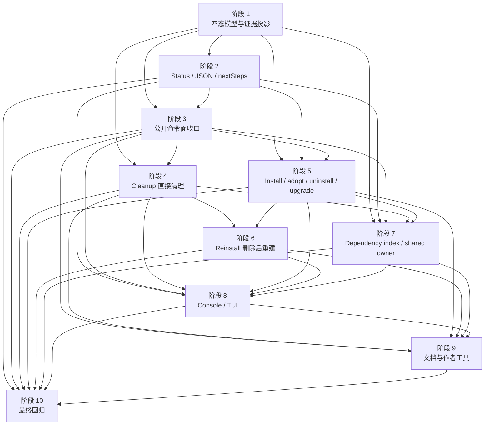

# 插件状态简化执行计划

日期：2026-05-22
需求来源：`docs/dev/specs/plugin-state-simplification.md`
关联规格：`docs/dev/specs/plugin-state-and-tui-simplification.md`
状态：已完成
文档规范：`docs/dev/spec-plan-writing-guide.md`

## 文档定位

这份计划只定义执行步骤、实现切分、涉及文件、测试范围和收口顺序。它回答“怎么做、先后依赖是什么、改哪些文件、用哪些测试证明完成”。

需求边界、状态模型、公开合同、用户体验和最终验收标准以 Spec 为准。本计划不重新定义插件状态语义，不新增兼容旧状态格式的目标，也不扩展新的恢复入口。

`docs/dev/specs/plugin-state-simplification.md` 是本计划的直接需求来源。涉及 TUI、console item、公开页面模型、结构化 `nextSteps` 或 `repair` 去留时，如果它与 `docs/dev/specs/plugin-state-and-tui-simplification.md` 有冲突，实施时以后者为准。

## 实施约定

- [x] 有效 install record 是唯一安装真值。现场证据可以进入 diagnostics、command blocker、cleanup / reinstall 删除范围或 TUI 状态详情，但不能单独证明插件已安装。
- [x] 用户和 `aw status --json` 顶层状态只允许 `installed`、`notInstalled`、`cleanupRequired`、`external`。旧 `needsRepair`、`residual`、`adoptable`、`externallyManaged` 不能继续作为公开一等状态。
- [x] `reasons`、`diagnostics` 和结构化 `nextSteps` 是状态细节，不是新状态机。新增异常时先归入四态，只补必要 reason。
- [x] `dynamic diagnostic cache`、`project artifact identity`、`global dependency index`、`historical lifecycle runtime`、`native transaction marker`、`shared runtime owner` 都不能改变有效 record 的顶层 `installed`。
- [x] `project artifact identity` 只服务 project fresh clone 的 `install --adopt-existing`。已有有效 record 时，identity 缺失、损坏或漂移只进入诊断或命令级提示。
- [x] `aw repair` 从目标公开模型移除。CLI help、命令注册、TUI、JSON receipt、错误提示、公开文档、插件作者文档和 `nextSteps` 都不能把 `repair` 作为可执行恢复入口。
- [x] `aw cleanup` 直接执行清理，默认保留配置，不运行 uninstall lifecycle，不要求 `--plan`。如果内部仍需要 dry-run helper，只能作为实现细节，不能暴露为公开合同。
- [x] `aw reinstall` 是保留配置的删除后重建入口。它不能保留旧 record、旧 source、旧 artifact truth、diagnostic cache、native marker、historical runtime、dependency index 引用或 shared runtime owner 残留。
- [x] `--takeover-shared-runtime` 不再是公开入口。shared runtime owner 冲突只能作为写命令 blocker、diagnostic 或结构化下一步暴露。
- [x] `cleanup --dependency-index --prune-stale <token> --yes` 是 dependency index 的唯一显式维护入口，不能复用旧 repair 语义。
- [x] TUI 可以消费结构化 `nextSteps` 推导推荐动作，但不能显示 raw command，不能渲染字符串 `nextSteps` 正文，也不能出现 `诊断`、`repair`、`修复安装`、`openRepair`、`openDiagnose` 等用户可见入口。
- [x] 本轮会影响插件基础架构、adapter 行为、scope 语义、分发/安装流程和插件作者可见能力；实施时必须同步检查 `.agents/skills/create-agent-workflows-plugin/`、公开文档和测试夹具。
- [x] 每个阶段必须补齐行为测试。阶段内待办、测试验收和阶段验收都完成后，才能把该阶段标记为完成。
- [x] 文件清单是起始范围。实现中发现同一职责在其它文件中，也要补充到计划或提交说明。

## 阶段依赖总览

本表是阶段硬依赖的权威来源；下方 Mermaid 图必须与本表一致。可并行关系只表示能提前准备或用接口桩推进，不表示可以同时改同一共享文件。

| 阶段 | 主题 | 覆盖验收 | 依赖 | 可并行关系 |
| --- | --- | --- | --- | --- |
| 1 | 四态模型与证据投影核心 | 四态、安装真值、无 record 优先级、辅助证据降级 | 无 | 无 |
| 2 | Status / JSON / nextSteps 合同 | 旧状态移除、diagnostics、结构化 nextSteps、默认输出 | 1 | 阶段 3 可准备 CLI option 草案 |
| 3 | 公开命令面收口 | 移除 repair、移除 cleanup plan、移除 takeover、增加 install adopt | 1、2 | 可与阶段 4/5 做非共享 helper 准备 |
| 4 | Cleanup 直接清理语义 | cleanupRequired、配置保留、claimable external 跳过、幂等清理 | 1、3 | 阶段 6 可先准备 reinstall 调用接口 |
| 5 | Install / adopt / uninstall / upgrade 写路径 | external fail closed、project adopt、uninstall fail closed、upgrade 只认 record | 1、2、3 | 可与阶段 4 并行，最终命令联调串行 |
| 6 | Reinstall 删除后重建语义 | 保留配置、cleanupRequired 内部清理、external/依赖/风险阻断 | 4、5 | 阶段 7 可先准备 dependency index 纯模型测试 |
| 7 | Dependency index 与 shared runtime ownership 收口 | index 派生化、stale prune、record-derived owner、无 takeover | 1、2、3、4、5 | dependency index 纯模型测试可提前准备，shared owner 输出和 blocker 串行接入 |
| 8 | Console / TUI 页面与动作模型 | 首页分组、详情页、状态页、最近结果、无诊断/修复入口 | 2、3、4、5、6、7 | 文案和 renderer 单测可提前准备 |
| 9 | 文档、作者工具和夹具同步 | 公开文档、作者技能、测试夹具、README 命令示例 | 3、4、5、6、7、8 | 可随前序阶段增量更新，最终统一收口 |
| 10 | 最终回归与发布前检查 | 全部 | 2-9 | 集成阶段，不建议拆散 |

## 并行写入边界

- [x] 阶段 1 / 2 共享 `packages/cli/src/install-state/types.ts`、`packages/cli/src/install-state/evidence.ts`、`packages/cli/src/install-state/status-projection.ts`、`packages/cli/src/install-state/facade.ts` 和 `packages/cli/tests/unit/install-state-*.test.ts`。阶段 1 负责底层模型和投影，阶段 2 负责输出合同和 JSON schema，最终由单一 owner 串行接入共享类型。
- [x] 阶段 3 / 4 / 5 / 6 共享 `packages/cli/src/index.ts`、`packages/cli/src/commands/common.ts`、`packages/cli/src/commands/cleanup.ts`、`packages/cli/src/commands/reinstall.ts`、`packages/cli/src/commands/install.ts`、`packages/cli/src/commands/uninstall.ts` 和 `packages/cli/src/commands/upgrade.ts`。命令入口和 option normalization 必须先稳定，再接入具体写路径。
- [x] 阶段 4 / 6 共享 `packages/cli/src/commands/install-state-removal.ts` 和 cleanup 删除 helper。阶段 4 负责可清理项和归属边界，阶段 6 只能复用该语义，不能另写一套删除规则。
- [x] 阶段 5 / 7 共享 dependency protection、shared runtime owner 和 adapter 写入相关文件。owner 冲突、依赖保护和写命令 blocker 的 reason code 需要先统一，再分别接入 install、upgrade、uninstall、reinstall。
- [x] 阶段 8 与阶段 2 / 3 共享 `packages/cli/src/commands/console-model.ts`、`packages/cli/src/commands/console.ts`、`packages/cli/src/commands/console-wizard.ts`、`packages/cli/src/commands/discovery.ts`、`packages/cli/src/output/model.ts` 和 TUI 测试。阶段 2 是 `packages/cli/src/output/model.ts` 里 status / receipt / nextSteps 公开结构化模型的 owner；阶段 8 只能在阶段 2 合同稳定后串行接入 TUI 页面消费所需字段。TUI 只消费结构化模型，不能从 CLI 文案反解析。
- [x] 阶段 9 涉及 `README.md`、`docs/` 和 `.agents/skills/create-agent-workflows-plugin/`。文档改动必须在命令合同稳定后收口，避免先写错公开入口。

## 阶段依赖关系图

## 阶段 1：四态模型与证据投影核心

目标：把 install-state 的底层投影收敛到 `installed`、`notInstalled`、`cleanupRequired`、`external`，明确无 record 场景优先级，让辅助证据只进入 reason、diagnostic、next step 或 command blocker。

主要文件：

- [x] `packages/cli/src/install-state/types.ts`
- [x] `packages/cli/src/install-state/evidence.ts`
- [x] `packages/cli/src/install-state/status-projection.ts`
- [x] `packages/cli/src/install-state/facade.ts`
- [x] `packages/cli/src/install-state/schema.ts`
- [x] `packages/cli/src/install-state/transactions.ts`
- [x] `packages/cli/src/install-state/shared-runtime-owner.ts`
- [x] `packages/cli/tests/helpers/install-state-projection-fixtures.ts`
- [x] `packages/cli/tests/unit/install-state-status-projection.test.ts`
- [x] `packages/cli/tests/unit/install-state-evidence.test.ts`
- [x] `packages/cli/tests/unit/install-state-facade.test.ts`
- [x] `packages/cli/tests/unit/install-state-schema.test.ts`

待办：

- [x] 将 `ProjectInstallStateKind` 或等价底层状态类型收敛为四态，并迁移调用方使用的新 reason / diagnostic 字段。
- [x] 为 `cleanupRequired` 和 `external` 定义稳定 reason code，至少覆盖 `foreignExternalEvidence`、`claimableProjectArtifacts`、`invalidInstallRecord`、`nativeTransactionPresent`、`awOwnedResiduePresent`、`historicalRuntimeResidue`、`dependencyIndexReferenceResidue`、`sharedRuntimeOwnerResidue`。
- [x] 实现无有效 install record 的投影优先级：foreign external 优先，其次 AW-owned cleanupRequired，再其次 project claimable external，最后 notInstalled。
- [x] 有效 record 存在时，dynamic diagnostic cache、project identity、dependency index、historical runtime、native marker、shared owner 缺失或不可信都不能让顶层状态离开 `installed`。
- [x] 将 `project artifact identity` 对已有 record 的影响降级为 diagnostic，不再触发 `cleanupRequired`、`adoptable` 或等价状态。
- [x] 将 dynamic diagnostic cache 的缺失、损坏、stale 和无法匹配 record 的情况降级为 diagnostic，不影响安装真值。
- [x] 保留 dependency index、historical runtime、shared owner、native marker 等证据读取能力，但把它们从主状态输入改为 diagnostics / cleanup scope / command blocker 输入。
- [x] 删除或标记废弃旧 `repairAvailable`、`adoptExistingAvailable`、`sharedRuntimeNeedsTakeover` 等会直接推导旧公开动作的字段；需要保留内部过渡字段时，必须保证阶段 2/8 不会外露。

测试验收：

- [x] 有效 install record 存在且 diagnostic cache 缺失、损坏或 stale 时，投影仍为 `installed`，diagnostics 说明缓存不可用。
- [x] 有效 install record 存在且 project artifact identity 缺失或损坏时，投影仍为 `installed`，不会生成 cleanupRequired 或 adoptable。
- [x] 有效 install record 存在且 historical lifecycle runtime 缺失时，投影仍为 `installed`，只产生可供 uninstall blocker 使用的 diagnostic。
- [x] 有效 install record 存在且 dependency index 缺失、不可信或 coverage 不足时，投影仍为 `installed`，只产生依赖安全 diagnostic / next step 输入。
- [x] 无有效 record 且同时存在 foreign external evidence 和 AW-owned residue 时，顶层为 `external`，reason 为 `foreignExternalEvidence`，AW residue 只进入 diagnostics。
- [x] 无有效 record 且存在 native marker、异常 record、historical runtime 残留、dependency index 引用残留或 shared owner 残留时，顶层为 `cleanupRequired`。
- [x] 无有效 record 且存在可验证 project shared artifacts 与 project identity 时，顶层为 `external`，reason 为 `claimableProjectArtifacts`。
- [x] 无任何 record、外部证据或 AW residue 时，顶层为 `notInstalled`。
- [x] 仓库内状态投影单测不再断言 `needsRepair`、`residual`、`adoptable`、`externallyManaged` 是顶层状态。

阶段验收：

- [x] install-state facade 对外提供四态投影和结构化细节，旧状态只允许作为内部迁移临时变量存在。
- [x] 状态投影不再把辅助证据当作安装真值。
- [x] 无 record 优先级有单测覆盖，且同一 location 只产生一个顶层状态。

## 阶段 2：Status / JSON / nextSteps 合同

目标：让 `aw status`、`aw status --json`、console item 数据源和通用 receipt 模型消费四态投影，默认输出不再制造旧修复路径，JSON 暴露结构化 `reasons`、`diagnostics` 和 `nextSteps`。

主要文件：

- [x] `packages/cli/src/commands/status.ts`
- [x] `packages/cli/src/commands/discovery.ts`
- [x] `packages/cli/src/commands/console-model.ts`
- [x] `packages/cli/src/output/model.ts`
- [x] `packages/cli/src/output/command-receipt.ts`
- [x] `packages/cli/src/output/reporter.ts`
- [x] `packages/cli/tests/unit/status-command.test.ts`
- [x] `packages/cli/tests/unit/status-dependencies.test.ts`
- [x] `packages/cli/tests/unit/console-model.test.ts`
- [x] `packages/cli/tests/unit/command-receipt.test.ts`
- [x] `packages/cli/tests/integration/discovery.test.ts`

待办：

- [x] 更新 status 输出模型，顶层 `state` 只输出四态。
- [x] 将旧字符串 `nextSteps` 迁移为结构化 instruction，区分 UI action、CLI command、说明性 blocker 和文档提示。
- [x] 默认 human status 对 `installed` 只展示 AW 管理确认和必要摘要，不把 diagnostic cache、identity、historical runtime、dependency index 的辅助问题说成安装坏了。
- [x] `cleanupRequired` 的默认下一步指向 cleanup 或 reinstall；需要说明配置默认保留，清配置必须显式 `cleanup --remove-config` 或配置命令。
- [x] `external` 默认输出说明 AW 没有本机 ownership，不删除、不覆盖；`claimableProjectArtifacts` 指向 `install --adopt-existing`。
- [x] `status --verbose` / JSON 可以展示辅助证据，但字段名和文案必须说明它们是 diagnostics，不是安装真值。
- [x] dependency index stale 的 `nextSteps` 指向 `aw cleanup --dependency-index --prune-stale <token> --yes`，不再指向 `repair --dependency-index`。
- [x] shared runtime owner conflict 的 `nextSteps` 不再包含 `--takeover-shared-runtime`。
- [x] 删除默认输出、JSON receipt、console item 里的 `needsRepair`、`residual`、`adoptable`、`repairAvailable` 等公开旧语义。

测试验收：

- [x] `aw status --json` 对所有 fixture 只返回四态。
- [x] 默认 status 输出不包含 `needsRepair`、`residual`、`adoptable`、`repair`、`修复`、`--takeover-shared-runtime`。
- [x] `installed` + historical runtime 缺失时，默认 status 仍显示已安装；verbose / JSON 暴露卸载可能被阻断的 diagnostic。
- [x] `cleanupRequired` 输出可执行清理/重装建议，并说明默认保留配置。
- [x] `external` + `claimableProjectArtifacts` 输出 `install --adopt-existing`，普通 external 不提示 cleanup 覆盖。
- [x] stale dependency index 的 JSON next step 包含 prune token 和 cleanup prune 命令，不出现 repair dependency-index。
- [x] console item 数据源可以区分底层四态、TUI 友好状态、recommended action 和 diagnostics，不依赖旧 `diagnose` / `repair` 字段。

阶段验收：

- [x] status 和 JSON 合同能完整表达四态、reason、diagnostic 和下一步。
- [x] 默认输出用户可见词汇已经从旧异常状态和 repair 模型迁出。
- [x] TUI 后续阶段可直接消费结构化模型，不需要解析 human output。

## 阶段 3：公开命令面收口

目标：调整 CLI 注册、option normalization 和命令入口，让公开命令合同与目标模型一致：删除 `aw repair`，移除 `cleanup --plan` 和 `--takeover-shared-runtime`，新增或迁移 `aw install --adopt-existing`。

主要文件：

- [x] `packages/cli/src/index.ts`
- [x] `packages/cli/src/commands/options.ts`
- [x] `packages/cli/src/commands/common.ts`
- [x] `packages/cli/src/commands/install.ts`
- [x] `packages/cli/src/commands/repair.ts`
- [x] `packages/cli/src/commands/cleanup.ts`
- [x] `packages/cli/src/commands/reinstall.ts`
- [x] `packages/cli/src/commands/upgrade.ts`
- [x] `packages/cli/tests/unit/cli-entry.test.ts`
- [x] `packages/cli/tests/unit/command-options.test.ts`
- [x] `packages/cli/tests/unit/install-command.test.ts`
- [x] `packages/cli/tests/unit/cleanup-command.test.ts`
- [x] `packages/cli/tests/unit/reinstall-command.test.ts`
- [x] `packages/cli/tests/unit/repair-command.test.ts`
- [x] `packages/cli/tests/integration/cli-entry.test.ts`
- [x] `packages/cli/tests/integration/options-normalization.test.ts`

待办：

- [x] 从 CLI program 移除 `repair` 命令注册、help、JSON receipt 入口和 action context。
- [x] 删除或隔离 `packages/cli/src/commands/repair.ts` 的公开命令导出；历史 helper 若仍有复用价值，迁移到 install / cleanup / reinstall 的私有 helper，并改名避免公开 repair 语义。
- [x] 从 install、upgrade、reinstall、cleanup 等公开命令移除 `--takeover-shared-runtime` option 和 normalization 字段。
- [x] 从 cleanup 公开合同移除 `--plan`，保留 direct execution；如果 TUI 仍需要危险确认预览，必须通过结构化状态/receipt 或内部评估 helper，不暴露 CLI plan。
- [x] 在 `aw install` 增加 `--adopt-existing`，只允许 project scope，且只服务可验证 project shared artifacts fresh clone 场景。
- [x] 更新命令参数校验：`install --adopt-existing` 与已有有效 record、非 project scope、不可验证共享产物、普通 external evidence 的组合给出稳定错误。
- [x] 保留 `cleanup --dependency-index --prune-stale <token> --yes`，并确保该入口不需要插件名、不触发普通 plugin cleanup、不复用 repair 文案。
- [x] 更新 unknown command、help、deprecated skill trigger、JSON receipt builder 的命令列表，避免残留 repair。

测试验收：

- [x] `aw repair` 从 CLI help 中消失，直接执行时按 unknown command 或明确移除错误处理，不调用任何 repair handler。
- [x] `aw cleanup --plan` 在入口层失败，且不写任何 state、不删除文件、不创建备份。
- [x] install、upgrade、reinstall、cleanup 的 help 和 options 不再出现 `--takeover-shared-runtime`。
- [x] `aw install --adopt-existing -s project` 能进入 install command，并携带明确 adopt operation。
- [x] `aw install --adopt-existing -s user` 在写入前失败。
- [x] `aw cleanup --dependency-index --prune-stale <token> --yes` 仍能通过入口校验，且不接受普通插件名。
- [x] 入口和 options normalization 测试不再依赖 `repair-command.test.ts` 的公开命令行为；如果文件保留，只测试迁移后的私有 helper 或删除对应测试。

阶段验收：

- [x] 公开 CLI 命令面已经没有 repair、cleanup plan 和 takeover flag。
- [x] project adopt 的唯一脚本化入口已经挂到 install。
- [x] 命令入口层可以阻断旧参数组合，并证明没有副作用。

## 阶段 4：Cleanup 直接清理语义

目标：让 cleanup 成为异常状态的直接恢复入口。它默认清理 AW-owned 且可重建状态，保留配置，不运行 lifecycle，跳过或报告外部/未归属内容，并且可重复执行。

主要文件：

- [x] `packages/cli/src/commands/cleanup.ts`
- [x] `packages/cli/src/commands/install-state-removal.ts`
- [x] `packages/cli/src/install-state/transactions.ts`
- [x] `packages/cli/src/install-state/paths.ts`
- [x] `packages/cli/src/install-state/shared-runtime-owner.ts`
- [x] `packages/cli/src/utils/codex-native-recovery.ts`
- [x] `packages/cli/src/adapters/codex.ts`
- [x] `packages/cli/src/adapters/claude.ts`
- [x] `packages/cli/src/utils/plugin-config.ts`
- [x] `packages/cli/tests/unit/cleanup-command.test.ts`
- [x] `packages/cli/tests/unit/install-state-removal.test.ts`
- [x] `packages/cli/tests/unit/codex-native-recovery.test.ts`
- [x] `packages/cli/tests/integration/plugin-lifecycle-command.test.ts`

待办：

- [x] 将 cleanup 从“先 plan 再执行”的公开模型改为 direct execution，receipt 直接描述已删除、跳过、失败和残留项。
- [x] 建立统一 cleanup scope：异常 record、diagnostic cache、native marker、historical runtime、dependency index 对应引用、非认领场景 project identity、shared owner 残留、AW 可定位 artifacts。
- [x] 默认保留当前 target 的 AW 自管配置；只有 `--remove-config` 在主体清理成功后删除配置。
- [x] cleanup 不执行 uninstall lifecycle，不因为 historical runtime 缺失而阻断。
- [x] `claimableProjectArtifacts` 的 external 目标不进入默认 cleanup；receipt 指向 `install --adopt-existing` 或用户自行移除共享产物。
- [x] foreign external evidence 或无法确认归属内容必须跳过或阻断，不能为了重装/清理删除明显外部数据。
- [x] 有 verified dependents 时，cleanup 按依赖安全边界阻断或跳过目标，不能破坏依赖方；没有已知 dependents 且范围可界定时尽力继续。
- [x] 重复 cleanup 已经不存在的 target 返回稳定成功或 no-op receipt，不产生新异常状态。
- [x] cleanup receipt 和 human 输出移除 plan schema、would backups、repair 文案和 force-as-default 语义；`--force` 如保留，只作为更明确的高风险确认入口。

测试验收：

- [x] cleanup 损坏 record 后，目标 record、diagnostic cache、historical runtime、native marker、dependency index entry 和 shared owner 残留被删除，配置仍保留。
- [x] cleanup 带 `--remove-config` 且主体清理成功时删除当前 target 的 AW 配置；主体被阻断时配置保留。
- [x] cleanup historical runtime 缺失的目标不执行 lifecycle，也不因 runtime 缺失失败。
- [x] cleanup marker-only / record+marker 残留能删除 AW-owned 残留并稳定进入 notInstalled 或可重新安装状态。
- [x] cleanup 对 `external` + `claimableProjectArtifacts` 不删除 repo-visible shared artifacts，输出指向 install adopt。
- [x] cleanup 对 foreign external evidence 跳过外部内容并报告，不删除不可归属文件。
- [x] cleanup 重复执行同一目标不报错，不创建新的 record、diagnostic cache、marker 或 owner 文件。
- [x] cleanup 有 verified dependents 时在删除前失败或跳过，并返回 dependents 信息。

阶段验收：

- [x] cleanup 能让可清理异常目标恢复到可安装或已清理状态。
- [x] 默认配置保留和显式清配置边界有测试覆盖。
- [x] cleanup 的公开 receipt 不再表达 plan-first 或 repair-first 模型。

## 阶段 5：Install / adopt / uninstall / upgrade 写路径

目标：把 install、uninstall 和 upgrade 接到四态模型。普通 install 遇到 external fail closed；project fresh clone 只能通过 install adopt 认领；uninstall / upgrade 只处理有效 record，并把历史 runtime、dependency index 等风险表达为命令级 blocker。

主要文件：

- [x] `packages/cli/src/commands/install.ts`
- [x] `packages/cli/src/commands/uninstall.ts`
- [x] `packages/cli/src/commands/upgrade.ts`
- [x] `packages/cli/src/commands/plugin-dependency-write-executor.ts`
- [x] `packages/cli/src/commands/codex-project-installability.ts`
- [x] `packages/cli/src/commands/codex-project-safety.ts`
- [x] `packages/cli/src/utils/artifact-refresh.ts`
- [x] `packages/cli/src/utils/generated-artifacts.ts`
- [x] `packages/cli/src/utils/plugin-dependency-graph.ts`
- [x] `packages/cli/src/utils/plugin-dependency-planner.ts`
- [x] `packages/cli/src/utils/plugin-dependency-location.ts`
- [x] `packages/cli/tests/unit/install-command.test.ts`
- [x] `packages/cli/tests/unit/uninstall-command.test.ts`
- [x] `packages/cli/tests/unit/upgrade-command.test.ts`
- [x] `packages/cli/tests/unit/plugin-dependency-write-executor.test.ts`
- [x] `packages/cli/tests/integration/plugin-lifecycle-command.test.ts`
- [x] `packages/cli/tests/integration/upgrade-command.test.ts`

待办：

- [x] 普通 install 在读取到 `external` 时 fail closed，不覆盖、不删除、不默认认领。
- [x] `external` reason 为 `claimableProjectArtifacts` 时，普通 install 错误指向 `install --adopt-existing`；其它 external 指向用户移除外部内容或未来明确接管入口。
- [x] `install --adopt-existing` 只在 project scope、无有效 record、存在可验证 shared artifacts 和 project identity 时创建本机 install record。
- [x] 已有有效 record 时，`install --adopt-existing` 不改变普通 install / 覆盖安装语义。
- [x] 共享产物不可验证时，adopt 失败并提示 cleanup、reinstall 或普通 install，不能创建含糊 record。
- [x] uninstall 只处理有效 record；成功后清理 native 注册、repo-visible artifacts、project identity、diagnostic cache、historical runtime、native marker、shared owner 信息、install record 和派生状态。
- [x] uninstall 需要旧 lifecycle 但 historical runtime 缺失或不可验证时 fail closed，并引导 cleanup 或 reinstall，但 status 顶层仍保持 installed。
- [x] uninstall / upgrade 依赖 dependency index 时，先尝试从有效 records 重建；仍无法确认安全时以命令 blocker 失败，不改变顶层 installed。
- [x] upgrade 只处理有效 install record；缺少 record 或 record 不可读时目标投影为 cleanupRequired，并提示 cleanup / reinstall / install。
- [x] `upgrade --all` 使用新状态跳过 cleanupRequired / external / notInstalled，不再提示 repair。

测试验收：

- [x] 普通 install 遇到 foreign external evidence 时失败，且目标文件、record、identity、diagnostic cache 都没有变化。
- [x] 普通 install 遇到 claimable project artifacts 时失败并提示 `install --adopt-existing`，不删除共享产物。
- [x] `install --adopt-existing` 对可验证 project fresh clone 创建本机 record，状态变为 installed。
- [x] `install --adopt-existing` 对非 project scope、已有有效 record、不可验证 shared artifacts 分别稳定失败或回到普通 install 语义。
- [x] uninstall historical runtime 缺失时失败并提示 cleanup / reinstall，status JSON 顶层仍是 installed。
- [x] uninstall dependency index 缺失时先重建；无法确认 dependents 时失败并返回 command blocker，不改顶层状态。
- [x] upgrade 遇到 invalid / missing record 时不进入 repair，输出 cleanup / reinstall 路径。
- [x] `upgrade --all` 不再产生 `repairRequired` 或等价旧 reason。

阶段验收：

- [x] install、uninstall、upgrade 只围绕有效 record 执行正常写路径。
- [x] project adopt 的归属和验证边界有完整测试覆盖。
- [x] historical runtime 和 dependency index 风险已经从状态异常迁到命令 blocker。

## 阶段 6：Reinstall 删除后重建语义

目标：让 reinstall 成为保留配置的删除后重建入口。它复用 cleanup 归属和安全边界，可以处理健康 installed 与可安全收口的 cleanupRequired，遇到 external、verified dependents、无法安全枚举或 project adopt 场景时在新安装前停止。

主要文件：

- [x] `packages/cli/src/commands/reinstall.ts`
- [x] `packages/cli/src/commands/cleanup.ts`
- [x] `packages/cli/src/commands/install.ts`
- [x] `packages/cli/src/commands/install-state-removal.ts`
- [x] `packages/cli/src/output/command-receipt.ts`
- [x] `packages/cli/tests/unit/reinstall-command.test.ts`
- [x] `packages/cli/tests/unit/cleanup-command.test.ts`
- [x] `packages/cli/tests/unit/install-command.test.ts`
- [x] `packages/cli/tests/integration/plugin-lifecycle-command.test.ts`

待办：

- [x] 将 reinstall 的前半段改为复用 cleanup 语义删除 AW-owned 可重建状态和残留，不运行 uninstall lifecycle。
- [x] reinstall 默认保留配置，不提供隐式删除配置参数。
- [x] 健康 installed 目标可执行删除后按 current catalog 安装，旧 record、source、artifact truth、diagnostic cache、native marker、historical runtime、dependency index 引用和 shared owner 残留都不保留。
- [x] cleanupRequired 目标在安全可界定时不要求用户先运行 cleanup，reinstall 内部清理后继续安装。
- [x] external 目标、claimable project artifacts、verified dependents、无法安全枚举删除范围、明显外部数据或依赖安全无法确认时，reinstall 在新安装前停止。
- [x] reinstall 对 project adopt 场景指向 `install --adopt-existing`，不能删除共享产物后重装。
- [x] reinstall receipt 明确区分 cleanup stage、install stage、skipped/blocked reasons 和配置保留，不出现 repair 语义。

测试验收：

- [x] reinstall 健康 installed 目标后，配置保留，旧 diagnostic cache、native marker、historical runtime、dependency index 引用和 shared owner 残留已按新安装重建或删除。
- [x] reinstall 可安全 cleanupRequired 目标不要求先单独 cleanup，最终进入 installed。
- [x] reinstall 不删除 AW 配置，也不接受隐式删除配置参数。
- [x] reinstall 遇到 foreign external evidence 时在写入前失败，不删除外部内容。
- [x] reinstall 遇到 claimable project artifacts 时失败并提示 install adopt，不删除共享产物。
- [x] reinstall 遇到 verified dependents、无法安全枚举或 dependency safety 无法确认时，在新安装前失败。
- [x] reinstall receipt 和 human 输出不包含 repair、修复、takeover 或 cleanup plan 文案。

阶段验收：

- [x] reinstall 与 cleanup 使用同一归属和删除边界。
- [x] reinstall 能覆盖健康安装和可安全收口异常的保留配置重建。
- [x] reinstall 的阻断场景都发生在新安装前，且没有部分写入。

## 阶段 7：Dependency index 与 shared runtime ownership 收口

目标：把 dependency index 固定为可重建派生索引，把 shared runtime ownership 从独立强状态改成 record-derived 或 record/edge 推导模型，并移除公开 takeover 恢复路径。

主要文件：

- [x] `packages/cli/src/install-state/types.ts`
- [x] `packages/cli/src/install-state/facade.ts`
- [x] `packages/cli/src/install-state/shared-runtime-owner.ts`
- [x] `packages/cli/src/install-state/transactions.ts`
- [x] `packages/cli/src/utils/plugin-dependency-graph.ts`
- [x] `packages/cli/src/utils/plugin-dependency-planner.ts`
- [x] `packages/cli/src/commands/plugin-dependency-write-executor.ts`
- [x] `packages/cli/src/commands/cleanup.ts`
- [x] `packages/cli/src/commands/install.ts`
- [x] `packages/cli/src/commands/upgrade.ts`
- [x] `packages/cli/src/commands/reinstall.ts`
- [x] `packages/cli/src/commands/install-state-removal.ts`
- [x] `packages/cli/src/output/command-receipt.ts`
- [x] `packages/cli/tests/unit/install-state-shared-runtime-owner.test.ts`
- [x] `packages/cli/tests/unit/status-dependencies.test.ts`
- [x] `packages/cli/tests/unit/plugin-dependency-graph.test.ts`
- [x] `packages/cli/tests/unit/plugin-dependency-planner.test.ts`
- [x] `packages/cli/tests/unit/plugin-dependency-write-executor.test.ts`
- [x] `packages/cli/tests/unit/install-command.test.ts`
- [x] `packages/cli/tests/unit/cleanup-command.test.ts`
- [x] `packages/cli/tests/unit/upgrade-command.test.ts`
- [x] `packages/cli/tests/unit/reinstall-command.test.ts`
- [x] `packages/cli/tests/unit/install-state-removal.test.ts`
- [x] `packages/cli/tests/unit/uninstall-command.test.ts`
- [x] `packages/cli/tests/unit/command-receipt.test.ts`

待办：

- [x] 让需要依赖保护的命令优先从有效 install records 重建或校验 dependency index。
- [x] dependency index 无法确认依赖安全时，只阻断普通 uninstall / upgrade / reinstall 的危险写入，不改变有效 record 的顶层 installed。
- [x] 保留 `cleanup --dependency-index --prune-stale <token> --yes`，输出和 JSON receipt 说明 token、动作结果、跳过或失败原因。
- [x] stale dependency index prune 不改写 plugin record、identity、diagnostic cache、artifacts、config store、historical runtime、native marker 或 shared owner。
- [x] 将 shared runtime owner 的 claim / refresh / release 改为由有效 records 或 record 中 ownership 信息推导；独立 owner 文件如仍存在，只能作为可重建物化缓存。
- [x] owner conflict 不产生新顶层状态；有效 record 存在时只作为写命令 blocker / diagnostic / next step 输入。
- [x] 无有效 record 时，陈旧或损坏 shared owner 文件归入 cleanupRequired 的可清理 AW 残留，除非同时存在更高优先级 external evidence。
- [x] 删除公开 takeover 建议、suggestedFlag 和 `--takeover-shared-runtime` 文案；冲突解决路径是卸载、清理或调整冲突 owner 对应有效安装后重试。
- [x] 批量命令和 `--platform both` 不得通过任何公开参数批量接管 shared runtime。

测试验收：

- [x] dependency index 缺失时，uninstall / upgrade 先从有效 records 重建并继续。
- [x] dependency index coverage 无法确认时，uninstall / upgrade / reinstall 在写入前失败，status 顶层仍为 installed。
- [x] `cleanup --dependency-index --prune-stale <token> --yes` 只退休指定 stale reference，不触碰 plugin state。
- [x] stale dependency index next step 不再出现 `repair --dependency-index`。
- [x] shared runtime owner conflict 阻断非 owner 写命令，但不改变状态顶层 installed。
- [x] 无 record 且只有 stale shared owner 残留时，状态为 cleanupRequired，cleanup 可以删除该残留。
- [x] owner conflict 输出不包含 `--takeover-shared-runtime`、`takeover` 公开恢复入口或 `repair`。
- [x] owner release 后按稳定规则重新推导 owner 或移除 shared runtime，不依赖旧强状态文件作为真值。

阶段验收：

- [x] dependency index 和 shared owner 都不再作为安装真值。
- [x] 依赖保护和 owner 冲突的写命令 blocker 有稳定 reason code 和测试覆盖。
- [x] 公开输出和 JSON 不再暴露 takeover / repair 恢复路径；公开文档由阶段 9 统一收口。

## 阶段 8：Console / TUI 页面与动作模型

目标：把 TUI 调整成插件管理控制台。首页按友好状态分组，详情页承载操作，状态页只展示状态详情，写操作成功、失败或取消后都回到刷新后的详情页并显示合适的最近结果或取消提示；用户可见页面不出现诊断入口、repair、raw command 或字符串 nextSteps。

主要文件：

- [x] `packages/cli/src/commands/console-model.ts`
- [x] `packages/cli/src/commands/console.ts`
- [x] `packages/cli/src/commands/console-wizard.ts`
- [x] `packages/cli/src/commands/interactive.ts`
- [x] `packages/cli/src/commands/discovery.ts`
- [x] `packages/cli/src/output/model.ts`
- [x] `packages/cli/tests/unit/console-model.test.ts`
- [x] `packages/cli/tests/unit/console.test.ts`
- [x] `packages/cli/tests/unit/console-wizard.test.ts`
- [x] `packages/cli/tests/integration/console-entry.test.ts`
- [x] `packages/cli/tests/integration/console-duplicate-resolution.test.ts`

待办：

- [x] TUI 首页只展示一套块状插件卡片，按 `异常`、`可升级`、`已安装`、`未安装` 分组；空分组不展示，每个分组标题带数量，组内顺序稳定。
- [x] 首页卡片展示状态符号、插件名、版本或版本变化、短描述、平台与位置摘要和当前可执行主操作；异常、历史残留和配置残留必须点名；首页底部动作只保留 `刷新` / `退出`，不展示插件级执行入口、raw command 或内部字段。
- [x] TUI 友好状态由底层四态和严格 SemVer 版本比较推导；bundle fingerprint、source drift、identity drift 或同版本内容漂移不能触发 `可升级`。
- [x] 插件详情页只展示整体状态、平台/位置摘要、可执行动作和最近结果，不展示 catalog、selector、schema digest、install record path 等内部字段。
- [x] 状态页保留状态详情，但不再有 `诊断` / `查看诊断` / `openDiagnose` 入口。
- [x] 状态摘要页只列有现场证据的位置，不列纯未安装 catalog 位置；没有可执行动作时只保留 `返回` / `退出`。
- [x] TUI 页面不渲染 `nextSteps` 正文列表，不显示 `aw ...` command。可继续动作进入菜单，例如清理、重装、认领、配置、重新应用配置、返回、退出。
- [x] 删除 TUI feature kind、action kind、label、menu choice、result target 中的 `repair`、`repairInstall`、`openRepair` 和公开“修复”文案。
- [x] 认领动作映射到 `install --adopt-existing`，清理动作映射到 cleanup，重装动作映射到 reinstall。
- [x] 安装、升级、卸载、清理、重装、认领、处理重复安装、配置保存、配置重置和重新应用配置成功、失败或部分完成后，TUI 重新加载当前插件 console item，回到详情页顶部显示最近一次结果。
- [x] 单插件写操作完成后不出现独立结果页，不提供 `返回首页` 或 `状态 · 某位置` 的默认分叉入口；用户需要看状态时从详情页功能菜单进入 `状态`。
- [x] 最近结果必须来自刷新后的 plugin data 和写操作 receipt / target result，只展示操作名、成功/失败/部分完成状态、每个真实目标的简短结果，以及失败时一句用户可理解原因；不展示命令、内部错误栈、完整 receipt JSON 或旧 result page 文案。
- [x] 写操作取消后也回到详情页；取消可以显示一次短提示，但不能写入成功最近结果，也不能进入独立结果页。
- [x] 配置页以 `ConfigFieldEntryV2` 或等价结构化字段作为主数据源，默认展示插件名、当前配置 target、当前作用层、可应用位置和最近结果。
- [x] 配置字段列表只展示用户可理解的字段标题、当前值状态和来源；SkillTrigger 内建字段使用自然标题，不把 `$aw` 存储路径或内部 key 当主标题。
- [x] 配置页不默认展示 schema source、schema identity、schema digest、manifest digest、catalog channel、minAwVersion、install record path、内部 source identity 等调试字段；schema unavailable 或 store-only 旧配置用用户语义说明。
- [x] `生效` 配置视图只读，不展示 `更新` / `清空` / `重置`；`个人` / `项目` / `本地` 只展示当前层可执行操作，没有可执行操作时只保留 `返回` / `退出`。
- [x] 安装向导先选平台再选 scope，不把平台和 scope 的笛卡尔积混在同一页。
- [x] 安装、升级、重装和相关 TUI 写向导的公开 step、页面文案、确认页和结果区域都不展示安装期 SkillTrigger 选择，也不在公开 step 中出现 `selectSkillTrigger`；触发策略只能在配置页中作为 AW 内建配置字段查看和修改。
- [x] 危险确认页默认选中 `取消`，使用结构化正文展示操作对象、真实目标、将删除/覆盖/重建的内容、不会影响的内容、配置保留或删除状态、风险项、将执行动作和影响范围，不再退化为一段 `confirmText`。

测试验收：

- [x] 首页输出只有一套主要插件卡片，不重复展示正文摘要和 prompt description。
- [x] 首页卡片包含状态符号、插件名、版本或版本变化、短描述、平台与位置摘要和主操作，异常、历史残留和配置残留被点名；首页底部动作只保留 `刷新` / `退出`，不出现插件级执行入口、不可执行入口或命令建议。
- [x] 首页分组只出现 `异常`、`可升级`、`已安装`、`未安装`，空分组不展示，每个分组标题带数量，分组数量和组内排序稳定。
- [x] 详情页不出现 catalog/schema/install record/path 等内部诊断字段。
- [x] 任意 TUI 用户可见页面不出现 `诊断`、`查看诊断`、`repair`、`修复`、`aw repair`、`--takeover-shared-runtime`。
- [x] 状态摘要页只列有现场证据的位置，不渲染 raw command 和字符串 nextSteps；可执行后续动作出现在菜单。
- [x] project claimable external 的推荐动作是认领，并调用 install adopt，不调用 cleanup 或 repair。
- [x] 清理、重装、安装、升级、卸载、配置保存、配置重置、重新应用配置和认领成功、失败、部分完成或取消后，TUI 返回刷新后的详情页，不出现独立结果页或 `返回首页` / `状态 · 某位置` 分叉。
- [x] 最近结果来自刷新后的 plugin data 和 receipt / target result，只展示简短用户语义，不展示命令、错误栈、完整 receipt JSON 或旧 result page 文案。
- [x] 安装向导平台选择和 scope 选择分两步。
- [x] 安装、升级、重装和相关 TUI 写向导没有安装期 SkillTrigger 选择或 `selectSkillTrigger` step，确认页和结果区域也不出现触发策略选择文案。
- [x] 配置页默认展示当前配置 target、当前作用层、可应用位置、最近结果，以及用户可理解的字段标题、当前值状态和来源。
- [x] 配置页以 `ConfigFieldEntryV2` 或等价结构化字段为主数据源，不展示内部 schema/catalog/install metadata，`生效` 视图只读，当前层没有可执行操作时只显示 `返回` / `退出`，重新应用配置不调用 repair。
- [x] 危险确认页默认选中 `取消`，并结构化展示操作对象、真实目标、将删除/覆盖/重建的内容、不会影响的内容、配置保留或删除状态、风险项、执行动作和影响范围。

阶段验收：

- [x] TUI 公开模型只依赖结构化状态和动作，不解析 CLI 文案。
- [x] 用户可见 TUI 已完全迁出 diagnose / repair / raw command 模型。
- [x] 写操作成功、失败、部分完成或取消后的页面流符合“回详情页 + 最近结果或取消提示”。
- [x] 配置页视图、主数据和动作边界符合默认展示 target / 作用层 / 可应用位置 / 字段来源 / 最近结果、只读 `生效`、当前层可写、无动作只保留 `返回` / `退出` 的合同。

## 阶段 9：文档、作者工具和夹具同步

目标：同步公开文档、README、插件作者技能、manifest 参考和测试夹具，确保用户和插件作者看到的新命令合同与实现一致。

主要文件：

- [x] `README.md`
- [x] `docs/architecture.md`
- [x] `docs/plugin-installation.md`
- [x] `docs/plugin-installation-technical-details.md`
- [x] `docs/plugin-authoring.md`
- [x] `docs/coding-conventions.md`
- [x] `docs/testing.md`
- [x] `.agents/skills/create-agent-workflows-plugin/SKILL.md`
- [x] `.agents/skills/create-agent-workflows-plugin/references/plugin-manifest-spec.md`
- [x] `.agents/skills/create-agent-workflows-plugin/references/aw-scripts-config-lifecycle.md`
- [x] `.agents/skills/create-agent-workflows-plugin/references/comprehensive-example.md`
- [x] `.agents/skills/create-agent-workflows-plugin/references/skills-and-triggers.md`
- [x] `.agents/skills/create-agent-workflows-plugin/references/.examples/**`
- [x] `packages/cli/tests/unit/public-docs.test.ts`
- [x] `packages/cli/tests/integration/authoring-tools.test.ts`
- [x] `packages/cli/tests/helpers/minimal-plugin-install-state-fixtures.ts`
- [x] `packages/cli/tests/unit/minimal-plugin-install-state-fixtures.test.ts`
- [x] `packages/cli/tests/helpers/repo-managed-state.ts`

待办：

- [x] 更新 README 命令示例，删除 `aw repair`、`repair --dependency-index`、`cleanup --plan`、`--takeover-shared-runtime` 示例。
- [x] 更新安装文档中的 status、install adopt、uninstall、cleanup、reinstall、dependency index、shared runtime、transaction marker 和 TUI 章节。
- [x] 技术细节文档强调 install record 是唯一安装真值，辅助证据只作为诊断、cleanup / reinstall 删除范围或 command blocker。
- [x] 插件作者文档说明 cleanup / reinstall 的恢复模型、配置默认保留、dynamic diagnostic cache 的诊断定位和 project adopt 的新入口。
- [x] 更新 `.agents/skills/create-agent-workflows-plugin/` 中关于 lifecycle、dynamic artifacts、config refresh、repair install、adopt existing、shared runtime takeover 的描述。
- [x] 更新作者工具示例和夹具里调用旧命令或旧状态的内容。
- [x] 更新 public docs 测试，阻止公开文档继续出现旧命令示例或旧恢复入口。
- [x] 如果保留历史说明里的 `repair` 字样，必须清楚说明“目标模型不提供”，不能给出可执行命令。

测试验收：

- [x] `README.md` 和公开 docs 不再把 `aw repair` 作为可执行命令示例。
- [x] 公开 docs 不再建议 `cleanup --plan`、`repair --dependency-index` 或 `--takeover-shared-runtime`。
- [x] 插件作者技能不再指导作者依赖 repair install、repair adopt、shared runtime takeover 或 cleanup plan。
- [x] authoring tools 集成测试仍通过，示例插件没有使用旧命令合同。
- [x] public docs 测试覆盖旧词检查，并允许 spec / plan 中用于说明移除目标的历史文本。

阶段验收：

- [x] 公开文档、作者工具和测试夹具与新实现一致。
- [x] 项目维护文档已经解释新恢复路径：cleanup / reinstall / install adopt / dependency-index prune。
- [x] 文档没有把旧 repair 模型作为用户可执行路径。

## 阶段 10：最终回归与发布前检查

目标：完成跨命令、跨平台、跨 scope 的最终回归，确认代码、测试、文档和作者工具都已从旧状态模型迁出。

主要文件：

- [x] `packages/cli/src/**`
- [x] `packages/cli/tests/**`
- [x] `README.md`
- [x] `docs/**`
- [x] `.agents/skills/create-agent-workflows-plugin/**`

待办：

- [x] 跑状态、status、cleanup、install、uninstall、upgrade、reinstall、dependency、shared owner 和 console 相关单元测试。
- [x] 跑 CLI entry、plugin lifecycle、upgrade、discovery、console entry 和 authoring tools 集成测试。
- [x] 跑 build 和 smoke build，确认命令注册、bundle 和插件脚本 staging 没有旧入口依赖。
- [x] 使用 `rg` 检查公开输出、文档和 TUI 文案中的旧恢复入口残留，并逐项确认保留文本只用于 spec / plan / migration 说明。
- [x] 手工或脚本化验证 codex/claude、user/project 的典型链路：install、status、uninstall、cleanup、reinstall、install adopt、upgrade、TUI 写操作回详情页。
- [x] 检查 JSON stdout 在 `--json`、`--verbose`、`--debug` 组合下仍可直接 `JSON.parse`。
- [x] 检查 cleanup / reinstall 遇到外部或未归属内容时不会删除外部数据，并能报告 skipped / blocked。
- [x] 更新本计划中已完成阶段的 TODO 状态，或在最终提交说明中标明未完成项和原因。

测试验收：

- [x] `pnpm --filter @yiliang/aw test:unit` 通过。
- [x] `pnpm test:integration` 通过。
- [x] `pnpm test:smoke:build` 通过。
- [x] `pnpm test:smoke:plugin-scripts` 通过。
- [x] 关键人工链路没有旧 `repair`、`adoptable`、`residual`、`needsRepair`、`cleanup --plan`、`--takeover-shared-runtime` 用户可见输出。

阶段验收：

- [x] Spec 中所有验收标准都有对应自动测试、文档检查或手工回归记录。
- [x] 公开命令、TUI、JSON、文档和作者工具已经统一到四态模型。
- [x] 没有遗留的公开旧恢复入口会误导用户。

## 测试用例明细

本节是跨阶段测试索引和最终回归矩阵，不能替代阶段详情里的测试验收。每项都应能追溯到一个阶段的主责实现。

### 状态投影

- [x] T1，阶段 1：有效 record + diagnostic cache 缺失/损坏/stale，顶层状态仍为 `installed`。
- [x] T2，阶段 1：有效 record + project identity 缺失/损坏，顶层状态仍为 `installed`。
- [x] T3，阶段 1：有效 record + historical runtime 缺失，顶层状态仍为 `installed`，但有 command blocker 输入。
- [x] T4，阶段 1：有效 record + dependency index 缺失/不可信/coverage 不足，顶层状态仍为 `installed`。
- [x] T5，阶段 1：无 record + foreign external + AW residue，顶层为 `external`，reason 为 `foreignExternalEvidence`。
- [x] T6，阶段 1：无 record + AW-owned residue，顶层为 `cleanupRequired`。
- [x] T7，阶段 1：无 record + 可验证 project shared artifacts，顶层为 `external`，reason 为 `claimableProjectArtifacts`。
- [x] T8，阶段 1：无 record 且无证据，顶层为 `notInstalled`。

### Status / JSON

- [x] T9，阶段 2：`aw status --json` 顶层 state 只出现四态。
- [x] T10，阶段 2：默认 status 不显示旧状态词和 repair / takeover 建议。
- [x] T11，阶段 2：`cleanupRequired` 输出 cleanup / reinstall 路径，并说明配置默认保留。
- [x] T12，阶段 2：`external` + claimable 输出 install adopt，普通 external 不提示覆盖或 cleanup 删除。
- [x] T13，阶段 2：stale dependency index 的 next step 使用 cleanup prune token。
- [x] T14，阶段 2：shared runtime owner conflict 不输出 takeover flag。

### 命令入口

- [x] T15，阶段 3：`aw repair` 不再注册，help 不出现 repair。
- [x] T16，阶段 3：`cleanup --plan` 在入口层失败且无副作用。
- [x] T17，阶段 3：公开命令 help 不出现 `--takeover-shared-runtime`。
- [x] T18，阶段 3：`install --adopt-existing` 只允许 project scope。
- [x] T19，阶段 3：dependency index prune 入口仍可用，且不接受普通插件名。

### Cleanup

- [x] T20，阶段 4：cleanup 损坏 record 删除 AW-owned 可重建状态并保留配置。
- [x] T21，阶段 4：cleanup `--remove-config` 只在主体成功后删除配置。
- [x] T22，阶段 4：cleanup 不执行 lifecycle，也不因 historical runtime 缺失失败。
- [x] T23，阶段 4：cleanup claimable external 不删除共享产物。
- [x] T24，阶段 4：cleanup foreign external 跳过或阻断外部内容，并继续处理可安全项。
- [x] T25，阶段 4：重复 cleanup 稳定 no-op，不创建新异常状态。
- [x] T26，阶段 4：cleanup verified dependents 在删除前阻断或跳过。

### Install / Uninstall / Upgrade

- [x] T27，阶段 5：普通 install 遇到 external fail closed，无写入。
- [x] T28，阶段 5：普通 install 遇到 claimable project artifacts 指向 install adopt。
- [x] T29，阶段 5：install adopt 成功创建本机 record，状态变为 installed。
- [x] T30，阶段 5：install adopt 在非 project、已有 record、不可验证 artifacts 场景分别稳定处理。
- [x] T31，阶段 5：uninstall historical runtime 缺失时 fail closed，status 顶层保持 installed。
- [x] T32，阶段 5：uninstall dependency index 不可信时先重建，仍不可信才阻断。
- [x] T33，阶段 5：upgrade 只处理有效 record，异常 record 指向 cleanup / reinstall。
- [x] T34，阶段 5：upgrade --all 不再输出 repairRequired 或旧 repair 建议。

### Reinstall

- [x] T35，阶段 6：reinstall healthy installed 保留配置，旧 AW-owned 可重建状态被删除后重建。
- [x] T36，阶段 6：reinstall 可安全 cleanupRequired 内部清理后安装成功。
- [x] T37，阶段 6：reinstall external / claimable project artifacts 在新安装前失败。
- [x] T38，阶段 6：reinstall verified dependents / 无法安全枚举 / 依赖安全不明时在写入前失败。
- [x] T39，阶段 6：reinstall receipt 不出现 repair、cleanup plan、takeover 文案。

### Dependency Index 与 Shared Runtime

- [x] T40，阶段 7：dependency index 缺失时写命令从有效 records 重建。
- [x] T41，阶段 7：dependency index 无法确认安全时只阻断写命令，不改顶层 installed。
- [x] T42，阶段 7：cleanup prune stale token 只改 dependency index。
- [x] T43，阶段 7：shared owner conflict 是 command blocker，不产生新顶层状态。
- [x] T44，阶段 7：无 record stale shared owner 残留进入 cleanupRequired 并可清理。
- [x] T45，阶段 7：owner conflict 输出不含 takeover 或 repair。

### Console / TUI

- [x] T46，阶段 8：首页只展示一套按 `异常`、`可升级`、`已安装`、`未安装` 分组的卡片，分组标题带数量，卡片包含状态符号、插件名、版本或版本变化、短描述、平台与位置摘要和主操作，并点名异常、历史残留和配置残留，底部动作只保留 `刷新` / `退出`。
- [x] T47，阶段 8：TUI `可升级` 只由 current catalog SemVer 高于已安装版本触发。
- [x] T48，阶段 8：详情页不展示内部 catalog/schema/install record metadata。
- [x] T49，阶段 8：任意 TUI 用户可见页面不出现诊断、repair、修复、raw command 或 takeover。
- [x] T50，阶段 8：状态摘要页只列有现场证据的位置，不渲染字符串 nextSteps，动作进入菜单。
- [x] T51，阶段 8：claimable external 推荐认领并调用 install adopt。
- [x] T52，阶段 8：安装、升级、卸载、清理、重装、认领、配置保存、配置重置和重新应用配置成功、失败、部分完成或取消后回到刷新后的详情页，不出现独立结果页或 `返回首页` / `状态 · 某位置` 分叉。
- [x] T53，阶段 8：最近结果来自刷新后的 plugin data 和 receipt / target result，只展示简短用户语义。
- [x] T54，阶段 8：配置页默认展示 target、作用层、可应用位置、字段状态/来源和最近结果，隐藏内部 metadata，`生效` 视图只读，当前层没有可执行操作时只显示 `返回` / `退出`。
- [x] T55，阶段 8：安装向导先选平台再选 scope；安装、升级、重装和相关 TUI 写向导不出现安装期 SkillTrigger 选择或 `selectSkillTrigger` step，确认页和结果区域也不出现触发策略选择文案。
- [x] T56，阶段 8：危险确认页默认选中 `取消`，并结构化展示操作对象、真实目标、将删除/覆盖/重建的内容、不会影响的内容、配置保留或删除状态、风险项、执行动作和影响范围。

### 文档与作者工具

- [x] T57，阶段 9：README 和公开 docs 不再给出 `aw repair`、`cleanup --plan`、`repair --dependency-index`、`--takeover-shared-runtime` 可执行示例。
- [x] T58，阶段 9：插件作者技能说明 cleanup / reinstall / install adopt 的新恢复路径。
- [x] T59，阶段 9：public docs 测试能阻止旧公开入口重新出现。
- [x] T60，阶段 10：单元、集成、smoke build 和 plugin scripts smoke 全部通过。

## 并行实施建议

- [x] 阶段 1 和阶段 2 不建议拆给不同执行者同时改共享类型。可以由阶段 1 先输出四态投影和 fixtures，阶段 2 再串行接 status / JSON。
- [x] 阶段 3 可以先独立处理 CLI option 和命令注册，但涉及 install / cleanup / reinstall 的 handler 入参要等阶段 4-6 确认后统一收口。
- [x] 阶段 4 和阶段 5 可以并行推进非共享 helper：阶段 4 负责 cleanup scope 和删除边界，阶段 5 负责 install adopt / external preflight。共享命令入口最终串行合并。
- [x] 阶段 6 只能在阶段 4 的 cleanup 语义稳定后接入，避免 reinstall 另写一套删除逻辑。
- [x] 阶段 7 的 dependency index 纯模型测试可以与阶段 4/5 并行准备；正式接入公开输出、JSON nextSteps、shared owner blocker 和 takeover 文案移除时，必须等阶段 2 / 3 稳定后串行收口。
- [x] 阶段 8 可以提前改 renderer 文案测试和页面结构 fixture，但 action kind 和 recommended action 需要等阶段 3 的命令面稳定；涉及 `packages/cli/src/output/model.ts` 的字段变更必须等阶段 2 的公开结构化模型 owner 串行收口。
- [x] 阶段 9 可随前序阶段增量更新文档草稿，最终必须等阶段 8 后统一检查公开文案。

## 最终回归

- [x] 运行 `pnpm --filter @yiliang/aw test:unit`。
- [x] 运行 `pnpm test:integration`。
- [x] 运行 `pnpm test:smoke:build`。
- [x] 运行 `pnpm test:smoke:plugin-scripts`。
- [x] 针对 `README.md`、`docs/`、`.agents/skills/create-agent-workflows-plugin/`、`packages/cli/src/commands/console*`、`packages/cli/src/commands/status.ts` 执行旧公开入口检查，确认 `aw repair`、`repair --dependency-index`、`cleanup --plan`、`--takeover-shared-runtime`、`needsRepair`、`residual`、`adoptable` 不再作为用户可执行路径或公开状态出现。
- [x] 手工验证一条 codex project fresh clone 认领链路：无本机 record、有可验证 shared artifacts 时 status 为 `external` + `claimableProjectArtifacts`，普通 install 失败，`install --adopt-existing` 成功后变为 `installed`。
- [x] 手工验证一条 cleanup 链路：损坏 record 或 marker-only 残留可以直接 cleanup，配置默认保留，重复 cleanup 稳定。
- [x] 手工验证一条 reinstall 链路：healthy installed 和可安全 cleanupRequired 都能保留配置重建；external 或 claimable project artifacts 在新安装前停止。
- [x] 手工验证 TUI：首页分组标题数量，卡片状态符号、插件名、版本或版本变化、短描述、平台与位置摘要、主操作、异常/历史残留/配置残留点名和底部 `刷新` / `退出` 动作，详情页动作，状态摘要证据位置，配置页 target / 作用层 / 可应用位置 / 字段来源 / 最近结果与动作边界，危险确认默认取消且说明操作对象、真实目标、将删除/覆盖/重建的内容、不会影响的内容、配置保留或删除状态、风险项、执行动作和影响范围，写操作最近结果都符合新合同，且不出现旧诊断/修复/命令建议。
