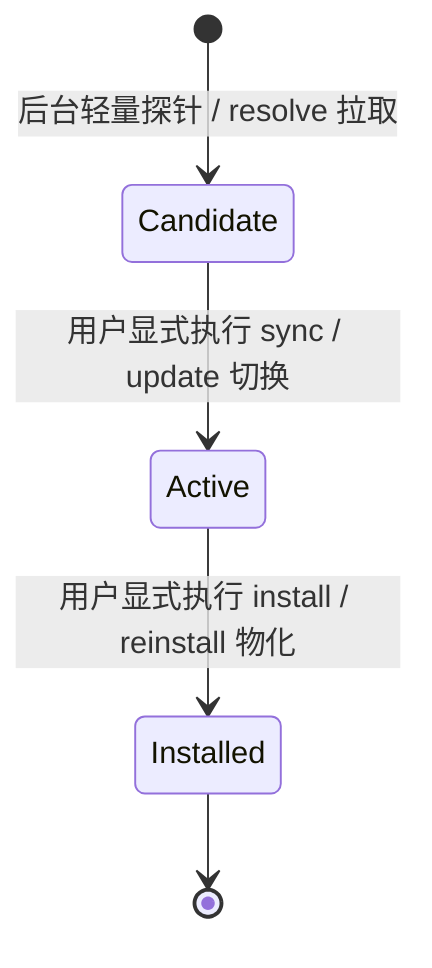

# Catalog 来源架构说明

本文件面向仓库维护者，是 Catalog 多来源管理、快照持久化存储、三层版本状态分层、来源变更政策、Preflight Inventory 影响评估、四种激活策略、Git 安全网络模型以及 Store Prune 垃圾回收算法的**唯一权威定义**。面向外部分发者和 Catalog 作者的公开格式、版本语法与发布计划合同参见 [外部 Catalog 参考合同](../../reference/catalog.md)；TUI 中的来源页面与交互状态参见 [TUI 当前交互与能力](tui.md)。

---

## 1. 来源配置与持久化存储架构

AW 支持多个独立的 Catalog 来源并发存在。每个来源独立拉取、独立校验、独立报错，某个来源失败绝不要求其他来源回滚，系统不设计跨来源的强事务。

### 1.1 文件存储组织与弱状态属性

```text
<AW_HOME>/
  catalog-sources.json          [强配置，schema 2]
  catalog-state.json            [强状态，记录各来源 Active 快照指针与 lastSync]
  catalog-store/                [弱状态，内容寻址的快照缓存]
    <sha256(logicalIdentity)>/
      <snapshotDigest>/
        metadata.json           [记录原始 logicalIdentity]
        snapshot/**             [快照物化树]
```

- **逻辑身份唯一性**：
  Catalog snapshot 的 logical identity **唯一来自** `.aw-generated.json.workspaceIdentity`。source ID、Git URL、SSH/HTTPS 文本和本地 path 绝不是 logical identity。
- **默认官方来源（Official Source）规范**：
  默认 `official` 来源的常量定义位于 `packages/cli/src/constants.ts` 与 `packages/cli/src/utils/catalog-sources.ts`：
  - URL：`https://github.com/lesliechan721-arch/agent-workflow.git`（SSH 地址为 `git@github.com:lesliechan721-arch/agent-workflow.git`）。
  - 分支引用：release 渠道（稳定版 CLI）使用 `refs/heads/catalog/latest`；beta 渠道（预发布版 CLI）使用 `refs/heads/catalog/beta`。
- **`catalog-sources.json`（schema 2）**：强配置，记录已配置的来源列表。缺失时默认使用内置的 `official` 来源；文件修改必须通过原子文件替换提交。损坏时，TUI 提供显式恢复：备份原始字节后原子恢复唯一的 primary `official` 来源（不触动 `catalog-state.json` 与 `catalog-store/`）。检测到 stale 配置时重新加载。
- **`catalog-state.json`**：强状态，仅为每个已配置来源保存 `Active` 和 `lastSync`。`Active` 绑定 logical identity、snapshot digest 以及 Catalog store 目录。系统中无 Candidate、Previous、current、last-good 持久层，也不设后台自动 refresh policy。
- **`catalog-store/`**：内容寻址的快照存储，属于可删除、可随时重建的弱状态，**绝对不决定插件的 live ownership**。metadata 文件必须保存原始 logical identity。系统不读取或迁移旧 URI identity 布局，旧 cache 目录不自动读取也不自动静默删除。
- **来源兼容性（Compatibility）**：
  来源 compatibility 状态枚举固定为 `null`、`supported` 或带 required/missing capability 的 `unsupported`。unsupported 状态使来源处于 not ready 状态，且系统不公开 available capability 全集。

---

## 2. 三层版本状态分层（Candidate / Active / Installed）

维护来源相关逻辑时，必须严格区分以下三层状态边界，切勿混淆：



1. **Candidate（候选层）**：轻量探测或 resolve 拉取到的远端元数据，仅存储于当前内存或 session overlay 中，**绝不持久化到磁盘状态，绝不自动覆盖 Active，绝不修改强配置**。
2. **Active（已激活层）**：用户明确批准并写入 `catalog-state.json` 的来源快照指针，是当前本地解析依赖与插件安装的基线。普通 CLI 命令只读 Active store，完全离线运行；缺少 Active 时必须先执行 sync。
3. **Installed（已安装现场层）**：用户各客户端现场已物化的插件产物。来源刷新、检查或 Active 变更**绝不静默升级已安装插件**。

---

## 3. 来源变更操作政策（Add / Update / Remove / Primary）

所有来源变更遵循配置优先与最小影响原则：

- **配置独立性（Config-only）**：`source add` 与 `source update` 仅修改 `catalog-sources.json` 配置，不自动启用新来源的 Active 快照。
- **原子更新主来源**：`source update <id> --primary` 可与 provider/autoCheck 更新合用。预检和锁内重验基于同一 proposed config 与 impact，确认通过后一次提交，不分成先更新地址、再切换 primary 的两次写入。仅切换 primary 不修改受 Workspace 管理的来源定义；组合修改仍保持 managed-source 保护。
- **同 ID 添加与孤儿清理时点**：
  同 ID 的 add 操作仅对新来源 ID（当前不在 `snapshot.config.sources` 中）执行孤立生成状态清理（orphan state cleanup）：
  1. 没有 preview/proposed config 证据的新来源，在构建 config 前先执行清理；
  2. 提供 preview 或 proposed config 证据的新来源，在 proposed config digest 与 impact 校验通过后、config commit 提交前同样执行清理。
  严禁对仍存在于配置中的来源执行孤儿清理；清理失败时放弃提交。普通无 Review 的非 primary add 保持简单直接提交。
- **同锁重新核验与 Stale/Conflict 严格停止边界**：
  Review 阶段核对 current 与 proposed config digest；进入 `AW_HOME` 写锁后，重新读取当前配置并对比。若 current config digest 发生漂移，抛出 `CatalogSourcesConfigConflictError`（add 命令根据调用分支核对）；若 proposed config digest 或 impact digest 发生漂移，抛出 Review stale 错误（`CatalogSourceReviewStaleError`）。系统返回相应 conflict/stale 回执并在写前停止，绝对不得在旧授权下继续提交，亦不得擅自重新构建计划继续执行。
- **Primary、Remove 与 Identity 变更确认边界**：
  - `source add --primary` 与 `source update --primary` 在主来源切换有受影响引用，或 inventory 检查不完整时，必须显式附加 `--yes` 确认；完整且无引用的切换不要求确认。
  - **公开 Remove 边界**：公开的 `source remove` 严禁直接删除 primary 来源或最后一个已配置来源。`replacementPrimarySourceId` 严格属于内部开发调用者（如 `aw dev source deactivate`）的专用通道，不是普通公开 remove 命令的允许参数。
  - **普通 Remove 确认**：普通 remove 在进入写锁后重新采集最新 impact，根据受影响引用或 unknown 影响决定确认；若存在受影响引用或 inventory 不完整且未传 `--yes`，抛出 `CatalogSourceImpactConfirmationRequiredError` 阻断。
  - **Identity 变更独立确认与 Stale 门禁**：来源 identity 变更（URL、path 或 subdir 变更）进入写锁后同样重采 impact 并绑定 `expectedImpactDigest`；若 impact digest 发生漂移则抛出 `CatalogSourceReviewStaleError` 停止；若未漂移，**identity 变更无条件要求显式传入 `--yes`（`CatalogSourceIdentityChangeConfirmationRequiredError`），即使本地 inventory 完整且为零引用也必须确认**。
- **尽力状态清理**：配置提交成功后，对 `catalog-state.json` 中遗留指针的清理为尽力（best-effort）执行；清理失败仅产生警告，绝不回滚已持久化的配置，且绝不删除 store 物理目录、已安装插件或 ownership 记录。

---

## 4. 来源影响评估与 Preflight Inventory

在执行可能影响已安装插件或配置引用的来源变更前，系统执行严格的影响评估：

### 4.1 Inventory 检查范围与未知保护

- **枚举范围**：检查范围覆盖 installation、config、intent、marketplace 以及 user、current project 和平台自身可枚举的历史 project 记录，不扫描未知 project 路径。
- **用户配置文档上下文**：配置引用仅从唯一的用户配置文档根（`catalog-source-references.ts`）枚举；项目目录仅提供授权来源与安装上下文，不单独作为第二配置源。
- **Unknown 非零原则**：当清单或旧 manifest 因文件损坏或权限问题不可读时，标记 `inventoryComplete: false`，影响判定为 `unknown`。**严禁将 unknown 假定为零影响**，必须要求用户显式传入 `--yes` 确认。

### 4.2 Impact 计算规则与现有引用门禁

- 当 current 和 candidate manifest 均可用时，系统计算 added、removed、changed、newly incompatible 以及 dependency changed 插件。
- **现有引用过滤（Affected References）**：generation 模式仅将 removed、newly incompatible、dependency changed 插件及其传递 consumer 在现场的**现有引用**列为 affected 影响集合（`affectedReferences = references.filter(...)`）。若来源移除了某个插件，但本地 inventory 完整且没有任何现有安装或配置引用指向该插件，不触发影响确认；但若 inventory 不完整（unknown），仍须确认。
- 来源移除（remove）或来源 identity 变更使用该来源的全部引用作为影响集合。

### 4.3 主来源切换机制（`primaryChange`）

- 来源配置变换从 current 与 proposed config 推导出 `primaryChange { fromSourceId, toSourceId }`。
- `primaryChange` 与 add、remove、identity change 或 generation mode 完全正交，使用统一的 inventory 与 impact digest。
- **影响范围限制**：primary change 仅影响无命名空间（legacy）的 owner/config/marketplace、canonical `aw` 注册及其 Codex/Claude consumer 和 installed evidence；namespaced lifecycle 产物不重新绑定。
- **不完整性传递**：若发生与 `fromSourceId` 或 `toSourceId` 相关的 inventory 读取错误，影响分析立即判定为不完整（`inventoryComplete: false`），视同 unknown 必须确认。
- **Schema 结构**：Catalog source impact 使用 schema v3，preflight inventory 使用 schema v2，source mutation 的领域回执保留 schema v6，CLI 将业务字段投影到统一结果 data。三者保留 `primaryChange`（无切换时为 `null`），严格脱敏，不公开绝对路径。

---

## 5. 同步机制与四种激活策略（Activation Policies）

来源同步是将 Candidate 转化为 Active 并持久化快照的核心通道。

### 5.1 探针与锁机制

- **Probe 阶段**：执行完整的 Transport Validation（核验快照目录结构、路径合法性、快照摘要、插件项 artifact/content 摘要、Marketplace 投影与 release metadata；**绝不解析未选插件的 bundle 内容，亦不是 Complete Validation**）。Probe 返回绑定 `sourceConfigFingerprint`、`sourceIdentity`、`logicalIdentity`、`ref`、`commit`、`version`、`channel`、`manifestDigest` 与 `snapshotDigest` 的 candidate evidence，清理临时 staging 目录，不取得写锁，不持久化 candidate，不写 store、Active 或 state。
- **`source status --remote` 模式**：临时拉取并执行 Transport Validation，返回脱敏候选与影响；清理临时材料，不写 store、Active、lastSync 或其它持久状态。
- **普通 `sync` 提交流程**：
  普通内容寻址发布在锁外将快照写入 store；随后进入单一 `AW_HOME` mutation lock。在锁内先执行 source config 重新核验：重新读取 `catalog-sources.json` 确认来源仍存在（若缺失抛出 `catalogGenerationSourceMissing`），且 `sourceConfigFingerprint` 与 `sourceIdentity` 严格匹配候选证据（若不匹配抛出 `catalogGenerationIdentityMismatch`）；若调用方提供了 `expectedConfigDigest`，核对当前配置 digest（若漂移抛出 `catalogGenerationReviewStale`）。随后重新读取 expected Active 与必要 store evidence、重采 impact、执行共享 activation policy。在状态替换前（`beforeReplace`）再次核对 source config 拒绝漂移，确认无误后原子提交 `catalog-state.json` 中的 `Active` **和 `lastSync`**。同步失败时保持原 Active 不变。
- **损坏非 Active 条目的自动替换资格**：
  若候选 key 对应的旧非 Active store entry 已损坏，普通 sync 会在 mutation lock 内确认合法 state 没有任何 Active 引用后，安全 quarantine 并替换该条目，无需手动传入 repair flag；并发修复直接复用。若该 key 已成为 Active 或 state 损坏，系统立即 fail closed。此在锁内替换损坏条目属于明确例外，不是普通发布的通用步骤。

### 5.2 四种激活策略定义

系统严格实现四种互斥的激活策略，`sync`、`refresh`、TUI generation 以及 `dev activate` 均共用该策略引擎：

| 策略标识 | 触发场景 | 核心校验与前置条件 | 失败恢复语义 |
| --- | --- | --- | --- |
| **`normal`（普通同步）** | 日常执行 `aw source sync <id>` | Git 来源严格要求更高 Catalog version（SemVer 递增）。**若 logical identity 与 snapshot digest 与当前 Active 完全一致，判定为正常 no-op，保持现有 Active 不变**。**严格拒绝相同 version 不同 digest 或较低 version**，且**严格拒绝 logical identity 发生任何变化**。Path 来源允许内容发生变化。若存在删除插件、新能力不兼容或依赖传递破坏的现有引用，需 `--yes`。 | 失败保持旧 Active 不变。 |
| **`explicitSourceChange`（显式来源切换）** | 来源配置发生变更（如切换 URL、分支或类型）后的首次同步 | 必须由 service 证明来源配置相对于 Active 所记录的 fingerprint / identity 发生了已核验的变化。允许合法的版本重置或内容调整。 | 失败保持旧 Active，提示重新同步。 |
| **`exactRepair`（精确修复）** | Active state 有效但物理 store 缺失或损坏 | Git 来源使用当前 transport 配置与 `Active.resolvedCommit` 拉取旧快照。必须在 `logicalIdentity`、`snapshotDigest`、`manifestDigest` 与 `resolvedCommit` 四项全部严格匹配时原地修复旧 key；来源配置不变。CLI 修复后继续执行当前候选的 normal sync；TUI 修复成功后立即停止。 | 旧 commit 不可取得或 Path 内容不是旧 key 时，返回 typed `replace-required`。只替换精确 key，失败还原目标，清理失败仅产生 warning。 |
| **`replaceDamaged`（替换损坏条目）** | 旧 commit 不可取得，或开发 Path 内容变更导致无法原地修复 | 必须显式传入 `--replace-damaged --yes`，或在 TUI 独立替换 Review 中授权。在短锁内重新绑定 expected Active、candidate 和 source config digest，确认旧 entry 确已损坏。仅跳过无法完成的旧版本比较；未经核验证明的 source config 变更严禁改变 logical identity。 | 失败保持原样，拒绝未经授权的身份迁移。 |

---

## 6. 本地开发源（Development Source）深度架构

面向插件开发者本地 Workspace 的直连机制：

- **`aw dev source activate`**：
  执行本地构建、complete 校验、注册 managed Path source 并执行同步。若影响现有引用或影响未知，必须显式传入 `--yes`。改变 managed Path source 的身份也必须确认，即使引用为空；确认后的公开结果仍保留 `confirmation.required=true` 和实际影响。
- **`aw dev source status`**：
  只读检查 snapshot、source/path 和 Active digest。Receipt v4 中的 `active.compatibility` 直接投影 generation status v2；无 Active 或无法判定时为 `null`；unsupported Active 使 dev status 处于 not ready 状态，结构损坏单独报告 typed `repair-required` 错误。
- **`aw dev source deactivate`**：
  停用受控来源，**绝对不删除 `.aw/catalog` 构建目录**。
  - 先对仍处于原 primary 状态的精确 managed Path source 执行 remove impact preflight，并核实 Workspace ownership。
  - 存在引用或 inventory 不完整时需要 `--yes`；通过 `--source-id` 进行恢复时无条件需要 `--yes`。
  - 进入 `AW_HOME` mutation lock 后重新核对 source、managed owner、replacement 与 impact，若发生漂移则在写入前返回 typed `stale`。
  - primary development source 的删除与 replacement primary 的切换通过单次 `catalog-sources.json` 原子替换提交；generation state 的清理在提交后尽力执行。
  - Receipt v4 必含脱敏 inventory v2 `impact`，若 preflight 无法完成则为 `null`，严禁公开绝对路径。系统不建立补偿事务，失败后可重新 sync 或重新执行 deactivate。

---

## 7. Git 来源连接与安全模型

Git 来源连接保持非交互与确定性，杜绝悬挂阻塞与凭据泄漏：

### 7.1 探针与超时策略

- **超时配置值域**：`AW_CATALOG_REMOTE_TIMEOUT_MS` 只接受 `0` 或 `100..300000`（毫秒）。
  - full resolve 默认超时为 180000 ms。
  - ref probe 默认超时为该值与 30000 ms 的较小值。
  - 设置为 `0` 表示无 deadline。
- **Deadline 共享机制**：
  单次 ref probe 内的各子命令共享 probe deadline；单次 full resolve 内的命令共享 full resolve deadline。probe 之后继续执行 full resolve 时，系统重新建立独立的 full deadline。

### 7.2 环境隔离与凭据脱敏

- **环境变量清理**：
  消费端在执行 Git 命令前，显式清理危险的环境变量：`GIT_DIR`、`GIT_WORK_TREE`、`GIT_INDEX_FILE`、`GIT_OBJECT_DIRECTORY`、`GIT_ALTERNATE_OBJECT_DIRECTORIES` 等，防止仓库逃逸与污染。
- **凭据保留与拒绝**：
  消费端保留用户的 SSH agent、credential helper、自定义 SSH 配置、proxy 和 `insteadOf`。
  **严禁在 Git URL 中包含明文凭据**，遇到含凭据的 URL 立即阻断。AW 自身不持久化存储任何 Git 凭据。
- **诊断脱敏**：所有诊断日志、错误消息与 receipt 对 Git URL 敏感信息、query 参数与 private hash 进行强制脱敏与截断。

### 7.3 TUI 会话级缓存机制

- TUI 自动检查与“重新检查”先执行轻量 Git ref probe，若 commit 未变则跳过完整 fetch；用户点击“完整验证”时强制执行 full resolve。
- 完整拉取到的 candidate 可在当前会话内复用于普通 Review preparation，但必须持续匹配 session token、source config fingerprint 以及 Active store key。
- 最终 Execute 阶段总是重新 resolve。会话缓存不持久化 Candidate，不改变 Active 或 Status。若候选要求当前 AW 不支持的 capability，TUI 显示 missing capability IDs，保留旧 Active，并阻止普通 update。

---

## 8. 快照缓存清理（Store Prune）完整算法与回执合同

`cache prune` 是显式的人工运维与故障恢复命令，**绝不引入后台无条件自动 GC**：

### 8.1 命令接口与授权互斥

```bash
aw cache status [--json]
aw cache prune [--dry-run] [--yes] [--json]
```

- `status` 与默认的 `prune`（或显式 `--dry-run`）为**严格只读检查**，不获取写锁。
- `--dry-run` 与 `--yes` 严格互斥，只有显式传入 `--yes` 时才执行真实删除。
- 实际 prune 运行在现有单一 `AW_HOME` mutation lock 保护下。

### 8.2 首次全量检查 Fail Closed 规则与单项错误隔离

在首次删除前，必须在锁内完成合法 `catalog-sources.json`、合法 `catalog-state.json` 以及 store 根目录的完整读取与核验：
- **首次全量读取失败**：若 source config、generation state 或 store 根读取损坏，系统立即 **fail closed**，绝对不删除任何内容。
- **单项检验错误隔离**：初始 inspection 的单项错误不等于全量读取失败。实际 prune 仍可处理其它独立且已安全确认的可回收项；inspection error 与 delete error 都投影到顶层 `diagnostics`，有效部分结果保留在 data，返回 `status: 'partial'`。
- **Status 与 Dry-Run 结果回执规范**：
  - `aw cache status` 遇到单项 inspection error 时返回 partial 并保留已查出的 `entries`、`totals`（包括 `reclaimableEntries` 与 `reclaimableBytes`）以及脱敏的 `errors`；完整取得且无阻断的检查返回 success，诊断按稳定 code 提供。
  - `aw cache prune --dry-run`（及实际 prune）遇到 inspection 不完整时，返回 `status: 'partial'`，保留已完成检查的结果：包含 `entries`、`deleted`、`retained`、`errors` 以及 data 内的 `reclaimableBytes` 与 `deletedBytes`（prune 不包含 `totals` 汇总对象）。

### 8.3 保护与保留规则体系

```text
Store Item 状态与保留期限：
  ├── Active 快照（有效配置来源引用）      ──> 永久保护，严禁删除
  ├── Orphan Active（已删除来源引用）       ──> 保留 30 天
  ├── 非 Active 正式条目                   ──> 整安全树最新 mtime > 30 天可回收
  ├── .staging-* 与 .replacement-* 临时目录 ──> 最新 mtime > 24 小时可回收
  ├── .quarantine-* 隔离目录              ──> 最新 mtime > 24 小时 + 对应正式条目健康完整
  └── .delete-<uuid>.tmp 删除声明         ──> 弱状态，普通目录且最新 mtime > 24 小时可重试
```

1. **Active 绝对保护**：
   只有当前有效 `catalog-sources.json` 中配置的来源所对应的 Active snapshot 受到保护，绝对不可删除。
2. **Orphan Active 降级**：
   已从配置中删除但 `catalog-state.json` 中仍有指针的来源，其快照标记为 `orphan`，按普通 inactive 条目保留 30 天。若同一个 store key 同时被有效来源与 orphan 来源引用，`active` 优先级更高，继续受永久保护。
   schema v2 的每个 inspection entry 必含 `generationReference: active | orphan | none`。
3. **正式非 Active 条目**：
   通过完整 store 校验的非 Active 正式 entry，只有在**整棵安全目录树的最新 mtime 超过 30 天**时方可回收。
4. **临时暂存与隔离条目**：
   - 严格命名的 `.staging-*` 与 `.replacement-*` 在超过 24 小时后可回收。
   - 严格命名的 `.quarantine-*` 目录：除超过 24 小时外，必须能够从自身 metadata 确定其 canonical key，且对应正式 entry 必须存在并通过完整验证，方准许删除。
5. **残留与未知节点绝对保留**：
   任何符号链接（symlink）、unsafe 节点、未识别节点、严格布局规范之外的文件、读取失败或校验失败项，一律 fail closed 保留。
6. **可回收字节核算**：
   可回收 bytes 仅累计安全的普通文件；inspection 不完整时计算为 `unknown`，严禁当零处理。

### 8.4 两阶段安全 Claim 与逐项删除算法

对初次判定为可回收的每个条目，执行严格的两阶段删除协议：

1. **逐项重验（Recheck）**：
   在实际删除前，重新核验当前节点身份、类型、store key/metadata identity、Active 引用以及 retention evidence。若证据漂移或重命名失败，保留该项并报告 `staleBeforeDelete`。
2. **原子 Rename 为 Claim**：
   重新确认通过后，将该精确节点原子重命名（rename）为同一安全 identity 父目录下的唯一 `.delete-<uuid>.tmp` claim 目录，并将 claim 根 mtime 设置为本次 claim 时间。若 mtime 更新失败，安全恢复原路径并报告 `staleBeforeDelete`。
3. **核实并递归删除 Claim**：
   只有当 claim 目录与已确认的节点和父目录身份完全匹配时，才递归删除该 claim。
4. **部分失败与收敛保证**：
   - 单项 claim 删除失败后，继续处理其他已安全分类项。
   - 重新检查后，让 `entries`、`retained` 与 `errors` 使用实际 claim 的相对 store key、`deleteClaim` category 以及当前 retention 状态；若 claim 已不存在，按删除成功处理。
   - 失败的 claim 保留为严格命名的弱 residue，其安全普通目录树在超过 24 小时后可由后续的 prune 命令再次重试清理。
5. **状态与 Receipt 规范**：
   - prune **绝对不修改** `catalog-state.json`。
   - 公开 schema v2 使用统一的应用级错误分类：明确的应用 code 保留，底层操作系统 errno 不作为公开 code，store 根读取失败统一为 `catalogStoreInspectionFailed`。
   - Receipt 仅包含相对 store key 和脱敏原因，严禁包含 `AW_HOME` 绝对路径。
   - 被删除的非 Active 弱快照可随时通过 `aw source sync` 重新拉取重建。

### 8.5 TUI 集成交互

TUI 的 Store 维护页面直接调用同一 status 与 prune 服务：
- 清理 Review 从只读 dry-run 检查中冻结精确的 `authorizedItems` 集合。
- 确认执行时将该精确集合交给 prune 服务。
- 用户确认之后新出现的候选不在授权集合内，绝不能被本次操作删除。
- 清理大小无法完整证明时显示为“未知”，绝不显示为零。TUI 不新增独立的锁、GC 任务或持久清理账本。
