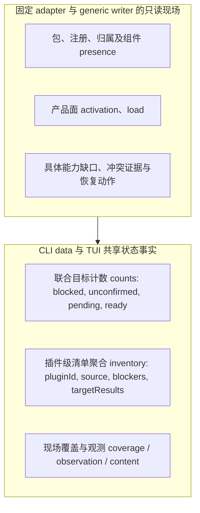
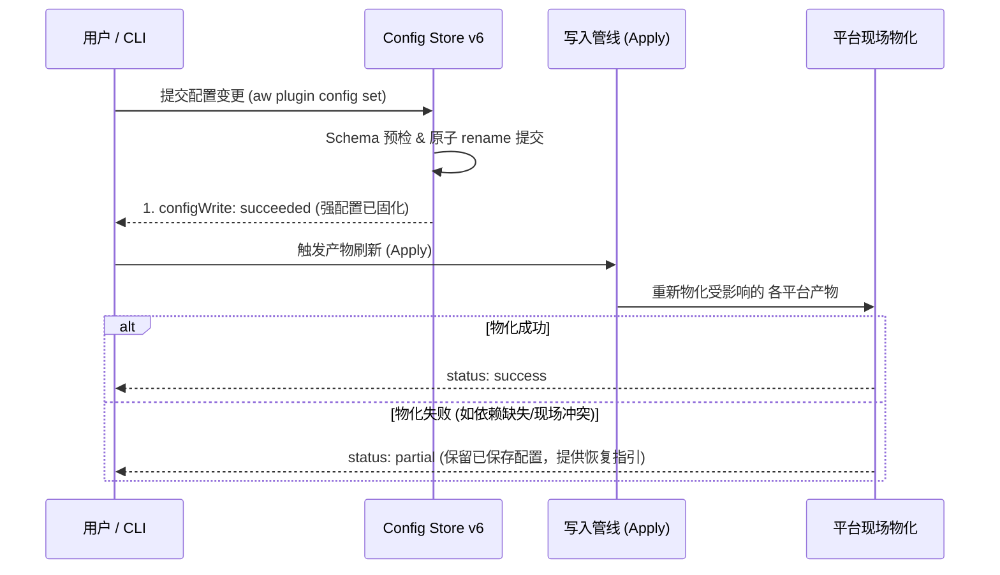

# 状态与配置架构说明

本文件面向仓库维护者，定义用户意图（Intent）、状态判定（Live Status）的分层模型与数据流、配置持久化（Config Store v6）的内部架构设计与恢复语义。面向插件作者的 Manifest、配置声明及 Schema 格式定义参见公开合同 [Plugin Manifest 与配置声明合同](../../reference/manifest-and-config.md)；TUI 中的交互与草稿呈现参见 [TUI 当前交互与能力](tui.md)；安装、重建与清理的物理动作参见[插件生命周期](lifecycle.md)。

---

## 1. 意图（Intent v3）与本机偏好

系统通过分离的意图模型区分用户与项目的部署诉求，避免全局污染：

- **用户级意图（User Intent）**：保存在用户个人配置目录（`<AW_HOME>/plugin-intents.json`），记录用户全局期望启用的插件集合。
- **项目级意图（Project Intent）**：保存在当前项目根目录的声明文件中（`<projectRoot>/.agent-workflows/plugin-intents.json`），记录当前仓库共享的插件需求。
- **本机部署偏好（DeploymentPreferences schema 2）**：记录用户在本机上选择的目标客户端平台（`codex`、`claude` 等），由 `aw target set` 维护。
- **选择与可用性分离**：九个 target 的选择仅由用户保存；发现结果不自动删除已选项。可用性为 available/missing/unsupported/unknown/notApplicable，generic 为 notApplicable。CLI 新增不可用目标需要显式 force；TUI 的本机草稿与保存时确认规则见 [TUI](tui.md)。
- **意图与清理边界**：
  取消项目需求（Intent）仅代表逻辑诉求的移除，**绝对不授予删除共享产物或未证实归属输出的权限**。具体清理门禁参见[插件生命周期](lifecycle.md#ownership-与删除权限)。

---

## 2. 联合恢复状态（Live Status）分层架构

命令 `aw plugin status [--context user|project]` 组合授权上下文中的两份 Intent、单一本机策略、Active Catalog、各原生平台与 generic 现场，输出统一的联合恢复状态。只读操作不创建持久状态、不运行 renderer/preApply、不取得工具或修改信任。未知需求保持 `unknown`；基础现场观察复用，不能递归调用 status。

状态模型在架构上严格区分为**公开恢复状态合同**与**内部状态事实模型**两层：



### 2.1 公开恢复状态合同（Public Recovery Status Contract）

领域事实由 `packages/cli/src/recovery/status.ts` 产生，TUI 直接使用共享服务。CLI 按[统一输出合同](../../reference/cli.md)显式投影，不直接输出内部回执或 backend。

- 顶层 `schemaVersion: 2`、`command: "plugin.status"`、`status` 与诊断描述本次查询是否完成。完整取得但仍需同步可以 success/0；来源读取失败、blocker 或覆盖缺口按实际返回 blocked/failed/partial。
- `data` 保留 scope/context、requirements、target selection、inventory、extraObserved、coverage、counts、inSync 与 allSatisfied 等业务事实。内部 intent/agent 对应公共 requirements/target；未知保持 null/unknown。
- **联合目标计数（counts）**：在本次可见 inventory 的 targetResults 上分别统计。它们不是需求根的互斥分类，不能相加推算插件数量：
  - `blocked`：有 blocker 的目标数。
  - `unconfirmed`：内容为 unknown 的目标数；可能与 blocked 重叠。
  - `pending`：satisfaction 为 pending 的目标数。
  - `ready`：内容为 satisfied 的目标数。
  - 同一个需求根可在一个平台 ready、另一个平台 pending。额外残留独立保存在 extraObserved，不混入 unconfirmed。
- **插件级清单（inventory）**：数组形式，汇总各插件在当前 scope 的来源信息、来源状态、阻断诊断（`blockers`）以及各平台 target 的执行结果（`targetResults: RecoveryTarget[]`）。
- **观测与内容事实状态（RecoveryTarget）**：
  - `observation`：为现场观测事实枚举（`'verified' | 'missing' | 'unknown'`）；
  - `content`：为现场内容匹配事实枚举（`'absent' | 'satisfied' | 'drifted' | 'conflict' | 'unknown'`）。两者均为**机器状态事实，绝非内容签名或哈希摘要**。
  - `satisfaction: 'not-applicable'` 表示只有能力缺口且实际安装数为 0 的目标已收敛。可以同时有 `content: 'satisfied'`，因此按目前可执行的工作计为 ready。实际安装和继承关系仍由独立的 `installed`、`inherited-user` 表达。
- **独立额外残留（extraObserved）**：磁盘上观测到的额外未管理残留记录在 `data.extraObserved` 列表中，**绝不混入 `counts.unconfirmed`**。
- **错误与覆盖**：完整诊断进入顶层 `diagnostics`；data 保留实际 coverage，明确其它项目未观察。清单错误保留稳定细分原因、安全位置和相关 scope；坏 header 只提供诊断线索，不授予 owner 权限。已证明独立的错误不传播到无关目标，不能证明无关时保留对应覆盖缺口；共享位置和真实依赖的影响仍传播。重复用户文件错误合并，不能丢失作用范围。
- **精确选择**：先解析完整必要依赖、provider、共享位置和碰撞关系，再对所选插件/target 观察。显式选择依赖时 inventory 包含该依赖及 requiredBy、需求和提供者 scope，不把它提升为 Intent root。无过滤查询仍按直接根聚合。
- **已有现场**：没有 Intent 的短名称与来源限定查询都保留匹配的 Native 残留。显式 Native-only target 不读取独立 generic 目录；按插件选择时，无关 Portable 输出仅检查安全路径和身份，内容保持 unknown。选中输出仍完整检查，无法确认范围的损坏保留覆盖缺口，浅观察不提供删除授权。
- **全局与本次完成**：selection 保留 plugins/targets 数组及 targetOrigin。allSatisfied/inSync 继续总结授权读取上下文；明确不满足优先为 false，尚未观察的需求或残留使结论为 null，完整满足才为 true。可选 coverage.requestComplete 表示本次选择及必要依赖/共享/碰撞证据是否完整；未选目标未观察不单独使精确请求失败。

### 2.2 平台、产品面与组件事实

recovery/status 复用固定 adapter 的 discover/resolve/inspect；generic 复用受管 Skills writer 的现场证据。既有浅检查 helper 可以提供归属和配置事实，但不代替九个平台的部署观测。

DeploymentObservation 分开保存包、登记、归属、组件和各产品面的有效启用及加载。目录路由的登记为 `not-applicable`。需要核对消费副本的路由另报告 `nativePackage`，Cursor 报告当前范围的 `workspaceOpen`。启用事实来自对应范围的原生清单或 API。加载需要独立运行证据。已观察到的包、登记和启用事实在待同步、部分失败及安全拒绝时仍可见。

可选 `configuration` 包含所读范围、显式 activation、可选 marketplace 和 reasonCodes。配置声明补充原生结果。归属、实际字节和共享引用分别控制更新与删除。原生已登记与 AW 无法安全维护可以同时成立。

原生清单明确提供安装范围时，`scopeRegistration` 保存当前范围的独立登记。Claude 的 User 记录属于 User，精确 projectPath 的 local 记录属于当前 Project。继承的 User 或 managed 记录可确认 Project 有效登记和启用。独立范围要求核对自己的登记。

Codex 的 neutral 清单提供 User 状态，精确工作目录的清单提供 Project 有效启用状态。Project 可以独立于禁用的 User 启用。显式 Project 启用在精确和 neutral 清单均为启用时，`scopeActivation` 保留未知，该范围的有效启用仍如实显示。无独立需求的继承只检查有效状态。精确清单明确禁用时，保留禁用事实。共享包使用一个物理位置，每个需求根据对应范围的启用、补足与共用包内容判断。

安装就绪只要求该路由需要的包、登记、启用和组件产物。已确认的输入或内容漂移作为 warning 且目标待同步，附精确插件、目标和范围的同步操作。明确禁用或缺少必要输出也待处理。必要事实无法观察时保持未知，实际归属冲突和安全门禁继续阻断。加载诊断可见，OpenCode 的可选加载及其诊断对目录交付和汇总无影响。

包内 nativeProjection 绑定 sourceIdentity、physicalKey、冻结 PhysicalIdentity 及包单元内组件到原生输出的映射；包外补足不能作为包内相对路径检查。共享包的输入摘要只绑定固定包渲染单元，不包含各 activation scope 的补足。只读状态核对输入、实际字节及物理位置，不运行 renderer。Antigravity 与 Grok 的 `nativePackageContentDigest` 只来自实际安装副本读取，不从 AW 源包反推；旧副本显示 drifted，确认副本缺失显示 absent，无法核验副本时保留 unknown 或实际归属冲突。Antigravity 的精确副本 owner、完整旧字节及可写条件见[原生路由](platforms.md#2-原生包正文与-lifecycle-路由)。Grok 来源清单不参与 renderer 或能力计算，故不纳入包输入摘要；完整来源、原始配置现场摘要与副本事实仍保留在锁内 stale 校验及状态展示中。输入摘要包括 renderer 的 configKeys，以及当前平台、实际渲染 scope 下 Skill producer 动态命令集的 refreshKeys 和非敏感校验依赖；命令配置单独变化也必须显示漂移。静态补足按当前 manifest、固定布局及 owner 核对实际内容。动态补足没有可核验的完整集合时保持 unknown，即使包内投影完整，也不能据此推断补足齐全；不能从已移除的 artifacts.targets 推断结果。

Codex 与 Grok 完整动态准备成功且后置复核通过时，记录该绑定完整的角色或规则补足集合，包括有意为空的集合。status 核对 AW 归属和实际文件字节。摘要过期且已确认旧产物时显示待同步。记录缺失、损坏或文件无法核对时保留 unknown。重新 sync 可重建记录。Codex 只在 Project 生成角色时，核对参与渲染的范围。若同一轮也生成过有意为空的包，则另核对现有空结果记录的包单元和实际缺席。

成功有意为空的原生集合，以及经确认只包含能力缺口的零产物结果，使用既有 platforms 命名空间内可重建的证据。零产物 receipt 绑定精确 binding/scope、全部 render units 和可只读复算的来源、资源、配置、派生能力。交付证据保留本次能力缺口及实际交付组件。缺失、损坏或过期时仍需重新准备。匹配证据后继续检查实际包、登记、激活与补足，按实际情况报告撤销失败或 foreign 残留。删除权限由独立的现场归属证据决定。

空结果的写入与状态读取都接受已确认的原生登记缺失、目录包缺失且登记不适用，或当前 scope 独立引用已撤销。接口未报告 activation 时不伪造 disabled，也不因该字段 unknown 拒绝这些缺席事实；Project 继承的 enabled 不代表独立项目引用。User 原生 enabled 不能因本地条目缺项而被认作空结果，foreign/unknown 归属与残留补足继续阻止确认。

generic 的准备 generation 同样保留来源绑定中的完整 `unmet`。匹配当前证据、现场没有未处理的输出且缺口仅来自平台能力时，可以确认零产物就绪。混合集合按已确认的 Skill 成品和能力缺口显示交付结果。受影响的旧 Skill 按声明和归属保护处理，仍有旧残留或其他未满足项时按实际结果待处理。候选列表为空本身不授予删除权限。

## 3. 现场证据、共享引用与 scope

### 3.1 只读观察

TUI 安装在准备 Review 和取得写锁后各自校验当前 Active Catalog。同一阶段内，来源绑定、store 实际根和快照身份均匹配的消费者可共用整树摘要校验。每个根仍由 Core 校验自己的条目和依赖闭包。锁内执行 generic 子计划时，如果安装组和保护组在同一段只读检查中引用同一来源与同一代，先重新绑定当前 Active，再逐组核对目标文件与归属。若此时发现变化，回执保留联合操作已经保存的声明和已完成的目标。首次发布 Portable 准备产物，在提交 staging 前独立校验来源。联合安装写完后，最终状态重新读取当前 Active，User 和 Project 的各根共享同一来源、同一代的整树验证。写入前提供的旧 Store 即使仍然完整，也要与当前来源重新核对。若无法确认本次目标的最终状态，回执保留已完成的写入，并给出当前上下文的只读 status 命令。

安装准备和状态查询可以并行读取多个平台。每个平台使用自己的发现与观测上下文，同一只读阶段内，相同入口、参数、环境和工作目录的调用共用在途结果。Codex 的 User 中立目录和 Project 精确目录分别查询，各自保留启用事实。Pi 在锁内重审时重新读取清单，位置核对可以复用本轮同作用域的结果。写入、`preApply` 和后续独立校验会结束前一轮的复用。最终状态对需要覆盖的客户端重新取证，具体平台的单目标条件见下文。

状态只运行固定有界 probe，不启动模型、preApply 或 renderer，不安装工具、不更新来源、不修改信任。User 查询使用隔离 neutral cwd，Project 查询绑定精确项目。Codex 使用 scoped plugin list；Claude 使用 plugin list 和 marketplace list；Copilot 使用对应原生清单的 enabled；Grok 使用 list/inspect 的各自字段。Pi list 仅提供可见包与 scope，activation 保持 unknown。缺少 Project 段时，该范围的登记保持未确认。所有清单均不提升为模型采用证据。Codex private cache 不进入删除授权。

Pi 首次 ensure 只有在源位置、归属和物理 slot 均确认为不存在时，才可把新独占源交给原生 install。宿主命令自行执行信任门禁，AW 不授信；unknown 不允许替换或删除既有内容。成功后按原生 list 可报告的精确登记核验。普通包用登记及内容确认即可就绪。Agents 组件另核对实际消费者配置、访问、授权和能力。AW 在固定包位置核对归属、扩展投影记录和现场内容摘要后，角色消费者检查跳过已证实由 AW 生成的 Hook、MCP 和 Instruction 扩展。证据缺失或内容漂移时，按实际扩展继续观察。

Pi 的 Project 移除可按本次原生命令确认撤销：正式 runner 正常完成、退出 0、无 stderr，且明确回报移除精确来源。后续有效 list 仅缺少 Project 段时，这份动作回执允许继续既有 AW 专属、无共享引用的包清理，以及本次停用和有意空集合汇总；查询失败、无效输出或仍有登记均不接受。通用观察的 registration 仍为 unknown，不从 settings 或动作回执改写，也不把本次确认保存为后续状态真值。

Grok inspect.projectTrusted 仅表示当前目录与运行时信任，不是新插件来源的安装授权。首次 User 安装发布 AW 源包后返回 nativeTrustRequired，用户须用回执中的精确原生命令显式授予 --trust，再执行 AW sync；AW --yes 不代表该授权。只有已原生登记、精确同源且独占的 AW 包可按已审核计划刷新。

显式 `--observe-native` 在符合 V2 接口最低条件的 OpenCode CLI 探测路径启动私有本地服务。该服务可能创建日志、状态和 cache，读取既有认证，加载已安装插件代码并按宿主现有配置连接外部服务。OpenCode 使用单次 --standalone API 绑定精确 location，不复用远程或版本不明的服务；active 确认当前 CLI 的启用与加载，failed 单独报告加载失败，异步激活尚未出现的条目保持 unknown，不将 CLI 结果提升为 Desktop 结果。进入启动路径时，公开结果通过 `nativeObservationSideEffects` 披露相关范围和副作用。该观察无需登录或模型会话。普通 status、TUI 和复用观察 session 的其他消费者默认不启用此模式。

同一次只读 status 可复用相同 Active snapshot 校验、manifest 与入口发现；复用部分 Catalog 上下文时，必须补读现场残留候选所需的缺失来源，不能因该插件已无 Intent 而漏掉已安装目标。补读只限缺失的已配置来源，结果及失败仅在本次读取内共享；原生清单按真实入口、配置根、scope、cwd 和来源区分，neutral 与 Project 不能混为一次。TUI 重新检查及下一命令使用新会话。Review、锁内执行及写后观察不能共用过期 snapshot。

Copilot 与 Pi 在同一次证据检查内可并行读取独立的不可变输入与可变现场，两项都结束后再比较，常规检查逐次重新读取，并保留不可变输入失败与 stale 的优先级。新建单个 Pi ensure 目标时，若同 session 仅有该目标、单 binding/plan 且无阻断或缺项，紧邻返回前的检查可复用同 build 渲染后取得的 discovery；原生事实与完整本地副本、配置、owner 等 observation 仍重新读取。此复用只交给首次创建者，缓存命中、执行和写后检查保持 fresh；并入其他可写目标时回退完整检查。首次返回检查失败不污染已构建目标的缓存，恢复输入后同 key 再准备仍执行完整检查。

已按平台核对的非 Codex 联合安装组，以及单独的 Copilot、Pi 原生路由，可以在紧邻执行时完成一次完整入口核验。它适用于一个已冻结的非空 ensure 部署，组件齐全、现有包和归属可确定，动作只涉及发布、登记、刷新或启用。带脚本、托管命令写入、阻断或补足删除的目标分别检查。Codex 使用自己的登记和启用复核。Pi 有效清单仅缺 Project 段时，还要求包及归属均为 absent、无共享引用、全部 owner 槽位为空，动作仅为发布与登记。此时 registration 保持 unknown，原生客户端仍可拒绝未信任项目。入口核验失败沿用 preflight 错误路径。成功结果仅供这次调用的首个生命周期检查使用，写后观察、rebase 和最终状态都重新取证。

Pi 的首包登记可能使原生清单显示此前不可见的 Project 段。同批后续 ensure 对原先没有目标包、归属和本地登记的目标，可以接受其登记由段不可见变成已确认缺席。新清单的全部 Project 来源必须精确匹配本批在同一项目配置和客户端中确认的登记，其他冻结证据继续逐项核对。

联合安装按平台判断是否需要在返回 Review 前刷新预览。同一平台只有一个完整的 ensure 组、该组的目标均通过准备时，首轮预览已经封存全部候选。其它平台或独立的 Portable 组可以在同一批次中存在。一个平台有多个 scope 或共享来源候选时，在各组准备完成后再刷新并冻结。来源激活后的重准备、锁内复核与写后的真实读取继续各自执行。产品面与 scope 必须明确，unknown 保留覆盖缺口。适用的进程、路径和身份检查见[平台边界](platforms.md)。

### 3.2 scope 与共享物理包

逻辑需求和物理输出分别判断。Codex、Claude、Copilot 共享包按 canonical user scope 渲染，需求 scope 与原生查询上下文分别保留；独立 scope 路由不因存在用户需求就省略项目部署。同 physicalKey 只算一个物理实例，但保留所有实际产品面与需求引用。

原生命令在项目中报告 enabled 时，即使没有显式项目条目，也保留 enabled。neutral 与项目查询的差异说明上下文结果，不还原安装由哪个 scope 发起。显式条目和 AW Intent 用于共享引用与精确写入保护，继承启用本身不是独立项目引用。

User neutral 查询已排除调用项目覆盖，其原生 enabled 必须保留为实际共享使用者，不能因本地条目 absent/disabled 而排除删除保护。只有 Project 的独立引用需要区分继承与显式条目。Claude Project 无 local 登记且无显式条目时，撤销本 scope 不新建停用覆盖；已有 local 登记继续按既有原生 disable 合同撤销，最终有效状态如实保留。

Codex 显式 project false 覆盖 user true。撤销项目需求时移除 AW 自身项目 activation entry，让有效用户激活继续继承；不能写 false 代替删除。用户操作不读取或修改未授权项目，也不能把共享 payload 当作项目已启用。

共享引用在本次内存中按 JointDemandSnapshot、实际 owner 和路由可证明的原生注册/activation 记录确定：明确仍有引用为 present，完整覆盖且无引用才为 none，其余为 unknown。两份 Intent 可读不证明全部历史项目无引用。unknown 时可撤本次精确 activation，但保留共享包与恢复说明。无 Intent 不自动新增依赖需求。

依赖按完整身份和实际布局选择；提供者失败只阻断其真实消费者，独立平台和无依赖命令包继续。共享包损坏不改用另一条安装路由。foreign、不可读现场、配置损坏与能力缺口保持可见，不能由无需求豁免吞掉。

### 3.3 弱证据与恢复

owner、来源绑定、角色补足和空结果 receipt 均可重建。损坏弱证据不能永久阻断有充分 live ownership 的精确清理，也不能授予 foreign/shared 内容的删除权。历史文件不自动迁移或遍历删除；强配置的显式恢复仍遵循各自 schema 门禁。

Core compile/select profile 借用对象修改前复制，不跨命令缓存；正则 binding 在 finally 中释放。生命周期与离线清理的具体授权见[生命周期](lifecycle.md)。

---

## 4. Config Store v6 持久化与写管线

<a id="store-v6"></a><a id="31-命名空间与-envelope-存储"></a>
### 4.1 Store v6 物理持久化 Envelope 规范

用户配置按命名空间独立持久化：

```text
<AW_HOME>/plugin-config/<sourceId>/<pluginName>/config.json
```

- **路径解析与展示分离**：由 `packages/cli/src/utils/plugin-config.ts` 的 `resolvePluginConfigStorePath` 函数确定，由 `sourceId` 和 `pluginName` 构成目录层级，配置文件统一命名为 `config.json`。展示用的 `pluginId`（如 `<sourceId>/<pluginName>`）仅用于运行时解析与界面投影，**绝对不作为文件路径或持久字段保存在 Envelope 中**。
- **顶层键严格白名单化**：遵循 Store v6 Envelope 规范，顶层键严格限定为以下六个，出现任何未知多余字段直接拒绝解析（返回 `null` / `invalidJson`）：
  - `schemaVersion: 6`（固定整数 6）
  - `sourceId: string`
  - `pluginName: string`
  - `binding: { kind: 'source', sourceIdentity: string }`
  - `common: Record<string, PluginConfigValue>`
  - `platforms: Partial<Record<PlatformTarget, Record<string, PluginConfigValue>>>`
- **强制 Source Binding**：`binding` 必须且仅包含 `kind: 'source'` 与 `sourceIdentity`，且 `sourceIdentity` 必须严格匹配 `^sha256:[0-9a-f]{64}$` 哈希格式。
- **受支持平台目标白名单**：`platforms` 的键必须严格属于受支持的平台目标（`PLATFORM_TARGETS`：`codex`、`claude`、`antigravity`、`cursor`、`opencode`、`pi`、`copilot`、`grok`、`generic`），未知平台键直接拒绝。
- **配置内容纯粹性**：`common` 与 `platforms[P]` 仅保存用户值，**绝不包含 UI 装饰、摘要或状态字段**。
- **覆盖解析顺序**：
  ```text
  defaults(compileSchema(P)) < common < platforms[P]
  ```
  按顶层键存在性覆盖。`false`、`0`、空字符串和空数组都是合法实际值。对象与数组按顶层字段整体覆盖替换，**不做深合并（deep merge）**。
- **校验与容错规则**：
  - common 最终值不符合平台 schema 时明确失败，合法平台覆盖可遮蔽 common。
  - 平台覆盖无效时不得回退运行；删除平台覆盖后若 common 无效，则明确报告无效。
  - 读取严格保留 JSON 原始类型，不做隐式类型转换（coercion，例如不把 `"123"` 自动转为 `123`）。
  - 内存规范化不改变磁盘；同义写入不重写文档，Review 仍绑定原始 bytes。
- **旧版格式拒绝**：旧版 `plugin-config.local`、Store v5 及更早文档拒绝读取，保留原文件并提供显式重置入口；所有新写入均为 Store v6。
- **并发与原子提交**：写入时必须获取唯一的 `AW_HOME` 进程写锁，使用同目录独占临时文件，并在完成写入后通过原子 `rename` 提交。

<a id="32-保存提交save与应用生效apply的解耦架构"></a>
### 4.2 保存提交（Save）与应用生效（Apply）的解耦架构

系统在架构上将强配置持久化与现场产物刷新完全解耦：



- **配置写入结果**：领域内部 Config Mutation Receipt v7 经 CLI 显式投影到统一结果的 data，存储版本不变。
  - 普通保存先通过 schema 和引用预检，再提交用户文档；按请求另行准备既有输出刷新。
  - `configWrite` 精确报告 `notStarted`、`failed`、`succeeded`，独立 apply 不重复保存。
  - 应用配置时，已交付 Skill 的调用限制沿用安装和同步的警告，保留插件、目标、作用域和 Skill 身份。保存并应用、批量保存及单独重试应用若在中途停止，回执保留已经确认的目标、对应警告和失败目标。单独重试只应用已保存配置，界面据此显示本次写入状态。 后续重试沿用上一次 Review 选定的平台，完成的位置从待办中移出。同一位置只有部分内容确认交付时，结果标明仍需检查的输出。项目失败按实际项目位置记录，即使配置保存在个人层。
  - **已保存配置绝不回滚**：一旦原子提交完成，无论后续的平台发现、依赖解析、renderer 或 preApply 抛出何种异常，**已提交的配置文档绝不被撤销**。回执以 `partial` 或 `unavailable` 报告，并附带安全恢复指引（如 `aw plugin sync`）。
  - 状态检查与预览不运行 preApply。
  - JSON stdout 仅输出一个安全回执，敏感值不进入 argv、诊断或 Review。
- **Config Review 证据绑定**：
  - Config Review 与锁内 writer 使用同一用户文档、profile、context 和有效输入证据。
  - `common` 变化检查公共及已知相关平台，平台变化只检查该平台；same-platform `valueRef` 的 provider 使用相同编译配置。
  - 普通保存保护授权来源中原先有效的引用，包括尚未安装的消费者。
  - apply 通过联合恢复计划，只刷新已存在且受影响的原生平台、generic 与无平台命令包。缺失输出提示 sync。无平台命令包只读公共 schema/common，发布前重新核对该包的归属、已安装记录、文件内容和每个命令绑定的实际状态。在 POSIX 上还核对发布会恢复的文件权限。Review 后包被移走或改写时，保留现场并返回该包的恢复入口。提供者失败阻止相关消费者，其它独立目标继续。apply 不新增 Intent 或 target。
  - 共享影响通过 sharedNativeRenderUnits 记录 pluginName、platform、renderScope、configKeys、dynamicComponents 和真实 commandSets；没有准备结果时不伪造动态 Skill 身份。
  - 平台配置变更命中 renderer configKeys 或真实命令声明的 refreshKeys 时，保存仍只提交用户配置。后续 apply Review 明示共享包体影响与必要脚本授权；缺少 apply 授权不撤销已经保存的值。

### 4.3 配置变更命令行为与显式恢复（Set / Unset / Reset）

- **`aw plugin config set`**：使用编译后的字段定义校验输入，通过 schema 与引用预检后原子提交。
- **`aw plugin config unset`**：可删除用户文档当前 profile 中存在的 stale key，并在回执中标记，不伪造 effective 配置变化，也不触发无关 apply。
- **`aw plugin config reset`（显式恢复语义）**：
  - 清除当前 common 或指定平台覆盖，并报告可能失效的引用。
  - 损坏用户文档仍可通过 schema-independent 恢复处理：
    - 普通文件或最终 symlink 只 unlink 自身；
    - 目录隔离为同父 quarantine 目录（仅显示 basename）；
    - 特殊节点（FIFO、socket、设备节点等）直接拒绝。
  - **四种重置处置结果（Reset Disposition）**：回执中通过 `absent | clearedLayer | deletedFile | unlinkedSymlink | quarantinedDirectory` 明确处理结果。
  - 保存成功后 apply 失败不回滚；独立 apply 回执的 `configWrite` 为 `notStarted`。其它项目在下次 status/sync 时识别自己的过期输出。

### 4.4 TUI 状态与配置错误分类处理

TUI 在界面上将配置相关的故障严格区分为三类独立流程处理：
1. **结构损坏的 Store（Corrupted Store）**：
   - 页面仅显示 profile、脱敏 target 摘要和稳定错误码。
   - 仅允许整层 reset 或返回，不提供部分编辑；qualified plugin ID 和 profile 可直接建立 reset Review，不要求 Catalog 或 schema 可用。
2. **Catalog / Schema 不可用（Catalog/Schema Unavailable）**：
   - 不打开字段编辑器；可确定设置层目标时仍可整层 reset。
   - 用户可从该页进入嵌套来源恢复；完成后返回原 plugin、profile、group 和 field 锚点，重新读取 schema 并重新校验父草稿。
   - 消失或变为无效的字段必须显式显示并阻止保存，直到用户放弃该项草稿；旧 Review ticket、evidence 和确认不能复用，也不能自动提交。
3. **字段覆盖无效（Invalid Field Override）**：
   - 继续提供字段修改、unset 和整层 reset。
   - 仅把低层脱敏值显示为“删除后恢复”的解释，**绝不把它投影为可运行 effective**。
   - 配置已提交但 apply 失败的结果页明确保留设置，并可通过新的 Review 重新采集 evidence 后调用现有 runtime replay；`invalidConfig` 结果只返回设置修复，不提供直接 retry apply。
