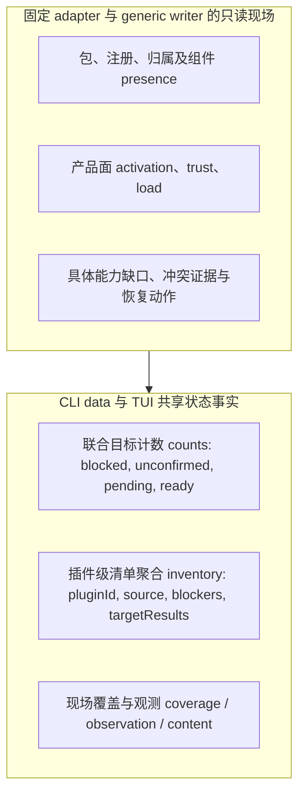
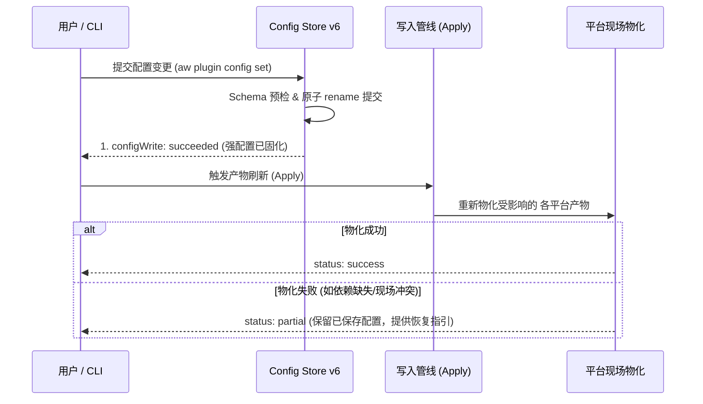

# 状态与配置架构说明

本文件面向仓库维护者，定义用户意图（Intent）、状态判定（Live Status）的分层模型与数据流、配置持久化（Config Store v6）的内部架构设计与恢复语义。面向插件作者的 Manifest、配置声明及 Schema 格式定义参见公开合同 [Plugin Manifest 与配置声明合同](../../reference/manifest-and-config.md)；TUI 中的交互与草稿呈现参见 [TUI 当前交互与能力](tui.md)；安装、重建与清理的物理动作参见[插件生命周期](lifecycle.md)。

---

## 1. 意图（Intent v3）与本机偏好

系统通过分离的意图模型区分用户与项目的部署诉求，避免全局污染：

- **用户级意图（User Intent）**：保存在用户个人配置目录（`<AW_HOME>/plugin-intents.json`），记录用户全局期望启用的插件集合。
- **项目级意图（Project Intent）**：保存在当前项目根目录的声明文件中（`<projectRoot>/.agent-workflows/plugin-intents.json`），记录当前仓库共享的插件需求。
- **本机部署偏好（DeploymentPreferences schema 2）**：记录用户在本机上选择的目标客户端平台（`codex`、`claude` 等），由 `aw target set` 维护。
- **选择与可用性分离**：十个 target 的选择仅由用户保存；发现结果不自动删除已选项。可用性为 available/missing/unsupported/unknown/notApplicable，generic 为 notApplicable。CLI 新增不可用目标需要显式 force；TUI 的本机草稿与保存时确认规则见 [TUI](tui.md)。
- **意图与清理边界**：
  取消项目需求（Intent）仅代表逻辑诉求的移除，**绝对不授予删除共享产物或未证实归属输出的权限**。具体清理门禁参见[插件生命周期](lifecycle.md#ownership-与删除权限)。

---

## 2. 联合恢复状态（Live Status）分层架构

命令 `aw plugin status [--context user|project]` 组合授权上下文中的两份 Intent、单一本机策略、Active Catalog、各原生平台与 generic 现场，输出统一的联合恢复状态。只读操作不创建持久状态、不运行 renderer/preApply、不取得工具或修改信任。未知需求保持 `unknown`；基础现场观察复用，不能递归调用 status。

状态模型在架构上严格区分为**公开恢复状态合同**与**内部状态事实模型**两层：



### 2.1 公开恢复状态合同（Public Recovery Status Contract）

领域事实由 `packages/cli/src/recovery/status.ts` 产生，TUI 直接使用共享服务。CLI 按[统一输出合同](../../reference/cli.md)显式投影，不直接输出内部回执或 backend。

- 顶层 `schemaVersion: 1`、`command: "plugin.status"`、`status` 与诊断描述本次查询是否完成。完整取得但仍需同步可以 success/0；来源读取失败、blocker 或覆盖缺口按实际返回 blocked/failed/partial。
- `data` 保留 scope/context、requirements、target selection、inventory、extraObserved、coverage、counts、inSync 与 allSatisfied 等业务事实。内部 intent/agent 对应公共 requirements/target；未知保持 null/unknown。
- **联合目标计数（counts）**：在本次可见 inventory 的 targetResults 上分别统计。它们不是需求根的互斥分类，不能相加推算插件数量：
  - `blocked`：有 blocker 的目标数。
  - `unconfirmed`：内容为 unknown 的目标数；可能与 blocked 重叠。
  - `pending`：satisfaction 为 pending 的目标数。
  - `ready`：内容为 satisfied 的目标数。
  - 同一个需求根可在一个平台 ready、另一个平台 pending。额外残留独立保存在 extraObserved，不混入 unconfirmed。
- **插件级清单（inventory）**：数组形式，汇总各插件在当前 scope 的来源信息、来源状态、阻断诊断（`blockers`）以及各平台 target 的执行结果（`targetResults: RecoveryTarget[]`）。
- **观测与内容事实状态（RecoveryTarget）**：
  - `observation`：为现场观测事实枚举（`'verified' | 'missing' | 'unknown'`）；
  - `content`：为现场内容匹配事实枚举（`'absent' | 'satisfied' | 'drifted' | 'conflict' | 'unknown'`）。两者均为**机器状态事实，绝非内容签名或哈希摘要**。
- **独立额外残留（extraObserved）**：磁盘上观测到的额外未管理残留记录在 `data.extraObserved` 列表中，**绝不混入 `counts.unconfirmed`**。
- **错误与覆盖**：完整诊断进入顶层 `diagnostics`；data 保留实际 coverage，明确其它项目未观察。

### 2.2 平台、产品面与组件事实

recovery/status 复用固定 adapter 的 discover/resolve/inspect；generic 复用受管 Skills writer 的现场证据。既有浅检查 helper 可以提供归属和配置事实，但不代替十个平台的部署观测。

DeploymentObservation 分开保存 package、registration、ownership、各产品面的 activation/trust/load 和组件 presence。已知缺失与无法观察不同；load=observed 仅表示宿主加载证据，不证明模型采用正文。平台缺失、接口不支持、权限或信任受限分别保留原因，不把它们折叠成未安装。

Codex CLI 0.167.0 的用户级普通 Skill 没有独立的 Hook 或项目配置信任门槛。status 仅在以下事实全部成立时，将当前组件集合的未知 trust 标为 `not-applicable`：完整静态集合非空且只含 Skill，无动态 artifacts、unmet 或补足；当前平台的精确 CLI/版本已合格；包为 AW 所有，完整投影输入与内容字节匹配，原生登记存在且 neutral 用户激活已确认。明确的拒信或阻断事实保持。此判定不标记 `trusted`，不改变 load，不启动宿主会话或创建持久状态；项目级、其他版本/产品面、混合或动态集合不适用。

Codex 的项目 activation 仍受宿主有效配置信任门槛控制。单个用户 TOML 中的声明、原生登记或 activation 不能代替合并配置及路径规则的证据。普通 status 不启动 app-server，无法确认时 content/trust 保持 unknown；公开 status 通过 `nativeTrustUnconfirmed` warning 说明该缺口，保留原计数和非成功结果。

`aw plugin status --observe-native` 只对当前项目 binding 显式观察有效信任。它限定为当前平台已合格的 Codex CLI 0.167.0，App、其他版本或无项目 binding 均不启动 app-server。会话沿原环境和原 CODEX_HOME 运行，不替换宿主配置根；仅在该进程临时覆盖 `features.plugins=false`，避免原生插件同步或自动升级。这保留所观察的 trust/project 层语义，但返回的 features 不是用户原来的有效 feature 配置，不用于任何状态判断。只发送 `initialize`（experimentalApi）、`initialized` 和带精确项目 cwd 的 `config/read`（includeLayers）。必须先收到 initialize 成功响应，再发送后两条消息，收到 config 响应后关闭 stdin，并等待正式 runner 的客户端退出和进程清理；已有响应不能覆盖超时、输入错误或清理未确认。规范通知不提供信任证据；重复、无效或不完整响应保持失败。

信任提取仅支持与 realpath 相同的精确项目路径。`config.projects[projectRoot].trust_level` 必须明确为 trusted/untrusted，其 origin 必须对应当前 CODEX_HOME 的有效 user 层与同一版本，且存在唯一的精确 `projectRoot/.codex` project 层。只有明确 trusted 且该 project 层没有 disabledReason 时才标记 trusted；明确 untrusted 且该层被禁用时标记 blocked。只有父仓库 trust、别名路径、托管或云端来源、缺层、重复层或矛盾证据均保留 unknown，不重建 Codex 的完整路径或配置加载规则。信任结果仅保存在本次内存会话中，不写 AW ledger、不提升生产 profile；包、摘要、归属、registration、activation 和组件能力仍分别检查，load 不变。

包内 nativeProjection 绑定 sourceIdentity、physicalKey、冻结 PhysicalIdentity 及包单元内组件到原生输出的映射；包外补足不能作为包内相对路径检查。共享包的输入摘要只绑定固定包渲染单元，不包含各 activation scope 的补足。只读状态核对输入、实际字节及物理位置，不运行 renderer。Antigravity、Gemini 与 Grok 的 `nativePackageContentDigest` 只来自实际安装副本读取，不从 AW 源包反推；旧副本显示 drifted，未确认副本保留 unknown 或实际归属冲突。Antigravity 的精确副本 owner、完整旧字节及可写条件见[原生路由](platforms.md#2-原生包正文与-lifecycle-路由)。Grok 来源清单不参与 renderer 或能力计算，故不纳入包输入摘要；完整来源、原始配置现场摘要与副本事实仍保留在锁内 stale 校验及状态展示中。输入摘要包括 renderer 的 configKeys，以及当前平台、实际渲染 scope 下 Skill producer 动态命令集的 refreshKeys 和非敏感校验依赖；命令配置单独变化也必须显示漂移。静态补足按当前 manifest、固定布局及 owner 核对实际内容。动态补足没有可核验的完整集合时保持 unknown，即使包内投影完整，也不能据此推断补足齐全；不能从已移除的 artifacts.targets 推断结果。

成功有意空集合使用既有 platforms 命名空间内可重建的空结果 receipt。它绑定精确 binding/scope、全部 render units 与可只读复算的来源、资源、配置、能力和消费者输入摘要；不是安装或删除凭证。缺失、损坏或过期时提示重新准备。匹配 receipt 后仍检查实际包、注册、激活与补足，不能掩盖撤销失败或 foreign 残留。它不使用包含 staging 或旧现场的操作 fingerprint。

generic 的准备 generation 同样保留来源绑定中的完整 unmet。只有准备成功、无 unmet 且明确有意为空时，才可在匹配证据及现场条件下报告成功空集合。全部 unmet 保留旧 Skill；混合集合可以写入独立的可支持 Skill，但保留受缺口影响的旧输出并报告 partial，不能由候选列表为空推导删除权限或 satisfied。

## 3. 现场证据、共享引用与 scope

### 3.1 只读观察

状态只运行固定有界 probe，不启动模型、preApply 或 renderer，不安装工具、不更新来源、不修改信任。目录存在、同名 executable 或版本通过都不足以证明原生注册或组件可用。原生 registration、activation 与 trust 按对应路由的公开命令或配置观察；Codex private cache 不进入删除授权。 Gemini 在发现已确认客户端后，直接读取原生安装元数据、manifest 和 enablement 规则，保留格式、来源与归属校验；不额外启动结果未用于判定的清单命令。这些配置事实不宣称 Skill 已加载，平台有效 scope 资格仍须独立的新客户端查询。

显式 `--observe-native` 允许原生 app-server 启动，因此可能创建 installation ID、日志、SQLite 状态和 cache，读取既有认证，并按宿主现有配置连接云端或远程环境。公开结果通过 `nativeObservationSideEffects` 同时向人类和 JSON 消费者披露；该选项不要求也不执行登录、模型或账号 RPC。普通 status、TUI 和复用观察 session 的其他消费者默认不启用此模式。

同一次操作可以复用内存中的只读发现与观测，Review 和锁内执行不能共用过期 snapshot。Gemini 与 Copilot 在同一次证据检查内可并行读取独立的不可变输入与可变现场，两项都结束后再比较，仍逐次重新读取，并保留不可变输入失败与 stale 的优先级。对 Gemini/Copilot 的单个正常非空部署，若完整动作明确没有 preApply、托管命令包写入或补足删除，可把纯准备和紧邻执行的重复完整核验合并到执行入口。入口核验失败仍走原 preflight 错误路径；只有同次调用、同一冻结计划的首个生命周期证据检查可消费该成功结果一次。每次执行仍重新核验，脚本、托管写入、多部署、blocked/unknown 现场及其他平台保持原检查，写后观察、rebase 和最终状态读取不复用该结果。跨调用不缓存弱现场结论。联合准备最终只有一个无阻断的 Gemini 或 Copilot ensure 组，且没有 Portable 部署、保护或残留时，首轮原生预览已封存该组全部目标，可省去返回 Review 前同一组的重复预览。多 scope、多组、移除及未完成计划继续刷新；来源激活后重准备、锁内复核、执行前检查和写后读取保持。产品面与 scope 的覆盖必须明确，unknown 不作为无引用。适用的进程、路径和身份检查见[平台边界](platforms.md)。

### 3.2 scope 与共享物理包

逻辑需求和物理输出分别判断。Codex、Claude、Gemini、Copilot 共享包按 canonical user scope 渲染，各需求保持自身 activation；独立 scope 路由不因存在用户需求就省略项目部署。同 physicalKey 只算一个物理实例，但保留所有实际产品面与需求引用。

Codex 显式 project false 覆盖 user true。撤销项目需求时移除 AW 自身项目 activation entry，让有效用户激活继续继承；不能写 false 代替删除。用户操作不读取或修改未授权项目，也不能把共享 payload 当作项目已启用。

共享引用在本次内存中按 JointDemandSnapshot、实际 owner 和路由可证明的原生注册/activation 记录确定：明确仍有引用为 present，完整覆盖且无引用才为 none，其余为 unknown。两份 Intent 可读不证明全部历史项目无引用。unknown 时可撤本次精确 activation，但保留共享包与恢复说明。无 Intent 不自动新增依赖需求。

Gemini 同版本动态 refresh 不是最终移除共享包：在精确 AW 所有权与来源、旧原生副本完整摘要及本次原生许可均成立时，可受限替换该物理副本，并保留全部已核验 activation。用户数据或弱证据阻止替换；新副本必须与冻结投影字节一致，不能从 AW source、版本或登记推断已应用配置。普通 sync 按新读取的原生摘要规划剩余动作，即使前次失败已经发布新 AW 源也会重试必要 refresh。只读 status 同样比较实际副本摘要：已确认旧副本为 drifted，缺失或无法核验的副本摘要为 unknown，不运行 renderer 或另启原生查询会话。完整边界与恢复见[Gemini 原生刷新](platforms.md#2-原生包正文与-lifecycle-路由)。

依赖按完整身份和实际布局选择；提供者失败只阻断其真实消费者，独立平台和无依赖命令包继续。共享包损坏不改用另一条安装路由。foreign、不可读现场、配置损坏与能力缺口保持可见，不能由无需求豁免吞掉。

### 3.3 弱证据与恢复

owner、来源绑定与空结果 receipt 均可重建。损坏弱证据不能永久阻断有充分 live ownership 的精确清理，也不能授予 foreign/shared 内容的删除权。历史文件不自动迁移或遍历删除；强配置的显式恢复仍遵循各自 schema 门禁。

Core compile/select profile 借用对象修改前复制，不跨命令缓存；正则 binding 在 finally 中释放。生命周期与离线清理的具体授权见[生命周期](lifecycle.md)。

---

## 4. Config Store v6 持久化与写管线

<a id="store-v6"></a><a id="31-命名空间与-envelope-存储"></a>
### 4.1 Store v6 物理持久化 Envelope 规范

用户配置按命名空间独立持久化：

```text
<AW_HOME>/plugin-config/<sourceId>/<pluginName>/config.json
```

- **路径解析与展示分离**：由 `packages/cli/src/utils/plugin-config.ts` 的 `resolvePluginConfigStorePath` 函数确定，由 `sourceId` 和 `pluginName` 构成目录层级，配置文件统一命名为 `config.json`。展示用的 `pluginId`（如 `<sourceId>/<pluginName>`）仅用于运行时解析与界面投影，**绝对不作为文件路径或持久字段保存在 Envelope 中**。
- **顶层键严格白名单化**：遵循 Store v6 Envelope 规范，顶层键严格限定为以下六个，出现任何未知多余字段直接拒绝解析（返回 `null` / `invalidJson`）：
  - `schemaVersion: 6`（固定整数 6）
  - `sourceId: string`
  - `pluginName: string`
  - `binding: { kind: 'source', sourceIdentity: string }`
  - `common: Record<string, PluginConfigValue>`
  - `platforms: Partial<Record<PlatformTarget, Record<string, PluginConfigValue>>>`
- **强制 Source Binding**：`binding` 必须且仅包含 `kind: 'source'` 与 `sourceIdentity`，且 `sourceIdentity` 必须严格匹配 `^sha256:[0-9a-f]{64}$` 哈希格式。
- **受支持平台目标白名单**：`platforms` 的键必须严格属于受支持的平台目标（`PLATFORM_TARGETS`：`codex`、`claude`、`antigravity`、`cursor`、`opencode`、`pi`、`gemini`、`copilot`、`grok`、`generic`），未知平台键直接拒绝。
- **配置内容纯粹性**：`common` 与 `platforms[P]` 仅保存用户值，**绝不包含 UI 装饰、摘要或状态字段**。
- **覆盖解析顺序**：
  ```text
  defaults(compileSchema(P)) < common < platforms[P]
  ```
  按顶层键存在性覆盖。`false`、`0`、空字符串和空数组都是合法实际值。对象与数组按顶层字段整体覆盖替换，**不做深合并（deep merge）**。
- **校验与容错规则**：
  - common 最终值不符合平台 schema 时明确失败，合法平台覆盖可遮蔽 common。
  - 平台覆盖无效时不得回退运行；删除平台覆盖后若 common 无效，则明确报告无效。
  - 读取严格保留 JSON 原始类型，不做隐式类型转换（coercion，例如不把 `"123"` 自动转为 `123`）。
  - 内存规范化不改变磁盘；同义写入不重写文档，Review 仍绑定原始 bytes。
- **旧版格式拒绝**：旧版 `plugin-config.local`、Store v5 及更早文档拒绝读取，保留原文件并提供显式重置入口；所有新写入均为 Store v6。
- **并发与原子提交**：写入时必须获取唯一的 `AW_HOME` 进程写锁，使用同目录独占临时文件，并在完成写入后通过原子 `rename` 提交。

<a id="32-保存提交save与应用生效apply的解耦架构"></a>
### 4.2 保存提交（Save）与应用生效（Apply）的解耦架构

系统在架构上将强配置持久化与现场产物刷新完全解耦：



- **配置写入结果**：领域内部 Config Mutation Receipt v7 经 CLI 显式投影到统一结果的 data，存储版本不变。
  - 普通保存先通过 schema 和引用预检，再提交用户文档；按请求另行准备既有输出刷新。
  - `configWrite` 精确报告 `notStarted`、`failed`、`succeeded`，独立 apply 不重复保存。
  - **已保存配置绝不回滚**：一旦原子提交完成，无论后续的平台发现、依赖解析、renderer 或 preApply 抛出何种异常，**已提交的配置文档绝不被撤销**。回执以 `partial` 或 `unavailable` 报告，并附带安全恢复指引（如 `aw plugin sync`）。
  - 状态检查与预览不运行 preApply。
  - JSON stdout 仅输出一个安全回执，敏感值不进入 argv、诊断或 Review。
- **Config Review 证据绑定**：
  - Config Review 与锁内 writer 使用同一用户文档、profile、context 和有效输入证据。
  - `common` 变化检查公共及已知相关平台，平台变化只检查该平台；same-platform `valueRef` 的 provider 使用相同编译配置。
  - 普通保存保护授权来源中原先有效的引用，包括尚未安装的消费者。
  - apply 通过联合恢复计划，只刷新已存在且受影响的 原生平台、generic 与无平台命令包；缺失输出提示 sync，不新增 Intent 或 target。无平台命令包只读公共 schema/common。提供者失败阻止相关消费者，其它独立目标继续。
  - 共享影响通过 sharedNativeRenderUnits 记录 pluginName、platform、renderScope、configKeys、dynamicComponents 和真实 commandSets；没有准备结果时不伪造动态 Skill 身份。
  - 平台配置变更命中 renderer configKeys 或真实命令声明的 refreshKeys 时，保存仍只提交用户配置。后续 apply Review 明示共享包体影响与必要脚本授权；缺少 apply 授权不撤销已经保存的值。

### 4.3 配置变更命令行为与显式恢复（Set / Unset / Reset）

- **`aw plugin config set`**：使用编译后的字段定义校验输入，通过 schema 与引用预检后原子提交。
- **`aw plugin config unset`**：可删除用户文档当前 profile 中存在的 stale key，并在回执中标记，不伪造 effective 配置变化，也不触发无关 apply。
- **`aw plugin config reset`（显式恢复语义）**：
  - 清除当前 common 或指定平台覆盖，并报告可能失效的引用。
  - 损坏用户文档仍可通过 schema-independent 恢复处理：
    - 普通文件或最终 symlink 只 unlink 自身；
    - 目录隔离为同父 quarantine 目录（仅显示 basename）；
    - 特殊节点（FIFO、socket、设备节点等）直接拒绝。
  - **四种重置处置结果（Reset Disposition）**：回执中通过 `absent | clearedLayer | deletedFile | unlinkedSymlink | quarantinedDirectory` 明确处理结果。
  - 保存成功后 apply 失败不回滚；独立 apply 回执的 `configWrite` 为 `notStarted`。其它项目在下次 status/sync 时识别自己的过期输出。

### 4.4 TUI 状态与配置错误分类处理

TUI 在界面上将配置相关的故障严格区分为三类独立流程处理：
1. **结构损坏的 Store（Corrupted Store）**：
   - 页面仅显示 profile、脱敏 target 摘要和稳定错误码。
   - 仅允许整层 reset 或返回，不提供部分编辑；qualified plugin ID 和 profile 可直接建立 reset Review，不要求 Catalog 或 schema 可用。
2. **Catalog / Schema 不可用（Catalog/Schema Unavailable）**：
   - 不打开字段编辑器；可确定设置层目标时仍可整层 reset。
   - 用户可从该页进入嵌套来源恢复；完成后返回原 plugin、profile、group 和 field 锚点，重新读取 schema 并重新校验父草稿。
   - 消失或变为无效的字段必须显式显示并阻止保存，直到用户放弃该项草稿；旧 Review ticket、evidence 和确认不能复用，也不能自动提交。
3. **字段覆盖无效（Invalid Field Override）**：
   - 继续提供字段修改、unset 和整层 reset。
   - 仅把低层脱敏值显示为“删除后恢复”的解释，**绝不把它投影为可运行 effective**。
   - 配置已提交但 apply 失败的结果页明确保留设置，并可通过新的 Review 重新采集 evidence 后调用现有 runtime replay；`invalidConfig` 结果只返回设置修复，不提供直接 retry apply。
