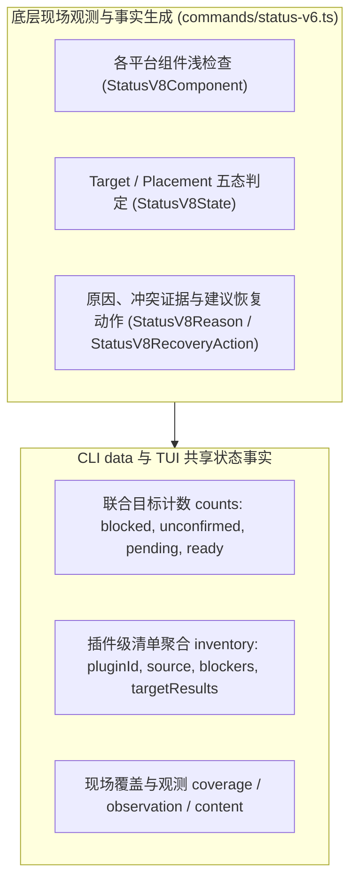
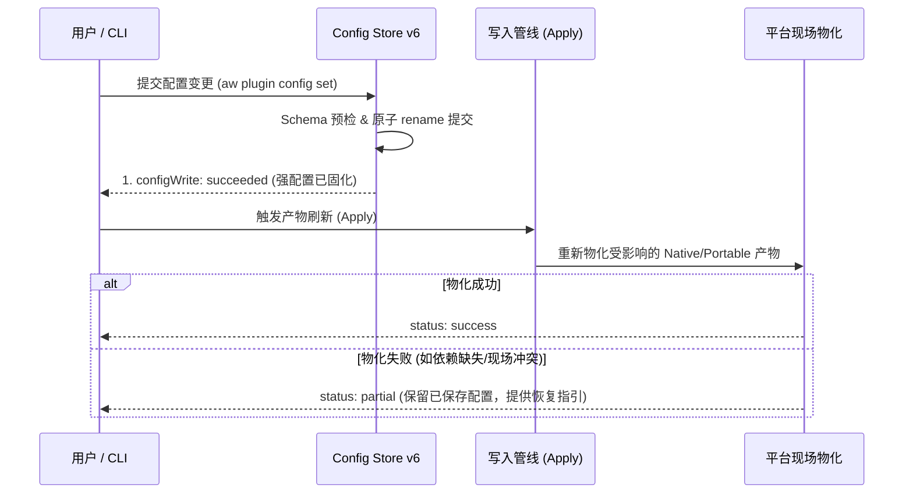

# 状态与配置架构说明

本文件面向仓库维护者，定义用户意图（Intent）、状态判定（Live Status）的分层模型与数据流、配置持久化（Config Store v6）的内部架构设计与恢复语义。面向插件作者的 Manifest、配置声明及 Schema 格式定义参见公开合同 [Plugin Manifest 与配置声明合同](../../reference/manifest-and-config.md)；TUI 中的交互与草稿呈现参见 [TUI 当前交互与能力](tui.md)；安装、重建与清理的物理动作参见[插件生命周期](lifecycle.md)。

---

## 1. 意图（Intent v3）与本机偏好

系统通过分离的意图模型区分用户与项目的部署诉求，避免全局污染：

- **用户级意图（User Intent）**：保存在用户个人配置目录（`<AW_HOME>/plugin-intents.json`），记录用户全局期望启用的插件集合。
- **项目级意图（Project Intent）**：保存在当前项目根目录的声明文件中（`<projectRoot>/.agent-workflows/plugin-intents.json`），记录当前仓库共享的插件需求。
- **本机部署偏好（DeploymentPreferences schema 2）**：记录用户在本机上选择的目标客户端平台（`codex`、`claude` 等），由 `aw target set` 维护。
- **意图与清理边界**：
  取消项目需求（Intent）仅代表逻辑诉求的移除，**绝对不授予删除共享产物或未证实归属输出的权限**。具体清理门禁参见[插件生命周期](lifecycle.md#ownership-与删除权限)。

---

## 2. 联合恢复状态（Live Status）分层架构

命令 `aw plugin status [--context user|project]` 组合授权上下文中的两份 Intent、单一本机策略、Active Catalog、Native 与 Portable 现场，输出统一的联合恢复状态。只读操作不创建持久状态、不运行 renderer/preApply、不取得工具或修改信任。未知需求保持 `unknown`；基础现场观察复用，不能递归调用 status。

状态模型在架构上严格区分为**公开恢复状态合同**与**内部状态事实模型**两层：



### 2.1 公开恢复状态合同（Public Recovery Status Contract）

领域事实由 `packages/cli/src/recovery/status.ts` 产生，TUI 直接使用共享服务。CLI 按[统一输出合同](../../reference/cli.md)显式投影，不直接输出内部回执或 backend。

- 顶层 `schemaVersion: 1`、`command: "plugin.status"`、`status` 与诊断描述本次查询是否完成。完整取得但仍需同步可以 success/0；来源读取失败、blocker 或覆盖缺口按实际返回 blocked/failed/partial。
- `data` 保留 scope/context、requirements、target selection、inventory、extraObserved、coverage、counts、inSync 与 allSatisfied 等业务事实。内部 intent/agent 对应公共 requirements/target；未知保持 null/unknown。
- **联合目标计数（counts）**：在本次可见 inventory 的 targetResults 上分别统计。它们不是需求根的互斥分类，不能相加推算插件数量：
  - `blocked`：有 blocker 的目标数。
  - `unconfirmed`：内容为 unknown 的目标数；可能与 blocked 重叠。
  - `pending`：satisfaction 为 pending 的目标数。
  - `ready`：内容为 satisfied 的目标数。
  - 同一个需求根可在一个平台 ready、另一个平台 pending。额外残留独立保存在 extraObserved，不混入 unconfirmed。
- **插件级清单（inventory）**：数组形式，汇总各插件在当前 scope 的来源信息、来源状态、阻断诊断（`blockers`）以及各平台 target 的执行结果（`targetResults: RecoveryTarget[]`）。
- **观测与内容事实状态（RecoveryTarget）**：
  - `observation`：为现场观测事实枚举（`'verified' | 'missing' | 'unknown'`）；
  - `content`：为现场内容匹配事实枚举（`'absent' | 'satisfied' | 'drifted' | 'conflict' | 'unknown'`）。两者均为**机器状态事实，绝非内容签名或哈希摘要**。
- **独立额外残留（extraObserved）**：磁盘上观测到的额外未管理残留记录在 `data.extraObserved` 列表中，**绝不混入 `counts.unconfirmed`**。
- **错误与覆盖**：完整诊断进入顶层 `diagnostics`；data 保留实际 coverage，明确其它项目未观察。

### 2.2 内部状态事实模型（Internal Target & Placement Facts）

由 `packages/cli/src/commands/status-v6.ts` 生成，作为统一 inventory 和各 target/placement 的底层事实输入，绝不直接将内部五态伪装成顶层回执的唯一 schema：

<a id="221-target--placement-的五类互斥状态statusv8state"></a>
#### 2.2.1 Target / Placement 的五类互斥状态（StatusV8State）

针对每个插件与平台 placement，内部状态判定器计算出以下五种互斥状态之一：

| 内部状态 | 判定依据 | 建议恢复动作 |
|---|---|---|
| `ready` | 所需能力和依赖可用；允许不改变有效使用结果的 Codex 项目重复开启 | 无 |
| `needsSync` | desired 已保存，但组件或依赖缺失、不完整、可替换或待同步 | `aw plugin sync` 或 `aw plugin sync --rebuild` |
| `orphaned` | 没有该范围的 desired，但实际激活或 AW-owned 扩展仍存在；用户级已启用时，无害的 Codex 原生项目重复开启除外 | `aw plugin remove --only outputs` |
| `blocked` | 来源不可用，或 foreign、unreadable、collision 或其它安全问题阻止收敛 | 按 `recoveryActions` 刷新来源、清理 AW-owned 输出或手动修复 |
| `absent` | 没有 desired intent、实际激活或需清理的范围输出；允许保留有效共享内容 | 无 |

#### 2.2.2 辅助事实组件与适配器

- **原因诊断（StatusV8Reason）**：记录稳定错误/告警码（`code`）、说明（`message`）、严重性（`severity: 'warning' | 'blocking'`）、依赖问题（`dependencyPluginId`、`rootIssueId`、`rootIssueCode`）与脱敏的冲突证据。`needsSync` warning 本身不使命令失败；安全 blocker 使 `hasErrors=true`。
- **浅事实组件（StatusV8Component）**：记录各平台组件的浅检查事实（`kind: 'intent' | 'ownership' | 'sharedNative' | 'activation' | 'extension' | 'dependency' | 'systemConsumer'`，`state`，`metadata`）。
- **恢复动作（StatusV8RecoveryAction）**：提供明确的恢复操作建议（`command: 'sync' | 'cleanup' | 'reinstall' | 'uninstall' | 'manual'`，`scope`，`description`）。
- <a id="shared-native-classification"></a>**共享 Native 五态与诊断判定（唯一完整定义）**：
  针对 Codex 等平台的共享原生层，底层由 `packages/cli/src/utils/codex-shared-native.ts` 结合精确路径与官方 list 执行统一判定：
  - **静态包（static package）**：由整个插件统一物化，没有逐 Skill 的 AW-owned 独立组件；不按逐 Skill 独立执行预检、写入或清理，缺失逐 Skill marker 绝不阻断重建或清理流程；用户手动修改文件可能导致覆盖。
  - **动态包（dynamic `codex-native`）**：由 AW 生成 `.agents-plugin/aw-codex-native-render.json` 记录规范化 identity 和 digest，该 receipt 仅作为现场诊断证据而非持久 ledger；状态检查只读检查 AW-owned canonical marketplace projection 与 receipt，**绝不运行 renderer**。
  - **共享 Native 五态分类**：
    - `usable`：规范注册有效、版本匹配且投影与渲染证据一致；
    - `missing`：官方观测明确为 absent；
    - `replaceable`：
      - `outdated`：版本落后于 desired；
      - `damaged`：receipt/内容缺失、格式损坏或摘要不匹配；
      - `renderDrift`：projection 完整有效但与当前 renderer/config/render input/target evidence 证据不一致；
    - `blocked`：
      - `foreign`：exclusive artifact slot 被外部占用、非规范注册或路径安全失败（`marketplacePathUnsafe`、`marketplaceRegistrationForeign`）；
      - `unreadable`：真实 I/O 失败、官方 list 执行失败或遇到重复（`pluginListUnavailable`、`pluginListDuplicate`、`codexNativeObservationFailed`）；
    - `unobserved`：本机缺少兼容客户端，或客户端未解析（此时 desired target 使用 `needsSync` 和 `codexSharedNativeUnobserved` 告警）。
  具体安全路径检查参见[平台边界与平台策略架构说明](platforms.md#11-生产-agent-目录解析)。
- **依赖就绪度（Dependency Readiness）**：在 components 中公开 `ready | absent | blockedByCollision | incomplete | error` 五种就绪度。
- **Ownership Health Adapter**：`state: present | absent | partial | error` 仅作为 `components` 中的归属健康适配数据，**绝不替代 target 顶层的 `state`**。

---

## 3. 现场证据收集、观测分工与 Scope 判定规则

<a id="23-浅检查原则与脱敏冲突证据collision-evidence"></a>
### 3.1 浅检查原则与官方客户端观测分工

状态检查坚持浅检查（shallow check）原则，但**浅检查绝对不等于跳过官方客户端观测**：

- **官方命令观测**：Native 状态检查必须使用 official scoped list 核对 static registration、plugin ID 和 active version：
  - 只有成功的 `codex plugin list --marketplace <AW marketplace> --json` 执行结果决定 native 的 `installed`、`absent` 和 active version；
  - 公开 Codex config 决定 activation 和 marketplace ownership；
  - AW-owned canonical marketplace source projection 决定可重建的 `renderDrift`。
  - Codex private cache 和 installed manifest 不受 AW 完全控制，不进入普通 lifecycle、repair、residue 或 cleanup 成败判断，AW **绝不直接删除它们**。
- **动态 Native 投影与静态包观测分工**：
  动态 Native 投影与静态包的观测分工与五态判定统一遵循[§2.2.2 共享 Native 五态与诊断判定](#shared-native-classification)：状态收集阶段仅执行只读检查与 receipt 核对，绝对不运行 renderer；静态包不按逐 Skill 检查 marker；精确五态判定（`usable` / `missing` / `replaceable` / `blocked` / `unobserved`）由该章节权威定义。
- **观测快照管理与代数（Snapshot Generations）**：
  - 每个 status、Review preview 和锁内执行 session 按 marketplace 复用 operation-local exact/neutral list snapshot。
  - 每个 operation/marketplace 的相关 target 和 activation 全部是 user 时，每代只读取 neutral；存在 project 时，每代最多读取一次 exact 和一次 neutral。
  - 一次 session 只创建并清理一个独立 neutral 临时 cwd。
  - **预览与锁内执行严格隔离**：preview 与锁内执行不共享 snapshot。
  - 锁内执行复用一代 pre snapshot；全部 native registration 与 activation mutation 完成后，每个发生真实 mutation 的 marketplace 只捕获一代 post snapshot，并让该 marketplace 的全部 target postcheck 复用它。无实际变更（no-op）时不捕获 post snapshot。
- **观测不足（Unobserved vs Blocked vs Assumed）**：
  - 本机 PATH/App 中没有 compatible consumer，或 consumer incompatible/unresolved 时，shared native 必须标为 `unobserved`；desired target 使用 `needsSync` 和 `codexSharedNativeUnobserved` warning，compatibility blocker 仍独立保留。
  - 本机没有兼容 Codex consumer 时，activation support 只标为 `assumed`，**绝不能宣称真实 Agent 已加载**。
  - official list 调用失败是 `blocked/unreadable`（`codexNativeObservationFailed`）。
- **Foreign 外部占用与冲突脱敏**：
  - `foreign` 表示 exclusive artifact slot 已被当前插件不拥有的内容占用；它**不能作为已安装证据**。
  - 公开 collision evidence 只包含安全字段：`reason`（`ownerMismatch | unownedContent | typeMismatch`）、`artifactKind`、`artifactKey`、`expectedOwner` 和可选 `actualOwner`，**严禁泄漏组件绝对路径、系统凭据、未知 stderr 或临时内部信息**。

<a id="24-codex-原生开关覆盖与共享边界"></a>
### 3.2 Codex 开关优先级与无害 Native Overlap

- **项目配置优先**：Codex 原生插件的有效开关按项目配置优先于用户配置计算，显式 project `false` 必须覆盖 user `true`。
- **无害 Native Overlap**：用户级 desired 且 user 已启用时，pure-native 的重复 project `true` 视为无害幂等，不产生 activation drift，不报告 `dependencyScopeConflict`，也不构成本 scope 的 orphaned 残留。
- **单物理身份保证**：Codex shared native 在顶层 `components` 记录为 `sharedNative` 与 `systemConsumer`，同一 shared native identity 在顶层只出现一次，不伪装成两个 owner。

### 3.3 Scope 隔离与依赖恢复边界

- **User 恢复范围**：User 恢复只处理用户激活，不读取或删除调用项目的关闭覆盖；需要启用当前项目时，显式保存 Project 声明并在该项目执行 `aw plugin sync --context project`。
- **共享内容与禁用激活不构成使用**：共享内容（shared native payload）或禁用的 activation 不构成本 scope 的使用或清理依据。
- **依赖检查范围与 Scope 判定规则**：
  - **三类检查范围**：依据当前实现（`commands/status-v6.ts:2189`），依赖检查不仅针对已启用的组件，而是严格覆盖以下三类场景：
    1. 期望作用域内（`desiredInScope`）：即使尚未实际启用或尚未生成物理输出，只要存在 desired 诉求，就必须执行依赖完整性检查，防止漏报安装阻断；
    2. 实际启用作用域（`actualCodexActivation`）；
    3. 适用扩展残留作用域（`hasScopedExtensionResidue`）；
    4. 对非 Codex 平台，存在已观察到的现场（`liveState === 'present' || liveState === 'partial'`）。
  - **Provider 选择与放置规则**：
    - User scope 仅能使用用户依赖（`dependencyPlacementsFor` 仅返回 `['user']`）；
    - Project scope 按联合需求（`['project', 'user']`）选择 provider；
    - 若配置了显式 `dependencyScopeOverrides`，以覆盖指定的 scope 为准。
  - **无 Intent 不自动扩展**：没有 Intent 诉求时不自动新增依赖需求或 target。
  - **豁免不能吞掉关键诊断**：无使用范围或未启用状态的豁免**绝对不能掩盖或吞掉配置不可读（`unreadable`）、原生官方命令观测失败（`codexNativeObservationFailed`）以及共享内容物理损坏（`replaceable: damaged`）的真实诊断与证据**。
- **损坏共享内容恢复限制**：User provider 损坏时不降级。当所有范围均无 desired 且 shared native 损坏时，系统只能提示用户显式选择 scope 后运行 `aw plugin install`，**普通 cleanup 不承诺修复 shared native**。

### 3.4 历史格式拒绝与内存生命周期

- **旧版格式拒绝**：旧 User/Project 偏好、旧 Status、旧 Receipt 入口一律明确拒绝。旧文件保留在磁盘，不自动迁移、不主动遍历删除，由系统提供显式 schema-independent 重置/恢复入口。
- **历史项目配置**：历史项目配置文件不读取、不自动迁移。
- **Core 编译与 Profile 内存管理**：Core compile 与 select profile 借用对象在修改前必须复制，不跨命令缓存。正则 binding 确保在 `finally` 中释放，确保内存耗尽时的安全恢复。

---

<a id="3-config-store-v6-持久化与写管线"></a>
## 4. Config Store v6 持久化与写管线

<a id="store-v6"></a><a id="31-命名空间与-envelope-存储"></a>
### 4.1 Store v6 物理持久化 Envelope 规范

用户配置按命名空间独立持久化：

```text
<AW_HOME>/plugin-config/<sourceId>/<pluginName>/config.json
```

- **路径解析与展示分离**：由 `packages/cli/src/utils/plugin-config.ts` 的 `resolvePluginConfigStorePath` 函数确定，由 `sourceId` 和 `pluginName` 构成目录层级，配置文件统一命名为 `config.json`。展示用的 `pluginId`（如 `<sourceId>/<pluginName>`）仅用于运行时解析与界面投影，**绝对不作为文件路径或持久字段保存在 Envelope 中**。
- **顶层键严格白名单化**：遵循 Store v6 Envelope 规范，顶层键严格限定为以下六个，出现任何未知多余字段直接拒绝解析（返回 `null` / `invalidJson`）：
  - `schemaVersion: 6`（固定整数 6）
  - `sourceId: string`
  - `pluginName: string`
  - `binding: { kind: 'source', sourceIdentity: string }`
  - `common: Record<string, PluginConfigValue>`
  - `platforms: Partial<Record<PlatformTarget, Record<string, PluginConfigValue>>>`
- **强制 Source Binding**：`binding` 必须且仅包含 `kind: 'source'` 与 `sourceIdentity`，且 `sourceIdentity` 必须严格匹配 `^sha256:[0-9a-f]{64}$` 哈希格式。
- **受支持平台目标白名单**：`platforms` 的键必须严格属于受支持的平台目标（`PLATFORM_TARGETS`：`codex`、`claude`、`antigravity`、`cursor`、`opencode`、`pi`、`generic`），未知平台键直接拒绝。
- **配置内容纯粹性**：`common` 与 `platforms[P]` 仅保存用户值，**绝不包含 UI 装饰、摘要或状态字段**。
- **覆盖解析顺序**：
  ```text
  defaults(compileSchema(P)) < common < platforms[P]
  ```
  按顶层键存在性覆盖。`false`、`0`、空字符串和空数组都是合法实际值。对象与数组按顶层字段整体覆盖替换，**不做深合并（deep merge）**。
- **校验与容错规则**：
  - common 最终值不符合平台 schema 时明确失败，合法平台覆盖可遮蔽 common。
  - 平台覆盖无效时不得回退运行；删除平台覆盖后若 common 无效，则明确报告无效。
  - 读取严格保留 JSON 原始类型，不做隐式类型转换（coercion，例如不把 `"123"` 自动转为 `123`）。
  - 内存规范化不改变磁盘；同义写入不重写文档，Review 仍绑定原始 bytes。
- **旧版格式拒绝**：旧版 `plugin-config.local`、Store v5 及更早文档拒绝读取，保留原文件并提供显式重置入口；所有新写入均为 Store v6。
- **并发与原子提交**：写入时必须获取唯一的 `AW_HOME` 进程写锁，使用同目录独占临时文件，并在完成写入后通过原子 `rename` 提交。

<a id="32-保存提交save与应用生效apply的解耦架构"></a>
### 4.2 保存提交（Save）与应用生效（Apply）的解耦架构

系统在架构上将强配置持久化与现场产物刷新完全解耦：



- **配置写入结果**：领域内部 Config Mutation Receipt v7 经 CLI 显式投影到统一结果的 data，存储版本不变。
  - 普通保存先通过 schema 和引用预检，再提交用户文档；按请求另行准备既有输出刷新。
  - `configWrite` 精确报告 `notStarted`、`failed`、`succeeded`，独立 apply 不重复保存。
  - **已保存配置绝不回滚**：一旦原子提交完成，无论后续的平台发现、依赖解析、renderer 或 preApply 抛出何种异常，**已提交的配置文档绝不被撤销**。回执以 `partial` 或 `unavailable` 报告，并附带安全恢复指引（如 `aw plugin sync`）。
  - 状态检查与预览不运行 preApply。
  - JSON stdout 仅输出一个安全回执，敏感值不进入 argv、诊断或 Review。
- **Config Review 证据绑定**：
  - Config Review 与锁内 writer 使用同一用户文档、profile、context 和有效输入证据。
  - `common` 变化检查公共及已知相关平台，平台变化只检查该平台；same-platform `valueRef` 的 provider 使用相同编译配置。
  - 普通保存保护授权来源中原先有效的引用，包括尚未安装的消费者。
  - apply 通过联合恢复计划，只刷新已存在且受影响的 Native、Portable 与无平台命令包；缺失输出提示 sync，不新增 Intent 或 target。无平台命令包只读公共 schema/common。提供者失败阻止相关消费者，其它独立目标继续。
  - 平台配置变更命中 Native Skill `refreshKeys` 时，保存仍只提交用户配置。后续 apply Review 明示共享包体影响与必要脚本授权；缺少 apply 授权不撤销已经保存的值。

### 4.3 配置变更命令行为与显式恢复（Set / Unset / Reset）

- **`aw plugin config set`**：使用编译后的字段定义校验输入，通过 schema 与引用预检后原子提交。
- **`aw plugin config unset`**：可删除用户文档当前 profile 中存在的 stale key，并在回执中标记，不伪造 effective 配置变化，也不触发无关 apply。
- **`aw plugin config reset`（显式恢复语义）**：
  - 清除当前 common 或指定平台覆盖，并报告可能失效的引用。
  - 损坏用户文档仍可通过 schema-independent 恢复处理：
    - 普通文件或最终 symlink 只 unlink 自身；
    - 目录隔离为同父 quarantine 目录（仅显示 basename）；
    - 特殊节点（FIFO、socket、设备节点等）直接拒绝。
  - **四种重置处置结果（Reset Disposition）**：回执中通过 `absent | clearedLayer | deletedFile | unlinkedSymlink | quarantinedDirectory` 明确处理结果。
  - 保存成功后 apply 失败不回滚；独立 apply 回执的 `configWrite` 为 `notStarted`。其它项目在下次 status/sync 时识别自己的过期输出。

### 4.4 TUI 状态与配置错误分类处理

TUI 在界面上将配置相关的故障严格区分为三类独立流程处理：
1. **结构损坏的 Store（Corrupted Store）**：
   - 页面仅显示 profile、脱敏 target 摘要和稳定错误码。
   - 仅允许整层 reset 或返回，不提供部分编辑；qualified plugin ID 和 profile 可直接建立 reset Review，不要求 Catalog 或 schema 可用。
2. **Catalog / Schema 不可用（Catalog/Schema Unavailable）**：
   - 不打开字段编辑器；可确定设置层目标时仍可整层 reset。
   - 用户可从该页进入嵌套来源恢复；完成后返回原 plugin、profile、group 和 field 锚点，重新读取 schema 并重新校验父草稿。
   - 消失或变为无效的字段必须显式显示并阻止保存，直到用户放弃该项草稿；旧 Review ticket、evidence 和确认不能复用，也不能自动提交。
3. **字段覆盖无效（Invalid Field Override）**：
   - 继续提供字段修改、unset 和整层 reset。
   - 仅把低层脱敏值显示为“删除后恢复”的解释，**绝不把它投影为可运行 effective**。
   - 配置已提交但 apply 失败的结果页明确保留设置，并可通过新的 Review 重新采集 evidence 后调用现有 runtime replay；`invalidConfig` 结果只返回设置修复，不提供直接 retry apply。
