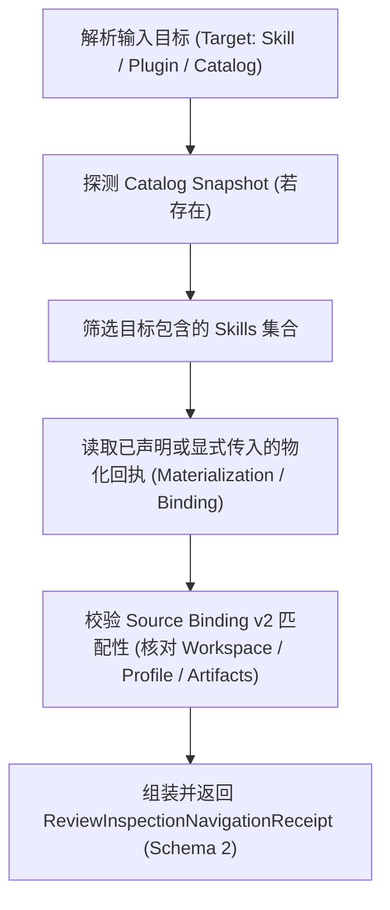

# Review 与 Eval 架构说明

本文件面向仓库维护者，阐明只读 Review 取证管线、快照隔离、以及 Eval 评测引擎的内部调用链、组件交互、进程观察机制与测试架构。面向外部开发者与自动化审计者的机器数据合同（`EvalSpec v1`、`EvalAudit v1`、`EvalResult v2`、`aw-source-binding.json` schema 2 等）参见公开精确合同 [Review 取证与 Eval 评估合同](../../reference/review-and-eval.md)。各插件专属评测用例由拥有该能力或 runner 的插件维护。

---

## 1. 架构定位与单一事实源分工

Review 与 Eval 子系统在架构设计上严格执行**外部公开合同**与**内部实现机制**的分层解耦：

- **公开机器与协议合同**：统一归属于公开合同 [Review 取证与 Eval 评估合同](../../reference/review-and-eval.md)。包括：
  - `aw dev review inspect` 的取证参数、回执结构与状态码；
  - `aw dev review prepare` 的安全目录约束与退出状态码；
  - `aw-source-binding.json` schema 2 的完整字段、版本门禁与弱证据定位；
  - `EvalSpec v1`、`EvalAudit v1` 与 `EvalResult v2` 的模式枚举与不承诺清理保证；
  - 外部 `custom-process` 与 `codex-workflow`（含 `instruction-v2`）的通信协议。
  **本架构文件不重复声明上述公开 schema 全表，统一引用公开合同**。
- **内部实现与控制流**：本文件专注于解释 CLI 与 Eval 引擎的内部组织、快照隔离机制、进程生命周期监控与弱状态恢复策略。

---

<a id="1-只读-review-取证管线架构"></a>
## 2. 只读 Review 取证管线内部实现

Review 取证管线负责在不产生副作用的前提下，为插件质量与安全提供确定性的现场证据。

<a id="11-静态检查与隔离设计"></a>
### 2.1 取证器内部架构（`commands/review-inspection.ts`）

`aw dev review inspect` 内部执行流程如下：



1. **纯只读实现保证**：实现位于 `packages/cli/src/commands/review-inspection.ts`。取证逻辑仅读取文件系统元数据、源码文本、Catalog 快照与指定的物化回执，**绝对不调用任何带有副作用的构建器或 renderer，不加载外部大模型，不发起网络请求**。
2. **事实与缺口模型（Fact & Gap）**：若依赖或物化现场缺失，内部取证器不进行猜测，而是直接输出已知源码事实并将缺失部分记录在 `issues` 数组中，标记为证据缺口（evidence gap）。取证操作仍正常退出 0，由上层审阅者或工具做出判断。
3. **歧义防护**：当发现多个候选物化产物具有相同输入选择但 digest 不一致时，抛出 `ReviewInspectionInputError` 并退出码 2，杜绝不一致证据混入审阅流程。

### 2.2 准备器内部架构（`commands/review-preparation.ts`）

当本地缺少物化产物时，`aw dev review prepare` 负责在完全隔离的环境中生成审核副本：

1. **物理路径安全校验**：通过 `resolvePhysicalPath` 解析物理真实路径，检查路径链上的每个祖先节点；若发现任何符号链接（symlink），立即抛出 `unsafeOutput` 错误并退出码 2。
2. **临时环境隔离**：通过 `createIsolatedSkillEnv` 为被测插件构建临时的、由 AW 托管的 `HOME` 与工作目录，确保配置仅由平台 manifest defaults 与传入的 `--config <file>`（注意 Review 使用 `--config`，而非 `--config-file`）决定，**绝不读取用户本地真实配置 Store**。
3. **构建与物化执行**：调用 `prepareSkillPluginBundle`，在 staging 生成 bundle；随后复用安装链的 `preparePlatformComponents`、命令 producer 收束与固定 adapter project。作者入口使用显式固定 profile，不读取本机客户端可用性；未核验能力保留 unmet。准备失败与合法空集合分别处理。
4. **生成 Source Binding v2**：调用 `writeAwSourceBinding`，在审核输出根目录下写入 `aw-source-binding.json`（schema 2），精确绑定 Workspace 身份、Profile 输入（Review profile 的 `id` 规范化为 `${platform}-${scope}` 如 `codex-user`）和生成的所有产物摘要。绑定同时保存完整组件集合、能力、资源与投影的准备摘要。inspect 只重算来源/profile/config 并校验产物，不重新运行脚本。
5. **原子提交通知**：全部产物和绑定校验通过后，原子移动至目标 `--out` 目录；若准备失败，仅清理内部 staging 目录，保留已产生的错误日志。后续 inspect 通过原源目标结合 `--materialization <new-dir>/aw-source-binding.json` 进行闭环核验。

<a id="12-快照复用与锁内执行隔离"></a>
### 2.3 快照复用与锁内执行隔离机制

在 CLI 与 TUI 的 Review 流程中，状态快照严格区分预览与执行两阶段：

- **预览阶段（Preview Session）**：按 Marketplace 复用 operation-local exact/neutral list snapshot，只创建并清理一个独立的 neutral 临时 cwd。
- **执行阶段（Locked Execution Session）**：
  - 预览快照**严禁跨入锁内执行阶段复用**。
  - 锁内执行启动时捕获 pre-snapshot。
  - 全部 native registration 与 activation 修改完成后，每个发生了实际变更的 marketplace 仅捕获一代 post-snapshot，供该市场下所有 target 的后置校验复用。无实际变更（no-op）时不捕获 post-snapshot。

---

<a id="2-eval-评测引擎内部数据流"></a>
## 3. Eval 评测引擎内部架构与组件调用链

评测子系统的权威归属为 npm 包 `@lesliechan721/agent-skill-eval`，执行入口为 `aw-skill-eval`。

<a id="21-阶段流转与不可变绑定"></a>
### 3.1 三阶段生命周期与不可变绑定

```mermaid
flowchart TD
    subgraph 阶段 1: 准备 (Prepare - CLI 调度)
        A["Skill evals/manifest.json"] --> B["aw dev eval prepare"]
        B --> C["EvalSpec v1 (物化工作区与用例集)"]
    end
    subgraph 阶段 2: 审计 (Audit - 独立审核)
        C --> D["独立 Auditor 审核"]
        D --> E["EvalAudit v1 (状态必须为 pass)"]
    end
    subgraph 阶段 3: 执行 (Run - Eval Engine 拥有)
        C & E --> F["aw-skill-eval run"]
        F --> G["EvalResult v2 (记录耗时、得分与进程证据)"]
    end
```

- **阶段 1：准备（Prepare）**：
  CLI 通过 Catalog Workspace 解析规范插件，按所选 plugin、Skill、suite 和 profile 生成 `EvalSpec v1`。内置 suite backend 仅支持 `codex` 平台（其他平台需显式 `custom-process`）；若 profile 包含任何声明为敏感（`sensitive: true`）的配置字段，`assertNoSensitiveProfileConfig` 立即抛错拒绝，绝不进行静默自动剥离。随后计算被测工作区（移除被测 Skill 后）的完整指纹，并在临时 staging 校验后原子发布。
- **阶段 2：审计（Audit）**：
  由独立的 Auditor 模块或安全工具执行。核对 Spec 的工作区摘要、提供者摘要（`calculated.providerDigest`）与测试用例，校验通过后签发 `EvalAudit v1` 授权文档（状态必须为 `pass` 且无 `blocked` case）。
- **阶段 3：执行（Run）**：
  `aw-skill-eval run` 接收 Spec 与 Audit，通过机器校验门禁核对 Spec 与 Audit 在 workspace、provider、target 及 case 集合上的精确摘要绑定一致性，执行环境预检后启动 Provider，并在运行结束时持久化 `EvalResult v2`。**注意：EvalAudit 是基于机器校验的输入与准入门禁，产品绝不提供公钥数字签名或防篡改存储保证**。

### 3.2 内部 Provider 架构与调度

Eval 引擎通过内部 Provider 注册表调度不同的执行后端：
- **`codex-trigger`**：负责单次单轮的动作触发与轻量级响应评测。
- **`codex-conversation`**：负责交互式会话评测。内部维护根线程 ID，仅以根线程事件推进生命周期，子线程仅记录于 trace 中；fixture 使用 `environment.pathPrepend`；通过 `workspace_valid: true` 执行公开 preflight；异常结果由 Auditor 在全新上下文中安排独立 result-triage。
- **`custom-process`**：外部协作式进程适配器。引擎通过轮询或信号监控其进程组，要求其完整保留 `AW_AGENT_SKILL_EVAL_PROCESS_MARKER`，绝不脱离初始进程组。
- **`codex-workflow`**：对象级工作流执行器。仅接受 `prepare` 与 `grade` 两个固定 phase；默认 transport 为 `app-server`，`instruction-v2` transport 绝对不支持隐藏交互与 `setupPrompt`；独立 grader 产生额外真实模型费用与调用；`hostRoleAdoption` 恒保持为 `'unknown'`；缺失 trace 证据时 checks 强制为 `'unknown'`，且必需 check 缺失或 unknown 时 Engine 坚决拒绝通过。完整公开合同参见[Review 取证与 Eval 评估合同](../../reference/review-and-eval.md#7-外部-providerworkflow-与-conversation-公开协议)。

---

<a id="3-评测进程树监控与收容边界"></a>
## 4. 进程生命周期监控与收尾实现

真实 Agent 评测涉及大模型与外部工具调用，必须具备可靠的进程生命周期控制：

<a id="31-macos--linux-标记采样与收尾"></a><a id="33-失败证据保留"></a>
### 4.1 POSIX 进程监控实现（`eval-process-management.ts`）

在 macOS 与 Linux 环境下，评测进程监控逻辑由 `packages/agent-skill-eval/src/eval-process-management.ts` 与 `process-tree.ts` 实现：

- **实现职责分工**：
  - `eval-process-management.ts`：负责执行运行前置预检（Codex permission profile、macOS keychain、进程树检查可用性与 Windows Job helper 准备），并返回受管元数据（`processManagement`）；
  - `process-tree.ts`：负责扫描系统进程表、验证 PPID 链与环境变量 marker、在单次预算内执行复查并判定三值语义（`markerMatches: true | false | null`）；
  - 进程生命周期、信号分发与直接子进程收尾的实际执行入口由各 Provider 运行时组件（`process.ts`、`custom-process.ts`、`codex-eval-process-tree.ts`）负责。
- **公共协议与收敛链接**：
  面向外部 Provider 与运行期的完整协议规范（包含原生 Codex 进程树监控、`custom-process` 协作式协议硬约束、Marker 检查三值语义、单次复查、僵尸豁免、Fail-closed 保护、以及 `--allow-unmanaged-processes` 直接子进程收尾与 `descendantCleanupGuaranteed: false` 边界）统一收敛于[Review 取证与 Eval 评估合同 §7.1 内置 Provider 与 custom-process 外部协议](../../reference/review-and-eval.md#provider-process-contract)。
- **失败证据保留实现**：
  运行或清理失败时在 `outputDir` 中安全持久化脱敏证据（`provider-evidence.json` 与 `provider-trace.json`）并清理符号链接的具体实现与脱敏边界，统一收敛于[Review 取证与 Eval 评估合同 §6.4 失败证据保留与 outputDir 安全清理](../../reference/review-and-eval.md#64-失败证据保留与-outputdir-安全清理)。

<a id="32-windows-原生-job-隔离"></a>
### 4.2 Windows 原生 Job 隔离机制

在 Windows 环境下，由于缺乏可靠的用户态进程树清理能力，引擎强制依赖专用的 Windows 原生辅助程序：

- **Helper 动态加载**：
  - 引擎在启动模型或创建 run 输出前，通过 `prepareWindowsJobHelper` 从自身已安装的可选依赖中解析并定位 `aw-windows-job.exe`；
  - 若依赖缺失，立即抛出错误并安全停止，绝不回退至仅依靠 PPID 观察的伪受管模式。
- **挂起启动与 Job 绑定**：
  - Helper 先以挂起（suspended）状态启动 root 进程；
  - 将 root 进程成功加入配置有 `KILL_ON_JOB_CLOSE` 标志的 Windows Job 对象后，方才恢复子进程执行；
  - 无论父进程正常退出、超时中断或异常崩溃，Windows 内核自动强行终止 Job 内所有后代进程。
- **审计与清空确认**：
  - 停止后 Helper 通过 Windows Job accounting 接口确认 Job 内进程计数归零。

### 4.3 Git 凭据与临时 HOME 隔离机制

- 引擎为评测进程创建专有的临时 `HOME` 与环境上下文，**显式不继承宿主的 Git credential helper**；
- 评测中所有组件（conversation、trigger、workflow、custom process）均被注入配置，禁用 Git system config 与终端交互式认证提示（`GIT_TERMINAL_PROMPT=0`），彻底防止触发 macOS SecurityAgent 弹窗或泄露开发者私有凭据。

---

## 5. 弱状态与恢复策略

评测与审阅涉及的中间产物与输出在架构上统一归类为**弱状态**：

- **Spec 与 Run 输出的弱状态属性**：
  - `EvalSpec` 目录、物化产物以及每次运行输出（`outputDir`）均属于**可删除、可重建的弱状态**；
  - 若准备或执行中途发生网络断开、超时中断或异常崩溃，恢复策略非常明确：**直接删除不完整的临时输出，重新执行 `prepare`、`audit` 与 `run`**；
  - 评测引擎**绝不维护 batch checkpoint ledger，也不承诺自动重试**，以保持架构的精简与状态的确定性。
- **辅助诊断命令的内部触发条件**：
  - `aw dev eval check --json`：仅在首次安装升级、用户显式请求环境诊断、或模型启动后的 run 失败时调用；
  - `aw-skill-eval inspect-result`：仅在异常结果需要按 case、attempt 与 variant 分组深度排查时使用；
  - 正常的评测成功流程（clean success）在结果交付后直接结束，不触发任何额外的模型调用或诊断分析。
