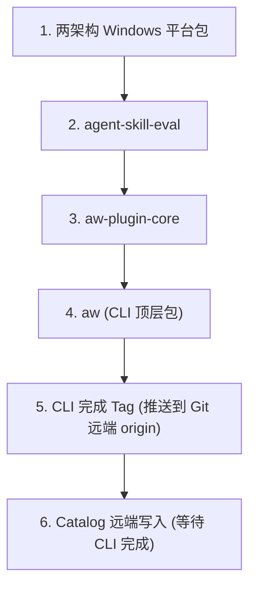

# 官方发布与失败恢复指南

本文件面向仓库维护者，定义官方 CLI 产品五包发布、Catalog 官方发布编排、Actions 工作流与外部凭据配置、版本占用原则、Attempt 门禁、本地与 Actions 恢复操作规范、以及发布测试与同步责任。面向外部 Catalog 的通用格式、版本决策、Publication Journal 状态机与远端对账完整合同参见 [外部 Catalog 参考合同：发布计划与恢复门禁](../reference/catalog.md#publication-recovery)；CI 矩阵与触发条件参见 [CI 说明](ci.md)。

---

## 1. CLI 产品五包体系与平台依赖

CLI 产品由五个紧密耦合的同版本 npm 包组成：

| 包名 | 职责与平台要求 |
| --- | --- |
| `@lesliechan721/aw-windows-job-win32-x64` | Windows x64 原生可执行 helper；`os: ["win32"]`, `cpu: ["x64"]` |
| `@lesliechan721/aw-windows-job-win32-arm64` | Windows arm64 原生可执行 helper；`os: ["win32"]`, `cpu: ["arm64"]` |
| `@lesliechan721/agent-skill-eval` | 同版本平台可选依赖与工具解析能力，Eval 机器合同所有者 |
| `@lesliechan721/aw-plugin-core` | 平台中立的 Manifest、Schema 与确定性 Catalog 校验合同 |
| `@lesliechan721/aw` | CLI 顶层发布包，复用 Eval 与 Core |

### 1.1 原生 Windows Helper 与源码边界

- Windows helper 的唯一 Go 源码和固定工具链位于 `native-tools/windows-job/`，工具版本严格取自 CLI。
- 普通开发构建与测试（`pnpm build` / `pnpm test`）不取得真实 EXE，也不要求安装 Go；npm 安装不编译 Go，不运行下载或复制 EXE 的 postinstall 脚本。
- 三个通用 npm 包、Skill 和 Catalog 绝不包含 EXE。平台包 EXE 随 npm 平台包依赖安装，运行时绝不另行下载。
- 显式原生准备和 CLI 发布打包会构建本次两架构平台包；本次候选需通过可复现检查及真实 Windows x64/arm64 资格评测。原生源码、工具链和生产逻辑变化属于 CLI 产品变化。作者声明、包解析和恢复参见[原生工具合同](../reference/native-tools.md)。
- 候选输出位于 `.native/windows-job/<CLI version>/`，包含两架构 EXE、平台 tarball 和构建、复现及资格证据。插件只声明宿主协议 `aw.windows-job.v1`，不保存工具版本或摘要；升级 CLI 配套工具无需重新发布或重装插件。

### 1.2 依赖解析与离线边界

- CLI 复用 Eval 从自身依赖解析适用平台包的能力，独立安装 Eval 也可正常运行。
- Windows 缺少 optional dependency 时，需要原生工具的操作在启动前失败；重新安装当前 CLI/Eval 并包含 optional dependencies 即可恢复。
- 运行时绝对不访问 npm registry，不使用 AW 原生 cache、预取、离线 import 或原生 registry 配置。离线安装沿用包管理器缓存或预先准备的同版本完整依赖包。

### 1.3 严格因果拓扑发布顺序

五包上传必须按如下因果拓扑顺序依次发布：



五包全部上传成功后，方可创建并推送 CLI 完成 tag（`cli-v<version>`）。普通发布在五包上传成功后即可打 tag，无需二次从远端重新下载校验。

---

## 2. 本地打包、安装与原生资格评测

### 2.1 CLI 本地打包与安装测试

打包命令从同一候选生成五个 tarball；本地安装从这组产物解析全部自有依赖，并只安装适用当前架构的平台包：

```bash
pnpm release:pack:cli
pnpm release:install:local
# 或使用已生成的完整五包产物：
pnpm release:install:local -- <cli.tgz> <eval.tgz> <core.tgz> <windows-x64.tgz> <windows-arm64.tgz>
```

同批本地候选安装将五个自有包的依赖全部解析到本地 artifact，绝不回退至 npm 远端解析。

### 2.2 Windows 原生工具准备、复现与资格

```sh
pnpm native:windows-job:prepare
pnpm native:windows-job:reproduce
# 在对应真实 Windows 架构运行，使用本次候选平台包：
pnpm qualification:windows-job
```

### 2.3 Codex Native 资格评测

Codex native qualification 是显式、本机、离线的维护者入口，不进入普通 test、build 或 release：
- 现有 `0.151.0` project activation 行为评测：
  ```bash
  pnpm qualification:codex-project-native
  ```
- 性能和 scoped list 合同分别对本机已有的两个精确 binary 运行（命令不会自动下载）：
  ```bash
  CODEX_QUALIFICATION_VERSION=0.151.0 CODEX_QUALIFICATION_CLI=/path/to/codex-0.151.0 pnpm qualification:codex-native-performance
  CODEX_QUALIFICATION_VERSION=0.153.0 CODEX_QUALIFICATION_CLI=/path/to/codex-0.153.0 pnpm qualification:codex-native-performance
  ```
- **评测约束与判定**：
  - 每次运行只使用临时 home、临时项目和 local marketplace，并阻断 proxy。
  - 两个版本都必须支持 marketplace-scoped JSON list；`0.153.0` 的 local scoped list 不得依赖远程 Catalog。
  - 代表性 local native install 运行五次，中位数必须低于 15 秒（`< 15000ms`）；精确 binary 缺失时保留未运行缺口。
  - 该 qualification 不接入 app-server plugin/reconcile，也不证明运行中的 Codex App 会自动刷新。

---

## 3. GitHub Actions 官方发布工作流与外部基础设施配置

官方发布由 GitHub Actions 严格执行。PR/main 自动运行 CI；main 的精确提交通过后，分别比较 CLI 五包的生产输入与 Catalog 的实际生产内容。有变化的产品自动准备 beta，版本提交和源码 tag 只放在 `release-source/<product>/<version>` 分支，**`main` 分支绝不接收自动版本提交**。

### 3.1 自动 Beta 与正式发布流程

- **自动 Beta 发布**：复用其精确 main 来源已通过的 CI 检查，不重复运行完整源码验证。源码 tag 记录 CI run/attempt，发布时重新查询并核对必要检查；证据缺失或查询失败时运行完整验证。候选构建、版本与产物校验、跨平台产物 smoke 仍必须通过。
- **正式版发布**：在 `Release CLI` 或 `Release Catalog` 的 Actions 页面选择 `source`，填写精确稳定版本和 main 提交 SHA。入口准备候选后推送 `release/cli/v<version>` 或 `release/catalog/v<version>`，触发该产品的验证与发布。
- **命令行推送候选分支**：可在已有工具构建的干净 checkout 中运行维护命令推送候选分支和 tag：
  ```bash
  pnpm release:actions source --product cli --version 0.2.1 --source <main-sha>
  pnpm release:actions source --product catalog --version 0.5.1 --source <main-sha>
  ```
- **单次构建与跨平台 Smoke**：每个候选只构建一次，六种 OS/CPU 的 Node 24 smoke 和精确 Node 22.0.0 最低版本 smoke 消费同一恢复包。Windows 两架构从本次平台包安装和运行 helper，不能只根据 npm 安装退出 0 判断可选依赖完整。任一门禁未通过就不准许发布。CLI 五包使用 npm Trusted Publisher；Catalog 消费原 snapshot/plan。原生 qualification 使用本次候选；Catalog 的 fake native runner 不表示真实 Codex/Claude 已通过 qualification。

### 3.2 串行发布队列与候选 Commit 铁律

- **分产品独立串行**：`release-cli.yml` 与 `release-catalog.yml` 分别串行发布，同一产品的 stable 与 beta 共用队列，**绝对不自动取消在途发布**。Tag 具有不可变性，严禁覆盖已存在的 tag。
- **候选 Commit 边界**：
  - 候选 commit 必须是固定 main 来源本身，或其仅含允许版本字段修改（`plugins/marketplace-source.json`、CLI version targets）的直接子 commit。
  - **历史交付的 Squash 兼容例外**：仅在 `allowLegacyHistory: true` 时启用（`scripts/release/source-candidate.mjs`）。历史交付若因 squash merge 失去 main 祖先关系，可通过完整 Git tree 相同的最近 main first-parent commit 证明；对于发布后继续修改再 squash 的历史，通过远端 `refs/pull/*/head` 证明（PR head 的完整 tree 必须与 main first-parent 相同，交付 commit 相对唯一共同祖先只能有允许的版本字段变化）。**此历史兼容严禁用于新候选，新候选必须具备明确的 main 来源与直接版本子 commit**！
- **所选轴无候选短路**：发布编排在所选轴没有生产内容变化且无候选时立即在写入前安全失败，不执行空发布。

### 3.3 仓库外部基础设施配置要求

1. **GitHub App 授权**：
   - 安装范围仅限本仓库，授予 Contents write 权限。
   - 设置 Repository Variable `RELEASE_APP_ID` 和 Secret `RELEASE_APP_PRIVATE_KEY`。
   - 未设置 `RELEASE_APP_ID` 时，main CI 仍执行全部验证，但跳过自动 beta 发布；配置 App 后启用自动发布。
   - 用 branch/tag ruleset 保护 main 和非发布 refs，App 不获得 main bypass。App token 本身不能按 ref 缩小权限；入口只推送规定的候选 refs。App 推送会触发 tag workflow。
2. **npm Trusted Publisher**：
   - 五个公开 npm 包分别配置 Trusted Publisher：当前仓库、`release-cli.yml`、environment `npm`；两个平台包也使用该实际发布工作流。
   - 发布 job 使用 GitHub-hosted Linux、Node 24、npm 11.6.2 和 OIDC，不需要长期 npm token。
3. **Hosted Runners 与保留期**：
   - 确认六种 hosted runner 可用于本仓库，并允许 30 天 artifact 保留期。
   - 可设置 repository variable `AW_TEST_WORKERS` 调整普通测试并发；串行和性能入口保持固定约束。
4. **恢复包生命周期与白名单规范**：
   - 恢复包在首次远端写入前上传，按精确 run/artifact ID 与 digest 查找并恢复；最终状态另存。
   - **Tar 白名单规范**：Actions 恢复包只保存 CLI 候选或 Catalog journal/pending repo 与固定版本的五包工具链；**绝对不包含凭据、任意 node_modules 或用户 home 目录**。白名单 regular-file tar 严格保留 `.git` 与 executable mode，在解包前必须严格核验 archive digest、路径、类型和完整文件清单。
   - 恢复包缺失、损坏或超过 30 天保留期时必须提升版本；**空 runner 绝对不代表首次发布**，不得盲目重新运行旧发布。本地与 Actions 严禁同时操作同一候选。

---

## 4. 本地一体发布编排（`pnpm release`）

本地一体维护入口用于在受控本地环境中执行版本推进与多包发布。

### 4.1 基础发布命令

渠道必须是 `beta` 或 `release`，并显式选择 CLI、Catalog 或两者：

```bash
pnpm release -- beta --cli
pnpm release -- beta --catalog
pnpm release -- beta --all
pnpm release -- release --all
```

### 4.2 显式版本 Bump 与插件基线

进入下一条稳定版本线时，在同一命令中指定 bump。`--plugin` 可按需重复：

```bash
pnpm release -- beta --cli --cli-bump patch
pnpm release -- beta --catalog --catalog-bump patch --plugin <plugin-name>=patch
pnpm release -- beta --all --cli-bump patch --catalog-bump patch --plugin <plugin-name>=patch
```

- `release/version-targets.json` 只保存 schema 2 CLI stable target。
- Catalog 的唯一版本真值是 `plugins/marketplace-source.json.catalog.version`。
- **版本基线判定**：成功生产基线来自五包完整 npm 结果与 `cli-v*` 完成 tag，或 immutable Catalog snapshot 的 `release.sourceHead`；失败候选只占号。main 旧声明不会降低已用版本线；稳定版后默认进入下一 patch beta，显式版本变更可以指定更高 base。

### 4.3 官方插件版本分配规则（Core 统一管理）
<a id="43-版本目标文件与-catalog-version-cli"></a>

官方插件版本由 Core 统一分配，具有以下完整规则：
- **唯一 Owner 与合并历史**：Core 是版本计算的唯一 owner；合并 `catalog/latest` 与 `catalog/beta` 的完整 first-parent 成功历史，按完整 SemVer 最高 entry 恢复基线；同版本但内容不同的插件提交直接拒绝。
- **未变化插件复用**：source stable base 未提高且生产内容未变时，beta 渠道复用已有完整 stable 或 beta；latest 渠道沿用 stable 基线并将已有 beta 转正；较高 base 按下文分支处理。
- **渠道分支与内容变化分配（`workspace.ts:957–1000`）**：
  - **`latest` 渠道（正式发布）**：产出稳定版本。
    - 历史已发布 stable（如 `1.2.3`）且生产内容变化时，自动推进为对应 patch 的稳定版本（`1.2.4`）；
    - 历史仅在 beta 发布（如 `1.2.3-beta.2`）时，转正为其稳定基线版本（`1.2.3`）；
    - 显式声明较高 base 或无历史时，产出纯稳定版本（如 `2.0.0` 或 `${sourceVersion}`）。
  - **`beta` 渠道（预发布）**：按内容与历史分配版本。
    - 历史已发布 stable（如 `1.2.3`）且生产内容变化时，推进为 patch 预发布版本（`1.2.4-beta.1`）；
    - 已有 beta 且同一 base 内内容变化时，递增 beta 序号（如 `${base}-beta.1` 推进至 `${base}-beta.2`）；
    - 显式声明较高 base 或无历史时，开启新版本线，统一从 `beta.1` 开始（`${sourceVersion}-beta.1`）。
- **Catalog 版本元数据转换（`prepared-release.mjs:254–275`、`release.mjs:232–243`）**：
  - 当 `plugins/marketplace-source.json` 中的 Catalog metadata 为 stable 版本时，在 beta 渠道发布自动选择同 base 的 beta 候选（如 `1.2.3` 转换为 `1.2.3-beta.1` 或下一可用序号）；
  - 当 Catalog metadata 为 beta 版本时，在 stable/release 渠道发布自动提升为同 base 的 stable 候选（如 `1.2.3-beta.2` 转换为 `1.2.3`）。
- **删除后重新加入**：插件被删除后重新加入时，继续使用删除前的最近历史基线。
- **冻结与 Apply 约束**：prepare 阶段把完整插件版本固定写入 snapshot 与 plan，apply 阶段绝不重新计算；发布 parent 属于目标 channel。第三方 Catalog 未提供官方双渠道历史时，回退使用原第三方 channel 规则（参见 [外部 Catalog 参考合同](../reference/catalog.md)）。
- **候选号占号原则**：CLI beta 占号同时检查 npm registry 中五个包已出现的最高 beta 与本地已尝试的 attempted beta；Catalog exact version 仅在同 journal plan 时可复用续跑，已用 beta 在同 base 下自动选择下一个未用序号。
- **Catalog-only 范围**：Catalog-only 发布不发布 npm 包、不创建 CLI tag、不建立 `.release/attempted.json`，且不编译 Go。

### 4.4 提交、打包与 Attempt 门禁

1. **工作区前提**：产品源码必须先提交，工作树必须完全干净。
2. **白名单独立提交**：命令先选择 Catalog beta，再调用公共 version mutation；需要变化时创建一个精确只包含 `plugins/marketplace-source.json` 的 commit。CLI/plugin metadata 使用单独白名单 commit。没有 Catalog version 变化时不创建空 commit。
3. **本地 Prepared 产物生成**：运行所选轴的完整验证，在 gitignored 的 `.release/prepared/` 生成本地 artifact 和 plan。未尝试的新版本可以安全重新 prepare。
4. **Attempt 占号、本地强 Build 绑定与写意图门禁（`.release/attempted.json`）**：
   - `.release/attempted.json` 是 CLI/npm 的强安全门禁。已尝试占号，与未尝试的 prepared 状态完全不同。
   - **本地强 Build Generation 绑定**：本地 prepare 与发布必须在 `withReleaseBuildSnapshot` 保护下，严格核验 `generationId`、`inputDigest`、`outputDigest` 与 `cliPackageDigest` 四项强 build 证据均未发生变化。若任一发生变化，抛错阻止发布并要求重新 prepare。
   - **跨 Runner Portable 绑定分支**：跨 runner 导出/导入完整 descriptor、五包、原 build/资格证据和 attempt 时，按受信 artifact 中的 descriptor digest、精确 source/version 和每个产物摘要核验（`options.portable` 分支），产生进程内绑定供 publish/repair 使用，不重建本机 generation，也不改写保存的 descriptor。此分支属于跨 runner 传输例外，不取代本地的强 build generation 校验。
   - **写意图单向流转**：在上传恢复包前保存 `publicationStarted: false` 写意图，在首次执行 npm 写入前原子更新为 `true`。普通重跑绝对不能消费已使用意图。
   - Actions 还检查原运行和历史 publish job，防止失败 job 重跑复用旧初始包。
5. **依序发布**：按 `两个 Windows 平台包 → Eval → Core → CLI → cli-v<version> 完成 tag → Catalog` 发布。五包使用相同版本和渠道；任一已存在同版本包都占用候选版本。Catalog 轴最后调用公共 publisher；CLI tag 推送到 `origin`，当前分支不自动推送。

---

## 5. Catalog 工具链固定与场景矩阵

官方 Actions 和本地 `pnpm release` 按本次实际发布轴选择 Catalog 工具链，恢复包保存精确工具版本与完整五包 tarball，恢复不重新查询浮动标签：

| 发布场景 | 所使用的 CLI 工具链 | 行为与门禁要求 |
| --- | --- | --- |
| **同源、同渠道的 CLI 与 Catalog 同批发布** | 本次完整五包 artifact | 自有依赖全部从本地产物解析；Catalog 远端写入等待 CLI 完成 tag |
| **只发 beta Catalog** | 准备时解析 npm `beta` 渠道 | 验证对应 beta CLI 已完成发布，五包可取得且能力可用 |
| **只发正式 Catalog** | 准备时解析 npm `latest` 渠道 | 验证对应无 prerelease 的 stable CLI 已完成发布，五包可取得且能力可用 |

### 工具链约束

- **Catalog-only 不编译 Go**。
- 缺少可用渠道 CLI、渠道不符、五包不完整或能力不支持时，**必须先发布对应渠道 CLI**；不跨渠道回退，也不使用当前未发布的源码 CLI。
- 所选 CLI 用于本次 Catalog 的 build、validate、物化 smoke 和 publisher；Catalog 内容仍来自本次源码。
- Catalog-only 从 npm 取得固定工具时，重新验证 metadata，并对短暂读取失败作有总时限的只读重试（不执行 publish，不增加持久状态）。
- 重新验证候选 CLI 的精确 version/head 完成 tag：在恢复、替换 prepared release 或写入 Catalog 前，重新核验该完成 tag。完成 tag 仅证明上传成功，不保证 npm registry 传播，亦不多次重复下载。

---

## 6. 失败恢复与修复操作规范

### 6.1 CLI 远端失败：普通升级 vs 显式修复（Repair）

当 CLI/npm 发布过程中发生网络中断、远端超时或结果不确定时，严禁直接重试单个 `npm publish`，也不得删除 `.release/attempted.json`：

#### 6.1.1 普通恢复必须提升版本（Bump Version）

- **铁律**：若 CLI 或 npm 发布失败或结果不确定，普通发布必须提升版本号，严禁在未进入显式修复模式下直接重跑同一候选版本。
- beta CLI 的普通恢复是用相同轴重新运行 `pnpm release`；工具保留稳定 target，自动选择下一个 beta，并重新准备和发布五包整组。稳定 CLI 仍需指定 `--cli-bump`。

#### 6.1.2 本地显式修复（Explicit Repair）

- **补发缺失包**：若要补发原候选中确认缺失的包，保留 prepared state 并运行：
  ```bash
  pnpm release -- --repair-cli
  ```
  命令严格绑定未变化的 prepared descriptor 和 attempt 记录，核验 source、artifact 和 registry 中已存在的包，只补缺失包，最后核验五包并补 CLI 完成 tag。
- **查询不确定时的停止与重试**：
  若在查询 npm registry 时结果不确定或遇到暂时性网络失败，**命令停止本次执行，但绝不强制提升版本**。维护者可在 registry 或网络恢复后，使用未变化的 prepared release 再次运行 `pnpm release -- --repair-cli` 重新查询并恢复；维护者亦可根据需要主动选择放弃修复并发布新版本。不能将普通发布的强制 bump 扩大到显式 repair。
- **内容冲突严格停机**：
  若 registry 中已存在的包其内容摘要与本次候选包不一致，立即停机，严禁强推，此时无法原地修复，必须提升版本。
- **CLI-only 严格边界**：
  显式 `--repair-cli` 与 `--repair-cli-tag` 仅适用于 CLI 五包产品线，**绝对不发布、不修复 Catalog**。
- **补推 Tag**：若五包已完整发布而只缺完成 tag，运行：
  ```bash
  pnpm release -- --repair-cli-tag
  ```
  tag repair 仅补发 tag，绝不准备新候选。CLI tag 推送异常时先读取远端；若预期 tag 已指向 source commit 即判定成功，缺失时补发，冲突时立即停止。
- **没有独立的原生工具 repair**。

#### 6.1.3 Actions 上的修复操作

- CLI 部分成功时，在 `Release CLI` Actions 中选择 `repair-cli` 并填写原源码 tag。
- 若五包均已发布且指纹一致、仅缺完成 tag，使用 `repair-cli-tag`。

---

### 6.2 Catalog 官方发布与恢复边界

Catalog 发布使用版本作用域的 Publication Journal 状态机（`.aw/publish/<version>/journal.json`）管理。其通用快照完整性、三态状态机、四状态远端对账、原子推送及不可变 tag 占号的**唯一完整合同定义**参见 [外部 Catalog 参考合同：发布计划与恢复门禁](../reference/catalog.md#publication-recovery)。

在官方发布编排中，遵循以下操作前提与边界：

1. **同计划恢复命令**：
   - 本地已有待恢复的 Catalog plan 时，使用原渠道的 `pnpm release <beta|release> --catalog` 续跑。命令核验原 prepared descriptor、五包和 journal，并使用原工具验证同一 plan，不再查询浮动标签。
   - 在 Actions 中选择 `resume` 工作流并填写原 tag，继续原 plan。
   - 若同批 CLI 尚未完成，先用 `--repair-cli` 或 `--repair-cli-tag` 修复 CLI，再恢复 Catalog；完成检查失败会保留原 CLI repair 材料。
2. **改动计划必须提升版本**：
   若修改了源码、调整了插件列表或重新打包生成了不同 Plan，必须提升 Catalog 版本号。若要同时发布新 CLI 或修改插件，先提升 Catalog version，再使用 `--all` 或 `--plugin` 创建新候选。
3. **暂存产物损坏立即停机**：
   处于 `prepared` 或 `uncertain` 状态时，若 `journal.json` 或 `repository/` 任一丢失或损坏，必须立即停止并提升版本，绝对不得盲目重建或复用。
4. **组合发布独立结果**：
   - **CLI 成功而 Catalog 失败**：保留 CLI 成功事实（已发布的 npm 包绝不撤回，也不尝试跨系统补偿）；Catalog 保持在当前版本的 Journal 状态继续修复或对账。
   - **CLI 失败**：绝对不得发布依赖本次未成功 CLI 候选的 Catalog，整条流水线在 CLI 失败点中止。

---

## 7. 发布自动化测试与同步责任

### 7.1 发布自动化测试隔离与覆盖

为确保发版自动化在真实网络中断或部分失败时能够可靠收敛，发布相关测试采用严格的环境隔离与风险分层：

- **隔离测试环境**：发布自动化测试一律使用本地 bare Git remote 与假 GitHub API 桩（fake GitHub API），**严禁写真实 `origin`，严禁访问真实 official 远端或真实 npm registry**。
- **覆盖范围**：必须全面覆盖参数互斥、白名单元数据 commit、所选轴远端隔离、空远端首个 beta 候选、所选轴无候选短路、注解 CLI tag 的创建/幂等补发/冲突拒绝、以及 Catalog publication journal 的状态流转。
- **发布风险到最低证据映射表**：

| 发布风险场景 | 最低验证层级与证据要求 |
| --- | --- |
| CLI target 同步五个 public package 与 workspace dependency | `prepared release unit` |
| beta/release 独立选择 CLI target 和 Catalog metadata beta | `prepared release unit` |
| CLI tag 精确指向 prepared source commit | `CLI tag integration` |
| npm 发布成功后完成 tag 可幂等补发 | `release entry unit` + `CLI tag integration` |
| CLI 成功后 Catalog 失败保留部分成功事实 | `release publish smoke` |
| Catalog plan、journal、channel 和 immutable tag 状态机 | `Catalog publisher integration` + `smoke` |

### 7.2 仓库维护者的同步责任

当改动插件基础架构、manifest/schema、adapter 行为、scope 语义、分发或安装流程，或任何影响插件作者使用方式的能力时，维护者承担以下同步责任：
1. **跨包与工具同步**：必须同时检查公开 CLI、canonical registry 与 `aw-development-toolkit`。
2. **单一 Scanner 实现**：CLI 作者 validator 的 JavaScript import scanner 是全仓库唯一实现；门禁覆盖 static import、export-from、dynamic import、`require()`、`require.resolve()`、非代码文本过滤和 `${...}` 代码扫描，严禁自行实现第二套扫描逻辑。
3. **三层插件验证**：插件应分别通过自身确定性测试，并增加同时安装三个插件的组合测试。
