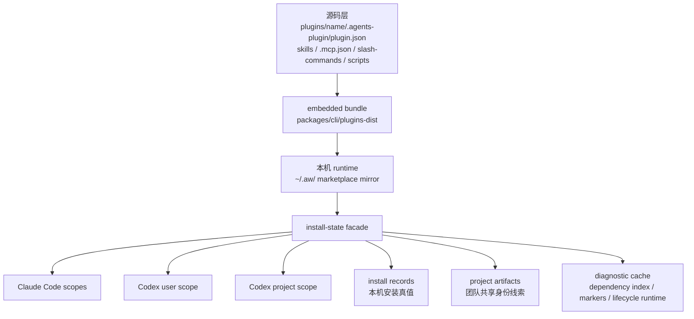
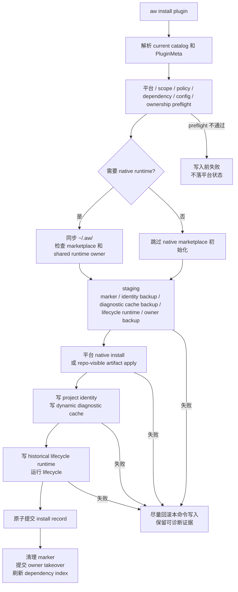
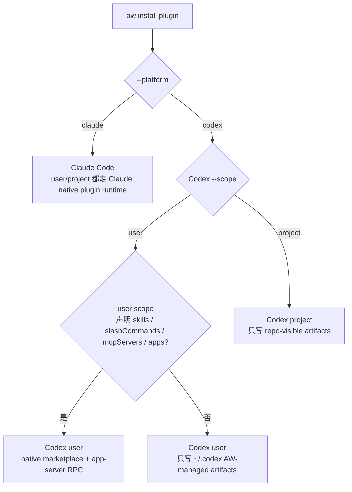
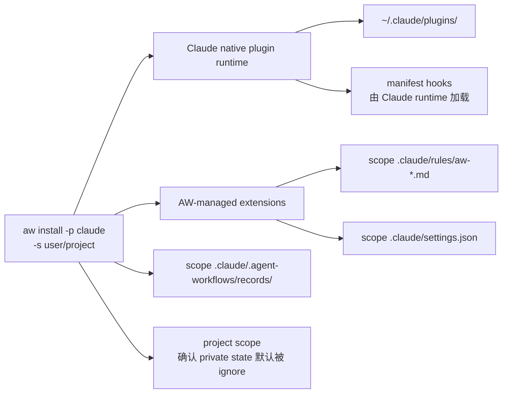
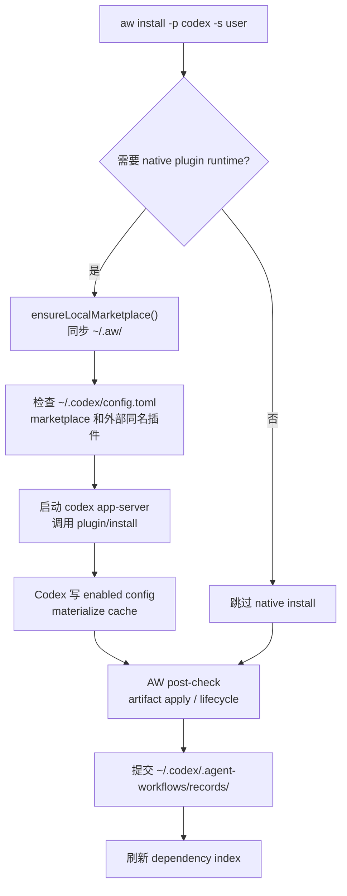
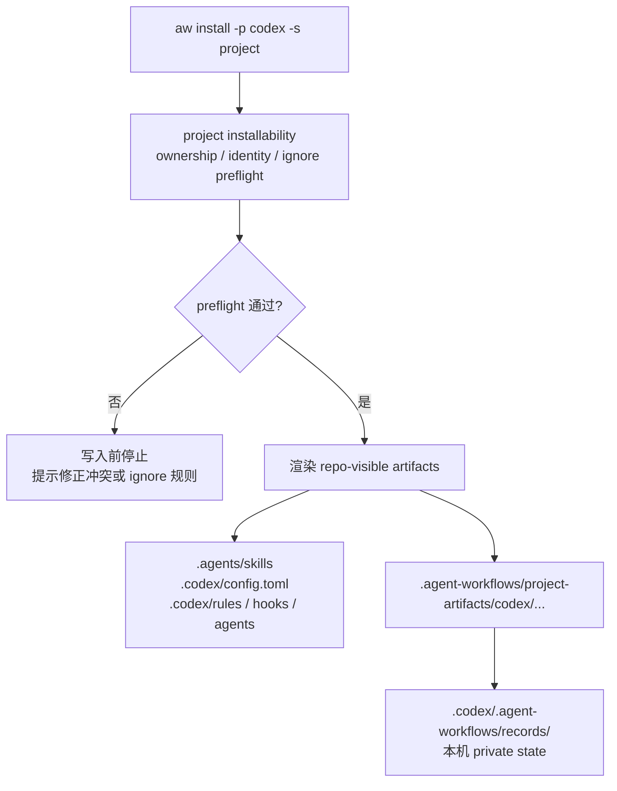

# 插件安装技术细节：Codex 与 Claude Code

本文描述当前模型下，`@yiliang/aw` 如何把一个 `agent-workflows` 插件安装到 Codex 和 Claude Code。它面向 CLI 维护者、插件作者和第一次接触这个项目的工程师，目标是把安装技术方案讲完整：插件从源码到运行时会经过哪些层，为什么要维护多种状态文件，不同平台和 scope 的写入面有什么差异，以及安装失败后 CLI 如何判断能不能修复。

读这份文档不要求先看源码。文中会保留真实路径、命令和状态名，因为这些标识会出现在代码、日志和诊断输出里；每个核心概念都会先解释它解决的问题，再说明它落在哪些文件上。

## 怎么读这份文档

这份文档既是技术说明，也是排障索引。建议先看图建立整体路径，再回到具体平台章节核对细节。

| 你想快速确认 | 优先看 |
|---|---|
| 文档里的术语分别是什么意思 | [核心概念速查](#核心概念速查) |
| 安装一个插件到底会改哪些文件 | [一个最小安装例子](#一个最小安装例子) |
| 插件从源码到平台目录会经过哪些层 | [安装模型总览](#安装模型总览) |
| 文档里的路径应该怎么分类 | [路径按用途看](#路径按用途看) |
| `aw install` 的主路径和失败边界 | [通用安装流水线](#通用安装流水线) |
| Claude Code、Codex user、Codex project 到底差在哪 | [平台与 scope 分流](#平台与-scope-分流) |
| 某个状态文件是不是安装真值 | [Install-State Facade](#install-state-facade) |
| project scope 哪些文件该提交，哪些不该提交 | [Project Config 与 Ignore 边界](#project-config-与-ignore-边界) |
| repair、cleanup、reinstall 应该选哪个 | [Repair、Cleanup 与 Reinstall](#repaircleanup-与-reinstall) |

## 先建立心智模型

`@yiliang/aw` 是一个插件分发和安装 CLI。它管理的不是某一个平台的单一文件格式，而是一套跨平台插件模型：同一个 AW 插件可以被安装到 Claude Code，也可以被安装到 Codex；可以装到用户全局目录，也可以装到当前项目；有些能力由平台原生插件系统承载，有些能力需要 AW 自己把文件写进项目仓库。

把安装过程想成三件事会比较容易：

1. **找到插件包**：CLI 先从当前 catalog 里找到插件的 manifest、平台 bundle 和脚本运行面。
2. **把能力落到目标位置**：根据 `--platform` 和 `--scope`，CLI 决定要调用平台原生安装器，还是直接写 `.agents/`、`.codex/`、`.claude/` 这类文件。
3. **记录 AW 能证明的事实**：安装成功后，CLI 写入 install record、project artifact identity、diagnostic cache 等状态。它们让后续 `status`、`repair`、`uninstall` 能判断哪些文件归 AW 管，哪些文件只是用户手写或其它工具生成。

为什么不能直接复制 `plugins/<name>/`？因为源码目录不是平台运行时目录。插件源码里可能同时有 Codex 和 Claude 能力，可能有需要 build 的脚本依赖，也可能有根据配置动态生成的 artifact。直接复制会绕过平台 manifest、权限合并、共享配置文件保护、卸载归属判断和失败恢复。

## 核心概念速查

| 名词 | 可以先这样理解 | 为什么安装时需要它 |
|---|---|---|
| AW / `@yiliang/aw` | 本项目提供的 CLI 和运行时约定 | 统一管理跨 Codex / Claude Code 的插件安装、升级、诊断和卸载 |
| 插件 | 一组可分发的 agent 能力，源码位于 `plugins/<name>/` | 用户安装的最小业务单位，例如 `git-commit`、`codex-explore` |
| manifest | 插件声明文件，源码真值是 `plugins/<name>/.agents-plugin/plugin.json` | 告诉 CLI 插件有哪些能力、支持哪些平台、需要哪些配置和依赖 |
| capability surface | 插件对外提供的能力面，例如 skills、MCP servers、slash commands、hooks、agents、instructions、dynamic artifacts | 决定插件能不能装到某个平台和 scope，也决定要写哪些文件 |
| platform | 目标产品，目前是 `codex` 或 `claude` | 两个平台的插件 runtime、配置文件和可承载能力不同 |
| scope | 安装位置，分为 `user` 和 `project` | `user` 是当前用户全局可用，`project` 是当前项目可用，通常会影响是否写入仓库 |
| artifact | AW 生成或管理的一份运行时产物，可以是文件、配置片段、skill 目录、hook group 或 agent role | 后续 repair / uninstall 必须知道这份产物是否归 AW 管 |
| repo-visible artifact | 写在项目目录、应该被团队看见或提交的 artifact | Codex project scope 主要靠这类文件让插件随仓库生效 |
| AW-managed artifact | AW 确认归属并能安全更新或删除的 artifact | 避免覆盖用户手写配置或其它工具生成的同名文件 |
| native plugin runtime | Codex 或 Claude Code 自己提供的插件安装机制 | user scope 或 Claude scope 下，平台需要自己 materialize 插件 cache、加载 hooks 或注册 marketplace |
| embedded bundle | `pnpm build` 后打进 `@yiliang/aw` 包里的插件 runtime bundle，路径是 `packages/cli/plugins-dist/` | 用户安装 npm 包后，CLI 需要从这里拿到可安装的插件包 |
| current catalog | 当前 CLI 能看到的插件清单和 manifest 视图 | `install`、`status`、`repair` 都先用它判断插件当前定义 |
| `~/.aw` / AW_HOME | 本机 AW runtime 目录和 local marketplace 镜像 | 给 native runtime 提供可注册的 marketplace，也保存跨 scope 的 AW 状态 |
| install record | 某个 plugin + platform + scope + location 在本机的安装真值 | 后续判断“这里是否安装过”“卸载时应该清什么”主要看它 |
| project artifact identity | project scope 下可提交的共享身份线索 | fresh clone 后，本机没有 install record，也能识别仓库里已有 AW 产物并提示认领 |
| diagnostic cache | 诊断缓存，特别是动态 artifact 最近一次生成和刷新结果 | `aw status` / `aw status --verbose` 可以只读展示健康状态，不必每次重新执行 renderer |
| dependency index | 从 install records 重建的反向依赖索引 | 卸载时防止删掉仍被其它插件依赖的自动依赖 |
| lifecycle runtime | 安装时保存的最小历史运行面 | 卸载、repair 或 reinstall 需要撤销旧副作用时使用 |
| native transaction marker | 平台 native 写入已经发生，但 AW record 还没提交成功时留下的短生命周期标记 | 安装中断后，`repair` 或 `cleanup` 可以据此收口 |
| shared runtime owner | 标记谁控制同一 plugin/platform 的共享 skill trigger runtime | 避免多个 location 同时改同一份共享 runtime，必要时要求 `--takeover-shared-runtime` |
| renderer | 插件脚本，用当前配置生成动态 artifact plan | 负责“算出该写什么”，但不能自己写 AW 受管文件 |
| target apply | AW 对 artifact plan 的统一写盘过程 | 集中做校验、冲突检测、回滚、identity 和诊断缓存写入 |
| preflight | 写入前的安全检查 | 在动文件之前发现平台不兼容、配置缺失、ignore 冲突、外部 ownership 等问题 |

## 一个最小安装例子

假设用户在一个 Git 仓库里运行：

```bash
aw install git-commit -p codex -s project
```

这条命令的目标是：让当前仓库里的 Codex 能看到 `git-commit` 插件提供的能力，同时不修改用户全局 Codex native marketplace。一次成功安装大致会发生这些事：

1. CLI 从 current catalog 找到 `git-commit`，确认它支持 Codex，并且至少有 project scope 能承载的能力。
2. CLI 做写入前检查：当前仓库是否能写 `.agents/` / `.codex/`，目标路径是否被 ignore 规则误盖住，是否存在同名但非 AW 管理的 MCP server、agent role 或 skill。
3. CLI 根据插件能力写 repo-visible artifacts，例如 `.agents/skills/<skill>/`、`.codex/config.toml`、`.codex/rules/aw-*.rules`、`.codex/hooks.json` 或 `.codex/agents/*.toml`。
4. CLI 写 `.agent-workflows/project-artifacts/codex/<sharedIdentityId>.json`，让这批可提交文件带上“来自哪个 AW 插件”的共享身份线索。
5. CLI 写 `.codex/.agent-workflows/records/<recordId>.json`，记录当前机器已经把这个插件装到当前仓库。这个 record 是本机 private state，默认不提交。

如果同一个插件改成 user scope：

```bash
aw install git-commit -p codex -s user
```

只要插件声明了 Codex native runtime 能力，CLI 就会先把 AW embedded bundle 同步到 `~/.aw`，再通过 Codex 的 native marketplace 和 `codex app-server` RPC 完成用户级安装。也就是说，project scope 主要写当前仓库，user scope 主要写用户目录和平台 native 状态。

## 安装模型总览

插件安装不是直接把 `plugins/<name>/` 复制到平台目录。源码会先被打成 embedded bundle，需要时再同步到本机 runtime，最后按目标平台和 scope 写入不同位置。

这张图展示的是“插件包”和“安装状态”的流向。上半部分解决插件内容从哪里来，下半部分解决安装后怎么证明、诊断和恢复。



| 层级 | 由谁产生 | 主要内容 | 安装时的作用 |
|---|---|---|---|
| 源码层 | 插件作者 | AW manifest、skills、MCP、slash commands、脚本 | 作为 build 输入，不直接写入平台目录 |
| embedded bundle | `pnpm build` | AW 源码 manifest、Claude manifest、Codex manifest | CLI 发布包内的插件来源 |
| 本机 runtime | `aw init` / `aw install` / `aw upgrade` | `~/.aw/` 下的 marketplace 镜像和跨 scope runtime 状态 | 供 native marketplace 和 shared runtime 使用 |
| 平台 scope | `aw install` / `aw repair` / `aw reinstall` | Claude 或 Codex 的原生状态、repo-visible artifacts、install-state 记录 | 形成当前机器和当前项目真正可用的安装结果 |

这里有两个容易混淆的真值：

- **插件内容真值**来自源码 manifest 和 build 后的 embedded bundle。它回答“这个插件现在应该有哪些能力”。
- **本机安装真值**来自 install record。它回答“这台机器上的这个 location 是否由 AW 安装过，以及 AW 当时承诺管理哪些东西”。

平台目录里的文件很重要，但它们只是现场证据。比如 `.codex/config.toml` 里存在某个 MCP server，不一定说明它是 AW 写的；只有 install record、project artifact identity 或受管 marker 能证明 ownership。

`~/.aw/` 是 embedded bundle 的本机镜像，同时保存跨 scope 运行时状态：

```text
~/.aw/
├── config.json
├── dependency-index.json
├── native-markers/codex/user/<plugin>.<hash>.json
├── plugin-config/<plugin>/config.json
├── lifecycle-runtime/<...>/<plugin>/<digest>/**
├── shared-runtime-owners/<platform>/<plugin>.<hash>.json
├── .claude-plugin/marketplace.json
├── .agents/plugins/marketplace.json
└── plugins/<name>/**
```

scope 本地 install record 才是安装真值。record 按 plugin + platform + scope + location 分片保存，单条 record 损坏只影响对应位置。它只记录 AW ownership、必要安装选项、安装来源、canonical outgoing dependency edges 和 shared runtime 相关偏好；健康状态由当前文件、平台现场、current catalog 和其它只读证据推导。

## 路径按用途看

这份文档会出现很多路径。第一次读时不要逐个硬记，先按用途分组：

| 路径类别 | 例子 | 谁会写 | 能不能提交 | 主要用途 |
|---|---|---|---|---|
| 插件来源和 build 产物 | `plugins/<name>/`、`packages/cli/plugins-dist/` | 插件作者、`pnpm build` | 源码可提交，build 产物随包发布 | 提供插件内容真值 |
| 用户级本机 runtime | `~/.aw/`、`~/.claude/`、`~/.codex/` | `aw`、Claude Code、Codex | 不提交 | 让当前用户的 CLI 或平台 runtime 能加载插件 |
| 项目级共享产物 | `<repo>/.agents/`、`<repo>/.codex/`、`<repo>/.agent-workflows/project-artifacts/`、`<repo>/.agent-workflows/plugin-config/` | `aw` | 通常要提交 | 让项目里的插件能力和共享 identity 随仓库传播 |
| 项目级本机私有状态 | `<repo>/.codex/.agent-workflows/records/`、`<repo>/.claude/.agent-workflows/records/`、`<repo>/.agent-workflows/plugin-config.local/` | `aw` | 默认不提交 | 记录当前机器的安装事实和本机覆盖配置 |

排查时也按这个顺序思考：

1. 插件定义是否正确：看 source manifest 或 current catalog。
2. 本机 runtime 是否健康：看 `~/.aw`、平台 native 状态和 user scope records。
3. 项目共享产物是否一致：看 repo-visible artifacts 和 project artifact identity。
4. 本机是否已经认领：看 project scope install record。

## Install-State Facade

`install-state facade` 是 CLI 内部的一层状态边界，不是某一个文件。命令层不直接散落读写各种 JSON，而是通过这层 facade 统一收集证据、提交事务和生成诊断视图。

这样设计是为了避免一个常见问题：安装涉及平台 native 状态、仓库文件、本机私有 record、共享 identity、诊断缓存和依赖索引。如果每个命令各自判断“装没装”“归不归我管”，很容易出现 install、status、uninstall 口径不一致。facade 的职责就是把这些证据按同一套优先级解释。

安装、升级、卸载、修复、清理、重装、状态和诊断都通过这层 facade 处理状态：

| 状态 | 角色 | 典型位置 | 是否是安装真值 |
|---|---|---|---|
| per-plugin install record v2 | 记录本机安装事实、AW ownership、安装来源和 dependency edges | `~/.claude/.agent-workflows/records/`、`<project>/.claude/.agent-workflows/records/`、`~/.codex/.agent-workflows/records/`、`<repo>/.codex/.agent-workflows/records/` | 是 |
| project artifact shared identity | 随仓库提交的最小共享身份线索，证明 repo-visible artifacts 的来源 | `<repo>/.agent-workflows/project-artifacts/<platform>/<sharedIdentityId>.json` | 否 |
| dynamic diagnostic cache | 记录动态 artifact 最近一次 accepted state / digest、`lastRefresh` 和 `refreshReach` | AW private state | 否 |
| historical lifecycle runtime | 为 `uninstall`、`repair`、`reinstall` 保存撤销历史副作用所需的最小运行面 | `~/.aw/lifecycle-runtime/...` | 否 |
| global dependency index | 从 records 重建跨 scope incoming edge 索引，辅助卸载保护和未使用依赖提醒 | `~/.aw/dependency-index.json` | 否 |
| native transaction marker | native 写入成功但 record 尚未提交时的短暂证据 | `~/.aw/native-markers/...` | 否 |
| shared runtime owner | 标记同一 plugin/platform 的共享 skill trigger runtime 由哪个 location 控制 | `~/.aw/shared-runtime-owners/...` | 否 |

判断安装状态时遵循这几条规则：

- 有 install record，才表示这台机器上的这个 location 被 AW 正式安装过。
- 有 project artifact identity，但没有本机 install record，通常表示“仓库里有可认领的共享产物”，不等于本机已经安装。
- 有 native marker，但没有 install record，表示平台 native 写入可能已经发生，AW 后续提交没收口，应该进入 repair 或 cleanup。
- 有 diagnostic cache，只能说明最近一次动态 artifact 接受或刷新过什么内容，不能把它当成安装成功证明。
- dependency index 可以丢失后重建。它不可信时，普通卸载这类删除命令仍然保守失败；但显式 `aw cleanup` 只要能定位残留且没有已知 dependents，就可以继续收口。

旧格式不会自动迁移。实现里如果需要测试旧文件，只能把它们作为“旧格式不迁移、读路径拒绝或历史兼容证据”的 fixture，不得把它们恢复成用户默认排障入口。

## 通用安装流水线

`aw install <plugin> -p <platform> -s <scope>` 可以先按三段理解：前置校验、写入执行、状态提交。

这条流水线的核心原则是：**尽量在写第一笔状态前发现问题；一旦开始写外部状态，就必须留下足够证据让后续命令能修复或清理。**



| 阶段 | 覆盖步骤 | 主要问题 |
|---|---|---|
| 前置校验 | 1-5 | 这个插件能不能装到目标平台和 scope，依赖、配置、ownership、ignore 规则是否安全 |
| staging | 6 | 如果后面失败，哪些状态可以恢复，哪些证据要留下 |
| 写入执行 | 7-10 | 调平台 native runtime、写 AW-managed artifacts、写诊断缓存、准备 lifecycle |
| 状态提交 | 11-13 | record 原子落盘，清理 marker，刷新 dependency index |

需要逐项核对时，命令层顺序如下：

1. 解析 current catalog，按插件名拿到 `PluginMeta`。这里的 catalog 是当前 CLI 可见的插件清单，`PluginMeta` 是命令执行所需的插件摘要。
2. 推断或校验目标平台，并检查 `marketplace.policy.products` 是否允许安装。比如 Codex-only 插件不能装到 Claude。
3. 展开完整依赖图，做 catalog、scope、平台兼容、required config、external ownership、project artifact identity、role namespace 和 ignore preflight。这个阶段只读检查，目标是在写文件前失败。
4. 如果目标需要 native runtime，调用 `ensureLocalMarketplace()` 同步 `~/.aw/`；纯 Codex project 安装只读 catalog，不初始化或修复用户级 marketplace。
5. 检查 shared runtime owner；非 owner 且会改变共享 runtime 时，脚本命令默认失败，提示加 `--takeover-shared-runtime`。
6. staging native marker、identity backup、diagnostic cache backup、historical runtime staging 和 shared owner backup。staging 的目的不是让安装“部分成功”，而是给失败回滚和后续诊断准备证据。
7. 执行平台 native install，写 AW-managed artifacts。native install 交给平台完成；AW-managed artifacts 则由 AW target apply 统一写盘。
8. 写 project artifact shared identity。只有 project scope 且存在 repo-visible artifacts 时，它才有意义。
9. 写 dynamic diagnostic cache。动态 artifact 的 accepted state、digest 和 refresh 信息会落在这里。
10. 写 historical lifecycle runtime，并运行 lifecycle。lifecycle 失败会阻断 record 提交，因为插件可能还没完成自己的安装副作用。
11. 原子提交 install record。提交成功后，这个 location 才算 AW 正式安装完成。
12. 删除 native marker，必要时提交 shared owner takeover。
13. 刷新 global dependency index，让后续卸载保护和依赖状态能看到最新 incoming edges。

失败时，CLI 尽量回滚当前命令写入；无法回滚的外部 side effect 会留下局部可诊断证据。AW 不写全局降级状态，也不让单个 location 的损坏影响同 scope 其它插件。

举例来说，如果 Codex user native RPC 已经成功，但 lifecycle 失败，用户级 Codex 可能已经有 enabled config 和 cache。此时 AW 不会假装安装成功，因为 install record 尚未提交；它会依赖 native marker 和现场证据提示用户运行 `aw repair` 或 `aw cleanup`。

## 平台与 scope 分流

不同平台真正分开的点，是“要不要走 native plugin runtime”以及“写入面在用户目录还是仓库目录”。

`scope=user` 和 `scope=project` 的含义不是简单地把路径从 `~` 换成当前目录：

- `user` 面向当前用户，适合跨项目都要使用的插件。它通常会碰到平台 native plugin runtime，例如 Codex user scope 的 marketplace / app-server，或 Claude Code 的原生 plugin runtime。
- `project` 面向当前项目，适合团队共享配置。Codex project scope 特别强调 repo-visible artifacts，也就是把 Codex 能读取的 skill、config、rules、hooks、agents 写进仓库，让 fresh clone 后仍能被识别。



| 平台 / scope | 是否走 native runtime | 主要写入面 | 适合先看 |
|---|---|---|---|
| Claude `user` | 是 | `~/.claude/plugins/`、`~/.claude/.agent-workflows/records/`、用户级 `.claude` 扩展层 | [Claude Code 安装](#claude-code-安装) |
| Claude `project` | 是 | `~/.claude/plugins/`、`<cwd>/.claude/.agent-workflows/records/`、项目级 `.claude` 扩展层 | [Claude Code 安装](#claude-code-安装) |
| Codex `user`，需要 native runtime | 是 | `~/.codex/config.toml`、`~/.codex/plugins/cache/aw/...`、`~/.codex/.agent-workflows/records/` | [Codex User Scope 安装](#codex-user-scope-安装) |
| Codex `user`，不需要 native runtime | 否 | `~/.codex/` 下的 AW-managed artifacts 和 records | [Codex User Scope 安装](#codex-user-scope-安装) |
| Codex `project` | 否 | `<repo>/.agents/`、`<repo>/.codex/`、`<repo>/.agent-workflows/project-artifacts/`、本机 project records | [Codex Project Scope 安装](#codex-project-scope-安装) |

常见 capability 到运行时产物的映射如下。它帮助读者理解“插件声明了一个能力”最后会变成什么文件或平台状态。

| capability | Claude Code 承载方式 | Codex user scope 承载方式 | Codex project scope 承载方式 |
|---|---|---|---|
| `skills` | Claude native plugin runtime 加载 bundle 内 skill | Codex native plugin runtime materialize 到用户 cache | 写入 `<repo>/.agents/skills/<skill>/` |
| `slashCommands` | build 生成 Claude command，再由 Claude runtime 加载 | build 生成 Codex manual-only skill，再由 Codex native runtime 加载 | 写入 `<repo>/.agents/skills/<command>/`，作为手动触发 skill |
| `mcpServers` | Claude native plugin runtime 或 AW 扩展层处理 | 写入用户级 Codex `mcp_servers` | 合并到 `<repo>/.codex/config.toml` 的 `mcp_servers` |
| `extensions.instructions` | 写 `<scope>/.claude/rules/aw-*.md` | 写用户级 Codex managed developer instructions block | 写 `<repo>/.codex/config.toml` 的 managed instructions block |
| `extensions.permissions` / rules | 合并 `<scope>/.claude/settings.json` | 写用户级 Codex rules | 写 `<repo>/.codex/rules/aw-*.rules` |
| hooks | Claude hooks 进入平台 manifest，由 Claude runtime 加载 | 写用户级 Codex hooks | 写 `<repo>/.codex/hooks.json` |
| agents / roles | Claude agent 能力进入平台 bundle | 写用户级 Codex agent role | 写 `<repo>/.codex/agents/*.toml` 并注册到 `.codex/config.toml` |
| `apps` | 由支持的平台 native runtime 承载 | Codex user native runtime 承载 | 当前不支持，Codex project scope 会 fail fast |
| dynamic `codex.skill` | 当前不支持 Claude 动态 artifact | renderer 生成计划，AW 写用户级 Codex runtime | renderer 生成计划，AW 写 `<repo>/.agents/skills/<skill>/` |

## Claude Code 安装

Claude Code 的 `user` 和 `project` scope 都走 Claude 原生 plugin runtime。

这意味着 AW 不会自己模拟 Claude 的插件加载规则。AW 负责准备本地 marketplace、调用 Claude 原生命令，并在 native install 完成后补充 AW 自己管理的扩展层和 install record。无论 `scope=user` 还是 `scope=project`，Claude 的 marketplace 状态都在用户级 `~/.claude/plugins/`；scope 的差异主要体现在 AW private state 和扩展层写到哪个 `.claude/` 目录。



| scope | 配置目录 | AW private state | 原生 marketplace 状态 |
|---|---|---|---|
| `user` | `~/.claude/` | `~/.claude/.agent-workflows/records/` | `~/.claude/plugins/` |
| `project` | `<cwd>/.claude/` | `<cwd>/.claude/.agent-workflows/records/` | `~/.claude/plugins/` |

Claude 原生命令完成后，AW 还会写自己管理的扩展层：

- `extensions.instructions` 生成到 `<scope>/.claude/rules/aw-<plugin>-<instruction>.md`。
- `extensions.permissions` 合并进 `<scope>/.claude/settings.json`，保留用户手写权限。
- Claude hooks 由 build 阶段写入 Claude platform manifest 的 `hooks` 字段，并由 Claude native plugin runtime 加载；CLI 不额外写一个 AW 管理的 `.claude/hooks.json`。

project scope 创建 `.claude/.agent-workflows/` 前必须确保它默认被 ignore；这是本机 private state，不是需要提交的项目 artifact。

所以 Claude project scope 里有一个特殊点：插件 runtime 本身仍由用户级 Claude marketplace 承载，但 AW 的 project record 和 project 扩展层属于当前项目。读状态时不能只看 `~/.claude/plugins/`，还要看当前项目 `.claude/.agent-workflows/records/`。

## Codex User Scope 安装

Codex user scope 分成两类：

- **需要 native plugin runtime**：插件声明了 `skills`、`slashCommands`、`mcpServers` 或 `apps`。这类安装必须走 Codex native marketplace 和 app-server RPC。
- **不需要 native plugin runtime**：只有 Codex `extensions.*` 或动态 artifacts。CLI 不调用 native install，只写 `~/.codex/` 下的 AW-managed artifacts。

判断“需不需要 native runtime”的关键是：这项能力是不是必须由 Codex 的原生插件系统 materialize。静态 skills、slash commands、MCP servers 和 apps 属于这一类；单纯的 AW-managed instructions、rules、hooks、agent role 或动态 artifact 可以由 AW 自己写用户级文件。



需要 native runtime 时，安装步骤如下：

1. 调用 `ensureLocalMarketplace()`，并解析 canonical `AW_HOME`。
2. 读取 `~/.codex/config.toml`，检查 `[plugins."<plugin>@..."]` 是否显示同名插件由外部 marketplace 管理。
3. 确保 `[marketplaces.aw]` 指向 canonical `AW_HOME`，必要时执行 `codex plugin marketplace add <canonical AW_HOME>`。
4. 启动私有 `codex app-server`，通过 stdio JSONL 调用 `plugin/install`。
5. `plugin/install` 成功后，Codex 自己负责写用户级 `[plugins."<plugin>@aw"].enabled = true`，并 materialize cache 到 `~/.codex/plugins/cache/aw/<plugin>/<version>/`。AW 不回退到只写 enabled config。
6. AW 写入 native transaction marker，再做 post-check、artifact apply、lifecycle、record commit 和 dependency index refresh。所有步骤成功后删除 marker。

Codex user scope 的 AW-managed artifacts 写在用户级 `~/.codex/`，包括 managed developer instructions block、`mcp_servers`、动态 role registration、rules、hooks 和 agents。所有共享文件都必须通过 AW 的 target apply 写入；renderer 和 lifecycle 不能直接改这些文件。

这里的 post-check 很重要。Codex RPC 返回成功还不够，AW 还要确认 enabled config 和 materialized cache 都存在。只有 native 状态、AW artifacts、lifecycle 和 install record 都收口后，状态才会被解释为完整安装。

## Codex Project Scope 安装

Codex project scope 完全走 repo-visible artifacts，不走 native plugin 平面：

- 不执行 `codex plugin marketplace add`
- 不启动 `codex app-server`
- 不写 `~/.codex/config.toml [marketplaces]`
- 不写 `~/.codex/config.toml [plugins]`
- 不写 `~/.codex/plugins/cache/...`

这是为了让项目级安装具有清晰边界：命令只改变当前仓库，不改变用户全局 Codex 环境。即使这台机器没有可用的 `codex` CLI，只要要写的 repo-visible artifacts 能被安全生成和校验，Codex project 安装也不应该产生用户级 native side effect。



project scope 的 Codex 写入面解析到仓库根：

```text
<repo-root>/.agents/skills/<skill>/
<repo-root>/.codex/config.toml
<repo-root>/.codex/rules/aw-*.rules
<repo-root>/.codex/hooks.json
<repo-root>/.codex/agents/*.toml
<repo-root>/.agent-workflows/project-artifacts/codex/<sharedIdentityId>.json
<repo-root>/.codex/.agent-workflows/records/<recordId>.json
```

`.codex/.agent-workflows/records/` 是本机 private state，默认忽略；`.agent-workflows/project-artifacts/` 是团队共享身份线索，不能默认忽略。

这两个目录的区别很关键：

- `.codex/.agent-workflows/records/` 说明“我这台机器已经认领并安装了这个 project target”，所以它是本机私有状态。
- `.agent-workflows/project-artifacts/` 说明“仓库里的这些共享产物属于哪个 AW 插件”，所以它应该随仓库提交，帮助其他人 fresh clone 后认领。

Codex project scope 会 fail fast 的情况：

- 插件没有任何 project-visible surface，例如只有 `apps` 或只有 native plugin runtime 能承载的能力。
- 插件声明了 `apps`，因为 Codex project scope 当前不支持 apps。
- `.codex/config.toml` 中存在同名非 AW managed MCP server、agent role 或其它会被覆盖的配置。
- project shared config 或 project artifact identity 目标路径被 ignore 规则覆盖。
- 既有共享产物 identity 损坏、locator 与当前 project target 不匹配、artifact path 越界，或实际文件与 identity 明显不符。

fresh clone 后，如果仓库里已有可验证的 repo-visible artifacts 和 shared identity metadata，但本机没有 install record，`status` 应显示“可认领”。脚本化认领入口是 `aw repair --adopt-existing`；它按当前机器的 `PluginLocation` 创建本机 record，不要求 shared identity 里存在本机 path 或 project key。

## Project Config 与 Ignore 边界

project config 分 shared / local 两层：

| 配置层 | 路径 | 是否提交 | 会不会参与 repo-visible artifact render |
|---|---|---|---|
| shared | `.agent-workflows/plugin-config/<plugin>/config.json` | 可以提交 | 会 |
| local | `.agent-workflows/plugin-config.local/<plugin>/config.json` | 默认忽略 | 不会 |

project scope 下，读配置和渲染 repo-visible artifact 不是同一件事：

- **读配置**面向本机命令、lifecycle 和 helper，可以按 `manifest default < user store < project shared store < project local store` 合并，得到当前机器的 effective config。
- **渲染 repo-visible artifact**面向团队共享文件，只能使用 manifest default 和 project shared config store 中可共享的键。否则同一个仓库在不同机器上会因为本机 user/local 配置不同而生成不同内容。

因此 user store、project local store 和路径型 `file` / `directory` 配置不能参与 project artifact render、digest、stale 判断或 refresh。路径型配置尤其不能进入 shared config，因为绝对路径或本机相对路径无法在团队成员机器上稳定成立。

默认 ignore 规则：

- 必须默认忽略：`.claude/.agent-workflows/`、`.codex/.agent-workflows/`、`.agent-workflows/plugin-config.local/`
- 不能默认忽略：`.agent-workflows/plugin-config/`、`.agent-workflows/project-artifacts/`

写入 project shared config 或 project artifact identity 前，CLI 必须检查目标路径没有被 ignore 规则覆盖；如果被忽略，命令在写第一笔 repo-visible artifact 前失败，并提示修正 ignore 规则或改用 project local 配置。

换句话说，ignore 规则也是安装安全边界的一部分。AW 不能把“应该提交的共享身份线索”写进一个被 Git 忽略的位置，否则 fresh clone 后其它机器就失去认领依据。

## Status、Repair、Cleanup 与 Reinstall

`aw status --verbose` 是统一只读排查入口；默认不执行 renderer、不运行 lifecycle、不修复文件。原先需要深度诊断才能看到的信息迁移到 `status --verbose`，不再提供额外的 `--deep` 用户选项。

这组命令的差异可以按“是否写状态”和“是否认为当前安装还可信”来理解：

| 命令 | 用途 | 安全边界 |
|---|---|---|
| `aw status --verbose` | 只读收集状态证据和详细排查信息 | 不执行 renderer、不运行 lifecycle、不修复文件 |
| `aw repair` | 在 current catalog 与 record source 能证明同一 bundle 时，重新应用 AW-owned artifacts | source 漂移时不能隐式升级 |
| `aw repair --dependency-index` | 从可验证 records 重建 dependency index | 只修索引，不修插件安装 |
| `aw repair --adopt-existing` | 认领 fresh clone 中已有的 project shared artifacts | 按当前机器 `PluginLocation` 创建本机 record |
| `aw cleanup` | 清理 AW 明确拥有的残留、marker-only 或损坏状态 | 不替代正常 `aw uninstall` |
| `aw reinstall` | 先诊断，再安全移除 AW-owned 状态，最后按 current catalog 重装 | 遇到 project “可认领”状态时默认停止 |

`aw repair` 只在 current catalog 与 record source 能证明同一 bundle 时重新应用 AW-owned artifacts；source 漂移时不能隐式升级。`aw repair --dependency-index` 从可验证 records 重建 dependency index。`aw repair --adopt-existing` 用于认领 project shared artifacts。

`aw cleanup` 只清理 AW 明确拥有的残留、marker-only 或损坏状态，不替代正常 `aw uninstall`。它是用户显式确认的收口入口：只要 AW 能定位到要删的残留，并且没有已知 dependents，就会继续执行；dependency index 缺失、损坏或覆盖范围不可信时，会保留诊断和 warning，但不会再把用户逼回重装或手动改文件。dependency index stale reference 仍必须通过 `aw status --verbose`、receipt 或结构化 `nextSteps` 给出的 token 显式退休：

```bash
aw cleanup --dependency-index --prune-stale <token> --yes
```

`aw reinstall` 等价于先读取状态，再安全移除 AW-owned 状态，最后按 current catalog 重新安装。遇到 project “可认领”状态时默认停止，提示先认领。

常见判断方式：

- 只是想知道出了什么问题，先用 `aw status --verbose`。
- record 还在，catalog source 也能对上，只是文件缺失或 drift，用 `aw repair`。
- 仓库里有共享产物和 identity，但本机没有 record，用 `aw repair --adopt-existing`。
- 只剩 marker、残留或损坏状态，并且 AW 能证明 ownership，用 `aw cleanup`。
- 想按当前 catalog 重新铺一遍，并允许先移除 AW-owned 状态，用 `aw reinstall`。

## 维护边界

- 改 install-state facade、schema、adapter 行为、scope 语义或安装/分发流程时，也要同步检查公开文档、测试 fixture 和插件作者工具。
- 改 Codex user native 流程时，必须同时考虑 app-server RPC、post-check、native transaction marker 和 `[marketplaces.aw]` cleanup，不能只改 `config.toml`。
- 改 Codex project 能力时，必须更新 project installability、write safety preflight、project artifact identity、ignore preflight 和文档中的 repo-visible surface。
- 改动态 artifact、config refresh 或 project config 语义时，必须同时检查 dynamic diagnostic cache、project shared/local config 边界和路径型配置限制。
