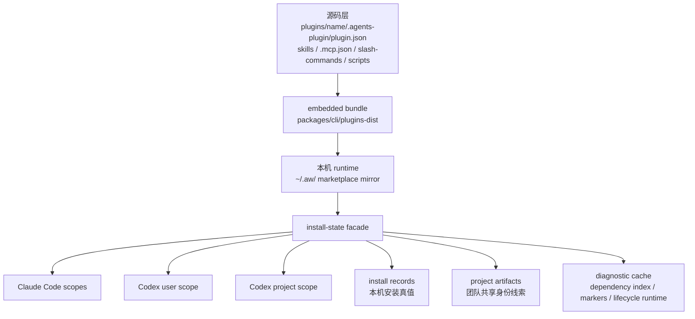
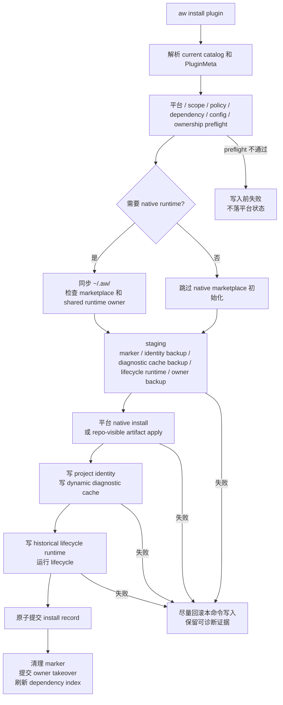
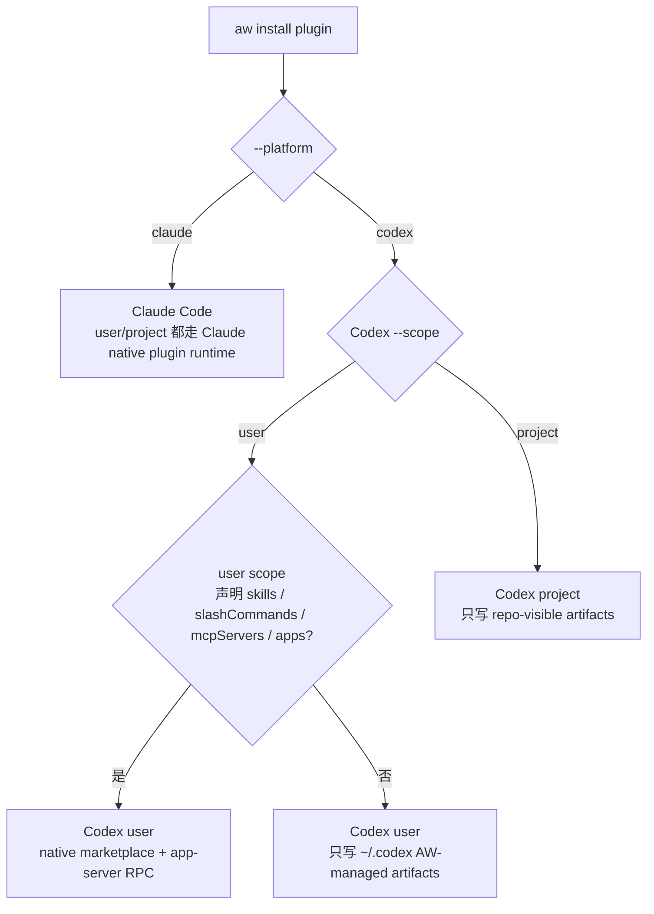
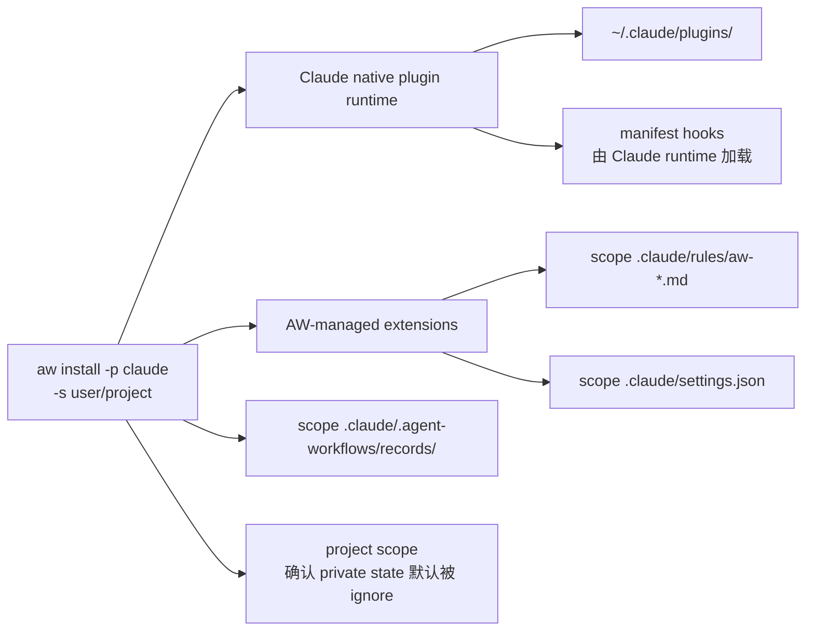
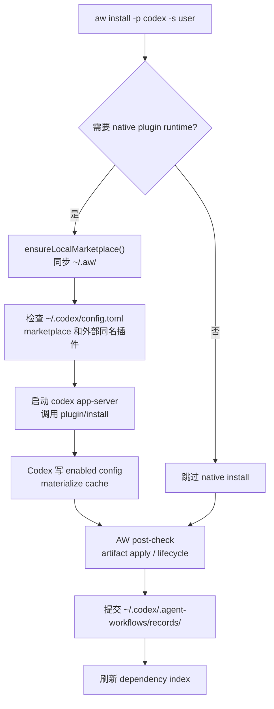
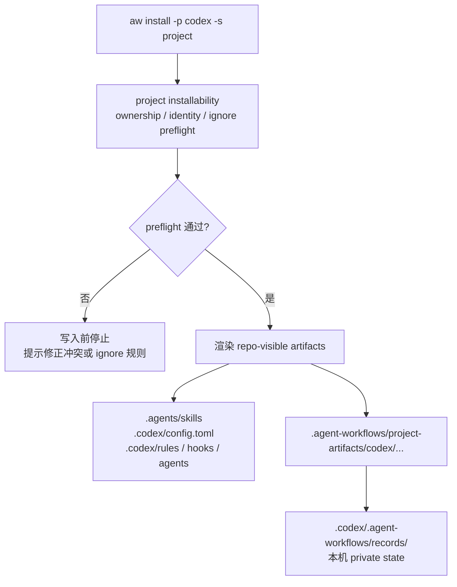

# 插件安装技术细节：Codex 与 Claude Code

本文描述当前模型下，`@yiliang/aw` 如何把一个 `agent-workflows` 插件安装到 Codex 和 Claude Code。它面向 CLI 维护者和插件作者，重点说明运行时写入链路、关键文件、scope 差异和失败恢复语义；日常命令用法见 [plugin-installation.md](./plugin-installation.md)。

## 怎么读这份文档

这份文档既是技术说明，也是排障索引。建议先看图建立整体路径，再回到具体平台章节核对细节。

| 你想快速确认 | 优先看 |
|---|---|
| 插件从源码到平台目录会经过哪些层 | [安装模型总览](#安装模型总览) |
| `aw install` 的主路径和失败边界 | [通用安装流水线](#通用安装流水线) |
| Claude Code、Codex user、Codex project 到底差在哪 | [平台与 scope 分流](#平台与-scope-分流) |
| 某个状态文件是不是安装真值 | [Install-State Facade](#install-state-facade) |
| project scope 哪些文件该提交，哪些不该提交 | [Project Config 与 Ignore 边界](#project-config-与-ignore-边界) |
| repair、cleanup、reinstall 应该选哪个 | [Repair、Cleanup 与 Reinstall](#repaircleanup-与-reinstall) |

## 安装模型总览

插件安装不是直接把 `plugins/<name>/` 复制到平台目录。源码会先被打成 embedded bundle，需要时再同步到本机 runtime，最后按目标平台和 scope 写入不同位置。



| 层级 | 由谁产生 | 主要内容 | 安装时的作用 |
|---|---|---|---|
| 源码层 | 插件作者 | AW manifest、skills、MCP、slash commands、脚本 | 作为 build 输入，不直接写入平台目录 |
| embedded bundle | `pnpm build` | AW 源码 manifest、Claude manifest、Codex manifest | CLI 发布包内的插件来源 |
| 本机 runtime | `aw init` / `aw install` / `aw upgrade` | `~/.aw/` 下的 marketplace 镜像和跨 scope runtime 状态 | 供 native marketplace 和 shared runtime 使用 |
| 平台 scope | `aw install` / `aw repair` / `aw reinstall` | Claude 或 Codex 的原生状态、repo-visible artifacts、install-state 记录 | 形成当前机器和当前项目真正可用的安装结果 |

`~/.aw/` 是 embedded bundle 的本机镜像，同时保存跨 scope 运行时状态：

```text
~/.aw/
├── config.json
├── dependency-index.json
├── native-markers/codex/user/<plugin>.<hash>.json
├── plugin-config/<plugin>/config.json
├── lifecycle-runtime/<...>/<plugin>/<digest>/**
├── shared-runtime-owners/<platform>/<plugin>.<hash>.json
├── .claude-plugin/marketplace.json
├── .agents/plugins/marketplace.json
└── plugins/<name>/**
```

scope 本地 install record 才是安装真值。record 按 plugin + platform + scope + location 分片保存，单条 record 损坏只影响对应位置。它只记录 AW ownership、必要安装选项、安装来源、canonical outgoing dependency edges 和 shared runtime 相关偏好；健康状态由当前文件、平台现场、current catalog 和其它只读证据推导。

## Install-State Facade

安装、升级、卸载、修复、清理、重装、状态和诊断都通过同一层 facade 处理状态：

| 状态 | 角色 | 典型位置 | 是否是安装真值 |
|---|---|---|---|
| per-plugin install record v2 | 记录本机安装事实、AW ownership、安装来源和 dependency edges | `~/.claude/.agent-workflows/records/`、`<project>/.claude/.agent-workflows/records/`、`~/.codex/.agent-workflows/records/`、`<repo>/.codex/.agent-workflows/records/` | 是 |
| project artifact shared identity | 随仓库提交的最小共享身份线索，证明 repo-visible artifacts 的来源 | `<repo>/.agent-workflows/project-artifacts/<platform>/<sharedIdentityId>.json` | 否 |
| dynamic diagnostic cache | 记录动态 artifact 最近一次 accepted state / digest、`lastRefresh` 和 `refreshReach` | AW private state | 否 |
| historical lifecycle runtime | 为 `uninstall`、`repair`、`reinstall` 保存撤销历史副作用所需的最小运行面 | `~/.aw/lifecycle-runtime/...` | 否 |
| global dependency index | 从 records 重建跨 scope incoming edge 索引，辅助卸载保护和未使用依赖提醒 | `~/.aw/dependency-index.json` | 否 |
| native transaction marker | native 写入成功但 record 尚未提交时的短暂证据 | `~/.aw/native-markers/...` | 否 |
| shared runtime owner | 标记同一 plugin/platform 的共享 skill trigger runtime 由哪个 location 控制 | `~/.aw/shared-runtime-owners/...` | 否 |

旧格式不会自动迁移。实现里如果需要测试旧文件，只能把它们作为“旧格式不迁移、读路径拒绝或历史兼容证据”的 fixture，不得把它们恢复成用户默认排障入口。

## 通用安装流水线

`aw install <plugin> -p <platform> -s <scope>` 可以先按三段理解：前置校验、写入执行、状态提交。



| 阶段 | 覆盖步骤 | 主要问题 |
|---|---|---|
| 前置校验 | 1-5 | 这个插件能不能装到目标平台和 scope，依赖、配置、ownership、ignore 规则是否安全 |
| staging | 6 | 如果后面失败，哪些状态可以恢复，哪些证据要留下 |
| 写入执行 | 7-10 | 调平台 native runtime、写 AW-managed artifacts、写诊断缓存、准备 lifecycle |
| 状态提交 | 11-13 | record 原子落盘，清理 marker，刷新 dependency index |

需要逐项核对时，命令层顺序如下：

1. 解析 current catalog，按插件名拿到 `PluginMeta`。
2. 推断或校验目标平台，并检查 `marketplace.policy.products` 是否允许安装。
3. 展开完整依赖图，做 catalog、scope、平台兼容、required config、external ownership、project artifact identity、role namespace 和 ignore preflight。
4. 如果目标需要 native runtime，调用 `ensureLocalMarketplace()` 同步 `~/.aw/`；纯 Codex project 安装只读 catalog，不初始化或修复用户级 marketplace。
5. 检查 shared runtime owner；非 owner 且会改变共享 runtime 时，脚本命令默认失败，提示加 `--takeover-shared-runtime`。
6. staging native marker、identity backup、diagnostic cache backup、historical runtime staging 和 shared owner backup。
7. 执行平台 native install，写 AW-managed artifacts。
8. 写 project artifact shared identity。
9. 写 dynamic diagnostic cache。
10. 写 historical lifecycle runtime，并运行 lifecycle。
11. 原子提交 install record。
12. 删除 native marker，必要时提交 shared owner takeover。
13. 刷新 global dependency index。

失败时，CLI 尽量回滚当前命令写入；无法回滚的外部 side effect 会留下局部可诊断证据。AW 不写全局降级状态，也不让单个 location 的损坏影响同 scope 其它插件。

## 平台与 scope 分流

不同平台真正分开的点，是“要不要走 native plugin runtime”以及“写入面在用户目录还是仓库目录”。



| 平台 / scope | 是否走 native runtime | 主要写入面 | 适合先看 |
|---|---|---|---|
| Claude `user` | 是 | `~/.claude/plugins/`、`~/.claude/.agent-workflows/records/`、用户级 `.claude` 扩展层 | [Claude Code 安装](#claude-code-安装) |
| Claude `project` | 是 | `~/.claude/plugins/`、`<cwd>/.claude/.agent-workflows/records/`、项目级 `.claude` 扩展层 | [Claude Code 安装](#claude-code-安装) |
| Codex `user`，需要 native runtime | 是 | `~/.codex/config.toml`、`~/.codex/plugins/cache/aw/...`、`~/.codex/.agent-workflows/records/` | [Codex User Scope 安装](#codex-user-scope-安装) |
| Codex `user`，不需要 native runtime | 否 | `~/.codex/` 下的 AW-managed artifacts 和 records | [Codex User Scope 安装](#codex-user-scope-安装) |
| Codex `project` | 否 | `<repo>/.agents/`、`<repo>/.codex/`、`<repo>/.agent-workflows/project-artifacts/`、本机 project records | [Codex Project Scope 安装](#codex-project-scope-安装) |

## Claude Code 安装

Claude Code 的 `user` 和 `project` scope 都走 Claude 原生 plugin runtime。



| scope | 配置目录 | AW private state | 原生 marketplace 状态 |
|---|---|---|---|
| `user` | `~/.claude/` | `~/.claude/.agent-workflows/records/` | `~/.claude/plugins/` |
| `project` | `<cwd>/.claude/` | `<cwd>/.claude/.agent-workflows/records/` | `~/.claude/plugins/` |

Claude 原生命令完成后，AW 还会写自己管理的扩展层：

- `extensions.instructions` 生成到 `<scope>/.claude/rules/aw-<plugin>-<instruction>.md`。
- `extensions.permissions` 合并进 `<scope>/.claude/settings.json`，保留用户手写权限。
- Claude hooks 由 build 阶段写入 Claude platform manifest 的 `hooks` 字段，并由 Claude native plugin runtime 加载；CLI 不额外写一个 AW 管理的 `.claude/hooks.json`。

project scope 创建 `.claude/.agent-workflows/` 前必须确保它默认被 ignore；这是本机 private state，不是需要提交的项目 artifact。

## Codex User Scope 安装

Codex user scope 分成两类：

- **需要 native plugin runtime**：插件声明了 `skills`、`slashCommands`、`mcpServers` 或 `apps`。这类安装必须走 Codex native marketplace 和 app-server RPC。
- **不需要 native plugin runtime**：只有 Codex `extensions.*` 或动态 artifacts。CLI 不调用 native install，只写 `~/.codex/` 下的 AW-managed artifacts。



需要 native runtime 时，安装步骤如下：

1. 调用 `ensureLocalMarketplace()`，并解析 canonical `AW_HOME`。
2. 读取 `~/.codex/config.toml`，检查 `[plugins."<plugin>@..."]` 是否显示同名插件由外部 marketplace 管理。
3. 确保 `[marketplaces.aw]` 指向 canonical `AW_HOME`，必要时执行 `codex plugin marketplace add <canonical AW_HOME>`。
4. 启动私有 `codex app-server`，通过 stdio JSONL 调用 `plugin/install`。
5. `plugin/install` 成功后，Codex 自己负责写用户级 `[plugins."<plugin>@aw"].enabled = true`，并 materialize cache 到 `~/.codex/plugins/cache/aw/<plugin>/<version>/`。AW 不回退到只写 enabled config。
6. AW 写入 native transaction marker，再做 post-check、artifact apply、lifecycle、record commit 和 dependency index refresh。所有步骤成功后删除 marker。

Codex user scope 的 AW-managed artifacts 写在用户级 `~/.codex/`，包括 managed developer instructions block、`mcp_servers`、动态 role registration、rules、hooks 和 agents。所有共享文件都必须通过 AW 的 target apply 写入；renderer 和 lifecycle 不能直接改这些文件。

## Codex Project Scope 安装

Codex project scope 完全走 repo-visible artifacts，不走 native plugin 平面：

- 不执行 `codex plugin marketplace add`
- 不启动 `codex app-server`
- 不写 `~/.codex/config.toml [marketplaces]`
- 不写 `~/.codex/config.toml [plugins]`
- 不写 `~/.codex/plugins/cache/...`



project scope 的 Codex 写入面解析到仓库根：

```text
<repo-root>/.agents/skills/<skill>/
<repo-root>/.codex/config.toml
<repo-root>/.codex/rules/aw-*.rules
<repo-root>/.codex/hooks.json
<repo-root>/.codex/agents/*.toml
<repo-root>/.agent-workflows/project-artifacts/codex/<sharedIdentityId>.json
<repo-root>/.codex/.agent-workflows/records/<recordId>.json
```

`.codex/.agent-workflows/records/` 是本机 private state，默认忽略；`.agent-workflows/project-artifacts/` 是团队共享身份线索，不能默认忽略。

Codex project scope 会 fail fast 的情况：

- 插件没有任何 project-visible surface，例如只有 `apps` 或只有 native plugin runtime 能承载的能力。
- 插件声明了 `apps`，因为 Codex project scope 当前不支持 apps。
- `.codex/config.toml` 中存在同名非 AW managed MCP server、agent role 或其它会被覆盖的配置。
- project shared config 或 project artifact identity 目标路径被 ignore 规则覆盖。
- 既有共享产物 identity 损坏、locator 与当前 project target 不匹配、artifact path 越界，或实际文件与 identity 明显不符。

fresh clone 后，如果仓库里已有可验证的 repo-visible artifacts 和 shared identity metadata，但本机没有 install record，`status` 应显示“可认领”。脚本化认领入口是 `aw repair --adopt-existing`；它按当前机器的 `PluginLocation` 创建本机 record，不要求 shared identity 里存在本机 path 或 project key。

## Project Config 与 Ignore 边界

project config 分 shared / local 两层：

| 配置层 | 路径 | 是否提交 | 会不会参与 repo-visible artifact render |
|---|---|---|---|
| shared | `.agent-workflows/plugin-config/<plugin>/config.json` | 可以提交 | 会 |
| local | `.agent-workflows/plugin-config.local/<plugin>/config.json` | 默认忽略 | 不会 |

project scope 下，repo-visible artifact render config 只能来自 manifest default 和 project shared config store 中可共享的键。user store、project local store 和路径型 `file` / `directory` 配置不能参与 project artifact render、digest、stale 判断或 refresh。

默认 ignore 规则：

- 必须默认忽略：`.claude/.agent-workflows/`、`.codex/.agent-workflows/`、`.agent-workflows/plugin-config.local/`
- 不能默认忽略：`.agent-workflows/plugin-config/`、`.agent-workflows/project-artifacts/`

写入 project shared config 或 project artifact identity 前，CLI 必须检查目标路径没有被 ignore 规则覆盖；如果被忽略，命令在写第一笔 repo-visible artifact 前失败，并提示修正 ignore 规则或改用 project local 配置。

## Repair、Cleanup 与 Reinstall

`aw diagnose` 只读收集证据；默认不执行 renderer、不运行 lifecycle、不修复文件。`aw diagnose --deep` 可以执行 renderer，用于确认动态 artifact 是否仍可生成。

| 命令 | 用途 | 安全边界 |
|---|---|---|
| `aw diagnose` | 只读收集状态证据 | 默认不执行 renderer、不运行 lifecycle、不修复文件 |
| `aw diagnose --deep` | 确认动态 artifact 是否还能生成 | 可以执行 renderer，但仍不写修复结果 |
| `aw repair` | 在 current catalog 与 record source 能证明同一 bundle 时，重新应用 AW-owned artifacts | source 漂移时不能隐式升级 |
| `aw repair --dependency-index` | 从可验证 records 重建 dependency index | 只修索引，不修插件安装 |
| `aw repair --adopt-existing` | 认领 fresh clone 中已有的 project shared artifacts | 按当前机器 `PluginLocation` 创建本机 record |
| `aw cleanup` | 清理 AW 明确拥有的残留、marker-only 或损坏状态 | 不替代正常 `aw uninstall` |
| `aw reinstall` | 先诊断，再安全移除 AW-owned 状态，最后按 current catalog 重装 | 遇到 project “可认领”状态时默认停止 |

`aw repair` 只在 current catalog 与 record source 能证明同一 bundle 时重新应用 AW-owned artifacts；source 漂移时不能隐式升级。`aw repair --dependency-index` 从可验证 records 重建 dependency index。`aw repair --adopt-existing` 用于认领 project shared artifacts。

`aw cleanup` 只清理 AW 明确拥有的残留、marker-only 或损坏状态，不替代正常 `aw uninstall`。dependency index stale reference 必须通过诊断给出的 token 显式退休：

```bash
aw cleanup --dependency-index --prune-stale <token> --yes
```

`aw reinstall` 等价于先诊断，再安全移除 AW-owned 状态，最后按 current catalog 重新安装。遇到 project “可认领”状态时默认停止，提示先认领。

## 维护边界

- 改 install-state facade、schema、adapter 行为、scope 语义或安装/分发流程时，也要同步检查公开文档、测试 fixture 和插件作者工具。
- 改 Codex user native 流程时，必须同时考虑 app-server RPC、post-check、native transaction marker 和 `[marketplaces.aw]` cleanup，不能只改 `config.toml`。
- 改 Codex project 能力时，必须更新 project installability、write safety preflight、project artifact identity、ignore preflight 和文档中的 repo-visible surface。
- 改动态 artifact、config refresh 或 project config 语义时，必须同时检查 dynamic diagnostic cache、project shared/local config 边界和路径型配置限制。
