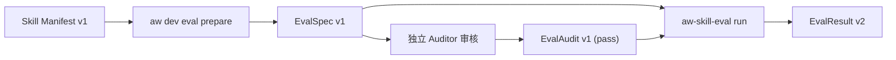

# Review 取证与 Eval 评估合同

本文件是面向代码审阅者、外部评测工具与自动化审计者的公开精确合同，定义 AW 只读 Review 取证接口、Review 准备与来源绑定凭据合同、人读报告边界，以及 Eval 评测引擎的机器数据合同（`EvalSpec v1`、`EvalAudit v1`、`EvalResult v2`）、外部 Provider 协议与执行门禁。内部引擎实现与测试架构参见[Review 与 Eval 架构说明](../maintainers/architecture/review-eval.md)。各插件专属评测用例归各插件维护。

---

<a id="1-只读-review-取证与人读报告"></a>
## 1. 只读 Review 取证合同（`aw dev review inspect`）

Review 机制为插件质量与安全审计提供一致、纯只读的静态取证入口。

<a id="11-只读检查接口aw-review-inspect"></a>
### 1.1 命令与输入对象

```bash
aw dev review inspect <target> [--materialization <receipt>]... [--skill <name>]... [--platform <platform>] [--scope <scope>] [--config <file>] [--workspace-root <root>] [--view review] [--json]
```

- **受支持目标**：`target` 可以是源 Skill 路径（`<workspace>/plugins/<plugin>/skills/<skill>`）、插件路径（`<workspace>/plugins/<plugin>`）或 Catalog 快照。
- **纯只读保证**：读取目标源码树、Catalog 快照与指定的物化回执，**绝对不执行被审插件的任何代码**，不运行 build、renderer、test 或 preApply，不发起网络请求，不修改磁盘上的配置或状态。
- **输入选项与选择门禁**：
  - **可重复 `--skill <name>`**：显式筛选本次审阅的一个或多个声明 Skill；省略时审阅目标中包含的全部 Skill。默认**绝不把单个 Skill 静默扩大到整个插件**；
  - **可重复 `--materialization <receipt>`**：指定一个或多个 `aw-source-binding.json` 物化回执文件路径；
  - **`--config <file>`**：传入审阅配置 JSON 文件路径（**注意：Review 使用 `--config`，而非 Eval 的 `--config-file`**）；
  - **`--workspace-root <root>`**：显式指定 Catalog Workspace 根路径；
  - **`--platform <platform>` 与 `--scope <scope>`**：未显式指定 profile 时，从 manifest 声明的 profiles 中自动枚举解析，不无据猜测；
  - **`--view <view>`**：合法域仅为 `'review'`（默认为 `'review'`）；
  - **动态来源映射与歧义报错**：动态源按 artifact、sourceDirs 与 renderer 映射；当发现多个候选物化产物具有相同输入选择但 digest 不一致时，抛出歧义错误（`ReviewInspectionInputError`，退出码 2）；
  - 默认配置不被已有的自定义旧 binding 覆盖；
  - **规范路径去重**：同选择、同 digest 时稳定选择证据路径；
  - 相同内容的不同 profile 仍保持为独立覆盖项。

### 1.2 取证结果

```json
{
  "schemaVersion": 1,
  "command": "dev.review.inspect",
  "status": "success",
  "data": {
    "view": "review",
    "target": {
      "kind": "plugin",
      "path": "plugins/example-plugin"
    },
    "sources": [
      "plugins/example-plugin"
    ],
    "skills": [
      {
        "skill": "example-skill",
        "sourcePath": "plugins/example-plugin/skills/example-skill",
        "profile": {
          "platform": "codex",
          "scope": "user",
          "inputDigest": "sha256:0123456789abcdef0123456789abcdef0123456789abcdef0123456789abcdef"
        },
        "finalPath": "out/skills/example-skill",
        "digest": "sha256:fedcba9876543210fedcba9876543210fedcba9876543210fedcba9876543210",
        "state": "ready",
        "evidencePath": "out/aw-source-binding.json"
      }
    ],
    "issues": []
  },
  "diagnostics": [],
  "nextActions": []
}
```

- **`status` 语义**：`success` 仅表示静态取证请求完成，不代表语义质量通过或发布合格。质量结论由审阅者判断。统一外壳和退出码见 [CLI 合同](cli.md)，source-binding 文件继续使用自身 schema 2。
- **退出状态码语义**：
  - `0`：取证成功（即使存在 missing、stale 或 invalid final，也正常退出 0，并在回执中如实记录缺口事实）；
  - `2`：非法选择或参数；合法请求因缺少来源、路径或能力而无法开始时返回 blocked/3；
  - `3`：缺少必要配置或准备期间检测到来源变化（sourceChanged）。

---

## 2. Review 准备合同（`aw dev review prepare`）

当审阅者需要检查实际物化产物（final）而本地尚未生成时，使用准备命令生成隔离的审核副本。

### 2.1 命令与执行隔离

```bash
aw dev review prepare <plugin-or-source-skill> --platform <platform> --scope <scope> --out <new-dir> [--skill <name>]... [--config <file>] [--workspace-root <root>] [--json]
```

- **目标与平台**：准备单插件、单平台（`codex`、`claude`、`antigravity`、`cursor`、`opencode`、`pi`、`gemini`、`copilot`、`grok`、`generic`）的所选 Skill；`--platform`、`--scope` 与 `--out` 为必填项。
- **Skill 与配置选项**：支持可重复的 `--skill <name>` 筛选具体 Skill；配置覆盖使用 `--config <file>`（传入普通 JSON 文件的非敏感覆盖，**严禁使用 `--config-file`**）；支持 `--workspace-root <root>` 显式指定工作区根。
- **配置来源隔离**：配置仅来自对应平台 manifest 默认值与 `--config <file>` 显式非敏感覆盖，**绝不读取真实用户的持久配置 Store**。
- **安全新目录门禁（`--out`）**：
  - 输出路径 `--out` 必须是一个**全新的、尚不存在的安全目录**；
  - 严禁覆盖源码、共享输入、已有产物或真实安装位置；
  - 路径链中任何组件包含符号链接（symlink）直接失败拒绝。
- **执行与物化验证**：
  - 在隔离临时环境和 staging 中执行本次必要的 build 和 renderer，复用 bundle 与 runtime imports；
  - 全部所选 final 必须通过布局、metadata、资源闭包和普通节点检查，且来源及配置在准备期间未变化，才原子提交至 `--out`；
  - 准备不提供真实安装、发布或大模型运行授权。
- **失败清理与残留保留**：
  - 准备失败时仅清理自己的临时 staging 目录，如实报告实际错误与未清理的 residue；
  - 发现源码变化（sourceChanged）时不自动回滚源码。
- **退出状态码**：
  - `0`：准备成功，返回 `ReviewPreparationV1` 回执（包含 `sourceBindingPath`、`skills` 列表等）；
  - `1`：构建失败或最终包检查失败；
  - `2`：参数错误、路径不安全（含 symlink）或不支持的能力；
  - `3`：缺少必要配置或准备期间检测到来源变化（sourceChanged）。

### 2.2 跨插件 `valueRef` 依赖闭包扩展

- **依赖扩展**：从 renderer 的 artifacts.configKeys 和所需真实命令声明的 refreshKeys 扩展实际校验依赖闭包，不从已移除的动态 target 清单推断。
- **配置来源**：依赖定义来自同次 Workspace 或 Catalog snapshot；依赖配置只取 defaults 和同一 config 文件的非敏感覆盖。
- **凭据绑定**：实际消费的依赖覆盖进入规范化 profile，`source-binding v2` 的 `inputDigest` 与 source evidence 覆盖其有效值、来源及相关 provider 定义；inspect 用同一选择算法重算。
- **失效与漂移**：provider 变化使旧绑定失效，准备期间变化仍返回 `sourceChanged`。
- **产物边界收敛**：闭包扩展**绝对不扩大所选产物范围**，也不向消费方 renderer 公开 provider 数组或无关配置。

---

## 3. 来源绑定凭据合同（`aw-source-binding.json` schema 2）

由 `aw dev review prepare`、`aw dev eval prepare` 和 `aw dev skill export` 统一生成，位于被测/被审 Skill 内容之外，其路径由命令回执返回。

### 3.1 凭据结构与版本门禁

```json
{
  "schemaVersion": 2,
  "kind": "aw-source-binding",
  "source": {
    "kind": "workspace",
    "workspaceIdentity": "0123456789abcdef0123456789abcdef",
    "sourceIdentity": "sha256:0123456789abcdef0123456789abcdef0123456789abcdef0123456789abcdef"
  },
  "subject": {
    "plugin": "example-plugin",
    "skill": "example-skill"
  },
  "profile": {
    "kind": "review",
    "id": "codex-user",
    "platform": "codex",
    "scope": "user",
    "inputDigest": "sha256:0123456789abcdef0123456789abcdef0123456789abcdef0123456789abcdef",
    "config": {},
    "requestedSkills": ["example-skill"]
  },
  "preparation": [
    {
      "plugin": "example-plugin",
      "platform": "codex",
      "renderScope": "user",
      "profileId": "codex:0.155.0:darwin-arm64-cli-0.167.0-skills",
      "capabilitiesDigest": "sha256:0123456789abcdef0123456789abcdef0123456789abcdef0123456789abcdef",
      "expectedDigest": "sha256:0123456789abcdef0123456789abcdef0123456789abcdef0123456789abcdef",
      "resourceDigest": "sha256:0123456789abcdef0123456789abcdef0123456789abcdef0123456789abcdef",
      "renderInputDigest": "sha256:0123456789abcdef0123456789abcdef0123456789abcdef0123456789abcdef",
      "outputs": [],
      "components": [{"id": "skill.example-skill", "kind": "skill", "name": "example-skill", "source": "static"}],
      "omitted": [],
      "unmet": []
    }
  ],
  "artifacts": [
    {
      "kind": "review-skill",
      "plugin": "example-plugin",
      "skill": "example-skill",
      "path": "skills/example-skill",
      "digest": "sha256:fedcba9876543210fedcba9876543210fedcba9876543210fedcba9876543210"
    }
  ],
  "finalDigest": "sha256:aabbccddeeff00112233445566778899aabbccddeeff00112233445566778899"
}
```

- **统一使用 Version 2**：读取器遇到旧版 schema 1 凭据直接拒绝（提示必须通过对应入口在新目录重新生成），**严禁原地修改版本号或手工补写 digest**。
- **身份与输入绑定**：
  - `source`：绑定实际 Workspace source（`workspaceIdentity`、`sourceIdentity`）或 Catalog snapshot 身份；
  - `subject`：绑定被审插件名称、可选 Skill 与可选 suite；
  - `profile`：保存 platform、scope、`inputDigest` 和已验证的非敏感配置覆盖。Review profile 的 `id` 必须严格等于 `${platform}-${scope}`（如 `codex-user`）；
  - `artifacts`：数组形式，记录生成物的 kind（`eval-target` | `eval-workspace` | `eval-cases` | `portable-skill` | `review-skill`）、相对路径与 sha256 摘要；
  - `preparation`：必填非空数组；每个实际准备的平台/插件记录 `plugin`、`platform`、`renderScope`、`profileId`、`capabilitiesDigest`、`expectedDigest`、`resourceDigest`、`renderInputDigest`、`outputs: [{path,digest}]`、`components: [{id,kind,name,source}]`、`omitted` 与 `unmet`。`source` 为 static/dynamic，输出路径是相对路径。只记录摘要和规范身份，不记录配置原值或私有绝对路径。Review 保留并核验原生投影摘要；Eval/export 的 outputs 为空，最终 Skill/工作区由 artifacts 绑定。缺少 preparation 的绑定须重新 prepare。
  - Review profile 的 `requestedSkills` 记录显式选择；其 inputDigest 包含固定 capabilities。动态集合通过真实准备及绑定取得，inspect 不运行 renderer。
  - `finalDigest`：**对整个去掉 `finalDigest` 的 binding envelope 对象执行规范化 JSON 摘要（`bindingDigest(bindingOmitFinalDigest)`）**，覆盖 source、subject、profile、可选 evalInput、preparation 和 artifacts 的完整内容，绝非各个产物摘要的简单字符串拼接。
- **Eval 输入绑定（`evalInput`）**：
  当 `profile.kind === 'eval'` 时，必须包含 `evalInput` 结构：
```json
{
  "evalInput": {
    "manifestPath": "plugins/example-plugin/evals/manifest.json",
    "casesPath": "plugins/example-plugin/evals/cases.json",
    "selectedCaseIds": ["example-case-1"],
    "suiteDefaultsDigest": "sha256:0123456789abcdef0123456789abcdef0123456789abcdef0123456789abcdef",
    "selectedCasesDigest": "sha256:0123456789abcdef0123456789abcdef0123456789abcdef0123456789abcdef",
    "fixturesDigest": "sha256:0123456789abcdef0123456789abcdef0123456789abcdef0123456789abcdef",
    "providerDigest": "sha256:0123456789abcdef0123456789abcdef0123456789abcdef0123456789abcdef",
    "inputDigest": "sha256:87658f5edc3541163104138ea40a47e9583f5f8ea40acfa06433169e79eb2c67"
  }
}
```
  **摘要算法与边界**：`inputDigest` 是对 `evalInput` 内其余 7 个字段按规范化 JSON 排序计算的 sha256 摘要（此处的 `sha256:87658f5e...` 经解析器 `parseAwSourceBindingEvalInput` 校验通过；示例中其余 4 个部件 digest 仅为示意性 sha256 格式；该示例通过结构和内部摘要校验，不证明实际 source、provider、fixtures 或当前性已验证）。完整源语料（source corpus）的规范化摘要与准备后选集文件的字节摘要（bytes digest）是不同层次的对象，绝对不能直接混淆或相互比较。
- **三类 Profile 与产物组合门禁**：
  - **Review profile (`kind: 'review'`)**：`profile.id` 必须为 `${platform}-${scope}`（如 `codex-user`）；`subject.suite` 与 `evalInput` 必须未定义；`artifacts` 全部为 `review-skill`，`plugin` 匹配 `subject.plugin`，Skill 名称唯一；若指定 `subject.skill`，产物必须严格包含且仅包含该 Skill；
  - **Eval profile (`kind: 'eval'`)**：`subject.skill` 与 `subject.suite` 必须显式定义；`evalInput` 必须完整存在；`artifacts` 严格包含且仅包含 3 个产物：`['eval-cases', 'eval-target', 'eval-workspace']`，且 `eval-target` 的 skill 匹配 `subject.skill`；
  - **Portable profile (`kind: 'portable'`)**：`subject.skill`、`subject.suite` 与 `evalInput` 必须未定义；`artifacts` 全部为 `portable-skill`，Skill 名称唯一且每个 Skill 保留真实来源插件身份。
- **Portable 依赖归属与配置来源绑定**：
  - Portable 输出中每个 Skill **必须保留实际来源插件身份**，依赖 Skill 绝不能被归类给根插件；
  - Portable profile 摘要同时绑定有效配置值及其物理来源：**相同配置值从 common 改由具体平台覆盖提供时，旧凭据必须重新物化**（因为 Renderer 可以读取配置来源）。
- **弱证据合同定位**：
  - 来源绑定是**可删除、可重建的现场弱证据**，专供后续只读消费者重新核验，**绝不是签名、安装 ledger 或运行授权**；
  - 旧产物缺少绑定时直接重新 prepare/materialize；检查器绝不能凭同名路径、有效旧 EvalSpec 或模型填写的文本推断 currentness。

### 3.2 典型审核走查场景（Walkthrough Scenarios）

1. **已有匹配 final**：直接传入 `--materialization <path>`，`aw dev review inspect` 核验 binding 与当前源码及配置完全匹配，输出 `state: 'ready'`，退出 0。
2. **缺 final 本地 prepare**：运行 `aw dev review prepare <source-target> --platform codex --scope user --out <new-dir> --skill <name> --config <file> --json` 在指定新目录生成 final 与 binding v2；随后对**原源目标**运行 inspect 并传入生成的回执路径：
   `aw dev review inspect <source-target> --platform codex --scope user --skill <name> --config <file> --materialization <new-dir>/aw-source-binding.json --json` 完成闭环核验。
3. **配置/provider 漂移**：配置值未变但配置来源从 common 改为平台覆盖，或 provider 定义发生变化，旧 binding 判定为 `sourceBindingProfileDrift` 或 `sourceBindingSourceDrift`，必须重新 prepare。
4. **v1 旧凭据**：inspect 检测到 schemaVersion 为 1 时明确报错拒绝（`unsupportedV1Message`），提示必须在新目录重新 prepare，不就地升级。
5. **Portable 依赖归属**：检查器核验 Portable 产物时，沿依赖闭包校验各 Skill 的真实来源插件归属，发现依赖被篡改为根插件时拒绝通过。

---

<a id="12-人读-review-报告边界"></a>
## 4. 人读 Review 报告合同

人读 Review 按任务交付，形式为对话交互或指定 markdown 文件：
- **报告内容**：明确说明设计判断、系统复杂度、findings、证据覆盖边界、未知项和最小改动建议。
- **纯只读原则**：质量判断只读取 source、final 与已有 Eval 证据，**不计算发布准备度**。
- **非发布门禁**：报告是一次性审阅产物，**不构成插件发布门禁，也不自动更新 production README**。
- **授权边界**：完整审核需要本地 prepare 时，必须在用户明确授权下在隔离输出目录执行，严禁修改用户源码、运行大模型、执行安装或发布操作。

---

<a id="2-agent-skill-eval-机器合同"></a>
## 5. Agent Skill Eval 机器合同

Eval 评测系统的机器合同权威所有者为 npm 包 `@lesliechan721/agent-skill-eval`，公开 CLI 执行入口为 `aw-skill-eval`。

<a id="21-核心数据结构与版本定义"></a><a id="3-eval-引擎校验与执行入口"></a>
### 5.1 数据结构与校验入口

评测生命周期由三份精确机器数据合同驱动：



```bash
# 校验评测规格
aw-skill-eval spec validate <spec.json>

# 校验审计授权（绑定 Spec）
aw-skill-eval audit validate <audit.json> --spec <spec.json>

# 校验评测结果（绑定 Spec 与 Audit）
aw-skill-eval result validate <result.json> --spec <spec.json> --audit <audit.json>

# 唯一执行入口（必须附带合格的 Audit 授权）
aw-skill-eval run <spec.json> --audit <audit.json> [--allow-unmanaged-processes]
```

成功的 `spec validate` 回执在 `calculated.providerDigest` 公开正式 provider 摘要，Auditor 只复制该值，不自行实现计算算法。

<a id="1-evalspec-v1评测规格"></a>
### 5.2 `EvalSpec v1`（评测规格）

由 `aw dev eval prepare` 生成，定义评测输入闭包：
- **平台与执行器分离及内置 Backend 资格**：
  - Manifest 的每个 profile 必须显式声明十平台之一（`codex`、`claude`、`antigravity`、`cursor`、`opencode`、`pi`、`gemini`、`copilot`、`grok`、`generic`）的 `platform`，与 backend/executor 分离；
  - **内置 Eval suite backend 仅支持 `codex` 平台**（`profile.platform === 'codex'`）；非 Codex 平台只有在使用显式 `custom-process` provider 时才被支持，否则 prepare 阶段直接拒绝（抛出不支持 backend 错误）。
- **工作区与内容**：包含 runtime target、可选 previous target、筛选后的 cases、Eval-owned fixture，以及**移除被测 Skill 后的完整 subject workspace**。
- **配置覆盖规则与继承**：
  - `plugins` 提供公共基础配置，未覆盖的字段完整继承 baseline 与平台 schema 默认值（`selectPluginConfigProfile`）；
  - 可选 `configByScope.user` 和 `configByScope.project` 只能覆盖已选插件顶层字段，scope 维度不增加额外配置值层；
  - Native shared-user 不把消费平台隐式转化为公共 profile；
  - 静态/动态 Skill、role 与 runtime tree 的实际物化严格限制在所选闭包内。
- **敏感配置抛错拒绝禁令**：profile 或配置文件中任何声明为敏感（`sensitive: true`）的配置字段，在 prepare 预检时由 `assertNoSensitiveProfileConfig` **严格抛错拒绝（fail closed）**，绝不进行静默自动剥离后继续！
- **`--config-file` 选项**：接受普通文件中的非敏感插件配置 map，覆盖已选 profile 的公共与 scope 配置，保存在 source binding 中，输出提交前重新读取和校验；`--config-file` 严禁新增未选插件。
- **不执行原则**：`prepare` 复用真实 bundle、依赖和平台物化，但**绝对不启动 provider、大模型或真实 native CLI**。
- **输出目录安全门禁**：在 staging 中验证路径、摘要和输入后，原子发布到 Workspace 外或 `<workspace>/.aw/evals/**` 中尚不存在的窄目录；`.aw/evals` 根目录、已有目录、过宽路径或含符号链接的目标一律 fail closed。

<a id="2-evalaudit-v1评测审计授权"></a>
### 5.3 `EvalAudit v1`（评测审计授权）

由独立 Auditor 或审核工具生成，是执行评测的**硬性门禁**：
- **精确绑定**：必须精确绑定当前 Spec 的 `provider`、`workspace` 摘要、`target`（current 及可选 previous target）、`caseDigest` 与全部 selected cases。
- **准入条件**：只有当 Audit 状态为 `pass` 且没有任何 `blocked` case 时，引擎才准许启动执行。
- **工作区指纹敏感性**：workspace 摘要覆盖所有普通目录和普通文件（**空目录的新增、删除或重命名均会使绑定失效**）；符号链接和特殊节点直接拒绝。
- **复用边界**：`runs` 和 `timeoutMs` 改变**不影响 Audit 复用**；旧版使用字符串 `workspace` 的 v1 Spec 必须重新 prepare 和 Audit。
- **中断恢复**：准备或执行中断后，删除不完整输出并重新 prepare、Audit 和 run；**不维护 checkpoint ledger，无自动重试**。

<a id="3-evalresult-v2评测结果"></a>
### 5.4 `EvalResult v2`（评测结果）

评测完成后输出的结构化结果，与 Result v1 不兼容：
- **绑定属性**：绑定 Spec、Audit、target、case 与 provider。
- **执行指标**：记录每次运行的状态、耗时、usage、grade 分数和错误跟踪。
- **进程管理审计（`processManagement`）**：
  ```typescript
  export type EvalResultProcessManagement = {
    mode: 'managed'
    inspectionAvailable: true
    userAcknowledged: false
    descendantCleanupGuaranteed: false
    limitation: string
  } | {
    mode: 'unmanaged-confirmed'
    inspectionAvailable: false
    userAcknowledged: true
    descendantCleanupGuaranteed: false
    limitation: string
    diagnostic?: string
  }
  ```
  - **合法模式枚举**：必须且仅能为 **`'managed'`** 或 **`'unmanaged-confirmed'`**（严禁将模式写成宽泛的 `'unmanaged'`）。
  - **后代清理不承诺**：在 `managed` 与 `unmanaged-confirmed` 两种模式下，**`descendantCleanupGuaranteed` 必须均为 `false`**！
  - **POSIX 事实**：POSIX managed 模式是对协作式后代的采样观察与清理，**不是 OS 强制 containment，不保证清理脱离的进程树**。
  - **Windows 事实**：Windows 使用专有 Job 对象收容，但当前通用 EvalResult 合同同样保持 `descendantCleanupGuaranteed: false`，不跨平台声明绝对保证。
  - **Unmanaged 确认事实**：`unmanaged-confirmed` 模式跳过进程树检查，`userAcknowledged: true`，仅尽力终止直接 provider child，可能遗留后代进程。

---

<a id="4-真实-provider-预检与进程收敛门禁"></a>
## 6. Provider 运行授权、安全预检与凭据隔离

<a id="41-操作系统特定前置检查"></a><a id="42-进程树监控与标记marker"></a>
### 6.1 执行前置预检（Preflight）

所有真实 provider run 都在创建 output 或启动模型前完成同一执行预检：
1. **Codex 会话权限检查与 Profile 判定**：
   - 读取环境变量 `CODEX_PERMISSION_PROFILE`，规范化为 `full-access`、`restricted` 或 `unknown`；
   - 仅对已确认为 `restricted` 且未提供 `--allow-unmanaged-processes` 的会话提前拒绝并安全停止；
   - 当 profile 为 `unknown`（如未设置环境变量）时，系统**准许继续进行真实的进程树与 keychain 检查**，绝非机械要求环境变量证明 Full Access；
   - **单次提权不合法**：一次性的 `sandbox_permissions=require_escalated` 请求**不等于 Full Access 会话，严禁作为替代方案重试**。必须将整个会话切换为 Full Access，或由用户显式授权 unmanaged 模式。
2. **macOS 可执行入口与 Keychain 检查**：
   - 先解析本次选中的 Codex 可执行入口绝对路径，再只读检查用户 keychain search list；
   - 严禁通过 fixture PATH 伪造或替换被测可执行程序；
   - 若入口是 cmux Codex shim/wrapper、存在 `accountsKeychainExport`，或检查失败时立即终止，引擎不自动寻找替代 Codex，也不修改 keychain；
   - 调用方可通过环境变量 `AW_SKILL_EVAL_CODEX_BIN` 显式指定原生二进制路径。
3. **Windows Job Helper 依赖检查**：
   - 启动前由 Eval 从自身的已安装可选依赖解析当前架构的 Windows Job Helper；
   - 缺依赖时提示重装当前 CLI/Eval 并包含 optional dependencies，绝不联网自动下载。

### 6.2 一次性 `--allow-unmanaged-processes` 授权限制

- **显式风险确认**：只有用户明确知晓并接受本次运行可能遗留后代进程的风险时，才可在单次命令中指定 `--allow-unmanaged-processes`。
- **单次且不持久化**：该授权**绝不写入 Spec 或 Audit**，不会形成静默 fallback，也不会自动重试。
- **不绕过安全检查**：该 flag **绝不绕过 macOS keychain 检查或 cmux wrapper 检查**。

### 6.3 Git 凭据与隔离 HOME 边界

- **凭据隔离保证**：隔离 HOME 不继承宿主的 Git credential helper。
- **禁用提示与系统配置**：`conversation`、`trigger`、`workflow`、`workflow adapter` 和 `custom-process` 均禁用 Git system config 与终端认证提示；Codex 工具子进程使用相同设置，杜绝弹出 macOS SecurityAgent 或意外读写宿主 Git 凭据。

### 6.4 失败证据保留与 `outputDir` 安全清理

- **失败诊断证据**：运行或清理失败时仍保存脱敏的 `provider-evidence.json` 与 `provider-trace.json`，但不产生成功 grade。POSIX 进程检查失败时附带首次失败和最后清理检查的进程元数据与 PID，**不保存命令文本、环境变量或 marker 字符串**。
- **凭据清理边界**：凭据清理仅扫描本次 provider 的 `outputDir`，其中的符号链接一律只 unlink 绝不跟随。subject workspace、Eval fixture 和其它输入**绝不扫描、不改权限、也不删除**。

---

## 7. 外部 Provider、Workflow 与 Conversation 公开协议

<a id="provider-process-contract"></a>
### 7.1 内置 Provider 与 `custom-process` 外部协议

- **内置 Provider**：`codex-trigger` 与 `codex-conversation`。
- **POSIX 进程树监控：原生 Codex 与 custom-process 双模式区分**：
  - **原生 Codex 进程树监控**：
    - 使用环境变量标记 `AW_CODEX_EVAL_PROCESS_TREE_ID`；
    - 允许工具宿主（tool host）处于独立进程组；
    - 归属确认通过 marker、PID 以及进程启动时间（start time）联合判定，防止 PID 复用竞争；
  - **`custom-process` 外部协作式协议**：
    - 是显式的、可信且协作式外部 provider escape hatch，**绝对不是任意外部程序的通用隔离沙箱**；
    - 命令与本地资产在 prepare 时执行边界检查，执行前必须单独披露未知调用成本、credential 与网络影响；
    - 使用专有环境变量标记 `AW_AGENT_SKILL_EVAL_PROCESS_MARKER`；
    - **进程组与生命周期硬约束**：
      - Provider 及其所有后代必须保留 marker，并**严格留在 Engine 创建的初始协作式进程组**；
      - 严禁调用 `setsid`、`setpgid`、detached、daemonize 或 double-fork；
      - 严禁遗留后台任务，必须在输出最终 JSON 和退出前等待全部后代退出；
  - **Marker 检查、三值语义与僵尸豁免**：
    - 采样器扫描系统进程表与环境变量，严格区分以下三种 `markerMatches` 状态：
      - `markerMatches: true`：标记匹配且可读；
      - `markerMatches: false`：进程环境可读，但标记缺失或不匹配（诊断原因包含 `root-marker-missing`、`known-process-marker-missing` 或 `initial-group-marker-missing`）；
      - `markerMatches: null`：无法取得可用匹配证据（包含：存活相关进程环境经单次复查后仍不可读，诊断原因为 `process-marker-unreadable`；或整次 marker 查询失败/复查超时命令失败，诊断原因为 `marker-lookup-failed`）；
    - **单次复查与僵尸豁免**：遇到 marker 暂时不可读时，在同一次命令预算（`POSIX_PROCESS_TREE_COMMAND_TIMEOUT_MS`）内**允许执行一次复查**；已退出进程及僵尸进程（zombie，状态以 `Z` 开头）免于复查；
    - 若复查后仍存活且无 marker（`false`）或无法取得可用证据（`null`），立即判定失败；
  - **检查失效保护**：Engine 在运行期观察该合同，发现违规或检查失效时，Engine 立即 fail closed：**丢弃 grade 并停止 batch，绝不盲杀 foreign 进程**。
  - **Unmanaged 模式与收尾边界**：
    - POSIX managed 模式仅代表引擎具备进程检查能力并尝试追踪协作式后代，**绝不是 OS 内核级别的强制 containment**；
    - 当通过 `--allow-unmanaged-processes` 显式授权 unmanaged 模式时，引擎完全跳过进程树检查逻辑（`inspectionAvailable: false`、`userAcknowledged: true`）；
    - 在终止评测时，引擎**仅向直接子进程（direct child）发送 SIGTERM/SIGKILL**，不尝试发现或清理可能逃逸的后代进程；该授权不持久化，不形成静默 fallback；
    - 无论 `managed` 还是 `unmanaged-confirmed`，在 `EvalResult v2` 中，**`descendantCleanupGuaranteed` 必须明确为 `false`**，严禁向外部做出夸大的进程树清理保证。

### 7.2 `codex-workflow` Provider 与 `instruction-v2` 协议

- **基本约束与 Transport 默认值**：
  - Manifest 必须显式提供非空 `command` 和可为空的 `allowedModels`；
  - 同一 adapter command 仅接收固定的 `prepare` 与 `grade` 两个 phase；单一 attempt deadline；由 Engine 拥有的隔离 app-server root，且仅接受 root thread 的完成事件。Windows 环境在模型调用前直接拒绝该 provider；
  - **Transport 默认值**：未声明 `transport` 时默认沿用 `app-server`。
- **`instruction-v2` Transport 封套硬约束**：
  - `CodexWorkflowRequest` 可选 `transport: { type: "instruction-v2", command, request }` 和 `reasoningEffort`；
  - command 包含一个绝对可执行程序与最多一个绝对 entrypoint；request 为有界 v2 封套；
  - **严禁隐藏交互与 setupPrompt**：`instruction-v2` transport **绝对不支持隐藏交互（`interactions`）或 `setupPrompt`**（若存在则直接抛错拒绝）；
  - Engine 核对任务、完整指令、模型、权限和推理强度与 workflow 一致；
  - **结果与凭据分离**：外部自然语言结果与独立程序 receipt 分开读取；指令通道、摘要或服务终态不完整时保留 `unknown`，不能只凭退出码或文本自述判定通过。
- **模型默认值与覆盖保护**：
  - 显式声明的模型**绝不被 V1 兼容默认值覆盖**；
  - 仅当未指定 `transport`（`!request.transport`），且显式请求的 `model === null`，且 `multiAgent.protocol === 'v1'` 时，统一默认模型为 `gpt-5.6-luna`（该默认值不属于 `allowedModels` 覆盖）；普通默认模型为 `gpt-6-luna`，可通过 `AW_SKILL_EVAL_CODEX_MODEL` 覆盖；
  - 插件 adapter 绝不硬编码模型或推理强度；`custom-process` 绝不持久化后备模型。推理强度沿用用户 Codex 配置。

### 7.3 Workflow `evaluation` 与独立 Grader

- **Eval-owned 输入**：`WorkflowRequest v1` 可选 `evaluation`（包含 `artifacts`、`checks`、`interactions` 与可选 `setupPrompt`），属于评测私有输入，**绝不写入被测者的 prompt、角色配置或工作区**。
- **`setupPrompt` 前提轮次**：
  - `setupPrompt` 建立真实的被测者前提交互轮次，单独记录测量起点（`measurementStart`）；
  - 准备、导入或初始化的历史**绝不计作本轮被测行为**。
- **`interactions` 隐藏交互**：提供语义条件、隐藏答复和受保护产品路径。仅当实际问题满足条件且受保护产物未提前改变时才回复对应问题。普通问答按相同条件续接，不按回合无条件补答。
- **Setup / Interaction / Final Actions 执行阶段与边界**：
  - 形式为 `{ command: ["node", "relative-script.mjs"], input, pathPrepend? }`；
  - 脚本与 PATH 必须位于已绑定 fixtures 内且无 symlink；
  - **三类 Action 的严格执行时机**：
    1. `evaluation.setupActions`：在被测者会话启动之前、且在工作区基线快照捕获之前执行；
    2. `interactions[].action`：在实际问题满足语义匹配条件之后，且在受保护路径（protected paths）复查确认未发生变动之后，在向被测者释放隐藏答复（hidden answer）之前执行；
    3. `evaluation.finalActions`：在被测者会话清理（subject session cleanup）完成之后，在独立最终评分器（independent final grader）运行之前执行；
  - 脚本执行使用 Engine 自身 Node 环境，沿同一 attempt deadline 共享 AbortSignal 与清理通道；
  - 环境无模型凭据，使用独立私有 home；
  - **动作能力边界**：动作输出仅接受有界事实 receipt，**动作绝对不能给出 grade 或代替模型完成业务任务**；任一 action 失败立即停止评测并保存不完整证据。
- **OS 文件边界硬性门禁**：
  - 必须具备可用的 OS 文件隔离边界；若没有可用的 OS 文件边界，**必须在被测者调用前直接拒绝，绝对不得退回至“仅按文件名隐藏”的伪安全模式**；旧版未启用 evaluation 的请求沿用原路径；
  - macOS 实施一层 outer Seatbelt，阻止被测进程读取准备输入、其他运行和输出，只开放当前 subject；**control-plane 与工具的网络能力均保持可用**（capabilities 与 evidence 必须如实披露此网络开放事实）；
  - 构建 HOME、Codex home、临时目录前解析真实路径，避免 macOS `/var` 与 `/private/var` 别名导致写入受阻；
  - 仅允许读取被测项目父目录的路径元数据以支持 Node 模块解析，不开放文件内容或目录列举。
- **独立 Matcher / Grader 成本与准入**：
  - 独立 matcher / grader 是**额外的真实大模型调用**，其 token 消耗与费用必须完整计入评测结果（`usage`），并共用本次 attempt deadline；
  - 独立 Grader 调用前仍必须通过合格的 `EvalAudit` 准入门禁与执行授权。
- **弱证据定位与 Passing Grade 门禁**：
  - Native launch 仅证明 Engine 输入通道正常，**`hostRoleAdoption` 必须保持为 `'unknown'`**；
  - 目录快照仅证明特定观测点的现场，**绝对不证明可观察事件之间没有发生过隐藏写入**；
  - 缺失读写归因、在途任务接收、判断独立性或固定阶段证据时，必须保留 `'unknown'`；
  - **必需 check 缺失、重复、失败或为 unknown 时，即使外部 adapter 返回 pass，Engine 也必须坚决拒绝通过（reject passing grade）**！
  - Grade 仅消费规范化机械证据；若最终 grader 调用失败，Engine 仍完整保存已采集的事实证据、trace 与 root 输出。

### 7.4 Conversation 评测与 Grader 边界

- **Conversation 评测与 Fixture 合同**：
  - **`environment.pathPrepend` Fixture 合同**：相对所属 Eval 根目录，必须为普通无符号链接的文件树；仅复制显式声明的 fixture，且仅在隔离副本中设置 executable 权限与 PATH；
  - **`workspace_valid: true` 公开预检**：公开执行 `catalog status` 与 `plugin validate` 前置预检，确保被测工作区合法可用；
  - **单层 Outer Seatbelt 与网络披露**：Conversation 评测仅使用一层 outer Seatbelt 实施按 case 的读写边界，turn 执行使用 `externalSandbox`；控制平面与工具网络均保持可用并显式披露。
- **根线程推进**：保存根线程 ID，仅以根线程的完成、最终回答、问题和 usage 事件推进当前会话；子线程事件仅保留在 trace 中，不能提前完成根任务。
- **Grader 独立性**：独立 conversation grader 接收脱敏的已完成命令、变更、协作活动和消息，保留事件顺序与线程归属；**不同线程 ID 本身绝不证明审查独立性**。共用 `turn/start.outputSchema` 约束最终 JSON。
- **`hostSourceAccessAbsent` 证据边界**：仅按 app-server 事件中的显式命令、审批和文件访问输入归因；命令输出、Agent 消息、reasoning 和 diff 中的文本不是访问证据。`hostSourceAccessAbsent=true` 仅表示未观察到违规访问，不表示被测项目未被读取。
- **工作区变更授权（`workspaceUnchanged`）**：
  - `expected.workspaceUnchanged: false` 时，必须显式提供 `allowedWorkspaceChanges`；
  - **非空 `allowedWorkspaceChanges` 授权相应最终文件变动，并强制要求产生实际 artifact 产物**；工具具备写能力绝不等于获得用户写入授权；
  - 显式空集合 `[]` 用于测试“工具可写时模型主动不写”，允许没有产物，但任何最终文件变动均由机械门禁拒绝；缺失集合直接拒绝。

### 7.5 辅助命令、异常 Triage 与收尾

- **`aw dev eval check --json`**：仅用于安装或升级、用户明确请求诊断，或模型已启动后的 run 失败；报告 permission profile、macOS keychain 状态和 managed/unmanaged 可用性，但不替代执行授权。
- **`aw-skill-eval inspect-result`**：仅用于异常结果按 case、attempt、variant 的分组排查。
- **独立结果归因分工（Result Triage）**：
  - 普通 clean success 在交付后直接结束，不要求额外的 result-triage；
  - **当出现评测失败、混合结果（mixed result）、相对基线发生回归（regression）、或评测结果即将驱动生产代码修改时，必须在全新独立上下文中安排独立 `result-triage` 任务**；
  - Oracle 预检与异常 triage 的责任**归属于独立 Auditor，不属于评测 Engine 本身**。
